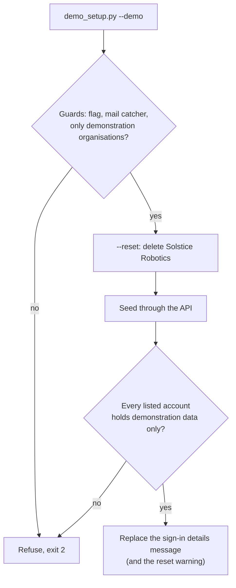
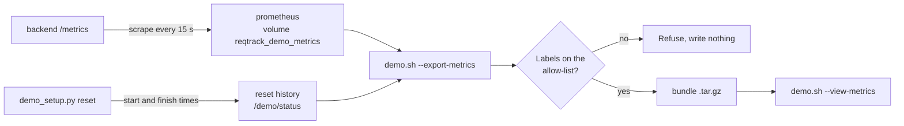

# Demonstration setup

Sets the local stack (`tests/container`) up as a demonstration with sample data, resets it on request or every day, collects usage metrics in Prometheus for a developer to review, and optionally records sessions with Microsoft Clarity. For evaluation and demonstrations only: never run it against a deployment that holds real data (the guards below refuse most such cases, but they are a safety net, not a permission).

## Quick start

```bash
scripts/demo.sh                      # start the stack, seed every demonstration project, post the sign-in details
```

Open http://localhost:3000. The sign-in details (accounts, role, password, next reset) are shown on the login page.

## Commands

| Command | Effect |
| --- | --- |
| `scripts/demo.sh` | Starts the stack, waits for it to be healthy, seeds, posts the sign-in details. A second run changes nothing. |
| `scripts/demo.sh --reset` | Removes the demonstration organisation, seeds again and re-posts the message. |
| `scripts/demo.sh --teardown` | Removes the demonstration organisation and the messages it owns, and seeds nothing. Accounts remain (accounts are never deleted). |
| `scripts/demo.sh --rotate-passwords` | A new random password for every account on each run (default: fixed). |
| `scripts/demo.sh --clarity <project id>` | Also loads Microsoft Clarity (see [Microsoft Clarity](#microsoft-clarity)). |
| `scripts/demo.sh --schedule` | Also starts the daily reset service. |
| `scripts/demo.sh --no-metrics` | Does not start the usage-metrics Prometheus (it starts by default). |
| `scripts/demo.sh --export-metrics [path] [--since 7d] [--no-snapshot]` | Writes a metrics bundle and starts nothing (see [Usage metrics](#usage-metrics)). |
| `scripts/demo.sh --view-metrics <bundle>` | Opens a bundle in a throwaway Prometheus on `127.0.0.1:9091`. |
| `scripts/demo.sh --purge-metrics` | Stops Prometheus and removes the collected metrics. |
| `scripts/demo.sh <other options>` | Any other option goes to `demo_setup.py` (table below), for example `--confirm-database reqtrack_test`. |

The script behind it can be run directly in a running stack:

```bash
cd tests/container
docker compose exec backend python scripts/demo_setup.py --demo [options]
docker compose --profile demo-schedule up -d demo-scheduler    # daily reset
```

### `demo_setup.py` options

Each option defaults from the environment variable shown.

| Option | Variable | Meaning |
| --- | --- | --- |
| `--demo` | `DEMO_MODE=1` | Required on every run; confirms this is a demonstration. |
| `--reset` | | Remove the demonstration organisation, then seed. |
| `--teardown` | | Remove the demonstration organisation and messages; seed nothing. |
| `--rotate-passwords` | `DEMO_ROTATE_PASSWORDS=1` | A new random password on every run. |
| `--no-login-message` | `DEMO_NO_LOGIN_MESSAGE=1` | Do not publish the sign-in details (distribute them another way). |
| `--confirm-database NAME` | `DEMO_CONFIRM_DATABASE` | Repeat the database name to run beside organisations this command did not create. |
| `--api-base URL` | `DEMO_API_BASE` | API address (default `http://localhost:8000/api/v1`). |
| `--state-dir DIR` | `DEMO_STATE_DIR` | Holds the rotated password (default `/demo/state`). |
| `--status-dir DIR` | `DEMO_STATUS_DIR` | Holds the metrics file (default `/demo/status`). |
| `--reset-at HH:MM` | `DEMO_RESET_AT` | Daily reset time; also shown in the messages. |
| `--reset-tz ZONE` | `DEMO_RESET_TZ` | IANA zone of the reset time (default `UTC`). |
| `schedule` (command) | | Stay running and reset at each `DEMO_RESET_AT`; needs it set. |

### Other variables

| Variable | Used by | Meaning |
| --- | --- | --- |
| `DEMO_ADMIN_EMAIL`, `DEMO_ADMIN_PASSWORD` | `seed_demo_data.py` | The server administrator the seed signs in as (default `admin@example.com` / `ChangeMe123!`, the stack's bootstrap account). |
| `DEMO_PASSWORD` | `seed_demo_data.py` | The shared demonstration password when run on its own (default `DemoDemo123!`). |
| `DEMO_CLARITY_PROJECT_ID` | Compose (`frontend`) | Becomes `CLARITY_PROJECT_ID` in the frontend; empty loads nothing. |
| `DEMO_RESET_AT`, `DEMO_RESET_TZ`, `DEMO_ROTATE_PASSWORDS`, `DEMO_CONFIRM_DATABASE` | Compose (`demo-scheduler`) | Passed to the scheduler (defaults `00:00`, `UTC`, off, empty). |

Exit status: `0` done, `1` failed, `2` refused or invalid options, `75` another run holds the lock.

## How a run works



Everything is created through the real HTTP API (`seed_demo_data.py`, which also seeds the repository project and the example templates), so validation, versioning and audit apply as for a person. Loading the repository project's decisions takes several minutes.

## Guards

| Guard | Behaviour |
| --- | --- |
| Flag | `--demo` or `DEMO_MODE=1` on every run, manual or scheduled. |
| Mail | `SMTP_HOST` must be a mail catcher (`mailhog`, `mailpit` or a loopback address), so demonstration mail never reaches a real relay. |
| Other organisations | A database holding an organisation this command did not create is refused unless `--confirm-database` repeats the database name. A reset removes only the demonstration organisation (Solstice Robotics). |
| Accounts | The sign-in details are refused if a listed account is a server administrator or belongs to another organisation. |
| One at a time | A lock prevents a manual and a scheduled run overlapping (exit 75). |

## Passwords and the sign-in details message

- The default password is fixed (`DemoDemo123!`), a documented exception in the access control policy. With `--rotate-passwords` every account gets a new random password on each run. The current one is kept in `DEMO_STATE_DIR` (mode 0600), because accounts outlive an organisation's removal and the next run must sign in to change it. If that file is lost the run stops and says so.
- The message is server-wide, shown on every login page and as a banner, and cannot be dismissed. It lists each account, its role, the password and the next reset time. It is found by its reserved title and replaced on every run. It publishes credentials to anyone who can reach the login page, so use it only on a deployment that holds nothing else.
- The password is never written to a log line or sent as a notification.

## Daily reset

`demo-scheduler` (Compose profile `demo-schedule`) runs `demo_setup.py schedule`: at `DEMO_RESET_AT` in `DEMO_RESET_TZ` it removes the demonstration organisation and seeds again. The local time is kept across a daylight-saving change. A message warns for the hour before. It is a separate opt-in service, never a backend job, so a deployment cannot reset itself by accident; every run applies the guards above. A host cron entry running `scripts/demo.sh --reset` is an alternative; use one or the other.

A failed seed removes the partly seeded organisation (names and accounts are unique, so the previous data cannot be kept beside it) and exits `1`. The status directory also holds `reqtrack-demo-resets.jsonl`, the start and finish of every run, for the [usage metrics](#usage-metrics) bundle. It holds `reqtrack-demo-reset.prom` with `reqtrack_demo_reset_last_success`, `reqtrack_demo_reset_last_run_timestamp_seconds` and `reqtrack_demo_reset_next_timestamp_seconds`, for monitoring to alert on.

## Usage metrics

A demonstration is the one place real evaluators use the product, and the daily reset removes what they did. `scripts/demo.sh` therefore also starts a Prometheus (Compose profile `demo-metrics`, service `prometheus`) that scrapes the backend's `/metrics` every 15 seconds and keeps 30 days (at most 2 GB) in the named volume `reqtrack_demo_metrics`. A reset and a teardown never touch that volume; only `--purge-metrics` removes it. It is published on `127.0.0.1:9090` only, because its admin API is enabled for the snapshot, and it listens on IPv6 inside the container. The production stack is unchanged.



**What the metrics can say.** Request count and latency per route template, method and status (`http_requests_total`, `http_request_duration_seconds`), shed requests, requirement and change request transitions, sign-in results (`login_attempts_total`), database statements by operation, and pool and memory gauges. They show which screens' routes are used and how the server behaves. They cannot say who did something or why: no metric carries a user, record, title, code or search text. Pair them with Microsoft Clarity (below) for on-screen behaviour, matching the two by time only.

**The bundle.** `scripts/demo.sh --export-metrics [path]` (default `demo-metrics-<UTC timestamp>.tar.gz` in the current directory) writes:

| File | Content |
| --- | --- |
| `snapshot/` | A Prometheus TSDB snapshot at full resolution (`--no-snapshot` leaves it out). |
| `series.jsonl` | Every series over the range at a fixed step (grows with the range, at most about 2,000 points a series), one JSON object a line. Series that are constant zero are left out and counted in the manifest. |
| `manifest.json` | Application version, bundle format, range, scrape interval, series counts, the reset history, the configured reset time with its zone and next UTC instant, whether session recording was enabled (never the project identifier), and the number of rows per database table. No row content. |
| `README.txt` | How to open it and what the metric names mean. |

`--since 7d` narrows the range (default `30d`). All times in the bundle are UTC instants; the reset history (`reset_started` and `reset_finished` with the outcome, appended by every setup, reset and teardown run) explains why counters fall to zero at each cycle. The command is the download path: copy the file from the demonstration host with `scp`. `scripts/demo.sh --view-metrics <bundle>` starts a Prometheus on the snapshot at http://127.0.0.1:9091 and removes it on exit.

**Safety.** Before writing, every series is checked against an allow-list of label names and value shapes (a route template, never an identifier; `scripts/demo_metrics.py`); an unexpected label or value stops the export, naming the label and never its value. The bundle holds metrics only: no logs, traces, environment values, configuration or sign-in details. Metrics are Internal under the data classification policy; the bundle leaves the host, so the check is its control. An in-application download button was not built: the backend would need a demonstration-only path to Prometheus's admin API in a product that also runs in production.

## Microsoft Clarity

`scripts/demo.sh --clarity <project id>` (or `DEMO_CLARITY_PROJECT_ID`) sets `CLARITY_PROJECT_ID` on the frontend container, which then loads Clarity's script from `clarity.ms`. Unset, nothing loads and nothing is sent. Only letters and digits are accepted as the identifier. Clarity records sessions in the browser: set masking to Strict in your Clarity project, and enable it only on a demonstration with sample data. Recorded in the vendor management policy as a demonstration-only exception.

## Related

[development.md](development.md) (local stack), [decisions.md](decisions.md) (the "Demonstration setup command" entry), [soc2/policies/access-control-policy.md](soc2/policies/access-control-policy.md) (known gap 10).
