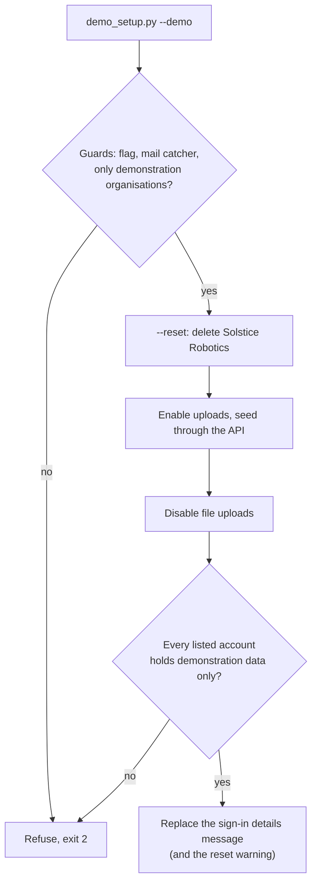
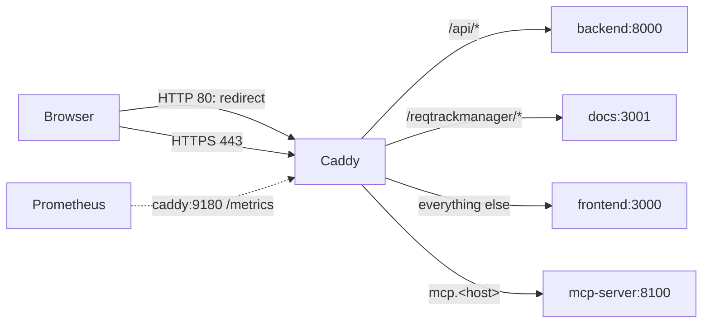
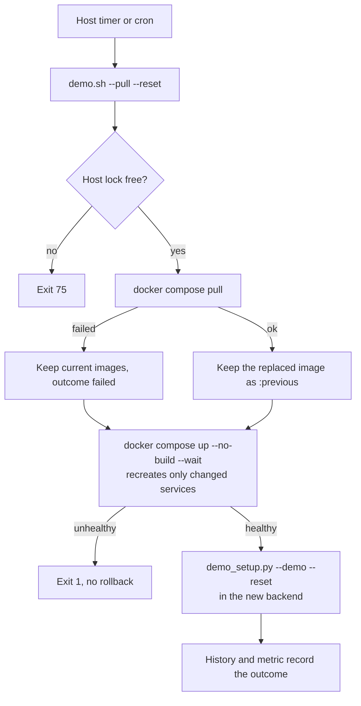
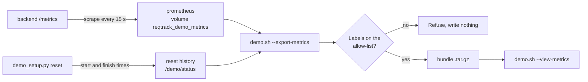

# Demonstration setup

Sets the local stack (`tests/container`) up as a demonstration with sample data, resets it on request or every day, collects usage metrics in Prometheus for a developer to review, and optionally records sessions with Microsoft Clarity. For evaluation and demonstrations only: never run it against a deployment that holds real data (the guards below refuse most such cases, but they are a safety net, not a permission).

## Quick start

```bash
scripts/demo.sh                      # start the stack, seed every demonstration project, post the sign-in details
```

Open https://localhost (the browser warns about the certificate until the local authority is trusted: see [HTTPS](#https)). The sign-in details (accounts, role, password, next reset) are shown on the login page.

## Commands

| Command | Effect |
| --- | --- |
| `scripts/demo.sh` | Starts the stack, waits for it to be healthy, seeds, posts the sign-in details. A second run changes nothing. |
| `scripts/demo.sh --reset` | Removes the demonstration organisation, seeds again and re-posts the message. |
| `scripts/demo.sh --teardown` | Removes the demonstration organisation and the messages it owns, and seeds nothing. Accounts remain (accounts are never deleted). |
| `scripts/demo.sh --rotate-passwords` | A new random password for every account on each run (default: fixed). |
| `scripts/demo.sh --clarity <project id>` | Also loads Microsoft Clarity (see [Microsoft Clarity](#microsoft-clarity)). |
| `scripts/demo.sh --schedule` | Also starts the in-container daily reset service (which cannot update images). |
| `scripts/demo.sh --pull [--reset]` | Pulls the latest published images, recreates only the services whose image changed, then seeds or resets (see [Daily reset](#daily-reset)). Refused with `--schedule`. `--no-prune` skips the disk clean-up. |
| `scripts/demo.sh --no-metrics` | Does not start the usage-metrics Prometheus (it starts by default). |
| `scripts/demo.sh --export-metrics [path] [--since 7d] [--no-snapshot]` | Writes a metrics bundle and starts nothing (see [Usage metrics](#usage-metrics)). |
| `scripts/demo.sh --view-metrics <bundle>` | Opens a bundle in a throwaway Prometheus on `127.0.0.1:9091`. |
| `scripts/demo.sh --purge-metrics` | Stops Prometheus and removes the collected metrics. |
| `scripts/demo.sh --trust-local-ca` | Prints the commands that trust the local certificate authority; changes nothing on the host. |
| `scripts/demo.sh --purge-certificates` | Stops the proxy and removes its certificates and local authority (a reset keeps them). |
| `scripts/demo.sh <other options>` | Any other option goes to `demo_setup.py` (table below), for example `--confirm-database reqtrack_test`. |

The script behind it can be run directly in a running stack:

```bash
cd tests/container
docker compose exec backend python scripts/demo_setup.py --demo [options]
docker compose --profile demo-schedule up -d demo-scheduler    # daily reset
```

### `demo_setup.py` options

Each option defaults from the environment variable shown.

| Option | Variable | Meaning |
| --- | --- | --- |
| `--demo` | `DEMO_MODE=1` | Required on every run; confirms this is a demonstration. |
| `--reset` | | Remove the demonstration organisation, then seed. |
| `--teardown` | | Remove the demonstration organisation and messages; seed nothing. |
| `--rotate-passwords` | `DEMO_ROTATE_PASSWORDS=1` | A new random password on every run. |
| `--allow-uploads` | `DEMO_ALLOW_UPLOADS=1` | Keep file uploads enabled (by default the demonstration disables them). |
| `--no-login-message` | `DEMO_NO_LOGIN_MESSAGE=1` | Do not publish the sign-in details (distribute them another way). |
| `--confirm-database NAME` | `DEMO_CONFIRM_DATABASE` | Repeat the database name to run beside organisations this command did not create. |
| `--api-base URL` | `DEMO_API_BASE` | API address (default `http://localhost:8000/api/v1`). |
| `--state-dir DIR` | `DEMO_STATE_DIR` | Holds the rotated password (default `/demo/state`). |
| `--status-dir DIR` | `DEMO_STATUS_DIR` | Holds the metrics file (default `/demo/status`). |
| `--reset-at HH:MM` | `DEMO_RESET_AT` | Daily reset time; also shown in the messages. |
| `--reset-tz ZONE` | `DEMO_RESET_TZ` | IANA zone of the reset time (default `UTC`). |
| `--image-update OUTCOME` | `DEMO_IMAGE_UPDATE` | `updated`, `unchanged` or `failed`: the image refresh that preceded the run. Set by `demo.sh --pull`. |
| `--image-report JSON` | `DEMO_IMAGE_REPORT` | Image identifier and changed flag per service, recorded in the reset history. Set by `demo.sh --pull`. |
| `schedule` (command) | | Stay running and reset at each `DEMO_RESET_AT`; needs it set. |

### Other variables

| Variable | Used by | Meaning |
| --- | --- | --- |
| `DEMO_ADMIN_EMAIL`, `DEMO_ADMIN_PASSWORD` | `seed_demo_data.py` | The server administrator the seed signs in as (default `admin@example.com` and the `SERVER_ADMIN_PASSWORD` the backend runs with: `scripts/demo.sh` generates the password, `JWT_SECRET` and `APP_SECRET_ENCRYPTION_KEY` once into the untracked `tests/container/.demo-secrets.env`, and the demonstration refuses to start on a placeholder secret). |
| `DEMO_PASSWORD` | `seed_demo_data.py` | The shared demonstration password when run on its own (default `DemoDemo123!`). |
| `DEMO_CLARITY_PROJECT_ID` | Compose (`frontend`) | Becomes `CLARITY_PROJECT_ID` in the frontend; empty loads nothing. |
| `DEMO_RESET_AT`, `DEMO_RESET_TZ`, `DEMO_ROTATE_PASSWORDS`, `DEMO_ALLOW_UPLOADS`, `DEMO_CONFIRM_DATABASE` | Compose (`demo-scheduler`) | Passed to the scheduler (defaults `00:00`, `UTC`, off, off, empty). |
| `DEMO_RESET_AT`, `DEMO_RESET_TZ` | `demo.sh` | When set, passed to the run so the sign-in details and the warning state the next reset. Must equal the host timer's time and zone. |
| `IMAGE_TAG`, `GHCR_IMAGE_PREFIX` | `demo.sh --pull` | The published image tag (default `latest`, the tip of `main`; a version or commit SHA pins) and registry prefix (default `ghcr.io/ballardr/reqtrackmanager`). |
| `DEMO_HOST_STATE_DIR` | `demo.sh --pull` | Holds the host-side lock (default `${XDG_STATE_HOME:-~/.local/state}/reqtrack-demo`). |

Exit status: `0` done, `1` failed, `2` refused or invalid options, `75` another run holds the lock.

## How a run works



Everything is created through the real HTTP API (`seed_demo_data.py`, which also seeds the repository project and the example templates), so validation, versioning and audit apply as for a person. Loading the repository project's decisions takes several minutes.

**File uploads are disabled** once the seed has finished, because anyone can sign in to a demonstration and it must not host files they upload (malware, for example). Uploads are on only while the seed stores its own pictures and attachments, and a failed seed disables them again. Existing files stay readable. `--teardown` restores the default (uploads enabled). The setting is the deployment-wide one in Server Management → **File uploads**.

## Guards

| Guard | Behaviour |
| --- | --- |
| Flag | `--demo` or `DEMO_MODE=1` on every run, manual or scheduled. |
| Mail | `SMTP_HOST` must be a mail catcher (`mailhog`, `mailpit` or a loopback address), so demonstration mail never reaches a real relay. |
| Other organisations | A database holding an organisation this command did not create is refused unless `--confirm-database` repeats the database name. A reset removes only the demonstration organisation (Solstice Robotics). |
| Accounts | The sign-in details are refused if a listed account is a server administrator or belongs to another organisation. |
| One at a time | A lock prevents a manual and a scheduled run overlapping (exit 75). |

## Passwords and the sign-in details message

- The default password is fixed (`DemoDemo123!`), a documented exception in the access control policy. With `--rotate-passwords` every account gets a new random password on each run. The current one is kept in `DEMO_STATE_DIR` (mode 0600), because accounts outlive an organisation's removal and the next run must sign in to change it. If that file is lost the run stops and says so.
- The message is server-wide, shown on every login page and as a banner, and cannot be dismissed. It lists each account, its role, the password and the next reset time. It is found by its reserved title and replaced on every run. It publishes credentials to anyone who can reach the login page, so use it only on a deployment that holds nothing else.
- The password is never written to a log line or sent as a notification.

## HTTPS

A Caddy reverse proxy (`caddy` in `tests/container/docker-compose.demo.yml`, configured by `tests/container/caddy/`) terminates TLS and is the only service published to every network interface. `scripts/demo.sh` loads the overlay; a developer or test run of the same stack does not, and keeps its direct ports.



| Variable | Default | Effect |
| --- | --- | --- |
| `DEMO_PUBLIC_HOST` | `localhost` | The host name or IP address the demonstration answers on. A DNS name gets a certificate from a public authority (ports 80 and 443 must be reachable from the internet, and the name must resolve to this host) and an HSTS header; `localhost` or an IP address uses Caddy's local authority and sends no HSTS (a browser would otherwise keep it for every local project on that name). |
| `DEMO_MCP_HOST` | `mcp.<host>` | The MCP server serves `/mcp` and `/login` at the root of its origin, so it has its own name (`mcp.localhost` resolves to the local machine in current browsers). `off` leaves it on the internal network; an IP address has no name for it, so it is off. |
| `DEMO_ACME_EMAIL` | empty | A contact address registered with the public authority. |

- **One origin.** The frontend is built with an empty API base, so API calls are relative paths and CORS is not involved. `FRONTEND_BASE_URL`, `PUBLIC_BACKEND_URL`, `CORS_ORIGINS`, `MCP_SERVER_PUBLIC_URL` and `HELP_URL` all derive from `DEMO_PUBLIC_URL`, which the script sets from the host.
- **Redirect and HSTS.** HTTP on port 80 answers with a permanent redirect to the same path on HTTPS and nothing else (plus the certificate challenge). The redirect response itself still carries `Server: Caddy`; every proxied response has the header removed.
- **Forwarded headers.** The proxy replaces `X-Forwarded-For` with the connecting address and sets `X-Forwarded-Proto` and `-Host`. The backend honours them from the proxy's address only (`FORWARDED_ALLOW_IPS`; the proxy and the backend share a small `edge` network, and the backend reaches it as `backend-edge`), so a request sent straight to the backend by another container cannot set them. This narrows the recorded `X-Forwarded-For` gap for the demonstration only: the application still reads the first hop of the header wherever it is deployed.
- **Log.** The access log is JSON on stdout with the path only: no query string (search text may be in it), no request headers and no cookies.
- **Certificates** live in the named volumes `reqtrack_demo_caddy_data` and `reqtrack_demo_caddy_config`. A reset or teardown leaves them, because issuing a certificate again every day meets the issuer's rate limits.
- **Local authority.** `tls internal` is for localhost and testing, not a production pattern: production keeps the operator's own proxy or a real certificate ([deployment.md](deployment.md)). `scripts/demo.sh --trust-local-ca` prints the commands that trust its root certificate.
- **Support services** (database, storage, mail catcher, identity provider, documentation) are published on `127.0.0.1` only.
- **Metrics.** Caddy's request counts and latency per status code are scraped by the demonstration Prometheus (`caddy_http_*` series only; no host, path or query label) and travel in the metrics bundle.
- Published demonstration passwords are a deliberate exception: HTTPS protects them in transit and does not make them secret.

## Daily reset

A reset removes the demonstration organisation and seeds again at `DEMO_RESET_AT` in `DEMO_RESET_TZ` (the local time is kept across a daylight-saving change). A message warns for the hour before. Every run applies the guards above, and none is a backend job, so a deployment cannot reset itself by accident. Three arrangements exist; use **one**:

| Arrangement | Updates images | Use when |
| --- | --- | --- |
| Host timer or cron entry running `scripts/demo.sh --pull --reset` | Yes | The demonstration should always show the latest published build. |
| `demo-scheduler` (Compose profile `demo-schedule`, `scripts/demo.sh --schedule`) | No | The demonstration builds the working tree and only needs its data reset. |
| Host cron entry running `scripts/demo.sh --reset` | No | As above, with the host's own scheduler. |

### Latest images on each reset

The demonstration stack builds from source. `--pull` loads `tests/container/docker-compose.demo-images.yml`, which names the images CI publishes on every passing merge to `main` (`ghcr.io/ballardr/reqtrackmanager-backend`, `-frontend`, `-mcp-server`, `-converter`, `-docs`), and runs the steps below. A developer or test run of the stack never loads that file and keeps building the working tree. The reset is the one moment the demonstration is already empty and its users already signed out, so the update costs no extra outage. It runs on the host because a container cannot replace its own image or its neighbours without the Docker socket, which is host-root access and is never mounted.



- **Order.** The update precedes the wipe, so the seed (part of the backend image) always matches the running code. The new backend runs its migrations on start.
- **Failed pull.** The registry being unreachable or rate limited keeps the images already present and the reset proceeds; the run records `image_update=failed` and `reqtrack_demo_image_update_last_success 0`, which monitoring can alert on.
- **Unhealthy new image.** The run exits `1` before seeding and prints the previous image identifiers. There is no automatic rollback, because migrations only go forward and the previous backend may not run against the migrated database. The replaced image of each updated service stays tagged `:previous`; run a published version with `IMAGE_TAG=<version or commit SHA> scripts/demo.sh --pull`.
- **Which tag.** `latest` tracks `main`, so the demonstration shows the tip of the main branch (how releases are made today). The packages are public and multi-architecture. The build publishes a provenance attestation but no signature, and `--pull` does not verify either; this is a recorded gap in the [vendor management policy](soc2/policies/vendor-and-subprocessor-management-policy.md). Third-party images (database, storage, Prometheus, proxy) are pinned and never updated automatically.
- **Disk.** After a healthy update the displaced `:previous` image of each updated service is removed, then dangling images (superseded layers, partial pulls) and build cache older than seven days are pruned. Tagged images, containers and volumes are never touched. The prune is host-wide, so a host shared with other Docker projects passes `--no-prune`. Container logs are limited to three files of 10 MB per service in the demonstration stack, so an unattended host does not fill its disk with them.
- **Visibility.** `reset_started` in the history carries the outcome and each service's image identifier and changed flag, so the [metrics bundle](#usage-metrics) shows which build served each period. The script prints the running identifiers at the end.

Install the host timer (systemd) or the cron line; the time in it must equal `DEMO_RESET_AT` and `DEMO_RESET_TZ`, because the timer starts the run and the variables are what the messages state.

```bash
sudo cp scripts/schedule/reqtrack-demo-reset.{service,timer} /etc/systemd/system/
sudo systemctl daemon-reload && sudo systemctl enable --now reqtrack-demo-reset.timer
```

`scripts/schedule/crontab.example` has the equivalent cron line. Registry authentication (`docker login ghcr.io`, held in the operator's Docker credential store) is needed only if the packages are made private; an authentication failure is then a failed pull.

### The in-container scheduler

`demo-scheduler` (Compose profile `demo-schedule`) runs `demo_setup.py schedule` and resets at each slot without touching images. It is a separate opt-in service. A failed seed removes the partly seeded organisation (names and accounts are unique, so the previous data cannot be kept beside it) and exits `1`.

### Status files

The status directory holds `reqtrack-demo-resets.jsonl`, the start and finish of every run, for the [usage metrics](#usage-metrics) bundle. It holds `reqtrack-demo-reset.prom` with `reqtrack_demo_reset_last_success`, `reqtrack_demo_reset_last_run_timestamp_seconds`, `reqtrack_demo_reset_next_timestamp_seconds` and, after `--pull`, `reqtrack_demo_image_update_last_success`, for monitoring to alert on.

## Usage metrics

A demonstration is the one place real evaluators use the product, and the daily reset removes what they did. `scripts/demo.sh` therefore also starts a Prometheus (Compose profile `demo-metrics`, service `prometheus`) that scrapes the backend's `/metrics` every 15 seconds and keeps 30 days (at most 2 GB) in the named volume `reqtrack_demo_metrics`. A reset and a teardown never touch that volume; only `--purge-metrics` removes it. It is published on `127.0.0.1:9090` only, because its admin API is enabled for the snapshot, and it listens on IPv6 inside the container. The production stack is unchanged.



**What the metrics can say.** Request count and latency per route template, method and status (`http_requests_total`, `http_request_duration_seconds`), shed requests, requirement and change request transitions, sign-in results (`login_attempts_total`), database statements by operation, and pool and memory gauges. They show which screens' routes are used and how the server behaves. They cannot say who did something or why: no metric carries a user, record, title, code or search text. Pair them with Microsoft Clarity (below) for on-screen behaviour, matching the two by time only.

**The bundle.** `scripts/demo.sh --export-metrics [path]` (default `demo-metrics-<UTC timestamp>.tar.gz` in the current directory) writes:

| File | Content |
| --- | --- |
| `snapshot/` | A Prometheus TSDB snapshot at full resolution (`--no-snapshot` leaves it out). |
| `series.jsonl` | Every series over the range at a fixed step (grows with the range, at most about 2,000 points a series), one JSON object a line. Series that are constant zero are left out and counted in the manifest. |
| `manifest.json` | Application version, bundle format, range, scrape interval, series counts, the reset history, the configured reset time with its zone and next UTC instant, whether session recording was enabled (never the project identifier), and the number of rows per database table. No row content. |
| `README.txt` | How to open it and what the metric names mean. |

`--since 7d` narrows the range (default `30d`). All times in the bundle are UTC instants; the reset history (`reset_started` and `reset_finished` with the outcome, appended by every setup, reset and teardown run) explains why counters fall to zero at each cycle. The command is the download path: copy the file from the demonstration host with `scp`. `scripts/demo.sh --view-metrics <bundle>` starts a Prometheus on the snapshot at http://127.0.0.1:9091 and removes it on exit.

**Safety.** Before writing, every series is checked against an allow-list of label names and value shapes (a route template, never an identifier; `scripts/demo_metrics.py`); an unexpected label or value stops the export, naming the label and never its value. The bundle holds metrics only: no logs, traces, environment values, configuration or sign-in details. Metrics are Internal under the data classification policy; the bundle leaves the host, so the check is its control. An in-application download button was not built: the backend would need a demonstration-only path to Prometheus's admin API in a product that also runs in production.

## Microsoft Clarity

`scripts/demo.sh --clarity <project id>` (or `DEMO_CLARITY_PROJECT_ID`) sets `CLARITY_PROJECT_ID` on the frontend container, which then loads Clarity's script from `clarity.ms`. Unset, nothing loads and nothing is sent. Only letters and digits are accepted as the identifier. Clarity records sessions in the browser: set masking to Strict in your Clarity project, and enable it only on a demonstration with sample data. Recorded in the vendor management policy as a demonstration-only exception.

## Related

[development.md](development.md) (local stack), [decisions.md](decisions.md) (the "Demonstration setup command" entry), [soc2/policies/access-control-policy.md](soc2/policies/access-control-policy.md) (known gap 10).
