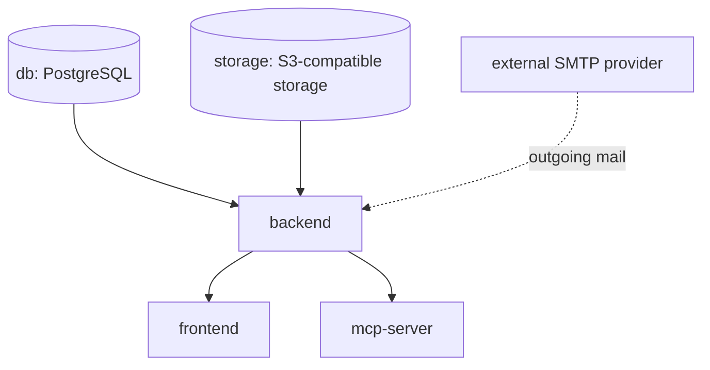
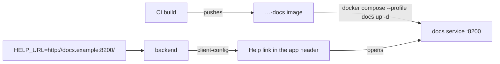
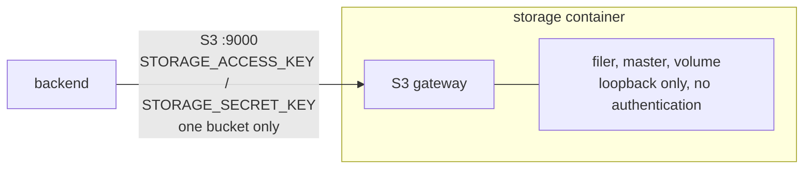
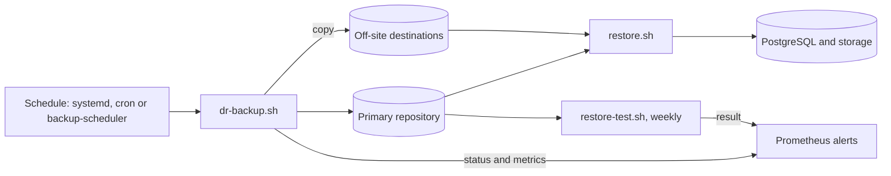

# Deployment Guide

This guide covers installing and configuring a new ReqTrackManager instance, from a local evaluation install through to a production deployment. It satisfies N-D-01 ("comprehensive documentation on how to deploy and configure a new instance"). For *why* the deployment is shaped this way, see [solution-architecture.md](solution-architecture.md) and [decisions.md](decisions.md); for using the application once it's running, see [user-guide.md](user-guide.md).

## Prerequisites

- Docker and Docker Compose 2.23.1 or newer (`docker compose`, not the legacy `docker-compose`).
- A host with persistent volume storage for PostgreSQL (and the bundled `storage` service, if using the bundled S3-compatible storage backend).
- For production: a domain name and TLS termination in front of the frontend/backend (ReqTrackManager does not terminate TLS itself — see [Production deployment](#production-deployment) below).

## Two separate Compose stacks

ReqTrackManager ships **two** Compose files with different purposes — using the wrong one for the wrong purpose is the single most important thing to get right:

- **`docker-compose.yml`** (repo root) — the **production-oriented** stack. No MailHog, no baked-in secret defaults; it refuses to start (`docker compose up` fails fast with a clear error) until you provide `JWT_SECRET`, `APP_SECRET_ENCRYPTION_KEY`, `SERVER_ADMIN_PASSWORD`, `POSTGRES_PASSWORD`, `STORAGE_SECRET_KEY`, and `SMTP_HOST`. This is what a real deployment runs.
- **`tests/container/docker-compose.yml`** — the **local development and automated testing** stack. Same shape, plus MailHog and a real Keycloak instance (for testing per-organisation SSO end-to-end, E-U-01), with dev-friendly defaults for everything and its own dedicated `reqtrack_test` Postgres database. This is what `backend/tests/` (pytest), `tests/playwright/`, and CI (`.github/workflows/ci.yml`) all run against.

These two are deliberately kept separate rather than sharing one file with a dev override, because sharing led to a real, serious bug during development: running the backend test suite against what was meant to be a "just add a test override" version of the same stack silently dropped and recreated the *production* database's schema (see [decisions.md](decisions.md), "Database: the test suite was wiping the live database"). Never run `pytest`, or anything from `tests/`, against the root stack.

## Components

The diagram below shows every container in the production stack and how they depend on each other at startup. Reading top to bottom: `db` and `storage` must be healthy before `backend` starts (the backend runs migrations and talks to storage immediately on boot); `backend` must be healthy before `frontend` *or* `mcp-server` start (the frontend's and mcp-server's own health checks are independent, but there is no reason to serve either before the API they both depend on is reachable); the backend sends outgoing mail to whatever `SMTP_HOST` points at, which in production is an external provider, not a container in this stack. This matters operationally because it tells you the correct order to check when something won't come up: `db`/`storage` first, then `backend`, then `frontend`/`mcp-server`.



| Service | Purpose | In root (prod) stack? | In tests/container stack? |
| --- | --- | --- | --- |
| `db` | PostgreSQL, the primary data store | Yes (no host port published) | Yes (`reqtrack_test`, port 5432 published) |
| `backend` | FastAPI application, runs migrations on startup | Yes | Yes |
| `frontend` | Static React SPA served by nginx | Yes | Yes |
| `storage` | Bundled S3-compatible file storage (SeaweedFS) | Yes | Yes |
| `mcp-server` | Read-only MCP server exposing requirements to AI assistants (see [mcp-server.md](mcp-server.md)) | Yes | Yes |
| `mailhog` | Local SMTP catcher with a web UI | **No** — replace with a real SMTP provider via `SMTP_HOST` | Yes |
| `keycloak` | Real OIDC identity provider, for testing per-org SSO login end-to-end (E-U-01) | **No** — a real deployment points `oidc_issuer_url` at each org's own IdP instead, never at this test container | Yes |
| `prometheus`, `loki`, `tempo`, `grafana`, `alloy` | Optional observability stack (`--profile observability`) | Yes, opt-in | No |

## Local / evaluation deployment

```bash
git clone <this-repo>
cd reqtrackmanager/tests/container
docker compose up --build
```

This is sufficient for evaluating the product or for development — see [development.md](development.md#quick-start--local-development--evaluation) for the URLs it exposes. It uses dev-friendly defaults: a fixed bootstrap admin password, MailHog instead of a real mail provider, and the bundled storage service with default credentials, all in an isolated `reqtrack_test` database. **Never point this stack at the internet, and never confuse it with the production stack below.**

For a populated instance to actually evaluate (rather than an empty bootstrap admin with nothing in it), run `docker compose exec backend python scripts/seed_demo_data.py` afterward — see [development.md](development.md#demo-data)'s Demo data section.

## Production deployment

Production deployment uses the root `docker-compose.yml` and the same container images used for local dev; the difference is entirely in configuration, and the compose file itself enforces the important parts — `docker compose up` fails immediately with a clear error naming the missing variable if any of these aren't set, rather than starting with an insecure default. Create a `.env` file next to `docker-compose.yml` (Docker Compose loads it automatically) and set at minimum:

```bash
# Secrets — generate strong random values, do not reuse the defaults
JWT_SECRET=<random 32+ byte secret>
APP_SECRET_ENCRYPTION_KEY=<random 32+ byte secret>  # distinct from JWT_SECRET — see README's Configuration table
SERVER_ADMIN_PASSWORD=<strong password>
POSTGRES_PASSWORD=<strong password>
STORAGE_SECRET_KEY=<strong password>           # S3 secret for the bundled storage (STORAGE_ACCESS_KEY optional)

# Networking
CORS_ORIGINS=https://your-domain.example
PUBLIC_API_BASE_URL=https://api.your-domain.example

# Outgoing email — point at a real SMTP provider instead of MailHog
SMTP_HOST=smtp.your-provider.example
SMTP_PORT=587
SMTP_USE_TLS=true
SMTP_USERNAME=<smtp username>
SMTP_PASSWORD=<smtp password>
SMTP_FROM_ADDRESS=noreply@your-domain.example

# Operational alerting
DEPLOYMENT_NOTIFICATION_EMAIL=ops@your-domain.example
```

The full list of backend environment variables, with defaults, is documented in the [README's Configuration section](../README.md#configuration).

### Obtaining container images

CI (`.github/workflows/ci.yml`) builds the production `backend`, `frontend`, `mcp-server`, and `docs` images on every change and, once the `frontend`, `backend-tests`, `e2e-tests` and `dependency-scan` jobs pass on a push to `main`, pushes all four to `ghcr.io/<owner>/<repo>-{backend,frontend,mcp-server,docs}` (see [development.md's Continuous integration](development.md#continuous-integration) section). Pull requests still build every image, proving the Dockerfiles work, but never push — only a merge to `main` publishes.

Each image is tagged three ways:

- **`latest`** — always the most recent build from `main`. What `IMAGE_TAG` defaults to below.
- **`<git sha>`** — the exact commit it was built from, for pinning to a specific build without needing a release version.
- **a SemVer** (e.g. `1.4.0`) — computed by [GitVersion](https://gitversion.net/) (`GitVersion.yml`, repo root) from the commit graph in `Mainline` mode: every merge to `main` is a release, so the version increments automatically without anyone pushing a git tag by hand.

`docker-compose.yml` declares both `image:` (pointing at these published tags) and `build:` (a local Dockerfile build) for `backend`/`frontend`/`mcp-server`. This means:

- **First run, or after `docker compose up --build -d`**: builds locally, exactly as before — nothing here requires ever touching `ghcr.io`.
- **To deploy an already-published image instead of building**: set `IMAGE_TAG` in your `.env` (a SemVer to pin a specific release, a commit SHA, or leave it unset/`latest` to track the newest `main` build), then `docker compose pull && docker compose up -d`. This is the faster path for upgrading an existing deployment — no build step, no source checkout needed on the host at all.

If your images live in a different registry/namespace (e.g. a private mirror), override `GHCR_IMAGE_PREFIX` in your `.env` instead of editing `docker-compose.yml`.

**Checking what's actually deployed.** The same SemVer/commit SHA used to tag an image is also baked into it at build time (`APP_VERSION`/`GIT_SHA`/`BUILD_DATE` build args, set by the `docker-build` CI job — see `backend/Dockerfile` and `frontend/Dockerfile`), so a running instance can report its own build identity without shell access to the host: the signed-in nav rail shows both the frontend's own bundled version and the backend's, fetched from `GET /api/v1/system/version`. A local `docker compose build` with no `--build-arg`s (the default for the two paths above) reports placeholder `dev`/`unknown` values instead of failing — only images built by CI carry a real version.

### Hosting the documentation internally

The header **Help** link opens the public documentation site by default. That shows the latest docs, not the version you run, and does not work without internet access. To host the docs yourself, run the `docs` image and point `HELP_URL` at it:



Read left to right: CI publishes a docs image tagged with the same version as the app, you run it, and the backend tells the UI where it is.

- The image is the same static site as the public one, served by unprivileged nginx on port 8080 (`docker-compose.yml` publishes it on 8200 under the `docs` profile). It is built for the root of its own host; to serve it under a sub-path such as `/docs/` behind your reverse proxy, set `DOCS_BASE_URL=/docs/` (and `DOCS_URL`) in your `.env` and build it with `docker compose --profile docs build docs`. The base path is baked in at build time, so a pulled image keeps its published `/`.
- `HELP_URL` must be reachable from users' browsers, not just from the backend.
- The dev/test stack (`tests/container/`) already sets `HELP_URL` to its own docs service, so Help is local there; only the production `docker-compose.yml` defaults to the public site.
- No internal mirror and no wish for an external link? Set `HELP_ENABLED=false` to remove the Help link.

### Storage credential scope

The bundled storage service (SeaweedFS) accepts **one** S3 identity, defined by plain configuration: `STORAGE_ACCESS_KEY` and `STORAGE_SECRET_KEY`. The backend uses the same pair. The identity may act on the application bucket (`STORAGE_S3_BUCKET`) only, so a leaked backend credential cannot read or write any other bucket, list buckets, or change storage configuration.



Read left to right: the S3 gateway is the only port reachable on the Compose network. SeaweedFS's filer and master APIs carry no authentication, so they listen on loopback inside the container and the backend cannot reach them.

| Variable | Default | Purpose |
|----------|---------|---------|
| `STORAGE_ACCESS_KEY` | `minioadmin` (or `STORAGE_ROOT_USER`) | Access key of the identity. Change it to something unguessable |
| `STORAGE_SECRET_KEY` | required (or `STORAGE_ROOT_PASSWORD`) | Secret of the identity. Compose refuses to start without it. It is needed even with `STORAGE_BACKEND=local` or an external provider (set any value then, or your provider's secret) |

- `STORAGE_ROOT_USER` / `STORAGE_ROOT_PASSWORD` from earlier releases still work as the access key and secret, so no `.env` change is needed to upgrade (see below). The pair is no longer an administrator, so the name is historical.
- Values must not contain quotes or backslashes (the identity file is JSON; SeaweedFS refuses to start on an invalid one rather than running open).
- To rotate, change both values and run `docker compose up -d storage backend`.
- To use a different bucket, set `STORAGE_S3_BUCKET`; the identity follows it.

#### Hardening the bundled storage further

What is already in place: a single bucket-scoped identity, no published ports, and loopback-only internal APIs. Beyond that, in rough order of value:

1. **Use an external S3 provider with its own IAM** if you can. Set `STORAGE_S3_ENDPOINT_URL`, and put a credential limited to your bucket in `STORAGE_ACCESS_KEY` / `STORAGE_SECRET_KEY`. Scoping, auditing, encryption at rest and TLS are then the provider's.
2. **Choose a random access key and a long secret.** The defaults are only there so existing setups keep working.
3. **Add identities for other users or tools** instead of sharing the backend's. Replace the identity file in a `docker-compose.override.yml`:

   ```yaml
   configs:
     storage_identity: !override   # replaces the inline content (needs Docker Compose 2.24 or newer)
       file: ./s3-identities.json
   ```

   ```json
   {"identities": [
     {"name": "app",     "credentials": [{"accessKey": "APP_KEY",    "secretKey": "APP_SECRET"}],
      "actions": ["Admin:reqtrackmanager", "Read:reqtrackmanager", "Write:reqtrackmanager", "List:reqtrackmanager"]},
     {"name": "auditor", "credentials": [{"accessKey": "AUDIT_KEY",  "secretKey": "AUDIT_SECRET"}],
      "actions": ["Read:reqtrackmanager", "List:reqtrackmanager"]},
     {"name": "operator","credentials": [{"accessKey": "OPS_KEY",    "secretKey": "OPS_SECRET"}],
      "actions": ["Admin", "Read", "Write", "List", "Tagging"]}
   ]}
   ```

   An action without `:bucket` applies to every bucket, so reserve it for an operator who needs it. `STORAGE_ACCESS_KEY` / `STORAGE_SECRET_KEY` must still match the `app` identity, because the backend reads them.
4. **Remove the right to create or delete the bucket.** `Admin:<bucket>` is what lets the backend create its bucket on first start. Create it yourself once (`docker exec -it reqtrack-storage weed shell`, then `s3.bucket.create -name reqtrackmanager`), then drop `Admin:` from the app identity's actions.
5. **Inspect without any S3 login:** `docker exec -it reqtrack-storage weed shell`, then `s3.bucket.list` or `fs.ls /buckets/reqtrackmanager`.
6. **Keep the secret out of version control and shell history.** Use a `.env` file readable by the deploy user only, or your orchestrator's secret store. The secret also appears in the storage container's identity file and in `docker compose config` output, so restrict who can run Docker on the host.
7. **Transport and rest.** Traffic between `backend` and `storage` is plain HTTP on the Compose network; if they are ever on different hosts, put TLS in front or use an external provider. Encrypt the `reqtrack_storage_data` volume at the host or disk level.
8. **Do not publish storage ports** or remove the loopback flags (`-ip.bind=127.0.0.1`) from the `storage` command; the filer and master have no authentication.

### Upgrading to the bucket-scoped credential

**No `.env` change is required.** An existing `.env` with `STORAGE_ROOT_PASSWORD` (and optionally `STORAGE_ROOT_USER`) keeps working: those values become the access key and secret. Tested by writing a file under the previous setup and reading it back with the same credential after upgrading. What changes is what that credential can do:

- It can no longer administer storage: listing buckets, creating or touching other buckets, or `aws s3 mb` now fail with `AccessDenied`. Use `weed shell` (hardening step 5) or add an operator identity (step 3).
- The filer, master and volume ports are no longer reachable from other containers. Tooling that called `storage:8888` or `storage:9333` across the network must run inside the container instead.
- `storage` can take up to 30 seconds to report healthy after a restart.

Steps: back up (`./scripts/dr-backup.sh`, see [disaster-recovery.md](disaster-recovery.md); it covers the database and the stored files); **replace your `docker-compose.yml` with the new one** (`git pull`, or copy it; `docker compose pull` fetches images only, and the storage configuration lives in this file, so pulling alone leaves the old, unscoped setup running; re-apply any local edits you made to the file); then `docker compose pull && docker compose up -d`. This needs Docker Compose 2.23.1 or newer (`docker compose version`), for inline `configs`. Check that `docker compose ps` shows `storage` and `backend` healthy and that an existing attachment opens. Optionally rename `STORAGE_ROOT_USER` / `STORAGE_ROOT_PASSWORD` to `STORAGE_ACCESS_KEY` / `STORAGE_SECRET_KEY`.

| Symptom | Cause and fix |
|---------|---------------|
| `configs.storage_identity` is not valid, or an unknown `content` attribute | Docker Compose is older than 2.23.1; upgrade it |
| `required variable ... STORAGE_SECRET_KEY` | Neither `STORAGE_SECRET_KEY` nor `STORAGE_ROOT_PASSWORD` is set |
| `storage` exits with `unmarshal error` in its log | A value contains a quote or backslash (fine before this release, not now); change it |
| Uploads fail with `AccessDenied` | The bucket name differs from `STORAGE_S3_BUCKET`, or the credential in use is not the one `storage` was started with; run `docker compose up -d storage backend` |

**Rolling back:** restore the previous `docker-compose.yml` and image tag and run `docker compose up -d`. Data is untouched and the same variables are read.

**Development and test stack (`tests/container`):** no `.env` change; run `docker compose up -d` there so `storage` and `backend` are recreated.

### TLS and reverse proxy

ReqTrackManager's containers serve plain HTTP internally (frontend on 3000, backend on 8000). In production, put a reverse proxy (nginx, Caddy, Traefik, or a cloud load balancer) in front of both that terminates TLS and forwards to the two container ports. Point the reverse proxy's public hostnames at `CORS_ORIGINS` (frontend origin) and `PUBLIC_API_BASE_URL` (backend origin) so the frontend and backend agree on where each other lives.

This is the two-hostname pattern (e.g. `app.example.com` for the UI, `api.example.com` for the backend) and it needs `CORS_ORIGINS` set correctly on the backend, since the browser treats the two as different origins. The alternative below avoids that entirely.

**Security response headers**: both the backend (`security_headers_middleware`, `backend/app/main.py`) and the frontend's nginx config set `X-Frame-Options: DENY`, `X-Content-Type-Options: nosniff`, `Referrer-Policy: same-origin`, and a minimal `Content-Security-Policy: frame-ancestors 'none'` on every response — deliberately just enough to close clickjacking-style UI-redress, not a full CSP. A full `Content-Security-Policy` restricting script/style/font sources would need to be tuned against this SPA's actual bundle (inline styles, any CDN fonts, etc.) to add without risking silently breaking the app, and hasn't been — if your deployment wants one, test it thoroughly against a full pass through the app first, and prefer adding it at the reverse-proxy layer (fronting both containers) so it's configured once, not duplicated between the backend middleware and nginx.conf.

### Same-origin subpath deployment (avoiding CORS)

Instead of two hostnames, the frontend and backend can be served from **one origin** — e.g. the UI at `https://my.website.com/` and the API at `https://my.website.com/api/` — with the reverse proxy routing by path. Because the browser then sees only one origin, this sidesteps CORS entirely rather than configuring around it: same-origin requests never trigger CORS preflight/enforcement, regardless of `CORS_ORIGINS`.

This works with **no backend routing changes** — every REST endpoint the frontend actually calls already lives under `/api/v1/...` (`backend/app/routers/*.py`), so a reverse proxy that passes `/api/` straight through to the backend, unmodified, lines up with the app's own path structure automatically. An nginx example:

```nginx
server {
    listen 443 ssl;
    server_name my.website.com;
    # ... TLS config ...

    location /api/ {
        proxy_pass http://backend:8000;   # no path on proxy_pass -> forwards the URI unchanged
        proxy_set_header Host $host;
    }

    location / {
        proxy_pass http://frontend:3000;
        proxy_set_header Host $host;
    }
}
```

Then set, on the backend:

```bash
CORS_ORIGINS=https://my.website.com   # harmless to leave set; same-origin requests ignore it anyway
```

and on the frontend:

```bash
PUBLIC_API_BASE_URL=   # deliberately empty — see below
```

An **empty** `PUBLIC_API_BASE_URL` (not omitted — actually set to an empty value in your `.env`/orchestrator config) tells the frontend to make API calls as relative paths (`/api/v1/...`) rather than against an absolute URL, so they resolve against whatever origin the page itself was loaded from — exactly what's needed once the UI and API share one origin. Leaving `PUBLIC_API_BASE_URL` completely unset instead falls back to the default (`http://localhost:8000`), which is correct for local development but wrong here — the two are deliberately different, and the frontend's runtime config generator (`frontend/docker/env-config-entrypoint.sh`) is written to preserve that distinction (an explicit empty value is honoured, not silently replaced by the default).

> **Common mistake: do not set `PUBLIC_API_BASE_URL=/api` (or any value containing `/api`).** It's a natural-looking choice — it matches the nginx location prefix above — but it's wrong, and it produces exactly the doubled-path failure this pattern is trying to avoid. The frontend's own request paths already start with `/api/v1/...` (that's what `/api/` in the nginx config is matching against); `PUBLIC_API_BASE_URL` is *prepended* to those paths, not merged with them. So `PUBLIC_API_BASE_URL=/api` turns a request for `/api/v1/orgs` into `/api` + `/api/v1/orgs` = `/api/api/v1/orgs`, which 404s — confirmed by actually setting `VITE_API_BASE_URL=/api` on a running frontend container and inspecting the resulting `env-config.js`/request URLs, not just reasoned about. The nginx `/api/` prefix and the frontend's own `/api/v1/...` paths were deliberately chosen to already line up (see "no backend routing changes" above) — that's precisely *why* `PUBLIC_API_BASE_URL` should carry no path at all here, just empty.

**What this does and doesn't cover:** the `/api/` location above only reaches paths that genuinely start with `/api/` on the backend — every route the frontend calls (`/api/v1/...`) matches, but `/health`, `/metrics`, `/docs`, and `/openapi.json` don't and won't be reachable at `my.website.com/api/health` etc. This is usually the right default — health checks and metrics are typically scraped over the internal Docker network (see [solution-architecture.md](solution-architecture.md)'s observability section), not exposed publicly. If you do want Swagger UI reachable through the public subpath, add matching one-to-one location blocks (`location /api/docs { proxy_pass http://backend:8000/docs; }`, and likewise for `/api/openapi.json` and `/api/metrics`).

This pattern was verified against a real reverse proxy (not just described): an nginx container configured exactly as above, routing to the actual running dev/test backend and frontend containers, correctly proxied both a public API endpoint and an authenticated login request through to identical responses as calling the backend directly. Re-verified again later specifically for path-doubling, prompted by a reasonable-sounding suspicion that the `/api/` `proxy_pass` itself might double the path: it doesn't (an `/api/v1/...` request through the proxy and the same request straight to the backend returned byte-identical responses, including the same HTTP status), and the same held for the extra one-to-one `/api/docs`/`/api/openapi.json` blocks. The doubling risk is real, but it lives entirely in `PUBLIC_API_BASE_URL` misconfiguration (see the callout above), not in this nginx config.

### Storage backend

- `STORAGE_BACKEND=local` (default outside Compose) stores files on the backend container's filesystem at `STORAGE_LOCAL_DIR`. The root `docker-compose.yml` mounts this as the named volume `reqtrack_local_files` so files survive container recreation; if you run the backend outside this Compose file, mount an equivalent persistent volume yourself. The built-in disk-usage monitor (I-M-11) only runs for this backend, emailing `DEPLOYMENT_NOTIFICATION_EMAIL` when usage crosses `DISK_USAGE_WARNING_THRESHOLD_PERCENT`.
- `STORAGE_BACKEND=s3` (the Compose default) stores files in any S3-compatible bucket — the bundled SeaweedFS service, a self-hosted SeaweedFS/MinIO cluster, or real AWS S3. Set `STORAGE_S3_ENDPOINT_URL` to your provider (omit or point at AWS's endpoint for real S3), and set `STORAGE_S3_BUCKET`/`STORAGE_S3_ACCESS_KEY`/`STORAGE_S3_SECRET_KEY`/`STORAGE_S3_REGION` accordingly. This is the recommended choice for any deployment with more than one backend replica, since local disk storage doesn't get shared across replicas.
- **Storage health.** Every `STORAGE_HEALTH_CHECK_INTERVAL_SECONDS` (default 300) the elected leader writes, reads back and deletes a tiny probe object through the configured backend (any backend, including S3-compatible ones whose free space the app cannot read). A failing probe is logged at ERROR on every check, sets the Prometheus gauge `storage_write_healthy` to `0` (alert on it), and notifies every server admin in-app (and by email per their preferences, plus the `DEPLOYMENT_NOTIFICATION_EMAIL` address if set) once per outage, with a second notification on recovery. For local storage the disk-percentage warning (`DISK_USAGE_WARNING_THRESHOLD_PERCENT`) also notifies server admins. Each probe is one write, one read and one delete, which a metered S3 provider bills; set `STORAGE_HEALTH_CHECK_ENABLED=false` to turn the periodic probe off, or raise the interval. A server admin can still probe on demand with `GET /api/v1/system/storage-health`.

### Database

PostgreSQL and the stored files are not backed up unless you schedule it. The supported tool is the whole-platform backup in [disaster-recovery.md](disaster-recovery.md): one command takes the database, the attachments (SeaweedFS or local), a manifest and, optionally, the encrypted `.env`, as an encrypted, deduplicated restic snapshot copied to your off-site destinations, pruned to a retention policy and integrity-checked.

```bash
./scripts/dr-backup.sh                              # take a backup (needs BACKUP_REPO_PASSWORD_FILE; see the runbook)
./scripts/restore.sh list                           # the sets available
./scripts/restore.sh fresh|in-place [--set ID]      # restore, verified against the set's manifest before anything is replaced
./scripts/restore-test.sh --repository-volume ...   # prove the latest set restores into a working platform
```



Schedule it with the `backup-scheduler` Compose service, systemd timers or cron (ready-made files in `scripts/schedule/`), and set `BACKUP_DESTINATIONS` to at least one copy off the host: the default repository is a volume on the same host. A backup that has never been restored is not a verified backup, so schedule `restore-test.sh` too; it restores on a throwaway Compose project, starts the application, compares every table count and statistic with the manifest, signs in, searches and exports, and exits non-zero on any difference. The backend setting `EMAIL_DELIVERY=disabled` (default `smtp`) makes every send fail before a connection is opened; the restore test uses it so a restored copy can never email real users.

The older `./scripts/backup.sh [output-dir]` (a gzip'd `pg_dump`, plus the local-files volume when `STORAGE_BACKEND=local`, and nothing for SeaweedFS objects or the `.env`) is kept for one-off dumps only, and `./scripts/restore.sh FILE` still restores its `.sql.gz` and `reqtrack-files-*.tar.gz` output into an empty database.

### Migrations

The backend runs `alembic upgrade head` automatically on every startup (see [decisions.md](decisions.md) for why). Upgrading to a new ReqTrackManager version is: pull the new image, `docker compose up -d backend` — no manual migration step is required. Because of this, always take a backup (`./scripts/dr-backup.sh`) before upgrading, since the migration runs immediately and automatically on container start; a restore needs the image the set was taken with, which the manifest names.

### Adding an external module by mounting a directory

The modular feature system (see [solution-architecture.md](solution-architecture.md)'s "Modular Feature System" section) can load a module from a plain directory mounted into the `backend` container — no rebuild of the backend image required. This is **off by default** and must be deliberately opted into, since it lets code the deployment operator supplies run inside the backend's own process with the backend's own database credentials; see [soc2/policies/vendor-and-subprocessor-management-policy.md](soc2/policies/vendor-and-subprocessor-management-policy.md) point 7 before enabling it.

1. Build the module directory on the host, e.g. `./modules/my_module/module.py` exposing a module-level `MODULE_DEFINITION` (a `ModuleDefinition` — see `docs/modules.md` for the full authoring contract). If the module has its own database tables, it can also declare `migrations_import_path` pointing at a sibling module exposing an idempotent `run_migrations(connection) -> None`.
2. Mount that directory into the backend container and point `EXTRA_MODULES_PATH` at it, and set `ALLOW_EXTERNAL_MODULES=true`:

   ```yaml
   backend:
     environment:
       ALLOW_EXTERNAL_MODULES: "true"
       EXTRA_MODULES_PATH: /extra-modules
     volumes:
       - ./modules:/extra-modules:ro
   ```
3. `docker compose up -d backend` (or restart the container). At startup the backend discovers `MODULE_DEFINITION`, mounts its router (if any), registers its RBAC roles/MCP tools (if any), imports its models into the schema-comparison metadata, and — because `ALLOW_EXTERNAL_MODULES` is on — automatically applies its own `migrations_import_path` migration if it declares one. No edit to any core ReqTrackManager file is needed for any of this.

A first-party module shipped inside the backend's own image (`backend/app/modules/`, e.g. Compliance) is unaffected by any of this — it always loads regardless of `ALLOW_EXTERNAL_MODULES`, and its own schema changes always ship as a reviewed Alembic migration in the core image, never via `migrations_import_path`.

### Adding a Tier C (federated) frontend module

The modular feature system's frontend half also supports a genuinely third-party module with **no rebuild of either the backend or frontend image** — Tier C / Module Federation (module system follow-up, 2026-09-07; see [modules.md](modules.md#tier-c--federated-a-genuinely-third-party-module-no-rebuild-required) for the full module-author/operator contract). This section is the operational walkthrough; read that doc first for what the module's own two artifacts (a frontend `remoteEntry.js`, a backend `module.py`) must contain.

**Read this before enabling it**: a Tier C module runs with **no sandbox at all** — same origin, same DOM, same cookies, same live component tree as the rest of this app, unlike Tier B's sandboxed iframe. The trust falls entirely to you, the deployment operator, to review and vet the module before enabling it — see [soc2/policies/vendor-and-subprocessor-management-policy.md](soc2/policies/vendor-and-subprocessor-management-policy.md) point 8.

1. Get the module's frontend bundle and `module.py` from its author.
2. Register the backend half exactly like any other external module — place `module.py` under a directory pointed at by `EXTRA_MODULES_PATH`, and set `ALLOW_EXTERNAL_MODULES=true` (step 2 of "Adding an external module by mounting a directory" above, unchanged):

   ```yaml
   backend:
     environment:
       ALLOW_EXTERNAL_MODULES: "true"
       EXTRA_MODULES_PATH: /extra-modules
     volumes:
       - ./modules:/extra-modules:ro
   ```
3. Mount the frontend bundle into the frontend container's reserved `/usr/share/nginx/external-modules/` directory (served same-origin, at `/external-modules/...` — `frontend/nginx.conf`'s own dedicated `location` block), so the module's declared `remote_entry_url` (e.g. `/external-modules/my-module/remoteEntry.js`) resolves:

   ```yaml
   frontend:
     volumes:
       - ./external-modules:/usr/share/nginx/external-modules:ro
   ```

   (`docker-compose.yml`'s own `frontend` service has this exact block, commented out, for discoverability.) If you'd rather host the bundle somewhere else entirely (your own CDN, another origin), skip this mount and have the module's `remote_entry_url` point at that absolute URL instead — mirrors Tier B's existing "`frame_url` can be any allowlisted origin" precedent, except there is no allowlist to configure for Tier C (see `modules.md`'s own explanation of why that's a deliberate, not missing, design choice). Note that if this project ever tightens its currently-minimal CSP with a `script-src` directive (a documented follow-up — see `frontend/nginx.conf`'s own comment), the same-origin mount above needs no allowlist change (`'self'` already covers it), while an externally-hosted `remote_entry_url` would need its origin added at that point.
4. `docker compose up -d backend frontend` (or restart both containers) — no rebuild of either image.
5. Enable the module for an organisation via the existing Modules admin UI (`/orgs/:orgId/admin/modules`), exactly like any other module.

### Observability

```bash
docker compose --profile observability up -d
```

Adds Prometheus, Loki, Tempo, Grafana Alloy, and Grafana. In production, put Grafana behind the same authentication/reverse-proxy layer as the rest of the stack — the bundled Grafana config enables anonymous viewer access, which is appropriate for local development only. See the [README](../README.md#optional-observability-stack) for the exposed ports and scrape config. No Grafana data sources or dashboards are provisioned; add Prometheus (`http://prometheus:9090`), Loki and Tempo in Grafana yourself.

Two counters cover traffic and database load (ready-to-paste PromQL; each replica is scraped separately, so `sum` across targets):

| Figure | PromQL |
|--------|--------|
| API requests per minute | `sum(rate(http_requests_total[1m])) * 60` |
| DB reads per 15 minutes | `sum(increase(db_statements_total{operation="select"}[15m]))` |
| DB writes per 15 minutes | `sum(increase(db_statements_total{operation!="select",operation!="other"}[15m]))` |

`db_statements_total` is labelled by `operation` only (`select`, `insert`, `update`, `delete`, `other`), never table names or SQL.

### Scaling the backend: worker processes and replicas

Each backend container runs `BACKEND_WORKERS` uvicorn worker processes (default `4`) so the API uses more than one CPU core. Workers — and separate replicas behind a load balancer, which share the same database — coordinate through PostgreSQL, with no extra infrastructure:

- **Startup** (migrations, bootstrap, registry syncs) is serialised by an advisory lock; the first process does the work.
- **Singleton background work** (scheduled jobs, the notification digest, the disk-usage monitor) runs only on one elected leader process (advisory lock, re-checked every 30s; leadership moves if the leader dies).
- **WebSocket broadcasts** fan out to every process via `LISTEN`/`NOTIFY`, so a client receives events whichever process it's connected to.
- **Metrics:** `/metrics` aggregates all workers of one container (Prometheus multi-process mode); scrape each replica separately.

Sizing: each worker holds up to 15 database connections (SQLAlchemy's default pool) plus two dedicated ones, so keep `BACKEND_WORKERS × replicas × ~17` under Postgres's `max_connections` (default 100), and budget roughly 150–250 MB of memory per worker. `BACKEND_WORKERS=1` restores single-process behaviour.

## Troubleshooting

**Backend logs were silently empty (fixed).** `docker compose logs backend` used to never show anything beyond the startup banner — no per-request access logs, no error tracebacks. Root cause: `backend/alembic/env.py` called `logging.config.fileConfig(...)` on every app startup (migrations run automatically every boot), and `fileConfig()`'s default `disable_existing_loggers=True` disabled every logger not explicitly listed in `alembic.ini`, including uvicorn's own loggers. Fixed by passing `disable_existing_loggers=False`. If you're on a version predating this fix and logs look suspiciously empty, that's why.

**A `500` on every request, including login, with `/health` still reporting OK, was the test suite wiping the database.** `tests/conftest.py` used `os.environ.setdefault("DATABASE_URL", ...)` to point at a test database — which is a no-op if `DATABASE_URL` is already set, and it always is inside the `backend` service container (pointed at the real app database). The test suite's schema fixture drops and recreates the entire `public` schema at both the start *and end* of a test run; running `docker compose exec backend pytest` therefore left the live database with no tables at all. Fixed two ways: `tests/conftest.py` now hard-fails immediately if `DATABASE_URL` doesn't resolve to a `*_test` database, and tests run against their own isolated stack (`tests/container/`, see below) rather than by exec-ing into the application container at all. If you ever see `relation "..." does not exist` errors on a live deployment, check whether something ran a migration/test tool against the wrong `DATABASE_URL` — restarting the backend (which re-runs migrations and re-bootstraps the admin user) will restore functionality but **does not recover lost data**; restore from backup instead if this happens on a real deployment.

## Verifying a deployment

After `docker compose up -d`, confirm:

1. `curl http://localhost:8000/health` (or your production hostname) returns HTTP 200 with `{"status": "ok", "database": "ok"}` (HTTP 503 and `"degraded"` if the database is unreachable).
2. `curl http://localhost:8000/metrics` returns Prometheus-format metrics.
3. The frontend loads and you can log in with the bootstrap admin credentials you configured.
4. If using email notifications, trigger one (e.g. change your password) and confirm it arrives at your configured SMTP provider (or MailHog's UI in non-production environments).
5. `curl http://localhost:8100/health` returns `ok` — see [mcp-server.md](mcp-server.md) if you intend to use the MCP server, including from a remote client like Copilot Studio.
