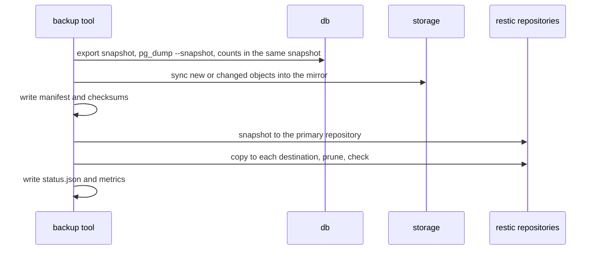
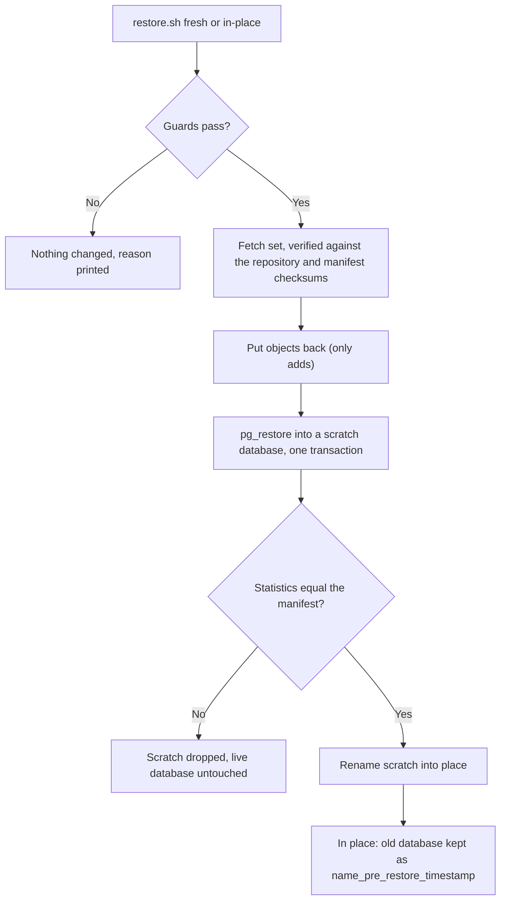
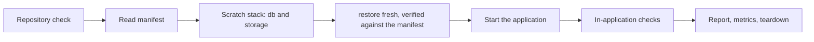

# Disaster recovery: backup and restore

Whole-platform backup and restore for recovering a lost host, a corrupted volume or a bad deploy. This page covers taking a backup, restoring one, and proving the latest backup restores (the restore test). Scheduling and the full runbook are separate deliverables.

## What a backup holds

| Component | Source | Stored as |
|-----------|--------|-----------|
| Database | `db` | `pg_dump` custom format, taken from one exported Postgres snapshot |
| Attachments | `storage` (S3 API) | Incremental mirror of the bucket; or a tar of `reqtrack_local_files` when `STORAGE_BACKEND=local` |
| Configuration | your `.env` | Only in `BACKUP_SECRETS_MODE=config`: encrypted with `age` to a public key you hold the private half of |
| Manifest | generated | `manifest.json`: app version, schema revision, Postgres version, component digests and the `dr_stats` counts a restore is verified against ([schema](schemas/backup-manifest.schema.json)) |

Everything is stored as one [restic](https://restic.net) snapshot per run (encrypted, deduplicated), copied to every destination you configure, then pruned to the retention policy and sampled for integrity (`restic check`).



The dump is taken before the object sync, so every row in the dump finds its object. A deleted object stays in the mirror for one more run (the set taken then may still reference it) and is then dropped.

## Run it

```bash
export BACKUP_REPO_PASSWORD_FILE=/secure/location/restic-password   # outside the data it protects
export BACKUP_ENV_FILE=./.env                                       # config mode only
export BACKUP_CONFIG_AGE_RECIPIENT=age1...                          # config mode only: age-keygen's public key
./scripts/dr-backup.sh                                              # or: docker compose --profile backup run --rm backup
```

Exit status: `0` success, `1` failed (a failed destination counts), `75` another backup is running. `status.json` and a Prometheus textfile (`reqtrack-backup.prom`) are written to the `reqtrack_backup_status` volume after every run.

The primary repository defaults to a volume on the same host, which does not survive losing the host: set `BACKUP_DESTINATIONS` to at least one copy elsewhere.

## Configuration

All variables are read by the `backup` service (see `docker-compose.yml`).

| Variable | Default | Meaning |
|----------|---------|---------|
| `BACKUP_REPO_PASSWORD_FILE` | required | File holding the restic repository password (a Docker secret). Losing it loses every backup |
| `BACKUP_SECRETS_MODE` | `config` | `config` also stores the encrypted `.env`; `none` stores no key material (you supply keys at restore time) |
| `BACKUP_CONFIG_AGE_RECIPIENT` | | age public key the `.env` is encrypted to. Required in `config` mode |
| `BACKUP_ENV_FILE` | | Host path of the `.env` to snapshot. Required in `config` mode |
| `BACKUP_DESTINATIONS` | | Comma-separated restic repositories to copy each snapshot to: `/mnt/nfs/reqtrack`, `s3:https://host/bucket`, `sftp:user@host:/path`, `azure:container:/path` |
| `BACKUP_REPO_VOLUME` | `reqtrack_backup_repo` | Volume or host path of the primary repository |
| `BACKUP_KEEP_DAILY` / `_WEEKLY` / `_MONTHLY` | 7 / 4 / 12 | Retention. restic keeps the last set of each period, so a schedule more often than daily also needs `BACKUP_KEEP_HOURLY` |
| `BACKUP_CHECK_SUBSET` | `5%` | Share of repository data read by the integrity check (empty skips it) |
| `BACKUP_PROBE_ENCRYPTION_KEY` | the app key | Key used to check the dump's encrypted columns decrypt. Set it empty to keep the key out of the backup container |
| `BACKUP_AWS_*`, `BACKUP_AZURE_*` | | Credentials for S3-compatible and Azure destinations |
| `BACKUP_SSH_DIR` | | Host directory with `id_*` and `known_hosts` for SFTP destinations |
| `BACKUP_BUNDLE_AGE_RECIPIENT` | | age public key for `bundle` |

Only credentials and the repository password reach the tool through the environment or Docker secrets, never the command line, and anything restic prints is scrubbed of them before it is logged or stored.

To hand-copy the latest set (scp, a USB disk) as one file: `./scripts/dr-backup.sh bundle --output /path/reqtrack.tar.age`. Decrypt with `age -d -i identity.txt`.

## Restore

`./scripts/restore.sh` runs the restore tool in the `backup` image (the `restore` Compose profile). It never writes into the live database: the set is restored into a scratch database, checked against the manifest with the same `dr_stats` code the backup used, and only then renamed into place.

| Situation | Command |
|-----------|---------|
| See what is available | `./scripts/restore.sh list [--repository R]` |
| New host: recover the `.env` | `./scripts/restore.sh config --age-identity identity.txt --output .env [--repository R]` |
| New host: empty stack | `./scripts/restore.sh fresh [--set ID] [--repository R] [--start]` |
| Bad data or deploy: replace the live database | `./scripts/restore.sh in-place --yes [--set ID] [--start]` |
| Check without changing anything | add `--dry-run` to `fresh` or `in-place` |



**Guards (a refused restore changes nothing):** the target must be empty for `fresh`; `in-place` needs `--yes` and stops the application only after a dry run has passed; the image must be the one the set was taken with (the statistics are computed by that release's models, so another schema revision is refused with the tag to use, then upgrade afterwards: the newer image migrates on start); the PostgreSQL server must not be older than the dump's; `STORAGE_BACKEND` must match the set; the staging volume needs room for the fetched set.

**New host, step by step**

1. Install Docker and get this repository and the image tag the set names (`list` and `--dry-run` print it).
2. Recover the `.env` with `config` and your age identity. A set taken with `BACKUP_SECRETS_MODE=none` holds none: supply `APP_SECRET_ENCRYPTION_KEY` and `JWT_SECRET` from wherever you keep them.
3. `./scripts/restore.sh fresh --repository <off-site repository> --start` (credentials for the repository as for backups). Output ends with `verified against the manifest`.
4. After an incident that may have exposed the dump or the host, add `--force-reset` (and `--reset-2fa`) to the restore, then print links for the first administrators; see [Credentials after a restore](#credentials-after-a-restore).

**Keys.** The restored application needs the original `APP_SECRET_ENCRYPTION_KEY`; the restore checks that every encrypted value decrypts with the key it is given and fails otherwise. If the original is lost, set a new key and add `--clear-unreadable-secrets`: those values are removed (users with 2FA re-enrol; organisation SMTP and SSO secrets are re-entered) and one audit event records the counts. Clearing is refused without a key to judge by.

### Credentials after a restore

Use this when the dump, the host or a backup may be in the wrong hands, or the old credentials are suspect for any reason. It is independent of the secrets mode: hashes are in every dump, and the encryption key may live elsewhere.

```bash
# on the restored copy, before it goes live: end every session, revoke access tokens, require a new password
./scripts/restore.sh fresh --repository <repository> --force-reset --reset-2fa --start
# the first administrators cannot sign in with a password now: print a single-use link for each, to your terminal only
docker compose exec backend python -m app.cli.credentials issue-link --server-admins
# once they are in and email works, send links to everyone else (Server Management → Access review → Force a credential reset…
# does the same from the UI, or from the command line:)
docker compose exec backend python -m app.cli.credentials force-reset --all --send --yes
```

`--force-reset [all|server_admins]` runs on the scratch database before it replaces anything and writes one audit event (`cli:<os user>`, counts only). It sends no email, because a restored host may have none. Accounts that sign in through single sign-on keep working (their sessions end and they sign in again). The tool is the same one operators use any time an administrator is locked out; see [Password resets and credential recovery](website/docs/workflows/password-reset-and-credential-recovery.md). SCIM tokens, `JWT_SECRET` and the encryption key are not rotated by it; rotate them separately if exposed.

**After an in-place restore** the replaced database stays on the server as `<name>_pre_restore_<UTC time>` (the name is printed and recorded in `restore-report.json`). Rolling back is stopping the application and renaming it back; when you no longer need it, `DROP DATABASE` it, since it still holds all the data the restore replaced.

`restore-report.json` (step names, counts and ids only, no row values or secrets) is written to the `reqtrack_backup_status` volume by every real restore, or to any file with `--report`. Objects the set does not contain are left in the store, never deleted. Exit status: `0` success, `1` failed or refused, `2` bad configuration, `75` a backup or restore is running.

Legacy files from `scripts/backup.sh` (`.sql.gz`, `reqtrack-files-*.tar.gz`) still restore with `./scripts/restore.sh FILE`, now in one transaction that stops at the first error, so only into an empty database.

## Restore test

`./scripts/restore-test.sh` proves the latest set restores into a working platform whose numbers match the source. It runs on a throwaway Compose project (`reqtrack-drtest-<UTC time>`) with its own volumes and network, no published ports, email delivery disabled and credentials generated for the run, so it is safe on the production host. The repository is mounted read-only. The scratch project and its credentials are removed afterwards, pass or fail.

```bash
export BACKUP_REPO_PASSWORD_FILE=/secure/location/restic-password
./scripts/restore-test.sh --repository-volume reqtrack_backup_repo --source-env /secure/location/.env
./scripts/restore-test.sh --repository sftp:backup@host:/srv/reqtrack --source-env ...   # the off-site copy, the honest test
```

`--source-env` supplies the original `APP_SECRET_ENCRYPTION_KEY` (the production `.env` or one recovered with `restore.sh config`); it is the only production value used. Everything else is generated.



| Check (in the restored application) | Passes when |
|-------------------------------------|-------------|
| `migrations` | The database is at the manifest's revision and that is the image's head, so `alembic upgrade head` changes nothing |
| `statistics` | Every table count and business statistic equals the manifest, recomputed after the application has been running |
| `file-objects` | Every file record has its object and a random sample reads back at its recorded size |
| `encrypted-columns` | Every encrypted value decrypts with the key the stack runs with |
| `email-disabled` | A send attempt is refused before any connection (`EMAIL_DELIVERY=disabled`) |
| `api-smoke` | As a manager of a project that holds records: health, identity, organisation and project lists, a record, a project search and a project export |
| `login` | Only with `--login-email` and `--login-password-file`: that account signs in with its password, proving the stored hashes verify |
| `credential-recovery` | Only with `--force-reset`: every local account is marked as needing a new password, a session from before the reset is dead, `python -m app.cli.credentials issue-link` prints a link for a server administrator while every administrator is locked out, the link sets a password exactly once, and the new password signs in |

Options: `--force-reset [all|server_admins]` and `--reset-2fa` (restore with a forced credential reset and prove a locked-out administrator is let back in from the command line; replaces the `login` check, since restored passwords no longer work by design), `--set` (a set id), `--key-mode wrong` and `--clear-unreadable-secrets` (recovery without the original key: the run passes when the unreadable values are removed and the application still works), `--image-tag`, `--output` (reports; default `./restore-test-reports/<project>/report.{json,md}`), `--status-dir` (writes `restore-test-status.json` and `reqtrack-restore-test.prom`, with the last success time carried forward over a failure), `--keep` (leave the scratch project running; the command to remove it is printed), `--check-subset` (share of repository data the integrity check reads). Exit status: `0` passed, `1` a check failed, `2` bad arguments, `75` a backup or restore is running.

**Prove the checks fail.** `--inject FAULT` damages the restored copy and passes only when the harness catches it, so a check that cannot fail is noticed:

| Fault | Done to | Must be caught by |
|-------|---------|-------------------|
| `delete-row` | one row of a leaf table, after the restore | `statistics` |
| `delete-object` | one stored object a file record points at | `file-objects` |
| `wrong-key` | a replacement `APP_SECRET_ENCRYPTION_KEY` | the restore, naming exactly the encrypted columns that hold values, with their counts |
| `corrupt-dump` | 256 bytes of the largest pack in a copy of the repository | the repository check or the restore |
| `unmarked-account` | the must-reset marker cleared on one local account after a forced reset | `credential-recovery` |

`./scripts/restore-test-selfcheck.sh` runs the whole chain on throwaway projects: it builds a source stack, seeds the end-to-end dataset, takes a real backup, runs the positive case, the recovery-without-key case, a forced credential reset (with a locked-out administrator let back in from the command line) and the five faults, and checks nothing was left behind. CI runs it as the `restore-test` job, which `docker-build` needs, so a backup that cannot be restored is never published.

**Needs.** Docker with the Compose plugin and `python3` 3.9 or newer on the host. The restore fetches the set into the scratch project's staging volume and holds a second copy of the database, so it needs free disk for the set plus a database copy; the restore tool prints the figure it needs and refuses to start without it. The scratch stack starts SeaweedFS without disk preallocation (the bundled one reserves about 1 GB per volume, 7 GB at the first upload), so it stays small. If the Docker VM's disk is full, Postgres in the scratch stack fails with "could not write init file": free space (`docker builder prune -f`) and rerun. The image tag the set names is used, so an old set needs that image available.

## Security notes

- The `backup` service has no listener and no Docker socket, drops all capabilities, and reads the database and storage over the Compose network with the application's own credentials.
- The staging volume holds the object mirror and, during a run, an unencrypted dump: treat it as Confidential and keep it on an encrypted disk. The dump is removed when the run ends, successfully or not.
- A backup contains the same data as production, including password hashes and encrypted secrets. `none` mode keeps the keys out of it; `config` mode stores them only encrypted to your age key.
- The restore test mounts the repository read-only and generates fresh credentials for its scratch stack; `restore-test-reports/` holds counts and check names only, never row values or secrets, but is still operational detail to keep private.
- The least-privilege read-only S3 identity for the backup is not in place yet; the tool currently uses the application's credentials, which already include list and read.
- The `restore` service additionally writes to the database server (it creates, renames and drops databases), the object store and the local file store; it is not started unless you run it, and shares the backup service's hardening (no listener, no Docker socket, all capabilities dropped).
