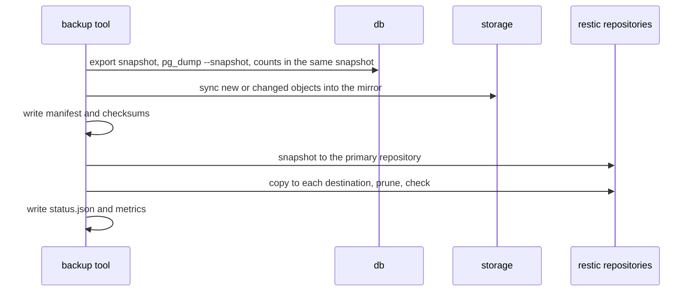

# Disaster recovery: backup

Whole-platform backup for recovering a lost host, a corrupted volume or a bad deploy. The restore tool, restore-test, scheduling and the full runbook are separate deliverables; this page covers taking a backup.

## What a backup holds

| Component | Source | Stored as |
|-----------|--------|-----------|
| Database | `db` | `pg_dump` custom format, taken from one exported Postgres snapshot |
| Attachments | `storage` (S3 API) | Incremental mirror of the bucket; or a tar of `reqtrack_local_files` when `STORAGE_BACKEND=local` |
| Configuration | your `.env` | Only in `BACKUP_SECRETS_MODE=config`: encrypted with `age` to a public key you hold the private half of |
| Manifest | generated | `manifest.json`: app version, schema revision, Postgres version, component digests and the `dr_stats` counts a restore is verified against ([schema](schemas/backup-manifest.schema.json)) |

Everything is stored as one [restic](https://restic.net) snapshot per run (encrypted, deduplicated), copied to every destination you configure, then pruned to the retention policy and sampled for integrity (`restic check`).



The dump is taken before the object sync, so every row in the dump finds its object. A deleted object stays in the mirror for one more run (the set taken then may still reference it) and is then dropped.

## Run it

```bash
export BACKUP_REPO_PASSWORD_FILE=/secure/location/restic-password   # outside the data it protects
export BACKUP_ENV_FILE=./.env                                       # config mode only
export BACKUP_CONFIG_AGE_RECIPIENT=age1...                          # config mode only: age-keygen's public key
./scripts/dr-backup.sh                                              # or: docker compose --profile backup run --rm backup
```

Exit status: `0` success, `1` failed (a failed destination counts), `75` another backup is running. `status.json` and a Prometheus textfile (`reqtrack-backup.prom`) are written to the `reqtrack_backup_status` volume after every run.

The primary repository defaults to a volume on the same host, which does not survive losing the host: set `BACKUP_DESTINATIONS` to at least one copy elsewhere.

## Configuration

All variables are read by the `backup` service (see `docker-compose.yml`).

| Variable | Default | Meaning |
|----------|---------|---------|
| `BACKUP_REPO_PASSWORD_FILE` | required | File holding the restic repository password (a Docker secret). Losing it loses every backup |
| `BACKUP_SECRETS_MODE` | `config` | `config` also stores the encrypted `.env`; `none` stores no key material (you supply keys at restore time) |
| `BACKUP_CONFIG_AGE_RECIPIENT` | | age public key the `.env` is encrypted to. Required in `config` mode |
| `BACKUP_ENV_FILE` | | Host path of the `.env` to snapshot. Required in `config` mode |
| `BACKUP_DESTINATIONS` | | Comma-separated restic repositories to copy each snapshot to: `/mnt/nfs/reqtrack`, `s3:https://host/bucket`, `sftp:user@host:/path`, `azure:container:/path` |
| `BACKUP_REPO_VOLUME` | `reqtrack_backup_repo` | Volume or host path of the primary repository |
| `BACKUP_KEEP_DAILY` / `_WEEKLY` / `_MONTHLY` | 7 / 4 / 12 | Retention. restic keeps the last set of each period, so a schedule more often than daily also needs `BACKUP_KEEP_HOURLY` |
| `BACKUP_CHECK_SUBSET` | `5%` | Share of repository data read by the integrity check (empty skips it) |
| `BACKUP_PROBE_ENCRYPTION_KEY` | the app key | Key used to check the dump's encrypted columns decrypt. Set it empty to keep the key out of the backup container |
| `BACKUP_AWS_*`, `BACKUP_AZURE_*` | | Credentials for S3-compatible and Azure destinations |
| `BACKUP_SSH_DIR` | | Host directory with `id_*` and `known_hosts` for SFTP destinations |
| `BACKUP_BUNDLE_AGE_RECIPIENT` | | age public key for `bundle` |

Only credentials and the repository password reach the tool through the environment or Docker secrets, never the command line, and anything restic prints is scrubbed of them before it is logged or stored.

To hand-copy the latest set (scp, a USB disk) as one file: `./scripts/dr-backup.sh bundle --output /path/reqtrack.tar.age`. Decrypt with `age -d -i identity.txt`.

## Security notes

- The `backup` service has no listener and no Docker socket, drops all capabilities, and reads the database and storage over the Compose network with the application's own credentials.
- The staging volume holds the object mirror and, during a run, an unencrypted dump: treat it as Confidential and keep it on an encrypted disk. The dump is removed when the run ends, successfully or not.
- A backup contains the same data as production, including password hashes and encrypted secrets. `none` mode keeps the keys out of it; `config` mode stores them only encrypted to your age key.
- The least-privilege read-only S3 identity for the backup is not in place yet; the tool currently uses the application's credentials, which already include list and read.
