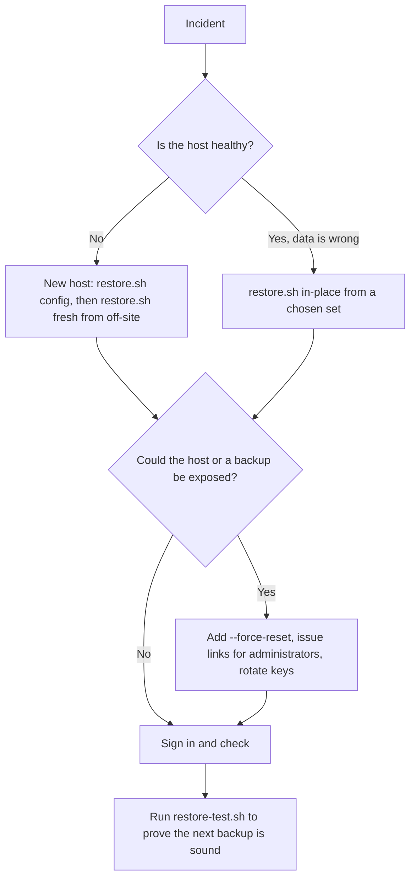
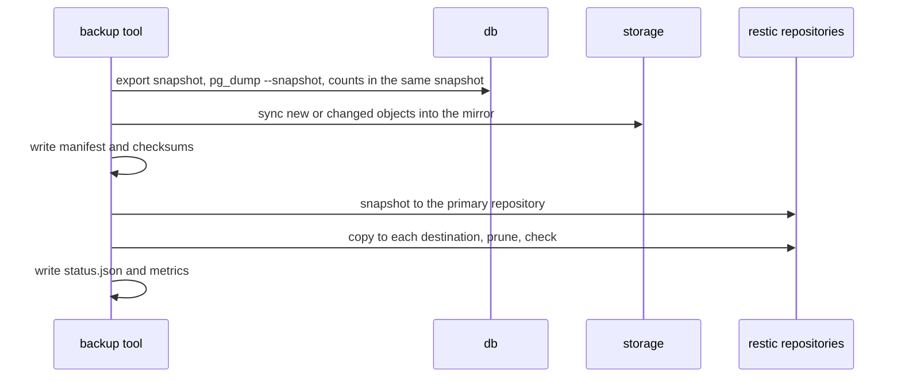
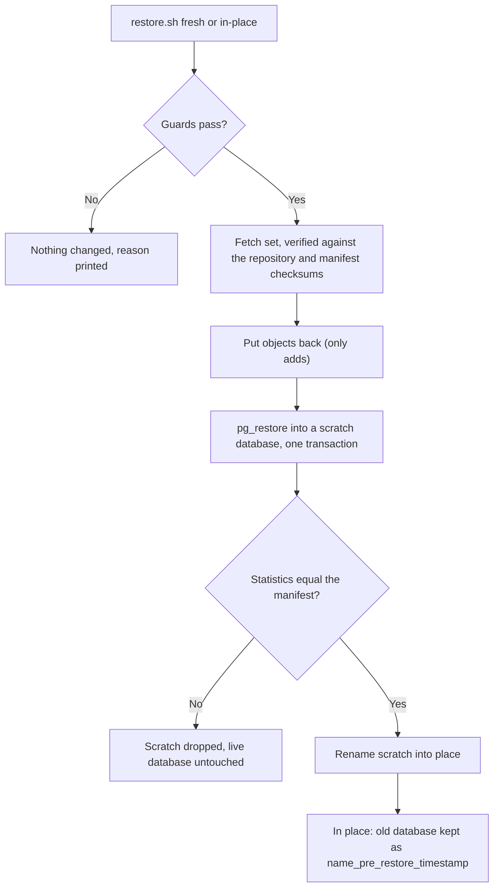
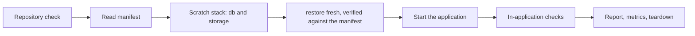
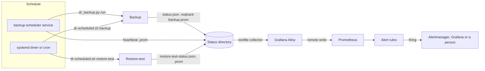

# Disaster recovery: backup and restore

Whole-platform backup and restore for recovering a lost host, a corrupted volume or a bad deploy. This page is the runbook: what is covered, who holds which key, how to back up, schedule, restore and prove a restore, and what to do when a step fails.

## At a glance

| | |
|---|---|
| **Recovery point (RPO)** | The interval between backups: 24 hours with the default nightly schedule. Set `BACKUP_SCHEDULE=every 1h` (dedup keeps it cheap) for less. Point-in-time recovery between backups is not provided |
| **Recovery time (RTO)** | Install Docker, fetch the repository and `.env`, then one `restore.sh fresh` command. The time is dominated by fetching the set and uploading objects, so it grows with attachment volume; it has not yet been measured on a clean machine. Each restore-test report (and `reqtrack_restore_test_duration_seconds`) records how long the whole run took on your data, including starting the scratch stack, which is the best estimate you will have until then |
| **Proof** | `restore-test.sh` restores the latest set into a throwaway stack and compares every table count with the manifest; weekly by default, alerted when it stops passing |
| **Not covered** | Container images (pulled by the tag the manifest names); telemetry (Prometheus, Loki, Tempo, Grafana); anything outside the three data volumes and the `.env`; per-project restore (use the project bundle export) |

| You have lost... | Do this |
|------------------|---------|
| The host or its disks | [New host](#restore), restoring from the off-site repository |
| Data, or a bad deploy, on a host that still works | `restore.sh in-place` from a chosen set ([Restore](#restore)) |
| Nothing yet, and want to know it would work | `restore-test.sh` ([Restore test](#restore-test)) |
| Control of the host or a backup (breach, stolen disk) | Restore, then [reset credentials](#credentials-after-a-restore) and rotate the keys below |



### Key custody

The backup is only as recoverable as the secrets kept **outside** it. Two people should be able to reach each item, at least one copy should be offline, and none should live only on the host being backed up.

| Secret | Needed to | If lost |
|--------|-----------|---------|
| Repository password (`BACKUP_REPO_PASSWORD_FILE`) | Read any backup set | Every backup is unreadable; nothing can recover it |
| age identity (private half of `BACKUP_CONFIG_AGE_RECIPIENT`) | Recover the `.env` from a `config`-mode set | Supply the `.env` values yourself, as in `none` mode |
| `APP_SECRET_ENCRYPTION_KEY` | Decrypt 2FA enrolments and organisation SMTP and SSO secrets | Restore with `--clear-unreadable-secrets`: users re-enrol 2FA and organisations re-enter secrets |
| `JWT_SECRET` | Keep sessions valid | Everyone signs in again (harmless) |
| Off-site destination credentials | Reach the off-site repository | Use the local copy, or recover them from your provider |

`BACKUP_SECRETS_MODE=none` keeps the last four out of the backup entirely; `config` stores the `.env` encrypted to your age key; hold that identity apart from the repository password, so one leak does not open both. Rotate the repository password and keys if either may have been exposed (`restic key` manages repository passwords), and keep at least one copy of each secret in a place that survives losing the host.

## What a backup holds

| Component | Source | Stored as |
|-----------|--------|-----------|
| Database | `db` | `pg_dump` custom format, taken from one exported Postgres snapshot |
| Attachments | `storage` (S3 API) | Incremental mirror of the bucket; or a tar of `reqtrack_local_files` when `STORAGE_BACKEND=local` |
| Configuration | your `.env` | Only in `BACKUP_SECRETS_MODE=config`: encrypted with `age` to a public key you hold the private half of |
| Manifest | generated | `manifest.json`: app version, schema revision, Postgres version, component digests and the `dr_stats` counts a restore is verified against ([schema](schemas/backup-manifest.schema.json)) |

Everything is stored as one [restic](https://restic.net) snapshot per run (encrypted, deduplicated), copied to every destination you configure, then pruned to the retention policy and sampled for integrity (`restic check`).



The dump is taken before the object sync, so every row in the dump finds its object. A deleted object stays in the mirror for one more run (the set taken then may still reference it) and is then dropped.

## Run it

```bash
export BACKUP_REPO_PASSWORD_FILE=/secure/location/restic-password   # outside the data it protects
export BACKUP_ENV_FILE=./.env                                       # config mode only
export BACKUP_CONFIG_AGE_RECIPIENT=age1...                          # config mode only: age-keygen's public key
./scripts/dr-backup.sh                                              # or: docker compose --profile backup run --rm backup
```

Exit status: `0` success, `1` failed (a failed destination counts), `75` another backup is running. `status.json` and a Prometheus textfile (`reqtrack-backup.prom`) are written to the `reqtrack_backup_status` volume after every run.

The primary repository defaults to a volume on the same host, which does not survive losing the host: set `BACKUP_DESTINATIONS` to at least one copy elsewhere.

## Configuration

All variables are read by the `backup` service (see `docker-compose.yml`).

| Variable | Default | Meaning |
|----------|---------|---------|
| `BACKUP_REPO_PASSWORD_FILE` | required | File holding the restic repository password (a Docker secret). Losing it loses every backup |
| `BACKUP_SECRETS_MODE` | `config` | `config` also stores the encrypted `.env`; `none` stores no key material (you supply keys at restore time) |
| `BACKUP_CONFIG_AGE_RECIPIENT` | | age public key the `.env` is encrypted to. Required in `config` mode |
| `BACKUP_ENV_FILE` | | Host path of the `.env` to snapshot. Required in `config` mode |
| `BACKUP_DESTINATIONS` | | Comma-separated restic repositories to copy each snapshot to: `/mnt/nfs/reqtrack`, `s3:https://host/bucket`, `sftp:user@host:/path`, `azure:container:/path` |
| `BACKUP_STORAGE_ACCESS_KEY` / `_SECRET_KEY` | the application's pair | S3 identity the backup reads the object store with. Set a read-only one for an external S3 service (see Security notes); the bundled SeaweedFS needs the default |
| `BACKUP_REPO_VOLUME` | `reqtrack_backup_repo` | Volume or host path of the primary repository |
| `BACKUP_KEEP_DAILY` / `_WEEKLY` / `_MONTHLY` | 7 / 4 / 12 | Retention. restic keeps the last set of each period, so a schedule more often than daily also needs `BACKUP_KEEP_HOURLY` |
| `BACKUP_CHECK_SUBSET` | `5%` | Share of repository data read by the integrity check (empty skips it) |
| `BACKUP_PROBE_ENCRYPTION_KEY` | the app key | Key used to check the dump's encrypted columns decrypt. Set it empty to keep the key out of the backup container |
| `BACKUP_AWS_*`, `BACKUP_AZURE_*` | | Credentials for S3-compatible and Azure destinations |
| `BACKUP_SSH_DIR` | | Host directory with `id_*` and `known_hosts` for SFTP destinations |
| `BACKUP_BUNDLE_AGE_RECIPIENT` | | age public key for `bundle` |
| `BACKUP_SCHEDULE` | | For the `backup-scheduler` service: `HH:MM` (daily) or `every Nh` (N divides 24). See [Scheduling and monitoring](#scheduling-and-monitoring) |
| `BACKUP_SCHEDULE_TIMEZONE` | `UTC` | IANA zone a daily `HH:MM` is meant in (`Australia/Sydney`); the time stays the same on the wall clock across daylight saving |
| `BACKUP_SCHEDULE_RETRIES` / `_RETRY_MINUTES` | 1 / 30 | Extra attempts after a failed scheduled run, and the wait before each (never past the next slot) |
| `BACKUP_EXPECTED_INTERVAL_HOURS` | 24, or the schedule's period | How often backups are meant to run; published as a metric so the staleness alert follows it. Set it when cron or a timer runs more or less often than daily |
| `BACKUP_STATUS_VOLUME` | `reqtrack_backup_status` | Volume or absolute host directory for `status.json` and the metric files. Use a host directory when a host job (the restore-test) writes beside them or a host `node_exporter` reads them |

Only credentials and the repository password reach the tool through the environment or Docker secrets, never the command line, and anything restic prints is scrubbed of them before it is logged or stored.

To hand-copy the latest set (scp, a USB disk) as one file: `./scripts/dr-backup.sh bundle --output /path/reqtrack.tar.age`. Decrypt with `age -d -i identity.txt`.

## Restore

`./scripts/restore.sh` runs the restore tool in the `backup` image (the `restore` Compose profile). It never writes into the live database: the set is restored into a scratch database, checked against the manifest with the same `dr_stats` code the backup used, and only then renamed into place.

| Situation | Command |
|-----------|---------|
| See what is available | `./scripts/restore.sh list [--repository R]` |
| New host: recover the `.env` | `./scripts/restore.sh config --age-identity identity.txt --output .env [--repository R]` |
| New host: empty stack | `./scripts/restore.sh fresh [--set ID] [--repository R] [--start]` |
| Bad data or deploy: replace the live database | `./scripts/restore.sh in-place --yes [--set ID] [--start]` |
| Check without changing anything | add `--dry-run` to `fresh` or `in-place` |



**Guards (a refused restore changes nothing):** the target must be empty for `fresh`; `in-place` needs `--yes` and stops the application only after a dry run has passed; the image must be the one the set was taken with (the statistics are computed by that release's models, so another schema revision is refused with the tag to use, then upgrade afterwards: the newer image migrates on start); the PostgreSQL server must not be older than the dump's; `STORAGE_BACKEND` must match the set; the staging volume needs room for the fetched set.

**New host, step by step**

1. Install Docker and get this repository and the image tag the set names (`list` and `--dry-run` print it).
2. Recover the `.env` with `config` and your age identity. A set taken with `BACKUP_SECRETS_MODE=none` holds none: supply `APP_SECRET_ENCRYPTION_KEY` and `JWT_SECRET` from wherever you keep them.
3. `./scripts/restore.sh fresh --repository <off-site repository> --start` (credentials for the repository as for backups). Output ends with `verified against the manifest`.
4. After an incident that may have exposed the dump or the host, add `--force-reset` (and `--reset-2fa`) to the restore, then print links for the first administrators; see [Credentials after a restore](#credentials-after-a-restore).

**Keys.** The restored application needs the original `APP_SECRET_ENCRYPTION_KEY`; the restore checks that every encrypted value decrypts with the key it is given and fails otherwise. If the original is lost, set a new key and add `--clear-unreadable-secrets`: those values are removed (users with 2FA re-enrol; organisation SMTP and SSO secrets are re-entered) and one audit event records the counts. Clearing is refused without a key to judge by.

### Credentials after a restore

Use this when the dump, the host or a backup may be in the wrong hands, or the old credentials are suspect for any reason. It is independent of the secrets mode: hashes are in every dump, and the encryption key may live elsewhere.

```bash
# on the restored copy, before it goes live: end every session, revoke access tokens, require a new password
./scripts/restore.sh fresh --repository <repository> --force-reset --reset-2fa --start
# the first administrators cannot sign in with a password now: print a single-use link for each, to your terminal only
docker compose exec backend python -m app.cli.credentials issue-link --server-admins
# once they are in and email works, send links to everyone else (Server Management → Access review → Force a credential reset…
# does the same from the UI, or from the command line:)
docker compose exec backend python -m app.cli.credentials force-reset --all --send --yes
```

`--force-reset [all|server_admins]` runs on the scratch database before it replaces anything and writes one audit event (`cli:<os user>`, counts only). It sends no email, because a restored host may have none. Accounts that sign in through single sign-on keep working (their sessions end and they sign in again). The tool is the same one operators use any time an administrator is locked out; see [Password resets and credential recovery](website/docs/workflows/password-reset-and-credential-recovery.md). SCIM tokens, `JWT_SECRET` and the encryption key are not rotated by it; rotate them separately if exposed.

**After an in-place restore** the replaced database stays on the server as `<name>_pre_restore_<UTC time>` (the name is printed and recorded in `restore-report.json`). Rolling back is stopping the application and renaming it back; when you no longer need it, `DROP DATABASE` it, since it still holds all the data the restore replaced.

`restore-report.json` (step names, counts and ids only, no row values or secrets) is written to the `reqtrack_backup_status` volume by every real restore, or to any file with `--report`. Objects the set does not contain are left in the store, never deleted. Exit status: `0` success, `1` failed or refused, `2` bad configuration, `75` a backup or restore is running.

Legacy files from `scripts/backup.sh` (`.sql.gz`, `reqtrack-files-*.tar.gz`) still restore with `./scripts/restore.sh FILE`, now in one transaction that stops at the first error, so only into an empty database.

## Restore test

`./scripts/restore-test.sh` proves the latest set restores into a working platform whose numbers match the source. It runs on a throwaway Compose project (`reqtrack-drtest-<UTC time>`) with its own volumes and network, no published ports, email delivery disabled and credentials generated for the run, so it is safe on the production host. The repository is mounted read-only. The scratch project and its credentials are removed afterwards, pass or fail.

```bash
export BACKUP_REPO_PASSWORD_FILE=/secure/location/restic-password
./scripts/restore-test.sh --repository-volume reqtrack_backup_repo --source-env /secure/location/.env
./scripts/restore-test.sh --repository sftp:backup@host:/srv/reqtrack --source-env ...   # the off-site copy, the honest test
```

`--source-env` supplies the original `APP_SECRET_ENCRYPTION_KEY` (the production `.env` or one recovered with `restore.sh config`); it is the only production value used. Everything else is generated.



| Check (in the restored application) | Passes when |
|-------------------------------------|-------------|
| `migrations` | The database is at the manifest's revision and that is the image's head, so `alembic upgrade head` changes nothing |
| `statistics` | Every table count and business statistic equals the manifest, recomputed after the application has been running |
| `file-objects` | Every file record has its object and a random sample reads back at its recorded size |
| `encrypted-columns` | Every encrypted value decrypts with the key the stack runs with |
| `email-disabled` | A send attempt is refused before any connection (`EMAIL_DELIVERY=disabled`) |
| `api-smoke` | As a manager of a project that holds records: health, identity, organisation and project lists, a record, a project search and a project export |
| `login` | Only with `--login-email` and `--login-password-file`: that account signs in with its password, proving the stored hashes verify |
| `credential-recovery` | Only with `--force-reset`: every local account is marked as needing a new password, a session from before the reset is dead, `python -m app.cli.credentials issue-link` prints a link for a server administrator while every administrator is locked out, the link sets a password exactly once, and the new password signs in |

Options: `--force-reset [all|server_admins]` and `--reset-2fa` (restore with a forced credential reset and prove a locked-out administrator is let back in from the command line; replaces the `login` check, since restored passwords no longer work by design), `--set` (a set id), `--key-mode wrong` and `--clear-unreadable-secrets` (recovery without the original key: the run passes when the unreadable values are removed and the application still works), `--image-tag`, `--output` (reports; default `./restore-test-reports/<project>/report.{json,md}`), `--status-dir` (writes `restore-test-status.json` and `reqtrack-restore-test.prom`, with the last success time carried forward over a failure), `--keep` (leave the scratch project running; the command to remove it is printed), `--check-subset` (share of repository data the integrity check reads). Exit status: `0` passed, `1` a check failed, `2` bad arguments, `75` a backup or restore is running.

**Prove the checks fail.** `--inject FAULT` damages the restored copy and passes only when the harness catches it, so a check that cannot fail is noticed:

| Fault | Done to | Must be caught by |
|-------|---------|-------------------|
| `delete-row` | one row of a leaf table, after the restore | `statistics` |
| `delete-object` | one stored object a file record points at | `file-objects` |
| `wrong-key` | a replacement `APP_SECRET_ENCRYPTION_KEY` | the restore, naming exactly the encrypted columns that hold values, with their counts |
| `corrupt-dump` | 256 bytes of the largest pack in a copy of the repository | the repository check or the restore |
| `unmarked-account` | the must-reset marker cleared on one local account after a forced reset | `credential-recovery` |

`./scripts/restore-test-selfcheck.sh` runs the whole chain on throwaway projects: it builds a source stack, seeds the end-to-end dataset, takes a real backup, runs the positive case, the recovery-without-key case, a forced credential reset (with a locked-out administrator let back in from the command line) and the five faults, and checks nothing was left behind. CI runs it as the `restore-test` job, which `docker-build` needs, so a backup that cannot be restored is never published.

**Needs.** Docker with the Compose plugin and `python3` 3.9 or newer on the host. The restore fetches the set into the scratch project's staging volume and holds a second copy of the database, so it needs free disk for the set plus a database copy; the restore tool prints the figure it needs and refuses to start without it. The scratch stack starts SeaweedFS without disk preallocation (the bundled one reserves about 1 GB per volume, 7 GB at the first upload), so it stays small. If the Docker VM's disk is full, Postgres in the scratch stack fails with "could not write init file": free space (`docker builder prune -f`) and rerun. The image tag the set names is used, so an old set needs that image available.

## Scheduling and monitoring

Backups only protect you if they run, and a restore-test only counts if it keeps passing. Pick **one** way to schedule each; every one runs the same tools, so the status files and metrics look identical.

| Way | Backup | Restore-test | Use when |
|-----|--------|--------------|----------|
| Compose `backup-scheduler` service | Yes | No (it drives Docker) | No cron or systemd to hand, or the host is "just Docker" |
| systemd timers (`scripts/schedule/reqtrack-*.{service,timer}`) | Yes | Yes | A Linux host with systemd (recommended) |
| cron (`scripts/schedule/crontab.example`) | Yes | Yes | Anything else |

The restore-test needs the Docker socket to build its throwaway stack, which the `backup` image deliberately lacks, so it is always scheduled from the host (weekly by default).



### In-container schedule

```bash
export BACKUP_SCHEDULE=02:30 BACKUP_SCHEDULE_TIMEZONE=Australia/Sydney   # or: every 6h
docker compose --profile backup-schedule up -d backup-scheduler
```

It runs a backup at each slot, **catches up once at start** if the last success is older than the previous slot (the container was down), retries a failed run once after 30 minutes, and refuses to start on an invalid schedule (exit `2`; see `docker compose logs backup-scheduler`). A time such as `02:30` is kept as a wall-clock time in its zone, so it means 02:30 on both sides of a daylight-saving change (a time the clock skips runs an hour later that day). `every Nh` is aligned to UTC midnight. The container is healthy while its heartbeat is recent; `docker compose stop` lets a run in progress finish (up to two minutes, then Compose kills it and the next run starts clean). Do not also run cron or a timer.

### Host schedule (systemd or cron)

Both call `scripts/dr-scheduled.sh backup|restore-test`, which reads its settings from `/etc/reqtrack/dr.env` (plain `KEY=value` lines, read and never executed):

```bash
# /etc/reqtrack/dr.env  (mode 0600)
BACKUP_REPO_PASSWORD_FILE=/secure/location/restic-password
BACKUP_STATUS_VOLUME=/var/lib/reqtrack/status        # a host directory, shared by the backup and the restore-test
RESTORE_TEST_SOURCE_ENV=/secure/location/.env        # holds the original APP_SECRET_ENCRYPTION_KEY
# RESTORE_TEST_ARGS=--repository sftp:backup@host:/srv/reqtrack   # test the off-site copy (the honest test)
# BACKUP_EXPECTED_INTERVAL_HOURS=6                    # if you back up more often than daily
```

The status directory must be writable by the `backup` image's user (`app`): `install -d -o root -m 0777 /var/lib/reqtrack/status` is the quick form, or `chown` it to that user's id.

```bash
sudo cp scripts/schedule/reqtrack-*.service scripts/schedule/reqtrack-*.timer /etc/systemd/system/   # edit User= and paths first
sudo systemctl daemon-reload
sudo systemctl enable --now reqtrack-backup.timer reqtrack-restore-test.timer
systemctl list-timers 'reqtrack-*'
```

The timers run the backup nightly at 02:30 and the restore-test on Sundays at 04:00 (`Persistent=true` makes up a run missed while the host was off). With cron, install `scripts/schedule/crontab.example`. Exit `75` (another backup or restore was already running) is not treated as a failure.

### Metrics

Every tool writes Prometheus textfiles (`reqtrack-*.prom`) to the status directory, atomically, so a scraper never reads half a file. They carry counts, times and names only.

| Metric | Meaning |
|--------|---------|
| `reqtrack_backup_last_run_success` | 1 if the last run succeeded (including every destination) |
| `reqtrack_backup_last_success_timestamp_seconds` | Unix time of the last fully successful run (0 if there never was one) |
| `reqtrack_backup_last_run_timestamp_seconds`, `reqtrack_backup_duration_seconds`, `reqtrack_backup_set_bytes` | Last run's finish time, duration and size |
| `reqtrack_backup_destination_up{destination}` | 1 if the copy to that destination succeeded |
| `reqtrack_backup_expected_interval_seconds` | How often backups are meant to run (`BACKUP_EXPECTED_INTERVAL_HOURS`) |
| `reqtrack_backup_scheduler_heartbeat_timestamp_seconds`, `_next_run_timestamp_seconds`, `_run_in_progress`, `_period_seconds` | The in-container scheduler (absent if you use cron or a timer) |
| `reqtrack_restore_test_last_run_success`, `_last_success_timestamp_seconds`, `_last_run_timestamp_seconds`, `_duration_seconds`, `_failed_checks`, `_expected_interval_seconds` | The restore-test (`--expected-interval-hours`, default 168) |

**With the bundled observability stack** (`docker compose --profile observability up -d`), Grafana Alloy reads the status directory with its textfile collector (`observability/alloy.river`) and remote-writes to Prometheus, which loads the alert rules in `observability/alerts/`. Nothing else to configure; if you moved the status directory with `BACKUP_STATUS_VOLUME`, Alloy follows. **With your own Prometheus**, point a `node_exporter --collector.textfile.directory` at the status directory, or copy the Alloy block, and load `observability/alerts/disaster-recovery.rules.yml`. A scraped series carries `job="reqtrack-backup"` when it comes through the bundled Alloy.

### Alerts

| Alert | Fires when | Severity |
|-------|-----------|----------|
| `ReqTrackBackupFailed` | The last run failed (10 min) | critical |
| `ReqTrackBackupStale` | No success for 1.5 times the expected interval, or never | critical |
| `ReqTrackBackupDestinationDown` | The off-site copy failed (names the destination) | critical |
| `ReqTrackBackupSchedulerDown` | The in-container scheduler has not beaten for 5 min | critical |
| `ReqTrackRestoreTestFailed` | The last restore-test failed | critical |
| `ReqTrackRestoreTestStale` | No passing restore-test for the expected interval plus one day (8 days when weekly) | warning |
| `ReqTrackBackupMetricsMissing` | Nothing reports a backup run for 30 min, so nothing may be scheduled | warning |
| `ReqTrackBackupMetricsUnreadable` | The textfile collector cannot parse a status file | warning |

The thresholds follow the published intervals, so changing a schedule needs no rule edit. The bundled stack has no Alertmanager: alerts show in Prometheus and Grafana; add an `alerting:` section to `observability/prometheus.yml` to be paged. `ReqTrackBackupMetricsMissing` also fires on a stack that takes no backups at all; that is the point, remove it only if you really intend that. Check the rules with `promtool check rules observability/alerts/*.rules.yml` and `promtool test rules observability/alerts/tests/*.test.yml` (CI runs both; `promtool` is in the `prom/prometheus` image).

Without a metrics stack, `status.json` (and `restore-test-status.json`) in the status directory hold the same facts, and cron's `MAILTO` mails any output a failed run prints.

## Troubleshooting

| Symptom | Cause and fix |
|---------|---------------|
| Backup exits `75` | Another backup or restore holds the lock. Wait; a scheduled run treats this as not a failure |
| Backup exits `1`, `ReqTrackBackupDestinationDown` | The primary set was taken but a destination copy failed (host down, credentials, full disk). The run counts as failed until every destination succeeds; fix the destination; the next run copies its own new set, and the set that missed stays only in the primary repository |
| A run takes a long time to fail | An unreachable remote is retried by restic; each command has a time limit so one dead destination cannot hold the lock indefinitely |
| `ReqTrackBackupStale` or `ReqTrackBackupMetricsMissing` | Nothing is running the backup: check `systemctl list-timers 'reqtrack-*'`, the crontab, or `docker compose logs backup-scheduler` (an invalid `BACKUP_SCHEDULE` stops it with exit `2`) |
| Backup fails at `stats` with a failed integrity probe | The live system already has a file record with no object, or an encrypted value its key cannot read. Fix production first: a backup of a broken system would only record the break |
| Restore refused: image or schema revision | The set was taken at another revision. Use the image tag the refusal names, restore, then upgrade (the newer image migrates on start) |
| Restore refused: target not empty (`fresh`) | The database already has tables. Use `in-place` if you mean to replace it, or start from empty volumes |
| Restore fails at `verify`, or statistics differ | The restored copy does not match the manifest. The scratch database is dropped and the live one is untouched; try the previous set (`list`, then `--set ID`) and keep the failing report |
| Restore stops on encrypted values that cannot be read | The key supplied is not the original. Supply the original `APP_SECRET_ENCRYPTION_KEY`, or accept the loss with `--clear-unreadable-secrets` ([Keys](#restore)) |
| No `.env` in the set | It was taken with `BACKUP_SECRETS_MODE=none`; supply your own |
| `wrong password` or `unable to open config file` from restic | The repository password is wrong or the repository path is: check `BACKUP_REPO_PASSWORD_FILE` and `--repository` |
| Everyone is locked out after a restore | Expected after `--force-reset`: print a link with `python -m app.cli.credentials issue-link --server-admins` ([Credentials after a restore](#credentials-after-a-restore)) |
| `could not write init file`, or a failed fetch for lack of space | The Docker VM or the staging volume is full. Free space (`docker builder prune -f`) and rerun; a restore needs the set plus a database copy |
| Restore-test fails but production is fine | Read `restore-test-reports/<project>/report.md`: the failing check names what differs. Run `./scripts/restore-test-selfcheck.sh` to prove the harness itself still catches faults |

When a restore fails, the output and `restore-report.json` name the step that failed (`select`, `checksums`, `objects`, `database`, `secrets`, `verify`) and carry counts and ids, never row values. A failed restore leaves the live database untouched: the replaced one is renamed to `<name>_pre_restore_<UTC time>` only after verification passes.

## Security notes

- The `backup` service has no listener and no Docker socket, drops all capabilities, and reads the database and storage over the Compose network with the application's own credentials.
- The staging volume holds the object mirror and, during a run, an unencrypted dump: treat it as Confidential and keep it on an encrypted disk. The dump is removed when the run ends, successfully or not.
- A backup contains the same data as production, including password hashes and encrypted secrets. `none` mode keeps the keys out of it; `config` mode stores them only encrypted to your age key.
- The restore test mounts the repository read-only and generates fresh credentials for its scratch stack; `restore-test-reports/` holds counts and check names only, never row values or secrets, but is still operational detail to keep private.
- **The backup only reads the object store** (a paged listing and gets; a test fails if a run makes any other call), and it never creates the bucket, so a read-only identity is enough. **The bundled SeaweedFS 3.97 cannot express one**: an identity without `Write` on the bucket is refused every operation, including `Read` and `List` (tried as `Read:bucket`/`List:bucket`, the global `Read`/`List`, the `bucket/*` forms and both together, with and without a shared account; `Write` on another bucket or on a key prefix does not help either), so by default the backup uses the application's identity. A bug in the backup tool could therefore write to the store; the read-only-calls test is the compensating control. With an **external S3 service** give the backup its own read-only identity: `s3:ListBucket` on the bucket and `s3:GetObject` on `bucket/*`, and set `BACKUP_STORAGE_ACCESS_KEY` and `BACKUP_STORAGE_SECRET_KEY`. The `restore` service always uses the application's identity, because it writes objects back. (Not exercised in CI: no read-only-capable store is part of the stack.)
- The `restore` service additionally writes to the database server (it creates, renames and drops databases), the object store and the local file store; it is not started unless you run it, and shares the backup service's hardening (no listener, no Docker socket, all capabilities dropped).
