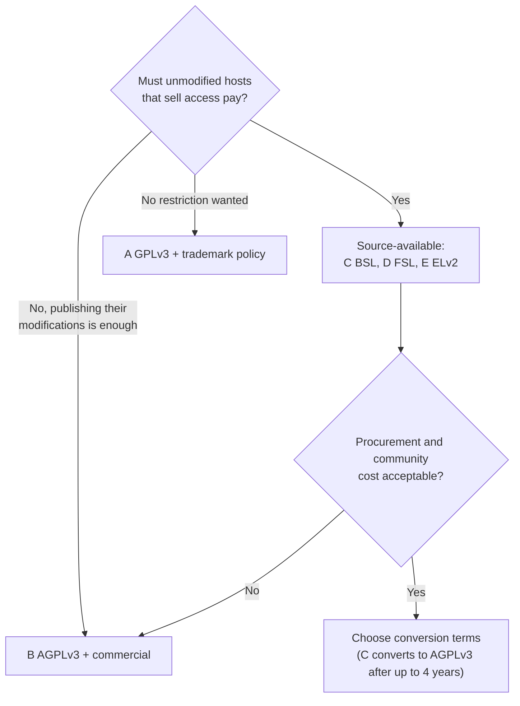

# Licensing Options

**Status:** decided 2026-11-19 (**Decided by: User**): option B, see [Decision](#decision). **Not legal advice:** counsel reviews the commercial terms and the contributor agreement.

## Goal and constraint

**Stated goal (User, 2026-11-19):** a party that hosts the product and sells access to it should send part of the profit back; WordPress hosting is the cited concern.

**Constraint:** the repository is public under GPLv3. Every release already published stays GPLv3 for anyone, indefinitely. A change protects future releases only.

## Facts that decide what is possible

| Fact | Consequence |
|------|-------------|
| One person holds the copyright (80 commits under two identities); no contributor agreement; no outside contribution merged; 1 star, 0 forks | The owner may relicense alone, and today the cost of doing so is at its lowest. Each accepted outside contribution without an agreement weakens that. |
| No GPL or AGPL library is linked (phase 4 inventory); only LGPL `svglib` and `psycopg2` (unmodified), MPL-2.0 `certifi`, and permissive packages | Every option below is compatible with the dependencies. |
| Ghostscript (AGPL) and poppler (GPL) run in the separate converter container | They stay separate programs under their own licences under every option; a source offer for them is an obligation of that image regardless. |
| The server tier already has a module entitlement switch (`OrganizationModuleEntitlement`) | A commercial option has a natural seam (open core, or per-module terms). |
| Past GPLv3 releases can be hosted by anyone | A host may fork the last GPLv3 release. Practical limit: the host then maintains it without the owner's later work. |

## Findings

1. **Copyleft does not return profit.** AGPLv3 section 13 obliges a host that **modifies** the code to offer those modifications to its users. An **unmodified** host owes nothing, and no copyleft licence requires payment. GPLv3 is weaker still: hosting is not distribution, so a host owes nothing at all.
2. **Only a source-available licence meets the stated goal directly.** Business Source License (BSL), Functional Source License (FSL) and Elastic License 2.0 (ELv2) forbid offering the product as a service to others. They are not open source (not OSI-approved).
3. **The cost of those licences is adoption and community.** Some procurement accepts only OSI-approved licences, which matters for a product sold to compliance-focused organisations; the HashiCorp (OpenTofu), Elastic (OpenSearch) and Redis (Valkey) changes each produced a community fork, and Elastic and Redis later added AGPL back. Public claims such as "open source" must then change to "source-available".
4. **"GPLv3 plus a no-hosting clause" is not an option.** GPLv3 section 10 lets any recipient remove added restrictions.
5. **A trademark policy works under every option** and is the lever WordPress used (GPLv3 section 7(e) permits withholding trademark rights). It limits who may sell a service under the name, not who may run the code.
6. **A contributor agreement must exist before any outside contribution is accepted** under every option except the baseline; relicensing later needs the contributors' consent without it.
7. **Much of the code was written with AI coding assistants under the owner's direction.** Whether, and to whom, copyright subsists in such output differs by jurisdiction (several require human authorship). The owner can license only what is copyrightable and theirs, so this is a question for counsel before commercial terms are written; the choice of licence does not change it.

## Options

| | A. Stay GPLv3 | B. AGPLv3 + commercial | C. BSL 1.1 | D. FSL | E. ELv2 | F. Open core |
|---|---|---|---|---|---|---|
| Open source (OSI) | Yes | Yes | No | No | No | Core yes, extras no |
| Hosts must pay or stop | No | Only if they modify and will not publish, or want a commercial licence | **Yes** (Additional Use Grant, owner-defined) | **Yes** (competing use, fixed wording) | **Yes** (managed service, fixed wording) | Only for the paid modules |
| Self-hosting by customers | Free | Free (AGPL obligations only if modified) | Free under the grant | Free (internal use) | Free | Free (core) |
| Converts to open later | n/a | n/a | Yes, up to 4 years, to a GPL-compatible licence the owner names (for example AGPLv3) | Yes, 2 years, to Apache-2.0 or MIT | Never | n/a |
| Fixed standard text | Yes | Yes | Template with parameters (grant, date, change licence) | Yes, one version | Yes | Two licences to maintain |
| Procurement friction | Low | Medium (AGPL banned by some firms; this also drives commercial sales) | Medium to high | Medium to high | Medium to high | Low to medium |
| Fork risk | None | Low | Medium | Medium | Medium | Low |
| Effect on past releases | None | None (stay GPLv3) | None | None | None | None |
| Fits stated goal | No | Partly | **Yes** | Yes, but ends permissive | Yes, never converts | Partly (hosts still run the core) |

### Notes per option

- **A. Stay GPLv3.** No cost, no goal met. Add the trademark policy and treat the hosted offering and support as the income.
- **B. AGPLv3 + commercial.** The common dual-licence model. Money arrives from organisations that cannot accept AGPL or want to keep modifications private, not from unmodified hosts. Needs a commercial licence text and the contributor agreement.
- **C. BSL 1.1.** The owner sets the Additional Use Grant (for example: all production use except offering the product to third parties as a hosted or managed service), a Change Date (at most four years after each release) and a Change License (AGPLv3 keeps the end state copyleft). Used by MariaDB and, until 2023 to 2024, others. The name "Business Source License" may be used only if the licence keeps the covenants (change date at most four years, a compatible change licence).
- **D. FSL.** Simplest wording, no parameters, converts after two years, but to Apache-2.0 or MIT, so a two-year-old version becomes free for any host with no obligation. Weaker end state than C for this goal.
- **E. ELv2.** No conversion; also forbids circumventing licence-key functions, which the entitlement switch could make relevant. Strongest restriction, largest community effect.
- **F. Open core.** Core under an open licence, selected modules proprietary behind the existing entitlement. All modules are in the public repository today under GPLv3, so only future versions of a module could move, and its maintenance splits across two licences. Highest engineering and community cost; the goal is met only for what is moved.

## Recommendation (Agent)

1. **If the goal is as stated, choose C (BSL 1.1)** with an Additional Use Grant that allows every use except offering the product as a hosted or managed service to third parties, and AGPLv3 as the Change License. It is the only option that meets the goal and ends in copyleft; FSL ends permissive and ELv2 never converts.
2. **If adoption by regulated organisations matters more than the goal, choose B**; accept that unmodified hosts owe nothing.
3. **Under both, do three things first:** a contributor licence agreement before any outside contribution, a trademark policy, and counsel's review of the licence text and commercial terms.
4. **Challenge to the premise:** with no outside users yet recorded, the host-and-resell risk is hypothetical while the adoption cost of a restrictive licence is immediate. The timing argument is the reverse: relicensing is cheapest now, with one copyright holder and no forks. Choosing A today and moving later is possible only while that stays true.

## Trademark policy outline

Applies to the name "ReqTrackManager" and its logo, under every option (a registration, if wanted, is a separate counsel decision; the name is currently an unregistered mark).

- Allowed without permission: running the software under its own name for one's own use, factual references (for example "compatible with ReqTrackManager"), and unmodified redistribution.
- Needs written permission: offering a hosted or managed service under the name or a confusingly similar one; using the name or logo for a modified version (it must be renamed).
- Not allowed: implying endorsement, or using the logo as one's own.

## If a change is chosen: what it touches

Order is fixed: contributor terms first, then the licence.

| Step | Files |
|------|-------|
| 1. Contribution terms | `CONTRIBUTING.md`, a contributor licence agreement and its enforcement (a sign-off check in CI, or a GitHub app, which is a vendor to record in the vendor policy) |
| 2. Licence | `LICENSE`, a commercial-licence summary (terms written with counsel), `TRADEMARKS.md` |
| 3. Metadata | `backend/pyproject.toml`, `mcp-server/pyproject.toml`, `frontend/package.json`, `docs/website/package.json` (none declares a licence today), the website schema.org field |
| 4. Text | `README.md` ("open source" becomes "source-available" under C, D, E), the Licences page constant `PRODUCT_LICENCE` in `frontend/src/components/LicencesPanel.tsx`, the website contributing and overview pages |
| 5. Controls | `docs/soc2/policies/vendor-and-subprocessor-management-policy.md`, `scripts/licence_policy.json` if the product's own licence is checked, `docs/decisions.md` |
| 6. Guard | a test that the package metadata agrees with `LICENSE` |

Per-file headers are not added; `LICENSE` and the package metadata state the licence.

## Decision

**Decided by: User, 2026-11-19.**

| Question | Choice |
|----------|--------|
| Licence | **B. AGPLv3 + commercial.** The stated goal is met only partly (finding 1): an unmodified host owes nothing; the commercial licence is for those who cannot meet the AGPL. Chosen over the recommended C (BSL 1.1). |
| Contributions | A contributor licence agreement with a sign-off check in CI (`CLA.md`, `.github/cla-signatories.json`, `scripts/check_cla.py`). |
| Trademark policy | None for now. |
| Licensor and contact | Richard Ballard (individual); enquiries by GitHub issue until an email address is added. |

SPDX identifier `AGPL-3.0-only` (**Decided by: Agent**: "or later" would let a later FSF version change the terms without the owner's choice). The route to a source-available licence stays open while the contributor agreement is in force, because it grants the licensor the right to relicense contributions.
