# Modules

This document explains the modular feature system: what a "module" is in this
application, why it exists, and how to build one. It is written for someone
extending or integrating with the system — including a third-party developer
working outside this repository — who wants to understand the module contract
without first reading the full [solution architecture](solution-architecture.md)
document.

This document covers the module *mechanism* itself — the registry, gating,
RBAC, frontend integration, and MCP tool contribution — not any specific
module's own business logic. Compliance is the first real module built on top
of this system; see [docs/plans/completed/compliance-module-plan.md](plans/completed/compliance-module-plan.md)
for its own requirements and build history. It's used below only for small,
illustrative examples.

If you want the dense, line-referenced technical account (exact table/class
names, every edge case) rather than this readable version, see
[solution-architecture.md](solution-architecture.md)'s own "Modular Feature
System" section.

---

## Why modules exist

Some capabilities are large, optional, and not every organisation using this
application wants them — Compliance is the first, with more planned. Building
each one directly into the core application would mean:

- every optional feature area gets its own bespoke enable/disable switch,
  scattered across routers and settings pages
- every feature area that needs its own roles (e.g. a "Compliance Manager")
  either gets bolted onto the core `OrgRole`/`ProjectRole` enums — permanently
  growing them even for organisations that never use the feature — or gets a
  one-off role mechanism nobody else can reuse
- every feature area that wants its own UI ends up either crammed into the
  core frontend bundle regardless of whether it's enabled, or built as a
  second, inconsistent way of extending the UI

The module system solves this once, generically: a **module** is a
self-contained unit — backend endpoints, database tables, RBAC roles, frontend
pages, and (optionally) AI-assistant tools — that plugs into the application
through a small, fixed set of extension points, rather than requiring edits
scattered through core code. A module can be shipped in this repository
("first-party") or built and installed independently ("third-party"). Either
way, it's gated the same way, uses the same RBAC and UI conventions as the
core application, and can be turned on or off per deployment and per
organisation without any code changes.

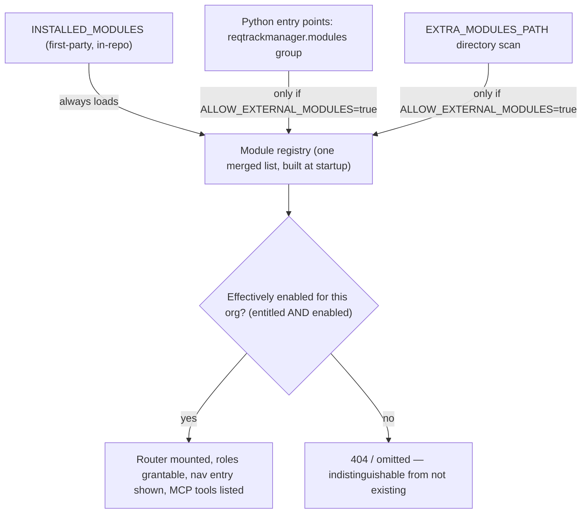

---

## Core concepts, at a glance

| Concept | What it is |
|---|---|
| `ModuleDefinition` | The single object a module registers to declare everything about itself — name, backend router, RBAC roles, frontend integration, MCP tools. |
| Registry | The merged list of every currently-known `ModuleDefinition`, built once at process startup from three discovery sources. |
| Entitlement | Server-tier: is this organisation *allowed* to use this module at all (the licensing/plan lever)? |
| Enablement | Org-tier: has this organisation's own admin actually *turned it on*? |
| Module-contributed role | An RBAC role a module defines for itself (e.g. "Compliance Manager"), without touching the core role enums. |
| Tier A / Tier B / Tier C | The three ways a module supplies frontend UI — compiled into the app (Tier A), rendered in a sandboxed iframe (Tier B), or dynamically loaded at runtime via Module Federation, with no rebuild and no sandbox (Tier C). |
| Module MCP tools | AI-assistant tools (`mcp-server/`) a module contributes, proxied declaratively to its own REST endpoints. |

---

## 1. The registry: how a module gets discovered

`backend/app/modules/registry.py` is the single source of truth for "which
modules exist." At process startup it merges three sources, in priority
order — an earlier source's `key` always wins if two collide:

1. **`INSTALLED_MODULES`** — a static Python list, in this repository,
   reviewed the same way any other code change here is. Always loads,
   regardless of configuration. This is how a first-party module (built in
   this repo, via a normal PR) is registered.
2. **Python entry points**, under the `reqtrackmanager.modules` group — the
   same plugin-discovery idiom pytest and Flask extensions use. Any package
   `pip install`-ed into the deployment's image that declares this entry
   point is picked up automatically at startup. This is how a third-party
   module, published as its own installable package, is registered.
3. **`EXTRA_MODULES_PATH`** — an optional local directory. Each immediate
   subdirectory containing a `module.py` that exposes a module-level
   `MODULE_DEFINITION` attribute is loaded. This is for a self-hosted
   operator adding a custom module without publishing a package at all.

Sources 2 and 3 are gated behind `ALLOW_EXTERNAL_MODULES` (env var, default
`false`). When it's off, neither source is even scanned — not just filtered
afterward. A deployment that wants third-party modules has to opt in
explicitly; first-party modules in `INSTALLED_MODULES` are unaffected either
way. (This mirrors `MCP_WRITES_ENABLED`'s existing off-by-default precedent
in this codebase, and is a deliberate mitigation for a real risk: a
plugin-loading mechanism that can `pip install` and auto-run third-party code
is a new code-execution trust boundary — see [Security model](#security-model)
below.)

Every module the registry actually loads is logged at startup with its key,
version, and source — an operational record of what code entered the
deployment on a given run.

---

## 2. Gating: entitlement × enablement

A module is gated at two independent tiers, and **both** must pass for it to
be usable by a given organisation:

- **Entitlement** — the server-tier licensing/plan lever. Is this
  organisation allowed to use this module at all? Managed by a server admin
  or the narrower `MODULE_ADMINISTRATOR` server role. Stored as an explicit
  override row (`OrganizationModuleEntitlement`); no row means "use the
  deployment-wide default" (`ServerSettings.default_module_entitlement_policy`,
  `"open"` or `"closed"`) — not "denied."
- **Enablement** — the org-tier day-to-day switch. Among modules the
  organisation is entitled to, has *this organisation's own admin* actually
  turned it on? Stored as an explicit override row
  (`OrganizationModuleEnablement`); no row means "use the server-wide default"
  (`ServerModuleDefault`), and with none of those, the module's own registry
  default (`ModuleDefinition.default_enabled`).
- **Server default** — what an organisation with no row of its own gets
  (`ServerModuleDefault`: enabled for the organisation, and on by default for
  its projects). A fresh install is seeded with every module on; an upgrade is
  seeded with nothing, so it keeps its current effective states. Server
  administrators change it under Server Management → Modules, and can apply it
  to every existing organisation explicitly.

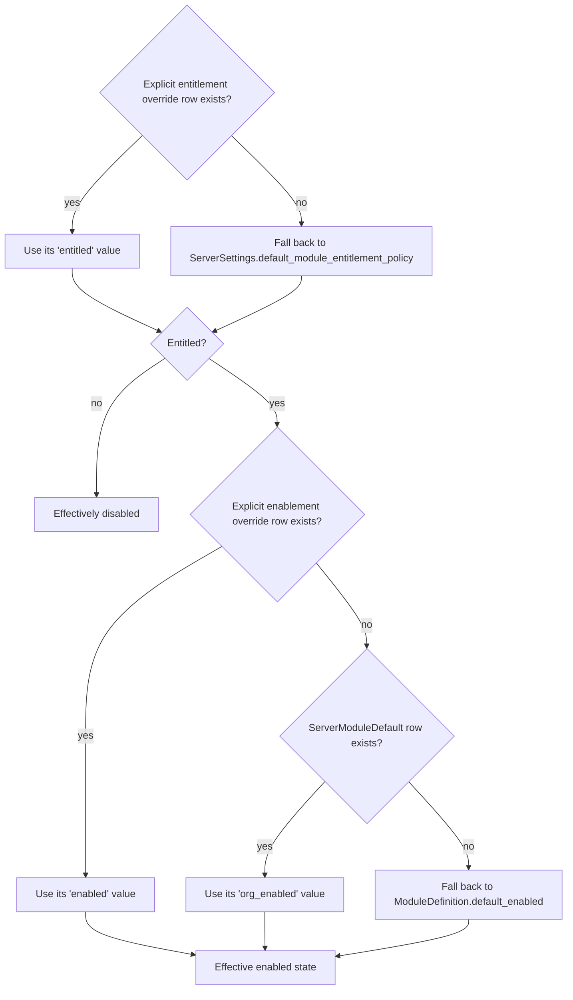

**Hiding.** A module an administrator cannot use is not listed to them: the
organisation module list omits a module the organisation is not entitled to
(server administrators keep the full view); the project module list omits a
module, and its sub-components, the organisation has disabled. A project's own
row for a hidden module is kept, so it returns with its state when the module
is re-enabled.

Whichever backend dependency a module's endpoints use to check this
(`require_org_module_enabled(module_key)` / `require_project_module_enabled
(module_key)`, both in `app.services.rbac`) returns **404, not 403**, when the
module is disabled or non-entitled. A disabled module's endpoints must be
indistinguishable from endpoints that don't exist — not leak their existence
via a 403.

A module never enforces this gate on its own endpoints from the outside —
`app.main` mounts every registered module's router in a simple loop, with no
second gate at the mount-loop level. Each module wires
`require_org_module_enabled`/`require_project_module_enabled` (or
`require_module_role`, below, which composes the same check) onto its own
routes internally, the same way every other router in this codebase already
owns its own dependency wiring.

### 2a. Sub-component enablement: one tier finer than whole-module (Module 0 — Platform Foundations — Phase 4)

A module may be too coarse a unit to enable/disable as a whole — Context &
Strategy's organisation may want to keep Pain Point on while turning Strategy
and Future State off, not an all-or-nothing switch. `ModuleDefinition.
sub_components` declares a tuple of `ModuleSubComponentDefinition(key, name,
default_enabled=True)` entries (empty by default — every module before
Context & Strategy needs no change), and a **third, independent gating
tier** sits below whole-module enablement for each one:

- **Org default** — `OrganizationModuleSubComponentDefault`, an explicit-
  override-only row keyed on `(organization_id, module_key,
  subcomponent_key)`; absence means "use the registry's own
  `default_enabled`." Org-admin-managed, same endpoint family as whole-
  module enablement: `GET`/`PUT /orgs/{id}/modules/{module_key}/
  subcomponents[/{subcomponent_key}]`.
- **Project override** — `ProjectModuleSubComponentEnablement`, same
  explicit-override-only shape, keyed on `(project_id, module_key,
  subcomponent_key)`; absence means "use the org default above, or the
  registry default if the organisation has none either." This is a
  genuinely new capability at the project level — whole-module enablement
  itself has **no** project-level override at all, only this finer-grained
  layer gets one. Project-admin-managed: `GET`/`PUT /projects/{id}/
  modules/{module_key}/subcomponents[/{subcomponent_key}]` (`require_
  project_manage`-gated, same dependency every other project-settings
  endpoint uses).

Resolution (`app.modules.registry.is_module_subcomponent_enabled`, for a
project-scoped artefact): whole-module disabled always wins first, with no
further lookup; then project override; then org default; then the
registry's own `default_enabled`. `require_project_subcomponent_enabled
(module_key, subcomponent_key)` (`app.services.rbac`) is the RBAC dependency
a module's project-scoped router depends on instead of/in addition to
`require_project_module_enabled` — same 404-not-403 posture, same Tier B
`<ModuleFrame>` token acceptance.

**An org-scoped artefact has no project tier to speak of** — there is no
`project_id` for a project override to key against at all (Context &
Strategy's own org-scoped Strategy records are the first example). For this
case, `is_org_module_subcomponent_enabled`/`require_org_subcomponent_enabled`
resolve purely from the organisation's own default: that row *is* the
effective value, not a fallback beneath a tier that doesn't exist for this
artefact. This reuses the same org-default table/endpoint the project-scoped
resolution's own middle tier already uses, rather than inventing a second,
parallel org-scoped mechanism.

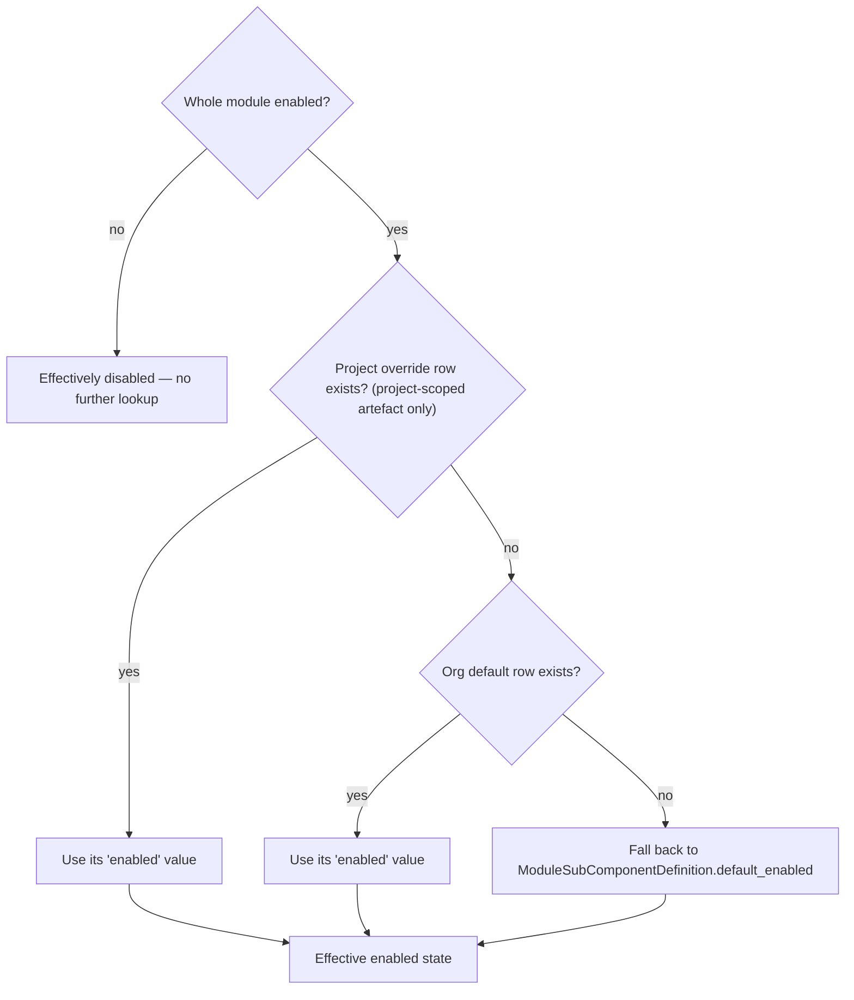

Both endpoint families return the effective state alongside the org
default/registry default and whether an override exists at that tier — not
just a flat boolean — so the frontend can render the UX style guide's
"platform-default override visibility" pattern ("using org default: X" vs.
"overridden to: Y"). **Frontend built** (2026-09-29, a later pass than
Context & Strategy's own Phase 7 artefact UI, once a real "toggle a
sub-component" need existed to build it against): the org admin's
**Modules** page (`OrgAdminPage.tsx`) renders one extra, indented row per
sub-component underneath its own module's row, each with a `ToggleSwitch`
bound to that sub-component's org default — entirely generic over
`ModuleSubComponentDefinition.name`/`default_enabled`, so a future module
declaring `sub_components` needs no frontend edit of its own to get this.
`GET .../subcomponents` is called for every registered module
unconditionally (it safely returns `[]` for one with none declared, e.g.
every module before Context & Strategy) rather than checked first. See
`docs/plans/completed/module-00-platform-foundations-plan.md`'s Phase 4 section.

### 2b. Project-level override of whole-module enablement (Module 0 — Platform Foundations — Phase 5)

Added immediately after Phase 4, at the user's request: whole-module
enablement itself (§2's `OrganizationModuleEnablement`) had no project-
level override at all — the org's own row was the one and only effective
value for every project in that org. This phase gives a project an
override lever over the organisation's own setting for that module —
**corrected 2026-09-29** (Decided by: User — see `docs/decisions.md`'s
dated entry) once the original design's first real consuming UI exposed a
gap: the original single `enabled` boolean conflated "is this module
available to the organisation at all" with "what does a project get by
default," which meant a project override could re-enable a module the
organisation had deliberately disabled outright — not what "disabled"
should mean.

The corrected model is four tiers, not two: `OrganizationModuleEnablement`
gains a second, independent column, `default_project_enabled` (migration
`0055`). `enabled` is now a genuine **hard floor** — `False` means no
project of this organisation may use the module at all, and no
`ProjectModuleEnablement` override can cross it in either direction (a
`PUT` attempting `enabled=True` from the project side is rejected 400 while
the organisation's own `enabled` is `False`). `default_project_enabled`,
only consulted once `enabled` is `True`, is the actual default a project
inherits absent its own override — and a project's own override remains
**symmetric** against *this* value, either direction (a specialist module
the organisation makes available but defaults off for most projects can
still be opted into by an individual project manager). `is_module_enabled_
for_project(db, project_id, module_key)` (`app.modules.registry`) resolves
it: entitlement and `enabled` first (both an absolute ceiling), then
`ProjectModuleEnablement` (project override, if any), then
`default_project_enabled`, then the registry's own `default_enabled` (for
an organisation with no explicit row at all). `require_project_module_
enabled`/`require_project_module_enabled_dynamic` (`app.services.rbac`)
resolve through this function now instead of calling the org-only
`is_module_enabled` directly — every existing module-gated project
endpoint keeps working unchanged, since day one has zero `ProjectModuleEnablement`
rows and the fallback is exactly the pre-Phase-5 org-only behaviour.

**Copy-on-create (2026-10-04, Decided by: User).** An org default only
affects projects that get the module afterwards; an org hard Off still
reaches every project. `snapshot_project_module_state` (called from
`routers.projects.create_project`, blank and template-cloned alike) writes
a `ProjectModuleEnablement`/`ProjectModuleSubComponentEnablement` row per
module/sub-component the org has hard-on; `freeze_projects_module_default`/
`freeze_projects_subcomponent_default` write the *old* default into any
row-less project just before an org default changes. Both skip anything
hard-off, so a project created while a module was Off picks up whatever
default applies when it's turned on (Decided by: Agent). The live-default
tier in the resolvers is therefore only reached by such projects or by a
module registered after the project was created.

**Sub-components have the same two org levers** (migration `0056`):
`OrganizationModuleSubComponentDefault.enabled` is a hard floor (also the
effective value for org-scoped artefacts) and `default_project_enabled` is
what gets copied. `resolve_org_subcomponent_state` returns both.

`GET`/`PUT /projects/{id}/modules/{module_key}/enablement` and
`GET`/`PUT .../subcomponents[/{subcomponent_key}]`
(`app.routers.projects.module_roles`) are the project surface; the former
`DELETE` "reset to org default" endpoints were removed — with copied
values there is no live default to reset to, so a reset is just a `PUT`.
`GET /projects/{id}/modules` (no `module_key`) lists every registered
module with this project's own effective state in one call — the bulk
discovery endpoint a Project Admin "Modules" tab needs to know which
modules exist to list at all, since `GET /orgs/{id}/modules` is org-admin-
gated and the per-module endpoint above requires already knowing every
`module_key` to iterate.

**Not purely additive — Phase 4's own resolution had to be repointed.**
`is_module_subcomponent_enabled`'s first (whole-module) check used to call
the org-only `is_module_enabled` directly; it now calls this phase's
`is_module_enabled_for_project` instead, so a project-level whole-module
override correctly cascades to disable/enable that module's every
sub-component too — not just the org-level disable case Phase 4 alone
could see. Org-scoped artefacts are unaffected by this phase either way:
`require_org_module_enabled`/`is_org_module_subcomponent_enabled` remain
untouched, the same "no project to hold an override against" reasoning
Phase 4 already applied to org-scoped sub-component gating. **Frontend
built** (2026-09-29, same later pass as Phase 4's own): the Project Admin
**Modules** tab (`ProjectAdminPage.tsx`, a new core nav entry — not a
`moduleAdminSections` module-contributed panel) renders every registered
module with an `OverridePill` (`custom={has_project_override}`) alongside
its `ToggleSwitch`, and the same shape one level down for each module's own
sub-components — generic over the registry, so no per-module frontend
work is needed here either.

---

## 3. `ModuleDefinition`: the contract

Everything a module declares about itself is one `ModuleDefinition` value
(a frozen dataclass, `app.modules.registry.ModuleDefinition`):

```python
@dataclass(frozen=True)
class ModuleDefinition:
    key: str                                    # stable, unique — e.g. "compliance"
    name: str                                   # display name
    description: str
    version: str                                # the module's own version string
    default_enabled: bool                       # default for an entitled org with no override row
    implemented: bool                           # False for a registered-but-not-yet-live placeholder
    get_router: Callable[[], APIRouter | None]   # called once; None if no HTTP endpoints
    roles: tuple[ModuleRoleDefinition, ...] = ()  # module-contributed RBAC roles
    sub_components: tuple[ModuleSubComponentDefinition, ...] = ()  # independently-toggleable pieces (§2a)
    scoring_schemes: tuple[ScoringSchemeDefinition, ...] = ()  # configurable scoring matrices (§4d)
    scoring_target_providers: dict[str, Callable[[Session, UUID], list[ScoringTarget]]] = {}  # records others score against (§4e)
    artefact_summary_providers: dict[str, ArtefactSummaryProvider] = {}  # records others link to (§4f)
    search_providers: dict[str, ArtefactSearchProvider] = {}  # records the global search finds (§4j)
    not_searchable: dict[str, str] = {}  # artefact types deliberately outside the search, with the reason (§4j)
    search_scopes: dict[str, SearchScope] = {}  # extra places the search can be scoped to (§4j)
    record_tables: dict[str, RecordTableProvider] = {}  # a type's list as an exportable, importable table (§4l)
    not_importable: dict[str, str] = {}  # artefact types whose records import cannot author, with the reason (§4l)
    report_fields: dict[str, ReportFieldProvider] = {}  # fields a custom report layout may use for a type (§4m)
    not_reportable: dict[str, str] = {}  # artefact types deliberately outside custom reports, with the reason (§4m)
    report_starter_sections: tuple[ReportStarterSection, ...] = ()  # your parts of the platform's starter report layouts (§4v)
    report_snippets: tuple[ReportSnippet, ...] = ()  # fragments of a report layout the designer can insert, about your records (§4aa)
    link_type_seeds: tuple[LinkTypeSeed, ...] = ()  # link types you ship; any artefact links to any by default (§4f-bis)
    reports: tuple[ReportDefinition, ...] = ()  # reports core serves for you (§4g)
    notification_types: tuple[NotificationTypeDefinition, ...] = ()  # notification kinds you send (§4h)
    on_artefact_changed: Callable[[Session, ArtefactChange], None] | None = None  # react to another module's artefact changing (§4h)
    scheduled_jobs: tuple[ModuleScheduledJob, ...] = ()  # daily sweeps core's scheduler runs for you
    frontend_manifest: ModuleFrontendManifest | None = None
    mcp_tools: tuple[McpToolDefinition, ...] = ()
    mcp_guidance: str = ""  # agent usage guidance, required when mcp_tools is non-empty
    models_import_path: str | None = None       # dotted path to your ORM models module
    migrations_import_path: str | None = None   # dotted path to a module exposing run_migrations(connection)
    get_project_router: Callable[[], APIRouter | None] | None = None  # optional 2nd, project-scoped router
    get_global_router: Callable[[], APIRouter | None] | None = None  # optional 3rd, id-less router
    resolve_file_owner_project_id: Callable[[Session, UUID], UUID | None] | None = None  # file-download auth hook
```

**`get_router` vs. `get_project_router`**: `get_router()` mounts at
`/api/v1/orgs/{organization_id}/modules/<key>/...` — the org-scoped root
every module before Compliance's Phase 7 used exclusively. If your module
also has endpoints that should live at `/api/v1/projects/{project_id}/
modules/<key>/...` instead (no `organization_id` in the path at all),
declare a second router via `get_project_router`. The main reason to want
one: an MCP tool proxying to a project-scoped endpoint can only declare
`project_id` as its path parameter — mirroring hand-written tools like
`get_project(project_id)` — if the underlying route has no
`{organization_id}` placeholder to also require. `build_mcp_tool_manifest`
validates each tool's `path_template` against *either* of your two router
prefixes (whichever one actually has a matching route), so a tool
declaring a `path_template` under `get_project_router()`'s prefix is
checked against that router, not `get_router()`'s. `app.main`'s mount loop
mounts both the same way; leave this `None` if you have no project-scoped
endpoints of your own (most modules).

**`get_global_router` (plans/completed/compliance-module-plan.md Phase 18)** is a third,
optional router for the rarer case where an endpoint has *no* single org or
project id in its own path at all — Compliance's own example is `GET
/api/v1/compliance/nav-visibility`, which aggregates across every org the
caller belongs to, and `GET /api/v1/compliance/standards/{standard_id}`,
which resolves its owning org from the standard's own id rather than a path
parameter. `app.main`'s mount loop mounts it the same way as the other two,
with no second gate applied at the mount-loop level — a route here must do
its own org/project resolution and access check internally, using `app.
services.rbac.require_org_access_and_module_enabled(db, current_user,
organization_id, module_key)` once you've resolved the relevant org id from
wherever your endpoint's own identifier leads to it. Leave this `None`
unless you have a genuinely id-less endpoint (most modules never will).

`key` and every `role_key` a module declares are load-bearing identifiers —
they're used as plain string keys in database rows (entitlement, enablement,
role grants), not foreign keys into a "modules" table, since modules are
defined in code, not as rows. **Never change a module's `key` or an existing
role's `role_key` once a deployment has data keyed on it.**

**If your module has its own database tables**, set `models_import_path` to
the dotted path of the module that defines them (e.g.
`"app.modules.compliance.models"`) — `import_all_module_models()` imports it
for you at the right time, so `Base.metadata` includes your tables for
Alembic's own comparisons without you having to touch `alembic/env.py` or
`tests/conftest.py` at all. This is purely an in-process Python import; it
never touches a real database on its own.

Getting your tables to actually *exist* in a real database is a separate
step, and where it happens depends on how your module is loaded:

- **First-party** (shipped inside `backend/app/modules/`, added to
  `INSTALLED_MODULES`): ship a real Alembic migration and set
  `migrations_dir` to its directory, relative to `backend/` (e.g.
  `"app/modules/compliance/migrations"` — Compliance's own
  `migrations/0026_compliance_data_model.py` is a worked example) —
  reviewed in a normal PR, exactly like every other first-party migration.
  Colocating it with the rest of your module's own code (models/service/
  router/tests) rather than dropping it into the flat, shared
  `backend/alembic/versions/` directory is a plans/completed/compliance-module-plan.md
  Phase 11 follow-up: `app.modules.registry.configure_alembic_version_
  locations` adds every registered module's `migrations_dir` to Alembic's
  own multi-directory `version_locations`, so your migration still
  participates in the exact same single, linear, reviewed chain — this is
  a file-location convenience, not a second, less-reviewed path (see that
  function's own docstring for why this doesn't reopen the trust-boundary
  reasoning below). Number your revision file to continue the existing
  chain's own sequence regardless of which directory the previous head
  lives in (check `python scripts/db.py heads`, not just your own module's
  directory, before picking the next number) — Alembic resolves the chain
  by each file's own `down_revision` string, not by directory, but this
  repo's own numbering convention is still project-wide sequential, for a
  human skimming `python scripts/db.py history` to follow easily. Write
  and run your migration via `python scripts/db.py revision`/`upgrade`/
  `history`/etc. (from `backend/`), not bare `alembic <command>` — the
  wrapper is what actually wires `configure_alembic_version_locations` in
  before dispatching, so a bare `alembic` invocation using this repo's own
  `alembic.ini` directly would only ever see the core directory, missing
  every module's own migrations entirely; see `scripts/db.py`'s own module
  docstring. Leave `migrations_import_path` unset; it is ignored for a
  first-party module even if you do set it.
- **External** (loaded via `EXTRA_MODULES_PATH` or a `pip`-installed entry
  point, only when the deployment operator has set `ALLOW_EXTERNAL_MODULES`):
  set `migrations_import_path` to a module exposing
  `run_migrations(connection) -> None`. It's called automatically at every
  startup, each module in its own transaction — so it must be **idempotent**
  (`CREATE TABLE IF NOT EXISTS`, etc., the same style every migration in this
  repo already uses), since there's no per-module revision tracking. See
  "Adding an external module by mounting a directory" in
  [deployment.md](deployment.md) for the full operator-facing walkthrough.
  (An external module *could* alternatively set `migrations_dir` instead,
  since that mechanism is honoured for any registered module — but
  `migrations_import_path` remains the documented, recommended path for an
  external module specifically, since it needs no filesystem access to this
  repo's own `backend/` tree at all, only an importable Python module.)

**If your module lets users attach files** (reusing `services.files.
upload_file`, per the project's own "reuse existing attachment mechanisms"
principle — Compliance's evidence attachments, Phase 8, are the first
example), set `resolve_file_owner_project_id` so the single, generic,
module-agnostic `GET /api/v1/files/{id}` download endpoint
(`app.routers.files.download_file`) can authorize your attachments too,
without that core router importing anything from your module directly.
It takes `(db, file_id)` and returns the owning project's id if your
module's own file-link table (e.g. `ComplianceEvidenceFile`) references
that file, else `None` — `app.modules.registry.resolve_module_file_
project_id` tries every registered module's hook, in registry order,
until one matches. Leave this `None` if your module has no file
attachments of its own.

**If your module needs to seed its own org-scoped defaults**, set
`on_org_created: Callable[[Session, UUID], None]` — called once,
unconditionally, right after a brand-new `Organization` row is flushed
(`app.routers.orgs.create_organization`/`app.services.bootstrap.
run_bootstrap` both call `run_on_org_created_hooks`, never importing your
module directly). Add rows, don't commit — the caller commits once for the
whole org-creation transaction. This is for defaults every organisation
should simply have (Compliance's own default action types are the
existing example) — there is no "on module enabled" callback to hook into
instead, so org-creation time is the one deterministic point that can't
race or double-seed regardless of your module's own `default_enabled`
policy.

**If your module has *optional* seeding a human should choose, not
unconditional defaults** (Decision Management's three seeded ADR template
packs are the first example — plans/module-04-decision-management-plan.md
Phase 1), use `org_creation_choices`/`on_org_created_with_choices` instead
of `on_org_created`:

```python
org_creation_choices: tuple[OrgCreationChoiceOption, ...] = ()
on_org_created_with_choices: Callable[[Session, UUID, frozenset[str]], None] | None = None
```

Declare each option as an `OrgCreationChoiceOption` (`key`, `group_label`,
`label`, `description`, `default_selected`) — `key` should be namespaced
with your module's own key (e.g. `"decisions:adr_madr"`) so it can never
collide with another module's choice. `GET /orgs/creation-choices` returns
every registered module's options (via `get_org_creation_choices()`) for
the org-creation form to render generically, grouped by `group_label`;
`POST /orgs`'s `module_choice_keys` field carries back whichever keys the
caller checked. Your `on_org_created_with_choices` hook receives the full
resolved set of selected keys across *every* module, not just your own —
filter to your own prefix before acting. If the caller creates an
organisation without passing `module_choice_keys` at all (an API caller,
script, or `services.bootstrap.run_bootstrap` that predates your module),
the resolved set falls back to every option with `default_selected=True`
(`default_org_creation_choice_keys()`), so your module still gets sensible
defaults without that caller needing to know your choices exist. Leave
both fields at their defaults (empty tuple, `None`) if your module has
nothing optional to offer at org-creation time — most modules never will.

---

## 4. Module-contributed RBAC

A module can declare its own named roles without touching the core
`OrgRole`/`ProjectRole` enums:

```python
ModuleRoleDefinition(
    role_key="compliance_manager",
    name="Compliance Manager",
    description="Can create and publish compliance standards for this organisation.",
    scope="org",   # or "project"
)
```

Nothing stops a module from declaring **both** an org-scoped and a
project-scoped role that mean the same conceptual thing at two different
levels — Context & Strategy (`docs/plans/module-01-context-and-strategy-
plan.md`) is the first module whose own artefact (a Strategy) is itself
scoped at either level, so it registers `strategy_owner`/`strategy_approver`
(project) *and* `org_strategy_owner`/`org_strategy_approver` (org) side by
side, picking whichever pair applies per-row from the artefact's own
`scope` column. No mechanism change was needed for this — `scope` was
already a plain per-role string, not a fixed choice a module makes once for
its whole role set. Context & Strategy's own Phase 2 (Future State) repeats
this exact pattern a second time in the same module, for a second artefact
type — `future_state_owner`/`future_state_approver` (project) and
`org_future_state_owner`/`org_future_state_approver` (org) — bringing that
one module to eight roles total, confirming the mechanism scales to more
than one org/project-dual-scoped artefact per module without any further
change. Phase 3 (Pain Points) then adds two more roles that deliberately
*don't* follow this dual-scope pairing at all — `pain_point_manager` is
project-scoped only (Pain Point itself has no organisation-level record,
unlike Strategy/Future State, so there is no `org_pain_point_manager`
counterpart to pair it with), and `pain_point_type_admin` is org-scoped
only, gating a different table (`PainPointTypeDefinition`) than the one
`pain_point_manager` gates. Confirms `scope` was never actually a
per-artefact-type constraint — a module is free to mix single-scope roles
alongside dual-scope pairs in the same `roles` tuple as its own artefacts'
shapes actually require, not obligated to always declare both halves of a
pair. Phase 4 (Guiding Principles) goes back to the dual-scope pairing —
`guiding_principle_owner`/`guiding_principle_approver` (project) and
`org_guiding_principle_owner`/`org_guiding_principle_approver` (org) —
since Guiding Principle, like Strategy/Future State and unlike Pain Point,
is itself scoped at either level; this brings Context & Strategy to
fourteen roles total across four artefact types, three of which follow the
dual-scope pattern (four roles each) and one (Pain Point, two roles) which
doesn't. Phase 5 (Open Questions) adds a third shape neither of the first
two covers: `open_question_owner`/`open_question_resolver` — two roles,
like Pain Point (Open Question has no organisation scope either), but
*not* a single role the way Pain Point's own two-tier permission model
collapses to. Source overview §9.4 names three distinct tiers (broad
project members; "Question Owner / Project Manager"; a separate "Decision
Maker"), so this phase's two roles split "change status" from "resolve"
rather than one role covering every decide-tier action the way `pain_
point_manager` does — confirming a module's roles are free to mix all
three shapes (dual-scope pairs, a single project-only role, or two
project-only roles) as each artefact's own source text actually requires,
not obligated to reuse whichever shape a sibling artefact in the same
module already happened to need. This brings Context & Strategy to sixteen
roles total across five artefact types.

At every process startup, `sync_module_role_definitions` mirrors the live
registry's roles into a `module_role_definitions` table — deliberately
**append-only** (a role is never deleted from this table just because its
module was uninstalled), so a historical grant made while a module was
registered still resolves to a real display name later, even after the
module is removed. Actual grants live in `user_module_roles`, a direct-grant
table (`user_id`, `module_key`, `role_key`, `organization_id`, optional
`project_id`) — there is still no *project-hierarchy* inheritance for module
roles, unlike core `ProjectRole`s. **Group-based grants were added by module
system Phase 30**, reversing V1's original "direct grants only" scope
boundary: `group_module_roles` (`org_group_id` in place of `user_id`,
otherwise identical) lets a role be granted to an organisation group as a
whole, resolved for every transitive member of that group at check time
(`services/rbac.py::_has_module_role_grant`'s group-grant branch, via
`effective_org_group_member_ids`) — mirroring `OrgGroupProjectRole`'s own
already-shipped group-grant precedent for core `ProjectRole`s one tier up.
This was a deliberate, user-requested reversal (see `docs/compliance-
module-plan.md` Phase 30 and its `docs/decisions.md` entry), not a walk-back
of the *hierarchy*-inheritance boundary above, which module roles still
don't have.

A module gates an endpoint on one of its own roles with
`require_module_role(module_key, role_key)`. The check composes with the
core RBAC model rather than replacing it — a caller is authorized if **any**
of the following hold:

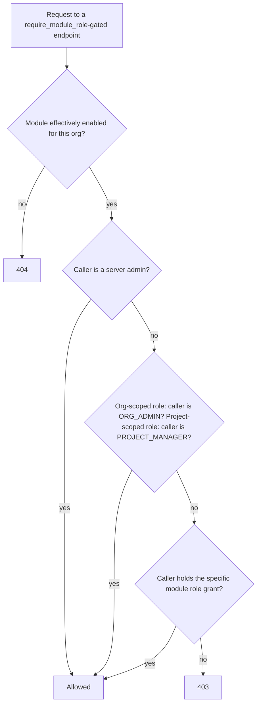

In other words: a higher-tier admin never needs the narrower module role
explicitly granted too — the same principle already applied to core roles.

**UI convention:** a module's roles are never rendered as a bespoke
grant/revoke control. The existing `MultiSelectDropdown` roles column on the
org admin Users table and the project members table merges in whichever
module roles are currently offered (declared by a currently-*enabled*
module) alongside the fixed core-role options — same checkbox, same
accessible labelling, same component, for every role in the system.

### 4a. A module-owned entity scope (plans/completed/compliance-module-plan.md Phase 22)

`scope` isn't limited to the two core-recognised literals above. A module
may declare **any other string** as `scope` — a role tied to one specific
row of a first-class entity the module itself owns, narrower than "the
whole org" but with no core-role tier to reuse the way `"project"` reuses
`ProjectRole.PROJECT_MANAGER` one level up. Compliance's own `standards_
manager`/`standards_contributor` (one role per `ComplianceStandard` row)
are the first example:

```python
ModuleRoleDefinition(
    role_key="standards_manager",
    name="Standards Manager",
    description="Full management of one specific compliance standard.",
    scope="standard",
    # Compliance's own org-scoped role also satisfies a standard-scoped
    # check, with no per-standard grant needed — the same "a higher tier
    # already retains full access" principle core roles get for free one
    # level up, extended one tier further down since there's no core role
    # to reuse here.
    overridden_by=(("org", "compliance_manager"),),
    # Resolves a `standard_id` (read off the request's own path parameters,
    # at the key "standard_id" for scope="standard") to its owning
    # organisation — required for any scope other than "org"/"project".
    resolve_entity_organization_id=resolve_standard_organization_id,
)
```

`require_module_role(module_key, role_key)` handles this generically: for
a non-core `scope`, it reads the entity's id off the request's resolved
path parameters at `f"{scope}_id"` (e.g. `standard_id` for `scope=
"standard"`), calls `resolve_entity_organization_id` to learn which
organisation it belongs to (the same role `_project_organization_id` plays
for `"project"`-scoped roles), then applies the identical module-enabled /
2FA / frame-scope checks every other scope gets, before checking (in order)
`is_server_admin`, `OrgRole.ORG_ADMIN` on that organisation, the caller's
own direct grant at this exact entity, and finally each role named in
`overridden_by`. Grant rows use the same `user_module_roles` table, with one
more nullable column: `scope_entity_id` (the generalised sibling of
`project_id`) — a bare `UUID`, not a foreign key, since (like `module_key`/
`role_key`) which table it points into is owned entirely by the declaring
module, not by this core table.

**Composing two of a module's own roles into one check:** `require_module_
role` only ever checks a single `(module_key, role_key)` pair. A module
that needs an "either of my own two roles" gate (Compliance's own
"`standards_manager` OR `standards_contributor` may edit a draft" check) —
composes the reusable predicate, `app.services.rbac.user_satisfies_module_
role`, directly: build two ordinary `require_module_role(...)` dependencies
(one per role) and try the first, falling back to the second on a 403 (never
on a 404 — a disabled module or absent entity should propagate immediately).
See `app.modules.compliance.router._require_standard_manage_or_contribute`
for the actual implementation — this is the pattern to copy, not a special
case to work around.

**A module-owned entity scope can also need its own "always at least one X"
floor**, the same way a project always needs at least one `PROJECT_MANAGER`.
There is no generic mechanism for this (it's inherently module-specific —
what "empty" means and how to detect it varies per entity), but the generic
hook a module needing one should reach for is `ModuleDefinition.validate_
org_group_member_removal` (Phase 22's own addition, alongside this scope
mechanism) — see §4b below.

### 4b. `validate_org_group_member_removal`: a module's own floor tied to an `OrgGroup`

Compliance's `standards_manager` floor has a second satisfaction path
besides a direct per-standard grant: an org can designate one `OrgGroup` as
its fallback compliance-managers group, whose every current member counts
as an effective `standards_manager` for any standard with no explicit grant
of its own (§3, "defaulting to a group of all compliance managers where
roles are SSO-managed" — the group may already be `idp_synced_group_name`-
mapped, reusing the existing SSO group-sync mechanism as-is, no new sync
plumbing needed). This raises a floor question `app.routers.orgs.remove_
org_group_member` has no way to answer on its own: removing this group's
last member could leave a standard with zero managers.

`ModuleDefinition.validate_org_group_member_removal: Callable[[Session,
UUID, UUID], str | None]` is the generic hook this needs — `remove_org_
group_member` calls every registered module's copy (via `app.modules.
registry.run_org_group_member_removal_hooks`) before removing a genuine
*user* member (never a nested-group member) from any `OrgGroup`, stopping
at the first one that returns a non-`None` block message (400'd verbatim).
A module with no group-based floor concept of its own (every module before
Compliance's Phase 22) simply returns `None` (the default) and is skipped —
core code never needs to know which modules, if any, care about a given
group being removed from.

This mechanism is distinct from, and predates, module roles' own group-*grant*
capability (§4's `group_module_roles`, added later by Phase 30): it only
ever answers "would this removal break a floor" for the fallback-group path,
it never grants a role on its own — a `group_module_roles` row is a real,
standard-specific grant like any other, just held by a group instead of a
user, and coexists with this floor mechanism rather than replacing it. See
`app.modules.compliance.service.validate_fallback_group_member_removal` for
the reference implementation.

Its whole-group counterpart, `ModuleDefinition.validate_org_group_deletion:
Callable[[Session, UUID], str | None]` (2026-10-05, when org groups became
deletable), is called by `delete_org_group` through `run_org_group_deletion_
hooks` in the same way. Compliance uses it to block deleting the fallback
group while a standard relies on it, since its setting is
`ON DELETE SET NULL` and the floor would otherwise vanish silently (see
`validate_fallback_group_deletion`).

`ModuleDefinition.artefact_ids_in_organization: Callable[[Session, UUID],
set[UUID]]` (2026-10-05) returns the ids of a module's own artefacts (of its
`artefact_types`) belonging to an organisation, org-scoped or in its
projects. Org deletion uses it to remove `ArtefactLink` rows, comments and
subscriptions on those artefacts, which have no foreign key core could
cascade through. Any module declaring `artefact_types` should implement it.

### 4c. Fine-Grained Access Control: `ModuleRoleDefinition.permissions`, `subtype_providers`, and `entity_scopes`

Fine-Grained Access Control (`docs/plans/core-fine-grained-access-control-
plan.md`, reclassified from an optional module to a **core** platform
capability, 2026-09-23 — it has no `ModuleDefinition` of its own, unlike
every other module this document describes) adds three small, additive
extension points to the module contract this section already documents,
rather than a new module:

- `ModuleRoleDefinition.permissions: tuple[str, ...] = ()` — the set of
  Fine-Grained Access Control permission-atom strings
  (`app.services.permissions.encode_permission`, e.g.
  `"decision:approve_baseline:"`, or a bare administrative key like
  `"grant_roles"`) a holder of this module-contributed role additionally
  gets, folded into the effective-permission resolution alongside direct
  custom-role grants. Optional and defaulted empty — a module that never
  sets this (every module as of this phase) keeps working exactly as
  before.
- `ModuleDefinition.subtype_providers: dict[str, Callable[[Session, UUID],
  list[str]]] = {}` — maps one of the module's own `artefact_types` values
  to a callable returning that organisation's currently valid sub-type
  values for it, e.g. Decision Management registers `{"decision":
  <a callable returning that org's current Decision Type names>}`. This
  lets a permission atom's optional third dimension (`subtype`) validate
  against a *dynamic, per-organisation* vocabulary a module owns (Decision
  Types are `DecisionTypeDefinition` rows, not a fixed code-level set),
  the same reason `artefact_types` itself exists one layer up — see
  `app.modules.registry.get_subtype_providers`/`get_subtypes`. A module
  with no dynamic sub-type vocabulary of its own simply leaves this empty;
  `subtype=None` (the wildcard, matching every sub-type) remains the only
  option for its artefact types.
- `ModuleDefinition.entity_scopes: dict[str, EntityScopeDefinition] = {}`
  (Phase 5) — registers one of this module's own `ModuleRoleDefinition.
  scope` values (§4a's module-owned entity scope, e.g. compliance's
  `"standard"`) so code *outside* `require_module_role` can resolve/
  enumerate it too: `CustomRoleDefinition.scope` accepts any key present
  here (an org can now define a custom role scoped to one specific
  standard, not just the two core `"org"`/`"project"` values), and `app.
  services.rbac.get_effective_permissions`/`require_permission` gained
  matching optional `entity_scope`/`entity_id` parameters that compose a
  module-role's or custom role's `permissions` against that exact entity —
  see `app.modules.registry.get_all_registered_entity_scopes`. `Entity
  ScopeDefinition` carries `resolve_organization_id` (same contract as
  `ModuleRoleDefinition.resolve_entity_organization_id` — deliberately a
  second, parallel declaration, not a refactor of that field, so `require_
  module_role`'s own entity-scope branch is untouched), `label` (for the
  Role Management UI's scope/entity pickers), and `list_entities` (that
  organisation's current rows of this scope, as `(id, name)` pairs, so the
  frontend never hardcodes a specific module's entities). A module with no
  entity-scoped role of its own (every module before Compliance) simply
  leaves this empty.

Full design and phase-by-phase detail lives in that plan, not here — this
entry exists only so a module author extending either the core `Module
RoleDefinition`/`ModuleDefinition` contract or their own module's roles
knows these fields exist.

### 4d. Scoring schemes: configurable scoring matrices (Module 1 Phase 10)

A module that scores something (Pain Points, Stakeholders and Risks today)
registers a `ScoringSchemeDefinition` on `ModuleDefinition.scoring_schemes`
instead of building its own matrix tables. Core owns storage, resolution,
maths, API and UI; the module only declares keys and defaults.

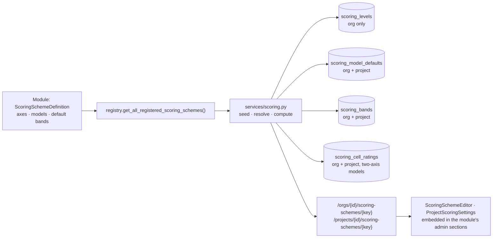

- **Axes** have ordered, weighted levels (≥2, unique names and weights,
  ordered by weight; the highest is the top level). Seeded per org on
  creation/import and at every startup (`sync_scoring_levels`), so a module
  installed later still gets levels. Org-only: module rows reference levels
  by id.
- **Models** combine axes; score = product of the chosen levels' weights,
  "not scored" if any input is missing. **Bands** use the normalised score
  (score ÷ maximum), so they survive re-weighting.
- **Default model and bands** resolve project → nearest ancestor → org →
  module default (the nested-projects fallback rule). No rows = inherit.
- **Cell ratings (Module 3 Phase 1a).** Thresholds on a product can't
  reproduce a non-monotonic matrix (a 5 × 1 cell rated differently from its
  score), so a **two-axis** model may also carry explicit
  `(first-axis level, second-axis level) → band label` rows
  (`scoring_cell_ratings`, `PUT .../models/{model}/cell-ratings`, same
  org/project endpoints and gating as bands). The label must exist in the
  scope's effective bands (bands a scope's own cells still use can't be
  removed or renamed); a set is all-or-nothing and resolves project →
  ancestor → org with no system default; a deleted level takes its cells
  with it. In `services.scoring.compute_score`, pass `level_ids` and
  `cell_ratings` (from `resolve_effective_cell_ratings`/`to_cell_ratings`) and
  a pinned cell wins over the thresholds for that cell only. A *blend* of
  several cells (an average across personas, say) is not a cell, so it keeps
  the threshold bands; a single scored entry keeps its cell band.
- **Gating:** reads need org membership (org endpoints) or project
  view-or-manage (project endpoints); org writes need org admin or the
  scheme's `admin_role_key` module role; project writes need
  `require_project_manage`. All 404 when the module is disabled. Writes are
  audit-logged.
- **Level references:** set `count_level_usage`/`reassign_level_usage`
  once your own rows reference levels, so core can block a delete or
  reassign references to another level on the same axis. Stakeholders
  (Module 2) is the first to do so: its versioned rows hold
  `influence_level_id`/`interest_level_id`, the hooks count and move only
  *current* versions, and a historic version's reference is cleared by the
  foreign key's `ON DELETE SET NULL` instead of rewriting history.
  Risk Management (Module 3) follows the same pattern with six level columns (inherent and residual
  Likelihood, Consequence and Detectability) and derives each risk's rating at read time
  (`modules/risk_management/ratings.py`), so nothing about a rating is stored.
- **UI:** embed `ScoringSchemeEditor` (org) and `ProjectScoringSettings`
  (project) in your own `orgAdminSections`/`projectAdminSections`, passing
  your scheme key. `ScoringLevelPicker`, `ScoringModelSwitcher` and
  `ScoringMatrixChart` are the shared scoring/viewing components;
  `ScoringCellRatingsEditor` (inside `ScoringModelBands`) edits cell ratings.

---

### 4h. Notification types and change hooks (Module 3 Phase 4)

Two generic extension points let a module send its own notifications and react
to changes elsewhere, without editing a core file.

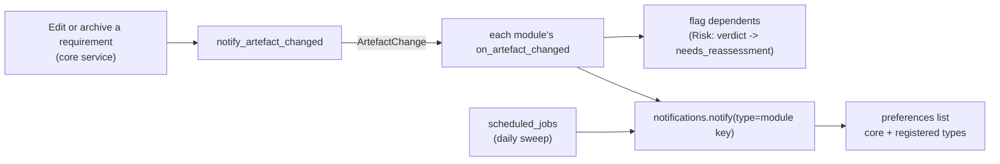

- **`notification_types`** declares `NotificationTypeDefinition(key, label)`
  kinds (prefix the key with the module key, e.g. `risk_review_due`).
  `Notification.type` and `NotificationPreference.type` are plain strings
  validated against core's `NotificationType` plus every registered module's
  declarations (`get_all_notification_types`), so a module never adds a member
  to core's closed enum. `services.notifications.notify` accepts either form and
  raises `ValueError` for an unregistered key. The preferences API returns
  `label` for module types; core types are labelled by the frontend string table.
  To make a notification clickable, send the record's registered artefact type as
  `entity_type` and its id as `entity_id`: the frontend's `getNotificationLink`
  opens it through the owning module's `artefactPaths`, with no core change.
- **`on_artefact_changed`** is called with an `ArtefactChange` (`artefact_type`,
  `artefact_id`, `project_id`, `kind` of `content_changed` or `archived`,
  `summary`, `actor_id`) by `services.artefact_changes.notify_artefact_changed`,
  inside the changing request's transaction (never commit). It is raised today
  for requirements (a content edit, or archival); any artefact owner can call
  `notify_artefact_changed` the same way, with no import of the consuming module.
  A hook that raises is logged and rolled back to a savepoint, so a dependent's
  bookkeeping can never fail the edit. Risk uses it to detect that the artefact
  behind an effective treatment verdict changed; it flags, it does not rewrite.

### 4i. Principal references: a field that names a user or a group (Users and groups parity, Phase 1)

A module field that names an owner, assignee or reviewer is built as a **principal**: a `<name>_type` / `<name>_id` column pair (`models/principal.py` helpers) holding a user, an organisation group or a project group, written through `services/principals.py` (`validate_principal`, `is_principal_member`, `principal_filter_clause`, `principal_recipients`, `principal_labels`, `principal_to_bundle` / `principal_from_bundle`; a bundle importer calls `principal_columns_from_bundle`, which also reads an older bundle's `<field>_email`). Declare each pair so core can find what still names a group without importing the module:

```python
PrincipalReference(model=Decision, field="owner", label="decision owners",
                   audit_entity_type="decision", mandatory=True)
```

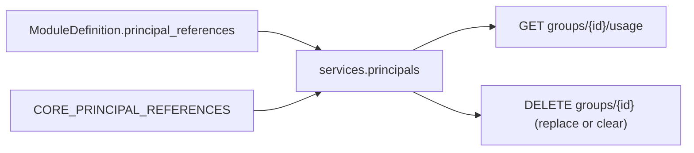

Deleting a group is blocked (409) while a declared field names it, until every row is handed to a replacement or an optional field is cleared; a `mandatory` field always needs a replacement. Set `live_filter` on a versioned table so only current rows count; older versions keep the recorded id and show as a deleted group; on a version table also set `record_id_field` (`"persona_id"`) so the audit event names the record, not the version row (Stakeholders & Personas does both). Actor fields (`created_by`, `decided_by`) are not principals. A group confers no right of its own: use membership only as one more way to satisfy an "is the owner" check.

## 5. Frontend integration: Tier A and Tier B

A module's UI is registered one of two ways, chosen per module:

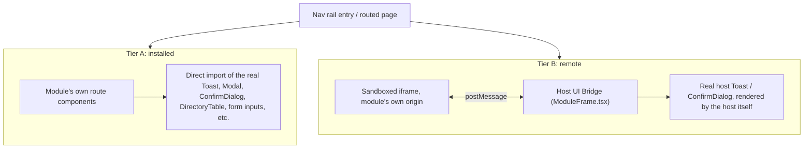


### 4e. Scoring targets: records another module scores against (Module 2 Phase 1.1)

A module that scores *per something another module owns* (Pain Points per
Persona) can't import that module. The owner declares
`scoring_target_providers[artefact_type] = (db, project_id) -> [ScoringTarget]`
and the scorer calls `registry.get_scoring_targets(db, project_id, type)`.

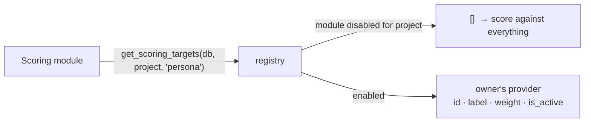

- `ScoringTarget(id, label, weight, is_active)`: `weight` is the resolved
  importance for that project (`None` = equal weighting); `is_active` is
  false for records that shouldn't be scored (Personas: anything but
  Active).
- The scorer stores `target_id` as a plain id, never a foreign key, and must
  tolerate a target disappearing or the owner being disabled.
- The provider does its own sub-component and tenancy checks; the caller has
  already authorised the project.
### 4f. Link targets: records another module relates to (Module 2 Phase 3)

A module that relates its records to another module's (a Stakeholder
"experiences" a Pain Point, is "consulted on" a Decision) can't import that
module, but must still validate the target belongs to the same project, label it
and offer a picker. The owner declares
`artefact_summary_providers[artefact_type] = ArtefactSummaryProvider(get, list_for_project, get_many_in_project, browse_levels, filter)`
(the batch lookup and `filter` are optional; `browse_levels` is required, see below; `list_for_organization(db, organization_id)` is optional too and lists the records the *organisation* owns, so core can resolve an organisation-qualified code such as `ACME-PER-001` through `registry.list_organization_artefact_summaries` without naming the module) and a display name in
`artefact_type_labels[artefact_type]`; callers use `registry.get_artefact_summary` /
`list_artefact_summaries` / `has_artefact_summary_provider` /
`get_artefact_summaries_in_project` / `get_artefact_type_label`. On the frontend the owner's
`TierAModuleDefinition.artefactPaths[artefact_type] = (projectId, id) => route`
lets `modules/artefactPaths.ts` link to the record's page, and
`TierAModuleDefinition.artefactStatusLabels[artefact_type][status]` gives the
display label of its status, so the shared Links panel can show a linked
record's status through a label map (`getArtefactStatusLabel`; a status with no
label shows no badge, never the raw value). Core owns only `requirement` and
`requirement_action`. `TierAModuleDefinition.artefactInactiveStatuses[artefact_type]` lists the
statuses that mean a record is no longer live (superseded, retired, rejected…), which the
link trace's "Hide inactive records" skips (`isArtefactInactive`; an archived record always counts).

**Every type declares at least one browse level** (`browse_levels=(BrowseLevel(key, label), ...)`), the
steps of the "Add a link" finder that narrow the search for a record of that type
("Standard" > "Version" > "Requirement", "Status"). A level with no `list_options`
reads the facet of the same `key` from the `ArtefactSummary.facets` your provider
sets (`{key: (option_id, label)}`), so a status or type needs only that one line
per level plus the facet; give `list_options(db, project_id, selected, query)` and
an SQL `filter(db, project_id, selected, query, limit)` (return at most
`limit + 2`) only for a type too large to load whole (an organisation's compliance
clauses). `selected` is `{level key: option id}` for the earlier levels; the core
validates it against what each level offered, so compute options from it alone and
scope them to the project's organisation. A test fails if a registered type has no
level. An organisation-owned type (`project_id=None`) is offered only from the
request project. Core owns only `requirement`, `requirement_action` and `change_request` (its levels
live in `services/link_browse.py`). `services.summary_facets` has helpers for status
and two-tier type facets, and `relationships.delete_links_for_artefacts` removes
links when a type hard-deletes records.

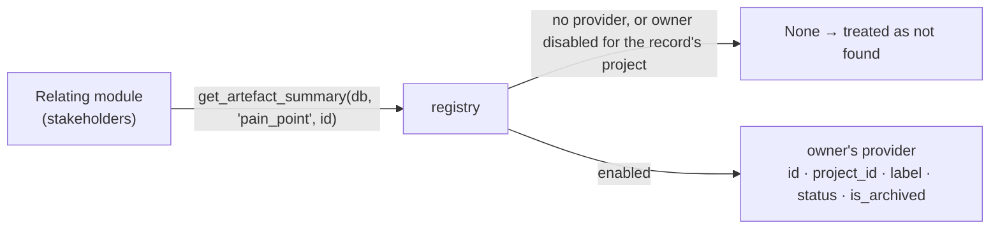

- `ArtefactSummary` carries the target's `project_id` (`None` for an org-owned
  record, with `organization_id` set), so the caller enforces "same project as
  the request" without knowing the owner's tables.
- `get_many_in_project(db, project_id, ids)` returns only what that project may
  see — its own records and, for a type with an org form, the org's records the
  project has not hidden — in one query. The owner applies its own visibility
  rules there; without it the registry falls back to `get` per id filtered to the
  project. `get_artefact_summaries_in_project` adds the module/sub-component
  enablement check (a sub-component whose `key` equals the artefact type) and
  returns `None` when no module provides the type, so a caller can tell "cannot
  show this kind" from "none visible".
- The link graph also reaches the request project's parent and child projects the
  caller can open (links across nesting), so it calls `get_many_in_project` once per
  such project. A summary returned for a related project is accepted only if its
  `project_id` is that project: an org-owned record (`project_id` `None`) is taken
  from the request project alone, so a related project can never be used to reach one
  the request project hides. Return only what the *given* project may see.
- Every first-party artefact type has a provider, enforced by
  `tests/test_link_graph.py`: the core link graph (`services/link_graph.py`,
  `GET /projects/{id}/artefacts/{type}/{id}/link-graph`) shows only types it can
  resolve. A new module declaring `artefact_types` must also declare a provider
  and a label.
- A relationship kind whose target type has no provider (Design / System
  Element, until Module 6) is *declared but unavailable*: listed, never
  creatable. It goes live when the owner registers a provider.
- The caller stores `target_id` in `ArtefactLink` as a plain id; the provider
  does not authorise, so the caller still checks the `(type, view)` permission.

### 4f-bis. Link types: any artefact can link to any artefact (Platform enhancements Phase 5b)

Any two registered artefact types in a project can be linked, so a module needs
nothing to make its types linkable the day they register. Link types (the org's
vocabulary of phrases) can restrict which artefact types they join, and an
artefact type can restrict which link types it uses; both are enforced when a
link is created (`services.relationships.create_link`), never retroactively. A
module that wants meaningful vocabulary declares **seeds**:

```python
ModuleDefinition(
    ...,
    link_type_seeds=(
        LinkTypeSeed("Addresses", "Is addressed by", LinkFlow.FORWARD_IS_UPSTREAM,
                     nesting_scope=LinkNestingScope.UPSTREAM_IN_ANCESTOR,
                     allowed_source_types=("decision",), allowed_target_types=("pain_point",)),
        LinkTypeSeed("Supersedes", "Is superseded by", dedicated_endpoint=True,
                     allowed_source_types=("decision",), allowed_target_types=("decision",)),
    ),
)
```

- A seed is created for an organisation only when it has no link type with that
  forward name, and only for modules enabled in it (on first use, when the org's
  link types are listed, or when link types are requested for an artefact), so an
  admin's edits are never overwritten. A type an admin deletes is recreated by the
  next use; restrict a type rather than deleting it.
- `nesting_scope` says whether the type may join a project and its parent or child
  project (default `ANCESTOR_EITHER_WAY`; `SAME_PROJECT` turns it off;
  `UPSTREAM_IN_ANCESTOR` requires the upstream end, per `flow`, to be in the same or a
  parent project, so it needs a `flow` other than `NONE`). Like the rest of the seed
  it applies only when the type is created.
- Seeds sharing a forward name across modules merge: restriction lists are unioned,
  the first non-`none` flow wins, and a conflicting reverse phrase is dropped with a
  warning. Core defaults (`services.definitions.DEFAULT_LINK_TYPES`) are unrestricted.
- Use `services.link_types.ensure_org_link_type(db, org_id, forward_name, reverse_name)`
  to fetch-or-create a type in your own code, never your own copy of the query. It
  returns the organisation-wide type; a project's own link types never replace it.
- A project can also own link types (inherited by nested projects), hide
  organisation-wide ones, and set its own artefact-type rules; an organisation can
  switch that off. A module creating links should pass its project to
  `relationships.create_link(..., project_id=...)` so the type is checked as usable
  there and the project's rules apply; a type it picks for the user should also pass
  `enforce_offered=True` (a hidden type is then refused). Never query link types
  directly for a picker: use `services.link_type_scope.resolve_effective_link_types`.
- `dedicated_endpoint=True` marks a type with a fixed meaning and its own action
  (supersession flips a status): the generic link endpoints neither offer, create nor
  delete it, and your own action passes `enforce_rules=False` to `create_link`.
- A seed can extend another module's link type without importing it: seeds
  sharing a `forward_name` merge, so Risk Management declares `"Addresses"` with
  `allowed_source_types=("decision",)`, `allowed_target_types=("risk",)` and the
  type accepts Risk targets as well as Decision Management's Pain Point. Seeds
  never touch a type an organisation already has, so a module widening an
  existing restricted type ships a data migration for existing organisations
  too (Risk Management's `0074`).
- A module declaring `artefact_types` also needs `artefact_summary_providers`,
  `artefact_type_labels` (§4f) and, on the frontend, `artefactPaths`, so the type can
  be shown and followed from a link; `tests/test_artefact_type_routes.py` and
  `frontend/src/modules/registeredArtefactTypes.json` guard the last. It also needs a
  `search_providers` entry, or a `not_searchable` reason (§4j).

### 4j. Global search: providers and scopes (Platform review, Phase 23)

Every artefact type is findable by the header search with no search code of your own: you describe the
SQL, core does scoping, authorisation, matching, ranking and paging.

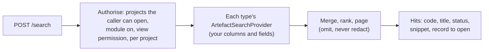

- `search_providers[artefact_type] = ArtefactSearchProvider(from_clause, columns, fields, where, status_labels, organization_owned, open_owner_type)`.
  `columns` (`SearchColumns`) says which SQL expression is the id, owning project, code, title, status,
  archived flag and last change; `fields` (`SearchField(key, label, column)`) are the **extra** text columns
  the search may match. **Fields are opt-in:** a column you do not list is never matched, so a personal-data or
  consent-sensitive column is excluded by leaving it out. Reuse a `key` and `label` another type uses
  (`description`, `rationale`) so the field picker lists it once; `id`, `title` and `tags` are built by core
  (every taggable type is searched on tags with no provider work). A versioned record is read through its
  current version: `services.search_core.versioned_provider` builds the provider for you.
- `organization_owned=True` for a type that can belong to the organisation (`project_id` NULL) and is shown
  through projects: such a record is found only through a project allowed to see it, using the same visibility
  your `get_many_in_project` applies (per-project hiding), and its count is taken after that check.
- `organization_subcomponent="<key>"` instead, for a type whose organisation-owned records have an organisation-level
  surface and no project shows them (a Strategy): they are searched, in the all-projects scope, for every member
  of an organisation where that sub-component is on (and, in a one-project search, where the module has it on for
  that project, unless the person left organisation records out), and open at the organisation page you register in
  `TierAModuleDefinition.orgArtefactPaths`.
- `comments=SearchComments(model, record_id, body, created_at, where)` makes the opt-in `comments` field available
  for a type that has a comment table (`services.search_core.comments_of` builds it). Comments are never searched
  by default and cannot be a stored default: one `EXISTS` per type is much dearer than the record's own columns.
- `open_owner_type` names the type whose page opens when yours has none of its own (a finding opens its
  engagement); `columns.owner_id` is that record's id.
- **Frontend.** A list page passes `records={{ projectId, recordType, filters, onImported }}` to `ListPageLayout` and gets the Export menu and the Import wizard (`ListActions`, `CsvImportWizard`) from the columns above; `filters` is the page's own filter query string (the names its list request sends, minus paging and sort), so the file matches the screen. A module writes no export or import UI.
- **The overview's total records.** The same provider feeds the project overview's *Total records* chart (`services/record_counts.py`, in `GET /projects/{id}/metrics` as `records_by_type` and `record_total`): give a cheap `count(db, user, project_id)` where a query is easy, else the rows of `list_records` with no filters are counted. Only the project's own, authored records count: organisation-owned rows are not any project's, and a type derived from an assigned standard sets `in_overview=False`. Declare the type's list page in `TierAModuleDefinition.artefactListPaths` so a legend row can open it (`artefactPaths.stories.tsx` fails for a counted type with none). A type the caller cannot read, or whose module is off, is omitted.
- **Registration is required.** A type with neither a provider nor an entry in `not_searchable` (`{type: reason}`)
  fails `tests/test_search.py`, and the frontend must resolve a page for it (`artefactPaths`) or its result would
  be a dead row (`artefactPaths.stories.tsx`).
- `search_scopes[key] = SearchScope(label, resolve, narrowness)` adds a place to the page's **Scope** filter
  (Compliance: `standard`). `resolve(db, user_id, ref_id)` returns a `ScopeResolution(project_ids, restrictions)`:
  the projects the unit spans (core keeps only those the caller can open) and, per type, an extra SQL condition
  (a standard's clauses only). A type absent from `restrictions` is not searched in the scope. Return `None` for
  "not found or not allowed" and answer the two identically. On the frontend register the matching
  `TierAModuleDefinition.searchScopes` (`key`, `label`, `narrowness`, `match(pathname) -> ref id | null`); core
  names no module's scope.
- Never log, audit or trace the query text; core already does not.

### 4k. Project and organisation bundles: hooks every module provides

Everything a module stores for a project travels in the project bundle (`services/project_export.py`), and everything it stores for an organisation travels in the organisation bundle (`services/org_export.py`). A module does this through `ModuleDefinition.project_bundle_hooks` and `org_bundle_hooks`, never a per-module edit to a core export file. A module with nothing to carry at a level says why in `no_project_bundle` / `no_org_bundle`; `backend/tests/test_module_bundle_hooks.py` fails for a module with neither, and for sections whose JSON keys collide with another module's or a core section (the sections are merged into one object, so a collision would overwrite data silently).

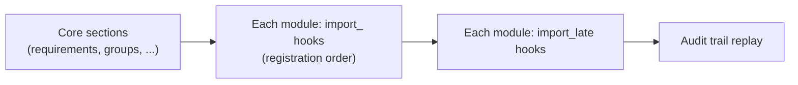

Read left to right: core sections import first, then every module's `import_` in registry order, then every `import_late`. Use `import_late` only for content that refers to another module's records, which may not exist yet (Pain Point scores refer to Personas).

Rules for a hook (reference implementations: `modules/risk_management/export.py`, `modules/context_strategy/export.py`):

- Cross-references use portable keys (type names, level axis and name, codes, labels, emails), never database ids. People and groups go through `principal_to_bundle` / `principal_columns_from_bundle`; a reference the target cannot match is left unset (or falls back to the importer for a mandatory owner) with a warning.
- A record travels as its current content and status; history and comments do not. An import numbers records afresh with `generate_unique_code` and keeps the exported code only as a bundle `ref`.
- Links between the module's own records and Requirements use `services.bundle_links.export_artefact_links` / `import_artefact_links`; attachments use `bundle_common.export_file_links` / `import_file_links`; tags use `record_tag_names` / `restore_record_tags`.
- A type vocabulary carries its project overrides, project-only types and the organisation defaults the project has hidden (`ProjectDefinitionSuppression`).
- An imported status is never an approval by someone else: no approver identity is carried, and project import is limited to organisation admins and project creators.
- Add the export and import for a new table or column in the same change, with a round-trip test (export, import into a fresh project or organisation, compare).

### 4l. Record tables: export and import of every list (List data and form UX, Phase 8)

Every artefact type's list exports as CSV and, for a type people author, imports from the same file. You declare the table; core owns authorisation, the file, the preview and the audit.

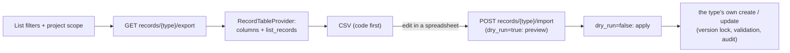

Read left to right: the same provider defines the columns of the file out and the file in, and the apply step runs the type's **own** create or update, never a raw write. A preview is that same run rolled back.

- `record_tables[artefact_type] = RecordTableProvider(label, columns, list_records, find, prepare, create, update, filter_params, gate, can_create, can_update, approval_gated, organization_owned, organization)` (core types in `services/record_tables_core.py`).
  - `columns(db, project)` returns `RecordColumn(key, label, get, parse, kind, editable, required, sensitivity, choices, cell_lock, tones)`. `get(prepared, record)` is the cell text (and the "before" an import compares against); `parse(ctx, text)` makes the value `create`/`update` receive and raises `RecordCellError` with a message the person can act on. **No `parse` means export-only** (a status behind an approval gate, a derived value, an instant). `prepare(db, project, records)` does the batch lookups once.
  - `list_records(db, user, project_id, filters)` **must share its query with the type's list endpoint** (extract a function both call, as `services.requirements.filter_requirements` does), so a filter added to the page reaches the file. `filter_params` names the filters it understands; core refuses any other query parameter rather than ignore it. Tags and the nested-project scope are applied by core (`gate` is the list's own module gate).
  - `gate` is the list's own `(module, sub-component)` gate. Core uses it for the nested-project scope **and** refuses the table (404, like an unknown type) while the project has that sub-component switched off, so a table never outlives the page it exports.
  - `find(db, project, code)` searches **that project only**. `create(ctx, values)` and `update(ctx, record, values)` call the same service functions the type's endpoints call and **never commit** (core owns the transaction: a savepoint per row, one commit on apply). `update` receives only the cells that changed. Write the type's per-record audit event there as the endpoint does.
  - `can_create` / `can_update` are the same check the type's endpoints make; when omitted the fine-grained `propose_create` / `manage` permission applies.
  - `choices` is the closed list of cell texts a column accepts (enum labels, the project's stage names); the import wizard offers it as a pick list for "same value for every row". Leave it `None` for free text. `GET .../columns` also says whether the caller `can_import`, so a person who could not apply the file is not offered Import.
- **The organisation's own lists.** A type the organisation can own also gives its provider `organization=OrganizationRecordTable(subcomponent, columns, list_records, find, prepare, create, update, filter_params, can_create, can_update)`: the same shape with the `Organization` where the project tier takes a project (`ctx.project` is `None`; use `ctx.organization`), gated by the sub-component the organisation list endpoint requires. Core serves it at `/api/v1/orgs/{id}/records/{type}/columns|export|import` and `/api/v1/orgs/{id}/reports/record-list` (`routers/org_record_tables.py`) through the same import body as the project tier, so the columns, the policy, the formula guard, the preview and the audit are shared. The tier matches only the organisation's own records (a project's code, or another organisation's, is an unknown-code row), writes codes qualified by the organisation code and uses the organisation-level `export_personal_data` grant. Share the list query and the create/edit function with the organisation endpoint, as for the project tier (`edits.create_strategy_record(db, RecordOwner(...))`). `backend/tests/test_org_record_tables.py` fails when a type with `organization_owned` has no organisation tier.
- **Export-only tiers and types without a code.** A tier with no `create`/`update` is a read-only table; the type then gives its reason in `not_importable`. A module that declares no sub-components passes `subcomponent=None` (the module being enabled for the organisation is the whole gate). A type with no `PREFIX-nnn` code (the compliance requirement and its two project-level children, a recorded gap) returns a lightweight row object from `list_records` carrying the record and what its columns read, with `id`, `project_id` and `unique_code` (its clause reference, or blank) and gives `find` that always answers `None`; Compliance's `record_tables.py` is the reference.
- **Organisation-owned rows.** A type the organisation can own (a Persona shared by every project) lists those rows in the project's table too. Give the provider `organization_owned(record) -> bool`: core then writes such a row with the organisation-qualified code (`ACME-PER-001`, always qualified, since its bare code could equal a project record's), and, because `find` searches the project's own records only, an import never changes one from a project (the row is reported as an unknown code). An organisation's own records are exported and imported at the organisation level.
- **A write path the import can share.** A module's create/update that commits (a `*_from_payload` the endpoint calls) is split into a `stage_*` function that validates, writes and audits without committing, and a thin wrapper that commits and returns the API shape; the endpoint calls the wrapper and the provider the `stage_*` (see `modules/stakeholders/_*_shared.py`, `modules/context_strategy/edits.py`). Build the endpoint's own request payload (`PersonaCreate`, `StakeholderUpdate`) from the cells and turn a refusal into the row's error, so its length limits and tenancy checks apply unchanged.
- **Format.** First column `code` (core writes it, qualified by the project code outside the request project or where the organisation enforces it). A person is one cell: an email, or `Name (Org group)` (`parse_principal_cell`, `PrincipalCells` for export). Enums by label, dates `YYYY-MM-DD`, instants UTC and export-only. Core adds the `'` formula guard on write and strips it on read; a provider never does.
- **Approval gates.** A type with an approval gate sets `approval_gated=True` and gives its `status` no `parse`: a file creates drafts and edits content, it never approves (`tests/test_record_tables.py` fails otherwise).
- **Personal data.** Classify a column with `sensitivity` (`personal`, `contact`, `free_text_people`); core leaves a tagged column out of every export and import unless the organisation's policy (its override, else the server default, else excluded) allows the tag **and** the person holds `export_personal_data` (`services/record_policy.py`). Never add a per-module check; the tag is the whole contract. Never expose a Restricted-classified value as a column.
- **PDF and Word: the Record list report.** A provider's table is also a report (`GET /projects/{id}/reports/record-list?record_type=<type>&format=json|pdf|docx|csv`, `services/record_list_report.py`), listed in the report catalogue under the platform (`module_key` `platform`), not a module, with one `record_type` parameter holding exactly the types the caller may list. It adds no code per type: it renders `build_table`, so it shows the columns and rows the CSV export would. `format=csv` is the export's file byte for byte; a file (not the on-screen run) is audited as `records_exported`. A column colours its cells in PDF and Word with `RecordColumn.tones` (`{cell text: tone}`, tones as `report_model.TONE_FILL`); the text still names the value. The same MCP tool (`get_record_list_report`) serves every type.
- **The bulk edit grid.** The same provider feeds the grid of a list (`GET /projects/{id}/records/{type}/grid`, `PATCH .../records/{type}/rows/{code}`; `build_grid` / `update_row` in `services/record_tables.py`, `components/RecordGrid.tsx`). A column is a grid cell when it is `editable`, importable and a closed-value kind (`enum`, `number`, `date`, `bool`); free text stays in the form. A save changes only the cells that differ from the value the grid loaded (`expected`; a cell changed since is refused with 409 and its current value), calls the provider's `update` in a savepoint and commits per row, so the type's own lock, validation and audit event apply and no second audit event is written. Two optional hooks say why something cannot be edited, as a courtesy to the person (the save is refused with the type's own message either way): `RecordTableProvider.read_only_reason(prepared, record)` for a whole row (a Requirement that is approved, a Pain Point at a terminal outcome) and `RecordColumn.cell_lock(prepared, record)` for one cell (a Pain Point scored per persona has no single severity). Rows of a related project (widened scope) and organisation-owned rows are read-only here. A list page offers the grid with `ViewToggle showGridOption` and `<RecordGrid projectId recordType filters contextKeys recordHref />`; the grid exists for the project tier only.
- **Registration is required.** A type with no provider is listed in `PENDING_RECORD_TABLES` in `backend/tests/test_record_tables.py` (the list only shrinks). A type whose records import cannot author (produced by a workflow) still registers a provider for export (no `create`/`update`) and gives a reason in `not_importable`; a core type's reason is in `CORE_NOT_IMPORTABLE` (`services/record_tables_core.py`, change requests). Do not add per-type export or import code to a core file.

### 4m. Custom reports: report fields and traversal (Module 10 Phase 1)

A custom report layout (a tree a person authors) reads records through two core pieces, so a layout never
hand-queries a table and a module adds no report code to a core file.

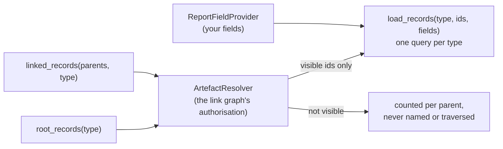

- `report_fields[artefact_type] = ReportFieldProvider(from_clause, columns, fields, where, status_labels)`. Build
  it with `services.report_fields.from_search(SEARCH_PROVIDERS[type], *typed_fields)`: the joins, current-version
  filter, identity columns and status labels come from the type's search declaration, and its vetted text fields
  come across. Add typed fields with `date_field`, `enum_field`, `bool_field`, `number_field`, `instant_field`,
  `principal_field` (a user or group, shown by name) and `name_lookup_field` (a foreign key as the row's name).
- Fields are **opt-in**. A column that is not declared cannot be reached from a layout, so a Restricted or
  consent-sensitive column (an email address, a participant, a consent record) is excluded by omission. `code`,
  `title`, `status` and `tags` are reserved: the engine builds them.
- A type that cannot be reported gives a reason in `not_reportable`. `backend/tests/test_report_fields.py` fails
  for a registered type with neither, for a reserved or repeated key, and for one key with two labels.
- `load_records` does **not** authorise. It is given only ids that `root_records` or `linked_records` returned;
  both run every candidate through `ArtefactResolver`, the same rule as the link graph (project membership, module
  enabled, `view` on the type in the record's own project, nesting). A record that fails is counted per parent, never
  named, and never a stepping stone to the next hop; a type no module can display is counted apart (`unavailable`).
- Work is bounded: `MAX_ROOTS` and `MAX_LINKED` set `truncated` rather than fail, and the number of queries does not
  grow with the number of records.
- Time: an `instant` field is a past UTC `datetime`, a `date` field is a plain calendar date; neither is converted
  on the server.

### 4n. Custom reports: layouts, the tree and the evaluator (Module 10 Phase 2)

A layout is a versioned JSON tree a person authors; the evaluator turns it into the neutral report model for one
caller. A layout is configuration, not an artefact type: no `PREFIX-nnn` code, not linkable, not searched.

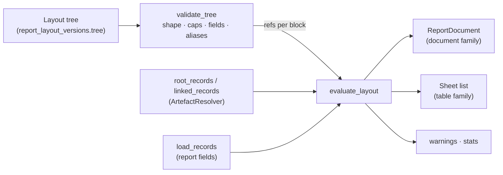

- **Storage.** `report_layouts` (owner: organisation, or a project when `project_id` is set; `family` `document` or
  `table`; `current_version`) and `report_layout_versions` (immutable tree, SHA-256 `tree_hash`, comment). Saving appends a
  version through `services.report_layouts.save_version`, which refuses a save based on a stale version
  (`LayoutConflictError`) and stores nothing for an identical tree. An ORM guard refuses to update a saved version.
- **Tree.** `{schema_version, family, orientation?, page_size?, margins?, mirror_margins?, page_styles?, header?, footer?, variables?, nodes}`. Blocks: `heading`, `text` (restricted Markdown: paragraphs, `#` headings, bullet and numbered lists, `**bold**`, `*italic*`, `` `code` ``; see §4w),
  `table`, `each`, `group`, `if`, `page_break`, `section`, `image`, `record_images`, `equation` (document); `sheet` (table). Unknown keys are errors. There is no
  expression language and no raw HTML block.
- **Images.** An `image` block names a library file by id (`services/report_images.py`): a project layout may use its
  own project's pictures (`file_assets.project_id`) and the organisation's shared resources, an organisation layout the
  organisation's only (`usable_by_layout`, checked at save, validate and run). Pictures are judged by their bytes, embedded
  without metadata and within byte and pixel caps; size is one rule for every renderer (`services/report_image_layout.py`);
  they travel with their layouts in the project and organisation bundles (`report_layout_images`). Size limits are
  settings (`REPORT_IMAGE_MAX_BYTES`, `REPORT_IMAGE_MAX_PIXELS`, `REPORT_IMAGE_MAX_TOTAL_BYTES`); widths and heights may be
  cm, mm or (widths) a percentage; caption numbering is `auto`, `always` or `never`. API: `/orgs/{id}/report-images`,
  `/projects/{id}/report-images` (list with the size limit, upload, delete). A picture's size and EXIF come from the general
  `GET /files/{id}/details` (same read rule as the download), shown by `FileDetailsToggle` wherever files are listed.
- **Record images.** A `record_images` block (inside an `each`) prints the pictures attached to that block's record. A module
  lets its types take part with `ModuleDefinition.record_attachments[type] = RecordAttachmentProvider(link table, record
  column)` (core types: `services/record_attachments_core.py`), or gives a reason in `no_record_attachments`
  (`backend/tests/test_report_record_images.py` fails for a reportable type with neither); a type whose attachments may
  concern identifiable people gives that reason and is not offered. `services/report_record_images.py` lists a batch of
  records' files in one query, never one a person marked `FileAsset.confidential`, narrows them by the block's rules
  (`names` with `*` and `?` and no regular expressions, `types`, `max_size_mb`, `order`, `max_count`), then reads only the
  survivors and decides what is a picture from the bytes. A `{{placeholder}}` in a pattern is filled into the literal
  stretches only, so a value never becomes a wildcard. The files are reached through the record's own link table, so a
  picture prints when the caller could open it from the record's page; pictures share the library pictures' caps and are
  recorded in the run's stats as a count and a digest. `PATCH /files/{id}/confidential` (uploader, project manager, or an
  organisation admin for an organisation resource; audited) sets the mark, which changes nothing but reports.
- **Image columns (Phase 46).** A table or sheet column `{"images": {...rules}, "label"?, "from"?}` shows the pictures attached to each
  row's record. It uses the record-images rules through the one `_validate_picture_rules` and the same `candidate_files` and one-batch
  file query (a name pattern may read the row as `{{row.field}}`), plus a size (`width` with `width_unit` `percent` of the column by
  default 90, or cm or mm; `height`) and `arrange` (`stacked` or `side_by_side`). A document table's cell is a
  `report_model.ImageCell` and every renderer draws it through `report_image_layout.place_cell_pictures` (sized against the cell, shrunk
  only to the physical page limit); a sheet's cell is the file names as text. The layout root's `repeat_table_header` (default true)
  reaches `Table.repeat_header` (PDF `repeatRows`, Word `w:tblHeader`, ODT header rows, HTML `thead`). The designer draws the column's
  settings from `BlockCatalogue.image_column_fields`.
- **Sources.** A block reads records from `{record_type}` (all of a type in the report's projects),
  `{record_type, linked_from: alias, link_types?, direction?}` (records linked to an enclosing record; link types are
  named, forward or reverse, so a layout moves between projects) or `{group: alias}` (a group's members), plus
  `where`, `sort` and `include_archived`. `group` buckets records by a field; `{{group.value}}` and `{{group.count}}`
  are its values.
- **Sheets (table family).** A `sheet` is a root source plus up to five left `joins` along links
  (`{as, source: {record_type, linked_from}}`); a column names the record it reads with `from`. One row per
  combination, blank cells where nothing is linked, so nothing drops out of an export.
- **Placeholders.** `{{alias.field}}` and the global `{{project_name}}`, `{{report_title}}`, `{{generated_on}}`,
  `{{organisation}}`. They are validated at save time against the field registry and the aliases in scope, and
  substituted into already-parsed blocks at run time, so a record value can never become Markdown or a placeholder.
- **Tiers and visibility.** A layout is owned by an organisation or a project (`routers/report_layouts.py`:
  `/orgs/{id}/report-layouts`, `/projects/{id}/report-layouts`). A project sees its own, its ancestors' (nearest
  first) and the organisation's, de-duplicated by name with the nearest winning (`services/report_layout_scope.py`):
  additive, not the Action Types "own rows, else the ancestor's" rule, which would hide every inherited layout as soon
  as a project made one. A project hides an inherited layout with a `ProjectDefinitionSuppression` tombstone (kind
  `report_layout`, per project, not inherited downwards; a hidden layout still holds its name) and restores it;
  deleting the layout drops every tombstone. Platform starter layouts join as a read-only tier below the
  organisation when they exist.
- **Permissions.** Two administrative atoms, `manage_org_report_layouts` and `manage_project_report_layouts`
  (`services/permissions.py`), grantable to users and groups through custom roles. Organisation admins hold both;
  project administrators (and so managers) hold the project one in their project. Listing needs only membership;
  reading a tree, versions or writing needs the atom, and an inherited layout is read-only where it is inherited.
  Running a layout needs neither.
- **Bundles.** `services/report_layout_bundle.py` adds `report_layouts` (every version) and `report_layouts_hidden`
  (by name) to `project.json` and `report_layouts` to `org.json`; an import validates every tree again, drops a
  version that is not valid here, renumbers 1..n, makes the importer the author, and never overwrites a layout in a
  merge (a taken name imports as "<name> (imported)").
- **Authorisation.** None of its own: every record comes from `root_records`/`linked_records`, so the caller's link
  graph decides. Unseen records are counted in a note ("2 records not shown ...") and never named; a block with a
  `where` says "Up to N" because the count precedes the filter.
- **Limits.** Authoring caps in `report_layout_tree` (`MAX_DEPTH`, `MAX_NODES`, `MAX_COLUMNS`, text and size caps);
  run caps in `report_layout_eval` (`MAX_WORK`, `MAX_OUTPUT`, a wall-clock timeout) raise `LayoutLimitError`; a read that
  hit a traversal cap adds a warning instead.
- **Text view.** `services/report_layout_text.py` reads and writes the tree as lines a person can type
  (`parse_text`, `format_tree`); `POST .../report-layouts/text/parse` and `.../text/format` expose it at both tiers for
  the designer (manage permission, nothing stored, the text never logged). `parse_text(format_tree(t))` returns `t`
  exactly for every valid tree, so editing as text and saving unchanged makes no new version. A syntax error gives a
  line and column and no tree; otherwise the validator runs and each of its errors is reported at its block's line.

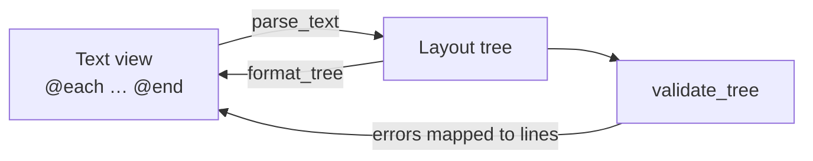

  Grammar: first line `@layout document [portrait|landscape]` or `@layout table`; a block is `@name …` and
  `each`, `group`, `if` (with `@else`), `table`, `sheet` and `@text` close with `@end`. A source is a record type or
  `in <group>` then any of `from <name>`, `via "<link type>", …`, `direction <d>`, `archived true|false`,
  `where <condition>`, `sort <field> [asc|desc]`, plus the block's `as`, `by`, `empty "<text>"`
  (`none` after `via`, `where`, `sort` is an empty list). Table and sheet columns and joins are `@column
  [name.]field "label"` and `@join <source> as <name>` lines. A line that is not a directive is text; a text line
  starting `@` is written `@@`. A widget is the one block written as a line of its own, `[[widget.<module>.<report>.<part>
  name=value]]` (§4p).

  **Conditions.** A `where` clause (and an `@if`) holds a condition: a test of one field, `<field> <op> [value, …]`, or
  tests combined with `and`, `or`, `not` and brackets. `not` binds tightest, then `and`, then `or`; several `where`
  clauses must all hold. Operators by kind of field: text and person `eq ne contains in not_in empty not_empty`; enum
  the same without `contains`; number and date `eq ne gt gte lt lte in not_in empty not_empty`; instant the
  comparisons and `empty`; yes/no `eq ne`. `in` and `not_in` take a comma-separated list (`where category in
  Safety, Security`), of any kind that has an `eq`. An empty value matches only `empty`, `ne` and `not_in`, so "everything
  except General" keeps records with no category. The tree stores a test as `{field, op, value}` and a combination as
  `{"all": [...]}`, `{"any": [...]}` (two or more) or `{"not": ...}`; a `where` list is an implicit `all`, so trees
  saved before combinations existed are unchanged. At most `MAX_CONDITIONS` tests per `where` and
  `MAX_CONDITION_DEPTH` levels of nesting. The writer brackets only what keeps the tree reading back identically (a
  nested `all` or `any` is bracketed, an `all` inside an `any` is not), and quotes a value that is `and`, `or`, `not`,
  `true`, `false` or holds a bracket; a bare `and` / `or` / `not` as a value is a syntax error that says so.

```
@group requirement by category as cat where category not_in General, Legacy and (status eq approved or owner not_empty)
  @heading {{cat.value}}
  @table in cat sort title
    @column title
  @end
@end
```

```
@layout document
@group requirement by component as comp
  @heading {{comp.value}}
  @each in comp sort title as req
    @heading level=3 {{req.code}} {{req.title}}
    @table stakeholder from req empty "No stakeholders."
      @column title "Stakeholder"
    @end
  @end
@end
```
- **Extending.** A later block type (equation) calls `report_layout_tree.register_block_spec` (its
  validator), `report_layout_eval.register_evaluator` (its evaluation) and `report_layout_text.register_text_form`
  (its text form); `backend/tests/test_report_layout_eval.py` and `test_report_layout_text.py` fail when one exists
  without the others. No core file is edited per block type.
- **Time.** A layout stores no schedule. Run times are UTC instants; `instant` conditions compare as UTC whatever zone
  the literal is written in; `date` conditions compare plain dates.

### 4o. Custom reports: running a layout (Module 10 Phase 5)

A layout appears in the report catalogue beside the module reports (`module_key` `custom_reports`) and runs through
its own routes, as the Record list report does: it is core, not a module, so no module declares it.

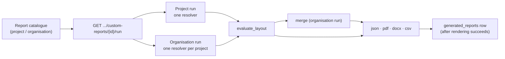

- **Routes** (`routers/custom_reports.py`, `services/custom_report_run.py`).
  `GET /projects/{id}/custom-reports/{layout}/run?format=&include_children=&report_template_id=` runs a layout the
  project can reach (its own, an ancestor's or the organisation's) unless the project hid it (404).
  `GET /orgs/{id}/custom-reports/{layout}/run?format=&project_ids=a,b&report_template_id=` runs an organisation layout
  once **per project** the caller holds a role in and merges the results; `project_ids` can only narrow that set (404
  for a project outside it), a project that hid the layout is left out (and the report says so), at most
  `MAX_FANOUT_PROJECTS` are evaluated, and a document gets one heading per project with a page break between them
  (authored headings move one level down) while a table layout's sheets of one name are concatenated with a leading
  `Project` column. Running needs only access to the project or organisation: neither manage permission.
- **Authorisation** is unchanged: each project is evaluated with `ArtefactResolver(project, caller)`, so a record the
  caller cannot see is counted and never named. The wall-clock limit and the output cap are shared by the whole run.
- **Formats** come from the renderer registry (`services/report_render.py`; `available_formats` is `json` plus
  `formats_for(family)`): a document layout gives `pdf`, `docx`, `html` and `odt`; a table layout `csv` (one CSV, or a zip
  with one CSV per sheet when there are several), `xlsx` and `ods`. Table formats are for the table family only. A
  new format is one `register_renderer(Renderer(key, families, render))` (ODT and ODS were); a renderer sees only the neutral
  model (`RenderInput`: a `ReportDocument` or `Sheet`s). The `json` form is the Reports dialog's on-screen view: each
  table of the document becomes a section titled by the headings above it ("Alpha / Requirements"), the text between
  tables is its note. The catalogue entry lists the formats and, for an organisation layout,
  `supports_project_multi_filter` and the `projects` the caller may choose among; the Reports dialog offers them as a
  **Projects** selector.
- **Cells and pages are safe by construction.** Every CSV, XLSX and ODS cell goes through `csv_safe` and is written as
  text (an XLSX cell is typed `s` and an ODS cell is a `string` value with no formula attribute, never a formula,
  and both are cut at 32,767 characters); sheet and zip member names are
  cleaned and made unique. The HTML page escapes every string, carries no script and a
  `Content-Security-Policy` of `default-src 'none'; img-src data:; style-src 'unsafe-inline'`, inlines a raster image
  only as a `data:` URI of a type sniffed from its bytes and an SVG only after sanitising. ODT and ODS
  (`services/report_odf.py`, `report_odt.py`, `report_ods.py`) are written as XML text, not through an object
  library (which cost 1.1 GB for 100,000 rows): every string passes `xml_text`/`xml_attr`, an image's type is sniffed,
  and the package holds no macro, link, script or field code but the page number. ODT headings, tables, lists and
  the footer page number are real ODF structures; equations are pictures (then the source), not formula objects.
- **SVG figures.** `Image(svg=...)` holds markup that is untrusted until `report_svg.sanitize_svg` allow-lists it
  (no DOCTYPE or entity, no script, `foreignObject`, `image`, `style` element, event handler or external reference;
  `href` only to `#id`); every renderer sanitises again. The PDF draws it as vector through `svglib` (a `resvg-py` PNG
  if `svglib` cannot), Word embeds a PNG (`python-docx` cannot take SVG), HTML inlines it. Text in an SVG is drawn
  with the bundled DejaVu font; a module producing a diagram wraps its own labels. A figure that cannot be drawn is
  skipped, never an error.
- **No separate introduction, chapters or appendices.** A layout's own text blocks carry them; report content as a
  stored tier (template, project, organisation) was removed, so the PDF, Word and OpenDocument renderers add nothing
  around the evaluated blocks but the scope line and notes. The "Requirements by Component" starter shows the pattern.
- **Provenance** (`models/generated_report.py`). Every run writes one `generated_reports` row after rendering succeeds
  (so a refused or failed run leaves none): layout id, name, version and tree hash, caller, UTC time, engine version,
  format, parameters, the projects covered, the widgets that ran (§4p), records read per type, block/row/hidden counts, the
  version number of every versioned record in the report (`record_versions`, from `SearchColumns.version`, which
  `versioned_provider` sets; bounded at `MAX_RECORDED_VERSIONS`, `record_versions_truncated` when cut) and a
  SHA-256 `source_digest` over all the records in the report (type, id, last-change time). It holds identifiers, counts and keys only, no layout text or cell value, and survives the
  layout's deletion. Layout runs are recorded here rather than in `audit_events`, as a report read is for the module
  reports.
- **Limits.** `LayoutLimitError` answers 413 and a timeout 408 for the on-screen (`json`) form; for a file format it
  answers 409 `{"detail": {"code": "async_required"}}` (§4s). Both write nothing.
- **MCP.** `list_report_layouts`, `get_report_layout`, `run_custom_report`, `parse_report_layout_text`,
  `format_report_layout_text`, `list_report_widgets` and, in write mode, `create_report_layout`, `save_report_layout_version`,
  `update_report_layout`, `delete_report_layout` (`mcp-server/server.py`, skill `reqtrack-mcp`). `run_custom_report`
  always returns the `json` form.

### 4p. Custom reports: widgets (Module 10 Phase 6)

A `widget` block embeds one **component** of a module report (§4g) in a document layout: one of its tables, its
headline figures, or its caveat notes. A widget is only the component. It never adds a heading or a sentence, so the
layout owns every word around it and the same table can sit under different explanations in different reports.

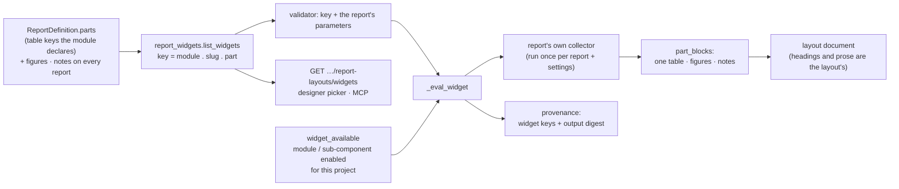

- **Declaring components.** A module lists the tables of a report it wants embeddable in
  `ReportDefinition.parts` (`ReportPartDefinition(key, title)`, `key` being the `ReportSection.key` the collector
  gives the table). Every report also offers `figures` (a `Measure | Value` table, with a `Group` column when the
  report groups them) and `notes` without declaring them. A table whose key depends on the data (the summary pack's
  re-listed gap tables, the risk matrices) is not embeddable. A registry test fails when a collector produces a table
  that is not declared, or a declaration names a table the collector does not produce.
- **Key.** `<module key>.<report slug>.<part>` (`risk_management.risk-register.register`). A slug is unique only within
  its module, so a bare slug could turn ambiguous and change what a stored layout means; all three segments are stable.
- **Text.** `[[widget.context_strategy.summary.figures stale_months=12]]` on a line of its own, optionally with
  `sort <column> [asc|desc]` (up to three, most significant first) and ending `empty "No risks recorded."`. A value is a bare word, number, `true` or `false`, or quoted text; anything that would
  read back differently (`"1"`, `"true"`, a date with a space) is quoted. A line starting `[[widget` is always a widget,
  and a syntax error when malformed, so prose that needs such a line writes it inside `@text`. `@widget` is not accepted.
- **Sorting.** `sort` orders a table or the figures by the heading of one of its columns (`"sort": [{"column": "Next
  review", "descending": true}]`), reading each cell as a person would: numbers as numbers, ISO dates as dates, anything
  else as text ignoring case, empty cells last either way. A report's ratings are text, so "High" sorts alphabetically
  and not by severity; use the report's own order when severity matters. A heading the table does not have is a
  run-time warning and is skipped (a table's columns are only known when the report runs). Without `sort`, the order is
  the report's own. For a plain list of records, prefer a `table` block, which sorts and filters by the record's fields.
- **Tree.** `{"type": "widget", "key": "...", "params": {"name": value}, "sort": [...], "empty_text": "..."}`; `params`,
  `sort` and `empty_text` are left out when unused. Parameters belong to the report, so every component of a report takes the same
  ones; values are JSON literals of the declared type (date and id as text) checked against its
  `ReportParamDefinition`s, with bounds and choices. There are no placeholders or expressions in a parameter; `empty_text`
  may use the global placeholders (`{{project_name}}`). Document family only.
- **Running.** The report's own collector runs with a `ReportContext` over the same organisation and projects as the
  layout run, for the project being evaluated (an organisation-wide run runs it once per project), **once per report
  and set of parameters** however many of its components the layout embeds. At most `MAX_WIDGET_REPORTS` (20) such runs
  per layout. A component with nothing in it shows `empty_text`, or nothing. The widget runs only where the report's
  module, and its sub-component if it declares one, is enabled for that project (`widget_available`, the gate the
  report's own project route applies); elsewhere the layout says so in a note and a warning and carries on. A report that
  rejects its parameters (4xx) is shown the same way, never as a failed layout; any other error is a bug and propagates.
- **Provenance.** `generated_reports.widgets` lists the widget keys that ran. Their data is not read through the field
  registry, so no record versions are recorded for it; instead a SHA-256 of each report's output is folded into
  `source_digest`, so a change in what a widget reports changes the digest.
- **Designer and agents.** `GET .../report-layouts/widgets` (organisation and project tier, manage permission) and the
  `list_report_widgets` MCP tool list the components whose module the organisation or project can use, with the report's
  parameters. Saving does not check availability (an organisation layout runs in many projects); each run does.

### 4q. Custom reports: the designer (Module 10 Phase 8)

The designer is core UI over the layout API, with no per-module code: modules reach it through the field registry (§4m)
and widget list (§4p), which it only reads.

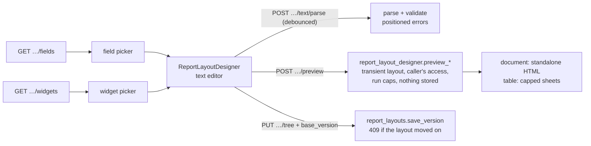

- **Endpoints** (both tiers, manage permission, server administrators excluded as for every layout route):
  `GET .../report-layouts/fields` returns the record types the scope can use (module and sub-component enabled, the same
  gate as the widget list) with their fields from `report_fields.field_catalogue`, the global `{{placeholders}}` and the
  fields of a group; `POST .../report-layouts/preview` takes `text` or `tree` (exactly one) and answers
  `{ok, errors}` for text with problems (200, nothing run), else a document as one standalone HTML page
  (`report_html`, script-free, CSP meta) or a table as sheets capped at `PREVIEW_MAX_ROWS` with their real row counts.
- **A preview is a run that leaves nothing behind.** It goes through `custom_report_run` with an unsaved `ReportLayout`
  and version that are never added to the session, so the caller's own read access, the work/output/time caps and the
  fan-out rules apply unchanged; it writes no `generated_reports` row and no audit event (nothing was produced to keep)
  and never logs the text. Refusals (413, 408, 404, 422) are the run route's (`routers.custom_reports.guard_run`).
- **Frontend.** `api/reportLayouts.ts` (`ReportLayoutApi`, one injectable interface per scope), `ReportSetupPanel` (the
  one folder list of layouts, packs and module reports in Project Admin's Report Setup and Org Admin's Templates & reports), `ReportLayoutFormModal` (create and edit share
  `ReportLayoutFields`), `ReportLayoutDesigner` (page `/projects/:id/report-layouts/:layoutId`, `/orgs/:id/report-layouts/:layoutId`),
  `ReportLayoutFieldPicker`, `ReportLayoutWidgetPicker` (reuses `ReportParamsForm`), `ReportLayoutPreviewPanel` (a
  sandboxed frame with an empty `sandbox` attribute for the HTML) and `ReportLayoutHistory` (a line diff of two
  versions' text views, computed in the browser). `utils/reportLayoutText.ts` only helps a person write (names in scope
  at the caret, insertion, snippets, the widget line); the server stays the only parser and validator, so the client
  holds no block model that could drift from the tree.
- **Block editor.** The designer's second view edits the same tree on a Blockly workspace (`ReportLayoutBlocks`, loaded lazily so
  the library stays out of the main bundle). Block types are generated from the block catalogue (`GET .../blocks`) in
  `utils/reportLayoutBlocklyBlocks.ts`: a label, the short fields (`text`, `alias`, `tex`, `integer`, `boolean`, `choice`; an
  optional text is not short) inline with a small label each, a read-only summary of what only the inspector edits, and a
  statement input per child list. A small integer range or a choice is a dropdown. A module's block type therefore needs no
  frontend code. `utils/reportLayoutBlockly.ts` converts tree and workspace state both ways without importing Blockly; a block's
  `data` keeps the whole node minus its child blocks, so a key the editor does not draw survives and opening a layout never
  rewrites it (a round-trip story pins this). The inspector beside the workspace shows every field of the selected block with the
  shared field components (`ReportLayoutBlockField`, `ReportLayoutSourceEditor`, `ReportLayoutConditionEditor`,
  `ReportLayoutColumnsEditor` (also joins), `ReportLayoutWidgetEditor`, `ReportLayoutVariablesField`, and `ReportLayoutJsonField`
  for a kind or block type it does not know) and "Add to <list>" menus. There is no Blockly toolbox: "Add block" above the canvas
  (`paletteEntries`: Heading by level, Text and Table first, then the rest by name) adds at the place a select beside it states
  (after the selected block, inside it, or the end of the layout), creating the block in the workspace so one Ctrl/Cmd+Z undoes
  it. The canvas has the page's width; the inspector goes under it by container query when the editor is narrow. An inspector
  edit that changes only values is patched into the blocks in place; a change of shape redraws the workspace. Blockly deselects
  when focus leaves the workspace, so the inspector keeps showing the last block chosen. The designer holds the tree while the
  blocks are shown, checks it with `POST .../validate` after each pause, keeps the text view's text in step through `text/format`
  for the preview and for switching back, and saves the tree itself. A block dropped outside the layout is not part of it and is
  counted in the inspector. `utils/reportLayoutTree.ts` holds the pure tree reads and inserts, the names in scope (from each
  block's `provides`) and the path reading that puts a server problem on its block.
- **Two views.** The designer's `Tabs` are **Text** and **Blocks**. The blocks edit the one tree the designer holds; from the
  text the designer parses the text as it stands (an immediate `text/parse`, not the pause-and-check result) and refuses with the
  reason if it has problems; to the text it formats the tree only if the tree changed since it was entered. Dirty, Save, the
  preview and the validate check read the tree in either view. (A rich-text document view existed briefly and was removed; so was
  the card outline the block editor replaced.)
- **Text view tools.** `ReportLayoutBlockToolbar` is an icon button per block (headings by level) with tooltips;
  `ReportLayoutPageSetup` opens the Page setup dialog (paper, orientation, margins, mirrored margins, page styles) and writes
  them into the `@layout document [landscape] [size] [mirror] [margins …]` line and one `@pagestyle` line per style (§4g, "Page styles"); `ReportLayoutFieldPicker` is one searchable list of the report and project
  placeholders (`PLACEHOLDER_NAMES`: `project_name`, `project_code`, `project_description`, `report_title`, `generated_on`,
  `organisation`) and the fields of every name in scope; `SaveVersionButton` asks for the note in a popover. The page size
  reaches `ReportDocument.page_size` and every renderer through `report_model.page_dimensions_cm`.
- **Page styles.** A document layout's own pages are `page_size` (A4 when absent), `orientation` and `margins`
  (`{top, bottom, left, right, gutter}` in cm; 1.5 cm on every side and no gutter when absent; 1 to 10, gutter 0 to 5). `page_styles` is
  a list of named styles (`{name, page_size?, orientation?, margins?}`, at most 10, unique names) that leave out what they share with the
  layout. The `section` block (`page_style`, `children`) lays its contents out in one style: a new page in that style, the contents, then a
  new page back in the layout's own style; a section with no output leaves no page, and a section cannot contain another. `mirror_margins`
  is one switch for the whole layout (Word keeps it per document): `left` and the gutter are the inner edge and `right` the outer. Every
  style must leave 5 cm of text width and height. The evaluator emits `PageStyleChange` blocks (`services/report_model.py`; flat, so a
  renderer only switches style where one falls) and `services/report_page_styles.py` owns the vocabulary, the checks and the resolution.
  Per format: PDF has one ReportLab page template per style (two when mirrored, picked by the parity of the page the style starts on),
  Word a section per change with its own size, margins and gutter and `w:mirrorMargins`, ODT a page layout and master page per style
  (`style:page-usage="mirrored"`; the gutter joins the inner margin), HTML a labelled `<section>` as wide as the page and CSS named pages
  (`@page psN`) for printing. A table-family layout has no pages and refuses the keys.
- **Headers and footers.** The root and each page style may carry `header` and `footer`: `{left?, centre?, right?, logo?: {file, height, slot?},
  first_page?: "same"|"none"}` (a cell is text of up to 300 characters on three lines; `{}` prints nothing; a style that writes none prints the
  document's, and the document's, where it writes none, the branding template's: its footer text and page number, and its logo as a header).
  Cells take the report-wide placeholders, `{{layout_version}}`, `{{page}}`, `{{pages}}` and `{{var.name}}`, never a record field; the
  evaluator fills them (`generated_on` is the caller's own day) and leaves the two page fields to the renderer (`RunningBand`,
  `report_model`). A band must fit inside its margin (0.5 cm to the page edge + its tallest cell, `report_page_styles.band_height_cm`), checked
  at save for each style with the margin it will print in. A logo is a library picture and goes through `report_images.image_nodes`, so the
  tier rule, "used by" and the bundles treat it like an image block. Per format (three-column table in each): PDF draws the bands after
  the body on a canvas that keeps pages open until the end so `{{pages}}` is known (`report_pdf_running`); Word writes a borderless table in
  each section's header, first-page and (mirrored) even-page parts with `PAGE` and `NUMPAGES` fields; ODT writes header, left-hand and first-page
  headers on each master page, a continuation master page for the return to the document's style, and trims the layout's margins so the body
  starts where the margin says (`report_odt_running`); HTML shows bands on screen and prints through `@page` margin boxes (no logo).
  `report_running.apply_template_defaults` is the one place the template's defaults are applied.
- **Kind is fixed.** The server parses text without knowing the layout, so the designer compares the text's `@layout`
  kind with the layout's and reports a mismatch as a problem before saving.
- **Block schemas for the visual designer.** A `BlockSpec` carries a `schema` (`services/report_layout_block_schema.py`):
  label, description, the block's `fields` (key, label, `kind`, required, help, bounds, choices, `depends_on`), its child
  lists (`containers`: `children`, an `if`'s `else_children`), the name it brings into scope (`provides`, for example
  `as`) and a `template` node. `GET .../report-layouts/blocks` (both tiers, manage permission) lists them with the
  layout-level fields and the field `kind`s the designer can draw; `POST .../report-layouts/validate` takes a tree and
  answers `{ok, errors: [{path, message}], node_count}` (200 either way, nothing stored, the tree never logged). A schema
  describes; `BlockSpec.validate` still decides. A type with no schema is offered as raw JSON; a test fails for a
  registered type without one.
- **Extending.** A new block type needs its server pieces (§4n), a `schema` (the visual designer draws its form from
  it) and, to be offered as a shortcut in the text editor, an entry in `BLOCK_SNIPPETS`; the editor, pickers and
  preview need no change. Build its form from the existing field kinds; a new kind needs a control in the designer.

### 4r. Custom reports: math (Module 10 Phase 9)

Equations are TeX in the layout and the neutral model; each renderer asks `services/report_math.py` for the form it
needs, and shows the author's own text when it cannot draw one.

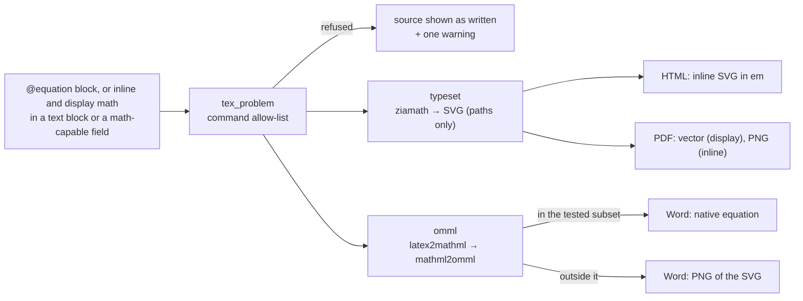

- **Where math is recognised.** `\( x \)` is inline and `$$ x $$` is display. Both are found in the **author's own text**
  and in the value of a record field its provider marks **math-capable** (`ReportField.math`, `from_search(...,
  math_fields=...)`; today the requirement's description, reasoning and clarification). A delimiter inside any other
  substituted value stays text (the evaluator keeps a per-character mask of where a delimiter counts), so a title cannot
  become an equation; an author may still write `\( k = {{record.title}} \)`. A bare `$` is never a delimiter, and an
  opener with no closer is ordinary text. Scanned: the paragraphs, headings and list items of a text block, and the
  cells of a document table whose field is math-capable. A `$$ $$` where there is no room for a block (a heading, an
  item, a cell) is drawn inline, and a display equation cannot hold a blank line (Markdown ends the paragraph). Sheets
  of the table family (CSV, XLSX, ODS) keep the TeX as text.
- **The `equation` block** is `{type: "equation", tex}` (a display equation; text view `@equation <TeX>` on one line, no
  spaces at either end). The neutral model has `Equation(tex, display)` for a block and `MathText`, a `str` subclass whose
  value is the text as written and whose `parts` are its runs and inline equations, so a heading, paragraph, list item or
  cell needs no new field and every string-only consumer (CSV, the on-screen result) sees the source; only the
  evaluator makes either, so a module report's ordinary text is never scanned.
- **Allow-list, not block-list.** `tex_problem` admits named commands (Greek letters, operators, relations, arrows,
  fractions, roots, delimiters, `\mathbb`-style fonts, `\text`, a few environments such as `matrix`, `cases`, `aligned`),
  at most 2,000 characters and ten levels of braces, `&` only inside an environment, plain characters inside `\text{}`,
  and none of `% # $ ~ "`. `\href`, `\input`, `\includegraphics`, `\def` and the rest are refused, because `latex2mathml` is
  lenient and would pass some of them through. A save refuses an `equation` block, or an authored equation in a text
  block, that fails; TeX that arrives at run time (a field value, a placeholder) is checked then.
- **Drawing.** `ziamath` (plain SVG 1, glyphs as paths, so no font is needed and nothing in the output can fetch) gives the
  SVG, which still passes `report_svg.sanitize_svg`. HTML sizes it in `em` and lowers it by its descent; the PDF embeds a
  display equation as vector (`svglib`) and an inline one as a PNG placed with an `` tag, because ReportLab reads an
  inline image only from a file path (a temporary directory per render, removed afterwards). TeX that fails to parse is
  shown as its source with the warning "An equation could not be drawn and is shown as written." (never the TeX itself).
- **Word.** The converter's markup is unwrapped from its empty `m:box` wrappers, a square root gets the hidden degree Word
  requires, and any element outside `OMML_ELEMENTS` (accents, limit operators, aligned equations) sends the equation to a
  PNG instead. `tests/test_report_math.py` pins the markup for the supported subset. Checked in LibreOffice (Phase 0);
  **a person must open a sample in Word before release.**
- **On screen.** `components/MathText.tsx` draws the same fields on the requirement page (when locked or read-only) and a
  change request's proposed text with **KaTeX** (`trust: false`, DOMPurify, MathML kept for screen readers). It first applies
  `utils/mathTex.ts`, a port of the allow-list that reads `utils/mathAllowList.json`, generated by
  `backend/scripts/generate_math_allowlist.py`; `tests/test_report_math_allowlist.py` fails when the file is stale and both
  sides run the vectors in `utils/mathTexCases.json`, so the screen and the report accept the same equations and show the
  rest as written. A new math-capable field is shown with `<MathText text={...} />`.
- **Bounds.** A run draws at most `MAX_EQUATIONS` (1,000) equations, then shows the rest as written; results are cached per
  TeX, so the same equation per record is typeset once.
- **Extending.** A new renderer (ODT) calls `typeset`, `omml`, `png_of`, `source_of` and `report_model.text_runs`; nothing
  else in the layout needs to change. A provider marks a field math-capable with `text_field(..., math=True)` or `from_search(..., math_fields=)`.

### 4s. Custom reports: background runs (Module 10 Phase 10)

A file run that passes the synchronous limits is produced in the background, stored for a limited time and announced
with a notification. The job is the run's own provenance row (`GeneratedReport`), so there is one table and one history.

```mermaid
flowchart LR
    R["GET .../run?format=pdf"] -->|"over the limits"| X["409 async_required"]
    X --> Q["POST .../runs<br/>(queued row)"]
    Q --> L["leader: run_job_loop<br/>FOR UPDATE SKIP LOCKED"]
    L --> J["run_job: as the requester,<br/>background limits x5, 10 min"]
    J --> S["object store<br/>report-runs/ORG/RUN.ext"]
    J --> N["notification<br/>report_run_finished"]
    S --> D["GET /report-runs/ID/download<br/>(requester only)"]
    E["expiry pass (15 min)"] --> S
```

- **Hand-off.** There is no cost estimate: the synchronous run is attempted with its normal limits and the `LayoutLimitError`
  it raises for a file format becomes a 409 `async_required` (the on-screen `json` form keeps 413/408, there being no file
  to queue). `ReportRunner` answers it with `POST .../custom-reports/{layout}/runs` (project and organisation; body
  `format`, `report_template_id`, `include_children` or `project_ids`), which pins the layout's current version and the
  request on a `queued` row (202). At most `MAX_ACTIVE_PER_USER` (5) rows per requester are queued or running (429).
- **Job state** is `GeneratedReport.status`: `completed` (a synchronous run), `queued`, `running`, `ready`, `failed`,
  `expired`; with `started_at`, `finished_at`, `expires_at`, `output_key`, `output_filename`, `output_size` and a fixed-sentence
  `error` (never an exception message).
- **The queue** is worked by `services/report_run_jobs.run_job_loop`, started through the lifespan's `start_singletons`, so
  one process works it. It claims the oldest queued row with `FOR UPDATE SKIP LOCKED` and runs one job at a time in a worker
  thread. A job still `running` past `ASYNC_TIMEOUT_SECONDS` plus two minutes (the leader died) is marked `failed`, never
  re-run.
- **Limits.** A background run uses `ASYNC_LIMIT_SCALE` (5) times the work and output limits and `ASYNC_TIMEOUT_SECONDS`
  (600 s) (`evaluate_layout(limit_scale=)`, `run_*_layout(background=True)`); a stored file over `MAX_OUTPUT_BYTES`
  (200 MB) fails.
- **Authorisation.** The job runs with the requester's resolver, after re-checking that the account is active, the
  organisation is active, they still hold a role in the project or organisation and the layout is still reachable and not
  hidden. Only the requester lists (`GET /api/v1/report-runs[?organization_id=]`), reads, downloads or deletes a run; another
  person's run is a 404. Download re-checks the same access and the expiry. `?active=true` narrows the list to runs
  that are queued or running (the top-bar indicator).
- **Generate again.** `POST /api/v1/report-runs/{id}/again` (`report_run_jobs.requeue`) queues a fresh run of an
  `expired` or `failed` run's stored request (format, scope, branding template, variable values, pack set): the requester,
  the layout or pack's reach and its *current* version are checked again, the old file is never reused, the queue limit
  applies and the response says whether the definition changed since (`definition_changed`). 404 not the caller's or the
  report is gone or unreachable; 409 the run is waiting, running or still downloadable; 422 the stored values no longer fit;
  429 too many queued.
- **Where the person meets a run.** There is no list page. The `report_run_finished` notification links to
  `/report-runs/:id` (`ReportRunDialog`: Download, or the expired/failed explanation with Generate again) and a clock with
  a count in the top bar (`ReportRunsIndicator`, polling `?active=true`) shows runs still in progress.
- **Retention.** `effective_retention_days`: `Organization.report_output_retention_days` (Org Admin > Templates & reports >
  Background reports), else `report_output_default_retention_days` (7), never above `report_output_max_retention_days` (30).
  The expiry pass (every 15 minutes) deletes the object of a `ready` row past `expires_at` and marks it `expired` (file
  columns cleared, provenance kept), and deletes provenance rows older than `report_run_record_retention_days` (400) that are
  not queued, running or ready. Deleting an organisation deletes its stored objects (`org_deletion`).
- **Notification** type `report_run_finished` (core `NotificationType`): title "Report ready: <layout>" or "Report could not
  be produced: <layout>", body the expiry time or the failure sentence; no report content.
- **Not in MCP.** `run_custom_report` returns the on-screen JSON; a file has no MCP form, so there are no MCP tools for
  background runs.


### 4t. Custom reports: run-time variables (Module 10 Phase 10b)

A layout declares typed variables the person supplies when running it, so one layout serves any selection (for example
the categories to show) without a copy per scope. Variables narrow a report; they never widen what the caller may read.

```mermaid
flowchart LR
    L["Layout tree<br/>variables + {var: name}"] --> V["resolve_values<br/>supplied, else default"]
    U["Run form<br/>GET .../variables"] --> S["values"]
    S --> V
    V --> B["bind_variables<br/>copy with literals"]
    B --> C["validate again"]
    C --> E["evaluate<br/>(unchanged)"]
    D["ReportField.domain<br/>(db, project ids)"] --> U
    V --> P["GeneratedReport.params.variables"]
```

- **Declaration.** Root `variables`: `name`, `type` (`text`, `number`, `date`, `bool`, `enum`), `label`, `multiple`, `default`
  (a date may default to `today`), and for an enum either `options` or a `source {record_type, field}`. The text view writes
  them as `@var` lines and references as `$name`.
- **References** are `{"var": name}` in a condition `value` (kind and list-ness checked at save), a widget parameter (one value
  of a fitting parameter type) and `{{var.name}}` in text. Substitution happens before evaluation, so no evaluator, operator
  or widget has a variable case.
- **Value domain hook.** `ReportField.domain(db, project_ids) -> list[str]` offers a closed list a project defines; an enum's
  labels and the status labels need none; `services.report_fields.field_domain` is the single read path. A module whose field names a
  project-defined row passes the lookup table's `project_id` column to `name_lookup_field`. A field with no domain takes free input.
- **Runs.** `variables` is accepted by both run routes, `.../runs`, the draft preview and the MCP `run_custom_report`; 422
  `variable_values` lists each problem by variable. The values used are stored on `GeneratedReport.params` and echoed by the
  run form (`GET .../custom-reports/{id}/variables`, and `POST .../report-layouts/variables` for a draft). The catalogue entry
  carries the run form as `variables`.

### 4u. Custom reports: report packs (Module 10 Phase 10c)

A report pack lists several reports (custom layouts and module reports), each with its own format, and is run with
one set of variables into a zip with a `manifest.json`. A pack is configuration like a layout: organisation or project
level, immutable versions, additive project visibility with hide and restore, the same manage permissions.

```mermaid
flowchart LR
    F["Run form<br/>GET .../report-packs/{id}/form"] --> V["pack variables"]
    V --> P["POST .../preview<br/>records per entry, nothing stored"]
    V --> R["POST .../run"]
    R --> E1["layout entry<br/>custom_report_run + renderer"]
    R --> E2["module report entry<br/>report_module_run + framework renderer"]
    E1 --> Z["zip: manifest.json + NN-name.ext"]
    E2 --> Z
    E1 --> G["GeneratedReport per entry<br/>shared pack_run_id"]
    E2 --> G
```

- **Definition** (`services/report_pack_definition.py`): `variables` (declared as a layout's), optional `template`, and up to
  25 `entries`: `{"kind": "layout", "name", "tier"?, "format", "filename"?, "variables"?}` or
  `{"kind": "report", "module_key", "report", "format", "filename"?, "params"?}`. A layout is named, never identified by id.
- **Variables** reach a layout entry by name, type and list-ness; a value the entry fixes wins; else the layout's default.
- **Every entry runs as the caller** through the report's own path and gates, so a pack never widens access. An entry that
  cannot run (not found, hidden, module off, no role, format not offered, variables not settable) is listed in the manifest
  as `not_available` with a reason; no runnable entry is a 409 `nothing_to_run`.
- **Files** are flat, `NN-<stem>.<ext>`; the stem is the entry's `filename` (or name) cleaned to letters, digits and `._- `.
- **Bounds:** 25 entries, 100 MB, 120 seconds for the pack, plus each layout's own caps. A file run over a bound answers 409 `async_required`
  and is queued with `POST .../report-packs/{id}/runs` (a preview over a bound is a 413); the background job stores the zip like any
  background output, with larger bounds (200 MB, 15 minutes) and the requester's access re-checked.
- **Saved variable sets** (`services/report_pack_sets.py`): a set is a name and values for some of the pack's variables, saved
  with the pack or added by a project. A project overrides a pack-defined set per variable (nearest ancestor's override wins,
  then the set's value) and resets it by deleting the override. A run takes `variable_set_id`; what is typed wins. In an
  organisation run every project's entries use that project's effective values and the manifest lists them per project.
- **Bundles.** `services/report_pack_bundle.py` adds `report_packs` (every version, with its sets), `report_packs_hidden`,
  `report_pack_sets_added` and `report_pack_set_overrides` (by pack and set name) to `project.json` and `report_packs` to `org.json`;
  an import validates everything again, drops what is not valid here with a warning and never overwrites a pack in a merge.
- **MCP.** `list_report_packs`, `get_report_pack_form`, `preview_report_pack`, `get_report_run` (read) and `run_report_pack` (write mode,
  queues the zip; the file is downloaded in the app).
- A module adds nothing for its reports to appear in a pack: they are found through the registry.

### 4v. Custom reports: starter layouts (Module 10 Phase 11)

Every organisation is created with four ready-made document layouts: **Business Requirements Document**, **Engineering
Specification**, **Review Package** and **Requirements by Component** (the requirements report grouped by component and category,
with an Introduction and Appendices to write). They are ordinary organisation layouts once written (editable, versioned, hideable, shared
with projects), so an organisation adapts one rather than cloning it first.

```mermaid
flowchart LR
    C["Core parts<br/>requirements, change requests,<br/>the document's own words"] --> A["StarterLayout.tree<br/>merge by order"]
    M["Module parts<br/>ModuleDefinition.report_starter_sections"] --> W["wrapped in<br/>if module &lt;key&gt;"] --> A
    A --> L["organisation layout<br/>(create_layout)"]
    L --> R["run in a project:<br/>a part whose module is off is left out"]
```

- **A module contributes its own parts.** `ModuleDefinition.report_starter_sections` holds `ReportStarterSection(starter, order, nodes)`:
  blocks over the module's own record types and report widgets. `services/report_starters.py` holds only the parts about core records
  and the document's words, merges every module's parts by `order` and wraps each in `{"type": "if", "when": {"module": key}}`, so core
  names no module. A part opens with its own heading. Build blocks with `services/report_starter_blocks.py`.
- **`if` on a module.** An `if` test can be `{"module": key}` (text view: `@if module risk_management`): true where that module is
  available in the project being run. The part, heading included, is left out otherwise, rather than printed with a false "none recorded".
- **Adding them.** New organisations get them at creation (`routers/orgs/core.py`, `services/bootstrap.py`); an existing organisation
  asks with `POST /orgs/{id}/report-layouts/starters` (the Add starter layouts button, manage-layouts permission). A starter whose name is
  already used is skipped, so it is safe to repeat and never overwrites an edit. An upgrade seeds nothing by itself.
- A new module with something to say in a starter adds a section; a new starter adds a `StarterLayout` and a key in
  `services/report_starter_blocks.py`. `backend/tests/test_report_starters.py` validates every starter as assembled.

### 4w. Report text: bold, italic, code and numbered lists (Module 10 Phase 13, text formatting)

The Markdown reader (`report_model.markdown_to_blocks`) is shared by a layout's text block and by the resource-file sections the
requirements report appends, so both get the same formatting in every document format.

```mermaid
flowchart LR
    A["Author's Markdown"] --> B["Set equations aside<br/>(inline and display)"]
    B --> C["markdown-it<br/>link, image, html, entity rules off"]
    C --> D["Runs: str and Styled<br/>(bold, italic, code)"]
    D --> E["Put equations back as written"]
    E --> F["Fill placeholders per run<br/>(a value is never parsed)"]
    F --> G["Paragraph / list item as MathText"]
    G --> H["HTML · DOCX · ODT · PDF<br/>one style each, same words"]
```

- **Model.** `Styled(text, bold, italic, code)` is a third kind of part in a `MathText` (beside plain strings and `Equation`), and
  `NumberedList(items)` joins `BulletList`. A `MathText` reads as its words without the markers, so CSV, the on-screen result and every
  string-only consumer see plain text; text with no style is the plain `str` it always was.
- **What is a style.** `**x**` bold, `*x*` / `_x_` italic, `***x***` both, `` `x` `` code; `\*`, `\_`, `` \` ``, `\[`, `\]` and `\\` make a marker
  literal. Everything else stays as written: bare addresses and autolinks, reference-style links, images inside a sentence (an image alone on its line is still a
  picture), raw HTML, entities, strikethrough. No hyperlink path exists in any renderer.
- **Links.** `[words](address)` is a `Styled` run with an `href`. `link_problem` allows an absolute `http` or `https` address with a host,
  `mailto:` with one address, or `#anchor` (a heading of the same document), and refuses whitespace, control characters, quotes,
  angle brackets, backslashes and anything over 2000 characters. markdown-it's own link normalising and validation are replaced (an
  address stays exactly as written, so `{{record.url}}` survives to be filled), the autolink, reference and image rules stay off, and a
  link with an address that is not allowed is kept as written text. In a layout the evaluator fills the address and checks it again on
  the final text (`checked_link`: a failure drops the link with one warning that never repeats the address); a record value can
  therefore reach an address (accepted by the User, 2026-10-28) but never produce anything other than an allowed link.
  `finalize_links` runs first in every renderer: each `Heading` gets an anchor (`heading_anchor`, unique in reading order:
  `overview`, `overview-2`) and a link to a heading that is not there becomes plain words. HTML writes `<a href>` (outside addresses
  `rel="noopener noreferrer nofollow" target="_blank"`) and heading ids; Word a relationship target or a bookmark (`sec_` plus a hash
  of the anchor) with `w:hyperlink`; OpenDocument `text:a` and `text:bookmark`; PDF `<a href>` and `<a name>`. The designer's
  sandboxed preview shows links but does not follow outside ones.
- **Safety order.** Equations are set aside before the reader runs and put back unread (a `_` or `*` in TeX is never emphasis);
  placeholders and record values are filled run by run after the Markdown is read, and a value takes the style of the run it is
  inside but is never read for styles. The layout evaluator keeps a run's style through placeholder filling and equation finding
  (`_restyled`); an equation inside a styled run is drawn unstyled.
- **Renderers.** HTML `<strong>`/`<em>`/`<code>` and `<ol>`; Word run bold/italic, a Courier New code font and the `List Number`
  style; OpenDocument `text:span` with named character styles (`T_Bold`, `T_Italic`, `T_BoldItalic`, `T_Code`, …) and the `L_Number`
  list style; PDF `<b>`, `<i>` and `<font face="Courier">` around the escaped words, and a numbered `ListFlowable`. A heading is bold
  already and reads as plain words.
- **Behaviour change.** Existing text containing a matched `*…*`, `**…**`, `_…_` or a backtick pair now prints styled, and a line
  starting `1. ` becomes a numbered list; an unmatched marker, `5 * 3`, `snake_case` and a lone `_` are unchanged. This applies to
  layouts and appended resource files.

### 4x. Reports picker: folders, placements and the sub-component gate (Module 10 Phase 16)

Every entry of the report catalogue has a **folder** and a **kind** (`report`, `sheet` for a table layout, `pack`).
The folder is a path of up to three levels (`Handover/Quarterly`, `services/report_folders.py`), decided in layers:

```mermaid
flowchart LR
    D["Default<br/>module name · Platform ·<br/>Custom reports · Report packs"] --> A["Author's folder<br/>ReportLayout.folder · ReportPack.folder"]
    A --> O["Organisation placement"] --> P["Parent project placement"] --> C["Project placement"]
    C --> E["ReportCatalogueEntryOut.folder<br/>and the picker's tree"]
```

- **`ReportPlacement`** (`models/report_placement.py`, `services/report_placements.py`) is one row per (organisation or
  project, report key) holding an optional `folder` and, for a module or platform report, an optional `hidden`. Each
  is `NULL` for "no override here"; the nearest tier with a value wins per attribute (the way action types fall
  back to the nearest ancestor). A report is named by a stable key: `report:<module>.<report key>`, `layout:<id>`,
  `pack:<id>`; deleting a layout or pack deletes its placements.
- A shared layout or pack is hidden through its own definition-suppression tombstone, so a placement may only *move*
  it. A hide of a module report is a tidy-up, not access control: the report route still answers and runs its own gate.
- `GET/PUT /api/v1/{orgs|projects}/{id}/report-placements` lists everything a scope can place (hidden included, so it can
  be restored) and sets one override; `GET .../report-placements/resolved` is the read for any member. The permission
  is the existing manage-report-layouts one at each tier. Changes are audited (`report_placement`).
- **`ReportFolder`** (`models/report_folder.py`, `services/report_folder_store.py`) keeps a folder nothing is filed in yet, one row per
  (organisation or project, path). The listing is those rows plus every folder a visible layout, pack or placement uses (a project
  also sees its ancestors' and the organisation's); `GET/POST/PATCH/DELETE /api/v1/{orgs|projects}/{id}/report-folders` lists,
  adds, renames and deletes (path in the body or query string). Rename and delete change only what the scope owns; a delete moves
  what was filed in it up one level and deletes no report. Same permission as layouts; audited (`report_folder`); both bundles carry
  the rows (`services/report_folder_bundle.py`).
- Placements travel in both bundles (`services/report_placement_bundle.py`): a module report by key, a layout or pack by name,
  resolved after the layouts and packs are imported; a name with nothing to apply to is a warning.
- **Sub-components.** A `ReportDefinition` names the sub-component it needs (`subcomponent`) or, for a report spanning
  several, the ones it spans (`any_subcomponents`, offered while at least one is enabled). `report_enabled_for_project` and
  `report_enabled_for_organization` (`modules/registry.py`) are the one check the catalogue, the report route, the
  widget list and the module run all use.
- Favourites are not a table: they are a list of report keys in the person's `ui_preferences` (`report_favourites`). The folders left open are kept the same way (`report_picker_folders`: folder ids by picker; each host names its picker with `pickerId`), and a picker opens fully collapsed the first time.
- Frontend: `ReportPicker` (dialog over the shared `FolderTreeList`), `ReportSetupPanel` (Org Admin and
  Project Admin: layouts, packs and module reports as one folder list, merged client-side in `utils/reportSetupRows` from the layout, pack, placement and folder lists) and `ReportFolderChooser`.

### 4y. Custom reports: default file names (Module 10 Phase 40)

A downloaded or stored report is named by a `{{placeholder}}` template (`services/report_file_names.py`). The same
placeholder syntax, run facts and resolver the document's text uses fill it, so a name cannot disagree with the report.

```mermaid
flowchart TD
    E["Pack entry filename"] --> S
    L["Layout tree file_name"] --> S
    O["organizations.report_file_name"] --> S
    S["render_stem: fill, clean each value,<br/>clean the whole, cap"] --> R{usable?}
    R -->|yes| N["stem + extension chosen by the renderer"]
    R -->|no| B["next source, else the built-in scope-report name"]
    N --> D["file_response -> content_disposition<br/>(RFC 5987 for anything not printable ASCII)"]
```

- **Where a template lives.** `file_name` on the layout tree root (`@filename "..."` in the text view, a `file_name` field
  kind in `LAYOUT_FIELDS`), `file_name` on a pack definition (the zip) and `filename` on a pack entry (all part of the
  versioned JSON, so they travel in bundles unchanged), and `organizations.report_file_name` (the default for a report
  that sets none, including the built-in reports: framework module reports, the requirements report, the compliance
  reports and the record-list report; in the organisation bundle).
- **Order.** Layout: its `file_name`, else the organisation's, else `<scope>-<layout>`. Pack zip: its `file_name`, else the
  organisation's, else `<scope>-<pack>`. Pack entry: its `filename`, else the layout's `file_name`, else the layout name.
- **Placeholders.** `report_title`, `project_name`, `project_code`, `organisation`, `generated_on` (the caller's own day: the
  run records `LayoutRun.today` from `effective_today()`), `layout_version`, `format` and `var.<name>`. The organisation
  default has no `layout_version` and no variables. A record field is refused at save: a file has no current record (the
  record-image name rule, which has one, shares the syntax).
- **Safety.** `clean_filename` folds accents, replaces anything outside `A-Za-z0-9 ._-`, collapses `..` and repeated dashes,
  strips leading and trailing dots, spaces and dashes, prefixes a Windows device name and caps the length; each value is
  cleaned and cut to 40 characters before it is joined. `file_response` builds the header through `content_disposition`.
  An empty or unusable result falls back; a run never fails because of a name.
- **Live example.** `POST /api/v1/report-file-names/example` (any signed-in person; stateless, data-free) answers the
  example, the problems and the placeholders valid for the place; the shared `FileNameField` shows them.

### 4z. Custom reports: copying between projects (Module 10 Phase 41)

`services/report_copy.py` copies layouts, packs, folders and module-report settings from one project to another of the
same organisation (`POST /projects/{target}/report-copy`, `dry_run` to preview; `GET /projects/{source}/report-copy/targets`).
It adds no table and needs nothing from a module: a layout or pack is serialised by the project bundle's own entry builders
(`report_layout_bundle.layout_entry`, `report_pack_bundle.pack_entry`, both with `latest_only`) and created by the bundle's
importers (`import_layout_entry`, `import_pack_entry`), so a field a module's blocks or a later change adds to the bundle
reaches a copy with no edit here.

```mermaid
flowchart TD
    Q[Request: source, ticked items, name rule] --> G{Gates}
    G -->|no access / other organisation| N404[404]
    G -->|no manage right| N403[403]
    G -->|archived| N409[409]
    G -->|ok| PL[plan_copy: reads only]
    PL -->|dry_run| OUT[Plan returned]
    PL -->|apply| AP[apply_copy: folders, layouts + pictures, packs, settings, favourites]
    AP --> AU[One audit event: counts and ids]
```

- **Gates.** `manage_project_report_layouts` in the target (dependency) and in the source (checked in the route; a source the
  caller cannot see at all is 404), no server-administrator bypass; both projects unarchived and in one organisation.
- **Names.** A taken name is renamed `Name (copy)`, `(copy 2)`, ... or skipped; nothing is replaced. A pack entry naming a
  copied layout is re-pointed at the copy's name.
- **Pictures.** An organisation picture stays a reference; a project (or ancestor) picture is copied once into the target
  project's library, read through `files.read_file` and re-uploaded by the bundle's picture importer.
- **Selection UI.** `FolderTreeList` takes optional `checks` (tick boxes, a folder covering its items, a mixed state);
  `ReportSetupPanel` uses them for its copy mode and `ReportCopyDialog` previews and applies.

### 4aa. Custom reports: snippets (Module 10 Phase 43)

A **snippet** is a named fragment of a layout (a cover page, a logo at the top right, record images, document control, approvals,
a landscape table section) that an author inserts into the layout they are editing. Inserting **copies** the blocks in: nothing
links back, so changing a snippet never alters a layout. A snippet adds no block type, no data access (its blocks run with the
runner's permissions) and the built-in and module snippets store nothing: the designer holds the draft and the server only builds
and validates the result. Authors can also keep their own (see "Saved snippets" below).

```mermaid
flowchart LR
    C["Core set<br/>services/report_snippets_core.py"] --> R["get_report_snippets()"]
    M["Module set<br/>ModuleDefinition.report_snippets"] --> R
    R --> V["visible_snippets:<br/>module on for the scope,<br/>record-type choices"]
    V --> L["GET .../report-layouts/snippets"]
    V --> A["apply_snippet<br/>draft tree + values + container/index"]
    A --> P["POST .../snippets/{key}/apply:<br/>new tree, changes, or the reasons"]
```

- **A module contributes its own.** `ModuleDefinition.report_snippets` holds `ReportSnippet(key, name, description, category, blocks,
  family, root, parameters, formats)`; a snippet about a module's own records is offered only where that module is on (the
  organisation, or the project). Core names no module. `backend/tests/test_report_snippets.py` applies every built-in to an empty
  layout and to one that already has what it adds.
- **Parameters fill declared paths.** A `ReportSnippetParameter` (`image`, `record_type` or `text`) names the paths in the fragment that
  receive its value (`nodes[0].children[1].source.record_type`), never a token parsed out of text, so the fragment is a valid tree
  from the start. A picture is checked against the layout owner's library (an organisation layout cannot take a project's picture), a
  record type against what the scope can report; a picture and a record type are never defaulted.
- **Root additions** (`root`: `page_styles`, `variables`) are reused when identical, a page style with a clashing name is renamed
  (`Cover 2`) and the inserted sections follow, a clashing variable is refused; nothing is overwritten.
- **Only the snippet's own problems refuse it.** A draft is often mid-edit, so a problem elsewhere in the layout is counted
  (`problems_elsewhere`), not a reason to refuse; a problem inside what was inserted, or caused by it (the block or page-style limit,
  a section inside a section), refuses it with the reason and path.
- **`layout_aware`** (built-in snippets only) adjusts a fragment to the layout: the logo is sized to the page's top margin and placed
  from the page corner so its right edge meets the right margin. The position is fixed at insert time.
- **Formats.** `formats` lists where the result is true; the logo is an image in front of the text anchored to the page, printed by
  PDF, Word and OpenDocument text but only approximated in the browser preview.
- **MCP.** `list_report_snippets` and `apply_report_snippet` (read-and-compute, nothing stored) in the core server and skill.

**Saved snippets (Phase 45).** An author keeps a selection of a layout (a block with everything inside it, or a run of top-level
blocks) as a snippet of a project or the organisation (`report_snippets`, `SavedReportSnippet`; core configuration, not an artefact
type, so no code, tags or search). It is stored as the blocks and the `root` they need (the page styles their sections use, the
variables they read), has no parameters or versions, and is offered by `visible_snippets` under the key `saved-<id>` after the
built-in and module snippets, so the insert dialog, the apply service and MCP treat it like any other.

```mermaid
flowchart LR
    D["Draft tree + selection"] --> F["fragment_from_selection:<br/>blocks + page styles + variables"]
    F --> K["validate_fragment:<br/>tree validator + picture rule at the tier"]
    K --> T[("report_snippets<br/>org or project")]
    T --> S["report_snippet_scope:<br/>own, ancestors, organisation,<br/>less those the project hides"]
    S --> V["visible_snippets"]
    T --> B["Bundles: report_snippets,<br/>report_snippets_hidden,<br/>report_snippet_images"]
```

- **One check on every way in.** `report_snippet_store.validate_fragment` runs on save, copy, bundle import and MCP create: the tree
  validator over a minimal wrapping tree (no unknown block, no raw HTML, nothing that refers to something outside the selection) and
  the picture rule at the snippet's tier (a project picture is refused at organisation level and on a copy up, and named). Apply
  still re-checks the whole result.
- **Visibility is additive** like layouts and packs (own, ancestors', organisation's, de-duplicated by name, nearest wins); a project
  hides an inherited snippet through a `ProjectDefinitionSuppression` tombstone (kind `report_snippet`) and restores it.
- **Routes** `/orgs/{id}/report-snippets` and `/projects/{id}/report-snippets` (list, read, `check`, save, rename, delete, copy; at
  project level `visibility`, `restore`, `check-organization` and `organization`), gated by the layout-management permissions.
- **Bundles.** `services/report_snippet_bundle.py` adds `report_snippets`, `report_snippets_hidden` (by name) and
  `report_snippet_images` to `project.json`, and `report_snippets` and `report_snippet_images` to `org.json`; an import revalidates
  every fragment, skips one that is not valid here with a warning, and never overwrites a name in a merge.
- **MCP.** `list_saved_report_snippets`, `get_saved_report_snippet`, `check_report_snippet` (read) and `save_report_snippet`,
  `update_saved_report_snippet`, `delete_saved_report_snippet`, `set_saved_report_snippet_visibility`,
  `copy_saved_report_snippet` (write mode).

### 4g. Reports: one collector, everything else from core (Module 1 Phase 12b)

A module that reports on its records declares a `ReportDefinition` per report on
`ModuleDefinition.reports` and writes one `collect_*` function for each. Core
(`services/report_framework.py`) supplies the rest: routes, `?format=json|pdf|docx|html|odt|csv|xlsx|ods`,
access gating, typed parameters, MCP tools, the catalogue and the branded document output. One function,
`report_framework.render_result`, decides a module report's file formats: the documents (`pdf`, `docx`, `html`, `odt`)
render the neutral `ReportDocument` of the result and the spreadsheets (`xlsx`, `ods`) one tab per section through the
`report_render` registry; `csv` is the first section only. The record-list routes use the same function, so a new
format is one registration there and every report gains it.

```mermaid
flowchart LR
    MOD["Module: ReportDefinition<br/>+ collect_* function"] --> BR["build_report_routers()<br/>project + org routers"]
    MOD --> MCP["report_mcp_tools()"]
    MOD --> REG["registry.get_module_reports()"]
    BR -->|"module includes them<br/>under its own prefixes"| API["…/reports/{slug}"]
    REG --> CAT["GET /projects/{id}/report-catalogue<br/>GET /orgs/{id}/report-catalogue"]
    API --> CTX["ReportContext<br/>readable projects · validated params"]
    CTX --> COL["collector → ReportResult"]
    COL --> OUT["JSON · CSV (first section) · PDF and DOCX (all sections,<br/>one ReportDocument, template branding)"]
```

```python
# reports.py
def collect_overdue(db: Session, ctx: ReportContext) -> ReportResult:
    projects = ctx.eligible(db, "tasks")          # in-scope projects with the sub-component on
    tasks = load_overdue(db, projects, ctx.params["days"], ctx.today)
    tags = ctx.tag_text(db, "task", [t.id for t in tasks])          # one query for the Tags column
    rows = [[ctx.code(t.unique_code, t.project_id), t.title, t.project_name, tags.get(t.id, "")] for t in tasks]
    return ReportResult(
        key="t1", title="Overdue tasks", scope_label=ctx.scope_label, generated_at=datetime.now(UTC),
        notes=[ctx.scope_note],
        sections=[ReportSection("overdue", "Overdue", ["Code", "Task", "Project", "Tags"], rows, gap=True)],
        eligible_projects=len(projects),
    )

REPORT_DEFINITIONS = (
    ReportDefinition(
        "t1", "overdue-tasks", "Overdue tasks", "Tasks past their due date.", collect_overdue,
        subcomponent="tasks", org_level=True, org_role_key="tasks_reports_viewer",
        params=(ReportParamDefinition("days", "integer", default=0, minimum=0, maximum=365),),
        record_types=("task",),
    ),
)
REPORT_ROUTERS = build_report_routers("tasks", REPORT_DEFINITIONS)
# project_router.include_router(REPORT_ROUTERS.project); org_router.include_router(REPORT_ROUTERS.org)
# ModuleDefinition(reports=REPORT_DEFINITIONS, mcp_tools=(*other_tools, *report_mcp_tools(REPORT_DEFINITIONS, project_router_prefix=PREFIX)))
```

- **Access (generic, fail-closed).** A project route needs project membership
  and the module (and declared `subcomponent`) enabled, else 404. An
  organisation route also needs `org_role_key`, an org-scoped role of your
  module (403); org admins hold module roles by default.
- **Scope.** `ctx.projects` is the whole set a collector may cover and it never
  widens it. Project runs and org runs default to `readable_projects` (only
  projects the caller holds a role on; `include_children` adds readable
  descendants). A role whose purpose is cross-project oversight may declare
  `org_scope="all_org_projects"` explicitly, as Compliance's manager view would.
- **Mounting.** Include `REPORT_ROUTERS.project` (and `.org`) in the module's project (and
  org) router. The catalogue reads each report's real mounted path from the route, so a module
  whose router is a composite of several prefixed routers (Stakeholders & Personas) works as
  well as one with a single prefix: include it with `prefix=<the module's project prefix>`.
- **Parameters** are declared, not hand-written: core validates types and bounds
  (422), checks `choices` (400), applies defaults, and derives the OpenAPI and
  MCP parameters from the same declaration. `format`, `include_children`
  and `report_template_id` are framework-level; unknown query parameters are
  ignored.
- **Branding.** `?report_template_id=` applies an organisation report template's
  accent colour, cover page, logo and footer to the PDF and DOCX (400 for another
  organisation's template). A report prints its own scope line, notes and sections;
  authored text around a report is written in a layout that embeds its widgets
  (§4p), so declaring a report is all a module does.
- **Validation.** A definition with a duplicate key/slug, malformed parameter,
  `org_level` without an `org_role_key`, an unknown sub-component, or an
  `org_role_key` that is not an org-scoped role is excluded and logged: no
  catalogue entry, no MCP tool, 404 on its route.
- **Records are named by code, with their tags.** A row that names a record leads with
  its code and ends with its tags, through the context's helpers, never a hand-formatted
  string: `ctx.code(unique_code, project_id)` for a project-scoped record, `ctx.org_code(unique_code)`
  for one the organisation owns, `ctx.tag_text(db, artefact_type, ids)` for the Tags column (one query
  per type). The rule mirrors the screen's (`frontend/src/utils/recordCode.ts`): a record in the
  reported project is bare (`REQ-001`) unless the organisation shows the project code everywhere; a
  record from another project, any record of an organisation-wide run, and an organisation-owned
  record are qualified (`ACME-REQ-001`). The viewer's `show_project_code` preference is **not**
  applied, so a saved or scheduled run reads the same for everyone. `record_types` lists the
  registered artefact types the report names (`backend/tests/test_report_record_codes.py` fails for a
  report that declares none, or an unregistered type). A custom view renders the server's `code`
  string and does not format it again.
- **Read-only reports.** `ReportDefinition.view_only=True` marks a report meant to be read on screen (a summary pack). The catalogue entry carries `view_only`; a record list's "Download report" leaves it out, the Reports dialog still shows it, and its `parts` remain widgets. Nothing in core names a report.
- **Packs on a record list.** `ReportPackOut.record_types` is the sorted union of the types its entries read (a module report's `ReportDefinition.record_types`, a layout tree's `record_types_of`), resolved for the asking scope (`report_pack_run.pack_record_types`); a record list's "Download report" offers a pack when its types include the list's.
- **Cells are untrusted.** CSV cells go through `csv_safe`, PDF cells through
  `report_document.safe` and DOCX cells through `report_docx.clean_text`. Do not put Restricted data (secrets, file content) in
  a result: report reads are not audit-logged, on the basis that every field is
  already returned to the same caller elsewhere.
- **A cell the screen colours keeps its colour in PDF and Word.** `ReportSection.tones` is a grid shaped
  like `rows` (`None` = no tone) naming a tone (`muted`, `info`, `accent`, `warning`, `danger`: the screen's
  `BadgeTone`, so a rating band's `tone` goes straight in). A section whose `tones` are the wrong shape or
  name an unknown tone raises when it is built. `report_model.TONE_FILL` is the one print colour per tone
  (pinned to the stylesheet's `.scoring-cell--<tone>` tints by `backend/tests/test_report_tones.py`); CSV and
  JSON carry the text only, so a toned cell's text also names the band ("2 (High ×2) · Critical"), which keeps
  a greyscale print readable. A matrix is an ordinary table whose cells are toned (Pain Point R1's
  Severity × Frequency, Risk RK2's Likelihood × Consequence).
- **Embeddable tables: declare `parts`.** `ReportDefinition.parts` lists the tables of the report a custom report layout can embed on its own (§4p), by the `ReportSection.key` the collector gives them. A test fails when a collector produces a table that is not declared; a table whose key depends on the data cannot be.
- **Status badges: declare, don't loop.** `ReportDefinition.cell_tones` maps a column heading to
  `{label: tone}` (`{"Status": tones_by_label((RISK_STATUS_LABEL, RISK_STATUS_TONE))}`), and the framework tones
  every matching cell in every section of the report, so a collector needs no change. Keep a `*_TONE` map beside
  the `*_LABEL` map in the module's `labels.py`, the hand-kept twin of the frontend's (`test_report_tones.py`
  fails when they drift); `tones_by_label` rejects a label that two enums tone differently. A collector's own
  `tones` (a rating) wins over a declared one.
- **Text colour is chosen by contrast, never fixed.** `report_model.text_on(fill)` returns black or white by the
  WCAG rule the screen uses for the accent colour (`branding.contrast_text_hex`). Tone cells, and the table
  header on an organisation's accent colour, use it, so a dark fill gets white text and a light one black. A
  new renderer or a module's own PDF table must use `report_document.toned_paragraph` / `header_text_color`,
  not a literal `colors.white`. The accent used *as text* on white paper (the cover title) goes through
  `branding.readable_on_white`, which darkens a light accent until it reads.
- **Not built yet:** rich cells (Compliance's multi-line narrative) and row caps; add them when a second
  consumer needs them.
- **On-screen UI is core too (Phase 13).** The Reports dialog (`ReportsDialog`, opened from the "Reports" menu
  on the project and organisation overviews) lists whatever the catalogue returns and run it with
  the shared `ReportRunner` (parameter form from the declaration, `ReportViewer`,
  PDF/Word/CSV). A module needs no UI for a report whose table form is enough. To draw
  something richer, register a view on the frontend
  `TierAModuleDefinition.reportViews`:

```ts
reportViews: {
  r1: { component: PainPointPrioritisationReportView, ownedParams: ["model_key", "rollup"] },
}
```

  Organisation-level reports also accept a framework-level `project_id` query
  (shown as a "Project" picker, flagged by `supports_project_filter`; the
  entry's `projects` lists exactly the projects it accepts for that caller) that narrows the run to one project already in the report's scope;
  a project outside it is a 404, so it can never widen access.

  `component` receives `{entry, result, scope, values, onValueChange}`;
  `ownedParams` are parameters the view draws its own controls for, hidden from
  the generic form. Compose `ReportSummary`/`ReportSectionTable` from
  `components/ReportViewer` for the parts a table already serves.

### Tier A — installed (the primary path)

A first-party module ships default-exported route components and registers
them in its own `frontend/src/modules/<key>/module.ts` — **not** a hand-edit
to a shared registry file. `frontend/src/modules/registry.ts` auto-discovers
every such file at build time (`import.meta.glob('./*/module.ts', { eager:
true })`, works identically under the real Vite build, Vitest, and
Storybook's Vitest-based runner) and assembles `installedModules` from the
results — dropping in a new `module.ts` is the entire registration step; see
that file's own docstring for the mechanism (module system follow-up,
2026-09-07; `docs/decisions.md`'s "Module system follow-up: frontend module
auto-discovery" entry has the full account). This only covers first-party
modules physically under `frontend/src/modules/*` — a third-party
(npm-installed) Tier A module isn't discovered this way and would need its
own registration mechanism, not built yet (no third-party Tier A module
exists).

```ts
// frontend/src/modules/compliance/module.ts
export const moduleDefinition: TierAModuleDefinition = {
  key: "compliance",             // must match the backend ModuleDefinition.key
  routes: [
    { path: "/compliance", element: <ComplianceHomePage /> },
  ],
  // Optional — see "Org-admin sections" below.
  orgAdminSections: [
    { key: "compliance", label: "Compliance", render: ({ orgId }) => <ComplianceAdminPanel orgId={orgId} /> },
  ],
};
```

Because this is compiled directly into the same frontend bundle, the
module's own components can import and use every real shared component —
`Toast` via `useToast()`, `ConfirmDialog`, `Modal`, `SidePanel`,
`DirectoryTable`, `FilterPanel`, form inputs — genuinely part of the app, not
a lookalike. The trust model matches the backend's `INSTALLED_MODULES` tier:
"an operator deliberately included this at build time." This is the tier
recommended for any module — first- or third-party — that can be compiled in.

The backend's `ModuleDefinition.frontend_manifest` still carries a
`ModuleFrontendManifest(tier="installed", nav_label=..., nav_path=...)` —
only the nav-entry metadata (a Python value can't reference a React
component), used by the nav rail and route-splicing to know a module has a
frontend surface and where it lives. `nav_path` must match the path used in
the Tier A route registration above.

A nav entry that leads to one sub-component sets `sub_component` (the primary
entry: `ModuleFrontendManifest.nav_sub_component`) to that sub-component's key.
`GET /projects/{id}/enabled-modules` returns each module's
`disabled_sub_components`, and the nav rail hides the entries listed there — the
same state that makes the sub-component's API routes 404, so a link never leads
to a page that cannot load. A page that serves several sub-components (a combined
list) sets `sub_components_any` (primary entry: `nav_sub_components_any`) instead:
the entry goes only when every listed sub-component is off. `Layout.tsx` filters
generically on both fields; it names no module. A module-admin toggle calls `refreshProjectEnabledModules`
(`hooks/useProjectEnabledModules.ts`) so the rail follows without a reload.

For a **project-scoped** route, `nav_path` may contain a literal
`"{project_id}"` placeholder (e.g.
`"/projects/{project_id}/modules/compliance"`) — `GET /projects/{id}/enabled-
modules` (`routers/projects.py::list_project_enabled_modules`) substitutes
the real project id into it before returning it to the frontend, and the
matching Tier A route registration should use React Router's own `:projectId`
param syntax at the same position (`"/projects/:projectId/modules/..."`).
`GET /orgs/{id}/modules` (the org-admin bookkeeping view) has no single
project in scope and leaves the placeholder as literal text — don't rely on
it being interpolated there. Compliance (Phase 13) is the first module to use
this; see `docs/decisions.md`'s "Compliance module plan, Phase 13" entry if
you need the full story of why this substitution exists.

### Org-admin sections

The routing/nav-discovery mechanism above is project-scoped end to end — a
module with an org-level (not project-level) admin surface, like
Compliance's own standards-management and cross-project-dashboard panels,
declares it via `TierAModuleDefinition.orgAdminSections` instead (module
system follow-up, 2026-09-07): a list of `{ key, label, render({ orgId }) }`
entries. `OrgAdminPage.tsx` merges every *enabled* installed module's own
`orgAdminSections` onto its ten fixed core `ResourceMenu` groups (Overview,
Users, Groups, ...), builds the matching `/orgs/:orgId/admin/<key>` route
segment automatically, and renders whichever section's `key` matches the
active group by calling its `render({ orgId })` — no per-module edit to
`OrgAdminPage.tsx` itself. A section's `key` must be unique across every
installed module (and distinct from the ten core group keys); a colliding
key is dropped, logged, rather than silently shadowing a core group. See
`frontend/src/modules/compliance/module.ts` for a real example
(`OrgCompliancePanel`, the org-wide compliance dashboard — Compliance's own
former second section, `ComplianceAdminPanel`, was retired in Phase 18, see
below) and `docs/decisions.md`'s "Module system follow-up: dynamic org-admin
panel registration" entry for why this replaced Phase 12/14's original
hardcoded approach.

### Global nav links, global routes, and standalone workspaces

Three more optional `TierAModuleDefinition` fields (plans/completed/compliance-module-plan.md
Phase 18), mirroring `orgAdminSections`' own "module hands the parent a
render function" shape, for a module that needs a presence in `Layout.tsx`/
`App.tsx` themselves rather than inside Org Admin or a specific project:

```ts
export const moduleDefinition: TierAModuleDefinition = {
  key: "compliance",
  // Always-mounted, top-level page routes — the same {path, element} shape
  // as `routes` above, but spliced into App.tsx's <Routes> unconditionally
  // for every installed module (like /projects, /orgs), not gated on any
  // one project's/org's own currently-enabled-modules list the way `routes`
  // is. For a cross-org, always-present surface with no single project/org
  // to check enablement against (Compliance's own /standards and friends).
  globalRoutes: [
    { path: "/standards", element: <StandardListPage /> },
    { path: "/standards/settings/:orgId/:group?", element: <ComplianceSettingsPage /> },
    { path: "/standards/:standardId/:section?", element: <StandardWorkspacePage /> },
  ],
  // A top-level nav-rail link in Layout.tsx's Global section (sibling to
  // Projects). Each item owns its own visibility and may render `null` —
  // Layout.tsx invites every installed module's items to render and never
  // itself decides whether a given one applies.
  globalNavItems: [
    { key: "compliance-standards", render: ({ railCollapsed }) => <ComplianceGlobalNavLink railCollapsed={railCollapsed} /> },
  ],
  // A left-nav section rendered as a sibling to Layout.tsx's own "Project"
  // section, active whenever `matchPath` matches the current URL — for a
  // project-like entity that isn't a Project (Compliance's own Standard:
  // Overview/Versions/History). `matchPath`'s first capture group is
  // passed to `render` as `entityId`.
  standaloneWorkspaces: [
    {
      key: "standard",
      matchPath: /^\/standards\/(?!settings\/)([^/]+)/,
      render: ({ entityId, railCollapsed }) => <StandardNavSection entityId={entityId} railCollapsed={railCollapsed} />,
    },
  ],
};
```

**Page components registered via `globalRoutes` (or `routes`) live inside
your own module's directory (`frontend/src/modules/<key>/`), never under
`frontend/src/pages/`** — `StandardListPage.tsx`/`StandardWorkspacePage.tsx`/
`ComplianceSettingsPage.tsx` all live in `frontend/src/modules/compliance/`,
the same place `ProjectCompliancePage.tsx` (registered via `routes`) always
has. `NavRailLink` (`components/Layout.tsx`) is exported so your own render
functions can build visually-consistent links. Use these three fields, not a
direct edit to `Layout.tsx`/`App.tsx`, for anything that needs a
Global-section link, an always-mounted top-level route, or a Project-like
left-nav section — an earlier Phase 18 implementation pass hardcoded the nav
link/section directly into `Layout.tsx`, and — caught in a *second* review
pass after that first fix — then repeated the identical mistake for the
routes, importing the three page components straight into `App.tsx` and
hardcoding their paths there. Both were corrected before the phase was
accepted (see `docs/decisions.md`'s "Phase 18 complete" entry for the full
account of both); the module system's own "Design history" already rejected
this shape twice during its original design, before either of these. If
your nav contribution needs its own gating logic (Compliance's link is
hidden unless `GET /api/v1/compliance/nav-visibility` says otherwise), keep
that logic self-contained inside your own module — a small hook backed by a
module-level `useSyncExternalStore` store, not a React Context/Provider
`Layout.tsx` would have to mount, is `useComplianceNavVisibility.ts`'s own
pattern (`frontend/src/modules/compliance/`) if you need the same shape.

### Tier B — remote (for a module that can't be compiled in)

For a module genuinely not installed into the deployment — an org admin
pointing at an external tool's URL at runtime, no build step — the backend
declares `ModuleFrontendManifest(tier="remote", nav_label=..., nav_path=...,
frame_url=...)`. The host renders it inside `<ModuleFrame>`, a sandboxed
`<iframe sandbox="allow-scripts allow-same-origin allow-forms">` — but with a
**Host UI Bridge**: the iframe's own page body is isolated, but shared chrome
is requested over `postMessage` and rendered by the real host components, so
it still feels native for what matters most.

```mermaid
sequenceDiagram
    participant Host as Host app (ModuleFrame)
    participant Backend as Backend API
    participant Iframe as Module iframe (its own origin)

    Host->>Backend: POST /modules/{key}/frame-token
    Backend-->>Host: short-lived JWT scoped to (module, org/project, user)
    Host->>Iframe: postMessage "init" (context, token, cssTokens, theme)
    Iframe->>Backend: its own API calls, using the scoped token
    Iframe->>Host: postMessage "toast" (message, variant)
    Host->>Host: real useToast().showToast()
    Iframe->>Host: postMessage "confirm" (id, title, message)
    Host->>Host: render real ConfirmDialog
    Host->>Iframe: postMessage "confirm_result" (id, confirmed)
```

A few details that make this safe, not just convenient:

- **The token is never the user's real session token.** It's a short-lived
  (~15 minute) JWT minted server-side, scoped to exactly one
  `(module_key, organization_id or project_id, user_id)` tuple. A request
  presenting it is checked by the same `require_org_module_enabled` /
  `require_project_module_enabled` / `require_module_role` dependencies as
  any other request; a helper (`_enforce_module_frame_scope`) rejects it
  with 403 if its scope doesn't match the specific resource being requested
  — checked *before* any admin-override bypass, so a mis-scoped token can't
  reach further just because the underlying user happens to hold a higher
  role.
- **A module-frame token can't mint another one.** The frame-token minting
  endpoints require a normal session, not a module-frame token — so a Tier B
  iframe can't use its own already-scoped token to get itself a broader one.
- **Every `postMessage` is origin-checked, both directions**, against the
  module's own declared `frame_url` origin — never a wildcard.
- **`frame_url` must resolve to an allowlisted origin**
  (`MODULE_FRAME_ALLOWED_ORIGINS`, comma-separated, empty by default). A
  module whose origin isn't allowlisted is excluded from the frontend
  manifest entirely (logged, not trusted from the module's own declaration);
  the same allowlist drives the `Content-Security-Policy: frame-src` header
  as an independent, browser-enforced backstop.

### Tier C — federated (a genuinely third-party module, no rebuild required)

Module system follow-up, 2026-09-07 — requested directly by the repo owner,
not part of a numbered `plans/completed/compliance-module-plan.md` phase. Tier A requires a
rebuild of this frontend image (Vite bundles are static build artifacts —
there is nothing to rescan once the image exists). Tier B can run without a
build step, but only by giving up native component reuse for iframe
isolation. **Tier C is for a self-hosted operator who wants to add a
genuinely third-party frontend module — one never compiled into this
image — the same way the backend has always supported for a Python module**
(`Settings.allow_external_modules` + `Settings.extra_modules_path`,
`ALLOW_EXTERNAL_MODULES=true`/`EXTRA_MODULES_PATH`, [§1](#1-the-registry-how-a-module-gets-discovered)
above): the module author builds their own remote bundle, on their own
schedule, with their own tooling, entirely outside this repository; the
operator drops the built artifact somewhere this frontend can reach at
runtime; the host dynamically `import()`s it, sharing its own React/
component-library instances rather than an isolated iframe.

```mermaid
flowchart TD
    AUTHOR["Module author's own build (Module Federation, outside this repo)"]
    ARTIFACT["remoteEntry.js + module.py, no rebuild of this image"]
    MOUNT["Operator mounts both: nginx /external-modules/, backend EXTRA_MODULES_PATH"]
    DISCOVER{"ALLOW_EXTERNAL_MODULES=true?"}
    MANIFEST["Backend registers module.py, serves federated frontend_manifest"]
    LOAD["Host dynamically import()s remote_entry_url, merges into installedModules"]
    NONE["Manifest never discovered/served — same as any other third-party module"]

    AUTHOR --> ARTIFACT --> MOUNT --> DISCOVER
    DISCOVER -->|yes| MANIFEST --> LOAD
    DISCOVER -->|no| NONE
```

**A `federated` `ModuleFrontendManifest` is only ever legitimate for a
module discovered through the existing third-party pipeline (entry points /
`EXTRA_MODULES_PATH`) — never `INSTALLED_MODULES`.** A first-party module
has no reason to use Tier C at all: it can use Tier A directly, with full
build-time review. `get_frontend_manifest` enforces this mechanically (logs
an `ERROR` and excludes the manifest) rather than trusting a module not to
misdeclare it — the same "verify, don't trust a self-declared field"
principle already applied to Tier B's `frame_url`. This is also why Tier C
needed **no second, independently-configured frontend flag**: a `federated`
manifest can only ever reach the frontend at all for a module that already
came from the `ALLOW_EXTERNAL_MODULES`-gated discovery pipeline, so that
existing gate — not a new one — is the whole gate. There is deliberately no
`MODULE_FRAME_ALLOWED_ORIGINS`-equivalent allowlist for `remote_entry_url`
either, for the same reason: unlike Tier B (which a first-party module can
also legitimately use, and therefore does need its own separate origin
check), a Tier C manifest reaching the frontend at all already implies the
gated pipeline produced it.

**The trust model — stated as plainly as the repo owner stated it when
this was designed**: *"the trust falls to the server admin to review and
vet any plugins they add to their deployment that isn't first party."*
This is a materially **bigger** trust concession than either Tier A or Tier
B — not a restatement of the same risk one level up:

| | Tier A (installed) | Tier B (remote/iframe) | Tier C (federated) |
|---|---|---|---|
| Code review | This repo's own PR review, before the image is built | The module's own origin's own process — but sandboxed | **None at all** — code the operator never compiled or reviewed |
| Isolation | N/A — genuinely part of the app | Sandboxed `<iframe>`, no DOM/cookie access to the host | **None** — same origin, same DOM, same cookies, same live component tree as the host |
| Rebuild required | Yes | No | No |
| Native component reuse | Full | Only via the Host UI Bridge's `postMessage` RPC | Full — shares the host's own React/component instances |

A Tier C module's code runs with everything the current page's own script
already has access to — the user's session (via whatever the page's own
fetch/cookie context provides), the live DOM, every other component's
state. There is no sandbox standing between "this manifest was served" and
"this code runs with full page access." The mitigation is exactly the same
shape as the backend's own third-party discovery gate
(`ALLOW_EXTERNAL_MODULES`, off by default) — an explicit, logged, opt-in
decision by the deployment operator — but the *consequence* of that
decision is larger for Tier C than for a router-only third-party backend
module, since a backend module's blast radius is still bounded by whatever
the rest of the backend's own authorization checks allow it to do, while a
Tier C frontend module's blast radius is "whatever the current user's
browser session can do." See [soc2/policies/vendor-and-subprocessor-management-policy.md](soc2/policies/vendor-and-subprocessor-management-policy.md)
point 8 for the SOC 2 framing in full, and do not understate this when
advising an operator whether to enable it.

**Runtime mechanism.** `ModuleFrontendManifest` gained a third `tier`,
`"federated"`, plus two fields only meaningful for it:

```python
ModuleFrontendManifest(
    tier="federated",
    nav_label="My Third-Party Module",
    nav_path="/projects/{project_id}/modules/my-module",
    remote_entry_url="/external-modules/my-module/remoteEntry.js",  # same-origin, or any absolute URL
    exposed_module="./Module",  # the Module Federation "exposed module" name
)
```

`frontend/src/modules/federatedLoader.ts` is the frontend half: given a
currently-enabled module's manifest, it dynamically `import()`s
`remote_entry_url`, calls the loaded container's `init(sharedScope)` (handing
it the host's own already-loaded `react`/`react-dom` instances) then
`get(exposed_module)`, and merges the resulting `TierAModuleDefinition`
straight into the **same** `installedModules` array Tier A's build-time
`import.meta.glob` discovery populates (`registry.ts`) — so `getInstalledModule`,
`buildModuleRoutes.tsx`, and `OrgAdminPage.tsx`'s `moduleAdminSections` all
treat a Tier C module identically to one discovered at build time, with no
second, parallel merge path to keep in sync. `useFederatedModules`
(`frontend/src/hooks/useFederatedModules.ts`) is what `App.tsx` and
`OrgAdminPage.tsx` each call, independently, with their own project-/
org-scoped enabled-modules list — mirroring `useProjectEnabledModules`'s own
"each concern fetches/derives its own data" convention — to trigger these
loads and re-render once one settles.

```mermaid
sequenceDiagram
    participant Host as Host frontend (federatedLoader.ts)
    participant Nginx as nginx /external-modules/ (or an external host)
    participant Remote as Module's own remoteEntry.js

    Host->>Nginx: dynamic import(remote_entry_url)
    Nginx-->>Host: remoteEntry.js (a plain ES module)
    Host->>Remote: init(sharedScope) — hands it host's own react/react-dom
    Host->>Remote: get(exposed_module)
    Remote-->>Host: factory() -> { moduleDefinition }
    Host->>Host: installedModules.push(moduleDefinition) if not already present
    Host->>Host: buildModuleRoutes / moduleAdminSections now find it, same as any Tier A module
```

**A documented deviation from the plugin this mechanism was designed
around, disclosed rather than silently substituted.** The design calls for
a real Module Federation build plugin — `@originjs/vite-plugin-federation`
(or an equivalent) — on both the host and a real module author's own build,
configured for *dynamic* remotes (a Tier C remote's URL isn't known at
host build time). **This repository's own sandboxed build/test environment
had no network access to the npm registry** when Tier C was built
(`npm view`/`npm install` both timed out against `registry.npmjs.org`), so
that dependency could not be installed, built, or verified here — and
shipping a `vite.config.ts` that imports a package not actually present in
`node_modules` would break every frontend typecheck/lint/build/test run,
not just this feature. `federatedLoader.ts` instead implements, by hand,
the same minimal container contract a real Module Federation remote build
produces (`init(sharedScope)` / `get(exposedModuleName) -> Promise<() =>
Module>`), using only native dynamic `import()` — no new dependency. See
that file's own docstring for the full account, including its explicitly
named limitation (no real shared-dependency *version* negotiation — a Tier
C remote must be built against a React version compatible with the host's
own, with nothing automated standing behind that expectation) and the
concrete, narrow upgrade path (swap this one file's own remote-loading
calls for the real plugin's dynamic-remote runtime APIs — e.g.
`__federation_method_setRemote`/`__federation_method_getRemote` for
`@originjs/vite-plugin-federation` — once a deployment building this repo
has normal registry access). `docs/decisions.md`'s "Module system
follow-up: Tier C (Module Federation)" entries have the full account of
what was verified for real (a genuinely separate, hand-authored fixture
remote, dynamically `import()`-ed in a real browser via Storybook/Vitest —
see `frontend/src/modules/federatedLoader.stories.tsx`) versus documented
as a known limitation.

#### Tier C: module-author guide

A Tier C module author never touches this repository. Their own build
produces two artifacts:

1. **A `remoteEntry.js`** (or equivalent bundle name) exporting the
   container contract above: `init(sharedScope)` and `get(exposedModuleName)`.
   `get("./Module")` (or whatever name you choose — the backend's
   `exposed_module` field must match exactly) must resolve to a **factory
   function** (not the module object directly — call it once to get the
   real module), whose return value has a `moduleDefinition` property
   shaped exactly like a Tier A `TierAModuleDefinition`
   (`frontend/src/modules/types.ts`): `{ key, routes?, orgAdminSections? }`.
   `key` **must** match the `module_key` your backend `ModuleDefinition`
   registers — a mismatch is rejected by the host loader (logged, and the
   module simply doesn't appear), not silently accepted under a different
   key.
2. **Use the host's own shared dependencies, don't bundle your own.**
   `sharedScope.react`/`sharedScope["react-dom"]` are the *host's own*
   already-loaded instances, handed to your `init(sharedScope)` — building
   your components against these (rather than your own bundled copy of
   React) is what makes your module render through the same live component
   tree as the host, avoiding the classic Module Federation footgun of two
   different React instances fighting over one page (hooks silently
   breaking, context providers not being seen by consumers in the "wrong"
   copy). Once this repository has normal npm registry access and swaps in
   a real Module Federation plugin (see the deviation note above), the
   equivalent, more familiar way to express this on your own end is your
   own `vite.config.ts` declaring `shared: ["react", "react-dom"]` in that
   plugin's own `federation({...})` config — the host will accept either,
   since the container contract itself is what matters, not how your own
   build produced it.
3. **What you may import directly, versus what you must receive via
   `sharedScope`**: only `react`/`react-dom` need to come from the shared
   scope (they're stateful singletons — the classic footgun above). This
   repo's own shared component library (`Toast`, `Modal`, `SidePanel`,
   `DirectoryTable`, form inputs, etc.) is **not** exposed to a Tier C
   module the way it is to a Tier A module compiled into this bundle — a
   Tier C module builds its own UI (using the host's shared React instance,
   so at least hooks/context work correctly), styled to visually match
   using this app's own CSS custom properties (the same design tokens Tier
   B's `<ModuleFrame>` hands an iframe via its `init` message's `cssTokens`
   — inspect `document.documentElement`'s computed style for the same
   `--color-*` custom properties at runtime) rather than importing this
   repo's own component source, which it has no access to.
4. **Your backend counterpart** is a router-less `module.py` — see the
   operator guide below for the exact shape; you'll typically supply both
   the frontend bundle and this file to the operator together, as one
   package.

Nothing about your own build tooling, bundler choice, or repository
structure is dictated beyond "produces a `remoteEntry.js` implementing this
container contract" — you are not required to use Vite, or even Module
Federation's own tooling by name, provided the contract is honoured.

#### Tier C: operator guide

None of this requires rebuilding either the backend or frontend Docker
image.

1. **Get the module's two artifacts from its author**: a frontend bundle
   (`remoteEntry.js` + whatever else it references) and a backend
   `module.py`. A router-less module needs no database migration of its
   own either, but may have one (`migrations_import_path`) exactly like any
   other externally-discovered module — see [§3](#3-moduledefinition-the-contract)
   above.
2. **Write (or receive from the author) the backend `module.py`**:

   ```python
   # my-modules/my_module/module.py
   from app.modules.registry import ModuleDefinition, ModuleFrontendManifest

   MODULE_DEFINITION = ModuleDefinition(
       key="my_module",
       name="My Third-Party Module",
       description="What it does.",
       version="1.0.0",
       default_enabled=False,
       implemented=True,
       get_router=lambda: None,  # router-less — Tier C modules built purely
                                 # for frontend UI need no backend endpoints
                                 # of their own; add a real router the same
                                 # way any other module does if yours needs one.
       frontend_manifest=ModuleFrontendManifest(
           tier="federated",
           nav_label="My Third-Party Module",
           nav_path="/projects/{project_id}/modules/my-module",
           remote_entry_url="/external-modules/my-module/remoteEntry.js",
           exposed_module="./Module",
       ),
   )
   ```

   This is the entire registration — it reuses 100% of the existing
   third-party discovery pipeline (entitlement, org enablement, audit
   logging, the Modules admin toggle) with **zero new backend discovery
   code**: `get_router() -> None` is already an `Optional` field per this
   system's own original Phase 1 design, so a frontend-only module is not a
   special case the registry needed to learn about.
3. **Place it under `EXTRA_MODULES_PATH`** (a directory the backend
   container can see — see [Adding an external module by mounting a
   directory](deployment.md#adding-an-external-module-by-mounting-a-directory)
   above for the exact bind-mount pattern) **and set
   `ALLOW_EXTERNAL_MODULES=true`** — the same two settings any other
   third-party module needs; nothing Tier-C-specific about either.
4. **Mount the frontend bundle into the frontend container's
   `/external-modules/` directory** (nginx serves it same-origin — see
   [deployment.md](deployment.md#adding-a-tier-c-federated-frontend-module)
   for the exact bind-mount and the alternative of hosting it
   externally instead and pointing `remote_entry_url` at an absolute URL).
5. **Restart both containers** (or `docker compose up -d backend
   frontend`) — no rebuild.
6. **Enable it for an organisation** via the existing Modules admin UI
   (`/orgs/:orgId/admin/modules`), exactly like any other module — an org
   admin (or server admin, for entitlement) turns it on the same way they
   would Compliance or any other module. Its nav entry/route (or org-admin
   section) appears the next time an enabled project/org page loads it,
   once the frontend's own dynamic import resolves.

**Before enabling `ALLOW_EXTERNAL_MODULES` and mounting a Tier C module in
particular** (more so than a router-only backend module — see the trust
model above), review the module's own code, reputation, and maintenance
posture the way [soc2/policies/vendor-and-subprocessor-management-policy.md](soc2/policies/vendor-and-subprocessor-management-policy.md)
point 8 asks — its code will run with full access to whatever the current
page's own session/DOM already has, with no sandbox.

---

## 6. Module-contributed MCP tools

A module can also register its own tools for `mcp-server/` — the same
server AI assistants (Claude Code, Copilot, etc.) already use to read and
(in write mode) author requirement content, described in full in
[docs/mcp-server.md](mcp-server.md). A module declares each tool
declaratively; nothing here is a second implementation of `mcp-server`'s own
patterns:

```python
McpToolDefinition(
    name="list_standards",        # local name — not a full global name
    description="Lists compliance standards for an organisation.",
    method="GET",
    path_template="/api/v1/orgs/{organization_id}/modules/compliance/standards",
    params=[
        {"name": "organization_id", "type": "uuid", "required": True, "in": "path"},
    ],
)
```

The manifest builder (`GET /api/v1/system/modules/mcp-tools`, normal
bearer-token authentication, no exemption) turns this into a real tool
`mcp-server` can register — but derives the security-relevant parts
**mechanically**, never from what the module itself claims, the same
"verify, don't trust a self-declared field" principle applied to Tier B's
`frame_url` above:

- The registered tool name is always **prefixed with the module's own key**
  (`compliance_list_standards`) — a module can never claim or collide with
  another module's or core's tool name, whatever local `name` it declares.
- **`mutates` is derived from the HTTP method** (`GET` → `False`, anything
  else → `True`) — nothing for a module to misdeclare.
- **`path_template` must fall inside the declaring module's own router
  prefix.** An entry pointing outside it — e.g. a compliance-module tool
  secretly wired to an unrelated, more sensitive endpoint — is excluded and
  logged, regardless of what the module's own manifest entry claims.
- **`is_approval_action` is read from the real backend route's own
  metadata** (a marker that endpoint's own author sets, reviewed the same
  way the endpoint itself is), not from the module's declaration. Any tool
  resolving to an approval-type action is excluded from the manifest
  entirely — approval must stay attributably human, the same principle
  `mcp-server`'s hand-written tools already enforce by simply never
  exposing that capability as a tool at all.

```mermaid
sequenceDiagram
    participant Module as ModuleDefinition.mcp_tools
    participant Backend as Manifest builder
    participant MCP as mcp-server
    participant AI as AI client

    Module->>Backend: declares name, method, path_template, params
    Backend->>Backend: prefix tool name with module key
    Backend->>Backend: reject path_template outside module's own router prefix
    Backend->>Backend: derive mutates from HTTP method
    Backend->>Backend: read is_approval_action from the route's own metadata
    Backend->>Backend: drop any tool where is_approval_action is true
    MCP->>Backend: GET /api/v1/system/modules/mcp-tools (authenticated, cached ~10 min)
    Backend-->>MCP: manifest of safe, scoped tools
    MCP->>MCP: register each via _register_declarative_tool -> _call_backend
    AI->>MCP: calls the module-prefixed tool
    MCP->>Backend: proxies to path_template, forwarding the caller's own token
```

Every module tool's `path_template` names an explicit `{organization_id}` or
`{project_id}` placeholder — there is no implicit "current org" and no
cross-org aggregation inside a tool. This mirrors the app's own REST
convention and means multi-org, mixed-enablement callers work correctly with
zero special-casing: the same per-call `require_org_module_enabled` check
that gates the real endpoint gates the tool, so a caller can successfully
call a module tool against one org and get a clean, ordinary access error
against another. An AI wanting to enumerate across a caller's orgs calls the
existing `list_organizations()` tool first, then chooses which org(s) to
call module tools against — normal MCP client-side composition, not
something the manifest mechanism does for it.

`mcp-server` fetches this manifest **lazily and authenticated** — never at
an unauthenticated boot-time call. Whichever session's own bearer token
first triggers a refresh within the cache window is used; the result is
cached in-process and reused across sessions until the next refresh. A
mutating (`mutates: True`) tool is only registered when `MCP_WRITES_ENABLED`
is set, the same gate `mcp-server`'s own hand-written write tools already
use. No packaging changes are needed in `mcp-server`'s own image — every
declarative tool is a plain HTTP proxy call through the same
`_call_backend` helper every hand-written tool already uses, so a module's
Python package never needs to be installed there.

**Scope boundary:** this only supports declarative, single-REST-call tool
mappings. A tool needing genuinely custom logic (multiple backend calls,
non-trivial response shaping) would mean shipping real code into the
`mcp-server` process — a different, larger trust question this mechanism
deliberately doesn't take on.

---

**Agent guidance (required).** A module that contributes MCP tools must also set `mcp_guidance`, Markdown telling an AI agent how to use them: the data model and lifecycle order, the read and write workflows, which tools are approvals, and gotchas. Keep it in a `mcp_guidance.md` file next to `module.py` and load it, as the first-party modules do. It is embedded in the MCP agent skill's generated `module-tools.md` (see [mcp-server.md](mcp-server.md#agent-skill)); do not repeat parameter lists there, the generator adds them. `backend/tests/test_mcp_skill_reference.py` fails if a module with tools has no guidance, or if the generated reference is stale (run `python scripts/generate_mcp_module_tools_reference.py` from `backend/`).

## 7. Building a new module: a checklist

**Decide how it will be discovered.** All three options below are gated and
mounted identically once loaded — this only decides how a `ModuleDefinition`
reaches the registry:

| Path | Where the module lives | Requires `ALLOW_EXTERNAL_MODULES` |
|---|---|---|
| First-party | This repository, added to `INSTALLED_MODULES`, via a normal PR | No |
| Installable package | Your own pip package, exposing a `reqtrackmanager.modules` entry point | Yes |
| Local directory | A folder with a `module.py` exposing `MODULE_DEFINITION`, pointed at by `EXTRA_MODULES_PATH` | Yes |

**Backend:**
1. Define your models and set `models_import_path` on your
   `ModuleDefinition` so `Base.metadata` includes them automatically —
   no core-file edit needed for this part, regardless of discovery path.
   Getting a real database to match that shape differs by discovery path:
   a first-party module ships a real, reviewed Alembic migration in its own
   `migrations_dir` (e.g. `app/modules/<key>/migrations/`, colocated with
   the rest of your module's code — see above for the full worked
   convention), authored/applied via `python scripts/db.py`, not bare
   `alembic`; an external module instead sets `migrations_import_path` to
   an idempotent `run_migrations(connection)`, applied automatically — but
   only when the deployment operator has set `ALLOW_EXTERNAL_MODULES` (see
   [Security model](#security-model)).
2. Build an `APIRouter` for your endpoints. Gate each mutating/sensitive
   endpoint with `require_org_module_enabled(your_key)` /
   `require_project_module_enabled(your_key)`, or `require_module_role
   (your_key, your_role_key)` if it needs one of your own roles.
3. Log every mutation through `app.services.audit.log_event` — the same
   audit trail every core mutation already goes through.
4. Assemble your `ModuleDefinition` (key, name, description, version,
   `default_enabled`, `get_router`, `roles`, `frontend_manifest`,
   `mcp_tools` plus the required `mcp_guidance` if you declare tools,
   `models_import_path`, `migrations_import_path`) and
   register it via whichever discovery path you chose above.

**Frontend (if you have a UI):**
- Prefer **Tier A**: build your route components against the real shared
  components, add a first-party `frontend/src/modules/<key>/module.ts`
  exporting `moduleDefinition` (auto-discovered — no `registry.ts` edit
  needed), and set `frontend_manifest=ModuleFrontendManifest(tier=
  "installed", ...)` on your backend definition with a matching `nav_path`.
  If your module needs an org-level (not project-level) admin surface,
  declare it via that same `moduleDefinition`'s `orgAdminSections` instead
  of a project-scoped route — see "Org-admin sections" above.
- Use **Tier B** if your module genuinely can't be compiled into the
  frontend bundle but you're comfortable with an iframe boundary: host it
  yourself, set
  `frontend_manifest=ModuleFrontendManifest(tier="remote", frame_url=...)`,
  get your origin added to `MODULE_FRAME_ALLOWED_ORIGINS`, and implement the
  iframe side of the `init` / `toast` / `confirm` / `confirm_result` message
  contract described above.
- Use **Tier C** if your module is genuinely third-party (not installed
  into this repo's own image at all) and an iframe boundary isn't
  acceptable — e.g. it needs to render through the host's own live
  component tree, not a sandboxed message contract. Requires `ALLOW_
  EXTERNAL_MODULES=true` (your `ModuleDefinition` must be discovered via
  entry points or `EXTRA_MODULES_PATH`, never `INSTALLED_MODULES`); set
  `frontend_manifest=ModuleFrontendManifest(tier="federated",
  remote_entry_url=..., exposed_module=...)`. See "Tier C" above for the
  full module-author/operator split — **this is a materially bigger trust
  concession than Tier A or Tier B, with no sandbox at all**, so weigh that
  before choosing it over Tier B for a module that could tolerate an
  iframe.

**MCP tools (optional):** declare `McpToolDefinition` entries for whichever
of your endpoints are safe to expose to an AI assistant. Mark any endpoint
that approves/decides something with your route's own approval-action
metadata — don't rely on the manifest builder's exclusion as your only
defence; design the endpoint itself so an AI-driven caller can't reach an
approval action even if the tool mechanism changes later.

**Tags.** Every type you list in `artefact_types` is taggable with no tag code in your module: tags are keyed by the registered type string (`ArtefactTag.artefact_type`, validated against `get_all_registered_artefact_types()`), and the generic endpoint `/projects/{id}/artefacts/{type}/{id}/tags` authorises through the same `ArtefactResolver` and `manage` permission your type already has. What your module does add: take `TagFilter` (`app/services/tags.py`) as a dependency on each project list endpoint and narrow the rows with `tag_filter.keep(db, project_id, YOUR_TYPE, rows)`; pass `<RecordTags>` to `RecordHeader` on the detail page, `TagField` + `useCommitTags` in the create form and `TagFilterField` + `useTagFilter` in the list; and call `forget_record_tags` where a record is erased for good. A bundle export that carries your records adds `"tags": record_tag_names(...)` to each row and `restore_record_tags(...)` on import.

**Every record type's shared obligations.** Each type in `artefact_types` also ships, in the same change:
a human-readable `unique_code` from `services.sequences.generate_unique_code` shown through `<RecordCode>`;
a search provider (§4j) or a `not_searchable` reason, plus a frontend `artefactPaths` entry so a result opens a page;
a list that takes `ProjectScope` (nested-project filter) and `TagFilter`; and `QuickLinkField`, `TagField` and the
`help` text on its create form. A vocabulary a project can define and an organisation can default is a
`TypeVocabulary`, so a project can hide and restore an organisation default. A lifecycle that goes draft to active
offers Save and activate only when activating needs nothing beyond permission to create. A nav entry that serves
several sub-components sets `ModuleNavEntry.sub_components_any`. Each of these is a registration or a shared
component, never an edit to a core file.

**Reports.** If your module reports on its records, declare `ReportDefinition`s
(§4g) rather than building routes, PDF/CSV code or a catalogue of your own. Name each
record through the context's code and tag helpers and list its type in `record_types`.

**Test it** the way every other change in this codebase is tested: a
backend test pinning your endpoints' behaviour (including the disabled/
non-entitled 404 case and, if you declared roles, the grant/composition
behaviour), and — if you have Tier A frontend — Storybook coverage plus a
Playwright end-to-end test, per this repository's standing testing
requirements. Put your module's own backend tests in `app/modules/<key>/
tests/`, colocated with the rest of your module's code (Compliance's own
`app/modules/compliance/tests/` is the worked example — a compliance-
module-plan.md Phase 11 follow-up moved its tests there from the flat,
shared `backend/tests/` directory) rather than the flat directory every
core (non-module) test lives in. This needs no `conftest.py`/`pytest.ini`
change on your part: `backend/conftest.py` (this project's pytest rootdir)
already registers `tests/conftest.py` as a plugin
(`pytest_plugins = ["tests.conftest"]`), so its fixtures (`client`,
`admin_token`, `org_id`, etc.) apply to your module's own test directory
automatically, the same as they do inside `tests/` itself — pytest's own
directory-based fixture cascade wouldn't otherwise reach a sibling
subtree like `app/modules/<key>/tests/` on its own, which is exactly why
that one small top-level file exists. If your tests need to exercise your
own migration's up/down behaviour directly (rather than just relying on
`test_schema_migrations_match_models.py`'s drift check), build your
`alembic.config.Config` via `tests.conftest.build_alembic_config()`, not a
bare `Config(...)` — it's the one that already calls `configure_alembic_
version_locations` for you, without which Alembic can't resolve `"head"`
(or any revision id) at all once more than one module's migrations exist
outside the core directory.

---

## Security model

This system opens a real, new trust boundary — code loading — and is treated
that way, not glossed over:

- **The trust boundary is "was deliberately installed."** First-party
  modules go through this project's own PR review. Third-party modules
  require a deployment operator to explicitly set `ALLOW_EXTERNAL_MODULES=
  true` and either `pip install` the package or point `EXTRA_MODULES_PATH`
  at it — an active, logged choice, not a default-on surface.
- **Sandboxing arbitrary untrusted code execution is explicitly out of
  scope.** The mitigation is the opt-in gate above, not a sandbox — the same
  boundary any Python plugin ecosystem (pytest, Flask) relies on.
- **That same opt-in also covers applying an external module's own database
  migration**, via `migrations_import_path` (§3 above) — not a second,
  separate trust decision, just the same "was deliberately installed" gate
  extended to schema changes rather than only request-time behaviour. A
  first-party module is exempt from this mechanism regardless of the flag:
  its schema changes always ship as a reviewed migration in the core image.
- **Path-scoping and approval-exclusion for MCP tools are mechanically
  enforced**, not trusted from a module's own manifest — see
  [§6](#6-module-contributed-mcp-tools) above. This gives a real guarantee
  for tools pointing at first-party endpoints; for a third-party module's
  *own* endpoints, the guarantee still ultimately rests on "was deliberately
  installed," the same boundary as everything else here.
- **Tier B tokens are narrowly scoped and can't escalate themselves** — see
  [§5](#5-frontend-integration-tier-a-and-tier-b) above.
- **Tier C is a materially bigger trust concession than either Tier A or
  Tier B, stated plainly rather than glossed over**: there is no build-time
  review (the code was never in this repo, unlike Tier A) and no sandbox at
  all (unlike Tier B's iframe) — a federated module shares the same origin,
  DOM, cookies, and live component tree as the host the instant it loads.
  The trust falls entirely to the deployment operator to review and vet any
  such plugin before enabling it. A `"federated"` manifest is mechanically
  restricted to modules discovered through the existing gated third-party
  pipeline — never a first-party one — but that pipeline's own gate
  (`ALLOW_EXTERNAL_MODULES`) is the *only* gate; there is deliberately no
  second, Tier-C-specific allowlist the way Tier B has one for `frame_url`.
  See "Tier C" [above](#tier-c--federated-a-genuinely-third-party-module-no-rebuild-required)
  for the full account.

For the full SOC 2 framing (which control-matrix gap this raises the stakes
of, and the specific policy-document changes this system committed to), see
[docs/plans/completed/compliance-module-plan.md](plans/completed/compliance-module-plan.md)'s "SOC2 /
Security Planning" section and
[docs/soc2/policies/](soc2/policies/access-control-policy.md).

---

## Where to go next

- [solution-architecture.md](solution-architecture.md)'s "Modular Feature
  System" section — the precise, line-referenced technical account of every
  table, class, and dependency mentioned here.
- [plans/completed/compliance-module-plan.md](plans/completed/compliance-module-plan.md) — the phased build
  plan this system was built under, its design history (including the
  corrections that shaped Tier A/B and module-contributed RBAC), and current
  phase status.
- [mcp-server.md](mcp-server.md) — the full `mcp-server` documentation
  module tools are proxied through.
- [soc2/policies/](soc2/policies/access-control-policy.md) — the adopted
  policy set this system's authorization and vendor/third-party sections
  extend.
