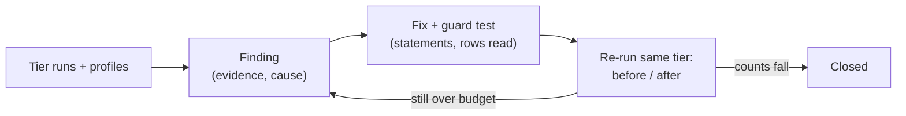

# Performance findings

The commands that produced these figures are in [perf/README.md](../perf/README.md), "Run recipes".

What the profiling runs (`perf/`, how-to in [perf/README.md](../perf/README.md)) found about how the product scales,
and what was done. One entry per finding, latest state only. Numbers are from Docker Desktop on a Mac (amd64, one
backend worker, shared host), so **statement and row counts are exact and latencies are indicative**: untouched
endpoints differed by 2-10x between two otherwise identical runs, so a latency difference alone is never taken as a
finding or as proof of a fix.

## Cross-host results (commit d01093e, T0 to T4, full runs)

| Host | Workers | Page of 50, T0 / T4 (4 users, p95) | Single record, T4 | Backend peak memory, T4 |
|------|---------|------------------------------------|-------------------|-------------------------|
| Linux server (16 cores, 30 GiB, shared with production) | 4 | 22 ms / 94 ms | 16 ms | 4.4 GiB |
| Dell workstation (WSL2, Docker Desktop) | 4 | 37 ms / 100 ms | 24 ms | 4.4 GiB |
| Raspberry Pi 5 (8 GiB, NVMe) | 1 | 200 ms / 2.0 s | 390 ms | 1.4 GiB |

- The paged list, the single record, search, comments, links and the dashboard are flat or near-flat from 30 to 20,000
  requirements on both x86 hosts; the Pi shows the same shape at 5-20x the latency, with CPU the limit (four users on
  one worker).
- A worker costs about 530 MiB private (no sharing) up to 1,000 requirements, and peaks near 1 GiB at 5,000 and
  20,000 because the report, export and bundle scenarios hold the whole project (open item O7).
- The work that is still linear in project size is the work that touches every record on purpose: the unpaged list
  (4-8 s at 20,000), CSV export (3.5 s), PDF report (39 s), project export (12 s) and project import (115 s Linux,
  186 s Dell at the run's commit; faster after F8, not re-measured).

## Capacity (T2, 1,000 requirements; the `capacity` scenario)

A **connection** here is one simulated client making about one API request a second (the browse mix, with about one
request in five a write). It is not a person: an active person makes a request every 5-10 seconds on average (a page view
fires a few calls together, then the person reads), so one connection stands for 5-10 active people. A level is judged on
the delivered rate (at least 90% of offered), failures (at most 1%) and the request-weighted p95 (at most 1 s).

**What the usable numbers mean in people** (assumption: one request per 5 s for a busy person, per 10 s for a relaxed one;
"signed in" assumes a third of signed-in people are active at any moment, a guess to replace with your own usage):

| Stack (Linux server, 1,000-requirement project) | Usable rate | Active people at once | Signed-in people |
|--------------------------------------------------|-------------|-----------------------|------------------|
| 2 workers | 63 req/s | 315-630 | about 950-1,900 |
| 4 workers | 125 req/s | 625-1,250 | about 1,900-3,750 |
| 6 workers, 6 cores (a floor: not yet saturated) | 126 req/s usable, 242 delivered at 256 connections | 1,210-2,420 | about 3,600-7,300 |

| Host | Workers | Usable level | At the next level | Backend CPU at the knee |
|------|---------|--------------|-------------------|-------------------------|
| Linux server (16 cores, shared with production), after the request limit | 4 | 128 connections (124 req/s delivered, p95 0.87 s, no failures) | 256 connections: 188 of 256 req/s (73%), 0.7% failures, p95 1.75 s | 322% of the 400% cap |
| Mac (Docker Desktop), before the request limit | 1 | 8 connections | 32 connections: 61-70% delivered; 96 connections: **nothing completed** (F10) | 115% |
| Mac, after the request limit | 1 | 8 connections | 96 connections: 22% delivered, no failures (saturated, not stalled) | 116% |
| Linux server, 2 workers | 2 | 64 connections (63 req/s, p95 0.79 s) | 128 connections: 96% delivered but p95 1.05 s; 256: 48% | 209% (cap 400%) |
| Linux server, 4 workers (second run) | 4 | 128 connections (125 req/s, p95 0.84 s) | 256 connections: 79% delivered, p95 1.9 s | 381% (cap 400%) |
| Linux server, 6 workers on the same 4-core backend cap | 6 | 128 connections (126 req/s, p95 0.77 s) | 256 connections: 74% delivered, p95 2.2 s | 367% (cap 400%) |
| Linux server, 6 workers with 6 cores (`--max-cpus 12`) | 6 | 128 connections (126 req/s, p95 0.77 s) | 256 connections: **94% delivered (242 req/s), p95 1.1 s, not yet saturated** | 499% (cap 600%) |

- **A worker is about one core of Python, so throughput scales with workers until the backend's cores run out.** Two
  workers peak at 123 req/s using 209% CPU (one core each), four at 203 req/s using 381%, and six workers add nothing
  (190 req/s, 367%) because the stack's CPU budget capped the backend at four cores in all three runs (`--max-cpus` was not
  raised on a server shared with production). Per core the peak is steady at 51-61 req/s. Sizing rule: one worker per core
  the backend may use, about 50 requests per second per core, or roughly 250-500 active people per core.
- **Confirmed with six cores:** six workers with six backend cores delivered 242 req/s at 256 connections (94% of offered, 499% CPU),
  against 190 req/s on four cores: about 48 req/s per core of CPU used, the same rate as two and four workers. 256 connections did
  not saturate it, so 242 is a floor, not the peak; the next levels (384, 512) find the knee (O9).
- **The database connection limit is the next wall.** At 256 connections the six-worker run held 91 of the 97 connections
  PostgreSQL allows clients (6 workers x (4 + 10 + 2) = 96 possible). Each further worker needs about 16 more, so beyond six
  workers of this pool the database refuses connections before the CPU runs out: a smaller pool per worker (the request
  limit follows it), a higher `max_connections`, or a pooler such as PgBouncer is required.
- No run failed a request at 256 connections: the request limit queues instead, so overload shows as lower delivered rate and
  p95 above 2 s, not as errors.
- The Linux server scales linearly (16, 32, 64, 128 connections deliver 97-98% of the offered rate) and then runs out of
  CPU, not of anything else: the load generator used 16% of its cap, the database cache hit rate stayed at 98.6-98.9%
  and no connection pool was exhausted. About 17 ms of backend CPU per request (322% CPU for 188 req/s), so a worker
  serves roughly 45-55 requests a second per core on this mix.
- Planning rule from these numbers: usable requests per second is about 50 times the number of workers (one core
  each); divide by how often a person makes a request (5-10 s) to get active people.

**Writes spread over ten projects** (Linux server, 6 workers, 6 backend cores, 3 database cores; 256 / 384 / 512 connections):
delivered 220 / 237 / 230 req/s with **no failed request at any level**, backend CPU 480-508% of 600%, database CPU 237% on
average and 314% at peak against its 300% cap. The counter-lock wait fell from 1,149 ms to 12.7 ms on average (the create queue of
a single project, O11, is gone), and the ceiling stayed at about 235 req/s because the **database CPU is now the limit**,
with the backend close behind. For sizing, count the database's cores as well: about 26 req/s per core of the whole stack
(6 + 3 cores) here, against 34 for four workers (4 + 2 cores); the database share grows with the stack.

**After F12** (same command): delivered 200 / 250 / 241 req/s at 256 / 384 / 512 connections, no failures, backend CPU 414-539%,
database CPU 227% mean and 312% peak. The total-count statement left the slow list (it was 54 s of database time), yet the
ceiling stayed at about 250 req/s: the database is still at its cap and the list page itself (9.6 ms, 73 s) and the
activity timeline's three audit queries (8-11 ms each, 63 s, sequential scans) now lead the database time. F13 indexes the
audit trail; the remaining list cost is O12.

**After F13** (the audit indexes; same command): delivered 231 / 237 / 242 req/s at 256 / 384 / 512 connections, no failures. The
activity timeline's audit statements now use a bitmap index scan and take 2.9-3.6 ms instead of 8-11 ms (about 63 s of database time
over the run down to about 16 s). The ceiling did not move because **both halves of the stack are now at their CPU caps**:
the backend peaks at 615% of its 600% (436% on average) and the database at 310% of its 300% (217% on average). That is what
a CPU-bound, balanced stack looks like. At this mix a request costs about 27 ms of CPU, 18 ms in the backend and 9 ms in the
database, so the stack serves about 27 req/s per core of its 9 cores (about 240 req/s, 1,200-2,400 active people). More
throughput now needs more cores, in the same two-to-one split, or a cheaper request (O12); the 97-connection limit
(91 held) is the wall for adding workers.

**Same climb at T3** (ten projects of 5,000 requirements, 50,000 in all; 6 workers, 6 + 3 cores): delivered 142 and 149 req/s at
256 and 384 connections (about 40% below T2's 240), no failed request, p95 3.2-3.8 s, about 700-1,500 active people. The backend
was not at its cap (282% average) and the database was (247% average, 312% peak), and **the buffer cache hit rate fell to 73%** with
the default `shared_buffers` of 128 MB against a 335 MB database. The page-of-50 statement averaged 212 ms (9 ms at T2) and
read 3,445 blocks per call. So the capacity ceiling does depend on project size at this scale, through the database: its
working set no longer fits `shared_buffers`, and the default ordering reads the whole project for each page (below).

**Why the page costs more at T3, tested.** The page query joins the 5,000 requirements to their current versions, and the planner
scans all 50,000 current versions of the database's ten projects to do it (8,852 buffers, 34 ms warm on a replica of this
data). A partial index on current versions (`requirement_id WHERE valid_to IS NULL`) did **not** change the plan or the time (45 ms
either way): probing 5,000 times costs about as much as scanning 50,000 rows, and the default order needs every row of the
project to sort. The cost per page is therefore linear in the project's size by construction, and in cache misses once the
database outgrows `shared_buffers`. The next experiment is the buffer size, not an index.

**The same T3 climb with `shared_buffers` 512 MB and `work_mem` 16 MB:** the buffer cache hit rate went from 73% to 99.99%
and the page query read no blocks from outside the cache (11.4 million before); that statement fell from 212 ms to 117 ms.
Delivery rose only from 142 / 149 to 154 / 159 req/s at 256 / 384 connections (about 8%), with no failures and the database
still at its CPU cap (244% average, 316% peak). The climb stopped at 384 because it delivered under half the offered rate, so
512 is skipped by design. The buffer size is worth setting (the cache misses were real cost and the hit rate is now
healthy), but it is not the lever for throughput: at 5,000 requirements per project the page statement is the wall, and its
cost is the default ordering reading the whole project for every page.

## Other record types and the links between them (Linux server, commit 8b8a5161, 2026-10-27)

Four runs on the shared Linux server (`linux-vm-4c8g`, 4 workers; 6 for the climb), dataset v3 with every registered type and a
1,000-link hub per type pair. All publishable, none aborted, no request failed. T2 is 1,000 requirements per project (105,505
rows, 65 MiB), T3 5,000 (444,337 rows, 205 MiB). Means are over three repeats at one simulated user; each request class has
only 2-50 samples per tier, so p95 is noisy and the means are the fair number.

| Request | T2 mean | T3 mean | Budget | Reading |
|---------|---------|---------|--------|---------|
| Another type's unpaged list (15 types) | 15-135 ms | 22-477 ms | 1 s | Within budget at T3. Grows with the data (x1.5 to x10 for 5x the records); the risk list (3,000 rows, 477 ms) and pain points (265 ms) are the largest |
| A record, its comments | 12-18 ms | 16-22 ms | 300 ms | Flat |
| Link graph, depth 2 from a 1,000-link hub | 151 ms | 188 ms | 1 s | Flat in project size, as hoped |
| Link graph, depth 3 from a hub | 208 ms | 164 ms | 1 s | Flat |
| Activity timeline (hub) | 65 ms | 71 ms | 300 ms | Flat (F17) |
| Link candidates / browse | 30-48 ms | 80-282 ms | 1 s | Grow with the size of the searched type (x2 to x8); worst: decision browse 282 ms, risk 264 ms at T3 |
| Search (all types in a project; every project) | 96 / 99 ms | 144 / 141 ms | 1 s | x1.4 for 5x the data |
| One type's CSV export / import preview | 30-170 / 50-480 ms | | 30 s | Seconds at most |
| Project bundle export (T2, ~6,000 records) | 4.2 s | | 30 s | Within budget |
| Organisation bundle export, one T2 project / 31 T1 projects | 4.5 s / 14.6 s | | 30 s | Within budget; was 215 s before F16 |

| Capacity (6 workers, ten projects, T2, 4 + 10 pool) | Delivered | p95 | Backend CPU |
|-----------|-----------|-----|-------------|
| `capacity`, 256 connections | 157 req/s (61%) | 2.6 s | 548% of 600% |
| `capacity`, 384 connections | 161 req/s (42%) | 3.9 s | 548% |
| `capacity_mixed`, 256 connections | 122 req/s (48%) | 3.3 s | 572% |

Reading: the stack saturates near 160 req/s with this dataset, against about 240 in the earlier recipe on a much smaller one;
the mixed workload (other types and link reads in the mix) delivers 22% less than the plain one. Nothing failed: it saturates
by queueing. Worker memory stays under 640 MiB private (idle 417), peaking in the bundle exports (640 MiB); the bundle exports
spilled about 500 MiB of temporary files each (`work_mem` 4 MB, O20). The cache hit rate was 92% in `capacity` and 88% in
`capacity_mixed` (`shared_buffers` 128 MB; O13 found 512 MB lifts it above 99%). The run found F20.

### Second server run (commit a9014996) against the first (8b8a5161)

The same four profiles after F20. Nothing else changed measurably: lists, records, comments, link graph, candidates, browse, search and the exports are within noise of the first run (single-user means), as expected since F20 does not touch them. Capacity is the change.

| Capacity (6 workers, ten projects, T2) | 256 connections | 384 | 512 | CPU |
|---|---|---|---|---|
| `capacity` before | 157 req/s, p95 2.6 s | 161, 3.9 s | | 548% of 600% |
| `capacity` after | **225 req/s, p95 1.7 s** | 231, 2.6 s | 237, 2.9 s | 502-546% |
| `capacity_mixed` before | 122 req/s, p95 3.3 s | | | 572% |
| `capacity_mixed` after | **150 req/s, p95 2.8 s** | 148, 4.1 s | | 570% |

Neither run has a level that meets the 1 s p95 budget, because the lowest level run (256 connections) is already past the knee; a lower level (for example 128 or 192, `--capacity-users`) is needed to name a usable capacity, which is a Phase 5 measurement. What limits it now, from `pgstat.csv`: the page-of-50 requirement list (80 s of database time in `capacity`, 10.5 ms a call: O12), the project counter lock (37 s: O11), the dashboard's status count (19 s), and in `capacity_mixed` a cache hit rate of 96% (`shared_buffers` 128 MB: O13). Failures: none.

## Closed

| # | Symptom | Cause | Fix | Before to after (T2, 1,000 requirements) | Guard |
|---|---------|-------|-----|------------------------------------------|-------|
| F1 | A "page of 50" request cost as much as the whole project: 1.3 s at 5,000 requirements and 5.2 s at 20,000 (p95) | The list loaded and serialised every requirement, then sliced. Once the per-row lookups were paged, the remaining cost was reading all 19,031 rows: 59% of CPU, nearly all of it psycopg2 turning six UUID columns per row into Python objects, plus building a mapped entity per row | The database applies every filter, the order (component, category, manual; or one column, `COLLATE "C"` to match Python's order) and the page; one UUID column per row; the full records, versions, people, tags and counts are loaded for the returned page only. A keyword filter (tag names) still narrows in Python; a scope widened over related projects still reads each project whole to order them together | Rows read per request (1,000 requirements): versions 946 to 50, tags 1,151 to 61, comment counts 672 to 36. p95 at 20,000: page of 50 5.2 s to 0.75 s (same as at 5,000, so flat in project size); status + sort 5.4 s to 0.63 s; text search 5.7 s to 0.68 s; has comments 6.3 s to 0.30 s | `test_requirements_page_cost_does_not_grow_with_the_project` (versions and records read), `test_requirements_sorted_page_matches_the_full_sorted_list`, `test_requirements_list_filters_and_default_order_are_unchanged`, `test_requirements_sql_filters_and_sort_match_what_python_would_return` (accents, punctuation, every sort column) |
| F2 | Project overview ran 282 statements | A module-availability lookup (5 statements) repeated for each of about 20 record types; counts read every requirement id back and sent them in `IN (...)` lists | Module state read once per module for the request; counts and stage progress are database aggregates | Statements per request 282 to 96 (flat in the data) | `test_project_metrics_query_count_does_not_grow_with_the_project` |
| F3 | A record's link list ran 57 statements at 100 requirements and 170 at 1,000 | Two lookups per link (the other record and its current version) | Link types, other records and their names loaded once for the whole list | Statements 57 / 170 to 16 / 16 | `test_requirement_links_query_count_does_not_grow_with_the_link_count` |
| F4 | Every requirement list counted comments with a sequential scan | No index on the comment target | Migration 0107 adds `ix_review_comments_target` | Planner cost 1,856 to 454; no measurable time change at 1,100 comments | `test_review_comment_index.py` |
| F5 | Found by a full run on a Linux server (T3-sized project): project export ran one `SELECT email` per requirement (4,363), the requirements report one version and one tag query per requirement (1,777 and more), and a record import update four structure queries and two person lookups per row (3,554) | Per-row lookups of a person, a version, a tag list and the type's structure | Export reads each person or group once (`principal_to_bundle` memoised for the request); the report reads versions and tags in one statement each; the import finds the named records and prepares them once for the whole file | 40 requirements: export 106 to 67 statements, report 99 to 21, record import 399 to 126 (the remaining 40 are one lookup per named record) | `test_export_report_and_record_import_statements_do_not_grow_with_the_requirements` |
| F6 | A comment thread cost three statements per comment (reaction count, my reaction, attachments) | `comment_to_out` queried per comment | `comments_to_out` reads authors, reaction counts, my reactions and attachments in one statement each; the requirement, action and change request lists use it | Statements for a thread of 12: flat with the thread length | `test_requirement_comments_statements_do_not_grow_with_the_thread` |
| F7 | Creating a requirement took 30-45 ms up to 1,000 requirements and 430-570 ms at 5,000 and 20,000, on all three hosts (Pi: 1.1-3.3 s). **Verified on the Linux server: 440 to 34 ms at 5,000 and 533 to 39 ms at 20,000 (p95, one user)** | Numbering the new record read every id of the project back to count them (20,424 rows per create) | The count is `COUNT(*)` in the database (also in the change request approval path) | Rows read per create: project size to 0 | `test_creating_a_requirement_does_not_read_the_projects_requirement_ids` |
| F8 | Project import ran about 14 statements per requirement (115-186 s at 20,000) | Each record re-read the organisation role of the importer and the tag list of the project (3 statements plus 2 parent-project lookups) | An import reads each organisation role once and each scope's tag list once, adding to the list the tags it creates | 576 statements for 40 requirements to under 9 per requirement. **Verified on the Linux server: import 33 s to 22 s at 5,000 and 115 s to 80 s at 20,000 (still over the 30 s heavy budget at 20,000: O6)** | `test_project_import_statements_per_requirement_stay_small` |
| F9 | `analyse.py` reported 12 workers for a 4-worker backend and a total above the container's cap | `processes.csv` has one snapshot per user level with the same scenario and repeat, and they were merged | Snapshots are told apart by a repeated process index | Linux T4: 4 workers x 1,043 MiB private, 4.2 GiB total | `test_worker_memory_tells_snapshots_at_different_user_levels_apart` |
| F10 | **A worker stalled completely under load.** With one worker, 96 simulated connections completed no request in 55 s (the backend 9% busy, all 15 connections `idle in transaction`, then `QueuePool limit ... connection timed out`) | A request takes a database connection in its first dependency and keeps it until its handler and session cleanup have run, and each step needs a thread from a pool of 40. With more requests in flight than connections, every thread waits for a connection held by a request that is waiting for a thread, until the pool's 30 s timeout, and new requests refill it | Each worker admits at most as many requests as it has connections (`MAX_CONCURRENT_REQUESTS`, default 15); the rest wait in the event loop and get `503` + `Retry-After` after `REQUEST_QUEUE_TIMEOUT_SECONDS` (30); `/health`, `/metrics` and WebSockets are exempt; `requests_shed_total` counts refusals | 96 people: 0 requests completed to 22% of the offered rate delivered, 0 failures; 192 people: 12%, 0 failures (graceful saturation, 1 worker on a Mac) | `tests/test_concurrency_limit.py` (ceiling, queue, timeout, exemptions, slot freed on failure, default equals pool capacity) |
| F11 | **Writers queued behind one lock, capping six workers at about 240 req/s with the CPU 25% idle.** At 256, 384 and 512 connections the stack delivered 224, 220 and 237 req/s (flat), backend CPU 379% of 600%, and the statement `SELECT projects.id ... FOR UPDATE` (taken by every create to number the record) averaged 897 ms; the audit insert averaged 39 ms and 76 connections sat idle in a transaction | The lock was `FOR UPDATE`, which also conflicts with the `KEY SHARE` lock that every foreign-key check on `projects` takes, so while one request held it every other insert for the project (audit events, comments, versions) waited too: the lock was a project-wide write lock | The serialising locks (`lock_project_for_update`, `lock_organization_for_update`, `lock_row_for_update`, and the organisation lock in `services.codes`) are `FOR NO KEY UPDATE`: still exclusive between lockers, so numbering and the last-manager guards are as safe as before, but they no longer block foreign-key checks | Measured on the Linux server (six workers, 256-512 connections): the audit insert fell from 39 ms mean (255 s in total over the run) to below the top-15 list, so writes are no longer queued behind the lock. The ceiling barely moved (peak 242 to 257 req/s) because the remaining wait is creators queuing on each other for the counter (see O11) | `tests/test_lock_levels.py` (an insert referencing the project proceeds while the lock is held; a second lock waits; the test fails with `FOR UPDATE`) |
| F12 | The page-of-50 list cost two heavy statements per request at 1,000 requirements: the page (8.9 ms) and the total count (7.1 ms), 122 s of database time over the ten-project run and the largest single share | The total was counted through the same joins as the page (versions, components, categories), though only the page needs them, and it was counted even when the rows already said how many there were | The total is counted from the requirement table alone unless a filter reads the version (status, stage, text), and not counted at all when the page is short or the list is unpaged | Statement time to be re-measured on the Linux server | `test_requirements_total_count_is_right_for_every_page_shape` (first, full, short last, past-the-end, unpaged, filtered) |
| F13 | A record's activity timeline ran three sequential scans of `audit_events`, 8-11 ms each, about 63 s of database time over a capacity run, growing with the trail (the table had no index besides its key, and it gains a row with every write) | No index on the columns the timeline, the project change feed and the `SET NULL` of a deleted project filter on | Migration 0108: `ix_audit_events_entity (entity_type, entity_id)` and `ix_audit_events_project_type (project_id, entity_type, created_at)` | Verified on the Linux server: planner scan sequential to bitmap index scan; per call 8-11 ms to 2.9-3.6 ms; about 63 s to 16 s of database time over a capacity run | `test_audit_event_indexes.py` (both indexes exist and the planner uses each for its filter) |
| F14 | **A module record's comment thread cost one statement per comment** for eleven types (decision, future state, open question, engagement, guiding principle, pain point, persona, risk, stakeholder, need, strategy): 20 to 24 statements for the thread of a record as its comments went from 2 to 6 | The author and the attachments were looked up for each comment (the shape F6 fixed for requirements, actions and change requests) | `services.module_attachments.comments_out` reads the authors and the attachments of a whole thread in two statements; the shared kit, the Context & Strategy routers and the Decision router all use it | Statements per thread: flat in the comment count (guard compares 2 and 6 comments) | `test_scaling_shapes.py` (every type, `comments`), `test_batched_list_helpers.py` |
| F15 | **Nine types' lists issued statements in proportion to their rows**: change requests +3 per row (a subscription, a comment count, the proposed links), personas +3 (weights, overrides, visibility), pain points +2 (type names), and +1 per row for future states, guiding principles, risks, stakeholders, needs, strategies (the current version) and compliance evidence (its links). Going from 3 to 9 records: change requests 24 to 42, personas 31 to 49, pain points 27 to 39, risks 32 to 38 | Each row's version, counts, weights, type name or links were fetched by a call made inside the loop that builds the response | `services.current_versions.current_versions` (one statement for a list's versions), `resolve_persona_weights`, `pain_point_type_names`, `engagement.subscribed_ids`, `build_evidence_outs`, and the change request list reads only each request's latest version with its proposed links loaded together | Statements per list request: flat in the number of records, for all twenty probed types | `test_scaling_shapes.py` (`KNOWN_GROWING` is now empty), `test_batched_list_helpers.py` (the batched answers equal the per-record ones) |
| F16 | **The project and organisation exports issued thousands of statements per project.** A project of 100 requirements and about 1,200 records of other types ran **3,345 statements in 6.2 s** to export; the organisation export of 31 such projects took **215 s** for one request (13.8 MB; concurrent requests piled up). Found by a smoke run of the new scenarios. About three statements per record, in every module's export | Each module's export looked a record's tags, attachments, current version, links, type name, pain point scores, engagement facilitators and prompts, and a persona's weight up one record at a time (the shape F5 fixed for requirements); the organisation route also lacked the read-only cache block the project route has | An export reads the tags, attachments, current versions and links of all its records of a type in one statement each (`prime_record_tag_names`, `prime_file_links`, `prime_current_versions`, `prime_links`, answered inside the read-only block); the pain point, risk, engagement, group, evidence and persona exports read their satellites in bulk; vocabulary and link-type lookups are cached for the export; the organisation route uses the same block | One project: 3,345 to 326 statements (6.2 s to 1.5 s in-process, one worker). Statements no longer depend on the number of records in any probed type | `test_scaling_shapes.py` (`export` check for every probed type, and the organisation bundle), `test_module_*_export_import` round trips unchanged |
| F17 | A record's activity timeline read every generic link event of its project and compared two JSON fields per row, so its cost grew with the project's total links (92,000 link events in one project at 5,000 requirements) | No index on the ids kept in the link events' `detail` | Migration 0109: partial expression indexes `ix_audit_events_link_source` and `ix_audit_events_link_target` on `(detail ->> 'source_id')` and `(detail ->> 'target_id')` where `entity_type = 'artefact_link'`; the timeline's query is unchanged and matches them | Planner scan to index lookup proved on an empty table; timings to be re-measured on the Linux server at T3 | `test_audit_event_indexes.py` (both indexes exist and the planner uses each) |
| F18 | **The link graph, the activity timeline and the link-type list resolved access once per project and record.** On a nested tree of 31 projects (T1) a depth-2 graph from a hub ran **960 statements** (1,092 from a requirement hub), the activity timeline **719**, and `link-types` **117** (35 identical lookups, one per seeded link type). The runner's N+1 check flagged them | Each project the graph reaches had its roles, module state and organisation looked up again for each record; `ensure_org_seeds` looked up every seeded link type one by one | The three read-only routes run inside the request-scoped lookup caches the project export uses, `related_projects` preloads the roles of the ancestors and of each level of descendants in bulk, and the seed check reads the organisation's link types once | Statements: link graph 960 to 312 (353 from the requirement hub, from 1,092), activity 719 to 216, `link-types` 117 to 73. What remains is about ten statements per related project (module roles and custom-role grants, read per project) | `test_scaling_shapes.py` (`activity` check), `test_batched_list_helpers.py` (seeds are one lookup) |
| F19 | **The risk, persona and stakeholder lists named each row's type with two lookups per row** (risks 117 statements for 43 typed rows, stakeholders 76), and the exports looked up each project's type vocabulary one row at a time. The probes created untyped records, so the guard did not see it; the runner's N+1 check did | `display_name` was called per row, and the exports resolved each project type row and its organisation type separately | `TypeVocabulary.display_names` names a whole list's types in two statements, the exports prime them (and which are project-local) for the block, and the probes now create typed records round robin | Risks 117 to 33, stakeholders 76 to 30, personas 40 to 28; organisation export of 31 projects 7,037 to 5,492 statements (what remains is a fixed cost per project) | `test_scaling_shapes.py` (typed records for risk, persona, stakeholder, pain point and decision) |
| F20 | **The server run's capacity profile showed three costs that scale with the data, not with the request.** With every record type loaded (about 75,000 rows per project) the six-worker climb delivered **157 req/s** (61% of 256 connections) against about 240 in the earlier recipe, backend CPU 548% of 600%, and the database spent most of its time in: (1) the activity timeline's two audit queries, **20 ms and 15 ms per call, 1.9 million blocks read** over the run; (2) the dashboard, which **built every module type's whole default list** to count its records (1,012 calls each loading all pain points and all decisions); (3) the page-of-50 requirement list (O12) | (1) `_legacy_link_entries` matched `entity_type LIKE '%_link'` (no index) and searched each row's JSON as text, and a record's change history filtered a project's events by record id with no matching index; (2) only the three core types had a `count` hook on their record-table provider, so the other fourteen fell back to `list_records` | (1) a closed list of the four legacy link event types, so the project and type index applies, and migration 0110 `ix_audit_events_project_entity (project_id, entity_id)`; (2) a `count` hook (one `COUNT(*)`) for every project-owned module type | **Verified on the Linux server (commit a9014996, same recipe):** `capacity` at 256 connections **157 to 225 req/s** (384: 161 to 231; 512: 237), p95 2.6 s to 1.7 s, cache hit rate 92% to 99.7%; `capacity_mixed` 122 to 150 req/s. The two audit statements fell from 20 and 15 ms to about 4 ms each, the dashboard from 2.5 s to 1.2 s mean at 256 connections, and the dashboard's list-building statements left the top of `pgstat.csv`. Back at the earlier recipe's 240 req/s on a dataset about ten times larger | `test_audit_event_indexes.py` (both indexes used; every legacy link event type listed), `test_every_overview_type_has_a_count_hook` and `test_every_overview_count_equals_the_rows_of_the_types_default_list` |

## What has and has not been measured

Everything above is about **requirements and the records that hang off them** (links, comments, tags, actions, audit events,
search, the dashboard, export, report and import). The dataset generator now also writes every other registered type
(change requests, risks, decisions, personas, pain points, strategies, stakeholders and their needs and groups,
engagements, research findings, open questions, future states, guiding principles and the four compliance types), with
their versions, comments, tags and links to other types (2026-10-27; a T2 project holds about 75,000 rows). Those types
are **generated but not yet measured**: no scenario runs against them, so every number in the register above is still a
requirements number. Organisation-owned records and attachments are not generated.

What carries over to every type without further work: the request limit, the lock level (every versioned record takes
`lock_row_for_update`), the audit indexes, the pool settings and `shared_buffers`. What does **not** carry over: the fixes
made in each type's own list, comment, link, export and import code.

### Static review of the other types and the link system

Written 2026-10-27 by reading the code (Phase 4c step 1, **Decided by: User**); nothing here is measured. Every row is a
hypothesis until a generator and a run exist (O3, O14). Paths are under `backend/app/`. "Per row" means a statement issued
once for each returned record; "unpaged" means the endpoint takes no `limit` or `offset`, so a page costs the whole project.

| Type | List | Per-row work in the list | Rest of the list's cost |
|------|------|--------------------------|-------------------------|
| requirement action | `routers/actions.py:92`, unpaged | none (comment counts and assignees batched) | whole project read per call |
| change request | `routers/change_requests/core.py:445`, builds every row then slices (`:523`) | one comment-count statement (`_to_out`, `:107`) | `latest_versions` reads every version of every request, not the latest only |
| risk | `modules/risk_management/project_router.py:221`, unpaged | current version (`:242`) | owners, treatment counts and ratings batched; treatment counts walk each link for liveness |
| strategy, guiding principle | `modules/context_strategy/project_router.py:384`, `:2014`, unpaged | current version (`:395`; `_shared.py:550`) | owners batched |
| future state | same file `:841`, unpaged | current version (`:852`) | |
| pain point | same file `:1449`, unpaged | type name, bounded by the number of distinct types (identity map), not rows | owners batched |
| open question | same file `:2514`, unpaged | none | owners batched |
| decision | `modules/decisions/project_router/core.py:85`, unpaged (a stated assumption that sets are small) | none (`_decisions_to_out` batches owners and decision makers) | filters and search in Python after the read |
| stakeholder, persona, need | `modules/stakeholders/stakeholder_project_router.py:267`, `project_router.py:218`, `need_project_router.py:95`, unpaged | current version (`_stakeholder_shared.py:174`, `_shared.py:144`, `_need_shared.py:115`) | owners, groups and last-engaged batched; group filter in Python |
| stakeholder group | `group_project_router.py:74`, unpaged, flat | not read in full | |
| engagement | `engagement_project_router.py:89`, unpaged | none (facilitators and counts batched) | |
| research finding | `research_project_router.py:170`, unpaged | none | |
| compliance evidence | `modules/compliance/project_router/evidence.py:181`, unpaged | one link query per row (`service.py:1044`, `build_evidence_out`) | |
| compliance: assigned standards and their requirements | `project_router/assignment.py:62`, `applicability.py:45`, unpaged | not read in full | bounded by the standards assigned, not by records |

| Path | Shape found by reading | File |
|------|------------------------|------|
| Detail and comments (modules) | `comment_to_out` queries the author and the attachments once per comment (the shape F6 fixed for requirements) | `services/module_attachments.py:71` |
| Links list of a decision, strategy, future state, pain point, guiding principle, open question | One `db.get` of the link type and one lookup of the far record (and its current version, for a requirement) per link (the shape F3 fixed) | `modules/decisions/project_router/relationships.py:66`; `modules/context_strategy/_shared.py:764` |
| Links list of a risk | Batched through `ArtefactResolver`; not a finding | `modules/risk_management/treatment.py:133` |
| Link graph | The resolver looks up every neighbour of the frontier before the 150-node cap applies (`:397-414`), so a hub of 1,000 links resolves 1,000 records to show 150; one lookup per scope project per module type, and a permission lookup per scope project (`:195`) | `services/link_graph.py` |
| Related projects | Per ancestor and per descendant level: a role lookup and a project load; a nested tree multiplies the statements | `services/link_nesting.py:184` |
| Link candidates and browse (module types) | A type with no `filter` on its summary provider reads every unarchived record of the type in the project, then filters and sorts in Python (`_facet_summaries`, `_records_matching`); only compliance supplies a `filter` | `services/link_browse.py:258`, `:483`; `modules/compliance/summaries.py:288` |
| Activity timeline, link events | The project's link events are selected on `entity_type` and `project_id` and then matched on two JSON fields row by row (no index on `detail`), so it grows with the project's link events | `services/record_activity.py:81` |
| `artefact_links` indexes | Forward lookup (`uq_artefact_links_typed`), reverse (`ix_artefact_links_target`) and cross-project (partial) exist; there is no index for a project's links (the table has no project column for a same-project link) | `models/relationship.py:117` |
| Project bundle, links | Loads every requirement of the project to map codes for each module's export; a risk export reads one record's links per risk (`get_all_links`, `:153`, `:213`) | `services/bundle_links.py:79`; `modules/risk_management/export.py` |
| Search | Generic, with a row cap per type; not a finding | `services/search.py` |
| Reports (risk) | Batched (owners, counts, tags, one rating context per project); not a finding | `modules/risk_management/reports.py:165` |

The scaling-shape guard (2026-10-27) tested the list, detail, comments and depth-1 link graph at 3 and 9 records for every
type with a probe: the per-row lookups above were confirmed for lists and comments and fixed (F14, F15); the link graph's statements
are flat in the number of linked requirements for every type; the compliance types have no probe yet.

What this predicts, to be confirmed or refuted by the Phase 4c runs: the other types' lists cost a whole project per page, so
the cost grows with the project; the per-row version, comment-count and link lookups are the same shapes as F3 and F6; the
link graph and the finder cost more with a hub's degree than with the project; and the activity timeline is the one path
whose cost grows with the total number of link events in the project.

## Open

| # | Observation | Evidence | Next step |
|---|-------------|----------|-----------|
| O1 | The page-of-50 list is 0.75 s at p95 at T3 and T4, above the 300 ms budget; the count over the whole project is the remaining database work | `latency.csv` T3/T4, four users on one worker on a shared host | Re-measure on a dedicated host before changing anything further |
| O2 | `link-candidates` (1.1-1.3 s), `link-graph` for a hub (1.5-1.9 s) and a hub's link list (0.7 s) are flat between T3 and T4, so they depend on the hub's degree, not the project size | `latency.csv` | Profile with `--profiling cpu` on a hub; the link list is already 16 statements |
| O6 | Project import is 30% faster after F8 but still 80 s at 20,000 requirements (about 4 ms per requirement); what remains is per-record writes (versions, audit events, tags) and a record import's one lookup per named record | Linux T4 close-out run | Needs bundle-scoped caches (the tag list changes as the import creates tags, and the organisation-role lookup shares a memo with project roles that the import creates), so it is its own change with its own tests |
| O3 | Other modules list links and comments with the same per-row lookups as F3 and F6 (decisions, context and strategy, stakeholders: their own `comment_to_out` and `_link_to_out`) | Fixed as F14/F15 (statements no longer grow with rows); generators now exist | Measure at T2 and T3 |
| O9 | Six workers saturate at about 240 req/s: backend and database are both at their CPU caps (615% of 600%, 310% of 300%), so the stack is CPU-bound as configured, about 27 ms of CPU per request | Linux, 6 workers, ten projects, after F13 | Nothing to fix; size by cores (backend and database in a two-to-one split). Open for Phase 5: a pooler or `max_connections` before adding workers (91 of 97 held), and the same climb at T3 (`--capacity-tier T3`) |
| O12 | **The wall at large projects.** (A partial index on current versions was tested and changes nothing, see the T3 paragraph.) The default ordering reads every row of the project for each page: 9 ms at 1,000 requirements, 35-45 ms warm and 117 ms under load at 5,000, so a six-worker stack delivers about 240 req/s at 1,000 and about 155 at 5,000 | Replica of the T3 data, `EXPLAIN (ANALYZE, BUFFERS)` | Structural: keep a page's sort keys on one indexed table (for example the order held on the requirement), or page by a stored position; only if large single projects matter, since the cost is a page every few seconds per user |
| O11 | (Measured with the writes spread over ten projects: the lock wait fell to 12.7 ms, so this is only the single-project hotspot.) Creates in one project serialise on its counter lock: a create runs 46 statements while holding it, so one project sustains about 14 creates per second (the test's single project, 5.7% creates at 250 req/s); the wait averaged 1.1 s, and the waiting creators held 79 connections and request slots, which starved the reads | `pgstat.csv`, `pgdb.csv`, capacity run after F11 | No change for real use (no team creates 800 requirements a minute in one project; a bulk import is serial by nature). If it ever matters: allocate the number in a short separate transaction (a failed create then leaves a gap in the numbers, a decision for the product owner), or cut the statements run after the lock. First measure with the writes spread over ten projects |
| O10 | At 20,000 requirements the page-of-50 list spilled 1.3 GB of sorts to disk over the browse run (518 temporary files, `work_mem` 4 MB). The cause is deep paging: a random offset up to 19,950 makes the database sort `offset + 50` rows, which exceeds 4 MB. It costs 69 ms of database time on average and the request still answers in 90-110 ms | `pgdb.csv`, `pgstat.csv`, Linux T4 | Re-run `browse` at T4 with `work_mem` 16 MB and 32 MB before advising a setting; keyset paging is the structural fix if deep pages matter |
| O13 | (Tested.) `shared_buffers` 512 MB lifts the T3 hit rate from 73% to 99.99% and cuts the page statement from 212 to 117 ms, but delivery rises only about 8% (154-159 req/s at T3) | T3 capacity runs, default and 512 MB | Advise `shared_buffers` of at least the database's size (a quarter of RAM is the usual starting point); the throughput lever is O12 |
| O19 | The link graph, activity timeline and other reads that cross nested projects still cost about ten statements for each related project (module roles and custom-role grants are read per project by `get_effective_permissions`): 312 statements for a depth-2 graph across 31 projects. Bounded by the number of related projects (capped), not by records | Local profile of a nested 3x5 tree at T1 | Batch the module-role and custom-grant reads for a set of projects in `services/rbac.py` (access-control code: needs its own review against the access-control policy and tests of the batched answers against the per-project ones); measure first whether it matters at the server's tree sizes |
| O20 | The project and organisation bundle exports spill about 500 MiB of temporary files each at T2 (`work_mem` 4 MB) and peak at 640 MiB per worker. They finish in 4-5 s, so it costs little, but it is disk I/O on a shared server | `pgdb.csv`, run 2 | Re-run the exports with `--pg-work-mem 16MB` and `32MB` and record the change before advising a setting |
| O21 | A single slow request of 400-700 ms appears in almost every request class in the first repeat of each scenario (the mean is 15-50 ms), independent of type; likely the first request each of the four workers serves after warm-up (imports, caches, connection) | `latency.csv` max_ms, run 1 | Check whether it is the first request per worker: a longer warm-up, or logging the first request's time. Not yet explained |
| O14 | (Planned as Phase 4c in `docs/plans/resource-profiling-plan.md`, with the links between types as its main subject.) Other record types are unmeasured and, by reading the code, likely carry the shapes fixed for requirements (list builds every row then slices; no paging on the module lists; one lookup per row for versions, comments and links) | `TRACKED_GAPS`, code review | A follow-up phase: a registry-driven scaling-shape test (statements and rows read at two sizes, per type) in the main suite, generators for the highest-volume types (change requests, risks, decisions, pain points), then the capacity climb with their lists in the mix |
| O15 | PgBouncer (or any pooler) is the usual way past the 97-connection limit but is untested and unsupported: the live-update `LISTEN` and the startup advisory lock use the request engine and need a direct connection | `services/pubsub.py`, `services/process_coordination.py` | Add a direct URL setting for those two, then measure; documented as untested in `docs/deployment.md` |
| O4 | At 20,000 requirements the buffer cache hit rate falls to 86% (attachment) and 66% (soak) with the default `shared_buffers` of 128 MB; every other scenario stays above 99%, and no scenario wrote a temp file or deadlocked | `pgdb.csv`, Linux and Dell T4 | Re-run the soak at `shared_buffers` 512 MB and 1 GB and record the change before advising a setting |
| O7 | The PDF report takes 39 s at 20,000 requirements (over the 30 s heavy budget) and the Word report 15 s; report, project export and project import hold the whole project, so each backend worker peaks near 1 GiB at 5,000 and 20,000 requirements | `latency.csv`, `processes.csv` | Stream or chunk the document build; until then size memory for the heavy requests (worker peak above, times the workers that may run one at once) |
| O8 | `link-graph` for a hub record takes 0.5-0.6 s at 5,000 and 20,000 requirements on the x86 hosts (1.3 s on the Pi), and `link-candidates` 1.0-1.3 s at 16 users | `latency.csv` | Profile with `--profiling cpu` on a hub; the cost follows the hub's link count |
| O5 | Four workers hold about 400 MiB each with almost nothing shared | Memory profile | A pre-fork server is its own change; the user decides whether to pursue it |
