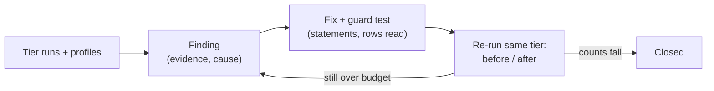

# Performance findings

What the profiling runs (`perf/`, how-to in [perf/README.md](../perf/README.md)) found about how the product scales,
and what was done. One entry per finding, latest state only. Numbers are from Docker Desktop on a Mac (amd64, one
backend worker, shared host), so **statement and row counts are exact and latencies are indicative**: untouched
endpoints differed by 2-10x between two otherwise identical runs, so a latency difference alone is never taken as a
finding or as proof of a fix.

## Cross-host results (commit d01093e, T0 to T4, full runs)

| Host | Workers | Page of 50, T0 / T4 (4 users, p95) | Single record, T4 | Backend peak memory, T4 |
|------|---------|------------------------------------|-------------------|-------------------------|
| Linux server (16 cores, 30 GiB, shared with production) | 4 | 22 ms / 94 ms | 16 ms | 4.4 GiB |
| Dell workstation (WSL2, Docker Desktop) | 4 | 37 ms / 100 ms | 24 ms | 4.4 GiB |
| Raspberry Pi 5 (8 GiB, NVMe) | 1 | 200 ms / 2.0 s | 390 ms | 1.4 GiB |

- The paged list, the single record, search, comments, links and the dashboard are flat or near-flat from 30 to 20,000
  requirements on both x86 hosts; the Pi shows the same shape at 5-20x the latency, with CPU the limit (four users on
  one worker).
- A worker costs about 530 MiB private (no sharing) up to 1,000 requirements, and peaks near 1 GiB at 5,000 and
  20,000 because the report, export and bundle scenarios hold the whole project (open item O7).
- The work that is still linear in project size is the work that touches every record on purpose: the unpaged list
  (4-8 s at 20,000), CSV export (3.5 s), PDF report (39 s), project export (12 s) and project import (115 s Linux,
  186 s Dell at the run's commit; faster after F8, not re-measured).

## Closed

| # | Symptom | Cause | Fix | Before to after (T2, 1,000 requirements) | Guard |
|---|---------|-------|-----|------------------------------------------|-------|
| F1 | A "page of 50" request cost as much as the whole project: 1.3 s at 5,000 requirements and 5.2 s at 20,000 (p95) | The list loaded and serialised every requirement, then sliced. Once the per-row lookups were paged, the remaining cost was reading all 19,031 rows: 59% of CPU, nearly all of it psycopg2 turning six UUID columns per row into Python objects, plus building a mapped entity per row | The database applies every filter, the order (component, category, manual; or one column, `COLLATE "C"` to match Python's order) and the page; one UUID column per row; the full records, versions, people, tags and counts are loaded for the returned page only. A keyword filter (tag names) still narrows in Python; a scope widened over related projects still reads each project whole to order them together | Rows read per request (1,000 requirements): versions 946 to 50, tags 1,151 to 61, comment counts 672 to 36. p95 at 20,000: page of 50 5.2 s to 0.75 s (same as at 5,000, so flat in project size); status + sort 5.4 s to 0.63 s; text search 5.7 s to 0.68 s; has comments 6.3 s to 0.30 s | `test_requirements_page_cost_does_not_grow_with_the_project` (versions and records read), `test_requirements_sorted_page_matches_the_full_sorted_list`, `test_requirements_list_filters_and_default_order_are_unchanged`, `test_requirements_sql_filters_and_sort_match_what_python_would_return` (accents, punctuation, every sort column) |
| F2 | Project overview ran 282 statements | A module-availability lookup (5 statements) repeated for each of about 20 record types; counts read every requirement id back and sent them in `IN (...)` lists | Module state read once per module for the request; counts and stage progress are database aggregates | Statements per request 282 to 96 (flat in the data) | `test_project_metrics_query_count_does_not_grow_with_the_project` |
| F3 | A record's link list ran 57 statements at 100 requirements and 170 at 1,000 | Two lookups per link (the other record and its current version) | Link types, other records and their names loaded once for the whole list | Statements 57 / 170 to 16 / 16 | `test_requirement_links_query_count_does_not_grow_with_the_link_count` |
| F4 | Every requirement list counted comments with a sequential scan | No index on the comment target | Migration 0107 adds `ix_review_comments_target` | Planner cost 1,856 to 454; no measurable time change at 1,100 comments | `test_review_comment_index.py` |
| F5 | Found by a full run on a Linux server (T3-sized project): project export ran one `SELECT email` per requirement (4,363), the requirements report one version and one tag query per requirement (1,777 and more), and a record import update four structure queries and two person lookups per row (3,554) | Per-row lookups of a person, a version, a tag list and the type's structure | Export reads each person or group once (`principal_to_bundle` memoised for the request); the report reads versions and tags in one statement each; the import finds the named records and prepares them once for the whole file | 40 requirements: export 106 to 67 statements, report 99 to 21, record import 399 to 126 (the remaining 40 are one lookup per named record) | `test_export_report_and_record_import_statements_do_not_grow_with_the_requirements` |
| F6 | A comment thread cost three statements per comment (reaction count, my reaction, attachments) | `comment_to_out` queried per comment | `comments_to_out` reads authors, reaction counts, my reactions and attachments in one statement each; the requirement, action and change request lists use it | Statements for a thread of 12: flat with the thread length | `test_requirement_comments_statements_do_not_grow_with_the_thread` |
| F7 | Creating a requirement took 30-45 ms up to 1,000 requirements and 430-570 ms at 5,000 and 20,000, on all three hosts (Pi: 1.1-3.3 s) | Numbering the new record read every id of the project back to count them (20,424 rows per create) | The count is `COUNT(*)` in the database (also in the change request approval path) | Rows read per create: project size to 0 | `test_creating_a_requirement_does_not_read_the_projects_requirement_ids` |
| F8 | Project import ran about 14 statements per requirement (115-186 s at 20,000) | Each record re-read the organisation role of the importer and the tag list of the project (3 statements plus 2 parent-project lookups) | An import reads each organisation role once and each scope's tag list once, adding to the list the tags it creates | 576 statements for 40 requirements to under 9 per requirement; wall time at 20,000 to be re-measured | `test_project_import_statements_per_requirement_stay_small` |
| F9 | `analyse.py` reported 12 workers for a 4-worker backend and a total above the container's cap | `processes.csv` has one snapshot per user level with the same scenario and repeat, and they were merged | Snapshots are told apart by a repeated process index | Linux T4: 4 workers x 1,043 MiB private, 4.2 GiB total | `test_worker_memory_tells_snapshots_at_different_user_levels_apart` |
| F10 | **A worker stalled completely under load.** With one worker, 96 simulated people completed no request in 55 s (the backend 9% busy, all 15 connections `idle in transaction`, then `QueuePool limit ... connection timed out`) | A request takes a database connection in its first dependency and keeps it until its handler and session cleanup have run, and each step needs a thread from a pool of 40. With more requests in flight than connections, every thread waits for a connection held by a request that is waiting for a thread, until the pool's 30 s timeout, and new requests refill it | Each worker admits at most as many requests as it has connections (`MAX_CONCURRENT_REQUESTS`, default 15); the rest wait in the event loop and get `503` + `Retry-After` after `REQUEST_QUEUE_TIMEOUT_SECONDS` (30); `/health`, `/metrics` and WebSockets are exempt; `requests_shed_total` counts refusals | 96 people: 0 requests completed to 22% of the offered rate delivered, 0 failures; 192 people: 12%, 0 failures (graceful saturation, 1 worker on a Mac) | `tests/test_concurrency_limit.py` (ceiling, queue, timeout, exemptions, slot freed on failure, default equals pool capacity) |

## Open

| # | Observation | Evidence | Next step |
|---|-------------|----------|-----------|
| O1 | The page-of-50 list is 0.75 s at p95 at T3 and T4, above the 300 ms budget; the count over the whole project is the remaining database work | `latency.csv` T3/T4, four users on one worker on a shared host | Re-measure on a dedicated host before changing anything further |
| O2 | `link-candidates` (1.1-1.3 s), `link-graph` for a hub (1.5-1.9 s) and a hub's link list (0.7 s) are flat between T3 and T4, so they depend on the hub's degree, not the project size | `latency.csv` | Profile with `--profiling cpu` on a hub; the link list is already 16 statements |
| O6 | Project import runs, per requirement, about 3 tag-vocabulary statements, 2 parent-project lookups, 1 organisation-role lookup and 1 audit insert (576 statements for 40 requirements); a record import still looks up each named record with its own statement | Probe of a 40-requirement project | Needs bundle-scoped caches (the tag list changes as the import creates tags, and the organisation-role lookup shares a memo with project roles that the import creates), so it is its own change with its own tests |
| O3 | Other modules list links and comments with the same per-row lookups as F3 and F6 (decisions, context and strategy, stakeholders: their own `comment_to_out` and `_link_to_out`) | Read from code; not measured, because the dataset generator has no generators for those module types yet | Measure once the module generators exist; apply the F3 pattern where it holds |
| O9 | A single worker saturates at about 20 requests per second on the Mac (32 people deliver 61-70% of 32 req/s, backend CPU 115%): one worker is one core of Python | Capacity runs, Mac, 1 worker | Run the capacity scenario with 4 workers on the Linux server and the Dell to get the per-worker figure and see whether the pool, the project row lock or CPU is the next limit |
| O4 | At 20,000 requirements the buffer cache hit rate falls to 86% (attachment) and 66% (soak) with the default `shared_buffers` of 128 MB; every other scenario stays above 99%, and no scenario wrote a temp file or deadlocked | `pgdb.csv`, Linux and Dell T4 | Re-run the soak at `shared_buffers` 512 MB and 1 GB and record the change before advising a setting |
| O7 | The PDF report takes 39 s at 20,000 requirements (over the 30 s heavy budget) and the Word report 15 s; report, project export and project import hold the whole project, so each backend worker peaks near 1 GiB at 5,000 and 20,000 requirements | `latency.csv`, `processes.csv` | Stream or chunk the document build; until then size memory for the heavy requests (worker peak above, times the workers that may run one at once) |
| O8 | `link-graph` for a hub record takes 0.5-0.6 s at 5,000 and 20,000 requirements on the x86 hosts (1.3 s on the Pi), and `link-candidates` 1.0-1.3 s at 16 users | `latency.csv` | Profile with `--profiling cpu` on a hub; the cost follows the hub's link count |
| O5 | Four workers hold about 400 MiB each with almost nothing shared | Memory profile | A pre-fork server is its own change; the user decides whether to pursue it |
