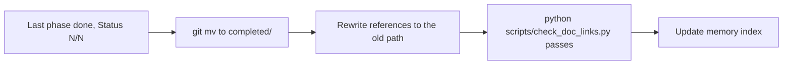

# Plans

Live plans are in this folder; plans whose Status table reads N/N are archived in [completed/](completed/). Cross-cutting indexes: [future-modules-2026-09-index.md](future-modules-2026-09-index.md). Decisions made while building go in [../decisions.md](../decisions.md).

## Closing a plan



Source files (code, comments, tests, migrations, config) never name a plan, phase or question number; the rationale goes in the comment itself or in `docs/decisions.md`. `scripts/check_doc_links.py` fails on any Markdown link or `docs/...md` path that no longer resolves, and on a source file naming a plan document; it runs in CI, the pre-commit hook and `backend/tests/test_doc_links.py`.

## Template for a new plan

```markdown
# <Name> — Plan

**Status:** <planned/in progress, date>. **Decision tags:** every decision says `Decided by: User` or `Decided by: Agent`.

## Status / Resume Here
N / M phases complete. | # | Phase | Notes | Status | table with `[ ]` / `[x]`

## Decisions
## Phase specs  (Why / Risk addressed / Outcome / Tests per phase)
## Standing checklist per phase
## Risks

When the table reads M/M: move this file to `docs/plans/completed/` and run `scripts/check_doc_links.py` (see CLAUDE.md "Plan Lifecycle").
```
