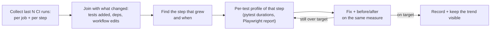

# CI Test Duration — Plan

**Status:** planned 2026-10-25, not started. Split out of `resource-profiling-plan.md` (where it was Phase 7) on 2026-10-27, **Decided by: User**. **Decision tags:** every decision says `Decided by: User` or `Decided by: Agent`.

## Status / Resume Here

0 / 1 phases complete. Independent of every other plan; can start at any time.

| # | Phase | Status |
|---|-------|--------|
| 1 | CI test duration: why it doubled (22 → 45+ min), and cut it | [ ] |

## Phase 1 — Find why CI doubled, and cut it

**Why:** **Decided by: User** (2026-10-25): CI wall time went from about 22 minutes to over 45 in a short period, which slows every PR and makes a wedge or flake costlier to retry. The cause is unknown: more tests, slower tests, a slower stack, cache misses, retries or load imbalance each give the same symptom. **Risk addressed:** "fixing" it by guesswork (bigger timeouts, fewer tests, skipped suites) and the time creeping back as soon as the next module lands. **Outcome:** a measured breakdown of where the time went and when, a set of fixes each with a before/after, and a cheap way to see the trend again. This phase times the **CI test suites**; it is separate from the resource-profiling plan's "CI does not run performance tests" rule, which is about product profiling.

Independent of the resource-profiling plan (can start any time); its Phase 3/4 tools (`py-spy`, `pg_stat_statements`) help if a slow test is slow because of the product rather than the test.

**Step 1 — measure the history (no changes yet):**

- `scripts/ci_timing_report.py` (stdlib + `gh api`; read-only) pulls the **last N PR-head runs and `main` runs** of `ci.yml` (**Decided by: Agent**: N = 40, widened until it includes runs from the ~22-minute era; stop at the first run that predates the jump) and writes one CSV row per run and job/step: run id, PR, head SHA, date, conclusion, queued-to-start wait, job duration and step durations (from `/actions/runs/{id}/jobs`). Count only the last completed run per PR head, and report cancelled/failed-early runs separately so a retry does not read as a slow suite. Output committed under `perf/ci-timing/` (job and step names only; no logs).
- Join each run to what the PR changed: backend test count (`pytest --collect-only -q`), Playwright test count (`playwright test --list`), files and lines in `backend/tests` / `tests/playwright`, dependency or base-image bumps, and edits to `ci.yml` or the compose files. This shows whether duration tracks test count (growth), or jumped at one PR (a regression or a runner/image change).
- Decompose the wall clock: it is the **critical path** (the slowest of `frontend`, `backend-tests`, `e2e-tests`, the image builds and the arm64 leg added by the resource-profiling plan's multi-arch images phase), not the sum. Check first which job is on that path, how much is image build/pull and stack start/seed versus test execution, and whether the new multi-arch jobs queue behind the others for runners.
- Separate noise from signal: record the spread between runs of the same SHA or consecutive SHAs, runner queue time, and cache hit/miss for the buildx and npm caches, so a number is only called a regression if it is outside that spread.
- Where the JUnit artifacts (`backend-test-reports`, the Playwright report) are still retained, extract per-test and per-file durations for several points in the history; where they have expired, take the comparison from checking out an old commit and running the suite once on a comparable host rather than guessing.
- Output: a short written finding in `docs/decisions.md` giving the timeline, the step(s) that account for the growth, and the evidence, before any fix starts.

**Step 2 — profile the step that grew** (hypotheses to confirm or refute, not conclusions):

| Area | Check |
|------|-------|
| Test count | Tests added per PR against job time; a handful of slow tests versus a uniform per-test cost. |
| Slowest tests | `pytest --durations=50` (also a `--durations-min`) and Playwright's per-test durations; the top 5% of tests usually hold a large share of the time. |
| Fixture cost | Per-test seeding, org/project/user creation, `create_all`/migrations or schema copy per xdist worker (`_pytest_database.py`), session fixtures that are function-scoped by accident. |
| Password hashing | bcrypt work factor in tests that create users or log in repeatedly. A lower cost applied to **tests only** through test configuration, never to the production default or a policy-controlled setting. |
| xdist balance | `-n 4` on a 4-core runner with `--dist load` vs `loadfile`/`worksteal`: one long file or module pinning a worker while three idle. Compare per-worker finish times. |
| Playwright | `workers: 2` on a 4-core runner (the backend shares those cores, so measure before raising it); `retries: 2` in CI silently doubling the cost of flaky tests (count retries from the report); fixed `waitForTimeout` sleeps; UI login in every test instead of a stored session; specs forced into the serial `global-state-mutators` project that no longer need it. |
| Stack start | Image build/pull, Keycloak wait, reseed step and the backend restart in the e2e job, versus test time. |
| Sharding | Splitting pytest or Playwright across a job matrix (each shard has its own stack): trades runner minutes for wall time. Prefer this only after the cheap fixes above, and measure the added build/start overhead per shard. |
| Coverage | Whether coverage instrumentation costs a large fraction of pytest time, and whether a lighter configuration keeps the reported numbers the same. |

**Constraints (binding):**

- **No loss of coverage or rigour:** the test count and coverage do not fall, nothing is skipped, deselected or marked slow-and-excluded to hit a number, and a flaky test is fixed rather than retried more (see "No timeout bump or DB reseed as the fix"). Tests stay order-independent and idempotent per `CLAUDE.md`; a faster fixture must not leave state that another test depends on.
- **Security settings stay as shipped:** only test configuration may change work factors or similar; policy-governed defaults are untouched (SOC 2 change-management policy).
- Run local pytest strictly one invocation at a time; a time comparison taken on a wedged or loaded test database is invalid.
- A fix needing a design change (a new test-database strategy, a sharded matrix) becomes its own change with its reason recorded, not a side effect of this phase.

**Target and guard** (**Decided by: Agent**, provisional):

- **Target:** the critical path back to about the earlier ~22–25 minutes, or, if growth turns out to be genuine new coverage, the lowest figure the evidence supports with the reason written next to it. A target is only relaxed with the measured value and reason, never silently.
- **Keeping the trend visible without a flaky gate:** the CI job summary lists the 25 slowest backend tests and the per-job time, and `scripts/ci_timing_report.py` can be re-run by hand for the trend. A hard CI time gate is **not** added (wall time is noisy and would fail healthy runs); whether to add a deterministic guard, for example a cap on a single test's duration that is generous enough to be stable, is a question for the user once the data exists.
- Add the "keep new tests cheap" expectation (reuse session fixtures, no sleeps, no per-test full seed) to `docs/development.md`'s testing section and `CLAUDE.md`'s Testing Requirements, if the findings support one.

**Tests and docs:** a unit test for the report script's parsing and joins on fixture JSON (main suite, deterministic); update the stale `~12 min` / `~9 min` figures in the `ci.yml` header comment with measured ones; `docs/decisions.md` entry with **Decided by** tags (finding, each fix with before/after, what was rejected and why); `docs/development.md` note on how to re-run the timing report. The website needs no change (CI internals have no user-visible surface).

**Verification:** at least three consecutive CI runs after the fixes, reported as a spread against the same measure as the "before" runs; pytest and Playwright test counts equal to or above the "before"; coverage not below the "before"; the full suites also pass when a test is run alone and in a shuffled order.
