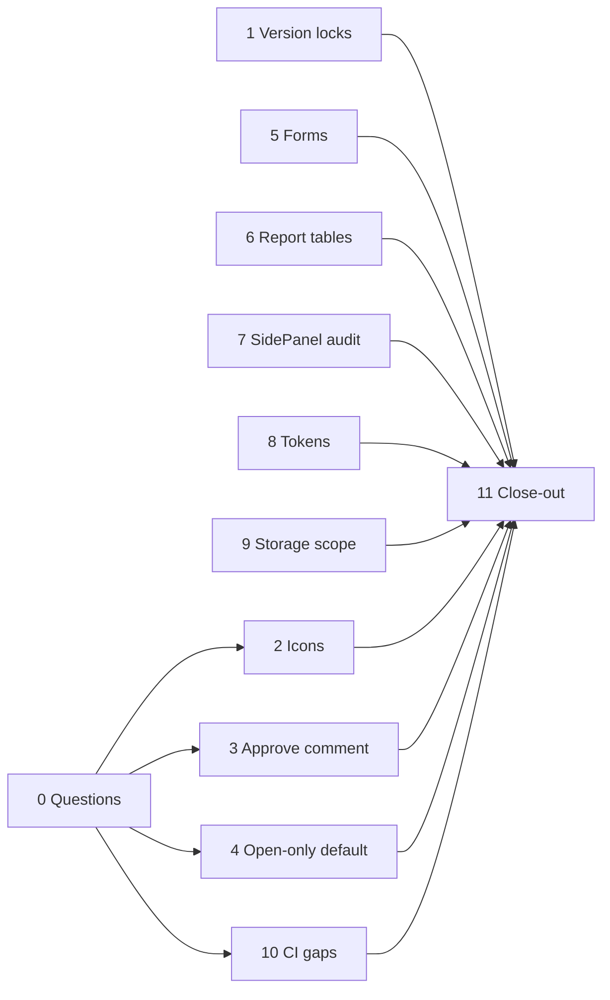

# Leftovers (October 2026) — Plan

**Status:** complete 2026-10-23 (11 / 11). Built from a review of `docs/decisions.md`, `docs/ux-style-guide.md` and the SOC 2 Known Gaps sections. Module plans (5–15), resource profiling and disaster recovery are separate and excluded.
**Decision tags:** every decision says `Decided by: User` or `Decided by: Agent`. Questions Q1–Q6 were answered by the user on 2026-10-21 (section 2); everything else about *how* is **Decided by: Agent**.

## Status / Resume Here

11 / 11 phases complete (finished 2026-10-21 to 2026-10-23; the plan is archived). Open for the user: apply the branch-protection checklist, decide on the docs-site `braces` advisory (report-only for now), and answer the Compliance tag/quick-link question. Follow-ups: section 6.

| # | Phase | Source of the item | Status |
|---|-------|--------------------|--------|
| 0 | User sign-off on the questions in section 2 | decisions.md Phase 22 / 27 | [x] |
| 1 | Lock every versioned update (Strategy, Future State, Guiding Principle, Requirement, Decision) | decisions.md, "Still open" in the concurrency review | [x] |
| 2 | Icon scale review closed out | Phase 22 "Not done" (Q9) | [x] |
| 3 | Requirement approve takes an optional comment | Phase 27 N44 | [x] |
| 4 | "Open only" default on Risks, Decisions, Open Questions | Phase 27 N47 | [x] |
| 5 | Forms still on placeholder-only inputs move to the shared field components | style guide "Not yet migrated" | [x] |
| 6 | Report tables stop rendering every row | style guide "Not yet migrated" | [x] |
| 7 | `SidePanel`-only detail views audited against the page checklist | style guide, "Pattern: entity detail panel" | [x] |
| 8 | Spacing and radius become named tokens | style guide, design tokens | [x] |
| 9 | Backend gets a bucket-scoped storage credential | vendor policy Known Gap 3 | [x] |
| 10 | CI and policy gaps: dependency scanning, coverage threshold, stale policy text, CODEOWNERS and ruleset checklist | change-management policy Known Gaps 2–5 | [x] |
| 11 | Docs website, seeds, README, close-out and archive this plan | all | [x] |

Read left to right: phases with no inbound arrow from Phase 0 can start immediately; everything ends at the close-out.

## 1. Scope and exclusions

- **In:** items 1–6 of the review (the three open questions, the unlocked version race, the unmigrated forms and report tables, the `SidePanel` sweep, the unnamed spacing/radius tokens, the storage credential gap, the SOC 2 tooling gaps).
- **Out:** `docs/plans/module-*.md`, `resource-profiling-plan.md`, `disaster-recovery-backup-plan.md`. Decision self-approval stays as recorded (a product decision across core, Compliance and Decisions, not a bug) unless the user asks for it.
- **Out, on purpose:** image-publishing changes (already live); "Still open `braces` alert 45" (no upstream patch exists; build-time only). Re-check it in Phase 10 when dependency scanning is added.

## 2. Questions for the user (Phase 0)

| Q | Question | Answer (all **Decided by: User**, 2026-10-21) |
|---|----------|--------|
| Q1 | Icon scale (outside buttons): accept the draft as final? | Accept as final. |
| Q2 | Requirement approve takes an optional comment? | Yes. |
| Q3 | Which lists open on open items only? | All three: Risks, Open Questions and Decisions. |
| Q4 | CI coverage threshold | Current backend coverage minus 2 points. |
| Q5 | Publish container images from CI? | Already done: CI pushes to ghcr.io on main. The policy's Known Gap 5 is stale and is corrected in Phase 10. |
| Q6 | Branch protection | Agent documents; user applies. Finding: the "Main Branch" ruleset exists but its enforcement is **disabled**, approvals required is 0, code-owner review is on with no CODEOWNERS file, and one required check name ("Build production container images (not published)") looks stale. |

## 3. Phase specs

Each phase follows the standing checklist in section 4. Every requirement states why it exists, the risk it addresses and the expected outcome.

### Phase 1 — Lock every versioned update

- **Why:** every versioned edit closes the current version and inserts the next. Two simultaneous edits both read version N and the loser dies on the `(record, version_number)` unique constraint with a 500. `lock_row_for_update` (`backend/app/services/rbac.py`) already fixes this for Persona, Stakeholder, Need and Risk; `apply_new_version` in `services/requirements.py` and the Context & Strategy ones (`apply_new_version`, `apply_future_state_new_version`, `apply_guiding_principle_new_version`) still read first. The Decisions update path is checked in the same pass.
- **Risk:** a user sees a server error and loses their edit, never corrupted data. Low severity, but it is a known, one-line, repeatable defect.
- **Outcome:** a second concurrent edit waits, then applies on top of the first.
- **Work:** take the lock on the identity row before the current-version read in each path; the lock call sits in the caller (router or service) where the other four modules put it, so the order "lock, then read" is visible. Add a generic test that scans for every `apply_*new_version` and fails if its callers do not lock first, so a future versioned type cannot skip it. Update `lock_row_for_update`'s docstring list.
- **Tests:** per type, two concurrent edits both succeed with consecutive version numbers (pattern in the existing Risk/Persona concurrency tests). Pytest runs one invocation at a time.
- **SOC 2:** change-management review; no auth or audit path changes. Record in decisions.md.

### Phase 2 — Icon scale closed out

- **Why:** the draft scale was accepted 2026-10-18 on condition of a review after Phase 21; that review never happened.
- **Outcome:** the style guide states the scale as final (Q1); no code change.
- **Work:** record the acceptance in the style guide's icon section and decisions.md (**Decided by: User**).

### Phase 3 — Requirement approve comment

- **Why:** approve is the one approval that cannot carry a reason (its change note is the fixed "Approved directly."). An approver cannot say what they checked.
- **Risk:** audit trail for approvals is thinner for requirements than for other approvals.
- **Outcome:** an optional comment on approve, stored as the audit event's `detail.comment` and the version's `change_note`, shown by the shared `ActivityNote`.
- **Work:** optional field on the approve endpoint and the approve dialog (shared field component, `help` text, no "(optional)" label); the pinned test in `test_activity_transition_comments.py` that records the gap is replaced by a test of the new behaviour. MCP: if a tool exposes approve, update `mcp-server/skill/reqtrack-mcp/SKILL.md` and run `generate_skill_reference.py`.
- **Not Save-and-activate:** requirements keep their approval gate; this is a comment only.

### Phase 4 — Open-by-default lists

- **Why:** Pain Points open on open items because most visits want that; the same applies elsewhere, and one mechanism is better than five.
- **Work:** extract Pain Points' "open only unless the link says otherwise" rule (`open=0`, or a slice the default would hide) into one shared hook, move Pain Points onto it, then apply it to Risks, Open Questions and Decisions. "Open" per type is defined once in a mapping (Risk: not closed/retired; Open Question: not answered/closed; Decision: not yet decided, i.e. not approved, rejected or superseded; the exact status names are read from each type's status enum and label map). Report figures that link to these lists link with `open=0` when they count every status.
- **Tests:** Storybook for the default, the empty state that says the default caused it, and the opt-out link; Playwright for one list; unit test per type's "open" definition.

### Phase 5 — Forms on the shared field components

- **Why:** the style guide lists the Project Admin Structure inline add/rename rows (stages, components, categories, custom fields), the Org Admin branding, single sign-on and bootstrap cards, and the CSV import wizard as still using placeholder-only inputs or hand-built layouts. Placeholder-only fields have no accessible name and no `help`, and drift from every other form.
- **Risk:** accessibility defect class, plus a bespoke copy per page, which the style guide exists to stop.
- **Outcome:** each uses `TextField`/`LabeledSelect` etc. with a visible label, `help` or `helpNotNeeded`, `required` where the API rejects the field, and `FormGrid` for three or more fields. `scripts/check_field_help.py` and `check_required_markers.py` pass with empty baselines.
- **Work:** inline add/rename rows get a shared compact "inline add row" component (extract first, then update every call site, per the shared-component rule). Settings cards that save on change need no required marks (as already decided). Remove the "Not yet migrated" paragraph from the style guide.
- **Tests:** Storybook per changed form; one Playwright spec per surface covering label lookup; `requiredCaptions` where a Save gate exists.

### Phase 6 — Report tables paginate

- **Why:** the generic report tables render every row, so a long report is one very long page.
- **Risk:** slow render and unusable scrolling on large projects.
- **Outcome:** report tables use the existing `LoadMoreButton` / `DirectoryTable` pagination shape, with a visible "Showing n of m", client-side because the report response is already fully loaded. Exports (CSV, PDF, DOCX) are unaffected and still contain every row.
- **Tests:** Storybook with 500 rows; Playwright asserting the first page, "Show more", and that an export still contains every row.

### Phase 7 — `SidePanel` sweep

- **Why:** the entity-detail checklist (lifecycle actions, relationships, comments, attachments; four markers) was applied once (Decisions). Other `SidePanel` detail views were never audited. Candidate list from imports: Guiding Principles and Strategies lists (which also have detail pages), Decision templates, the Compliance panels (requirement assessment, evidence, applicability, standard versions, project compliance detail), Requirement detail, Org and Project Admin.
- **Outcome:** an audit table in `docs/decisions.md` (surface, markers hit, verdict). Any surface hitting 3 or more markers, or visibly overloaded, moves to a page with an optional quick-view, following the Decisions precedent; others are recorded as passing. Moves are made in this phase, not deferred, per the repo's fix-don't-defer rule.
- **Risk:** each move touches routes, `artefactPaths` and search results, so the module-boundary and search obligations apply (no core import of a module's files; the type must still resolve a page).
- **Tests:** Playwright for each moved surface; stories for each new page.

### Phase 8 — Spacing and radius tokens

- **Why:** the values already agree (`4/6/8/12/16/24px` spacing; `6px` radius) but are inline, so a change means a repo-wide edit.
- **Outcome:** `--space-*` and `--radius-*` custom properties in `theme.css`; stylesheets reference them; a check script fails a new literal where a token exists.
- **Work:** introduce the tokens with the existing values first (no visual change), then replace literals mechanically. Do not add per-module tokens in core (module-boundary rule). Update the style guide's token table.
- **Tests:** the existing geometry and orphaned-controls Playwright checks must pass unchanged; a before/after measured check on three pages.

### Phase 9 — Bucket-scoped storage credential

- **Why:** the backend authenticates to the bundled SeaweedFS as its admin identity. A compromised backend credential can read or delete any bucket and change storage configuration. The MinIO recipe was lost in the migration (`docs/deployment.md`, "Storage credential scope (known gap)"; vendor policy Known Gap 3).
- **Risk:** least-privilege failure on the confidentiality control.
- **Outcome:** the compose stack creates a non-admin S3 identity limited to the application bucket (SeaweedFS IAM identity config), the backend uses it, and the admin credential is used only by the init step. A test proves the scoped identity can read/write its bucket and cannot list or write another.
- **Work:** investigate SeaweedFS identity config first; if the version in use cannot scope by bucket, record that finding, keep the gap, and say so (do not claim a fix). Update `docker-compose.yml`, `tests/container/docker-compose.yml`, `.env` examples, deployment docs and website mirror, vendor policy Known Gaps and the TSC mapping Status column. Rebuild and recreate containers before testing (services do not bind-mount source).
- **Security review:** identify, verify, remediate; recorded in decisions.md.

### Phase 10 — CI and policy gaps

- **Why:** the change-management policy lists gaps that are partly stale and partly real: no dependency/container scanning, no coverage threshold, and a review requirement that is configured but not enforced. Policy text that contradicts reality misleads auditors and the next session.
- **Outcome and work:**
  - **Stale text:** Known Gap 5 (images "built but not published") is wrong; `docker-build` pushes to ghcr.io on main. Correct the policy, the control matrix Status column and any docs repeating it.
  - **Scanning:** `pip-audit`, `npm audit --omit=dev` (fail at high) and Trivy on the built images as CI steps. Existing findings are fixed or upgraded, never suppressed; the `braces` alert is re-checked here.
  - **Coverage:** backend threshold at the current figure minus 2 points (Q4).
  - **Review requirement (Q6):** add `.github/CODEOWNERS` and write a checklist in the policy for the settings the user applies in GitHub: set the "Main Branch" ruleset's enforcement from Disabled to Active; fix the stale required-check name to match the job's current name; decide the approvals count (a sole owner cannot approve their own PR, so a count of 1 needs a bypass for the owner or a second reviewer); confirm the owner bypass. The agent does not change the ruleset.
  - Update Known Gaps and the control matrix Status for each item closed or corrected.
- **Tests:** the steps run green on the current tree; a local dry run with the threshold raised above actual coverage fails.

### Phase 11 — Close-out

- **Work:** docs website review (`docs/website/`) for Phases 3, 4, 5, 6 and 7 (user-visible); README if setup or CI behaviour changed; `docs/solution-architecture.md` for Phase 9; decisions.md entry per phase with a `Decided by` tag; confirm `seed_demo_data.py` and `seed_e2e_dataset.py` still run on a fresh database; run `python scripts/check_doc_links.py`; set the Status table to 11/11, `git mv` this file to `docs/plans/completed/`, rewrite references; update the memory index.
- **Outcome:** nothing from this review is left only in a scrollback or a stale note.

## 4. Standing checklist per phase

- Backend change has a test; UI change has Storybook stories and a Playwright spec; tests are order-independent and repeatable.
- No warnings, lint-rule edits or suppressions; a bug found on the way is fixed in the same phase.
- Security-sensitive phases (1, 3, 9, 10): consult the matching SOC 2 policy, run the identify, verify, remediate pass, record it in decisions.md, and update Known Gaps and the Status column where a gap closes.
- Module boundary, nested-project fallback, users-and-groups parity and time-shape checks: none of these phases adds a module value to a core enum, a project-scoped definition table, a person field or a time value. Say so in each decision entry; re-check if that changes.
- Source files never name this plan or a phase; rationale goes in the comment.
- Never run two `pytest` invocations at once; rebuild and recreate backend and frontend containers before testing against the live stack; the agent does not run `git commit`.

## 5. Risks

| Risk | Mitigation |
|------|------------|
| Phase 7 turns into a rewrite of many panels | Audit first, move only surfaces that meet the checklist, one PR-sized change per surface |
| Phase 8's mechanical replace changes layout | Introduce tokens at today's values, run the geometry checks before and after |
| Phase 9 is not possible on the SeaweedFS version in use | Keep the gap, record the finding, offer an alternative (a separate storage identity per environment, or an external S3 service) |
| Phase 10 scanners fail on existing findings | Fix or upgrade each; suppression needs your explicit sign-off |
| A sole owner cannot satisfy a required approval | Checklist names the options (owner bypass or a second reviewer); the user decides when applying it |
| Concurrent-edit tests flake | Use a barrier in the test, not sleeps; do not widen timeouts |

The table reads 11 / 11, so this file lives in `docs/plans/completed/`.

## 6. Follow-ups (outside this plan's phases)

Raised during Phase 10 (**Decided by: User**, 2026-10-22: record it as a follow-up).

- **Move the backend off FastAPI 0.136.3 by rewriting the route walkers.** Phase 10 pinned `fastapi==0.136.3` because later releases keep included routers as lazy `_IncludedRouter` entries, so `APIRouter.routes` no longer lists every route with its full path. Three places read that list: `backend/app/modules/registry.py` (the lookup that validates module MCP tools; a miss silently drops the tool), `backend/app/services/report_framework.py` (`_mounted_path`) and `backend/tests/test_project_scope.py` (the `app.routes` scan).
  - **Why:** the pin stops the backend taking later FastAPI fixes and features, and the Starlette pin has to move with it.
  - **Work:** one shared `iter_routes(router)` helper yielding each `APIRoute` with its full path, used by all three; decide between the private `_IncludedRouter` fields (needs recursion and prefix combining) and a public route (`url_path_for`, or `app.openapi()`, which loses `openapi_extra` and `dependant`); confirm where `dependant` and `openapi_extra` live in the lazy model; then bump FastAPI and Starlette together.
  - **Tests:** a nested-router case (prefixes at two levels) for the helper; a guard that the module MCP manifest and the project-scope scan are non-empty, so a walker that finds nothing fails instead of passing; the full backend suite.
  - **Risk:** a missed route fails silently (tools vanish, a scan checks nothing), which is why the non-empty guards matter. Estimated half a day to a day.

- **Decide whether Compliance records get tags and quick links.** Raised in Phase 7 (**Decided by: Agent** to raise it; the answer is the user's). No Compliance create form has `QuickLinkField` or `TagField` and no Compliance list has `TagFilterField`, with no reason recorded in `docs/decisions.md`, which the style guide's tag and quick-link patterns require. Either build them for every Compliance type or record why each is omitted.
