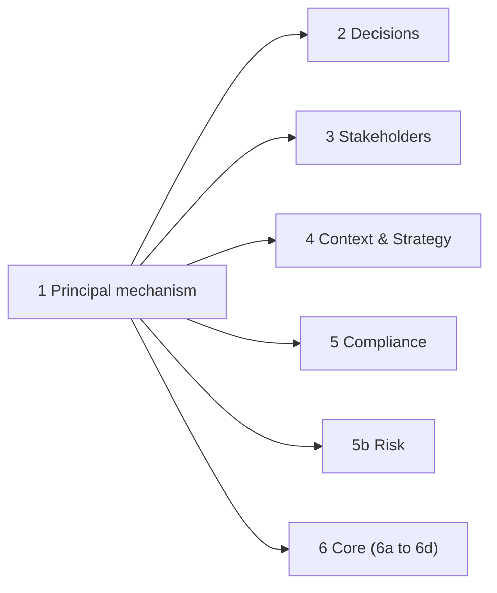

# Users and Groups on Parity — Plan

**Status:** planned 2026-10-11; Phases 1 to 5 and 5b shipped 2026-10-12; Phase 6 shipped 2026-10-13. **Decided by: User** (2026-10-11): groups can be selected wherever a user can (starting with a Decision's owner); both organisation groups and project groups; the other modules are updated too. The rule is also in `CLAUDE.md` ("Users and Groups on Parity").

## Status / Resume Here

6 / 6 phases complete, plus 5b. Phases 1 (the shared mechanism), 2 (Decisions), 3 (Stakeholders and Personas), 4 (Context & Strategy), 5 (Compliance) and 6 (core fields: requirement owner and reviewer, action assignee, change request people and tasks, group watchers) are done, as is 5b (Risk Management's owner). The plan is closed; `docs/decisions.md` holds the account of each phase.

| # | Phase | Status |
|---|-------|--------|
| 1 | Shared principal mechanism: reference type, membership, picker, usage hook | [x] |
| 2 | Decision Management: owner and decision maker (is Module 4 Phase 10) | [x] |
| 3 | Stakeholders and Personas: owner and champion | [x] |
| 4 | Context & Strategy: Pain Point, Guiding Principle and Open Question owners | [x] |
| 5 | Compliance: standard owner and required-action assignee | [x] |
| 5b | Risk Management: owner (`RiskVersion.owner`) | [x] |
| 6 | Core fields: requirement, action and change-request people, subscriptions (confirmed 2026-10-12; sub-phases 6a to 6d in section 4) | [x] |

## 1. Why, and what the code looks like today

**Why:** a team is often the accountable party. A user-only owner field forces a nominee, who then leaves or is on leave, and the record is effectively unowned. Group support added field by field would produce a different mechanism per module. **Risk addressed:** unowned or stale-owner records, and several inconsistent group implementations. **Outcome:** any field that names an accountable person can name a user, an organisation group or a project group, resolved, filtered, displayed, exported and reported the same way everywhere.

- Groups already exist at two levels: `OrgGroup` (nestable, transitive membership: `services.rbac.effective_org_group_member_ids`) and `ProjectGroup` (members, plus nested org groups resolved one level deep, as everywhere else). Groups already take roles and permissions; they cannot yet be named as an owner or assignee anywhere.
- Every "applied person" field below is a plain user FK today. The shared UI piece is `AssigneePicker` (users only).
- **Not in scope: actor fields.** `created_by`, `approved_by`, `decided_by`, `archived_by`, `uploaded_by`, `author_id`, `actor_id` and the like record who did something. A group cannot act, so these stay users; parity applies to who a thing is *assigned to or owned by*, not who *did* it. **Decided by: Agent.**
- **Not in scope: identity links.** `Stakeholder.user_id` says "this stakeholder is this login", which is not a role being applied. **Decided by: Agent.**

### Field inventory

| Area | Fields | Phase |
|------|--------|-------|
| Decisions | `Decision.owner_id` (mandatory), `decision_maker_id` | 2 |
| Stakeholders | Persona version `owner_id`, `champion_id`; Stakeholder version `owner_id`; Stakeholder Need version `owner_id` | 3 |
| Context & Strategy | `PainPoint.owner_id`, Guiding Principle version `owner_id`, `OpenQuestion.owner_id` | 4 |
| Compliance | `ComplianceStandard.owner_id` (mandatory), required-action assessment `assignee_id`, review `owner_id` | 5 |
| Risk Management | `RiskVersion.owner_id` (shipped user-only in Module 3 Phase 1; later Risk phases add reviewer fields that should be built as principals directly) | 5b (done) |
| Core | `Requirement.owner_id` (mandatory), `approval_authority_id`, `reviewer_id`; `RequirementAction.assignee_id`; change request `proposed_reviewer_id`, `proposed_action_assignee_id`, task `assignee_id`; `Subscription.user_id` | 6 |

## 2. Phase 1 — Shared principal mechanism

A generic core extension point, so no module hand-edits a core file and no module reinvents it (CLAUDE.md, Modular Feature System Boundary).

- **Reference type.** `PrincipalType` is a closed core set: `user`, `org_group`, `project_group`. A field becomes a pair of columns `<name>_type` and `<name>_id` (the id has no FK, the same trade-off `ArtefactLink` accepts for a polymorphic id), validated by the service; the type is a plain validated string, not a per-module enum value. A nullable field has both columns null or both set (check constraint). **Decided by: Agent**, to confirm during the phase against the alternative of three typed FKs per field, which repeats for every field and cannot be shared.
- **Service (`services/principals.py`).** `validate_principal` (exists, same organisation, a project group belongs to the project in question, and for a user the existing org-membership rule); `principal_member_ids` and `is_principal_member` (effective membership; the same resolver the role system uses); `principal_filter_clause(user_id)` so a list's "mine" filter matches the user's own and their groups' rows; `principal_labels` (batch display names); `principal_recipients` (fan-out to members for notifications, coalesced).
- **Schema and UI.** A `PrincipalRef` Pydantic type; a shared `PrincipalPicker` (users, organisation groups and project groups, each with its kind visible) and `PrincipalBadge` that replace `AssigneePicker` and every call site's own owner rendering, in the same change (CLAUDE.md: extract and update the original call sites, do not leave two).
- **Usage hook.** A declarative `ModuleDefinition.principal_references` (model plus the type/id column pair, and whether the field is mandatory) so core can answer "what uses this group?" without importing any module. It drives: blocking deletion of an in-use group with the shared `DeleteInUseDialog` and a reassign step (an optional field can be cleared, a mandatory one must be reassigned); organisation deletion cleanup; and organisation/project export and import (a group is referenced by ref, not raw id; a group missing on import falls back to the importing user with a warning, never failing the import). Mirrors `artefact_ids_in_organization`.
- **Safety.** A group from another organisation is always rejected; a group never confers more than its members hold individually; a project group is only valid in its own project; removing someone from a group removes what the group gave them; an owner group shows its name, not a guessed single person.
- **Tests:** unit and API tests for every validation branch, nested-group membership (transitive org groups, one-level project groups, removed member, cycle-safe), the filter clause, the usage hook, deletion block and reassign, cross-organisation rejection; Storybook for `PrincipalPicker` and `PrincipalBadge`; Playwright is covered by Phase 2's first adopter. SOC 2 access-control and multi-tenant isolation policies consulted; record identify, verify and remediate in `docs/decisions.md`.

**Delivered 2026-10-12, with these differences from the text above** (full account in `docs/decisions.md`): organisation deletion needs no usage-hook cleanup (every referencing row is in the same organisation and goes with it); export/import is provided as `principal_to_bundle` / `principal_from_bundle` helpers that each adopting module calls from its own bundle hook, since core does not serialise module rows; `PrincipalReference` gained an optional `live_filter` so older version rows are neither counted nor rewritten; the delete flow is `GroupInUseDialog` on the shared `DeleteInUseDialog`; and the Playwright test for deleting an in-use group lands with Phase 2, the first adopter, as stated above.

## 3. Phases 2 to 5 — module adoption

**Phase 2 delivered 2026-10-12** (full account in `docs/decisions.md`): migration `0076` (module migration chain; the next free number is 0077); `owner` and `decision_maker` on the API are `PrincipalRef` in and `PrincipalOut` out, replacing `owner_id` / `decision_maker_id` (a deliberate breaking change to the Decisions API, called out so the next adopter does the same rather than carrying both shapes); filters `owner_type`+`owner_id`, `owner_mine`, `decision_maker_type`+`decision_maker_id`, `decision_maker_mine`; the owner gate is `is_principal_member`; D1 and D2 and D3 print `Name (Org group)` through the new `principal_text` helper; the module declares both fields in `principal_references`; the UI uses `PrincipalPicker` / `PrincipalBadge` on the form, list, quick view and detail page. Decisions has no export/import bundle, so `principal_to_bundle` / `principal_from_bundle` were not needed here, and its notifications do not exist, so no fan-out. The Playwright test for deleting an in-use group (deferred from Phase 1) is `tests/modules/decisions/decision-group-owners.spec.ts`.

**Phase 3 delivered 2026-10-12** (full account in `docs/decisions.md`): migration `0077` (the next free number is 0078) backfills every version row; `owner` / `champion` on the API are `PrincipalRef` in and `PrincipalOut` out, for Persona, Stakeholder and Need, including the version-history endpoints and the MCP tools; a project group is valid only on a project-scoped record, so an organisation-level Persona or Stakeholder names users and organisation groups only; the four fields declare `principal_references` with `live_filter` (current version) and the new generic `record_id_field` so the audit event names the record, not its version row; bundles carry `{type, email | name}` and an unmatched optional principal is left empty with a warning (`principal_from_bundle(required=False)`); the UI uses a shared `RecordPrincipalField` in place of the user-only `RecordPersonField`, and the history tables show owner and champion. No owner gate, notification or owner filter exists in this module, so none was added. The Playwright test is `tests/modules/stakeholders/group-owners.spec.ts`.

**Phase 4 delivered 2026-10-12** (full account in `docs/decisions.md`): migration `0078` (the next free number is 0079) backfills every row, including all Guiding Principle versions; `owner` on the API is `PrincipalRef` in and `PrincipalOut` out for Pain Point, Guiding Principle (and its version history) and Open Question, and the MCP tools; Pain Point and Open Question take users, organisation groups and the project's groups, while an organisation-level Guiding Principle takes users and organisation groups only; **the old owner was never validated, so a user from another organisation could be named — `validate_principal` now closes that on every write path**; the three fields declare `principal_references` (Guiding Principle with `live_filter` and `record_id_field`); R4 and R6 print the owner with its kind, and a group owner is an owner, not a gap, in R4's Unowned table and By owner counts; the UI uses the shared `RecordPrincipalField` on the three detail pages and the shared `VersionHistoryTable` for Guiding Principle history. This module has no export/import bundle, no owner gate and no notifications, so those parts of the checklist did not apply. The Playwright test is `tests/modules/context_strategy/group-owners.spec.ts`.

**Phase 5 delivered 2026-10-12** (full account in `docs/decisions.md`): migrations `0079` (the standard owner, review owner and required-action assignee become principals; the standard's is mandatory) and `0080` (below); the next free number is 0081. `owner` / `assignee` on the API are `PrincipalRef` in and `PrincipalOut` out, replacing `owner_id` / `assignee_id` (a deliberate breaking change); a standard and a standard-level review are organisation-scoped (users and organisation groups only), while a project review and an assessment also take the project's groups; the three fields declare `principal_references` (the standard owner `mandatory=True`, so deleting its group needs a replacement); both due-date sweeps fan out to every member of the group; a recurring review's next cycle keeps its owner; bundles carry the principal by name (an unmatched standard owner falls back to the importing user, an unmatched assignee or review owner is left empty, both with a warning); the UI uses `PrincipalPicker` / `PrincipalBadge` for the assignee, the review owner and the standard's Overview and Edit dialog. No owner gate, owner filter or report column exists in this module, so those parts of the checklist did not apply. **A bug found on the way and fixed:** an organisation with a standard whose requirement has a required action could not be deleted (a 500), because the foreign keys to the org-level action and relationship types were checked before the cascade finished; `0080` defers them. The Playwright test is `tests/modules/compliance/group-owners.spec.ts`. Risk Management's `RiskVersion.owner_id` (the inventory's "5b") was not part of this phase.

**5b (Risk Management) delivered 2026-10-12** (full account in `docs/decisions.md`): migration `0081` (the next free number is 0082) backfills every version row; `owner` on the API is `PrincipalRef` in and `PrincipalOut` out for create, update, list, get, version history and the MCP tools; a Risk is project-scoped, so it takes users, organisation groups and the project's groups; the owner gate for assessing a treatment and recording a review is `is_principal_member` (a group confers no manage right); `risk_recipients` fans out to every active member and falls back to Risk Managers and Project Managers for an unowned Risk or an empty group; the field declares `principal_references` with `live_filter` and `record_id_field="risk_id"`; RK1 to RK4 print `Name (Org group)`; bundles carry the owner by name, an unmatched one is left empty with a warning; the UI uses the new shared `PrincipalFormField` and `PrincipalBadge`. Three copies of the same code were collapsed on the way: `services.principals.principal_columns_from_bundle` (Compliance and Stakeholders now use it), `create_org_group` / `create_project_group` test helpers, and `PrincipalFormField` (Decision, Compliance, Stakeholders and Risk forms). The Playwright test is `tests/modules/risk_management/group-owners.spec.ts`.

## 3a. Phases 2 to 5 — the checklist

Each adoption follows the same checklist, so each is small once Phase 1 exists:

1. Migration: `<name>_id` stays, a `<name>_type` column is added and backfilled to `user` (module migrations share one numbering sequence with core: take the maximum across both).
2. API and schemas take and return a `PrincipalRef`; the validation, the "mine" filters, and any owner-based gate (for example "the owner may propose") use effective membership. A group owner confers no approval or edit right the members do not already hold.
3. UI uses `PrincipalPicker` and `PrincipalBadge` on the form, list, quick view, detail page, Links panel summary and anywhere else the name appears.
4. Reports, CSV/PDF and the MCP tools print and filter on the group; `mcp_guidance.md` and the generated module-tools reference are updated in the same change.
5. `principal_references` is declared; bundle export and import round-trip it.
6. Tests: backend (each principal kind, gate, filter, delete-reassign, migration backfill, report output, bundle round trip and fallback), Playwright, Storybook; seeds give one record a group owner; docs website, `docs/decisions.md` (Decided-by tags), `docs/modules.md`.
7. Versioned artefacts (Personas, Stakeholders, Guiding Principles, Needs, Compliance versions) copy the owner pair across versions, so history shows who owned each version.

| Phase | Notes specific to the module |
|-------|------------------------------|
| 2 Decisions | Also the Module 4 plan's Phase 10. `owner` is mandatory, so group deletion must reassign. The owner gate is `workflow._require_owner_of_decision_or_role`; validation is `_require_org_member_or_none`; D1 and D2 reports print the owner. Decision maker is included because the parity rule says so. |
| 3 Stakeholders | Owner and champion on Persona (champion is a person who advocates for the persona: a group is natural). The stakeholder's own `user_id` stays a user (identity link). |
| 4 Context & Strategy | Three owners; the R4 Open Question register has an "unowned" gap and an owner breakdown: a group is an owner, not a gap, and the by-owner table groups by principal. Pain Point owner has no version row; Guiding Principle's does. |
| 5 Compliance | Standard owner is mandatory (reassign on delete). Assessment assignee drives due-date and assignment views and notifications: fan out through `principal_recipients`. |

## 4. Phase 6 — Core fields

**Confirmed by the user 2026-10-12** (**Decided by: User**): core is in scope, and a group named as a reviewer or approver is satisfied by **any one member**, with the member who actually acts recorded (`ReviewComment` / audit event actor). All-must-approve or quorum is a governance policy for Module 8, not built here.

Why it matters: Requirements, Actions and Change Requests are where people look first; leaving them user-only would make parity false in the most-used places. **Risk addressed:** the same unowned-record failure as the modules, plus a core review that stalls when its one reviewer is away. **Outcome:** a requirement's owner and reviewer, an action's assignee, a change request's proposed reviewer and action assignee, a change-request task's assignee and a watcher of a record can each be a user or a group, with the same validation, display, filtering, notification and export behaviour as the module fields.

### Field decisions

| Field | Treatment | Decided by |
|-------|-----------|------------|
| `RequirementVersion.owner` (mandatory) | Principal (users, org groups, the project's groups). Defaults to the creator. Group deletion needs a replacement. | Agent |
| `RequirementVersion.reviewer` (optional) | Principal. The review gate is `is_principal_member`: any one member (or a project manager) may record the review; the reviewer shown in history is the member who acted. The "my reviews due" page and its filter match the user's own and their groups' reviews. The reminder goes to every active member. | User (any one member), Agent (rest) |
| `RequirementVersion.approval_authority_id` | **Stays a user.** It is set to the user who approved (`actor.id`), never assigned: it records who did something (actor field), and C-G-13 asks for it as audit data. | Agent |
| `RequirementAction.assignee` | Principal. Validated (it was not validated at all before: any user id was accepted). | Agent |
| `ChangeRequestVersion.proposed_reviewer`, `proposed_action_assignee` | Principal pairs, carried through approval replay into the requirement version / new action. | Agent |
| `ChangeRequestTask.assignee` | Principal. | Agent |
| `Subscription` | The subscriber becomes a principal. A group subscription means every member is a subscriber, expanded when a notification is sent, so a membership change takes effect with no migration of rows. A user's own subscribe toggle is unchanged. | Agent |

**Delivered 2026-10-13** (full account in `docs/decisions.md`): migrations `0082` to `0085` (the next free number is 0086); the plan's open question resolved as confirmed (any one member; the acting member is recorded in `RequirementReview.reviewed_by`); `approval_authority_id` stays a user because it records who approved; the previously unvalidated requirement, action, change request and task people are now validated on every write path; `CORE_PRINCIPAL_REFERENCES` declares the core fields so group deletion works across them; subscriptions gained group watchers, resolved when a notification is sent and limited to people who can still view the project (`WatchingGroupsPanel`). The Playwright test is `tests/e2e-workflows/core-group-people.spec.ts`.

`docs/requirements.md` C-R-10 words the reviewer as "a specific user"; a group is a superset of that and does not conflict, but the requirements document is not changed by the agent, so the extension is recorded in `docs/decisions.md`.

### Sub-phases (each follows the section 3a checklist; core also edits `CORE_PRINCIPAL_REFERENCES`)

| # | Sub-phase | Status |
|---|-----------|--------|
| 6a | Action assignee and the change request's proposed action assignee | [x] |
| 6b | Change request task assignee | [x] |
| 6c | Requirement owner and reviewer, the change request's proposed reviewer, review reminders, "my reviews due", CSV and bundle import/export, MCP | [x] |
| 6d | Subscriptions | [x] |

## 5. Risks

| Risk | Mitigation |
|------|------------|
| A group owner dilutes accountability | The badge names the group, shows its member count, and the record keeps its audit trail of who acted |
| Someone passes an owner gate by being in a group they should not be | One resolver (`services.rbac`) and tests for removal, nesting and cross-organisation groups |
| A group is deleted while it owns records | The usage hook blocks the delete and offers reassignment; mandatory owners must be reassigned |
| Import into another organisation references a group that does not exist | Falls back to the importing user with a warning |
| Fan-out notifications to a large group | Reuse the existing coalescing; cap and summarise past a threshold |
| Six migrations for six modules drift | One checklist (section 3); migration numbers taken from the combined maximum at the time |
