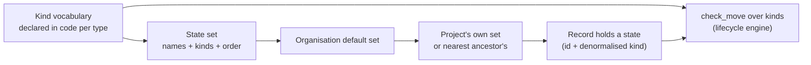

# Custom Record States — Plan

**Status:** Planned, 2026-11-26. Design signed off by the user for the pilot types and the wider flexibility (see Decisions); nothing is built. **Decision tags:** every decision says `Decided by: User` or `Decided by: Agent`.

Follows [Module 7 Phase 7.5f](module-07-traceability-and-governance-plan.md) and `docs/decisions.md` "Custom record states". Builds on the governance engine (`docs/modules.md` §4l15 to §4l17) and copies the pattern project stages already use: a free **name** over a closed **kind** that carries the behaviour.

## Status / Resume Here

0 / 13 phases complete. Phase 0 is next.

| # | Phase | Status |
|---|-------|--------|
| 0 | Core state engine: kinds, state sets, resolution, lifecycle integration (no type moved) | [ ] Not started |
| 1 | Pilot types: Persona, Stakeholder, Stakeholder Need move onto state sets | [ ] Not started |
| 2 | Bundles, templates and nested projects for state sets | [ ] Not started |
| 3 | A role per state (who may enter) | [ ] Not started |
| 4 | A rule before a move (a comment, fields filled) | [ ] Not started |
| 5 | Time in a state (a reminder on the review engine) | [ ] Not started |
| 6 | A scheduled automatic move | [ ] Not started |
| 7 | Governance profiles: a state set a profile requires | [ ] Not started |
| 8 | Frontend: the state set editor, pickers, badges | [ ] Not started |
| 9 | Docs website and reference coverage | [ ] Not started — depends on Phase 8 |
| 10 | Performance testing, review and fixes | [ ] Not started — depends on Phase 8 |
| 11 | Security review | [ ] Not started |
| 12 | Local CI test review (last; before the pull request) | [ ] Not started |

Later waves (other record types) are not phases of this plan; each is a plan of its own once the pilot has shipped (see "Roll-out order").

## Why this exists

Every record type with a status path has a fixed enum and a fixed map of moves. An organisation cannot rename Draft to "In workshop", add a "Validated" step or retire a state it never uses; a project can only turn off the optional states a type declares. Stage workflows already prove the alternative: names are free, a closed `kind` carries behaviour, sets live at the organisation and project level.

## Decisions

| # | Decision | Decided by |
|---|----------|-----------|
| D1 | Pilot types: Persona, Stakeholder and Stakeholder Need. Each has Draft, Active, Retired, no approval and no lock, so the mechanism is proven with the least risk. | User |
| D2 | The first release also offers a role per state, a rule before a move, time in a state and a scheduled automatic move. | User |
| D3 | A custom state name never carries behaviour; a closed kind does (the stage workflow pattern, CLAUDE.md "Governed Records Use the Governance Engine"). | User |
| D4 | Pilot kinds: `start` (records are created here), `working` (in use), `inactive` (set aside). A set has exactly one start state, at least one working state and may have several inactive ones; every kind may move to every other (as the types do today). | Agent |
| D5 | Where sets live: an organisation default set per type, a project set that replaces it, a project with none using the nearest ancestor's, else the organisation's (the `resolve_effective_action_types` shape). A project may hide an organisation state only while it holds one start and one working state; hidden states travel in bundles (`ProjectDefinitionSuppression`). | Agent |
| D6 | A record stores `state_id` and a denormalised `state_kind`, both written by the type's one transition function, so lists filter by kind without a join. | Agent |
| D7 | The default set of every type reproduces its enum (Draft/start, Active/working, Retired/inactive), seeded for each organisation as Standard is for workflows; an organisation or project that configures nothing behaves exactly as today. | Agent |
| D8 | A role per state is an additional requirement to the type's own right, never a replacement: it can narrow who may enter a state and can never admit someone the type would refuse. Roles are the approver-role vocabulary (project, module and custom roles), which users and groups both hold, so parity holds. | Agent |
| D9 | A scheduled move is a record's own target state plus a local wall-clock date and time with its IANA zone (CLAUDE.md "Time and Dates"); the sweep applies it through the type's transition function as the person who scheduled it, so every guard still applies. It never enters a state with an approval gate. | Agent |
| D10 | Export, import, reports and search show the state's name (the label the user sees); an import resolves the name in the target project's set and reports a name it cannot find. | Agent |

## Phase specs

### Phase 0 — Core state engine

**Why:** the mechanism must exist once, in core, before any type uses it; a per-module copy is the failure `docs/decisions.md` records for earlier types. **Risk addressed:** a module reaching into core to add its own kinds (the Modular Feature System Boundary). **Outcome:** `ModuleDefinition.state_kinds[type]` declares a type's kinds and the default set; core tables hold sets (`record_state_sets`, `record_states`: name, kind, order, optional role, rule and timing fields reserved for Phases 3 to 6), resolved by one service with nested fallback and hide/restore; `services.lifecycles.check_move` takes a state's kind for a type with a set, and `LifecycleDefinition` for such a type is derived from the declared kinds.

Tests: resolution (own, ancestor, organisation, hidden), the default set equals the enum, `check_governed_records.py` accepts a type with state kinds, a project with no configuration is unchanged.

### Phase 1 — Pilot types

**Why:** prove the engine on real records. **Risk addressed:** a migration that changes released data (the stakeholders module is on `main`, so a new migration, never an edit). **Outcome:** Persona, Stakeholder and Stakeholder Need hold `state_id` and `state_kind`; a data migration maps each stored status to the organisation's seeded default state; record tables, search fields, reports, exports and imports (D10), the frontend label maps, MCP tools and guidance, perf probes and generators, and both seed scripts read the state; the type's transition function is the only writer.

Tests: migration both ways on seeded data, every list, export and import shape, scaling probe stays flat, the existing stakeholders suites pass unchanged.

### Phase 2 — Bundles, templates and nested projects

**Why:** a project or organisation export that omits state sets loses data on a move. **Risk addressed:** records importing into a project whose set lacks their state. **Outcome:** both bundles carry sets and hidden defaults through `project_bundle_hooks` and `org_bundle_hooks`; template projects classify the keys; an import maps a state by name and falls back to the set's start state, with a warning.

Tests: round trip, template copy, a missing name, a nested child with no set of its own.

### Phase 3 — A role per state

**Why:** a team often wants only a lead to retire a record. **Risk addressed:** privilege escalation (D8) and a role the project cannot resolve. **Outcome:** a state may name approver roles; entering it needs one of them as well as the type's own right; the check runs in the transition function and in `entry_guard`, and the offered moves leave out a state the person may not enter.

Tests: narrowing only, a group-held role, a missing role, every route that changes state.

### Phase 4 — A rule before a move

**Why:** some moves need a reason or a complete record. **Risk addressed:** a rule that blocks a system move. **Outcome:** a state may require a move comment and a list of filled fields (the baseline required-fields provider is the precedent); the move is refused with every failure listed; the comment is stored on the move's audit event.

Tests: each rule, both together, an import honouring the rule, the scheduled move of Phase 6 failing cleanly.

### Phase 5 — Time in a state

**Why:** a record parked in a state for months is invisible. **Risk addressed:** a second reminder sweep (CLAUDE.md forbids one). **Outcome:** records carry `state_entered_at` (UTC instant, written with the state); a state may set "remind after N days"; a core `ReviewAdapter` per type with state sets sends one reminder per entry, to the record's owner, then the policy's default owner, then the project managers.

Tests: the day boundaries, re-arming on a new entry, an archived project.

### Phase 6 — A scheduled automatic move

**Why:** the stage review deadline auto-approves at a date and nothing else can. **Risk addressed:** a silent change of state. **Outcome:** a record may carry a scheduled move (D9); a daily sweep applies those that are due as the person who set them, audits them as scheduled moves, notifies the owner and skips, with a notice, a move the guards refuse; the schedule clears when the record changes state manually.

Tests: wall-clock time across a daylight-saving change, a guard refusal, a deleted target state, a record moved earlier.

### Phase 7 — Governance profiles

**Why:** an organisation that standardises states needs them to bind projects. **Outcome:** a profile may require a state set with the Enforced, Default and Opt-in modes, exemptions and the merge rule of `stage_workflow_policy` (the first profile by precedence supplies the start state; named states are always available and not hideable). Tests as the other policy kinds.

### Phase 8 — Frontend

**Why:** none of this is usable without screens. **Outcome:** an organisation and a project editor for a type's state set (settings hierarchy depth, organisation defaults a project can hide, one component per pattern, `help` on every field), a state picker that shows an unavailable state with the reason, a badge drawn from the kind's tone, a role, rule and timing section per state, the schedule control on the record. Storybook stories, a Playwright spec per flow, label maps with the state name from the API, `LongText` stress variants.

### Phase 9 — Docs

A website page for custom states (a Mermaid diagram of kinds, sets and resolution), the glossary, `docs/modules.md`, `docs/solution-architecture.md`, `docs/ux-style-guide.md` if a pattern is added, and the module pages of the three pilot types.

### Phase 10 — Performance

The scaling probes and dataset generators of the three types read states; a scenario measures a list of 50,000 records filtered by kind; the findings go in `docs/performance.md`.

### Phase 11 — Security review

A sweep of the repository's security issues and vulnerabilities before the plan closes: open Dependabot and code-scanning alerts, `pip-audit`, `npm audit`, Bandit, Semgrep, Gitleaks and the image scan, plus an identify, verify, remediate review of the role-per-state and scheduled-move paths (authorisation, tenant isolation, audit). Upgrade each vulnerable dependency to a supported version, fix each finding in code and record the outcome in `docs/decisions.md`.

### Phase 12 — Local CI test review

Every job in `.github/workflows/` run locally against the branch before the pull request is created (`docs/development.md`, "Testing the pipeline locally with `act`"), each failure fixed in the phase, each skipped job listed with its reason.

## Roll-out order (later plans)

| Wave | Types | Why this order |
|------|-------|----------------|
| 2 | Architecture records, Enhancement request, Pain Point, Open Question | Statuses without approval; the kind vocabulary may need a fourth kind (blocked or review). |
| 3 | Decision, Strategy, Future State, Guiding Principle, Risk | A guard or an approval sits on a named state, so the kind vocabulary gains `approval` and the engine's gated rules apply by kind. |
| 4 | Requirement, Change Request | Approved locks content and drives baselines and change requests across the product; last, with the widest blast radius. |

## Risks

- **Every reader of a status enum changes.** Mitigation: D6's denormalised kind, D7's default set, and the Phase 1 test that the existing suites pass unchanged.
- **A custom name leaking behaviour** (a report or rule matching "Retired" by text). Mitigation: a review in each phase and the check that code reads `state_kind`, never a name.
- **A scheduled move acting with stale rights.** Mitigation: D9 runs it as the setter through every guard.
- **A project left without a start state.** Mitigation: D5's hide rule and validation on every write.
