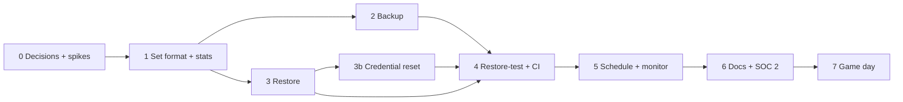
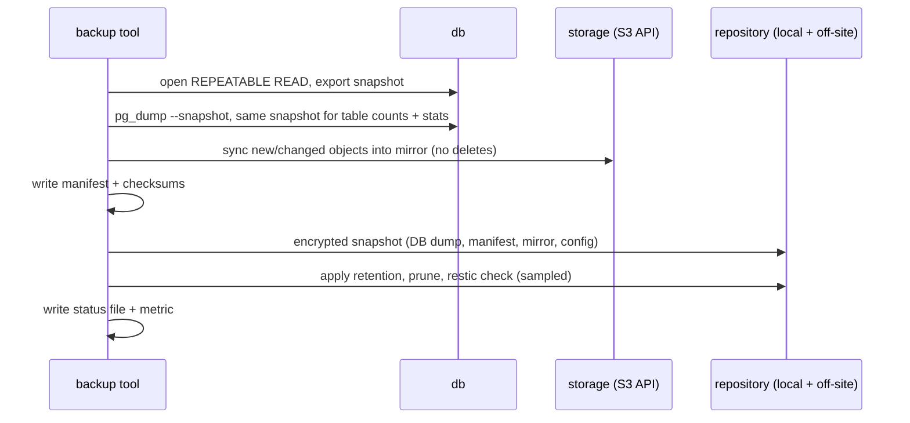
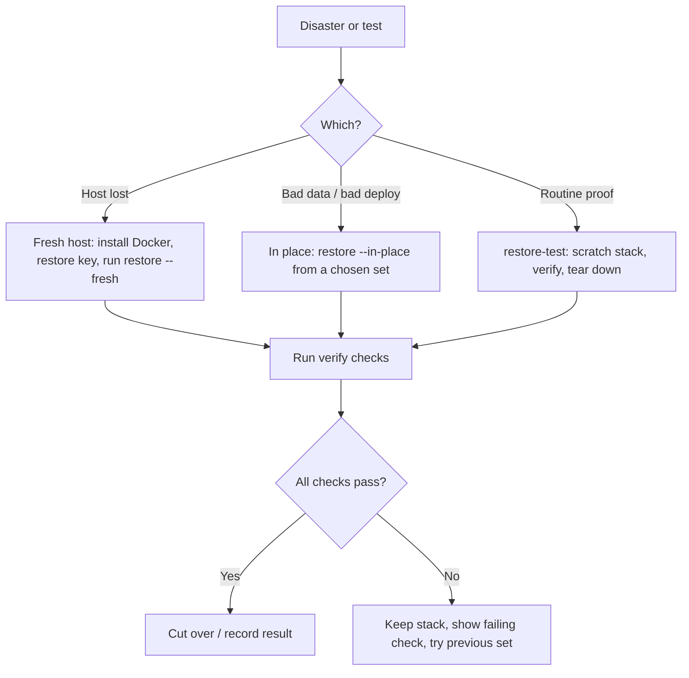
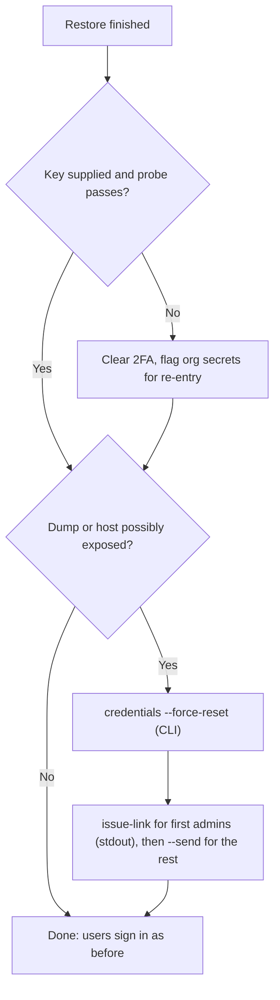

# Disaster Recovery: Backup, Restore and Restore-Test — Plan

**Status:** planned 2026-10-20, not started. **Decision tags:** every decision says `Decided by: User` or `Decided by: Agent`. **Decided by: User** (2026-10-20): wants documentation and scripts for a whole-platform backup that suits disaster recovery, runs from cron, has matching recovery instructions and scripts, and can be tested by restoring to a temporary system and checking the platform is stable and its statistics (users, projects, records) are correct. Everything below about *how* is **Decided by: Agent** until the user signs off the open decisions in §2.

## Status / Resume Here

0 / 9 phases complete. Phases 1–4 are the tooling and are each useful alone; 5–7 wrap it for operators and auditors.

| # | Phase | Status |
|---|-------|--------|
| 0 | Sign-off on open decisions and three spikes | [ ] |
| 1 | Backup-set format, manifest and `dr_stats` | [ ] |
| 2 | Backup tool (DB, objects, config, encryption, retention, off-site) | [ ] |
| 3 | Restore tool (fresh host, in place, scratch) | [ ] |
| 4 | Restore-test harness and CI job | [ ] |
| 5 | Scheduling and monitoring | [ ] |
| 6 | Runbook, docs website, SOC 2 and architecture docs | [ ] |
| 7 | DR game day on a clean machine | [ ] |

## 1. Why, and what exists today

**Why:** a lost host, a corrupted volume or a bad deploy must be recoverable to a known state, within a known time, by someone who did not build the system. **Risk addressed:** silent data loss, and a "backup" that cannot be restored. **Outcome:** one scheduled command produces a self-describing, verified, encrypted backup set off the host; one command restores it anywhere; one command proves, on a throwaway stack, that the latest backup restores into a working platform whose numbers match the source.

**Challenge to the current state (these are defects, not just missing features):** `scripts/backup.sh` and `scripts/restore.sh` exist but do not give disaster recovery.

| Gap | Consequence |
|-----|-------------|
| Default `STORAGE_BACKEND=s3` (SeaweedFS) is **not backed up**; the script only archives the local-files volume | A restored default deployment has every attachment row pointing at a missing object |
| `.env` secrets are not captured, notably `APP_SECRET_ENCRYPTION_KEY` | OIDC/SMTP secrets and every user's TOTP secret become undecryptable: 2FA users are locked out. `JWT_SECRET` loss logs everyone out |
| `restore.sh` pipes plain SQL into the live database with no `--clean`, no `ON_ERROR_STOP`, no single transaction, backend still running | Duplicate-key noise, a half-restored database, writes racing the restore |
| Nothing records the app version or migration revision | Restoring into an older image fails or corrupts; migrations only run forward |
| No integrity check, no encryption, no retention, no off-host copy, no failure signal | Silent cron failure; backups readable by anyone with the disk; the SOC 2 policies already list these as gaps |
| DB dump and file store taken at different moments, with no defined order | A restored row can reference an object the archive does not contain |
| Nothing verifies a restore | "A backup that has never been restored is not a verified backup" is stated in the docs but not enforced |

## 2. Open decisions (need user sign-off in Phase 0)

| # | Question | Recommendation |
|---|----------|----------------|
| Q1 | Storage engine for backup sets: plain files + `age` encryption + `rclone` off-site (transparent, more custom code incl. our own prune), or **restic** (encryption, dedup, retention, `check` and many remote backends built in; one more tool, repo not human-browsable)? | **restic.** It removes the code most likely to be wrong (prune, encrypt, verify). Plain `pg_dump` + manifest stay inspectable inside each snapshot |
| Q2 | Recovery point objective: nightly = up to 24 h of loss. Is that acceptable, or is point-in-time recovery (WAL archiving via pgBackRest/WAL-G) needed? | Nightly now (RPO 24 h, set as a configurable schedule, hourly is cheap with dedup). PITR is a separate later plan if the business needs it |
| Q3 | Where does the tool run: a `backup` Compose profile service (network-only, no Docker socket, pinned `pg_dump` 16, restic, schedule built in) or host scripts using `docker compose exec`? | **Compose service**, plus thin host wrappers (`scripts/backup.sh`, `restore.sh`) so existing doc links and cron habits keep working |
| Q4 | Off-site target: which providers must be supported first? | restic's S3, SFTP and local/NFS backends; document each in the runbook. User to name theirs |
| Q5 | Retention default | 7 daily, 4 weekly, 12 monthly, all configurable; reconciles the open row in the SOC 2 retention policy |
| Q6 | Should a failed or missing backup alert via an optional third-party heartbeat URL (a vendor under the vendor policy), or only via Prometheus? | Prometheus textfile metric + documented alert rule by default; heartbeat URL optional and off by default |
| Q7 | **Security posture.** (a) Backups must be able to hold no keys or secrets at all, because the key may be provisioned on the host or live in a vault; hashes may still be backed up. (b) A forced password reset must be available independently, from the command line, since server admins may themselves be locked out. | **Both, decoupled** (§3.6): `BACKUP_SECRETS_MODE=config\|none` and `--force-reset`, with reset-link issuing from the CLI. Needs sign-off because it adds a reset-link flow to core authentication, which is security-sensitive. Whether a reset link flow exists today is confirmed in Phase 0 (none found) |

## 3. Design

### 3.1 What is in a backup set

| Component | Source | How | Notes |
|-----------|--------|-----|-------|
| PostgreSQL | `db` | `pg_dump -Fc` over the Compose network | Custom format: parallel, selective, restores into an empty DB. Includes every module table because it dumps the whole schema |
| Object storage | `storage` (SeaweedFS, S3 API) | Incremental sync to a persistent staging mirror, then snapshot | Via the S3 API, not the raw volume, so it is consistent. Never deletes during a run |
| Local files | `reqtrack_local_files` | Tar, only when `STORAGE_BACKEND=local` | |
| Configuration and secrets | operator's `.env` | Encrypted separately, **different key and location from the data** | Holds `APP_SECRET_ENCRYPTION_KEY`, `JWT_SECRET`, DB and storage credentials |
| Manifest | generated | `manifest.json` | App version/image tag, git SHA, Alembic head, Postgres version, `STORAGE_BACKEND`, object count/bytes, table counts, business stats, tool version, timestamps, SHA-256 of each component |
| Optional | `loki`, `tempo`, `prometheus`, `grafana` volumes | Off by default | Operational telemetry, not business data. A DR does not need them |

Not backed up and not needed: images (rebuilt/pulled by tag recorded in the manifest), `mcp-server` and `docs` (stateless, **confirmed in Phase 1 inventory**, not assumed).

### 3.2 Consistency order (Decided by: Agent)

DB dump first, then sync the object store into an append-only mirror. A row in the dump therefore always has its object in the mirror (uploads after the dump are extra, harmless). An object deleted after the dump but before the sync is still present from an earlier sync. The mirror may therefore hold objects no retained dump references; they are pruned only when no retained manifest lists them, so a hard-deletion under the retention policy eventually leaves backup media too (the policy requires this).

Table counts in the manifest are taken in the same snapshot as the dump, so a verified restore must match **exactly**, with no tolerance, even while the system is live. (Spike A confirms this works with the `db` container; fallback is documented drift tolerance for a live system.)

### 3.3 Statistics for verification (`dr_stats`)

A backend script (`backend/scripts/dr_stats.py`, run in the backend image) emits one JSON document, used at backup time and at verify time so both sides are produced by the same code:

- Alembic revision (single chain across core and module migrations).
- `count(*)` for **every table discovered from the database catalogue**, so a table added by a new module is covered automatically with no per-module list (the same principle as the module boundary rules). A test fails if a table is skipped.
- Business summary: organisations, users (active/inactive), projects, groups, and records per registered artefact type via `get_all_registered_artefact_types()`; link count; file records and total bytes.
- Integrity probes: every file record's `storage_key` exists in storage; every row of each encrypted column (OIDC/SMTP secrets, TOTP) decrypts with the configured key (proves the restored key is the right one).

Its output never includes row content, secrets or personal data (counts and keys only), per the data classification policy.

### 3.4 Restore modes

| Mode | Target | Guardrails |
|------|--------|-----------|
| Fresh host (real DR) | New Compose stack, empty volumes, `.env` decrypted from the config snapshot | Pulls the image tag from the manifest; refuses a non-empty database |
| In place | Existing stack | Requires `--yes`; stops `backend`/`mcp-server`; takes a pre-restore safety dump; drops and recreates the database; restores in one transaction with `ON_ERROR_STOP`; refuses if the target image's Alembic head is older than the dump's |
| Scratch (restore-test) | Isolated Compose project (`-p reqtrack-drtest-<ts>`), own volumes and ports, no shared network with production | Email sink (no real recipients), no OIDC/webhooks to real endpoints, torn down afterwards; see Risks |

### 3.5 Restore-test checks (the pass/fail list)

1. Repository passes `restic check` (a sampled data read) and component checksums match the manifest.
2. Restore completes; backend reaches healthy; the Alembic revision equals the manifest and `alembic upgrade head` changes nothing.
3. Every table count and every business statistic equals the manifest (a diff table in the report names each mismatch).
4. Every file record resolves to an object; a random sample is downloaded and its size/ETag matches the manifest; all encrypted columns decrypt.
5. API smoke as the restored server admin: `/health`, login (incl. a 2FA-enabled test account), list organisations and projects, open a record, run a global search, export one project bundle.
6. Output: `report.json` + `report.md`, non-zero exit on any failure, a metric/status file, and teardown (`down -v`) unless `--keep`.

### 3.6 Secrets handling and credential reset (Q7)

Two independent controls, **Decided by: User** (2026-10-20 correction) on the principle, **Decided by: Agent** on the mechanics. They are deliberately not coupled: password hashes in a backup are useful and sensitive in their own right, and the decryption key may live elsewhere (provisioned onto the server, or in a vault such as Azure Key Vault).

**Control 1: what secret material the backup holds** (`BACKUP_SECRETS_MODE`)

| Mode | Backup contains | Restore needs | Typical user |
|------|-----------------|---------------|--------------|
| `config` (default) | Hashes and ciphertext in the DB dump, plus an encrypted `.env` snapshot under a separate key | Nothing extra | Small self-hosted installs |
| `none` | Hashes and ciphertext in the DB dump only. No `.env`, no keys | The operator supplies `APP_SECRET_ENCRYPTION_KEY`, `JWT_SECRET` and credentials from wherever they keep them (vault, secrets manager, provisioned host) | Admins who keep keys out of backups |

- The key is never needed *by the backup*; it is needed by the *restored backend*. In `none` mode, restore takes the secrets from the environment or a Docker secrets/vault-populated file, so the same code path serves a vault-fed deployment. No vendor SDK is added to the backup tool (a vault is the operator's provisioning concern).
- **The decrypt probe (§3.3) tells the truth.** If the supplied key is the original, every encrypted column decrypts and nothing is lost (hashes, 2FA, OIDC/SMTP secrets all survive). If the key is wrong or absent, the probe lists which columns are unreadable and restore offers the recovery steps in the table below instead of starting a half-working system.
- The manifest records the mode, so a restore never guesses.
- The dump holds hashes and ciphertext in both modes, so the data repository is always encrypted and treated as Confidential.

| If after restore... | Then |
|---------------------|------|
| Key correct | Nothing to do beyond the optional reset below |
| Key lost or rotated | TOTP secrets undecryptable: clear 2FA enrolment so users re-enrol. Org OIDC/SMTP secrets: flagged "needs re-entry". `JWT_SECRET` new: every session ends (normal) |

**Control 2: forced credential reset** (`--force-reset`, independent of Control 1)

Use it whenever a dump might be in the wrong hands or the old credentials are suspect: a hacked host, a stolen disk or backup, or a restore of an old set after an incident. Not tied to the backup mode or to key loss.

- **From the command line, not only the app.** A server admin may be locked out or compromised, so the tool runs from the host/container shell (`docker compose exec backend python -m app.cli.credentials ...` or via `scripts/restore.sh --force-reset`), with authority coming from shell and database access to the deployment, not from an app login. It works with the app down and with email down. Every use is audit-logged with the actor recorded as `cli:<os user>` through the `services/audit.py` pattern.
- **Scope:** all users (default for `--force-reset`), one organisation, one user, or only server admins. Users who sign in via SSO have no local credential to reset, and are listed in the output rather than silently skipped.
- **Effects, in one transaction:** set a `must_reset_credentials` marker, increment `token_version` (ends all sessions), revoke personal access tokens, optionally clear TOTP enrolment (`--reset-2fa`, since a stolen dump plus a leaked key would expose it).
- **Getting people back in without email:** `credentials issue-link --user <email>` prints a single-use, time-limited reset URL to stdout only (never to logs or the audit record, which stores the token's hash), so the first admins can be re-admitted by hand; `--send` emails links in bulk once SMTP works. A server-admin recovery path therefore exists even when every admin is locked out (also covers the bootstrap `SERVER_ADMIN_*` account, whose behaviour on a restored database Phase 0 confirms).
- **Emailed reset links (new core flow):** single-use, expiring, hashed at rest, rate-limited, uniform responses so accounts cannot be enumerated. Also gives ordinary "forgot password", so it is generic rather than restore-only.
- **Generic mechanism:** a "credential epoch" checked at login and token validation, usable outside DR. Groups have no credentials, so the users/groups parity rule does not apply; recorded in `docs/decisions.md`.

**Restore-test:** runs four cases: key correct without reset, key correct with reset (all sessions dead, every local user flagged, a printed link works exactly once and expires), key withheld (probe reports the unreadable columns exactly), and the CLI reset with the app's admins locked out.

## 4. Phase specs

### Phase 0 — Decisions and spikes
**Why:** Q1–Q7 change the shape of Phases 1–5. **Risk addressed:** building on a wrong premise. **Outcome:** answers recorded in `docs/decisions.md`, plus three spikes: (A) exported-snapshot `pg_dump` with counts from the same snapshot, driven from a network-only container; (B) SeaweedFS S3 list/get/ETag behaviour is enough for an incremental mirror (the app only uses head/create bucket, put, get, delete today, so listing is unproven there); (D) whether any password-reset or forced-reset hook exists beyond `/change-password` and `token_version`; (C) how to make a scratch backend send no real email and make no real outbound calls (there must be a config switch; if not, build a generic one, not a test-only hack). **Tests:** spike notes only.

### Phase 1 — Backup-set format, manifest and `dr_stats`
**Why:** backup and verify must agree on one definition of "the same". **Risk addressed:** counts compared with different code on each side; a new module's tables silently unverified. **Outcome:** manifest JSON schema (versioned), `dr_stats` as in §3.3, inventory of every stateful component recorded in the architecture doc. **Tests:** pytest on `dr_stats` (empty DB, seeded e2e dataset, a table added by a test module is counted, decryption probe fails on a wrong key, output contains no row content).

### Phase 2 — Backup tool
**Why:** one command, safe to run unattended. **Risk addressed:** partial/unencrypted/unverified backups, missing off-site copy, silent failure, two runs colliding. **Outcome:** `backup` Compose profile service (image built in CI beside the others, multi-arch if the resource-profiling plan's multi-arch phase has landed); `scripts/backup.sh` thin wrapper; flock so concurrent runs are refused; exit non-zero and write `status.json` on any failure; credentials only from env/Docker secrets, never on a command line or in logs; retention and prune per Q5; config snapshot encrypted with a separate key, `BACKUP_SECRETS_MODE=none` skips it. **Tests:** a `none` run writes no `.env` content anywhere and records the mode in the manifest; pytest with a temp restic repo and fake services: happy path, DB down, storage down, disk full, concurrent run, retention prune keeps referenced objects, no secret in output.

### Phase 3 — Restore tool
**Why:** recovery under stress must be one documented command with guardrails. **Risk addressed:** restoring over live data, version skew, half-restores. **Outcome:** `scripts/restore.sh` replaced by the three modes in §3.4 (same file name, so existing links hold), `--list`, `--set <id|latest>`, dry-run that prints the plan and checks the version guard. Keeps accepting the old `.sql.gz` / `reqtrack-files-*.tar.gz` for restoring legacy backups. Secrets taken from the environment or a provisioned file in `none` mode, key probe before starting, `--force-reset` hook per §3.6. **Tests:** round-trip tests; refuses non-empty target in fresh mode; refuses older-image-than-dump; failed restore leaves the safety dump and says where it is.

### Phase 3b — Credential reset: CLI, reset links, credential epoch (only if Q7 approved)
**Why:** after an incident (hacked host, stolen dump or disk) every local credential must be replaceable even when every admin is locked out and email is down. **Risk addressed:** locked-out deployments, and a reset flow that is itself an account-takeover vector. **Outcome:** the CLI of §3.6 (`--force-reset`, scoped by user/org/server admins, `issue-link` to stdout, `--send`, optional `--reset-2fa`, SSO users listed) with `cli:<os user>` audit events; single-use expiring reset tokens (hashed at rest, rate-limited, uniform responses); the `must_reset_credentials` marker and credential epoch checked at login and token validation; the reset page and a server-admin "force reset" action in the UI (shared form components, `help` text, label maps, two-tier confirm, toast per the UX style guide); updates to the access-control policy. Consult the access-control and encryption policies first; record the identify → verify → remediate review in `docs/decisions.md`. **Tests:** backend (token expiry, single use, enumeration parity, rate limit, epoch invalidates sessions/PATs, scopes, no token in logs or audit rows, CLI works with the app's admins locked out), Playwright (request link, reset, re-enrol 2FA, forced-reset banner) and Storybook for the new UI; update both seed scripts if a field is added.

### Phase 4 — Restore-test harness and CI
**Why:** the requirement that the whole process be testable. **Risk addressed:** backups that decay unnoticed (new table, new storage path, key mismatch). **Outcome:** `scripts/restore-test.sh` implementing §3.5; the four secrets/reset cases of §3.6; a CI job that seeds the e2e dataset, runs backup → restore-test on the dev/test Compose stack and fails on any mismatch; **negative tests** proving the checks bite: delete a row, delete an object, wrong encryption key, and corrupt a dump must each fail verify. **Tests:** those negative cases are the tests. Respects the one-pytest-at-a-time and shared-test-DB rules: the harness uses its own project name and volumes and never touches `reqtrack_test`.

### Phase 5 — Scheduling and monitoring
**Why:** a documented schedule is the first gap in the SOC 2 operations policy. **Risk addressed:** backups that stop and nobody knows. **Outcome:** ready-to-use crontab line, systemd service+timer pair and the in-container schedule; a Prometheus metric set (`reqtrack_backup_last_success_timestamp_seconds`, duration, size, `reqtrack_restore_test_last_success_timestamp_seconds`, last result) via the node-exporter textfile route or an Alloy-readable file; documented alert rules (backup older than 1.5× interval, restore-test older than 8 days, failure); restore-test default schedule weekly. **Tests:** status/metric file content under success and failure; alert-rule syntax check (`promtool`) if available in CI.

### Phase 6 — Runbook, docs, compliance
**Why:** an operator at 3 a.m. needs one page. **Risk addressed:** knowledge held only by the author; docs drifting from tooling. **Outcome:** `docs/disaster-recovery.md` (RPO/RTO table, what is and is not covered, decision flowchart, key custody, step-by-step fresh-host/in-place/test, troubleshooting); `docs/deployment.md` backup section and README pointer rewritten (not left stale); docs website pages under `installation-deployment/` (replace the backup section and Mermaid in `storage-database-and-migrations.md`); `docs/solution-architecture.md` data-flow/inventory; SOC 2: update `system-operations-monitoring-and-logging-policy.md` gaps 1 and the backup rows, `data-retention-and-disposal-policy.md` (rotation, mirror prune, schedule), `incident-response-plan.md` recovery step, and the control matrix Status column; `docs/decisions.md` entries; the scratch environment handled as Confidential per the classification policy. Diagrams validated. Link checker passes.

### Phase 7 — DR game day
**Why:** the only proof the runbook works is someone following it cold. **Risk addressed:** steps that only work on the author's machine. **Outcome:** a fresh machine with only the off-site repository, the documented key custody and the runbook; measured RTO and findings recorded in `docs/decisions.md`; runbook fixed. Needs the user (or their delegate) to run it. Repeat annually, or after a major change to storage or schema handling.

## 5. Standing checklist per phase

- Run the existing test suites (one `pytest` at a time against the shared test DB); touching secrets/encryption/retention areas gets the identify → verify → remediate review recorded in `docs/decisions.md`.
- No plan references in code, comments or SOC 2 docs.
- Every script has file-level and function docs; Python over long Bash for anything with logic.
- IPv6: this plan adds no listener; if the backup tool exposes a metrics endpoint, bind `::`.
- Docs website: review `docs/website/` for the change (Phase 6 does it in bulk; Phase 3b adds the reset-flow pages; earlier phases note what to touch).
- No new UI, so no Playwright/Storybook; revisit only if a server-admin "last backup" panel is requested (not planned: Prometheus covers it).
- Seed scripts: unaffected unless a phase adds a model; verify with `dr_stats` on both.

## 6. Risks

| Risk | Mitigation |
|------|-----------|
| Encryption key lost = backups and secrets unrecoverable | Key custody section in the runbook (two holders, offline copy), game day tests it, config snapshot encrypted with a separate key from the data repository |
| Backup repository holds all Confidential data, including personal data in stakeholders | Encrypted at rest and in transit; access limited; counts-only logging; retention enforced |
| Scratch restore emails real users (the scheduler sends review reminders) or calls real OIDC/webhook endpoints | Spike C; scratch stack forces an email sink and disables outbound integrations; test asserts none left the stack |
| Restoring a newer dump into an older image | Manifest records the tag; version guard in restore; fresh mode pulls the recorded tag |
| Large attachment store makes runs slow | Incremental mirror + dedup; first run is the only full copy; duration is a metric |
| Restore-test load on a small host (Raspberry Pi, Docker Desktop) | Separate low-priority schedule; documented minimum free disk/RAM, informed by the resource-profiling plan's measurements |
| Dev/test DB wedging from concurrent runs | Harness uses its own Compose project and volumes; never the shared test DB |
| Docker Desktop volume-in-VM disk growth | Document `docker builder prune`, and put the backup repository outside the VM |

## 7. Out of scope

Point-in-time recovery (Q2), multi-region failover or high availability, backing up telemetry, a UI for backup status, and application-level per-project restore (the existing ZIP export/import covers that and is not a DR mechanism).

When the table reads 9/9: move this file to `docs/plans/completed/` and run `scripts/check_doc_links.py` (see CLAUDE.md "Plan Lifecycle").
