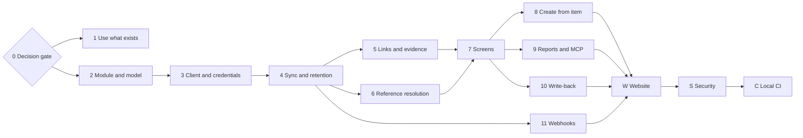
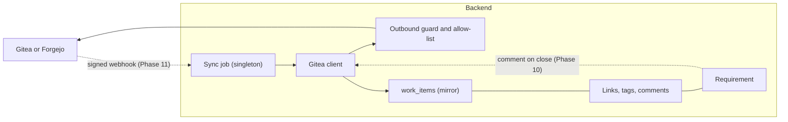
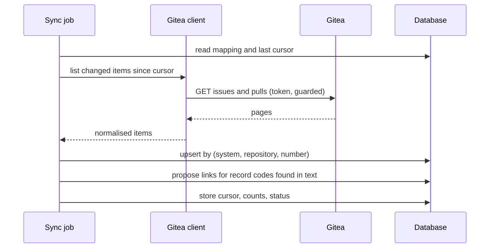
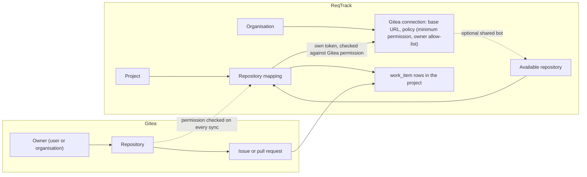
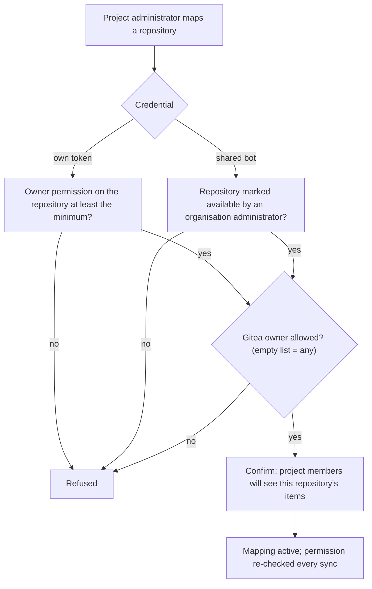

# Gitea Integration — Plan

**Status:** planned 2026-11-20; Phase 0 questions answered 2026-11-20, spikes not started. **Decision tags:** every decision says `Decided by: User` or `Decided by: Agent`; an Agent decision can be revisited on its own judgement, a User decision needs the user's sign-off to change.

Source: a conversation on 2026-11-20 about a Gitea integration, raising two needs (**Decided by: User**):

1. **Implementation evidence:** record that pull request *x* implements requirement *y*, as evidence only; whether the requirement is delivered stays a human decision (finding 11).
2. **Issues:** see Gitea issues (problem reports and feature requests) and link them from requirements, with a connector that reads Gitea and pulls them in.

Scope is Gitea (Forgejo shares its API and is covered by the same client). No other issue tracker is planned (**Decided by: User**, 2026-11-20).

Related: [external references](platform-review-2026-11-19-plan.md) (phases 11 and 12, built) are the manual form of this plan; [service users](platform-review-2026-11-19-plan.md) (phase 21) are the identity a Gitea Actions step or webhook-driven job can run as; [Engineering Design](module-06-engineering-design-plan.md) question 13 reserved a "pulled in from the tool" resolver, which Phase 6 builds generically.

## Status / Resume Here

0 / 15 phases complete.

| # | Phase | Notes | Status |
|---|-------|-------|--------|
| 0 | Decision gate and spikes | Questions answered (below); Gitea API spike and outbound-request guard design remain | [ ] |
| 1 | Use what exists | Convention for Gitea references on requirements today; PR template and commit trailer; reference roles become a vocabulary | [ ] |
| 2 | Module and data model | Module `gitea`; registered type `work_item` (`WRK-nnn`); connection and policy, optional available repositories, repository mapping with its credential, sync state, retention settings; every per-type obligation | [ ] |
| 3 | Gitea client and credentials | Read client; per-mapping tokens checked against Gitea permissions; optional shared bot connection; outbound-request guard and allow-list; test connection | [ ] |
| 4 | Sync engine and retention | Scheduled singleton job; incremental, idempotent; removal handling; backoff; configurable purge | [ ] |
| 5 | Links and implementation evidence | Link types with a generic relation kind and an evidence state provider hook; proposed links from record codes; evidence summary on any record; unlinked filter | [ ] |
| 6 | Reference resolution | A manual external reference to a Gitea key resolves to its mirrored item (generic resolver keyed by system kind) | [ ] |
| 7 | Screens | Work item list and record; connection and policy (organisation); repository mapping and its token (project); requirement panel; Storybook and Playwright against a stub Gitea | [ ] |
| 8 | Create from a work item | Requirement, Enhancement Request or Risk created from an item, linked and referenced | [ ] |
| 9 | Reports and MCP | Implementation evidence and unlinked-issue reports; MCP tools, guidance and generated reference | [ ] |
| 10 | Optional write-back | A comment on a Gitea item when a linked requirement closes; off by default; separate write credential; enable or disable per organisation and per mapping | [ ] |
| 11 | Inbound webhooks | Optional near-real-time updates; signed requests; rate limit | [ ] |
| W | Website and documents | Gitea module pages and Gitea-side set-up, repository-to-project guide, every changed core page, configuration and security pages, repository documents, SOC 2 package, glossary, screenshots | [ ] |
| S | Security review | Dependabot, CodeQL, `pip-audit`, `npm audit`, Bandit, Semgrep, Gitleaks, image scan; identify → verify → remediate on touched areas | [ ] |
| C | Local CI test review | Every job in `.github/workflows/` run locally before the pull request exists | [ ] |

Phase 1 ships value with no connector. Phases 10 and 11 are optional features: each is off until an administrator enables it.

## Findings and objections

1. **A pointer and a mirror are different things; build both, in that order.** An external reference (a system, a key, a role) already records "PR 42 implements REQ-001" and can be found from either side. It cannot say whether the PR is open or merged, so it cannot answer "which requirements have no merged implementation evidence". A mirror (a stored copy of the item's state) can. The reference needs no credentials and no outbound requests; the mirror needs both. Phase 1 ships the pointer now and Phases 2 to 6 add the mirror without replacing it.
2. **Gitea needs nothing installed, and Gitea's own permissions can be the control.** Its REST API (`/api/v1`) is read with a token (`Authorization: token …`). Tokens have category scopes (`read:issue`, `read:repository`) but **no per-repository restriction**: a token reaches whatever its owner can. The repository response carries the token owner's `permissions` (`admin`, `push`, `pull`), so ReqTrack can require a minimum Gitea permission on the repository before a mapping is accepted, and re-check it on every sync (a person who loses access pauses the mapping). Because a token reaches everything its owner can, the client only ever calls the mapped repository's endpoints. Only webhooks (Phase 11) need Gitea-side configuration, a normal webhook with a shared secret. The spike confirms that `permissions` reflects the owner's access when a scoped token is used.
3. **Write-back is optional, so it is designed as an optional capability, not a default.** Two systems each editing the same fields cause loops and disputes about authority. The mirror stays read-only for external fields; the only write is a single comment (never a status or field change) from a separate, optional write credential, off until enabled. Loop prevention is by construction: comments are not mirrored, and one comment is posted once per requirement and item, recorded locally.
4. **Gitea is often on a private network, which collides with the standard outbound-request defence.** A server that fetches an administrator-supplied URL is a server-side request forgery risk; the usual guard rejects private and link-local addresses, which would reject a self-hosted Gitea. Both a private and a public instance must work (**Decided by: User**). So the server administrator keeps an allow-list of hosts and address ranges a connection may reach; a private range is reachable only when listed; a public HTTPS host is reachable unless the server administrator has chosen to restrict to the allow-list; cloud-metadata and link-local ranges are never allowed; redirects off the configured host are refused.
5. **A merge is evidence, not a decision.** A merged pull request shows that work was done; a review period or further changes may still follow, so "implemented", "delivered", "verified" and "approved" are separate facts, and only people establish the last three. A merged pull request must never move a requirement's status or completion marker; the approval gate and segregation of duties stay human. Implementation evidence is *shown* on the record and never described as delivery, and record codes found in an item's text create **proposed** links that a person confirms, the mechanism the platform already uses for proposed links. A proposed link is not counted as evidence.
6. **Mirrored text is untrusted, third-party content with personal data.** Titles, bodies and labels are written by anyone with access to the repository. They are rendered only through the shared safe Markdown view, never as HTML; images in a body are never fetched; URLs are http or https only. Authors and assignees are stored as the external login (text), never an email address, are not searchable by default, and are not a user reference (an external identity is not a principal). Retention is configurable (Phase 4).
7. **Do not create a third silo.** Product Feedback (Enhancement Requests) already holds feature requests with demand, scoring and close-the-loop. A Gitea issue is an upstream signal for a Requirement, an Enhancement Request or a Risk, so the mirrored item stays thin and Phase 8 converts it rather than growing its own triage workflow.
8. **A live look-up at view time is the worse alternative.** It stores nothing, but it cannot be searched, filtered, reported on or exported, fails when Gitea is unreachable and sends a request per row. The mirror stores a small, bounded set of columns and is the only way to report coverage; its staleness is addressed by a visible "last synchronised" and a failure surface.
9. **Gitea only; no provider registry.** With no second tracker planned, the plan builds one client and no provider abstraction. The stored columns stay free of Gitea-only names (`kind`, `state`, `repository`, `number`) at no cost, so a later tracker would be a new client and a migration-free addition, but nothing is built for it now.
10. **Every record type is a target, not only requirements** (D20). The rule that every registered type carries a `PREFIX-nnn` code, and the shared link system, mean a decision, a risk, a design or a workflow can be named in a pull request exactly as a requirement can (`Refs: DEC-003, RSK-002`). The existing resolver `find_record_by_qualified_code` answers for a *calling user*; a sync has no user, so Phase 5 adds a user-less resolver scoped to one project (the user-based function is rebuilt on it, one code path), and the person who confirms a link is checked against both records. A project may override a type's prefix (`ADR-006` for `DEC-006`), so detection reads the project's effective prefixes, never a fixed list; a type registered later (Workflows, Investigations, Glossary) works with no change here.
11. **Evidence is a generic link classification, not a Gitea feature, a module or a record type.** Evidence has no data of its own: it is a relationship plus a state read from the other end (a pull request is merged; a later agile story is done). Evidence already means three things in the product (Compliance evidence attachments, Investigations step evidence slots, Decisions *Supports* links), and a Gitea-specific "delivery state" would be a fourth. So Phase 5 adds two generic extension points: a **relation kind** on the link type (`evidence`, and `plan` for planned work, so an agile story is never relabelled as evidence), and an **evidence state provider** a module registers for its own types. Core groups a record's evidence links and shows each provider's state, and never imports `gitea`. Only the hook is built now, with Gitea as its one user; no evidence screens or types are built until a second user (the planned agile tool) needs them. The existing evidence in Compliance and Investigations is held inside the record and is not merged into this.
12. **"Delivered" has no representation here.** A requirement's human fact is its own completion marker (`is_completed`, `completed_at`, `completed_by`, an overlay on *Approved*, not a lifecycle status), set by a person. No sync, link or merge sets it. Other record types have no such marker, so their evidence is shown with no completion claim. Every "deliver" term is removed from link types, roles, keywords, states, reports and documents; implementation evidence is the term.

## Decisions

| # | Decision | Tag |
|---|----------|-----|
| D1 | Needs: link a pull request as implementation evidence for a requirement; see and link Gitea issues from requirements; scope is Gitea only | **Decided by: User** (2026-11-20; wording revised the same day, see D22) |
| D2 | Pull both issues and pull requests, one type with a `kind` | **Decided by: User** (2026-11-20) |
| D3 | External fields are read-only; the only write is an optional comment on close (Phase 10), enabled and disabled by setting | **Decided by: User** (2026-11-20); the single-comment limit and loop prevention are **Decided by: Agent** |
| D4 | Authentication is by Gitea token: a dedicated read-only bot user's token and a personal access token are both accepted | **Decided by: User** (2026-11-20) |
| D5 | Both private-network and public Gitea instances are supported, through the server-administrator allow-list (finding 4) | **Decided by: User** (2026-11-20); the allow-list design is **Decided by: Agent** |
| D6 | Reference roles become an organisation-and-project vocabulary (Phase 1) | **Decided by: User** (2026-11-20) |
| D7 | Retention is configuration with three modes: keep all; keep while linked and purge unlinked closed items after N days; purge all closed items after N days. Default: keep while linked, 180 days. Set on the organisation's connection, overridable per mapping | Modes **Decided by: User** (2026-11-20); default and override **Decided by: Agent** |
| D8 | An item converts into a Requirement, an Enhancement Request or a Risk (Investigation is not offered) | **Decided by: User** (2026-11-20) |
| D9 | Inbound webhooks stay as the last, optional feature phase | **Decided by: User** (2026-11-20) |
| D10 | Evidence and links never change a record's status or completion marker; detected links are proposed, never confirmed, and a proposed link is not counted as evidence | **Decided by: Agent** (the proposed-link counting rule: **Decided by: User**, 2026-11-20) |
| D11 | The mirrored item is one registered type `work_item` (kind: issue or pull request), project-scoped, code `WRK-nnn` | **Decided by: Agent** |
| D12 | Module `gitea` (core code never imports it); the connection extends the existing organisation `external_systems` row, so manual references and mirrored items share one system vocabulary | **Decided by: Agent** |
| D13 | A mapping is project configuration with **no** nested-project fallback, because a child project that silently synchronised its parent's repository would duplicate every item; a child may map the same repository itself | **Decided by: Agent**; recorded in `docs/decisions.md` per the nested-projects rule |
| D14 | Credentials (per-mapping read and optional write tokens, and the optional shared bot's) use `EncryptedString`, are added to the fixed list in `services/secret_keys.py` and its rotation test, are Restricted, and are never logged or returned | **Decided by: Agent** |
| D15 | Pull on a schedule first; webhooks only trigger a targeted read | **Decided by: Agent** |
| D16 | Authority model, **both** modes: (a) a per-mapping token entered by the project administrator, accepted only when its owner holds at least the organisation's minimum permission on that repository, re-checked every sync, no organisation-level repository list; (b) an optional shared organisation bot connection whose repositories an organisation administrator marks available, for organisations that prefer one managed bot. A mapping uses one or the other | **Decided by: User** (2026-11-20, replacing the earlier organisation-only list, which was too much administration at a high privilege level) |
| D17 | A project may map many repositories and a repository may be mapped by many projects (a monorepo serving several projects), each mapping filtering by kind, state, start date and labels; each project stores its own copy of an item, so links, tags and comments stay project-scoped | **Decided by: Agent** (the flexible reading: no stated reason to forbid it) |
| D18 | A connection (base URL, policy) is organisation-level; a per-mapping token belongs to the mapping, is encrypted, never shown again, and is visible to organisation administrators as metadata only (token owner's Gitea login, permission at last check) with the right to revoke it; a mapping's project must be in the connection's organisation | **Decided by: Agent** (tenant isolation; organisation oversight without holding the secret) |
| D19 | The organisation's minimum Gitea permission to map a repository is configurable (admin, write or read); default **read**. An optional organisation allow-list of Gitea owners narrows which repositories any project may map (empty means any) | Default **Decided by: User** (2026-11-20); the allow-list is **Decided by: Agent** |
| D20 | **Every** record type can be named in a pull request or issue and linked: requirements, decisions, risks, designs, workflows and every type registered later, with no per-type code. The mechanism is the human-readable code every registered type already has; a work item links to any registered type through the shared link system | **Decided by: User** (2026-11-20) |
| D21 | Which link type a mention creates comes from a keyword table on the connection, seeded with defaults (`Implements`, `Closes`, `Fixes` give *Implemented by*; `Reports` gives *Reported as*; any other mention gives *Related*) and editable by the organisation administrator | **Decided by: Agent** |
| D22 | A merged pull request is evidence of implementation, not proof of delivery (a review period or further changes may follow). The link type is *Implemented by*, the reference role is `implementation`, the commit trailer is `Implements:`; no "deliver" term appears anywhere in the feature. "Delivered" stays a human fact: for a requirement, its own completion marker (`is_completed`), which nothing in this feature sets | **Decided by: User** (2026-11-20) |
| D23 | Evidence is generic, not a module or a record type: a relation kind on the link type and an evidence state provider hook on `ModuleDefinition`, built in Phase 5 with Gitea as the only user; a record shows an evidence summary (for example "2 of 3 pull requests merged", never a single delivered flag) and the number of proposed links separately | Direction **Decided by: User** (2026-11-20, evidence as a reusable core concept for later modules such as an agile tool); the hook-only scope and the `evidence` / `plan` kinds are **Decided by: Agent** |

### Still open (asked in Phase 0 spikes or Phase 10, not blocking Phase 1)

- Whether the relation kinds `evidence` and `plan` are enough for the planned agile tool, or it needs a third (settled when that tool is planned, not here).
- The exact Gitea scopes needed for pull requests (spike).

### Phase 0 spikes (exit criteria written down before starting)

- **Gitea API.** Against a real Gitea container: list issues and pull requests (`/api/v1/repos/{owner}/{repo}/issues?type=issues|pulls&state=all&since=`), pagination, the merged flag, rate limits, deleted and transferred items, `GET /api/v1/user` (login, `is_admin`) and the repository listing for the test connection and Discover, the repository's numeric id, what a rename or transfer returns, and that the response's `permissions` (admin, push, pull) reflects the token owner's access when the token is scoped read-only, the minimum token scopes for read and for posting a comment. Exit: a recorded contract and the fields mapped to the stored shape.
- **Outbound-request guard.** Design and test the allow-list, address resolution at connect time (not only at configuration, to defeat DNS rebinding), redirect refusal, response-size and time limits. Exit: a guard module with its own tests, reusable by any later outbound caller (the report converter and OIDC client are the existing outbound callers; check whether they can share it).

## Architecture

Identity of a mirrored item is `(system, repository, number)`, never the title. An item that disappears upstream is marked *removed upstream* and kept until retention removes it, so links and history survive; the sync never deletes an item on its own.

## How Gitea repositories connect to ReqTrack projects

| Level | Who | What |
|-------|-----|------|
| Connection and policy | Organisation administrator | One per Gitea base URL per organisation, attached to the organisation's `external_system_definitions` row so manual references and mirrored items share one system. Holds the policy: minimum Gitea permission to map (default read, D19), an optional owner allow-list, the retention default and the write-back capability. Holds **no token** unless the optional shared bot is set up. Two organisations on one Gitea host each configure their own connection. |
| Mapping (own token) | Project administrator | Pastes a read-scoped token. ReqTrack lists the repositories it can reach that satisfy the policy; the administrator picks one, sets filters (kinds, state, start date, labels) and an interval. The token is stored encrypted on the mapping, never shown again. The repository's Gitea permission for the token's owner is checked when mapping and on every sync. |
| Mapping (shared bot, optional) | Project administrator, within what an organisation administrator made available | The organisation administrator sets up the shared bot token and marks repositories available (default none, never automatic, no wildcard of a Gitea owner, because a repository created later would be exposed with nobody approving it). A project administrator maps one of them without holding the token. |

The access decision, whichever mode:

Rules that follow:

- **Gitea decides who may map.** A project cannot map a repository whose token owner lacks the minimum permission there, so the exposure that an organisation-wide token created (any project administrator reaching every repository the token sees) does not exist in own-token mode. Honest limit: at the default minimum of *read*, Gitea proves only that the person can read the repository; an organisation that wants a repository's administrators to decide raises the minimum to *write* or *admin* (D19).
- **Visibility follows the project, not Gitea.** A mirrored item is readable by whoever can read the project's `gitea` records (module permissions), regardless of their Gitea access, so a private repository's issues become visible to project members. Mapping therefore asks for confirmation naming that effect (the two-tier confirmation in the style guide), and the documentation says so.
- **Credentials follow the person.** A token's owner is recorded on the mapping. If that person loses the permission or the token is revoked, the mapping fails, keeps its items and notifies the project administrators, who supply another token; authority in Gitea, not in ReqTrack, is what ends access.
- **Organisation oversight.** An organisation administrator sees every mapping (project, repository, token owner's login, permission at last check, last status) and can pause a mapping or revoke its token, without ever seeing a token.
- **Nesting.** A child project does not inherit or run its parent's mappings (D13). Parent items still appear in a child's list through the existing nested-project scope filter, with the project label.
- **Code detection stays in the mapped project.** Bare and qualified record codes in an item's text are resolved only within the mapping's own project: a sync has no calling person to apply link scope to. A link to a record in another project is made by a person through the Links panel.
- **Failure.** A repository deleted, renamed beyond recognition or no longer readable by the token (401, 403, 404) fails the mapping: items are kept and shown as failed, never removed by the sync. A repository is identified by Gitea's numeric id, so a rename or transfer does not break the mapping (spike confirms).
- **Removing a mapping.** The items are kept as detached records until retention removes them, or are removed at once after a second-tier confirmation; the stored token is deleted either way.
- **Lifecycle and portability.** An archived project pauses its mappings; a deleted project removes them with their items and tokens. A project template never copies mappings (`template_excluded`). A project bundle carries each mapping as system name plus repository name, never a token; on import into another organisation (or a move) the mapping arrives inactive until a project administrator supplies a token. A project that hides the organisation's Gitea system pauses its mapping.

## Phase specs

### Phase 0 — Decision gate and spikes

**Why:** the plan commits to a credential, an outbound network path and a stored copy of third-party content; each is a one-way door. **Risk addressed:** an SSRF guard that rejects every real deployment, or a scope the API does not support. **Outcome:** answered questions (done, see Decisions), recorded in `docs/decisions.md` (`Decided by: User`), and two spikes with exit criteria met.

### Phase 1 — Use what exists

**Why:** the need is real today and the mechanism exists. **Risk addressed:** delaying value behind a connector, and teams inventing incompatible conventions meanwhile. **Outcome:** a documented, working manual flow, and a role vocabulary that can express it.

- Convention: an organisation external system "Gitea" with URL template `https://<host>/{key}` and key `owner/repo#42` (pull requests `owner/repo/pulls/42`, decided in the spike); roles from the vocabulary (`implementation` for a pull request that implements the record, `origin` for a reporting issue).
- Replace the closed `ExternalReferenceRole` with an organisation-and-project `TypeVocabulary` (hide and restore of defaults, bundle carriage including hidden defaults, migration of the two existing values, API, MCP and export columns reading the label), per the extension-point rule.
- Gitea pull request template and commit trailer (`Implements: REQ-001`, `Refs: DEC-003, RSK-002`; a manual reference names a record of any type) published in the documentation; the existing look-up `GET …/records/by-external-reference` documented as the way to find requirements from a pull request.
- Tests: vocabulary behaviour, migration and its reverse, bundle round trip, existing reference tests unchanged.

### Phase 2 — Module and data model

**Why:** the mirror needs its own records and settings. **Risk addressed:** a per-module edit to a core file, a type missing a per-type obligation, and an unbounded table. **Outcome:** a registered, searchable, exportable, bundled, profilable type with no connection yet.

- Module `gitea` with `ModuleDefinition` registration; gated at the three levels; a default only through the server default table.
- Tables: `work_items` (project, `unique_code`, `kind`, system, repository, number, title, state, merged flag, labels (bounded list), external author login, assignee logins, external URL, body (Markdown, bounded), `removed_upstream`, `external_created_at`, `external_updated_at`, `synced_at`; unique per project on code and on `(system, repository, number)`); `gitea_connections` (organisation, one organisation system row, base URL, minimum permission, owner allow-list, retention mode and days, write-back capability switch, optional shared read and write tokens); `gitea_available_repositories` (shared-bot connection only: Gitea repository id, full name, available); `work_item_repositories` (project, Gitea repository id and full name, credential source (own or shared), encrypted own read and write tokens, token owner's login, owner's permission at last check, kinds, state, start date, label filter, active, interval, retention override, write-back switch, cursor, last status, last error summary), validated so the project and the connection share an organisation. Existing `external_system_definitions` rows gain no connection column (D12, D18). No external field is writable through the API.
- Per-type obligations, each with its test: code through `generate_unique_code`; summary provider; search provider (title, labels, key; body opt-in; never the author login); `RecordTableProvider` with `count` and export (import is `not_importable`: produced by a connector); `record_tags` and `record_placements` in the bundle and the placement form; project bundle hooks (items and mappings by system and repository name, never a token or cursor; an imported mapping is inactive until its connection and repository exist) and template classification (`template_excluded`: a mirror belongs to one repository), organisation bundle `no_org_bundle` with the reason; scaling probe and perf generator with a ratio in `perf/datasets/profiles.yaml`; `mcp_guidance`; `entityAccentColor`; Tier A frontend registration.
- Time shape: every stored time is a past instant in UTC; no scheduled wall-clock time and no calendar date is introduced; the sync interval is a duration.
- Seed scripts: `seed_demo_data.py` and `seed_e2e_dataset.py` gain a mapping and a few mirrored items.
- Tests: model and API, access, tenant isolation, bundle round trip, the existing per-type guards.

### Phase 3 — Gitea client and credentials

**Why:** the product must read Gitea safely. **Risk addressed:** SSRF, leaked credentials, an over-privileged token. **Outcome:** a tested client and a guard any later outbound caller can reuse.

- Gitea client over `httpx` with timeouts, size limits, pagination and `since` support; token in the `Authorization` header only.
- Credentials (D4, D14, D16, D18): a per-mapping read token entered by the project administrator (a person's read-scoped token or a bot's), encrypted, shown once at entry and never again, replaced rather than edited; an optional shared bot token on the connection for the shared mode. An optional separate write token follows the same rules and is used only by Phase 10.
- Permission check (D19): on mapping and on every sync, read the repository's `permissions` for the token's owner against the organisation minimum and the owner allow-list; below the minimum, pause the mapping and notify. The client builds only `/repos/{owner}/{repo}/…` paths of the mapped repository, never a path chosen by stored text.
- Test connection (project administrator, per token; organisation administrator, for the shared bot): reports reachable, authenticated, the token owner's login, whether that owner is a Gitea site administrator, the owner's permission on the chosen repository, and the repositories visible, with a warning when a token reaches more than needed; no response body in logs.
- Discover: lists the repositories a token can reach that satisfy the policy, for the project administrator to pick; in shared mode only those an organisation administrator made available. Nothing becomes available automatically.
- Outbound guard and server-administrator allow-list (finding 4) with a server-administrator screen entry and an audit event on every change.
- Tests: guard (private range allowed only when listed, metadata address refused, rebinding, redirect), client against recorded Gitea fixtures, secret never in a response, log or audit event; `scripts/rotate_secret_key.py` covers the new columns.

### Phase 4 — Sync engine and retention

**Why:** a mirror is only useful while current and bounded. **Risk addressed:** duplicate rows, a runaway sync hammering Gitea, silent staleness, unbounded growth of third-party data. **Outcome:** an idempotent, observable, rate-limited sync and a purge that follows the configured mode.

- A `ModuleScheduledJob` registered by the module and run only by the singleton leader (`start_singletons`), never per process; interval configurable per mapping; a "Synchronise now" action for project administrators with a per-mapping lock.
- Incremental from the stored cursor, a full re-read on demand; upsert by identity in bulk (one query per page, not per row); removal marks `removed_upstream`; a transferred item is recognised by its new key where the API says so, otherwise treated as removed plus new.
- Backoff on rate-limit and server errors; a failing mapping is paused after a bound and shown as failed with a summary, with a notification to the project administrators (notification type registered with its target, so the notification-target test passes).
- Retention (D7): a scheduled purge applying the mode in force (mapping override, else connection): keep all, keep while linked and remove unlinked closed or removed items after N days, or remove every closed or removed item after N days; a purge is audited with counts, and removes the item's tags, placements, comments and links through the existing delete path.
- Audit: one event per run with counts and the mapping id, never titles or bodies; a Prometheus metric with counts and outcome only.
- Tests: idempotent re-run, concurrent run refused, removal and return, rate-limit backoff against a stub, each retention mode including the "linked" exemption, a large first import within the scaling probe's flat limits.

### Phase 5 — Links and implementation evidence

**Why:** the value is the full story across records: a requirement, the decision behind it, the risk it carries and the pull request that implements it (D20). **Risk addressed:** a merge altering approved content or being read as delivery, false links from loose text matching, a Gitea-only evidence mechanism that the next module (an agile tool) would repeat, and a requirements-only implementation that every other module then has to repeat. **Outcome:** any record shows the work items linked to it and a summary of its implementation evidence; people confirm detected links; nothing marks a record delivered.

- **Generic hook (D23, finding 11).** `LinkTypeSeed` and the link type definition gain a `relation_kind` (plain validated string; `evidence`, `plan` or none, beside the existing `flow` classification), and `ModuleDefinition` gains an evidence state provider keyed by artefact type, returning for a linked item a state label and whether it counts as complete evidence. Core groups a record's `evidence` links on the shared Links panel and builds the summary from the providers, generically for every module; no core file imports `gitea`, and no core enum or map gains a per-module value. The link-type organisation vocabulary, bundle carriage and API read the kind like any other column.
- Link types registered by the module through `link_type_seeds` (*Implemented by* with kind `evidence`, *Reported as*, *Related*) between `work_item` and **any** registered type; normal `ArtefactLink` rules (project scope, `link_nesting.can_open_project`, audit). The links appear on every record's Links panel with no per-type code, and the work item's own Links panel shows every record it names.
- Resolver: a user-less `find_record_in_project(db, project, code)` over every registered type that offers a summary (the registry is the list), built on the project's effective prefixes; `find_record_by_qualified_code` is rebuilt on it so there is one resolution path. Organisation-owned records (Strategy, Persona, Stakeholder and similar) resolve by the organisation-qualified code within the project's organisation.
- Detection: record codes in a title, body, branch name or commit trailer are resolved within the mapping's own project (a bare code, or a qualified code naming that project or the organisation; a code naming another project is ignored, because a sync has no calling person to apply link scope to) and create **proposed** links, never confirmed ones (D10). The link type comes from the connection's keyword table (D21): `Implements: REQ-001`, `Refs: DEC-003, RSK-002`. A code that resolves to more than one record is not guessed. A monorepo mapped by two projects yields proposed links independently in each.
- Implementation evidence computed server-side for any record from its *confirmed* `evidence` links, as a count by state (none, open, merged, closed unmerged, removed upstream; for example "2 of 3 merged"), never one yes or no and never the word delivered. Proposed links are shown only as a separate "N proposed" count and are not counted. It is surfaced through the Links panel and the summary provider, with a list filter on every record list through the existing extension points. A requirement's own completion marker is shown beside it and is set only by a person; a record type with no such marker shows evidence with no completion claim. No change to any record's status, completion marker or version, whatever its type (an approved decision or a baselined requirement is untouched by a merge).
- Tests: every registered type resolves (a test fails for a type the resolver cannot reach); a project prefix override is honoured; proposed not confirmed; an approved record unchanged by a merge; a requirement's completion marker unchanged by a merge, a confirmed link or a sync; a proposed link not counted in the evidence summary; several links summarised as a count; a record type with no provider shows no evidence state; the relation kind round trips through the bundle; no core import of `gitea` (boundary test); a code of another project not linked; an ambiguous code not linked; the same item mirrored in two projects; confirming needs access to both records.

### Phase 6 — Reference resolution

**Why:** a manual reference to a Gitea key should gain state when a connection exists. **Risk addressed:** two parallel ways of pointing at the same item. **Outcome:** one generic resolver extension point, reusable by Engineering Design.

- A `ModuleDefinition` extension point keyed by system kind that resolves an external reference (system and key) to a mirrored record, so the reference row shows state and offers a confirmed link; a reference to an unmirrored key stays a plain reference.
- Core code consumes the extension point generically for every module and never imports `gitea`.
- Tests: resolution, no resolution without a mapping, cross-organisation rejection, the boundary test for core imports.

### Phase 7 — Screens

**Why:** a capability with no screen is not done. **Risk addressed:** a one-off UI that ignores the style guide. **Outcome:** the full flow in the interface with story and end-to-end coverage.

- Organisation settings (or Resources, per the Org Resources rule): the Gitea connection and policy (minimum Gitea permission, owner allow-list, retention default, write-back capability), the optional shared bot with its test connection and available-repository list, an overview of every mapping (project, repository, token owner's login, permission at last check, status) with pause and revoke; server administration: the allow-list. Project Admin: repository mapping (own token or the shared bot, Discover, filters, a confirmation that project members will see the repository's items) with status, last synchronised, interval, retention override, the write-back switch, Synchronise now and remove (keep or delete items). Work Items list with `ListPageLayout`, sortable columns, tag and scope filters, `unlinked`, `kind` and `state` filters, export; record page with `RecordHeader` (`back`), `RecordTags`, comments, Links panel, "Open in Gitea", last synchronised, a removed-upstream banner.
- Shared components only (`LabeledSelect`, `FilterSelect`, `TextAreaField`, `FieldHelp`, `MarkdownView`); help in tooltips; enum labels through label maps; required markers; sort in the URL; list position kept.
- Every record page: implementation evidence and proposed links through the shared Links panel with confirm and dismiss (no per-type page change); the connection settings include the keyword table (D21).
- A stub Gitea server in the test stack for Playwright and a contract test against the real image where the stack allows.
- Tests: Storybook stories for every new component, Playwright specs (set the policy, map with an own token and with the shared bot, refusal below the minimum permission, mapping paused when permission is lost, the visibility confirmation, synchronise, confirm a proposed link, view implementation evidence, change retention, map one repository in two projects), each runnable alone and repeatedly.

### Phase 8 — Create from a work item

**Why:** an issue is a signal that becomes a requirement, a feature request or a risk (finding 7). **Risk addressed:** copy and paste and lost provenance. **Outcome:** conversion that keeps the upstream pointer.

- From a work item: create a Requirement, an Enhancement Request or a Risk through each type's own create path, with the shared `QuickLinkField` behaviour, a confirmed link and an external reference back to the item; the new record's approval gate applies (a requirement arrives as a draft). Each target is offered only when its module is enabled.
- Tests: each target, audit events, gate respected, nothing Restricted copied.

### Phase 9 — Reports and MCP

**Why:** coverage questions need answers, and agents need the same view. **Risk addressed:** a bespoke report path and a skill that drifts from the tools. **Outcome:** two reports and the tool set, with the skill updated in the same change.

- `ReportDefinition`s: records of a chosen type with no merged implementation evidence (a type picker, so requirements, designs and decisions share one report; it lists what to check, never what is undelivered), and unlinked open items; `record_types` declared and record codes through `ReportContext.code`.
- MCP tools (`mcp_tools` on the module): list and get work items, list proposed links, confirm a link; `mcp_guidance.md` updated and `scripts/generate_mcp_module_tools_reference.py` run.
- Tests: report behaviour, the skill reference tests, access.

### Phase 10 — Optional write-back

**Why:** raised 2026-11-20 (**Decided by: User**): tell the people who reported an issue when the requirement it became is closed. **Risk addressed:** a write credential's blast radius, comment loops, leaking confidential requirement content to a wider audience in Gitea. **Outcome:** a single, idempotent, switchable comment.

- Two switches, both off by default: an organisation capability (Organisation settings) and a per-mapping setting (Project Admin). When either is off, no write credential is used and no request is made.
- Trigger (**Decided by: Agent**, to confirm in the spike): when a person marks a requirement completed (`is_completed`, the human "delivered" fact, not a lifecycle status) and it is linked to an item by a confirmed *Reported as* link, post **one** comment on that item containing only the requirement's qualified code, the words "marked completed" and the link to it; never its text. The comment is recorded locally (item, requirement, time) so it is never repeated; nothing is changed on the Gitea item but the comment (no close, no label).
- Uses the separate write token (per mapping, or the shared bot's); a missing or failing write token disables the setting and notifies the administrators rather than falling back to the read token. Posting also requires the token owner's Gitea permission to allow commenting, checked like the read permission.
- Tests: off means no request, on posts once, repeat on a later status change does not repost, failure path, no requirement text in the comment, the audit event carries ids and counts only.

### Phase 11 — Inbound webhooks (optional)

**Why:** polling lags by its interval. **Risk addressed:** an unauthenticated endpoint on the internet-facing API. **Outcome:** near-real-time updates with no new trust assumption.

- One endpoint per mapping with a secret path component and an HMAC signature (Gitea's `X-Gitea-Signature`) checked in constant time; body size limit; rate limit; a replayed delivery is harmless because the upsert is idempotent; a webhook only triggers a targeted read through the client, so the payload is never trusted for content.
- Tests: signature failure, replay, oversize, wrong mapping, rate limit.

### Phase W — Website and documents

**Why:** user-visible features and an outbound integration must be documented, and a Gitea administrator needs the Gitea-side steps as much as the ReqTrack ones. **Risk addressed:** a published connector with no documentation, a stale vendor policy, and a mapping that exposes private issues because no one was told. **Outcome:** documents that describe the shipped state, each item below reviewed and either updated or recorded as not needed with its reason in `docs/decisions.md`.

Docs website (`docs/website/docs/`; Mermaid diagrams validated before finalising; formal wording; glossary terms reused):
- New `modules/gitea-module/` in the shape of `product-feedback-module/`: overview; **Gitea set-up** (create a read-scoped token for the mapping, or a bot user with read access to the chosen repositories only; the minimum scopes; optional write token; optional webhook with its secret); **connecting repositories to projects** (the diagrams and the levels above, the minimum permission and owner allow-list, own token against the optional shared bot, what happens when a token's owner loses access, mapping filters, monorepo, the visibility confirmation, nested projects, removing a mapping); work items and implementation evidence (why a merge is evidence, not delivery, and where "delivered" is recorded); links and proposed links; reference roles and manual references (the Phase 1 convention, PR template, commit trailer, the keywords and which record types can be named, a worked example of one story across a requirement, a decision, a risk and a pull request); create from a work item; retention; optional write-back; optional webhooks; reports; MCP integration; known limitations; troubleshooting (unreachable host, allow-list, 401/403/404, rate limit, a stale sync).
- Site wiring: `sidebars.ts`, `modules/overview.md`, `modules/roadmap.md`, `modules/third-party-and-federated-modules.md` only if the resolver extension point matters to module authors, `modules/building-your-own-module.md` for the resolver.
- Core pages that change: `core-features/links-and-traceability.md` (relation kinds, evidence summary, proposed links), the external references page (Phase W of the platform review plan; roles as a vocabulary), `core-features/global-search.md`, `core-features/notifications-and-email.md` (the sync-failure notification), `core-features/zip-export-import.md` (mappings in a bundle, inactive on import), `core-features/project-templates.md` (mappings not copied), `concepts/organisations-and-projects.md` (connections at the organisation, mappings at the project), `concepts/roles-groups-and-access-control.md` (who may connect, make available and map; visibility follows the project).
- Installation and security: `installation-deployment/configuration-reference.md` (every setting and default: allow-list, sync interval bounds, retention default, webhook limits), `production-deployment.md` and `tls-and-reverse-proxy.md` (outbound reachability from the backend to Gitea; exposing the webhook path), `observability.md` (the sync metric and audit events), `troubleshooting.md`, `enterprise-security/encryption-and-secrets-handling.md` and `soc-2-compliance-posture.md`, `api-integrations/` (webhook endpoint, Gitea Actions alternative with a service-user token, the MCP tool list).
- Reference: `reference/glossary.md` (Gitea connection, minimum permission, shared bot connection, available repository, repository mapping, work item, implementation evidence, relation kind, evidence state provider, proposed link, retention mode), `reference/architecture-overview.md`, and the two performance pages if a measured number moved.
- Screenshots regenerated for the new screens and any changed ones; the site builds and `check_doc_links.py` passes.

Repository documents:
- `docs/modules.md` (the resolver and evidence state provider extension points, and the link type relation kind; a module's scheduled job with retention; the module's own section), `docs/mcp-server.md`, `docs/solution-architecture.md` (the outbound integration, the guard and the sync, with a diagram), `docs/user-guide.md`, `docs/deployment.md` and `docs/development.md` (the stub Gitea and the real-image contract test in the Compose stack, running a sync locally, the allow-list during development), `docs/e2e-workflows.md`, `docs/ux-style-guide.md` (the available-repository and mapping pattern, the visibility confirmation, if they introduce a pattern), `docs/performance.md` if a number moved, README (features, configuration, known limitations).
- `docs/decisions.md`: every decision D1 to D23 with its tag, the security review outcome and each "not needed" judgement. `docs/requirements.md` is not changed.
- `docs/soc2/`: vendor and subprocessor management policy (a customer-supplied tool reached outbound, credential scope, the allow-list as the control), encryption and key management (new encrypted columns and the rotation list), access control (who may connect, make available and map), system operations and monitoring (the sync, its failures and metrics), data classification and confidentiality plus data retention and disposal (mirrored third-party content, the retention modes), incident response if a token compromise needs a step; `system-description.md` (dependencies and data tables), `trust-services-criteria-mapping.md`, `security-audit-inventory.md` (new endpoints, the webhook, the outbound path); Known Gaps and the control matrix Status updated where a gap closes or opens.
- Generated and in-code documentation: the module's `mcp_guidance.md` and generated tool reference, API descriptions in formal wording, file-level and function documentation on every new source file, the seed scripts, and `.github` or Compose examples where a setting is added.
- Checks: `scripts/check_doc_links.py`, the Mermaid validation, and the existing docs build, run before the phase closes.

### Phase S — Security review

**Why:** with automatic update pull requests off, nothing else moves a vulnerable dependency, and this plan adds an outbound network path, credentials and untrusted content. **Risk addressed:** known-vulnerable dependencies; SSRF, credential exposure, stored-content injection, webhook abuse. **Outcome:** open alerts and scan findings fixed, dependencies upgraded to supported versions, outcome in `docs/decisions.md`.

- Dependabot and CodeQL alerts, `pip-audit`, `npm audit`, Bandit, Semgrep, Gitleaks and the image scan; every finding fixed in code, never deferred.
- Identify → verify → remediate on: the outbound guard and allow-list, token storage per mapping, rotation and redaction in logs and audit, the permission check and its re-check, the organisation overview's revoke, access and tenant isolation of mirrored items and mappings, rendering of mirrored Markdown, the write-back path, the webhook endpoint, proposed-link integrity against the approval gate.

### Phase C — Local CI test review

**Why:** a plan closed without the whole pipeline has repeatedly left CI red. **Risk addressed:** red CI on the first run. **Outcome:** every runnable check passes before the pull request exists.

- Run every job in `.github/workflows/` locally (`act` where it works, otherwise the same commands directly: `pytest` one at a time, `vitest`, Playwright, `scripts/check_*.py`, `mypy` through `scripts/check_mypy.py`, linters, the scanners); list each skipped job with its reason in the close-out note; fix every failure, including unrelated ones, to its root cause.

## Standing checklist per phase

- Backend change: a test pinning the behaviour; `python scripts/check_mypy.py` at zero findings; run `pytest` one invocation at a time.
- Module boundary: no core file imports from `modules/gitea/`; any core need is a generic extension point; check whether a core enum, column or frontend map needs a per-module value.
- New UI: shared components, Storybook story, Playwright spec, formal wording, help text, required markers, label maps.
- Users and groups: an external login is text, not a principal; a person-valued field added later must accept a group. Recorded in `docs/decisions.md`.
- Time: say which of the three shapes each field is (all past instants in UTC here) and test boundary hours if a date comparison is added.
- Documents: `docs/decisions.md` entry with tags; seed scripts; website; no plan references in source files.

## Risks

| Risk | Mitigation |
|------|------------|
| SSRF through the connection | Allow-list, connect-time address check, redirect refusal, size and time limits (Phase 3, S) |
| A project reaching repositories it should not | Gitea permission checked at mapping and every sync, optional owner allow-list, optional minimum raised to write or admin, visibility confirmation, organisation overview with pause and revoke (Phases 3, 7) |
| Over-privileged token | Read-scoped tokens, test-connection warning when the owner is a site administrator or reaches more than needed, client calls only the mapped repository's paths (Phase 3) |
| A departed token owner leaves a mapping dead or open | Permission re-checked every sync; loss pauses the mapping and notifies (Phase 4) |
| Token exposure | `EncryptedString`, rotation list, never returned or logged; organisation administrators see metadata, not secrets (Phase 3) |
| Stored-content injection | Safe Markdown view only; no HTML; images never fetched (Phase 7) |
| Mirror drift and silent staleness | Last synchronised on every item, failure surface and notification (Phase 4) |
| Unbounded third-party data | Configurable retention (Phase 4) |
| A merge treated as approval or delivery | D10, D22: shown as implementation evidence, never applied to status or completion; proposed links only and not counted (Phase 5) |
| A Gitea-only evidence mechanism the next module repeats | D23: generic relation kind and state provider hook, Gitea as first user (Phase 5) |
| Write-back leaks requirement content or loops | Code, status and link only; one comment per pair; comments not mirrored (Phase 10) |
| Gitea API differences across versions | Spike contract and recorded fixtures; Forgejo covered by the same tests (Phase 0, 3) |
| Scope growth into a full issue tracker | Thin mirror, conversion into existing records (Phase 8) |

When the table reads 15/15: move this file to `docs/plans/completed/` and run `scripts/check_doc_links.py` (see CLAUDE.md "Plan Lifecycle").
