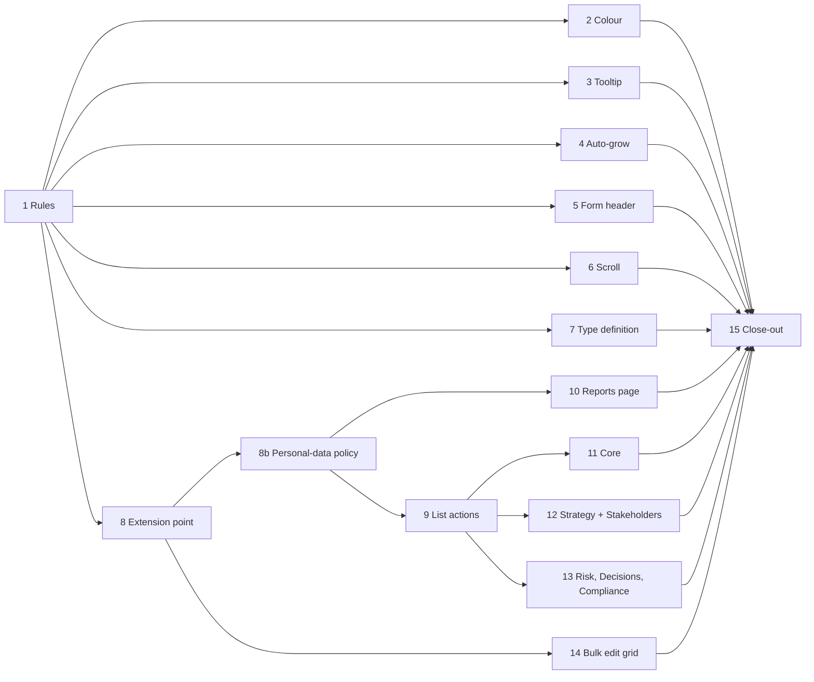

# List Data and Form UX (October 2026) — Plan

**Status:** planned 2026-10-22, not started. Built from eight items the user picked up (section 1). Phases 1 (rules) and 2 (coloured cells) are done; Phase 3 is next.
**Decision tags:** every decision says `Decided by: User` or `Decided by: Agent`. Q1–Q4 were answered by the user on 2026-10-22 (section 2). Everything in the "Agent defaults" table is **Decided by: Agent** and open to override before the phase that uses it starts.

## Status / Resume Here

2 / 16 phases complete (Phase 0, the questions, is signed off and not counted in the total; Phases 1 and 2 done 2026-10-23, uncommitted). Phases 3–7 are independent small fixes and can start now. Phases 8–14 are one chain: the extension point, then everything that uses it.

| # | Phase | Item | Status |
|---|-------|------|--------|
| 0 | Sign-off on Q1–Q4 | all | [x] |
| 1 | Agent instructions and style guide rules written first | 4, 5, 6, 7, 8 | [x] |
| 2 | Coloured report cells and matrices keep their colour in PDF and Word (inventory of every coloured on-screen table, incl. the Risk matrix) | 1 | [x] |
| 3 | Field help `(?)` becomes a tooltip | 2 | [ ] |
| 4 | Long text fields grow with their content (Pain Point description first, then a sweep) | 4 | [ ] |
| 5 | Form header: title and Save/Cancel pinned, body scrolls (shared `Modal`, then every form) | 8 | [ ] |
| 6 | List scroll position and loaded rows survive a trip to a record and back | 6 | [ ] |
| 7 | Pain Point types get an optional definition | 7 | [ ] |
| 8 | Record-table extension point (backend): columns, list, CSV out, CSV in with update | 5 | [ ] |
| 8b | Personal-data policy: column sensitivity, server default, organisation override, new permission | 5 | [ ] |
| 9 | Shared list actions (frontend): Export menu + Import wizard on `ListPageLayout` pages; Requirements migrated | 5 | [ ] |
| 10 | Record-list report in the Reports page (CSV, PDF, Word of any type) | 5 | [ ] |
| 11 | Roll-out A: core types (Requirements, Change Requests, Actions) | 5 | [ ] |
| 12 | Roll-out B: Context & Strategy, Stakeholders (Persona, Stakeholder, Need, Group, Engagement, Research Finding) | 5 | [ ] |
| 13 | Roll-out C: Risk, Decisions, Compliance | 5 | [ ] |
| 14 | Bulk edit grid (generic) wired to Pain Points; other types register editable columns | 3 | [ ] |
| 15 | Docs website, seeds, README, close-out and archive this plan | all | [ ] |

Read left to right: after the rules in Phase 1, Phases 2–7 stand alone; the export/import work is the chain 8 → 8b → 9/10 → 11–13, and the grid (14) needs only the extension point.

## 1. The eight items

| # | Item (user's words, condensed) | Phase |
|---|---|---|
| 1 | Coloured table (e.g. the Pain Point scoring table) loses its colour in PDF/Word export | 2 |
| 2 | `(?)` help should be a tooltip on hover or click, not shift the layout | 3 |
| 3 | Every module: show all records of a type as a table and edit eligible ones spreadsheet-style (first use: bulk severity, frequency, confidence on Pain Points) | 14 |
| 4 | Pain Point description does not grow with long text; make it a style-guide rule | 4 |
| 5 | Every record list has an Export/report control without visiting Reports; no exceptions for export; CSV import that can also update existing records where feasible; export format = import format; agent instructions + style guide | 1, 8–13 |
| 6 | Returning to a list after editing an item puts the user back at the top; keep the position; style-guide rule | 6 |
| 7 | Pain Point types get an optional definition | 7 |
| 8 | Long forms: Save at the top as well, or a header row with title + Save and a scrollable form; same for edit; style guide | 5 |

## 2. Decisions

### Answered by the user (Phase 0)

| Q | Question | Answer (all **Decided by: User**, 2026-10-22) |
|---|---|---|
| Q1 | Export formats on every record list | CSV, PDF and Word. |
| Q2 | How an import matches existing records | By record code (`PREFIX-nnn`). A row with a code updates that record, a blank code creates one, an unknown code is a row error. |
| Q3 | Spreadsheet-style editing | A generic in-app editable grid fed by each type's declared editable columns; Pain Points first. |
| Q4 | Form header | Every `Modal` form, through the shared `Modal`: header row with title, Save and Cancel, scrollable body; create and edit identical. |
| Q5 | Personal data in exports and imports | Organisations must be able to set this differently from the server default: per-column sensitivity, server default, organisation override per column (Phase 8b). Raised by the user 2026-10-22. |
| Q6 | Who may export or import personal-data columns | Anyone who can read the list **and** holds a new explicit permission (default: project admins and organisation admins); the organisation policy and the person's role must both allow it. |

### Agent defaults (**Decided by: Agent**; override before the phase starts)

| # | Default | Why |
|---|---|---|
| D1 | The extension point is `ModuleDefinition.record_tables[type] = RecordTableProvider(...)`; core types live in `services/record_tables_core.py`. A type with no provider gives a reason in `ModuleDefinition.not_importable` (import only; export has no exemption). A test fails for a registered type with neither (same shape as `search_providers` / `not_searchable`). | The module boundary rule: a generic point, never per-module code in core. Export having no exemption is the user's "no exceptions". |
| D2 | Export respects the page's current filters (including the nested-project scope and "Open only"), never widens to the full set. | The style guide's export rule: a filtered-looking screen must not download an unfiltered file. |
| D3 | The CSV is the round-trip file: header = the provider's column keys; first column `code`; people are referenced by email (users) or name (groups), per the users-and-groups parity rule; dates are plain `YYYY-MM-DD`; instants are UTC ISO 8601 and are export-only (never imported); enum values use the label shown to users. | One format for both directions; labels survive renames in the file better than raw enum strings and match Principle 12. |
| D4 | Import is two steps: **preview** (dry run listing creates, updates with before/after of changed fields, and row errors), then **apply**. Valid rows apply and invalid rows are reported with a downloadable error CSV; the result toast reads "N created, N updated, N failed". Caps: 5,000 rows and 5 MB. | Matches the existing Requirements importer's per-row result, adds the preview that an update-capable import needs. |
| D5 | Import never bypasses a type's own rules. Updates call the type's own update path (version lock, new version, audit event, validation). Status is not importable for a type with an approval gate (requirements, change requests, decisions, strategies, future states, guiding principles): imports create drafts and edit content only. | Segregation of duties and the Save-and-activate rule must not be bypassed by a file. |
| D6 | Every exported cell starting with `=`, `+`, `-`, `@`, tab or CR is prefixed with `'` (spreadsheet formula injection); the importer strips that one prefix again so the round trip is lossless. | Records contain user-typed text; opening an export in a spreadsheet must not run it. |
| D7 | Restricted-classified fields are never a provider column. Personal-data columns follow the Q5/Q6 policy (Phase 8b); the default for the server is **exclude**, so a fresh install leaks nothing until an administrator opts in. Export and import are audited as one event each (type, counts, filter keys, which sensitivity tags were included; never the data). | Data classification and logging policies; secure default. |
| D8 | PDF and Word of a list use the report framework through one catalogue report, **Record list**, with a `record_type` parameter (not one report per type). | Keeps one MCP tool and one catalogue entry; a per-type report would add 20 tools and 20 entries for the same shape. |
| D9 | The help tooltip opens on hover and keyboard focus and toggles on click or tap; Escape or an outside click closes it; it is portalled so it never shifts layout and works inside dialogs and popovers. The button keeps the name "Help: {label}". | The user asked for hover or click; touch has no hover. A portal removes the layout shift the inline disclosure causes. |
| D10 | Scroll restoration is a shared hook storing, per list location, the scroll offset and the number of rows loaded ("Show more" clicks), in `sessionStorage`, restored on back navigation only (not on a fresh visit or a changed filter). | The router is `BrowserRouter`, so React Router's `ScrollRestoration` is unavailable; rows must be reloaded or the offset points at nothing. |
| D11 | Pain Point type `definition` is a nullable text column on the organisation type and the project type; shown as the option's description in the type picker and in the type vocabulary panels, travels in the project bundle. | The type vocabulary already has both tiers (organisation defaults a project can hide). |

## 3. Phase specs

Each phase follows the checklist in section 4. Every requirement states why it exists, the risk it addresses and the expected outcome.

### Phase 1 — Rules first

- **Why:** the user asked for the export/import, scroll, auto-grow and form-header rules to become standing agent instructions and style guide rules. Writing them first means every later phase, and any other session, builds to them.
- **Work:**
  - `CLAUDE.md`: new sections **Every Record List Exports and Imports** (every registered artefact type exports CSV, PDF and Word from its list; import with update by code unless `not_importable` gives a reason; export format equals import format; filters respected; D3–D7 as rules), **List Position Is Kept**, **Long Text Fields Grow**, **Form Header** (title + Save/Cancel pinned; body scrolls; create and edit the same), and extend **Field help** to say tooltip.
  - `docs/ux-style-guide.md`: patterns "Pattern: list actions (export and import)", "Pattern: list position", "Pattern: form header", "Pattern: bulk edit grid"; revise "Pattern: auto-growing textarea" (long free-text is always auto-grow, including in detail edit forms), "Pattern: field help" (tooltip, not disclosure) and "Pattern: report export trigger" (the lists use the shared list actions; the Reports page is the second door). Mermaid diagram for the import flow.
- **Not in this phase:** `docs/requirements.md` (authoritative, never edited by the agent). If these items change product scope, raise it with the user.
- **Tests:** `scripts/check_doc_links.py`; Mermaid validated.

### Phase 2 — Coloured tables in PDF and Word

- **Why:** the report framework's `Table` carries plain-text cells only (`services/report_model.py`), so a cell the screen colours (a rating band, the Severity × Frequency matrix) is plain in PDF and Word. The user expects the same gap elsewhere, e.g. the Risk matrix.
- **Risk:** the export reads differently from the screen; colour carries meaning (the rating band).
- **Outcome:** a cell may carry an optional tone or fill; the PDF (`report_pdf.py`) and Word (`report_docx.py`, via the existing `_shade`) renderers apply it, with text colour chosen for contrast; the meaning is also in the text (band name in the cell) so a greyscale print still reads. CSV is unchanged.
- **Work:**
  1. **Inventory first**, recorded in `docs/decisions.md`: every place the frontend colours a table, grid, badge or heat cell that a report also shows (grep the report views and components such as `RiskMatrix`, the Pain Point matrix, Compliance status cells, scoring bands), and for each whether the export (a) has the same table with plain text (carry the tone), (b) has the data only as a list of rows with no matrix at all (the Risk report's note says ratings are derived, so a matrix grid may not exist in the export; add a matrix table block), or (c) is intentionally text-only (state why).
  2. Extend `ReportSection`/`Table` with a per-cell tone, mapped to hex in one place shared with the on-screen tones; fix every case from the inventory, not only Pain Points.
  3. A test fails if a collector emits a toned cell that a renderer ignores.
- **Tests:** renderer unit tests reading the PDF and the DOCX XML for the fill; a visual check of both files rendered for each fixed report (read the output, not just its structure).

### Phase 3 — Help as a tooltip

- **Why:** `FieldHelp` reveals text in place under the caption, which pushes the fields below it and causes layout shifts in dense forms.
- **Outcome:** per D9. `FieldHelp` is rebuilt on the existing `Tooltip` portal with a click/tap toggle; `strings.help` copy, `help`/`helpNotNeeded` props and `check_field_help.py` are unchanged.
- **Work:** extend `Tooltip` with a pinned-open mode instead of a second component; keep accessible naming (visually-hidden text, not `aria-label`) and the "no `<label>` wrapping" rule; verify inside `Modal`, `SidePanel` and `Popover`; update the style guide pattern and stories.
- **Tests:** stories for hover, focus, click and Escape; Playwright asserting that opening help does not change any sibling's bounding box (the geometry check already used elsewhere).

### Phase 4 — Long text grows

- **Why:** the Pain Point form's description is a fixed 3-row `TextAreaField`; requirements use `autoGrow`.
- **Work:** Pain Point description and the other multi-line Pain Point fields (source, impact, evidence) use `autoGrow`, in the form and on the detail page. Then a sweep: list every `TextAreaField`/`<textarea>` without `autoGrow` and decide per field (long prose grows; a deliberately short field such as a one-line note keeps a fixed height and says why). Add the rule to the style guide (Phase 1) and a check script listing textareas lacking `autoGrow` or an explicit opt-out, with an empty baseline.
- **Tests:** story with 40 lines of text; Playwright pasting long text and asserting the height grows and caps at the existing max lines.

### Phase 5 — Form header

- **Why:** a long form (new Pain Point) puts Save below the fold; the user must scroll to the end to commit.
- **Outcome:** per Q4. `Modal` renders a fixed header row (title, Cancel, Save, close) and a scrollable body; the form's primary action moves into the header through a `FormActions`-driven slot so that create and edit forms are identical; a short form may keep the footer buttons only if the style guide's rule says so (decided in Phase 1 from a count of forms).
- **Work:** inventory every form that uses `Modal`/`FormActions`; extend `Modal` with the action slot; migrate every form (the shared `*FormModal` components first); `SidePanel` forms get the same header (same component rule). Enter-to-submit, the `Save and activate` split button, validation errors and the required-field marks must keep working with the Save button outside the `<form>` element (use the `form` attribute).
- **Tests:** stories per variant; Playwright on three forms (Pain Point create, Pain Point edit, one other) covering Save from the header while scrolled, Escape, and validation errors; the existing orphaned-controls and geometry checks pass.

### Phase 6 — List position kept

- **Why:** opening a record and coming back resets the list to the top, which breaks the working pattern of editing down a list.
- **Outcome:** per D10; the hook is applied in `ListPageLayout` so every list that uses it gets it, with no per-page code beyond passing the "rows loaded" count/setter.
- **Work:** find the real scroll container (`Layout`'s main area versus `window`); persist offset and loaded page count on navigation away; restore after the rows have rendered; do not restore when the filters in the URL differ; a list whose filters are not in the URL (local state) is moved to URL state first, since otherwise a restored position would show a different list.
- **Tests:** Playwright: scroll down, open a record on page 2 of "Show more", edit and go back, assert the same row is in view; a fresh visit still starts at the top.

### Phase 7 — Pain Point type definition

- **Why:** a type name alone ("Market", "Operator") does not tell the author what belongs under it.
- **Work:** nullable `definition` text on the organisation and project type tables (migration; take the next revision number from the shared sequence across core and module directories), schemas, panels and form (shared field components with `help`; uses `AutoGrowTextarea`), shown in the type picker, in the bundle export/import, in search if the type is searchable, in `seed_demo_data.py`/`seed_e2e_dataset.py`.
- **Checks recorded in decisions.md:** no new project-scoped table, so the nested-project fallback check does not apply; no new core enum value; no person field.
- **Tests:** backend (create/update/bundle round trip, org-to-project hide still works); stories; Playwright editing a definition and seeing it in the picker.

### Phase 8 — Record-table extension point (backend)

- **Why:** only Requirements can export or import CSV. 19 other registered types cannot, and the Reports page cannot produce a basic table of Pain Points. Per-type endpoints would repeat the same code 20 times.
- **Design:**

```mermaid
flowchart LR
    L["List page filters"] --> E["GET records/export?format=csv"]
    E --> P["RecordTableProvider: columns + list(filters)"]
    P --> F["CSV / PDF / Word"]
    F -->|"edit in a spreadsheet"| I["POST records/import?dry_run=true"]
    I -->|"preview: creates, updates, errors"| A["POST records/import (apply)"]
    A --> U["type's own create/update path (lock, version, audit)"]
```

  Read left to right: the same provider defines the columns for the file out and the file in, and the apply step goes through the type's own update path, never a raw write.
- **Work:** `RecordTableProvider` (key, label, columns with `key`, `label`, getter, setter/parser, `editable` flag, `required` on create, enum/principal/date kinds, and a `sensitivity` tag: none, `personal`, `contact` or `free_text_people`; the provider is the only place a column is classified, and a column with no tag is `none`); list function that takes the same filter object as the type's list endpoint and the `ProjectScope`; shared generic routes (`/projects/{id}/records/{type}/export|import`, plus org-level for organisation-owned types) gated by the same module/sub-component gate and permission as the type's list (export) and create/update (import); formula-injection guard (D6); row and size caps (D4); audit events (D7); `ModuleDefinition.record_tables`, `not_importable`; the enforcement test; Requirements' existing importer moved onto the provider (it keeps its mapping/constant-value behaviour, now client-side only).
- **Security review (identify, verify, remediate, recorded in decisions.md):** authorization on every row of an import (a code from another project or organisation is rejected), tenancy, injection, upload limits, no logging of cell values.
- **Tests:** a generic suite parametrised over every registered type: export, re-import unchanged (no changes reported), edit one column and re-import (one update), unknown code, wrong-project code, formula prefix round trip, permission denied. Run pytest one invocation at a time.

### Phase 8b — Personal-data policy

- **Why:** Stakeholder names and contact details, Engagement notes and anonymous participant labels, and any free text that can quote people are Confidential personal data (data classification policy). Organisations differ in what they may let leave the app; a fixed server rule is too strict for some and too loose for others.
- **Risk:** personal data leaving the application through a file nobody can attribute (CSV, PDF, Word), or an import writing it from outside the app, against an organisation's own policy.
- **Outcome:** for each sensitivity tag the effective policy is the organisation's override if set, else the server default (**exclude** on a fresh install). A column whose tag is excluded is absent from export (every format, every route including the Record-list report) and ignored with a visible warning on import. A person additionally needs the new permission `records.export_personal_data` (default: organisation admins and project admins; fine-grained access control, with groups on parity) to include or import those columns. Both must allow it.
- **Work:**
  - Model: server default per tag in `ServerSettings`; organisation override per tag (and, if needed, per type) as a small structured setting row following the platform-default-vs-override pattern in the style guide (the override shows what it overrides and can be reset to the default).
  - Resolver `resolve_export_columns(db, org, user, provider)`: one function used by export, import, the Record-list report and the grid, so the rule cannot be bypassed on one route.
  - UI: a server-admin panel for the defaults and an Org Admin panel for the override (shared field components, `help`, confirm tier for widening the policy, Toast); list actions show a one-line note when columns were left out ("Contact details are excluded by your organisation's policy").
  - Audit events for a policy change (old/new value, never data) and for an export that included tagged columns.
  - Update the data classification policy and the control matrix; record the identify, verify, remediate pass in decisions.md.
- **Module boundary:** tags live on the provider (a module classifies its own columns); core holds only the tag vocabulary, as a closed list that is an intentional core concept, not a per-module value.
- **Tests:** backend matrix of (server default × org override × permission) for export, import, report and grid; a test that fails if a provider column named like a known personal field has no tag in the Stakeholders and Engagement providers; Storybook for both panels; Playwright toggling the org override and seeing the column appear in the export.

### Phase 9 — Shared list actions (frontend)

- **Why:** each list would otherwise hand-build its Export and Import controls.
- **Work:** `ListActions` (an action menu entry group or a `ReportExportButton` + "Import" pair, per the existing action-menu and one-door patterns) rendered from `ListPageLayout` given a record type and the page's filter state; `CsvImportWizard` generalised from the provider's columns (column mapping, constant-value, preview step, error CSV download), then `RequirementsPage` migrated onto it in the same change; the shared `useRecordTableExport` hook; Toast on every mutation.
- **Tests:** stories for the menu and each wizard step; Playwright for Requirements and Pain Points export download and a create+update import.

### Phase 10 — Record list in the Reports page

- **Why:** the user could not export a basic Pain Point table from the Reports page.
- **Work:** one `ReportDefinition` "Record list" (D8) built on the provider list; parameters: `record_type`, status/open filter, tags, project scope; `record_types` per the codes rule; PDF/Word via the framework (coloured cells from Phase 2 where a column has a tone); `mcp_guidance.md`/skill reference regenerated per the MCP rule (`generate_mcp_module_tools_reference.py`, in `backend/`).
- **Tests:** `test_report_record_codes.py` passes; catalogue Storybook; Playwright generating a Pain Point table.

### Phases 11–13 — Roll-out

Each phase, for each type: write the provider (columns, editable flags), wire the list page to `ListActions`, add the import behaviour (update by code), add a seed row where a new field needs one, and decide import exemptions with a stated reason in `docs/decisions.md` and `not_importable` (likely candidates: Engagement, Compliance evidence, and Compliance assessment records, whose rows are produced by a workflow rather than authored). Export has no exemption.

| Phase | Types | Notes |
|---|---|---|
| 11 | Requirement, Change Request, Action | Requirement is the migration of the existing importer; Change Request status and Action completion follow D5 |
| 12 | Pain Point, Strategy, Future State, Guiding Principle, Open Question, Persona, Stakeholder, Stakeholder Group, Stakeholder Need, Engagement, Research Finding | Stakeholders' personal data tagged and governed by Phase 8b; scoring columns of Pain Point shared with Phase 14 |
| 13 | Risk, Decision, Compliance requirement / project requirement / evidence / required-action assessment | Decision approval gate under D5; Compliance exemptions likely |

- **Tests:** the Phase 8 suite runs against each type; one Playwright spec per phase covers a representative type; the all-types enforcement test must pass at the end of 13.

### Phase 14 — Bulk edit grid

- **Why:** scoring many Pain Points one at a time is the use case that started this request.
- **Work:** `RecordGrid` (shared): rows from the same provider list and filters as the page, columns marked `editable`, cell editors from the shared field components (select for enums, number, text), arrow/Tab/Enter navigation, dirty-cell highlight, "Save N changes" with per-row results in a toast, a row that fails stays dirty with its error; rows in a state that forbids edits (or the user lacks permission for) render read-only with the reason in a tooltip; saves use the type's own update path with the version lock, one request per row so one failure doesn't block others (a bulk endpoint only if measured slow, per the bulk-operations pattern). Pain Point columns: severity, frequency, confidence, with the scoring scheme's allowed levels; entry point is a "Grid" view toggle on the list (view toggle pattern).
- **Other modules:** each type's provider already marks editable columns in Phases 11–13; the grid appears for a type once it has at least one editable column. Anything else is listed in decisions.md.
- **Tests:** stories; Playwright editing three cells and saving, a failing row, and a read-only row.

### Phase 15 — Close-out

- **Work:** docs website review (`docs/website/`: lists, export/import, help, forms, Pain Point types); README; `docs/solution-architecture.md` for the extension point; `docs/modules.md` section for `record_tables`; decisions.md entry per phase with `Decided by` tags; confirm the two seed scripts run on a fresh database; `python scripts/check_doc_links.py`; Status table 16/16; `git mv` to `docs/plans/completed/` and rewrite references; update the memory index.

## 4. Standing checklist per phase

- Backend change has a test; UI change has Storybook stories and a Playwright spec; tests are order-independent and repeatable.
- No warnings, lint-rule edits or suppressions; a bug found on the way is fixed in the same phase.
- Security-sensitive phases (8, 8b, 11–13, and 12's personal data): consult the SOC 2 policies (access control, data classification, logging), do the identify, verify, remediate pass, record it in decisions.md.
- Module boundary: nothing in core imports a module; the record-table provider is the only way a module contributes. Check each phase: no core enum, `Record<Kind, …>` map or stylesheet gains a module-specific value.
- Time shapes: imports take plain dates only; exports write instants in UTC; boundary-hour tests for any date column.
- Users and groups parity: owner/assignee columns accept a user email or a group name.
- Human-readable codes: the `code` column uses `ReportContext.code` / `services.codes.display_code`, never a hand-formatted string.
- Source files never name this plan or a phase.
- Never run two `pytest` invocations at once; rebuild and recreate backend and frontend containers before testing against the live stack; the agent does not run `git commit`.

## 5. Risks

| Risk | Mitigation |
|---|---|
| Import update silently changes the wrong or many records | Code-only matching (Q2), mandatory preview with before/after (D4), per-row authorization |
| Import bypasses an approval gate or version lock | D5: the type's own update path; status not importable for gated types; generic test per type |
| Spreadsheet formula injection from user-entered text | D6 guard on export and a round-trip test |
| Personal data leaves the app through an export or arrives through an import | Column sensitivity tags, server default exclude, organisation override, new permission, one resolver on every route, audited |
| Organisation sets a looser policy than its people expect | Confirm step on widening, audit event, the list shows when columns were left out |
| 20 types in one effort | One extension point first, three roll-out batches, each independently shippable |
| Moving Save into the modal header breaks submit, validation focus or Save-and-activate | Use the `form` attribute, keep one component, story and Playwright per variant |
| Scroll restore lands in the wrong place on a paginated or filtered list | Restore loaded rows first, URL-backed filters, back-navigation only |
| Tooltip rebuild regresses accessible names that tests rely on | Keep "Help: {label}" naming and the sr-only text pattern; the field-help check stays |
| Coloured cells unreadable in greyscale or low contrast | Band name stays in the cell text; text colour picked for contrast |

When the table reads 16 / 16: move this file to `docs/plans/completed/` and run `scripts/check_doc_links.py` (see CLAUDE.md "Plan Lifecycle").
