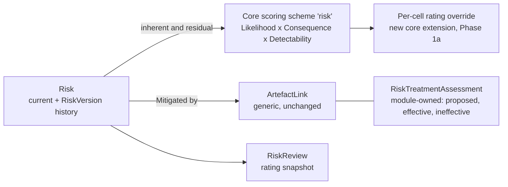

# Module 3 — Risk Management — Implementation Plan

See [future-modules-2026-09-index.md](future-modules-2026-09-index.md) for
cross-cutting architecture referenced throughout — this module consumes
[Module 0](module-00-platform-foundations-plan.md)'s relationship
infrastructure (a hard dependency) and the existing `RequirementAction`
model as its Verification link target.

**Source:** [future-modules-2026-09-overview.md](future-modules-2026-09-overview.md)
§11 "Module 3 — Risk Management".

**Status:** Phases 0 (2026-10-12, user sign-off) and 1a (core per-cell
rating override, 2026-10-12) complete; Phase 1 is next. Overview §46 groups this with Engineering
Design as "Phase 5" (built together, after Requirements & Libraries).

## Status / Resume Here

2 / 8 phases complete (Phases 0 and 1a done 2026-10-12). Phase 1 is next.

| # | Phase | Status |
|---|-------|--------|
| 0 | Exploratory: scoring-model shape & open questions | [x] Complete (2026-10-12) |
| 1a | Core scoring: per-cell rating override (added by Phase 0) | [x] Complete (2026-10-12) |
| 1 | Data model: Risk, Risk Type, scoring registration, module RBAC | [ ] Not started |
| 2 | Risk lifecycle, treatment, and residual-risk tracking | [ ] Not started |
| 3 | Risk-to-engineering relationships (mitigation vs. mere linkage) | [ ] Not started |
| 4 | Risk reviews + reassessment scheduling | [ ] Not started |
| 5 | Frontend UI | [ ] Not started |
| 6 | Docs website coverage | [ ] Not started — depends on Phase 5 shipping |

## Phase 0 — Exploratory: Requirements Clarification & Design Validation

**Why this phase exists:** §11.2's closing line — "the exact scoring model
should be configurable rather than hard-coded to one organisation's risk
matrix" — is the single hardest design point in this module. A risk matrix
is not just a formula; different organisations use qualitative (Low/Medium/
High), 5x5 numeric, or weighted-category models with different axis labels
entirely. Getting this wrong means either a rigid matrix that doesn't fit a
second organisation, or an over-abstracted config system nobody can
configure without engineering help. This phase must produce a concrete
configuration schema before Phase 1.

**Activities:**

1. Resolve the risk-scoring configuration shape (below) with the user —
   likely the single highest-value clarifying conversation in this entire
   module, given how central §11.2 makes it.
2. Resolve remaining open questions.
3. Confirm the "linked to" vs. "effectively treats" distinction (§11.5's
   closing line) — this needs a concrete mechanism, not just a sentence.
4. Confirm reuse of `RequirementAction` as the Verification target (index's
   confirmed finding) rather than treating Verification as unspecified.
   Confirm this is available for Risk specifically per whatever
   [Module 0](module-00-platform-foundations-plan.md) decided for
   `RequirementActionLink`'s own generalisation (its "This fork also
   covers `RequirementAction`/`RequirementActionLink`" note) — do not
   independently extend `RequirementActionLink` to target `Risk` here;
   that decision, and its implementation, belongs to Module 0.

**Exit criteria:** user sign-off on the scoring-model schema, risk field
list, and lifecycle states before Phase 1.

### Open questions for Phase 0

1. **Risk-matrix configuration shape.** Concretely, recommend: a project-
   (or org-, seeded-then-customised) scoped `RiskMatrixDefinition` with
   configurable Likelihood levels (ordered, named, numeric weight) and
   Consequence/Severity levels (same shape), plus a
   `RiskRatingBand` mapping (likelihood × consequence → rating label +
   colour, e.g. a 5x5 grid reduced to Low/Medium/High/Critical bands) —
   this is the generic shape that both a simple qualitative 3x3 matrix and
   a detailed 5x5 numeric one can be expressed as, without hard-coding
   either. Confirm this shape (or a simpler alternative) with the user
   before building it — this is the module's one piece of real
   configuration-engine work, comparable in kind to Traceability's rule
   engine (Module 7), and deserves the same care.
   **2026-10-04 update:** Module 1's Reporting extension (Phase 10) builds
   a generic, core scoring-matrix mechanism first: module-registered axes
   with ordered, weighted levels, named models, and org default + project
   override. **Decided by: User.** This Q1 should reuse that mechanism by
   registering Likelihood/Consequence axes, not build a separate
   `RiskMatrixDefinition`.
   **Shipped 2026-10-04** — see `docs/modules.md` §4d for the registration
   shape (`ScoringSchemeDefinition`; bands are normalised score thresholds
   per model, so a cell-by-cell rating override would be a new extension
   if Risk needs one).
2. **Risk category/type configurability.** §11.3's defaults (Safety,
   Technical, Reliability, Performance, Security, Compliance, Operational,
   Schedule, Cost, Supply chain, Integration, Environmental) — same
   org-seeded-then-project-customised type pattern as Pain Points/Decisions/
   Requirements? Recommend yes, for consistency (per Module 5's Q1 note).
3. **"Linked to" vs. "effectively treats" — how is this actually recorded?**
   §11.5's closing distinction needs a real mechanism: recommend the
   relationship itself carries a `treatment_effectiveness` field (or a
   separate small join attribute) distinct from existence — e.g. a Risk →
   Mitigated by → Requirement relationship can be `proposed` (just linked)
   or `confirmed effective` (a risk owner has reviewed and attests the
   requirement/design actually reduces the risk), matching how a
   Traceability Exception (Module 7 §22) distinguishes "satisfies the rule"
   from "has an approved exception" — same shape, different domain.
4. **Residual risk: separate fields, or a second Risk-shaped sub-record?**
   §11.2 lists residual likelihood/consequence/rating alongside inherent —
   recommend flat fields on the same `Risk` row (residual_likelihood,
   residual_consequence, residual_rating), recalculated whenever mitigation
   actions change, rather than a separate versioned record — a risk's
   residual state is current-state metadata, not history requiring its own
   audit trail beyond the existing risk history/review mechanism (Phase 4).
5. **Comments/attachments/evidence reuse** — same pattern as other modules,
   confirm `ReviewTargetType` extension.

### Phase 0 resolutions (2026-10-12)

1. **Scoring: reuse core's scoring-scheme mechanism, plus a new per-cell
   override.** A `risk` scheme registers three axes, Likelihood, Consequence
   and Detectability, with two models: Likelihood × Consequence (the
   default) and Likelihood × Consequence × Detectability (FMEA-style).
   **Decided by: User** (reuse, 2026-10-04) and **Decided by: User**
   (build the cell-by-cell override now rather than accept
   product-of-weights banding, 2026-10-12); the axes, models and default
   level names are **Decided by: Agent**. The override is core work and is
   its own **Phase 1a**, because it changes shared tables that Pain Points
   and Stakeholders also use: a (scheme, model, level-per-axis) →
   existing-band-label mapping, org default plus project override,
   all-or-nothing per set, resolved project → nearest ancestor → org like
   bands. The override names a band rather than inventing a rating, so
   colours stay in the band set. Limited to two-axis models (the grid
   editor is two-dimensional); the three-axis model keeps threshold bands.
   **Decided by: Agent.** Risk-specific tables (`RiskMatrixDefinition`,
   `RiskRatingBand`) are not built.
2. **Types: org base list plus project rename, reorder, disable and add**,
   seeded with §11.3's twelve defaults, the same shape as Pain Point and
   Stakeholder types. *Nested projects:* no ancestor fallback, because the
   org list is the base every project already sees (Module 2 Phase 0
   resolution 3's reasoning). **Decided by: Agent**, recommended in this
   plan and not objected to.
3. **"Linked to" vs "effectively treats": a module-owned
   `RiskTreatmentAssessment` table**, keyed to the Risk's Mitigated-by link
   (FK to `artefact_links`, cascade on delete): `status`
   (`proposed` / `effective` / `ineffective` / `needs_reassessment`),
   `assessed_by`, `assessed_at`, `rationale`. A link with no row is
   `proposed`. A Risk counts as *treated* only through `effective` rows.
   Phase 4's change detection sets `needs_reassessment`. `ArtefactLink`
   itself is unchanged, since a risk-only column there would break the
   module boundary. **Decided by: User.**
4. **Lifecycle: branching, with a distinct acceptance approval.**
   `Identified → Assessed → Treatment Planned → Treatment in Progress →
   Mitigated → Closed`; `Accepted`, `Transferred`, `Avoided`, `Realised`
   and `Rejected` are reachable from `Assessed` onward (Rejected from
   `Identified` too) and lead to `Closed`; a reassessment may move a risk
   back to an earlier state. Moving to `Accepted` needs a distinct
   module-registered *risk acceptor* role (accepting residual risk is as
   consequential as approving a requirement) and uses the generalised
   `allow_ai_approvals` gate for MCP, as this plan's Phase 4 note already
   says; `Mitigated` does not. **Decided by: User.** Exact transition
   table and role names: **Decided by: Agent** in Phase 1/2.
5. **History: a `RiskVersion` table, plus a snapshot on each review.**
   Residual likelihood, consequence and rating are flat fields on the
   current version, as originally proposed. This replaces the
   audit-log-only history in the original Q4, to match Modules 1 and 2 and
   the acceptance criterion "risk reviews and history are retained".
   **Decided by: User.**
6. **Owner is a user-or-group principal** (the "Users and Groups on
   Parity" rule). The shared mechanism is
   [users-and-groups-parity-plan.md](users-and-groups-parity-plan.md)
   Phase 1, not started. If it has not landed when Phase 1 begins, ship a
   user-only owner and log the gap in `docs/decisions.md`, to be closed by
   that plan. **Decided by: Agent** (the rule itself is the user's).
7. **Verification and Module 0.** `RequirementActionLink` is already folded
   into `ArtefactLink`, so Verified by / Treated by use Actions through the
   generic link; nothing is extended here. Any restriction on which
   artefact types may link as Risk targets is an `ArtefactLink` link-type
   rule, not Risk code. **Decided by: Agent.**
8. **Comments, attachments, evidence:** module-local tables
   (`RiskComment`, `RiskCommentFile`, `RiskFile`), not new
   `ReviewTargetType` members, per Module 2 Phase 0 resolution 8.
   **Decided by: Agent.**
9. **Field set (Phase 1):** identifier, statement, cause, risk event,
   consequence, type, owner, treatment strategy, acceptance criteria,
   inherent likelihood/consequence (/detectability) level ids, derived
   inherent rating, residual equivalents, status, review date, project
   scope. §11.2's "mitigation actions" are Actions linked through
   Treated by, not a text field. **Decided by: Agent**; the user signed off
   the field list by approving this phase's scope.
10. **Roles:** *Risk Manager* (create, assess, treat, edit, review),
    *Risk Acceptor* (the acceptance transition), project members propose
    (create in `Identified`), per §11.7. Keys and names:
    **Decided by: Agent** in Phase 1.

## Phase 1a — Core scoring: per-cell rating override (added by Phase 0)

**Why:** the core scoring mechanism rates a score by thresholds on the
normalised product of level weights. Real risk matrices are rarely
monotonic in that product (a 5 × 1 cell and a 2 × 3 cell often differ), so
an organisation could not reproduce its own matrix. Without this, Risk would
either misrate cells or need its own parallel matrix tables, the failure
Phase 0 Q1 was written to avoid. **Outcome:** any two-axis scoring model can
set an explicit band for each (level, level) cell; Pain Points and
Stakeholders gain it for free.

**Scope:** a core table of cell → band-label overrides at org and project
tier (all-or-nothing per set, project → ancestor → org resolution), service
functions in `services/scoring.py` (`band_for` consults the override first),
level-delete handling (cascade the cell's rows), API endpoints, an editable
grid in `ScoringSchemeEditor`/`ProjectScoringSettings`, and the audit-logged
writes the existing scoring endpoints use. Update `docs/modules.md` §4d.
Tests: backend resolution/inheritance/level-delete/authorisation, Playwright
for the grid editor, Storybook for the grid. Seeds: give the demo risk
scheme a non-monotonic example.

**As built (2026-10-12):** `scoring_cell_ratings` (migration 0072) keyed by
the two level ids with real cascading FKs, so deleting a level drops its
cells and re-weighting keeps them. `PUT .../models/{model}/cell-ratings` at
org and project, same gating and audit as bands. A cell names an existing
band label: it must exist in the scope's effective bands when saved, bands a
scope's own cells still use can't be removed or renamed, and a label that
later disappears (another scope changed its bands) is ignored at read time.
`compute_score` takes `level_ids` + `cell_ratings`; a single scored entry
keeps its cell band, a blend of several (weighted or plain average) is not a
cell and keeps thresholds, worst case keeps the worst entry's. Pain Points
and the R1 report (`cell_ratings` per group, by level name) consume it; the
shared `ScoringCellRatingsEditor` sits inside `ScoringModelBands`, so Pain
Points and Stakeholders configuration screens get it with no module change.
Stakeholders' grid colouring does not use bands, so nothing changed there.
No Risk scheme exists yet to seed, so the demo dataset pins Falcon-3's Pain
Point Blocker × Rare to High instead; Phase 1 should add a non-monotonic
example to the Risk scheme's own seed.

## Phase 1 — Data model: Risk, Risk Type, configurable scoring, module RBAC

**Scope** (fields §11.2, types §11.3, per Phase 0's resolution): risk
statement, cause, risk event, consequence, category/type (FK to
configurable type), likelihood, consequence/severity (both FK'd to the
configured matrix's levels), inherent risk rating (derived), owner,
treatment strategy, review date, evidence/comments (reused pattern),
revision/history (audit-log based, per the other modules' Q4-equivalent
resolution), a `RiskVersion` history table, and the `risk` scoring scheme
registration (Phase 0 resolutions 1 and 5); the bespoke `RiskMatrixDefinition`/
`RiskRatingBand` tables are not built.

**Why:** §11.1 — without a first-class Risk artefact, "a risk should not be
reduced to a free-text field on a requirement" is exactly the failure mode
this closes: today, nothing in this codebase represents risk as a queryable
entity at all (confirmed — no `Risk`-shaped model exists), so any
requirement rationale mentioning risk is unstructured prose with no
ownership, no rating, no review schedule.

**Roles:** Risk Manager/Owner (Manage), project members (Propose), no
distinct Approve role explicitly named in §11.7 beyond ownership — confirm
whether risk *acceptance* (moving to `Mitigated/Accepted`) needs a distinct
Approve-level role in Phase 0, since accepting residual risk is arguably as
consequential as approving a requirement.

## Phase 2 — Risk lifecycle, treatment, and residual-risk tracking

**Scope** (§11.4): `Identified → Assessed → Treatment Planned → Treatment
in Progress → Mitigated/Accepted → Closed`, with alternative terminal
outcomes (Transferred, Avoided, Realised, Rejected) per §11.4's closing
note — this needs a slightly richer state machine than a linear chain
(multiple valid terminal states from the same prior state), similar to
Pain Point's branching lifecycle in Module 1.

**Why:** §11.1 — "requirements and designs may exist specifically to
mitigate [risks]... a first-class risk allows the project to determine
whether mitigation is complete, whether residual risk is acceptable."
Without an explicit lifecycle, "is this risk actually closed out" has no
authoritative answer.

## Phase 3 — Risk-to-engineering relationships (mitigation vs. mere linkage)

**Scope** (§11.5): Risk → Mitigated by → Requirement/Design, Risk →
Addressed by → Decision (reserved until Module 4 exists, if built first),
Risk → Treated by → Action, Risk → Verified by → Verification (both via
the existing `RequirementAction`/`RequirementActionLink` — confirmed via
the index's "Verification Action" finding, no new artefact needed here;
*generalising `RequirementActionLink` to target `Risk` at all is
[Module 0](module-00-platform-foundations-plan.md)'s job, not this
module's — this phase only consumes that once it exists*), Risk → Affects
→ Requirement/Design, Risk → Related to → Compliance obligation (existing
Compliance module — confirm integration point with Module 9's plan).
Implements the "linked to" vs. "effectively treats" distinction from
Phase 0 Q3.

**Why:** §11.5 — the chain `Risk → Requirement → Design → Verification`
is what makes a risk register more than a list; it's what lets a later
Reporting query answer "which risks have no effective mitigation yet"
(one of overview §47.9's named AI-assisted-analysis candidates, and — even
without AI — a plain query any Risk Manager needs routinely).

## Phase 4 — Risk reviews + reassessment scheduling

**Scope** (§11.6): scheduled reassessment with ownership, status changes,
evidence, and history; notification when a risk is overdue for review, or
when a linked requirement/design changes in a way that may invalidate its
mitigation. The second trigger is the same "detect a linked artefact
changed, notify, let a human decide" pattern Engineering Design (Module 6
Phase 3/6) independently needed for its own invalidation mechanism, added
2026-09-16 and now documented once, generically, in
[Module 0's "Related, non-blocking" section](module-00-platform-foundations-plan.md) —
use that shared detection/notification approach here rather than building
Risk's own bespoke version of it. Risk's own `is_invalidated`-equivalent
state is its existing residual-risk/status fields reacting to that
notification (a Risk Manager reassessing and, if warranted, moving the
risk back to an earlier lifecycle state or changing its residual rating)
rather than a separate overlay marker — Risk already has a mutable
lifecycle status built for exactly this kind of reassessment, unlike
Design, which needed a new overlay because an *approved, immutable*
Design revision has nowhere else to record "this is now known to be
wrong" without either rewriting history or forcing a premature new
revision.

**Why:** §11.6 — a risk's mitigation can silently go stale when the
requirement/design it depends on changes underneath it; without this
notification, "our mitigations are current" becomes an assumption rather
than a monitored fact.

**MCP tools.** Added 2026-09-21 at the user's explicit instruction, applied
across every not-yet-built module plan (**Decided by: User**) — see
`docs/modules.md` §6 and [Module 4 (Decision Management)](module-04-decision-management-plan.md)'s
shipped `mcp_tools` (`backend/app/modules/decisions/module.py`) as the
precedent to follow. This module has no single dedicated "backend API"
phase the way Decision Management's later, more granular plan does — Phase
1 stands up Risk's own data model, configurable scoring, and RBAC together
with its CRUD endpoints, and Phases 2–4 progressively add lifecycle,
relationship, and review endpoints on top, so the full REST surface is
only complete once this phase's review/reassessment endpoints land,
immediately before Phase 5's frontend consumes it. Attaching the
commitment here, at the last purely-backend phase, rather than
retroactively to Phase 1 alone, is a judgment call (**Decided by: Agent**)
— revisit if a future pass splits Phase 1's own endpoints out explicitly
from its data-model work. Once this phase (and the endpoints it depends on
from Phases 1–3) exists, declare `McpToolDefinition` entries for the safe
list/get endpoints — candidates made concrete by each phase's own scope
text: `list_risks`/`get_risk` (Phase 1, including the risk's current
inherent/residual rating), and `list_risk_reviews`/`get_risk_review` (this
phase).

**2026-09-22 update (Decided by: User):** this plan originally committed to
**read-only-only** MCP tools; per the same reversal applied to the
Compliance module (`docs/decisions.md`'s "Compliance MCP write tools +
generalized AI approval gate" entry), this module should instead commit to
**write-enabled** MCP tools once built — CRUD/lifecycle tools for Risks and
Risk Reviews declared normally (gated by `MCP_WRITES_ENABLED` + the calling
account's own RBAC role, no special treatment). Whatever endpoint moves a
Risk to `Mitigated`/`Accepted` remains the one exception: it is an
approve/decide-type action, so it should use the generalized org+project
`allow_ai_approvals` gate (`app.services.rbac.require_ai_approvals_
enabled`) rather than staying hard-excluded via `openapi_extra=
APPROVAL_ACTION_ROUTE_EXTRA` — defaulting to this option for consistency
with Compliance's new posture, regardless of how Phase 0's own open
question about a distinct Approve-level role is ultimately resolved (the
gate is orthogonal to which RBAC role may call the endpoint). This is a
judgment call at plan-time (**Decided by: Agent**) about *which* option
(a)/(b) to pick; the underlying instruction to move this plan off
read-only-only is **Decided by: User** (2026-09-22).

## Phase 5 — Frontend UI

List/detail/create UI for Risks (with the configured matrix rendered as an
actual visual grid — a Risk Management UI without a visible matrix loses
most of its communicative value), risk register view, review-due
notifications surfaced consistently with existing notification patterns.
Playwright e2e + Storybook coverage per standing requirements; enum/status
values through label maps.

## Phase 6 — Docs website coverage

Added 2026-09-21 at the user's explicit instruction, applied across every
not-yet-built module plan (**Decided by: User**); the specific scope and
placement below are this session's own judgment (**Decided by: Agent**),
modelled closely on [Module 4 (Decision Management)](module-04-decision-management-plan.md)'s
Phase 6 of the same name.

**Goal:** add Risk Management's user-facing surface to `docs/website/` (the
published docs site, `docs/plans/docs-website-plan.md`) — what a Risk
record is, its lifecycle, the configurable scoring matrix, and how it
relates to Requirements, Designs, Actions, and Decisions — following the
site's existing structure, tone, and Mermaid-diagram conventions (per this
repo's Documentation Requirements: prefer diagrams, validate they render
before finalising).

**Why this is its own tracked phase, not folded silently into Phase 5:**
`CLAUDE.md`'s "Docs Website Maintenance" rule already requires this check
on every change with a user-facing surface, performed in the same change
rather than deferred — so in the ordinary case this would just be part of
Phase 5's own work. It's broken out explicitly here, mirroring Decision
Management's own Phase 6 reasoning, because this module's user-facing
surface is unusually broad for one phase — a configurable risk matrix, a
branching lifecycle with multiple valid terminal states, five relationship
kinds distinguishing "linked to" from "effectively treats," and a
review/reassessment workflow all land in the same Phase 5 UI at once — so
a dedicated, checklist-visible phase makes the docs-site update harder to
under-scope or miss amid everything else Phase 5 ships.

**Scope:**

- A new docs-site page or section (matching whatever grouping the site
  already uses for other project-scoped modules, e.g. Compliance and
  Decision Management) covering: what a Risk record is and when to use one;
  the configurable scoring model (the registered `risk` scheme and its
  per-cell overrides, Phase 0 resolution 1) with a worked example matrix rendered as a
  Mermaid diagram or table; the risk lifecycle as a validated Mermaid state
  diagram, including its branching terminal outcomes (`Mitigated/Accepted`,
  `Transferred`, `Avoided`, `Realised`, `Rejected`, per §11.4); the
  distinction between a risk being merely "linked to" a Requirement/Design
  versus "effectively treated" by it (Phase 0 Q3/Phase 3); the relationship
  kinds wired in Phase 3 (Mitigated by, Treated by, Verified by, Related to
  Compliance), including which targets (Decision) are reserved pending
  Module 4; and the review/reassessment scheduling from Phase 4.
- Update the site's module/feature index or nav to include Risk Management
  alongside the other installed modules it already lists.
- Cross-link from the Requirements documentation to the new page wherever
  the site already documents how a Requirement can exist specifically to
  mitigate a Risk, if it does.
- **Screenshots.** — **Decided by: User** (2026-09-22, made explicit across
  every not-yet-built module plan's own "Docs website coverage" phase,
  alongside [Module 4](module-04-decision-management-plan.md)'s Phase 6
  addendum of the same date). Follow `docs/plans/docs-website-plan.md`'s
  "Screenshots" standard (1440×900 viewport, captured against the seeded
  demo dataset, stored under `docs/website/static/img/screenshots/`, real
  alt text plus a one-line caption, no surrounding "what this shows/why it
  matters" prose) and its "every Concepts, Core Features, Workflows, and
  Modules page needs at least one screenshot or diagram" bar — not forced
  onto a page whose content is genuinely diagram/table-only. Candidate
  screens for this module's own page — **Decided by: Agent**: the Risk
  list view, a Risk detail page showing its scoring matrix and lifecycle
  state, and the review/reassessment scheduling UI.

**Status:** not started — depends on Phase 5 (frontend) actually shipping;
there is no real user-facing workflow to document accurately before then,
the same reasoning Decision Management's own Phase 6 and Compliance's
docs-site page both used. Not a blocker for any other phase.

## Acceptance criteria (from overview §48, Risk Management subset)

- Risks can be created, assessed, owned, treated, reviewed and closed.
- Risk scoring is configurable.
- Risks can be linked to requirements, decisions, designs, actions and
  verification.
- Risk mitigation status can be distinguished from simple relationship
  existence.
- Risk reviews and history are retained.
- Risk changes can participate in Change Impact analysis. *(Module 10 consumes this, not built here)*
