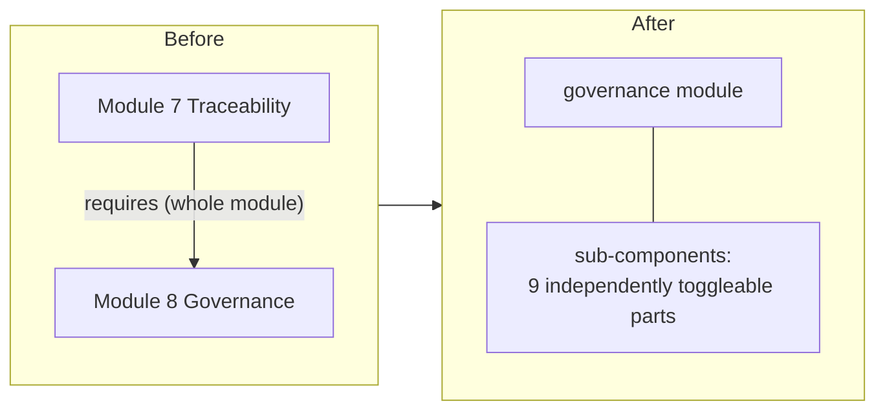
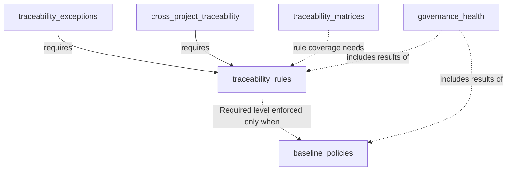
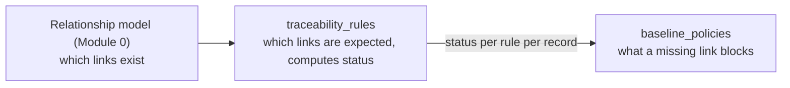

# Module 7 + 8 — Governance & Traceability — Implementation Plan

See [future-modules-2026-09-index.md](future-modules-2026-09-index.md) for the
cross-cutting architecture referenced throughout, especially the
relationship-vs-traceability-vs-governance distinction table. The relationship
model comes from [Module 0 — Platform Foundations](completed/module-00-platform-foundations-plan.md);
this module is its heaviest *consumer*.

**Source:** [future-modules-2026-09-overview.md](completed/future-modules-2026-09-overview.md)
§17–28 (Traceability) and §29–36 (Governance). This plan replaces the former
separate Module 7 and Module 8 plans. The numbers 7 and 8 remain only as
labels for the two halves, so older references to "Module 7" and "Module 8" stay
readable.

**Status:** Proposed, 2026-11-09. Not started. Merging the two modules into one
is **Decided by: User** (2026-11-09: "combine… use sub-modules to allow only
using some parts from one or the other plan"). The module key, the sub-component
list and the build order below are **Decided by: Agent** until Phase 0 signs them off.

## Status / Resume Here

0 / 16 phases complete. Phase 0 is next.

| # | Phase | Half | Status |
|---|-------|------|--------|
| 0 | Exploratory: combined module shape and open questions | both | [ ] Not started |
| 1 | Module skeleton, sub-components, governable-type registry | shared | [ ] Not started |
| 2 | Lifecycle policies | Governance | [ ] Not started |
| 3 | Approval policies | Governance | [ ] Not started |
| 4 | Review policies | Governance | [ ] Not started |
| 5 | Baseline policies and the check-provider extension point | Governance | [ ] Not started |
| 6 | Governance Health + Governance MCP tools | Governance | [ ] Not started |
| 7 | Governance frontend UI | Governance | [ ] Not started |
| 8 | Governance docs website coverage | Governance | [ ] Not started — depends on Phase 7 |
| 9 | Traceability enable/disable + rule configuration | Traceability | [ ] Not started |
| 10 | Enforcement levels + status + baseline hand-off | Traceability | [ ] Not started |
| 11 | Traceability exceptions | Traceability | [ ] Not started |
| 12 | Cross-project traceability | Traceability | [ ] Not started |
| 13 | Matrices + coverage + Traceability MCP tools | Traceability | [ ] Not started |
| 14 | Traceability frontend UI | Traceability | [ ] Not started |
| 15 | Traceability docs website coverage | Traceability | [ ] Not started — depends on Phase 14 |

Order is Governance half first, because the baseline policy's check-provider
extension point (Phase 5) is what Traceability's "Required" level plugs into
(overview §3.1: "Formal Traceability should require Governance"). Each half
ships on its own, so Governance can be released before any Traceability work.

## Why one module, and what it costs

**One module with sub-components, not two modules.** The two halves share a
vocabulary (enforcement level, baseline, exception approval), a registry of
governable artefact types, one set of settings screens and one docs section.
The existing sub-component tier ([docs/modules.md](../modules.md) §2a) already
lets an organisation or project switch off part of a module, which gives the
"use only some parts" behaviour without a second module.

**Challenges the Phase 0 sign-off must answer** (the merge is not free):

- **It narrows, not removes, the old hard edge.** Only the Traceability
  "Required" enforcement level needs Baseline policies; rules, status, matrices and
  coverage work alone. The index's "Traceability requires Governance" line
  changes accordingly (updated in the same change as this plan).
- **Sub-components have no dependency declaration today.** Exceptions need rules; the
  Required level needs baseline policies. Q3 proposes a generic extension point, not
  hand-coded checks.
- **One module means one entitlement, one enablement switch and one role set.**
  The module-level server entitlement cannot grant Traceability without Governance.
  Q4 addresses this by giving each sub-component its own permission atoms.
- **Bigger blast radius per migration and per hardening pass.** Mitigated by shipping
  the halves separately (Phases 1–8, then 9–15).

## Sub-components (the "sub-modules")

| Key | Half | Contains | Needs |
|-----|------|----------|-------|
| `lifecycle_policies` | Governance | Transition rules per artefact type | — |
| `approval_policies` | Governance | Role-based approval per artefact type | — |
| `review_policies` | Governance | Scheduled reassessment | — |
| `baseline_policies` | Governance | Pre-baseline checks, check-provider registry | — |
| `governance_health` | Governance | Live aggregate view | — (shows what is enabled) |
| `traceability_rules` | Traceability | Rules, requirement hierarchy, status, enforcement levels | — |
| `traceability_exceptions` | Traceability | Exceptions with approval | `traceability_rules` |
| `traceability_matrices` | Traceability | Matrices, coverage | — (coverage by rule needs `traceability_rules`) |
| `cross_project_traceability` | Traceability | Links and rules across nested projects | `traceability_rules` |

Solid: the sub-component cannot be enabled without the other. Dotted:
works alone; richer together, and the UI says what is not enforced or shown.

### Responsibility boundary (unchanged by the merge)

Traceability computes and exposes status and never blocks anything. Baseline
policy is the only place that blocks. Putting both in one module must not
blur this: Traceability code never calls a transition, and Governance code
never reads a rule table directly (it consults registered check providers).

## Phase 0 — Exploratory: requirements clarification and design validation

**Why this phase exists:** Governance is explicitly meta (§26.1) and must work
generically across every artefact type, and Traceability's rule engine must express
every §18–19 and §21 example without becoming a query-language project.
The merge adds three design questions of its own (Q1–Q4).

**Activities:**

1. Resolve the open questions below.
2. Read `services/requirements.py` before designing the generic engine, so
   Governance generalises the existing Requirement approval/baseline/review
   logic rather than duplicating it under a new name.
3. Validate the rule schema by hand against every §18, §19 and §21 example
   and the three §19 UI presets.
4. Confirm the relationship model supports arbitrary type-pair rules without
   per-pair special-casing (it does: `ArtefactLink.source_type`/`target_type` are
   registry-validated strings).
5. Read `docs/soc2/policies/` (access control, change management): this module
   touches RBAC, approvals and audit trails, so it is binding.

**Exit criteria:** user sign-off on Q1–Q4 (the merge), the artefact-type
registry, the policy schemas, the rule schema, and the check-provider contract, before Phase 1.

### Open questions for Phase 0

**Merge-specific**

1. **Module key and name.** Recommend key `governance`, display name
   "Governance & Traceability". Not `traceability`, because Governance ships first.
2. **Sub-component set and defaults.** The nine above. Recommend every
   `default_enabled=True` (a project that switches the module on gets everything and
   opts parts out), with the module itself switched on only through the server default
   table (`ServerModuleDefault`), never by flipping `ModuleDefinition.default_enabled`.
   Alternative: opt-in per part, in line with progressive governance (overview §2.2).
3. **Dependency declaration.** Recommend a generic `requires: tuple[str, ...]` on
   `ModuleSubComponentDefinition`, resolved in
   `is_module_subcomponent_enabled` so a sub-component is effective only when its
   requirements are, with the toggle UI showing the reason. A core change, but a generic
   extension point (Modular Feature System Boundary), not module behaviour hand-edited
   into core. The first consumer is this module; the existing modules need no change.
4. **Roles and permissions.** Recommend permission atoms per sub-component
   (`governance.approval_policies`, `traceability.rules`, …) over one flat module role,
   with module roles "Governance Manager" and "Traceability Manager" (§28, §36)
   composed from them. Separation of duties (an exception's requester is never its
   approver) is enforced in code, not by role design.

**Governance**

5. **Generic per-artefact-type engine or purpose-built policies per module?**
   Recommend generic: a registry of governable artefact types, extensible as later
   modules land, with `LifecyclePolicy`, `ApprovalPolicy`, `ReviewPolicy` and
   `BaselinePolicy` each scoped to one type and one project.
6. **Replace or sit alongside the Requirement-specific logic?** Recommend
   alongside. New types are built on the generic engine from the start; migrating
   Requirements is its own verified sub-phase (the existing suite is the regression bar),
   and only if the user confirms it. This is a product decision, not a mechanical one
   (SOC 2 relevance).
7. **Review policy versus the existing `RequirementReview`.** Same answer, scoped
   to reviews: generalise for new types and do not touch the existing mechanism as a
   side effect.
8. **Governance Health: computed or snapshot?** Recommend computed on demand.

**Traceability**

9. **Rule schema.** Recommend `TraceabilityRule` = source type, relationship type
   (or set), acceptable target types combined ANY, min links, max links (nullable),
   `is_mandatory`, `enforcement_level` (Informational/Warning/Required). "Requires A
   AND B" is two rows with the same source type; "A OR B" is one row with two
   target types. Confirm before building: it fixes the evaluation query shape.
10. **Requirement hierarchy (§23).** Recommend an ordinary `TraceabilityRule` row,
    with a dedicated "requirement hierarchy" screen for discoverability and no second
    data model.
11. **Exception approval.** The two halves now share a module, so recommend
    an exception is approved through the Governance Approval Policy for its type when
    `approval_policies` is enabled, and through a dedicated approve permission when not.
    The requester never approves their own exception, and the route stays
    `APPROVAL_ACTION_ROUTE_EXTRA` (human-only, Decided by: Agent in the earlier
    traceability plan, kept).
12. **Matrices: stored definitions or ad-hoc only?** Recommend a saved
    `TraceabilityMatrixDefinition` (ordered type chain plus connecting relationship
    types), sharing design language with Reporting's saved layouts.

**Hand-off and platform rules**

13. **Hand-off contract.** Recommend `baseline_policies` owns a registry of
    *check providers* (a `ModuleDefinition`-style generic hook, never an import of a
    module's own code). `traceability_rules` registers its provider inside this module;
    Compliance (Module 9) later registers its own through the same hook. When
    `baseline_policies` is off but a rule is `Required`, the level is still configurable
    (flexible reading) and every surface labels it "not enforced"; nothing silently
    pretends to block.
14. **Nested projects and organisation tier.** Policies, rules and matrix definitions are
    project-scoped definition tables, so decide now (CLAUDE.md "Nested Projects"):
    recommend the `resolve_effective_action_types` fallback (own rows, else nearest
    ancestor's, root-only seeding) for all three. Also decide whether an organisation tier
    exists; if so, the "Organisation Defaults a Project Can Hide" tombstone applies.
    Record in `docs/decisions.md` before Phase 2.
15. **Is a traceability exception a registered artefact type?** Recommend yes
    (`TEX-nnn`): then code, search, placement, tags, links, record-table export/import,
    scaling probe and perf generator all follow from the shared mechanisms. Policies,
    rules and matrix definitions are configuration, not artefact types, and say so
    in `not_searchable`/`not_placeable` terms where a test asks.
16. **Users and groups parity.** Review owners and exception requesters/approvers use
    the shared principal reference and picker (a group is valid wherever a user is).
    Approval policies reference roles by §32; confirm a group holding the role satisfies it
    through effective membership, as `services/rbac.py` resolves.
17. **MCP write posture.** The two source plans disagreed: Governance said read-only
    only; Traceability (updated 2026-09-22, **Decided by: User**) said write-enabled,
    with approval routes excluded. Recommend the Traceability posture for both halves:
    configuration CRUD is write-enabled (`MCP_WRITES_ENABLED` plus the caller's RBAC),
    and no route that *executes* an approval or finalises a blocked transition becomes
    a tool (`APPROVAL_ACTION_ROUTE_EXTRA`).

## Phase 1 — Module skeleton, sub-components, governable-type registry

**Scope:** `backend/app/modules/governance/` and `frontend/src/modules/governance/`;
`ModuleDefinition` with the nine `sub_components`; the `requires` extension point
(Q3, if approved) with tests across the three tiers; the governable-type registry
(an extensible mapping any module contributes to through its `ModuleDefinition`);
permission atoms (Q4); the check-provider registry's interface (empty).

**Why / risk / outcome:** one registration point for the nine parts, so later phases add
behaviour without touching core files. The risk is the core-boundary failure mode: no core
file imports from `modules/governance/`, and no per-module value is added to a core
enum or column. Outcome: the module can be enabled with every sub-component
independently switchable and dependency-checked.

## Phase 2 — Lifecycle policies (`lifecycle_policies`)

**Scope** (§31): per-project, per-artefact-type transition rules (who may move what,
when). Each module's own state enum stays specific to that artefact; Governance
configures the *rules*, not the data.

**Why:** §26.1 — Governance defines how a project operates, not engineering content.

## Phase 3 — Approval policies (`approval_policies`)

**Scope** (§32): policies reference roles, never individuals. This does not replace
Decision Management's existing binding (`(decision, approve_baseline,
subtype=<decision type>)`, satisfiable by a fixed, module or custom role under
[Fine-Grained Access Control (core)](completed/core-fine-grained-access-control-plan.md)).
A policy configured here becomes another way to *grant* the same permission atom
(for example by composing a custom role), not a competing enforcement path: the approval
endpoint keeps checking the one permission it already checks. Any other module's
approval-shaped action (Risk, Strategy, Design) follows the same pattern once it has its
own atom.

**Why:** without centralising this, each module reinvents "who can approve this" and
enforcement scatters.

## Phase 4 — Review policies (`review_policies`)

**Scope** (§33): interval, owner, due date, reminder, outcome, next review date,
generalised across types per Q7. Due dates are calendar dates (stored as `date`, tested
against `effective_today()`); owners are principals (Q16).

**Why:** today only Requirements have scheduled reassessment; Strategy, Guiding
Principles, Risks and Decisions plausibly need it, and a sixth bespoke mechanism is
the thing to avoid.

## Phase 5 — Baseline policies and check providers (`baseline_policies`)

**Scope** (§34): configurable pre-baseline checks (required fields, required approvals,
traceability, verification, compliance), none mandatory per project. Checks are
resolved through the check-provider registry (Q13); the built-in providers are
required fields and required approvals. Traceability and Compliance register theirs
later.

**Why:** this is where Governance and Traceability separate in practice. The rule says a
link is required; the baseline policy says a missing link blocks baselining. Without this,
Traceability would have no lever and would be purely informational.

## Phase 6 — Governance Health (`governance_health`) + Governance MCP tools

**Scope** (§35): live computed aggregate (percentage complete per governed category,
open-question count), including the result of whichever check providers are enabled.

**MCP tools.** The instruction to give every not-yet-built module plan an explicit
MCP-tools and docs-website treatment is **Decided by: User** (2026-09-21); placing the
tools in the last Governance backend phase and the candidate names are **Decided by:
Agent**. Per Q17, declare `McpToolDefinition` entries per
[docs/modules.md](../modules.md) §6 for lifecycle, approval and review policy
configuration and "get governance health". **No tool may execute an approval:** a
content module's own `approve`/`reject` route, or any Governance-side override that
finalises a blocked baseline or transition, is marked
`openapi_extra=APPROVAL_ACTION_ROUTE_EXTRA`, which mechanically excludes it from the
manifest, wherever it physically lives. Owning the policy never makes the act of
approving under it safer to expose. Update the module's `mcp_guidance.md` and run
`python scripts/generate_mcp_module_tools_reference.py` in `backend/`.

## Phase 7 — Governance frontend UI

Project settings surfaces for each policy category, following the UX style guide's
settings-hierarchy-depth model (a new settings surface), plus the Governance Health
view. Module-contributed through `TierAModuleDefinition` render-prop fields. Sub-component
toggles surface dependencies. Playwright e2e and Storybook coverage; enum values through
label maps; every non-obvious field has `help`.

## Phase 8 — Governance docs website coverage

Tracked as its own phase (**Decided by: User**, 2026-09-21; scope **Decided by: Agent**).
Governance is meta, so the page must get the boundary right for readers.

**Scope:**

- A page in `docs/website/docs/modules/` covering what Governance is and is not, the four
  policy categories and the types each governs (an extensible registry, not a fixed
  list), roles-not-individuals, the sub-components and how to turn parts off, and Health
  as a live aggregate.
- State plainly that Requirements' own lifecycle, approval and baseline logic is **not**
  replaced as a side effect of this module shipping (Q6), and cross-link the existing
  Requirement documentation without assuming migration happened.
- A Mermaid diagram of how a rule-satisfaction signal feeds a baseline policy's decision
  (the Traceability half's page repeats it from its side).
- Update the module index and the roadmap page (merge the separate "Governance &
  Policies" and "Traceability" rows into one).
- Screenshots per the docs-website standard (1440×900, seeded demo data, alt text plus
  one-line caption, no explanatory prose): a policy settings screen (baseline) and the
  Health view.

**Status:** not started; depends on Phase 7.

## Phase 9 — Traceability enable/disable + rule configuration (`traceability_rules`)

**Scope** (§17–19, §23, §28): per-project enablement through the sub-component tier;
`TraceabilityRule` CRUD (Q9); the requirement hierarchy as ordinary rules (Q10).

**Why:** the module's most important property is that enabling or disabling Traceability
changes only whether rules are evaluated, never whether relationships exist or can be
created. Test it first: a project with `traceability_rules` off behaves identically for
relationship creation to one that never enabled it.

## Phase 10 — Enforcement levels, status and baseline hand-off

**Scope** (§20–21): Informational / Warning / Required; a computed per-record
traceability status (per-required-relationship checkmarks); a check provider registered
with `baseline_policies` (Q13). Traceability exposes status and never blocks.

**Why:** §20 — the preferred behaviour is not to block creation but to prevent formal
approval or baselining; this implements the principle that governance affects lifecycle
transitions, not draft creation.

## Phase 11 — Traceability exceptions (`traceability_exceptions`)

**Scope** (§22): `TraceabilityException` as a registered artefact type (Q15): record,
rule, reason, requested by, approved by, expiry or review date (a calendar date),
evidence. Approval per Q11. Every surface that shows traceability status distinguishes
"satisfies the rule" from "has an approved exception" (threaded through Phases 10, 13
and 14).

**Why:** an approved waiver must never look like real coverage, or an audit reading
completeness is misled.

## Phase 12 — Cross-project traceability (`cross_project_traceability`)

**Scope** (§24): links and rules between nested projects, each user seeing and creating
only links to records they may access. Any read of a related project goes through
`link_nesting.can_open_project` (applies the token's project scope); confirm against the
shipped hierarchy logic before assuming a plain foreign key suffices.

**Why:** without it the shipped parent/child structure cannot answer whether a child's
requirement traces to the parent's business requirement.

## Phase 13 — Matrices, coverage and Traceability MCP tools (`traceability_matrices`)

**Scope** (§25–27): matrices as **generated views over the relationship graph**, never a
separately maintained structure (§25, load-bearing); saved definitions (Q12); coverage
metrics (percentage with required links, percentage verified, orphans,
exception-covered). A manually maintained matrix is the second-source-of-truth
anti-pattern.

**MCP tools** (**Decided by: User**, 2026-09-21 and 2026-09-22 for write-enabled; names
**Decided by: Agent**): list/create traceability rules, get traceability matrix, get
coverage report, request traceability exception (the request, not the decision).
Approving an exception is excluded (`APPROVAL_ACTION_ROUTE_EXTRA`). Update
`mcp_guidance.md` and regenerate the module tools reference.

## Phase 14 — Traceability frontend UI

Rule configuration (the three §19 presets as a quick-setup path over the full rule
editor), per-record status display with exceptions shown distinctly, matrix viewer,
coverage dashboard, exception request and approval flow. Playwright e2e and Storybook
coverage; label maps.

## Phase 15 — Traceability docs website coverage

Tracked as its own phase (**Decided by: User**, 2026-09-21; scope **Decided by: Agent**).

**Scope:**

- Pages beside the Governance ones: rules and the guarantee that disabling Traceability
  never disables ordinary relationships; the three enforcement levels and that
  Traceability only computes status while the baseline policy blocks; presets versus
  the full editor; exceptions rendered distinctly from satisfaction; matrices and coverage
  as live views; cross-project behaviour and permissions.
- A Mermaid diagram of the Module 0 / rules / baseline-policy boundary (above).
- Cross-link from the Governance pages and from Requirements documentation where it
  discusses hierarchy configuration.
- Screenshots (standard as in Phase 8): rule configuration with presets, the
  per-record status indicator, the matrix and coverage dashboard.

**Status:** not started; depends on Phase 14 and on Phase 8 for the cross-link.

## Standing checklist per phase

Each phase applies the rules in `CLAUDE.md` that this module touches. Mark each as done
or give a reason in `docs/decisions.md`; do not restate them in code.

- **Boundary:** no core file imports from `modules/governance/`; any new core hook
  (`requires`, check providers) is generic.
- **Bundles:** every table ships `project_bundle_hooks`/`org_bundle_hooks` with a round-trip
  test, plus template classification (`template_configuration_keys` for policies, rules and
  matrix definitions; `template_record_keys` with `template_reset` for exceptions,
  never carrying approval state), and hidden org defaults travel too.
- **Audit and SOC 2:** every mutation goes through `services/audit.py`; record the
  identify → verify → remediate review in `docs/decisions.md`; update the policies'
  Known Gaps if a gap closes.
- **Artefact types** (exceptions): `PREFIX-nnn` code through `generate_unique_code`,
  summary provider, search provider, `record_tables`, `count` hook, scaling probe, perf
  generator, `TagField`, quick-link, placements, `RecordCode`.
- **Frontend:** shared components only, `help` on non-obvious fields, `required` markers,
  `ListPageLayout`, `back` on record headers, label maps, `FormActions` header.
- **Time:** state which shape each date is (past instant in UTC, scheduled wall clock with
  IANA zone, or calendar date) and test boundary hours.
- **Seeds:** `seed_demo_data.py` and `seed_e2e_dataset.py` demonstrate each sub-component.
- **Docs:** `docs/modules.md`, `docs/solution-architecture.md` and `docs/mcp-server.md` where
  they change; the docs website per the phases above; `python scripts/check_doc_links.py`.
- **Tests:** backend test per behaviour, `python scripts/check_mypy.py` at zero findings, one
  `pytest` run at a time.

## Acceptance criteria (overview §48, both subsets)

**Governance**

- Governance can be enabled/disabled per project, and each sub-component separately.
- Projects can configure lifecycle, approval, review and baseline policies.
- Policies reference roles rather than specific individuals.
- Governance can use Traceability results.
- Governance can use Compliance results *(Module 9 integration)*.
- Governance checks provide an overall project health view.

**Traceability**

- Traceability can be enabled/disabled per project, and disabling it does not disable
  normal relationships.
- Projects can define rules that require one or multiple relationships and can target
  requirement types and Compliance Requirements.
- Rules have configurable enforcement, and missing mandatory relationships are clearly
  identified.
- Traceability can prevent approval/baselining where configured *(through the baseline
  policy)*.
- Exceptions can be formally approved and are shown distinctly from satisfaction.
- Matrices are generated from actual relationships.
- Cross-project relationships are supported subject to permissions.

**Combined**

- Any sub-component can be switched off without breaking the others, and a sub-component
  never appears enabled when a requirement of it is off.
- Each half is releasable without the other's unbuilt phases.
