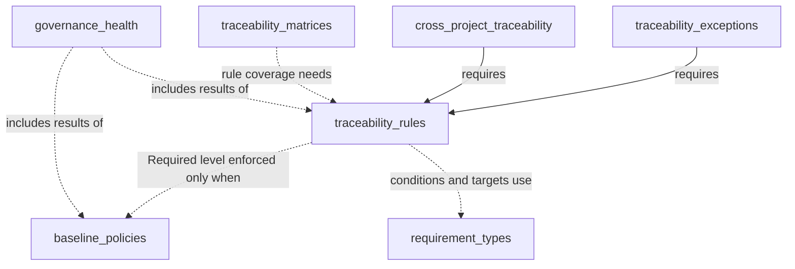
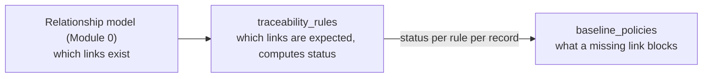
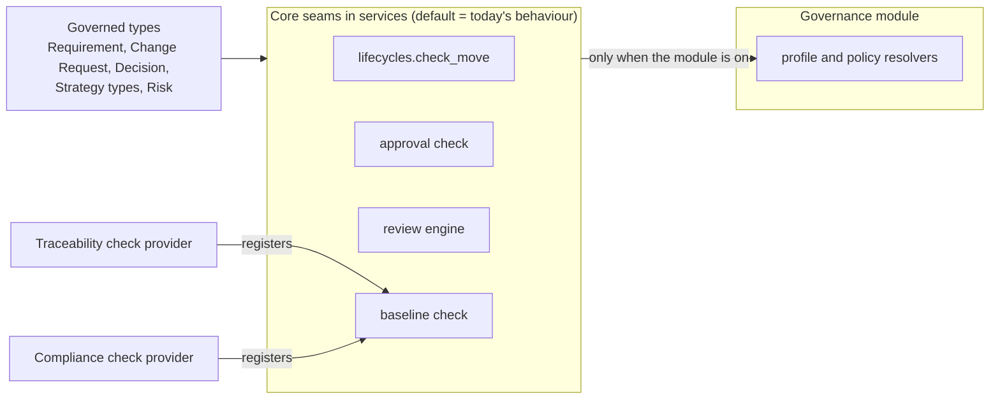

# Module 7 — Traceability & Governance — Implementation Plan

See [future-modules-2026-09-index.md](future-modules-2026-09-index.md) for the
cross-cutting architecture referenced throughout, especially the
relationship-vs-traceability-vs-governance distinction table. The relationship
model comes from [Module 0 — Platform Foundations](completed/module-00-platform-foundations-plan.md);
this module is its heaviest *consumer*.

**Source:** [future-modules-2026-09-overview.md](completed/future-modules-2026-09-overview.md)
§17–28 (Traceability) and §29–36 (Governance), plus §14/11.1 (Requirement Types),
moved here from Module 5 Phase 1, and the requests in
[issue #41](https://github.com/ballardr/reqtrackmanager/issues/41) (Q18). This plan replaces the former separate Module 7
and Module 8 plans; Module 8 is no longer a separate number.

**Status:** Proposed, 2026-11-09. Phase 0 done 2026-11-25. Phases 1, 1b, 2, 3, 4 and 5 done 2026-11-26. **Decision tags:** every
decision says `Decided by: User` or `Decided by: Agent`.

## Status / Resume Here

7 / 19 phases complete. Phase 6 is next.

| # | Phase | Half | Status |
|---|-------|------|--------|
| 0 | Exploratory: audit of existing approval, review and lifecycle code; remaining decisions | both | [x] Done 2026-11-25 |
| 1 | Module skeleton, sub-components, `requires`, engine registration points | shared | [x] Done 2026-11-26 |
| 1b | Governance profiles: organisation policy sets that enforce, default or opt in per project | Governance | [x] Done 2026-11-26 |
| 2 | Lifecycle policies (extend the shipped lifecycle engine) | Governance | [x] Done 2026-11-26 |
| 3 | Approval policies (one check seam plus approver roles) | Governance | [x] Done 2026-11-26 |
| 4 | Review policies (engine extracted from Requirement and Risk reviews) | Governance | [x] Done 2026-11-26 |
| 5 | Baseline policies and the check-provider extension point | Governance | [x] Done 2026-11-26 |
| 6 | Governance Health (on demand and two snapshot modes) + Governance MCP tools | Governance | [ ] Not started |
| 7 | Move existing types onto the engine: 7a Risk reviews, 7b Decisions, 7c Context & Strategy, 7d Requirements, 7e Compliance approval (last, optional) | Governance | [ ] Not started |
| 8 | Governance frontend UI | Governance | [ ] Not started |
| 9 | Governance docs website coverage | Governance | [ ] Not started — depends on Phase 8 |
| 10 | Requirement types (moved from Module 5 Phase 1) | Traceability | [ ] Not started |
| 11 | Traceability rule configuration, including the requirement hierarchy | Traceability | [ ] Not started |
| 12 | Enforcement levels, status and baseline hand-off | Traceability | [ ] Not started |
| 13 | Traceability exceptions | Traceability | [ ] Not started |
| 14 | Cross-project traceability | Traceability | [ ] Not started |
| 15 | Matrices, coverage + Traceability MCP tools | Traceability | [ ] Not started |
| 16 | Traceability frontend UI | Traceability | [ ] Not started |
| 17 | Traceability docs website coverage | Traceability | [ ] Not started — depends on Phase 16 |

The Governance half comes first because the baseline policy's check-provider
extension point (Phase 5) is what Traceability's "Required" level plugs into
(overview §3.1). Each half ships on its own.

## Why one module, and what it costs

Merging the two modules is **Decided by: User** (2026-11-09: combine, "use
sub-modules to allow only using some parts"). The existing sub-component tier
([docs/modules.md](../modules.md) §2a) gives "use only some parts" without a second
module. The two halves share a vocabulary (enforcement level, baseline, exception
approval), one registry of governable types, one settings area and one docs section.

The merge costs, and the plan answers:

- **The old hard edge narrows.** Only Traceability's "Required" level needs Baseline
  policies. Rules, status, matrices and coverage work alone.
- **Sub-components had no dependency declaration.** Fixed by a generic `requires` field (Phase 1).
- **One entitlement and one role set.** Fixed by permission atoms per sub-component.
- **Bigger blast radius per migration and hardening pass.** Mitigated by shipping the
  halves separately, and by moving existing types onto the engine one at a time.

## Decisions (all answered 2026-11-09)

| # | Decision | Decided by |
|---|----------|-----------|
| Q1 | Module key `traceability`, display name "Traceability & Governance" | User |
| Q2 | All sub-components on when the module is switched on; admins opt parts out. The module itself is switched on only through the server default table (`ServerModuleDefault`), never by flipping `ModuleDefinition.default_enabled` | User (the table rule: Agent, from `CLAUDE.md`) |
| Q3 | A generic `requires` field on `ModuleSubComponentDefinition`, resolved in `is_module_subcomponent_enabled`; the toggle UI shows why a part is unavailable | User |
| Q4 | Permission atoms per sub-component, with module roles Traceability Manager and Governance Manager composed from them | User |
| Q5 | The generic engine is **extracted from existing code** (see "Existing implementations"), with an extensible registry of governable types | User |
| Q6 | Full review of what exists, then expand it: Requirements move onto the engine in a planned, verified step (Phase 7d), not left beside it | User ("Do a full review and expand on what exists") |
| Q7 | One review engine generalised from `RequirementReview` and the Risk review logic, then both migrated (7a, 7d) | User |
| Q8 | Governance Health supports on-demand **and** snapshot. A per-project setting picks the mode; on-demand is the default; a perf scenario measures where on-demand becomes slow and the result is shown as guidance in settings. Nothing is forced | User |
| Q9 | ~~Rule schema: one row per AND, a target-type list per OR, plus one optional condition per rule~~ **Superseded by Q19** | User (condition: Agent) |
| Q10 | **Rules are the only hierarchy.** Requirement types are an ordered vocabulary; every "X must trace to Y" relationship, including multi-level chains, is a rule; the hierarchy screen is a tree derived from rules. No separate hierarchy model | User |
| Q10b | Requirement types become their own sub-component `requirement_types`; Module 5 Phase 1 moves here whole | User |
| Q11 | An exception is approved through the Governance approval policy for its type when `approval_policies` is enabled, otherwise through a dedicated approve permission. The requester never approves their own exception. The route stays `APPROVAL_ACTION_ROUTE_EXTRA` (human-only) | User |
| Q12 | Matrices: saved `TraceabilityMatrixDefinition` plus ad hoc views, always generated live | User |
| Q13 | "Required" with `baseline_policies` off is allowed and labelled "not enforced" everywhere; nothing silently pretends to block | User |
| Q14 | Nested-project fallback (the `resolve_effective_action_types` pattern) **and** organisation-level defaults that a project can hide and restore, for policies, rules, matrix definitions and requirement types. **Refined by Q24:** the organisation tier is chosen per table | User |
| Q15 | A traceability exception is a registered artefact type (`TEX-nnn`) | User |
| Q16 | Users and groups on parity: review owners and exception requesters/approvers use the shared principal picker; approval policies name roles, satisfied by a user or a group holding the role | User |
| Q17 | MCP: write-enabled configuration for both halves (needs `MCP_WRITES_ENABLED` and the caller's RBAC); no tool can execute an approval or finalise a blocked transition | User |
| Q18 | [Issue #41](https://github.com/ballardr/reqtrackmanager/issues/41) (a requirement traceability matrix, "derived from" / "source of" columns in the requirements report, and orphan detection in the requirements list) is covered explicitly in Phases 15 and 16. These need no rules: they belong to `traceability_matrices` and work with `traceability_rules` off. "Orphan" means a record with no links of any kind; "no required link" is a separate rule-based status (Phase 12). The list filter and the link columns reach the core Requirements list and export through a generic extension point, never a Requirements-specific edit | Agent (scope from the issue) |
| Q19 | **A rule is a Boolean expression, not a flat row.** "Applies when" and "requires" are each a tree of any number of AND and OR groups, nested up to a depth limit; a condition leaf may be negated. The flat shape of Q9 is the one-leaf case, and the three §19 presets are ready-made trees. Details in Phase 11. | User (2026-11-25: "why can't rules be built up out of logic, using any number of and's and or's"); limits, storage and leaf fields: Agent |
| Q20 | The engine seams (lifecycle move, approval check, review engine, baseline check) live in **core `services/`**, each with the type's current behaviour as the built-in default. The module contributes policy through registered resolvers, so a project with Governance off behaves as today, and no core file imports from `modules/traceability/` | Agent (the Modular Feature System Boundary rule and the `services/lifecycles.py` precedent) |
| Q21 | Phase 2 **extends the shipped lifecycle engine** (`LifecycleDefinition`, `services/lifecycles.py`): registers Requirement and Change Request, surfaces lifecycle settings in Governance. No second transition table, no custom user-defined states | User (2026-11-25) |
| Q22 | Phase 3 is **one approval check seam plus approver roles**: every approval path calls it, the default per type reproduces today's check, a policy names further roles that also satisfy it (another way to grant the same atom). No minimum-approvals (quorum) in this module | User (2026-11-25); consulting the `approve_baseline` atom for Requirements and Change Requests: Agent |
| Q23 | A baseline check that fails **refuses the whole baseline**, listing every failing record and check; nothing is approved or captured | User (2026-11-25) |
| Q24 | The organisation tier is chosen **per table**. Configuration rows (policies, rules, matrix definitions, requirement types) take Q14's hide/restore; settings that are not rows (lifecycle states, approval separation, snapshot mode) keep the requirement-plus-exemption pattern. Each table's phase states which. A configuration row's organisation tier is a profile (Q30) | User (2026-11-25, "both, per table"); the assignment: Agent |
| Q25 | Compliance approval stays with the Compliance module; it moves onto the engine only as the last, optional step 7e | User (2026-11-25) |
| Q26 | Governance Health mode is chosen **per project** from on-demand, snapshot at an interval, and snapshot on change; the organisation sets the default; a manual "Refresh now" exists in both snapshot modes. The interval refresh runs as a `ModuleScheduledJob` on the leader | User (modes, org default: 2026-11-25); job mechanism: Agent |
| Q27 | Phase 7 order: Risk, Decisions, Context & Strategy, Requirements, then 7e | User (2026-11-25) |
| Q28 | `requires`: a dependent sub-component is ineffective, never deleted, when its requirement is off, and the toggle says why | User (2026-11-25) |
| Q29 | Permission atoms: see Phase 0 result 6 | Agent |
| Q30 | **Governance profiles** are how an organisation sets policy for projects. A profile is a named set of policy rows (lifecycle, approval, review, baseline, traceability) with a mode and a target. Modes: **Enforced** (binds every targeted project; only a named exemption lifts it), **Default** (applies unless the project opts out), **Opt-in** (applies only where the project chooses it). Targets: all projects, an explicit project list, or a project with its nested children. A project may hold several profiles. This is the organisation tier that Q14 and Q24 refer to for configuration rows | User (2026-11-25: org policies for projects, enforceable on all, different policies for different kinds of project, some exempt, some opt-in; profiles chosen from three options); merge rules and exemption shape: Agent |

## Sub-components

| Key | Half | Contains | Needs (`requires`) |
|-----|------|----------|-------|
| `lifecycle_policies` | Governance | Transition rules per artefact type | — |
| `approval_policies` | Governance | Role-based approval per artefact type | — |
| `review_policies` | Governance | Scheduled reassessment | — |
| `baseline_policies` | Governance | Pre-baseline checks, check-provider registry | — |
| `governance_health` | Governance | Live and snapshot aggregate view | — (shows what is enabled) |
| `requirement_types` | Traceability | Ordered requirement type vocabulary | — |
| `traceability_rules` | Traceability | Rules, requirement hierarchy view, status, enforcement levels | — |
| `traceability_exceptions` | Traceability | Exceptions with approval | `traceability_rules` |
| `traceability_matrices` | Traceability | Matrix definitions, coverage | — (coverage by rule needs `traceability_rules`) |
| `cross_project_traceability` | Traceability | Links and rules across nested projects | `traceability_rules` |

Solid: the sub-component cannot be effective without the other (its data is kept
when the requirement is switched off). Dotted: works alone; richer together, and the
UI says what is not enforced or not shown.

### Responsibility boundary (unchanged by the merge)

Traceability computes and exposes status and never blocks anything. Baseline
policy is the only place that blocks. Traceability code never calls a transition, and
Governance code never reads a rule table directly: it consults registered check providers.

## Existing implementations (audit, 2026-11-25)

Read in full for Phase 0 (`backend/app`). "Atom" is a permission atom (`services/permissions.py`).

| Type | Who may approve | State path | Review | Registered lifecycle |
|---|---|---|---|---|
| Requirement | Project Manager role through `get_effective_project_roles`; the `requirement:approve_baseline` atom is **not** consulted; MCP needs `require_ai_approvals_enabled` | Draft, Reviewed, Approved (locks edits; change through a change request), Archived; completion is an overlay flag | `RequirementVersion.review_date`, `reviewer_*`, `review_lead_days`; `RequirementReview` rows (Met, Failed) | None |
| Change Request | Project Manager role (`_require_project_manager`), MCP gate, row lock, separation | Submitted, In review, Approved, Rejected | None | None |
| Decision | Atom `(decision, approve_baseline, <Decision Type>)`, server admin bypass, MCP gate, row lock, separation; Reject needs a comment | Draft, Proposed, Under review, Approved (+ later states) | None | Yes (`modules/decisions/lifecycles.py`) |
| Context & Strategy (Strategy, Future State, Guiding Principle; org and project scope) | Module `*_approver` role **or** the type's atom, server admin bypass, separation; send-back needs a comment | Draft, Proposed, Under review, Approved, Active, Superseded, Retired | None | Yes |
| Risk | Accepted is gated by the `risk_acceptor` role; separation applies | Identified to Closed with optional treatment steps | `RiskVersion.review_date`; `RiskReview` rows with a rating snapshot | Yes |
| Compliance requirement assessment | Compliance officer role, MCP gate | `PENDING_APPROVAL`, `APPROVED`, `REJECTED` (`approval_state`) | Own reviews | No |

Shared today: `require_ai_approvals_enabled` (MCP channel), `APPROVAL_ACTION_ROUTE_EXTRA`, `services/approval_separation.py`
(creator may or may not approve, org requirement, exemptions), `services/lifecycles.py` (`check_move`, optional states,
organisation requirements, exemptions, skip steps), `services/audit.py`, atoms `manage_org_lifecycles` and
`manage_project_lifecycles`.

Principle for every migration (Phase 7): **the default policy for each type is today's behaviour**, so a project that
configures nothing behaves identically, and the existing test suite is the regression bar. The suites that pin it:
`tests/test_requirement_lifecycle.py`, `test_review_scheduling.py`, `test_stage_review_and_completion.py`,
`test_stage_workflows.py`, `test_approval_separation.py`, `test_ai_approvals_via_mcp.py`, `test_lifecycles.py`,
`test_api_lifecycles.py`, `test_lifecycle_skip.py`, `test_change_request_*`; per module `test_decisions_workflow.py`,
`test_decisions_ai_approvals_via_mcp.py`, `test_risk_lifecycle.py`, `test_risk_reviews.py` and the Context & Strategy API
suites.

## Phase 0 — Exploratory: audit and remaining decisions (done 2026-11-25)

**Why this phase exists:** the Governance engine is extracted from live, SOC 2 relevant code, so it had to be read in full
before any design was fixed. Approval is an access control, so `docs/soc2/policies/access-control-policy.md` and the
change-management policy bind it. Phase 0 changed no code.

### Result 1: behaviours the engine must reproduce exactly

1. **Requirement approval has four paths**, all ending in `RequirementStatus.APPROVED`: `POST .../approve`
   (`routers/requirements/workflow.py`), a full edit with status approved (`routers/requirements/core.py`), `decide_change_request`
   and the stage baseline (`services/baseline.py`, which approves every Draft or Reviewed requirement in bulk, rows locked in id
   order, the whole baseline refused when separation fails for one). Each applies approval separation.
2. `approve`: the role check runs **before** the existence check (403 before 404); the MCP gate follows; the version is locked
   for update; only Draft or Reviewed may be approved (409); the new version's change note reads "Approved directly" or
   "Approved via MCP" plus the comment; one `approved` audit event carries `via` and `comment`; a pubsub notice follows.
3. Decisions and Context & Strategy bypass for a server administrator; Requirements and Change Requests have no such branch.
4. Reject and send-back need a comment (Decision, Strategy types, a failed requirement review).
5. A **failed requirement review clears the completion overlay** with its own audit event (`completion_cleared_by_review`).
6. A requirement review does **not** move `review_date`; the requirement leaves the due list because a review dated on or
   after `review_date` exists. A Risk review **does**: it writes a new version with the next review date (required, in the
   future). The two schedule models differ and the engine must support both.
7. Reminders: requirements notify the reviewer principal (every member of a group) or, if nobody can be notified, the
   project managers, once per version (`review_reminder_sent_at`), starting `review_lead_days` (default
   `Project.review_reminder_lead_days_default`, 7) before the date. Risks send "due soon" (7 days, fixed) and "overdue", once
   per date (`*_notified_for`).
8. Review gate: the assigned reviewer (or a member of the reviewer group) or a project manager.
9. A baseline captures requirement versions plus every module snapshot provider's records; a manual baseline approves and
   locks nothing.

### Result 2: findings that change the plan

| # | Finding | Consequence |
|---|---|---|
| F1 | Lifecycle configuration and approval separation shipped on 2026-11-24, after this plan was written | Q21: Phase 2 extends them; Phase 3 builds on `approval_separation` |
| F2 | Requirements and baselining are **core**; a core file may not import from `modules/traceability/`, and Governance can be switched off | Q20: the seams live in core `services/` with today's behaviour as the default; the module only registers resolvers |
| F3 | The `requirement:approve_baseline` atom exists in the vocabulary but no Requirement or Change Request path consults it, so a custom role holding it cannot approve (fails closed) | Phase 3's seam consults the atom as an additional grant; this is an access-control change, so Phase 3 re-reads the access-control policy and logs the review. Recorded here, not changed in Phase 0 |
| F4 | A stage baseline **is** the approval act for drafts | A "required approvals" check cannot demand approval before the baseline that grants it. For requirements in a stage baseline it means every approval step the type's policy needs beyond the baselining actor; for a manual baseline and for module records it demands the record is already approved. Phase 5 states this per check |
| F5 | Due-date code compares against the server date (`date.today()`, `datetime.now(UTC).date()`) and one query compares a timestamp with a date | Phase 4: a calendar date compared interactively uses `effective_today()`; the sweep has no caller, so it uses the UTC date and says so |
| F6 | The requirement reminder sweep is a core job in `services/scheduler.py`; modules register jobs through `ModuleScheduledJob` | The review engine is a core service; its single sweep stays core and consumes each type's registered adapter; Governance Health's snapshot job is a `ModuleScheduledJob` |
| F7 | Action-to-requirement membership is an **untyped** `ArtefactLink` with the action as source | A rule's requirement leaf needs a direction and an "untyped" link choice |
| F8 | `ModuleDefinition.subtype_providers` returns names for permission atoms only; nothing maps a record to its sub-type | Phase 1 adds a generic record sub-type provider (`record -> sub-type key`), so a rule can say "Project Requirement" or "Verification action" |
| F9 | The Compliance Requirement is not a registered artefact type | A rule can target it only after Module 9 Phase 1; the Traceability acceptance criterion reads "once registered" |
| F10 | Health aggregates could reveal counts of records a viewer may not open | Phase 6: Health counts only types the viewer holds `view` on, in modules enabled for the project |
| F11 | The plan's "governable-type registry" would be a fourth list beside `lifecycles`, `baseline_snapshots` and the approval gates | No separate list: a type is governable by the registrations it already has plus the new `review_adapters` and `baseline_check_providers` |
| F12 | The overview asks for organisation policy that can be enforced and can differ per kind of project; the product has no project type | Q30: governance profiles (Phase 1b) |

### Result 3: engine seams

Each seam asks its registered resolvers for the policy that applies, and falls back to the type's built-in default when
Governance is off, no resolver answers, or the project configures nothing.

### Result 4: rule schema checked against the overview (§18, §19, §21, §23)

| Example | Expressed as |
|---|---|
| Project Requirement, Derived From, Stakeholder Requirement, min 1, mandatory (§18) | Source (requirement, sub-type Project); one leaf: link type Derived From, outgoing, target (requirement, sub-type Stakeholder), min 1; level Required |
| No linking required (§19) | No rule, or an Informational rule |
| Type linking required | One leaf, one target type |
| Type and/or Compliance | One leaf whose target set holds both types (OR), or an `any` group of two leaves |
| Required one of several, or all of several, minimum and maximum, specific link types | `any` or `all` groups, `min`/`max` on a leaf, a link-type set on a leaf |
| Business Requirement AND Verification Action (§19) | An `all` group of two leaves; the verification leaf is incoming, **untyped**, from (action, sub-type Verification) (F7) |
| Conditional rule | `applies_when` tree, for example sub-type is Project AND component is X |
| Multi-level chain (§23) | One rule per level; the hierarchy view is a tree derived from rules |
| Per-requirement checkmarks (§21) | One result per leaf, shown against the leaf's label |

The `is_mandatory` column of Q9 is dropped: the enforcement level carries it (Informational is optional).

### Result 5: relationship model

`create_link` validates both ends only against the registry (`get_all_registered_artefact_types`), link-type source and target
restrictions are optional (`None` = any type), and cross-level links carry `source_project_id`/`target_project_id`. Arbitrary
type pairs need no per-pair code. **Module 5:** its plan confirms nothing in its Phases 2 and 3 depends on type order carrying
hierarchy meaning.

### Result 6: permission atoms (Q29)

Existing atoms `manage_org_lifecycles` and `manage_project_lifecycles` stay for lifecycle settings and approval separation.
New administrative atoms, added to `ADMINISTRATIVE_PERMISSIONS`:

| Atom | Covers | Held by |
|---|---|---|
| `manage_org_governance` | Profiles, and organisation-level approval, review and baseline policy | Organisation administrators; module role Governance Manager (organisation scope) |
| `manage_project_governance` | A project's approval, review and baseline policy, profile opt-in and opt-out, Health mode | Project administrators and managers in their project; module role Governance Manager (project scope) |
| `manage_org_traceability` | Organisation requirement types, rules, matrix definitions | Organisation administrators; Traceability Manager (organisation scope) |
| `manage_project_traceability` | A project's requirement types, rules, enforcement, matrices | Project administrators and managers; Traceability Manager (project scope) |
| `approve_traceability_exceptions` | Approving an exception when `approval_policies` is off (Q11) | Project managers; a custom role |

Exceptions use the ordinary record atoms (`traceability_exception:*`). The requester never approves their own exception.

### Result 7: open items, resolved

Compliance approval: stays with Compliance, optional 7e (Q25). Rule conditions: boolean trees (Q19). Snapshots: per project,
two modes, organisation default (Q26). Migration order: Q27. `requires`: Q28. Module 5: confirmed (Result 5).

**Exit criteria met:** audit complete, every open item answered by the user, results above.

## Phase 1 — Module skeleton, sub-components, engine registration hooks (done 2026-11-26)

**Scope:** `backend/app/modules/traceability/` and `frontend/src/modules/traceability/`;
`ModuleDefinition` with the ten `sub_components`; the `requires` field with tests across the project, organisation and
registry tiers (Q28: ineffective, data kept, the toggle says why); the new generic registration fields on
`ModuleDefinition` and their registries in `modules/registry.py`: `review_adapters`, `baseline_check_providers`,
`record_subtypes` (F8), policy resolvers for the seams of Result 3; the five administrative atoms of Result 6 and the two
module roles. No separate governable-type list (F11).

**Why / risk / outcome:** one registration point so later phases add behaviour without touching core files. The risk is the
core-boundary failure mode: no core file imports from `modules/traceability/`, and no per-module value is added to a core
enum or column. Outcome: the module can be enabled with every part independently switchable and dependency-checked.

**Built (account in `docs/decisions.md`, "Module 7 Phase 1"; contracts in `docs/modules.md` §2a and §4l16):**

- `backend/app/modules/traceability/` and `frontend/src/modules/traceability/module.ts`: ten sub-components, `requires` on
  `traceability_exceptions` and `cross_project_traceability`, four role definitions, `default_enabled=False`.
- `requires` on `ModuleSubComponentDefinition`, resolved at the project and organisation tiers, validated when
  `ModuleDefinition` is built, reported as `blocked_by` by both sub-component list endpoints and shown by
  `ModuleSettingsList` ("Inactive until X is on.").
- `modules/seams.py` (contracts) and `services/governance_seams.py` (project resolution): `policy_resolvers`,
  `baseline_check_providers`, `review_adapters`, `record_subtypes` and `administrative_permissions` on `ModuleDefinition`; core
  registers the requirement action's type (`services/record_subtypes_core.py`).
- **Deviation from this plan's wording:** the five atoms are `ModuleDefinition.administrative_permissions`, not additions to core's
  `ADMINISTRATIVE_PERMISSIONS` (that would hand-edit a core file per module). The seam contracts are minimal; Phases 2 to 5
  extend them. Not built here, by design: the requirement sub-type (Phase 10), any seam consumer (Phases 2 to 5, 7).
- Tests: `tests/test_module_subcomponent_requires.py`, `tests/test_governance_seams.py`,
  `app/modules/traceability/tests/test_traceability_module.py`; stories for `ModuleSettingsList`, Org Admin and Project Admin;
  Playwright `traceability-sub-component-requires.spec.ts`.

## Phase 1b — Governance profiles

**Scope** (Q30): `GovernanceProfile` (organisation-owned: name, mode Enforced, Default or Opt-in, target), its targets
(all projects, an explicit project list, a project with its nested children), per-project opt-in and opt-out, and named
exemptions from an Enforced profile (as `OrganizationLifecycleExemption`, with "include nested projects"). A profile
contributes policy rows through the `profile_id` column each policy table carries; the profile mechanism itself holds no
policy. The resolver contract (a `ProfileContributor` registered on `ModuleDefinition`) lets each later phase's table take
part, so the profile screens and bundles need no per-table code.

**Resolution:** a project's effective policy is, for each policy kind: the Enforced profiles that target it (an exempt
project is skipped), then its own opted-in and Default profiles it has not opted out of, then its own rows, then the nearest
ancestor project's (the nested fallback), then the built-in default. An Enforced profile beats a project's own choice and
cannot be relaxed by an import. Where two profiles set the same policy, each kind states its merge rule in its own phase and
the UI names the winning source.

**Design decisions to record in `docs/decisions.md`:** profile changes write one audit event each (keys only); an
organisation administrator or `manage_org_governance` holder manages profiles, `manage_project_governance` opts a project
in or out; the profile list, targets, exemptions and each project's chosen profiles travel in the organisation and project
bundles (an import never relaxes an Enforced profile); profiles are organisation configuration, not project template content
(`template_configuration_keys` for the project's opt-ins).

**Why:** the organisation needs one place to say "every regulated project runs these policies, some projects are exempt,
others may choose them", without repeating targeting on each table. The profile screens themselves ship in Phase 8.

**Built (account in `docs/decisions.md`, "Module 7 Phase 1b"; contract in `docs/modules.md` §4l17):**

- `modules/traceability/`: `models.py` (`governance_profiles`, `_targets`, `_exemptions`, `_choices`), migration `0210`,
  `profile_resolution.py` (the one outcome rule: `enforced`, `exempt`, `default`, `opted_out`, `opted_in`, `available`,
  `not_targeted`; `applicable_profiles`), `profiles.py` (writes, one audit event each), `router.py` (organisation API,
  `manage_org_governance`), `project_router.py` (a project's view and choices, `manage_project_governance`), `bundle.py`.
- **Deviations from this plan's wording (Decided by: Agent):** two target kinds (`all_projects`, `selected_projects`) with
  `include_children` per target express the three targets; exemptions belong to Enforced profiles only and choices to
  Default (opt out) and Opt-in (opt in) only; a project's choice never reaches its children; a profile may be targeted at
  no project yet.
- Generic extension points: `ModuleDefinition.profile_contributors` (`ProfileContributor`) and
  `ModuleOrgBundleHooks.export_with_projects` / `import_with_projects` (organisation content that names projects).
- Not built here, by design: the profile screens, their stories and Playwright specs (Phase 8), the policy tables that
  register a contributor (Phases 2 to 5), MCP tools (Phase 6) and the docs website page (Phase 9).
- Tests: `modules/traceability/tests/test_governance_profiles.py` (API, permissions, outcomes, order, audit, contributors)
  and `test_governance_profiles_bundle.py` (organisation round trip, merge, project choices, Enforced never relaxed).

## Phase 2 — Lifecycle policies (`lifecycle_policies`)

**Scope** (§31, Q21): extend `LifecycleDefinition` and `services/lifecycles.py`, never a second transition table. Register
Requirement and Change Request (neither has a definition today; their state enums, locks and content guards stay with them,
and the path, optional states and gated state are declared from the code the audit read). Surface the shipped settings
(optional states, organisation requirements, exemptions, skip steps) in the Governance settings and Health. Custom
user-defined states are out: each type's state enum drives guards, locks and content checks. The organisation tier is the
shipped requirement-plus-exemption pattern (Q24); a profile (Phase 1b) may carry the same settings as part of a set.

**Built (account in `docs/decisions.md`, "Module 7 Phase 2"; contract in `docs/modules.md` §4l15 and §4l17):**

- `services/lifecycles_core.py` registers `requirement` (Draft, Reviewed optional, Approved gated; Archived off the path) and
  `change_request` (Draft, Submitted, Approved gated; Rejected, Withdrawn and In review off the path; no optional state), merged by
  `get_lifecycles` with module key `""`. Their transition tables are the moves the endpoints allow, pinned by
  `tests/test_core_lifecycles.py`, which drives the real API.
- **Enforcement waits for 7d** (**Decided by: User**, "we aren't shipping prior"): neither type's endpoints call `check_move` yet,
  so a requirement's Reviewed switch is stored and has no effect until Phase 7d.
- **Profiles carry lifecycle policy** (**Decided by: User**): `governance_lifecycle_requirements` and
  `governance_lifecycle_skip_policies` (added to unreleased migration `0210`; a local database that already ran it needs a reset),
  `modules/traceability/lifecycle_policy.py` (writes, the seam answer, the `lifecycle` `ProfileContributor`) and
  `GET`/`PUT /profiles/{id}/lifecycle[/{type}|/skip]` under `manage_org_governance` and the `lifecycle_policies` part.
- **Seam contract reshaped** (Agent): `PolicyResolver` gives exactly one of `resolve` and `resolve_project`; `LifecyclePolicy` and
  `governance_seams.resolve_project_policy` are the lifecycle answer. `services.lifecycles` unions the organisation's and every
  applicable profile's required states and bans on skipping; the project response names the sources (`required_by_profiles`,
  `skip.forbidden_by_profiles`).
- **Deviation from this plan's wording:** "surface in the Governance settings and Health" is the API and the typed response fields;
  the screens are Phase 8 and Health is Phase 6.
- Tests: `modules/traceability/tests/test_governance_lifecycle_policy.py`, `tests/test_core_lifecycles.py`, the extended
  `tests/test_governance_seams.py`; the existing lifecycle, approval separation and profile suites pass.

## Phase 3 — Approval policies (`approval_policies`)

**Scope** (§32, Q22): one core function every approval path calls, replacing the five hand-written checks (the four
Requirement paths, Change Request decide, Decision, the Context & Strategy types, Risk acceptance). The default per type
reproduces today's check exactly (Result 1), including the 403-before-404 order and the server-administrator behaviour. A
policy (project row or profile row) names further roles (module, project or custom) that also satisfy the check, so it is
another way to grant the same atom, never a competing path; Decision Management's `(decision, approve_baseline, subtype)`
binding is unchanged. The seam also consults `requirement:approve_baseline` for Requirements and Change Requests (F3).
Group-held roles count through effective membership (`services/rbac.py`); policies name roles, never people. Approval
separation, the MCP gate and `APPROVAL_ACTION_ROUTE_EXTRA` stay where they are and run from the seam. No minimum-approvals
(quorum) feature.

**Why:** without centralising this, each approval path keeps drifting independently. **Security:** the access-control policy
is re-read first, and the F3 change and the identify, verify, remediate review go in `docs/decisions.md`.

**Built (account in `docs/decisions.md`, "Module 7 Phase 3"; contract in `docs/modules.md` §4l17):**

- Core `services/approval_policy.py`: `require_approver` / `may_approve` (the caller's default, then the type's `approve_baseline` atom, then the policy's roles), `holds_role` (project, module, custom; held, never composed, through new `rbac.user_holds_module_role` and `held_custom_role_ids`), the role vocabulary (`role_options`, `validate_roles`). `seams.ApproverRole` and `ApprovalPolicy` are the seam's answer.
- Paths on the check, each keeping its default and message: Requirement `approve` and edit-to-Approved (`require_requirement_approver`), Change Request decision and preview, Decision, Strategy, Future State, Guiding Principle, Risk acceptance. F3 is closed: the atom is consulted for Requirements and Change Requests.
- **Stage locking (Decided by: User):** policy roles for `requirement` may also enter or leave a locked phase of a stage or component track, and make no other move (`stage_workflows.may_lock_phases`, `rbac.require_project_manage_or`, `ProjectStageOut.can_lock`). This was the agent's recommendation to refuse; recorded for review.
- Module: tables `governance_approval_policies` and `_roles` (unreleased migration `0210`, edited in place: a local database that already ran it needs the two tables), `approval_policy.py` (writes with audit, `GovernanceSeam.APPROVAL` resolver, `approval` contributor, project bundle rows), profile and project routes, `activity_metadata_types`, `template_configuration_keys` extended.
- **Deviations from this plan's wording (Decided by: Agent):** no minimum-approvals feature (as Q22); a project's own row (not only a profile's) carries roles, with the nested fallback per type; pain points and open questions have no approval gate and are unchanged.
- Not built here, by design: the screens, their stories and Playwright specs (Phase 8), MCP tools (Phase 6), the docs website page (Phase 9), moving each type's own checks into one registry (Phase 7).
- Tests: `modules/traceability/tests/test_governance_approval_policy.py` (routes, validation, every path, separation, held roles, profile tiers, nested fallback, stage and track locking, bundles), `tests/test_approval_policy_seam.py` (the seam with no Governance module); the existing approval, stage, baseline, decision, risk and strategy suites pass unchanged.

## Phase 4 — Review policies (`review_policies`)

**Scope** (§33): interval, owner, due date, reminder, outcome, next review date, generalised
from `RequirementReview` and the Risk review logic (Q7). Due dates are calendar dates
(`date`, a person's calendar date). Interactive due lists compare with `effective_today()`; the single daily sweep has no
caller, so it compares with the UTC date and the reason is stated in code and docs (F5). Owners are principals (Q16). The
engine is a core service (Q20) that takes a type's `ReviewAdapter` (how its schedule is stored, how a review resets it:
Requirement leaves the date and relies on a later review, Risk writes the next date, and what each notifies), so both
existing models are expressible. The default policy has no interval, so Requirements keep today's behaviour; an interval is
optional and additive. The core reminder sweep becomes one job over the registered adapters. Test the boundary hours (a due
date at UTC+10 and UTC-8).

**Built (account in `docs/decisions.md`, "Module 7 Phase 4"; contract in `docs/modules.md` §4l17):**

- Core `services/review_engine.py`: `review_policy` (the seam answer, default none), `due_reviews`, `send_review_reminders` (the one
  sweep over adapters: record's reviewer, else the policy's default owner, else the project managers), `next_due_date`,
  `check_next_review_date`, `reminder_lead_days`, `reminder_open`. `ReviewAdapter` gained `pending_reminders`, `mark_reminded`
  and `notification_type`; `ReviewPolicy` and `ReviewReminder` are new. The requirement's adapter is core
  (`services/reviews.py`, `CORE_REVIEW_ADAPTERS`, module key `""`); the existing requirement review tests pass unchanged.
- Module: `GovernanceReviewPolicy` (unreleased migration `0210`, edited in place: a local database that already ran it needs the
  table), `review_policy.py` (writes with audit, the `GovernanceSeam.REVIEW` resolver, the `review` contributor, project bundle
  rows), profile and project routes, a `PrincipalReference` for the default owner.
- **The interval is engine-only until 7a and 7d (Decided by: User, 2026-11-26).** The policy stores and merges it and the engine
  offers the scheduling rules, but no shipped type applies it yet. The policy also carries a reminder lead and a default owner
  (Decided by: User), which take effect on requirements now.
- **Defect fixed:** a review was compared as an instant with the due date as UTC midnight, leaving a requirement reviewed on its due
  morning at UTC+10 overdue; a review now clears a due date once the date has begun anywhere (UTC+14). The due lists compare with
  `effective_today()`, the sweep with the UTC date.
- **Deviations from this plan's wording (Decided by: Agent):** Risk keeps its own reminder sweep and registers no adapter until 7a
  (its "due soon" and "overdue" notices, once per date, extend the contract then); the requirement review route and the
  requirement's review-date writes stay where they are until 7d.
- Not built here, by design: the screens (Phase 8), MCP tools (Phase 6), the docs website page (Phase 9), moving Risk (7a) and the
  requirement review route (7d).
- Tests: `modules/traceability/tests/test_governance_review_policy.py` (routes, validation, merge, nested fallback, the sweep's lead
  and default owner, audit, bundles); `tests/test_review_engine.py` (the core engine without the module: default sweep, boundary
  hours, interval and lead rules, a second schedule model through a fake adapter); the existing review, principal, lifecycle,
  approval and seam suites pass.

## Phase 5 — Baseline policies and check providers (`baseline_policies`) (done 2026-11-26)

**Scope** (§34): configurable pre-baseline checks (required fields, required approvals,
traceability, verification, compliance), none mandatory per project, resolved through the
check-provider registry. Built-in providers: required fields and required approvals.
Traceability (Phase 12) and Compliance (Module 9) register theirs through the same hook. The check seam is core
(`services/baseline.py` calls it); the module supplies which checks a project's policy enables. A failing check **refuses the
whole baseline** and lists every failing record and check (Q23); nothing is approved or captured. A policy chooses whether it
applies to stage baselines, manual baselines or both (default: stage only, since a manual baseline approves and locks
nothing). What "required approvals" means in a stage baseline is Result 2 F4. Stage baselining is a consumer, moved in Phase 7d.

**Why:** the rule says a link is required; the baseline policy says a missing link blocks
baselining. Without it Traceability would be purely informational.

**Built (account in `docs/decisions.md`, "Module 7 Phase 5"; contract in `docs/modules.md` §4l17):**

- Core `services/baseline.py`: `active_checks`, `check_baseline`, `preview_checks` (reused by Phase 6), `BaselineRefused` and
  `refusal_detail`. Stage and manual baselines run the enabled checks before anything is approved or written; a failure is a 409
  whose `detail` is `{message, failures[]}` from the stage transition, the component track transition and the manual baseline
  route. With checks enabled the module records are captured once and the same capture is stored.
- Seam: `BaselinePolicy(stage_checks, manual_checks)` through `GovernanceSeam.BASELINE`; `BaselineCheckFailure.code`; an empty
  `BaselineCheckProvider.artefact_types` means every type the baseline holds.
- Module: tables `governance_baseline_policies`, `_checks` and `_required_fields` (unreleased migration `0210`, edited in place:
  a local database that already ran it needs the three tables), `baseline_policy.py` (writes with audit, resolver, `baseline`
  contributor, project bundle row `governance_baseline_policy`, template configuration), `baseline_checks.py` (the two checks),
  profile routes `/profiles/{id}/baseline[/fields]`, project routes `/baseline-policy` and the preview `/baseline-checks`.
- **Required fields are any type's list columns (Decided by: User)**, custom fields included; **the review-deadline sweep skips a
  refused stage, retries daily and notifies the managers once per distinct set of failures (Decided by: User)**, through the new
  notification type `stage_baseline_refused`, switched by the baseline policy's `notify_managers` flag (default on, any
  applying policy asking for it keeps it on) and then each person's own preference for it.
- **Required approvals (Decided by: Agent, F4):** a stage baseline checks that the person may approve requirements and that
  separation allows each draft they created; a manual baseline needs approved requirements. A guard test fails when a type gains
  both an approval gate and a snapshot provider without an entry.
- **Deviations from this plan's wording (Decided by: Agent):** a policy keeps `applies_to_stage` / `applies_to_manual` per source
  (stage by default); a preview route is added for the screens and Health; a defect found on the way is fixed: one stage the
  approval rules refused (a required separate approver) stopped the whole review-deadline sweep.
- Not built here, by design: the screens (Phase 8), the check providers of Traceability (Phase 12) and Compliance (Module 9), MCP
  tools (Phase 6), the docs website page (Phase 9), and moving the stage baseline's own approval onto the engine (7d).
- Tests: `modules/traceability/tests/test_governance_baseline_policy.py` (routes, validation, merge, nested fallback, both checks
  end to end, kinds, preview, bundles) and `tests/test_baseline_checks.py` (the core seam with a fake module and no Governance:
  default, whole-baseline refusal, single capture, kinds, preview, the sweep and its notice); the existing baseline, stage,
  component stage, approval and seam suites pass.

## Phase 6 — Governance Health (`governance_health`) + Governance MCP tools

**Scope** (§35): percentage complete per governed category, open-question count, plus the
results of whichever check providers are enabled. Three modes (Q8, Q26): on-demand, snapshot at an interval, and snapshot
on change, chosen per project with the organisation setting the default; snapshots are labelled with their time, the
interval refresh is a `ModuleScheduledJob` on the leader, a change marks the snapshot stale and recomputes it lazily, and
"Refresh now" is offered in both. Health counts only record types the viewer holds `view` on (F10). A perf scenario in `perf/loadgen/scenarios.py` (with its budget rule) measures where on-demand becomes slow, and its
result sets the guidance threshold shown in settings.

**MCP tools** (the MCP and docs-website treatment for every unbuilt module is **Decided by:
User**, 2026-09-21; placement and names **Decided by: Agent**): policy configuration and "get
governance health", per [docs/modules.md](../modules.md) §6, write-enabled per Q17. **No tool
may execute an approval:** a content module's `approve`/`reject` route, or any override that
finalises a blocked baseline or transition, is marked
`openapi_extra=APPROVAL_ACTION_ROUTE_EXTRA`, which excludes it from the manifest wherever
it physically lives. Update the module's `mcp_guidance.md` and run
`python scripts/generate_mcp_module_tools_reference.py` in `backend/`.

## Phase 7 — Move existing types onto the engine

One verified step per type, each its own change with its own decisions-log review
(identify → verify → remediate), in the order of Q27. Each step: the default
policy reproduces today's behaviour; the type's existing tests pass unchanged; a parity test
runs the old and new paths on the same inputs; the audit events, notifications and locks are
identical; the SOC 2 access-control policy is re-read before the approval path changes.

| Step | Type | What moves |
|---|---|---|
| 7a | Risk | Review scheduling onto the review engine |
| 7b | Decisions | Approval and lifecycle rules onto the engine, keeping the permission atom |
| 7c | Context & Strategy | Approval and lifecycle rules |
| 7d | Requirements | Lifecycle, all four approval paths (the hard-coded project-manager check becomes the default policy), Change Request decide, stage baselining and review. Highest regression risk |
| 7e | Compliance approval | Optional, last (Q25): only if the engine has proven itself; until then Compliance keeps its own approval and registers a check provider |

## Phase 8 — Governance frontend UI

Project settings surfaces for each policy category, following the UX style guide's
settings-hierarchy-depth model and organisation-defaults pattern, the organisation's profile screens (create a profile, set
its mode and target, add exemptions, see which projects it binds and which have opted in or out), a project's view of which
profile set each policy and why, plus the Governance Health view with its mode setting. Module-contributed through `TierAModuleDefinition`
render-prop fields. Sub-component toggles show their dependencies. Playwright e2e and
Storybook coverage; label maps; `help` on every non-obvious field.

## Phase 9 — Governance docs website coverage

Tracked as its own phase (**Decided by: User**, 2026-09-21; scope **Decided by: Agent**).

- A page in `docs/website/docs/modules/`: what Governance is and is not, profiles (enforced, default and opt-in, targets and
  exemptions), the four policy categories and the types each governs (an extensible registry), roles not individuals,
  the sub-components and how to turn parts off, Health in both modes, and that Requirements
  now run on the engine with their previous behaviour as the default policy.
- A Mermaid diagram of how a rule-satisfaction signal feeds a baseline policy's decision.
- Update the module index and the roadmap page.
- Screenshots per the docs-website standard (1440×900, seeded demo data, alt text plus a
  one-line caption, no explanatory prose): baseline policy settings and the Health view.

**Status:** not started; depends on Phase 8.

## Phase 10 — Requirement types (`requirement_types`)

Moved from Module 5 Phase 1 (**Decided by: User**, 2026-11-09). **Scope** (§14/11.1):
`RequirementTypeDefinition` (net-new; no existing enum to migrate), seeded Business /
Stakeholder / Project defaults at root projects only, a nullable `type_id` on `Requirement`,
ordered and enable/disable-able, on the shared `TypeVocabulary` with an organisation tier,
project hide/restore and nested fallback (Q14). The order drives display and default report
order only: **it carries no hierarchy meaning** (Q10). Create and edit share one field group;
list filter, export/import column, search field and report field come with the
registration.

**Why:** a fixed three-tier structure cannot represent the two- or four-tier structures
organisations use, and the hierarchy itself belongs to rules.

## Phase 11 — Rule configuration (`traceability_rules`)

**Scope** (§17-19, §23, §28, Q19): per-project enablement through the sub-component tier; `TraceabilityRule` CRUD.

A rule has a **source** (artefact type and optional sub-type, through `record_subtypes`), an optional **applies when**
tree, a **requires** tree and one **enforcement level**. A tree node is `all` (AND), `any` (OR) or, in `applies when` only,
`not`. Leaves:

- *applies when*: a registered condition field (sub-type, component, category, tag; a type may register more, such as
  status), an operator and a value.
- *requires*: a link-type set (or "any", or "untyped"), a direction (outgoing or incoming), a target set of (artefact type,
  optional sub-type) counted together, and `min`/`max`.

Limits (Agent): depth 4, 25 nodes. Stored as a validated, versioned JSON document per rule; types are referenced by id
and exported by name. Evaluation runs one bulk grouped query per leaf for the project's source records and combines the
leaf results per record, so the statement count grows with leaves, never with records (the scaling probe guards it); each
record keeps its leaf results for the §21 checkmarks. The three §19 presets are ready-made trees over the full editor, and
multi-level hierarchies are one rule per level with a derived tree view. Rows are organisation configuration through a
profile (Q30) with hide and restore (Q14) and take the nested fallback.

**Why:** enabling or disabling Traceability changes only whether rules are evaluated, never
whether relationships exist or can be created. Test that first: a project with the part off
behaves identically for relationship creation to one that never enabled it. Also test a tree that is deep, wide, and
conditional on a sub-type of a record in an ancestor project.

## Phase 12 — Enforcement levels, status and baseline hand-off

**Scope** (§20–21): Informational / Warning / Required; a computed per-record traceability
status (per-required-relationship checkmarks); a check provider registered with
`baseline_policies` (Phase 5). Required with baselines off is configurable and labelled "not
enforced" (Q13). Traceability exposes status and never blocks.

**Why:** the preferred behaviour is to prevent formal approval or baselining, not to block
creation (§20).

**Input from the Platform Review plan (Phase 20, 2026-11-19):** a requirement made independent from an
alias is a draft that carries copies of the original's links. The status computation must be able to
show a record whose verification or validation links are all *carried over* as "verification
inherited", not as verified (the same rule as an approved waiver in Phase 13). The link carries a
note naming the source record; the status reads it through a generic link field, never a
requirement-specific case.

## Phase 13 — Traceability exceptions (`traceability_exceptions`)

**Scope** (§22): `TraceabilityException` as a registered artefact type (Q15): record, rule,
reason, requested by, approved by, expiry or review date (a calendar date), evidence.
Approval per Q11. Every surface showing traceability status distinguishes "satisfies the
rule" from "has an approved exception".

**Why:** an approved waiver must never look like real coverage.

## Phase 14 — Cross-project traceability (`cross_project_traceability`)

**Scope** (§24): links and rules between nested projects, each user seeing and creating
only links to records they may access. Any read of a related project goes through
`link_nesting.can_open_project` (applies the token's project scope).

**Why:** without it the shipped parent/child structure cannot answer whether a child's
requirement traces to the parent's business requirement.

## Phase 15 — Matrices, coverage and Traceability MCP tools (`traceability_matrices`)

**Scope** (§25–27): matrices as **generated views over the relationship graph**, never a
separately maintained structure; saved definitions and ad hoc views (Q12); coverage metrics
(percentage with required links, percentage verified, orphans, exception-covered).

**Issue #41 deliverables** (Q18), all independent of `traceability_rules`:

- **Requirement traceability matrix.** A saved or ad hoc matrix of requirements against
  requirements (or any registered type), with a cell per link, exportable as CSV, PDF and Word.
- **Link columns on the list, export and reports.** "Derived from" and "Source of" columns
  (the two directions of the project's derivation link type, labelled from the link type
  rather than hard-coded) for the Requirements list, its export (`record_tables`) and the
  requirements report, each showing record codes through `ReportContext.code`. Offered
  for every linkable type with a named direction pair, not only requirements.
- **Orphan detection.** An "Orphans" measure in coverage, and a generic list filter
  (a record with no links of any kind, respecting the caller's project scope and the
  token's project scope) contributed through a `ModuleDefinition` hook consumed by
  `TagFilter`-style list filters. The Requirements list takes no module-specific code.
  Export respects the filter.

**Aliases and carried-over links (cross-reference).** A requirement can sit in several components
with an alias code each, and making an alias independent copies the original's links onto a new
draft with `ArtefactLink.note` set to "Copied from REQ-001"
([platform-review-2026-11-19-plan.md](completed/platform-review-2026-11-19-plan.md), phase 20; **Decided by:
User**, 2026-11-21). Coverage counts a record once under all its codes, and a record whose
verification links all carry that note reads "verification inherited", not verified, until a person
confirms or replaces them: a status input registered through this module's own extension point,
never a Traceability edit in the core requirement code. The note itself is generic and is built.

**MCP tools** (write-enabled per Q17; names **Decided by: Agent**): list/create traceability
rules, get matrix, get coverage report, request traceability exception (the request, not
the decision). Approving an exception is excluded (`APPROVAL_ACTION_ROUTE_EXTRA`). Update
`mcp_guidance.md` and regenerate the module tools reference.

## Phase 16 — Traceability frontend UI

Requirement type screens, rule configuration (the three §19 presets as a quick-setup path
over the full editor), the hierarchy tree derived from rules, per-record status with
exceptions shown distinctly, matrix viewer and saved definitions, coverage dashboard,
exception request and approval flow, and the issue #41 surfaces: an "Orphans only" filter
on record lists (state kept in the URL via `useUrlFlag`), "Derived from" / "Source of"
columns in the list column chooser, and an orphan badge on the record header. Playwright e2e and Storybook coverage; label maps.

## Phase 17 — Traceability docs website coverage

Tracked as its own phase (**Decided by: User**, 2026-09-21; scope **Decided by: Agent**).

- Pages beside the Governance ones: requirement types and the rules-only hierarchy; rules and
  the guarantee that disabling Traceability never disables ordinary relationships; the three
  enforcement levels, and that Traceability only computes status while the baseline policy
  blocks; presets versus the full editor; exceptions rendered distinctly from satisfaction;
  matrices and coverage as live views; cross-project behaviour and permissions.
- The Module 0 / rules / baseline-policy boundary diagram.
- Cross-links from the Governance pages and from Requirements documentation.
- Screenshots (standard as in Phase 9): rule configuration with presets, the per-record
  status indicator, the matrix and coverage dashboard.

**Status:** not started; depends on Phase 16 and on Phase 9 for the cross-link.

## Standing checklist per phase

Each phase applies the `CLAUDE.md` rules this module touches. Mark each as done, or give a
reason in `docs/decisions.md`.

- **Boundary:** no core file imports from `modules/traceability/`; every new core hook
  (`requires`, check providers, governable-type registry) is generic.
- **Bundles:** every table ships `project_bundle_hooks`/`org_bundle_hooks` with a round-trip
  test, template classification (`template_configuration_keys` for policies, rules, matrix
  definitions and types, and a project's profile opt-ins and opt-outs; `template_record_keys` with `template_reset` for exceptions, never
  carrying approval state), and hidden organisation defaults travel too.
- **Audit and SOC 2:** every mutation goes through `services/audit.py`; the identify → verify
  → remediate review goes in `docs/decisions.md`; update the policies' Known Gaps if one closes.
- **Artefact types** (exceptions): code via `generate_unique_code`, summary and search
  providers, `record_tables` with `count`, scaling probe, perf generator, `TagField`,
  quick-link, placements, `RecordCode`.
- **Frontend:** shared components only; `help` on non-obvious fields; `required` markers;
  `ListPageLayout`; `back` on record headers; label maps; `FormActions` header.
- **Time:** state which shape each date is and test boundary hours.
- **Seeds:** `seed_demo_data.py` and `seed_e2e_dataset.py` demonstrate each sub-component.
- **Docs:** `docs/modules.md`, `docs/solution-architecture.md`, `docs/mcp-server.md` where
  they change; the docs website per the phases above; `python scripts/check_doc_links.py`.
- **Tests:** a backend test per behaviour; `python scripts/check_mypy.py` at zero findings;
  one `pytest` run at a time.

## Acceptance criteria (overview §48, both subsets)

**Governance**

- Governance can be enabled/disabled per project, and each sub-component separately.
- Projects can configure lifecycle, approval, review and baseline policies.
- Policies reference roles rather than specific individuals.
- Governance can use Traceability results and Compliance results *(Module 9)*.
- Governance checks provide an overall project health view.
- Existing types run on the engine with unchanged default behaviour.
- An organisation can define profiles of policy, enforce them on every project or a chosen set, exempt named projects, and
  offer others as opt-in; a project sees which profile set each policy.

**Traceability**

- Requirement Types are configurable per project and can be ordered *(moved from Module 5)*.
- Traceability can be enabled/disabled per project; disabling it does not disable normal
  relationships.
- Projects can define rules built from nested AND and OR conditions and requirements, targeting requirement
  types and, once Module 9 registers them, Compliance Requirements; hierarchies of any depth are expressed as rules.
- Rules have configurable enforcement, and missing mandatory relationships are clearly
  identified.
- Traceability can prevent approval/baselining where configured *(through the baseline policy)*.
- Exceptions can be formally approved and are shown distinctly from satisfaction.
- Matrices are generated from actual relationships.
- A requirements traceability matrix can be produced and exported, and the requirements list,
  export and report show "Derived from" and "Source of" columns *(issue #41)*.
- Records with no links can be found with a list filter and counted in coverage, with
  `traceability_rules` switched off *(issue #41)*.
- Cross-project relationships are supported subject to permissions.

**Combined**

- Any sub-component can be switched off without breaking the others, and none appears
  effective while a requirement of it is off.
- Each half is releasable without the other's unbuilt phases.
