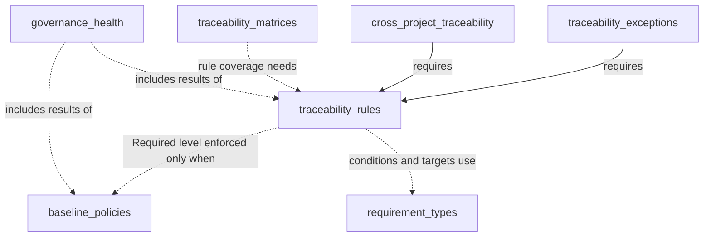
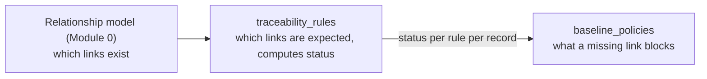

# Module 7 — Traceability & Governance — Implementation Plan

See [future-modules-2026-09-index.md](future-modules-2026-09-index.md) for the
cross-cutting architecture referenced throughout, especially the
relationship-vs-traceability-vs-governance distinction table. The relationship
model comes from [Module 0 — Platform Foundations](completed/module-00-platform-foundations-plan.md);
this module is its heaviest *consumer*.

**Source:** [future-modules-2026-09-overview.md](completed/future-modules-2026-09-overview.md)
§17–28 (Traceability) and §29–36 (Governance), plus §14/11.1 (Requirement Types),
moved here from Module 5 Phase 1, and the requests in
[issue #41](https://github.com/ballardr/reqtrackmanager/issues/41) (Q18). This plan replaces the former separate Module 7
and Module 8 plans; Module 8 is no longer a separate number.

**Status:** Proposed, 2026-11-09. Not started. **Decision tags:** every decision says
`Decided by: User` or `Decided by: Agent`.

## Status / Resume Here

0 / 18 phases complete. Phase 0 is next.

| # | Phase | Half | Status |
|---|-------|------|--------|
| 0 | Exploratory: audit of existing approval, review and lifecycle code; remaining decisions | both | [ ] Not started |
| 1 | Module skeleton, sub-components, `requires`, governable-type registry | shared | [ ] Not started |
| 2 | Lifecycle policies (engine extracted from existing code) | Governance | [ ] Not started |
| 3 | Approval policies (engine extracted from existing code) | Governance | [ ] Not started |
| 4 | Review policies (engine extracted from Requirement and Risk reviews) | Governance | [ ] Not started |
| 5 | Baseline policies and the check-provider extension point | Governance | [ ] Not started |
| 6 | Governance Health (on demand and snapshot) + Governance MCP tools | Governance | [ ] Not started |
| 7 | Move existing types onto the engine: 7a Risk reviews, 7b Decisions, 7c Context & Strategy, 7d Requirements | Governance | [ ] Not started |
| 8 | Governance frontend UI | Governance | [ ] Not started |
| 9 | Governance docs website coverage | Governance | [ ] Not started — depends on Phase 8 |
| 10 | Requirement types (moved from Module 5 Phase 1) | Traceability | [ ] Not started |
| 11 | Traceability rule configuration, including the requirement hierarchy | Traceability | [ ] Not started |
| 12 | Enforcement levels, status and baseline hand-off | Traceability | [ ] Not started |
| 13 | Traceability exceptions | Traceability | [ ] Not started |
| 14 | Cross-project traceability | Traceability | [ ] Not started |
| 15 | Matrices, coverage + Traceability MCP tools | Traceability | [ ] Not started |
| 16 | Traceability frontend UI | Traceability | [ ] Not started |
| 17 | Traceability docs website coverage | Traceability | [ ] Not started — depends on Phase 16 |

The Governance half comes first because the baseline policy's check-provider
extension point (Phase 5) is what Traceability's "Required" level plugs into
(overview §3.1). Each half ships on its own.

## Why one module, and what it costs

Merging the two modules is **Decided by: User** (2026-11-09: combine, "use
sub-modules to allow only using some parts"). The existing sub-component tier
([docs/modules.md](../modules.md) §2a) gives "use only some parts" without a second
module. The two halves share a vocabulary (enforcement level, baseline, exception
approval), one registry of governable types, one settings area and one docs section.

The merge costs, and the plan answers:

- **The old hard edge narrows.** Only Traceability's "Required" level needs Baseline
  policies. Rules, status, matrices and coverage work alone.
- **Sub-components had no dependency declaration.** Fixed by a generic `requires` field (Phase 1).
- **One entitlement and one role set.** Fixed by permission atoms per sub-component.
- **Bigger blast radius per migration and hardening pass.** Mitigated by shipping the
  halves separately, and by moving existing types onto the engine one at a time.

## Decisions (all answered 2026-11-09)

| # | Decision | Decided by |
|---|----------|-----------|
| Q1 | Module key `traceability`, display name "Traceability & Governance" | User |
| Q2 | All sub-components on when the module is switched on; admins opt parts out. The module itself is switched on only through the server default table (`ServerModuleDefault`), never by flipping `ModuleDefinition.default_enabled` | User (the table rule: Agent, from `CLAUDE.md`) |
| Q3 | A generic `requires` field on `ModuleSubComponentDefinition`, resolved in `is_module_subcomponent_enabled`; the toggle UI shows why a part is unavailable | User |
| Q4 | Permission atoms per sub-component, with module roles Traceability Manager and Governance Manager composed from them | User |
| Q5 | The generic engine is **extracted from existing code** (see "Existing implementations"), with an extensible registry of governable types | User |
| Q6 | Full review of what exists, then expand it: Requirements move onto the engine in a planned, verified step (Phase 7d), not left beside it | User ("Do a full review and expand on what exists") |
| Q7 | One review engine generalised from `RequirementReview` and the Risk review logic, then both migrated (7a, 7d) | User |
| Q8 | Governance Health supports on-demand **and** snapshot. A per-project setting picks the mode; on-demand is the default; a perf scenario measures where on-demand becomes slow and the result is shown as guidance in settings. Nothing is forced | User |
| Q9 | Rule schema: one row per AND, a target-type list per OR, plus one optional condition per rule (§19 conditional rules) | User (condition: Agent) |
| Q10 | **Rules are the only hierarchy.** Requirement types are an ordered vocabulary; every "X must trace to Y" relationship, including multi-level chains, is a rule; the hierarchy screen is a tree derived from rules. No separate hierarchy model | User |
| Q10b | Requirement types become their own sub-component `requirement_types`; Module 5 Phase 1 moves here whole | User |
| Q11 | An exception is approved through the Governance approval policy for its type when `approval_policies` is enabled, otherwise through a dedicated approve permission. The requester never approves their own exception. The route stays `APPROVAL_ACTION_ROUTE_EXTRA` (human-only) | User |
| Q12 | Matrices: saved `TraceabilityMatrixDefinition` plus ad hoc views, always generated live | User |
| Q13 | "Required" with `baseline_policies` off is allowed and labelled "not enforced" everywhere; nothing silently pretends to block | User |
| Q14 | Nested-project fallback (the `resolve_effective_action_types` pattern) **and** organisation-level defaults that a project can hide and restore, for policies, rules, matrix definitions and requirement types | User |
| Q15 | A traceability exception is a registered artefact type (`TEX-nnn`) | User |
| Q16 | Users and groups on parity: review owners and exception requesters/approvers use the shared principal picker; approval policies name roles, satisfied by a user or a group holding the role | User |
| Q17 | MCP: write-enabled configuration for both halves (needs `MCP_WRITES_ENABLED` and the caller's RBAC); no tool can execute an approval or finalise a blocked transition | User |
| Q18 | [Issue #41](https://github.com/ballardr/reqtrackmanager/issues/41) (a requirement traceability matrix, "derived from" / "source of" columns in the requirements report, and orphan detection in the requirements list) is covered explicitly in Phases 15 and 16. These need no rules: they belong to `traceability_matrices` and work with `traceability_rules` off. "Orphan" means a record with no links of any kind; "no required link" is a separate rule-based status (Phase 12). The list filter and the link columns reach the core Requirements list and export through a generic extension point, never a Requirements-specific edit | Agent (scope from the issue) |

## Sub-components

| Key | Half | Contains | Needs (`requires`) |
|-----|------|----------|-------|
| `lifecycle_policies` | Governance | Transition rules per artefact type | — |
| `approval_policies` | Governance | Role-based approval per artefact type | — |
| `review_policies` | Governance | Scheduled reassessment | — |
| `baseline_policies` | Governance | Pre-baseline checks, check-provider registry | — |
| `governance_health` | Governance | Live and snapshot aggregate view | — (shows what is enabled) |
| `requirement_types` | Traceability | Ordered requirement type vocabulary | — |
| `traceability_rules` | Traceability | Rules, requirement hierarchy view, status, enforcement levels | — |
| `traceability_exceptions` | Traceability | Exceptions with approval | `traceability_rules` |
| `traceability_matrices` | Traceability | Matrix definitions, coverage | — (coverage by rule needs `traceability_rules`) |
| `cross_project_traceability` | Traceability | Links and rules across nested projects | `traceability_rules` |

Solid: the sub-component cannot be effective without the other (its data is kept
when the requirement is switched off). Dotted: works alone; richer together, and the
UI says what is not enforced or not shown.

### Responsibility boundary (unchanged by the merge)

Traceability computes and exposes status and never blocks anything. Baseline
policy is the only place that blocks. Traceability code never calls a transition, and
Governance code never reads a rule table directly: it consults registered check providers.

## Existing implementations (first pass, 2026-11-09)

Phase 0 completes this into the full audit. What a first read of `backend/app` found:

| Concern | Where it lives today | Notes |
|---|---|---|
| Requirement approval | `routers/requirements/workflow.py` `approve_requirement` | Hard-coded `PROJECT_MANAGER` check; other paths in change-request decisions and `services/baseline.py` (stage baselining approves in bulk) |
| Requirement lifecycle | `RequirementStatus` (Draft, Reviewed, Approved, Archived), `REQUIRES_APPROVAL_STATUSES`, edit lock after approval, change requests | Completion is an overlay flag, not a status |
| Requirement review | `RequirementReview`, `RequirementVersion.review_date`/`review_lead_days`/`reviewer_id`, `services/reviews.py` due query and reminder sweep | |
| Risk review | `modules/risk_management/models.py` `review_date`, review rows with `next_review_date`, notified-for columns | A second review mechanism |
| Decision approval | `modules/decisions/project_router/workflow.py`, `service.py` | Bound to permission atom `(decision, approve_baseline, subtype)` |
| Context & Strategy approval | `modules/context_strategy/service.py`, `router.py` | |
| Compliance approval | `modules/compliance/project_router/assessment_workflow.py` and reviews | Overview §37: stays managed by Compliance (see Phase 0) |
| Shared today | `require_ai_approvals_enabled`, `APPROVAL_ACTION_ROUTE_EXTRA`, FGAC permission atoms, `services/audit.py` | The engine reuses these |

Principle for every migration (Phase 7): **the default policy for each type is today's
behaviour**, so a project that configures nothing behaves identically, and the existing
test suite is the regression bar.

## Phase 0 — Exploratory: audit and remaining decisions

**Why this phase exists:** the Governance engine is extracted from live, SOC 2 relevant
code, so it must be read in full before any design is fixed. Approval is an access
control, so `docs/soc2/policies/access-control-policy.md` and the change-management
policy are binding.

**Activities:**

1. Complete the audit above for every governed type: who may act, the states and
   transitions, side effects (audit events, notifications, locks, versions), the tests
   that pin them. Output: a table in this plan and the list of behaviours the engine must
   reproduce exactly.
2. Define the engine's seams from the audit: the transition rule, the approver check, the
   review schedule, the baseline check provider. State for each existing type what moves
   (policy) and what stays (its own state enum and data).
3. Validate the rule schema (Q9) by hand against every overview §18, §19, §21 and §23
   example, including the three §19 presets and multi-level chains.
4. Confirm the relationship model supports arbitrary type pairs without per-pair special
   cases (`ArtefactLink.source_type`/`target_type` are registry-validated strings).

**Still open (answer in this phase):**

- **Compliance approval.** Recommend excluded from migration: overview §37 says
  Compliance approval and evidence validity remain managed by the Compliance module.
  Compliance still registers a baseline check provider (Module 9).
- **Rule condition shape.** Recommend one predicate per rule: a field on the source
  record, an operator and a value (for example type = Project Requirement, or component =
  X). Compound conditions stay two rows.
- **Snapshot mechanism.** Recommend a per-project refresh interval run by the leader
  job loop (`start_singletons`), the snapshot showing its "as at" time; the on-demand
  threshold measured by a module-specific perf scenario.
- **Migration order (Phase 7).** Recommend lowest risk first: Risk reviews, Decisions,
  Context & Strategy, Requirements last.
- **`requires` semantics.** Recommend a dependent is ineffective, not deleted, when its
  requirement is switched off, and the toggle shows why.
- **Permission atom list** per sub-component, and which fixed roles hold which.
- **Module 5 impact.** Confirm nothing else in Module 5 depended on type ordering
  carrying hierarchy meaning.

**Exit criteria:** the audit and the open items above signed off, before Phase 1.

## Phase 1 — Module skeleton, sub-components, governable-type registry

**Scope:** `backend/app/modules/traceability/` and `frontend/src/modules/traceability/`;
`ModuleDefinition` with the ten `sub_components`; the `requires` field with tests across
the project, organisation and registry tiers; the governable-type registry (a mapping any
module contributes to through its `ModuleDefinition`, never a core edit); permission atoms;
the empty check-provider registry interface.

**Why / risk / outcome:** one registration point so later phases add behaviour without
touching core files. The risk is the core-boundary failure mode: no core file imports from
`modules/traceability/`, and no per-module value is added to a core enum or column.
Outcome: the module can be enabled with every part independently switchable and
dependency-checked.

## Phase 2 — Lifecycle policies (`lifecycle_policies`)

**Scope** (§31): per-project, per-artefact-type transition rules (who may move what, when),
extracted from the transition logic the audit found. A module's own state enum stays
specific to its artefact; Governance configures the *rules*, not the data (§26.1). Project
scope with nested fallback and organisation defaults (Q14).

## Phase 3 — Approval policies (`approval_policies`)

**Scope** (§32): policies reference roles, never individuals. This does not replace
Decision Management's binding `(decision, approve_baseline, subtype=<decision type>)` under
[Fine-Grained Access Control (core)](completed/core-fine-grained-access-control-plan.md).
A policy becomes another way to *grant* the same permission atom, not a competing path:
the approval endpoint keeps checking the one permission it already checks. Group-held
roles count through effective membership (`services/rbac.py`).

**Why:** without centralising this, each of the five existing approval paths keeps
drifting independently.

## Phase 4 — Review policies (`review_policies`)

**Scope** (§33): interval, owner, due date, reminder, outcome, next review date, generalised
from `RequirementReview` and the Risk review logic (Q7). Due dates are calendar dates
(`date`, compared with `effective_today()`); owners are principals (Q16). The reminder
sweep becomes one job over the engine.

## Phase 5 — Baseline policies and check providers (`baseline_policies`)

**Scope** (§34): configurable pre-baseline checks (required fields, required approvals,
traceability, verification, compliance), none mandatory per project, resolved through the
check-provider registry. Built-in providers: required fields and required approvals.
Traceability (Phase 12) and Compliance (Module 9) register theirs through the same hook.
Stage baselining in `services/baseline.py` is a consumer, moved in Phase 7d.

**Why:** the rule says a link is required; the baseline policy says a missing link blocks
baselining. Without it Traceability would be purely informational.

## Phase 6 — Governance Health (`governance_health`) + Governance MCP tools

**Scope** (§35): percentage complete per governed category, open-question count, plus the
results of whichever check providers are enabled. On-demand and snapshot modes (Q8):
per-project setting, snapshots refreshed by the leader job and labelled with their time,
and a perf scenario in `perf/loadgen/scenarios.py` (with its budget rule) whose result
sets the guidance threshold shown in settings.

**MCP tools** (the MCP and docs-website treatment for every unbuilt module is **Decided by:
User**, 2026-09-21; placement and names **Decided by: Agent**): policy configuration and "get
governance health", per [docs/modules.md](../modules.md) §6, write-enabled per Q17. **No tool
may execute an approval:** a content module's `approve`/`reject` route, or any override that
finalises a blocked baseline or transition, is marked
`openapi_extra=APPROVAL_ACTION_ROUTE_EXTRA`, which excludes it from the manifest wherever
it physically lives. Update the module's `mcp_guidance.md` and run
`python scripts/generate_mcp_module_tools_reference.py` in `backend/`.

## Phase 7 — Move existing types onto the engine

One verified step per type, each its own change with its own decisions-log review
(identify → verify → remediate), in the order recommended in Phase 0. Each step: the default
policy reproduces today's behaviour; the type's existing tests pass unchanged; a parity test
runs the old and new paths on the same inputs; the audit events, notifications and locks are
identical; the SOC 2 access-control policy is re-read before the approval path changes.

| Step | Type | What moves |
|---|---|---|
| 7a | Risk | Review scheduling onto the review engine |
| 7b | Decisions | Approval and lifecycle rules onto the engine, keeping the permission atom |
| 7c | Context & Strategy | Approval and lifecycle rules |
| 7d | Requirements | Lifecycle, approval (replacing the hard-coded project-manager check as the default policy), stage baselining and review. Highest regression risk, so last |

Compliance approval is excluded unless Phase 0 decides otherwise.

## Phase 8 — Governance frontend UI

Project settings surfaces for each policy category, following the UX style guide's
settings-hierarchy-depth model and organisation-defaults pattern, plus the Governance
Health view with its mode setting. Module-contributed through `TierAModuleDefinition`
render-prop fields. Sub-component toggles show their dependencies. Playwright e2e and
Storybook coverage; label maps; `help` on every non-obvious field.

## Phase 9 — Governance docs website coverage

Tracked as its own phase (**Decided by: User**, 2026-09-21; scope **Decided by: Agent**).

- A page in `docs/website/docs/modules/`: what Governance is and is not, the four policy
  categories and the types each governs (an extensible registry), roles not individuals,
  the sub-components and how to turn parts off, Health in both modes, and that Requirements
  now run on the engine with their previous behaviour as the default policy.
- A Mermaid diagram of how a rule-satisfaction signal feeds a baseline policy's decision.
- Update the module index and the roadmap page.
- Screenshots per the docs-website standard (1440×900, seeded demo data, alt text plus a
  one-line caption, no explanatory prose): baseline policy settings and the Health view.

**Status:** not started; depends on Phase 8.

## Phase 10 — Requirement types (`requirement_types`)

Moved from Module 5 Phase 1 (**Decided by: User**, 2026-11-09). **Scope** (§14/11.1):
`RequirementTypeDefinition` (net-new; no existing enum to migrate), seeded Business /
Stakeholder / Project defaults at root projects only, a nullable `type_id` on `Requirement`,
ordered and enable/disable-able, on the shared `TypeVocabulary` with an organisation tier,
project hide/restore and nested fallback (Q14). The order drives display and default report
order only: **it carries no hierarchy meaning** (Q10). Create and edit share one field group;
list filter, export/import column, search field and report field come with the
registration.

**Why:** a fixed three-tier structure cannot represent the two- or four-tier structures
organisations use, and the hierarchy itself belongs to rules.

## Phase 11 — Rule configuration (`traceability_rules`)

**Scope** (§17–19, §23, §28): per-project enablement through the sub-component tier;
`TraceabilityRule` CRUD with the Q9 schema (source type, relationship type or set, target
type set, min and max links, `is_mandatory`, enforcement level, one optional condition);
multi-level hierarchies as one rule per level; a derived hierarchy tree view. Nested
fallback and organisation defaults (Q14).

**Why:** enabling or disabling Traceability changes only whether rules are evaluated, never
whether relationships exist or can be created. Test that first: a project with the part off
behaves identically for relationship creation to one that never enabled it.

## Phase 12 — Enforcement levels, status and baseline hand-off

**Scope** (§20–21): Informational / Warning / Required; a computed per-record traceability
status (per-required-relationship checkmarks); a check provider registered with
`baseline_policies` (Phase 5). Required with baselines off is configurable and labelled "not
enforced" (Q13). Traceability exposes status and never blocks.

**Why:** the preferred behaviour is to prevent formal approval or baselining, not to block
creation (§20).

## Phase 13 — Traceability exceptions (`traceability_exceptions`)

**Scope** (§22): `TraceabilityException` as a registered artefact type (Q15): record, rule,
reason, requested by, approved by, expiry or review date (a calendar date), evidence.
Approval per Q11. Every surface showing traceability status distinguishes "satisfies the
rule" from "has an approved exception".

**Why:** an approved waiver must never look like real coverage.

## Phase 14 — Cross-project traceability (`cross_project_traceability`)

**Scope** (§24): links and rules between nested projects, each user seeing and creating
only links to records they may access. Any read of a related project goes through
`link_nesting.can_open_project` (applies the token's project scope).

**Why:** without it the shipped parent/child structure cannot answer whether a child's
requirement traces to the parent's business requirement.

## Phase 15 — Matrices, coverage and Traceability MCP tools (`traceability_matrices`)

**Scope** (§25–27): matrices as **generated views over the relationship graph**, never a
separately maintained structure; saved definitions and ad hoc views (Q12); coverage metrics
(percentage with required links, percentage verified, orphans, exception-covered).

**Issue #41 deliverables** (Q18), all independent of `traceability_rules`:

- **Requirement traceability matrix.** A saved or ad hoc matrix of requirements against
  requirements (or any registered type), with a cell per link, exportable as CSV, PDF and Word.
- **Link columns on the list, export and reports.** "Derived from" and "Source of" columns
  (the two directions of the project's derivation link type, labelled from the link type
  rather than hard-coded) for the Requirements list, its export (`record_tables`) and the
  requirements report, each showing record codes through `ReportContext.code`. Offered
  for every linkable type with a named direction pair, not only requirements.
- **Orphan detection.** An "Orphans" measure in coverage, and a generic list filter
  (a record with no links of any kind, respecting the caller's project scope and the
  token's project scope) contributed through a `ModuleDefinition` hook consumed by
  `TagFilter`-style list filters. The Requirements list takes no module-specific code.
  Export respects the filter.

**MCP tools** (write-enabled per Q17; names **Decided by: Agent**): list/create traceability
rules, get matrix, get coverage report, request traceability exception (the request, not
the decision). Approving an exception is excluded (`APPROVAL_ACTION_ROUTE_EXTRA`). Update
`mcp_guidance.md` and regenerate the module tools reference.

## Phase 16 — Traceability frontend UI

Requirement type screens, rule configuration (the three §19 presets as a quick-setup path
over the full editor), the hierarchy tree derived from rules, per-record status with
exceptions shown distinctly, matrix viewer and saved definitions, coverage dashboard,
exception request and approval flow, and the issue #41 surfaces: an "Orphans only" filter
on record lists (state kept in the URL via `useUrlFlag`), "Derived from" / "Source of"
columns in the list column chooser, and an orphan badge on the record header. Playwright e2e and Storybook coverage; label maps.

## Phase 17 — Traceability docs website coverage

Tracked as its own phase (**Decided by: User**, 2026-09-21; scope **Decided by: Agent**).

- Pages beside the Governance ones: requirement types and the rules-only hierarchy; rules and
  the guarantee that disabling Traceability never disables ordinary relationships; the three
  enforcement levels, and that Traceability only computes status while the baseline policy
  blocks; presets versus the full editor; exceptions rendered distinctly from satisfaction;
  matrices and coverage as live views; cross-project behaviour and permissions.
- The Module 0 / rules / baseline-policy boundary diagram.
- Cross-links from the Governance pages and from Requirements documentation.
- Screenshots (standard as in Phase 9): rule configuration with presets, the per-record
  status indicator, the matrix and coverage dashboard.

**Status:** not started; depends on Phase 16 and on Phase 9 for the cross-link.

## Standing checklist per phase

Each phase applies the `CLAUDE.md` rules this module touches. Mark each as done, or give a
reason in `docs/decisions.md`.

- **Boundary:** no core file imports from `modules/traceability/`; every new core hook
  (`requires`, check providers, governable-type registry) is generic.
- **Bundles:** every table ships `project_bundle_hooks`/`org_bundle_hooks` with a round-trip
  test, template classification (`template_configuration_keys` for policies, rules, matrix
  definitions and types; `template_record_keys` with `template_reset` for exceptions, never
  carrying approval state), and hidden organisation defaults travel too.
- **Audit and SOC 2:** every mutation goes through `services/audit.py`; the identify → verify
  → remediate review goes in `docs/decisions.md`; update the policies' Known Gaps if one closes.
- **Artefact types** (exceptions): code via `generate_unique_code`, summary and search
  providers, `record_tables` with `count`, scaling probe, perf generator, `TagField`,
  quick-link, placements, `RecordCode`.
- **Frontend:** shared components only; `help` on non-obvious fields; `required` markers;
  `ListPageLayout`; `back` on record headers; label maps; `FormActions` header.
- **Time:** state which shape each date is and test boundary hours.
- **Seeds:** `seed_demo_data.py` and `seed_e2e_dataset.py` demonstrate each sub-component.
- **Docs:** `docs/modules.md`, `docs/solution-architecture.md`, `docs/mcp-server.md` where
  they change; the docs website per the phases above; `python scripts/check_doc_links.py`.
- **Tests:** a backend test per behaviour; `python scripts/check_mypy.py` at zero findings;
  one `pytest` run at a time.

## Acceptance criteria (overview §48, both subsets)

**Governance**

- Governance can be enabled/disabled per project, and each sub-component separately.
- Projects can configure lifecycle, approval, review and baseline policies.
- Policies reference roles rather than specific individuals.
- Governance can use Traceability results and Compliance results *(Module 9)*.
- Governance checks provide an overall project health view.
- Existing types run on the engine with unchanged default behaviour.

**Traceability**

- Requirement Types are configurable per project and can be ordered *(moved from Module 5)*.
- Traceability can be enabled/disabled per project; disabling it does not disable normal
  relationships.
- Projects can define rules requiring one or several relationships, targeting requirement
  types and Compliance Requirements; hierarchies of any depth are expressed as rules.
- Rules have configurable enforcement, and missing mandatory relationships are clearly
  identified.
- Traceability can prevent approval/baselining where configured *(through the baseline policy)*.
- Exceptions can be formally approved and are shown distinctly from satisfaction.
- Matrices are generated from actual relationships.
- A requirements traceability matrix can be produced and exported, and the requirements list,
  export and report show "Derived from" and "Source of" columns *(issue #41)*.
- Records with no links can be found with a list filter and counted in coverage, with
  `traceability_rules` switched off *(issue #41)*.
- Cross-project relationships are supported subject to permissions.

**Combined**

- Any sub-component can be switched off without breaking the others, and none appears
  effective while a requirement of it is off.
- Each half is releasable without the other's unbuilt phases.
