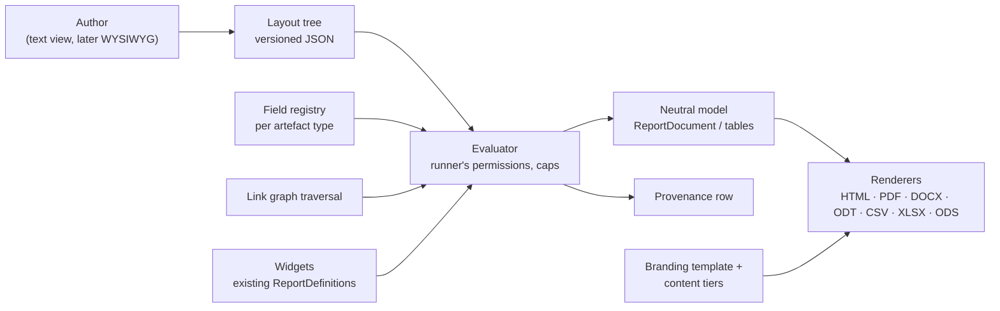
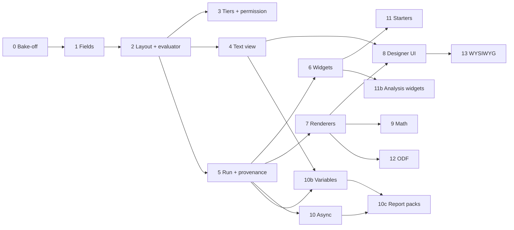

# Module 10 — Reporting & Analysis — Plan

See [future-modules-2026-09-index.md](future-modules-2026-09-index.md) for cross-cutting architecture. Source requirement: [overview §47](completed/future-modules-2026-09-overview.md) (read-only; `docs/requirements.md` stays authoritative).

**Status:** Re-planned 2026-10-20 (supersedes the 2026-09 plan, which predated the core report framework). Phases 0 to 10, 10b, 10c, 11, 12 and 13 (its Phase 0), 13a to 13d, 16 to 27 done 2026-10-26 to 2026-10-29; the User's third review (2026-10-29) added Phases 21 to 27 (all built, awaiting checkpoint R). Phases 10b (run-time variables) and 10c (report packs) added 2026-10-27 at the User's request. **Decision tags:** every decision says `Decided by: User` or `Decided by: Agent`.

## What this module is now

The 2026-09 plan built one bespoke phase per report type (BRD, Engineering Spec, Gap Analysis, Change Impact, …). Since then the core already ships the report framework (`ReportDefinition` + `collect_*`, catalogue, `ReportRunner`, branded PDF/DOCX/CSV from one neutral `ReportDocument`, per-report-type intro/chapters/appendices across template/project/organisation tiers, record codes and tags). So this module becomes **a custom-report designer on top of that framework**:

- A **layout** is a versioned tree of blocks that a person authors: document structure, tables, nested "for each record" blocks over the link graph, `{{record.field}}` values, and **widgets** (`[[widget.gap-analysis]]`) that embed any existing computed report.
- One layout renders to a **document family** (PDF, DOCX, ODT, HTML) or a **table family** (CSV, XLSX, ODS).
- Computed analysis (anti-joins, traversal, scoring) stays in code as collectors; they reach layouts as widgets. Document-shaped reports (BRD, Engineering Spec, review package, design description) become **starter layouts**, not code.

Three orthogonal axes, kept separate: **layout** (what is reported), **branding template** (`ReportTemplate`: how it looks) and **content tiers** (`ReportContent`: boilerplate intro/chapters/appendices). A custom report composes all three; it is keyed `custom.<layout id>` in `ReportContent`, which therefore needs a dynamic key source (today's `valid_report_keys` is registry-only).

## Decisions

| # | Decision | By |
|---|----------|----|
| D1 | Reports are built as custom layouts wherever document- or table-shaped; computed analysis stays code and is reached through widgets. | User |
| D2 | Not limited to documents: table layouts give CSV and multi-sheet XLSX/ODS. | User |
| D3 | Canonical stored form is a versioned JSON tree (`schema_version`); a human-readable text view (directives) is generated from it and editable back, kept lossless by a round-trip test. Each block type declares both forms in one place. | User (JSON durable, text readable), Agent (design) |
| D4 | Group 1 = coded templating (text view + live preview). Group 2 = WYSIWYG editing the same tree, library chosen in its own Phase 0. | User |
| D5 | Widgets sit on their own line, `[[widget.key param=value]]`; parameters validated by the widget's existing `ReportParamDefinition`s; run with the runner's permissions. | User |
| D6 | Output formats: PDF, DOCX, ODT, HTML, CSV, XLSX, ODS, as pluggable renderers. DOCX and XLSX ship first; ODT/ODS follow once the renderer interface has proved itself (Phase 12). Signed off 2026-10-26. | User |
| D7 | **PDF engine: stay on ReportLab.** The Phase 0 bake-off measured WeasyPrint at up to 14 times the memory (2.2 GB at 20,000 rows) and 3 to 10 times the time, so it was rejected; ReportLab embeds equations and SVG figures as vector through `svglib` (tested). HTML preview and the HTML format get their own renderer over the same neutral model. Known PDF limit: no Arabic/Indic shaping, and CJK needs a CJK font (`docs/decisions.md`, "Custom reports Phase 0"). | User |
| D8 | Rejected: Jinja/Liquid/Handlebars. They emit text, not the block model, and open template injection and unvalidated field access. The parser is ours: each, if, field, widget; no expressions. | Agent |
| D9 | Math: delimiters `\( \)` and `$$ $$`, never bare `$`. Recognised in authored text **and in record fields a provider marks math-capable**. TeX is untrusted: a command allow-list runs before conversion (no links, no includes). PDF/HTML show a server-made `ziamath` SVG (plain SVG 1 mode; the PDF embeds it through `svglib`), DOCX a tested OMML subset with an image fallback. | User (scope), Agent (delimiters, sanitiser, renderers) |
| D10 | Every artefact type declares report fields or a stated reason, enforced by a test (same pattern as global search). Fields are opt-in; Restricted and consent-sensitive columns are excluded by omission. | User |
| D11 | Provenance: a `GeneratedReport` row per run (layout id+version, params, scope, caller, UTC time, engine version, format, widgets used, record counts and, for versioned types, record versions; baseline optional until Module 8). No output at rest for synchronous runs. | User (row only), Agent (fields) |
| D12 | Layouts live at organisation **and** project level from day one. | User |
| D13 | New fine-grained permissions "manage organisation report layouts" and "manage project report layouts" (two, signed off 2026-10-26), grantable to users and groups; org admins hold the first by default; project admins the second for their own project. Running needs only access to the report and the data. | User |
| D14 | Runs are synchronous with node/depth/row caps and a timeout; a run expected to exceed a threshold becomes an async job, the user is notified when the download is ready, and **only async output is stored**, expiring after an organisation-set limit (capped by a platform ceiling). | User, Agent (mechanism) |
| D15 | Project-level layout visibility is **additive** (platform starters + organisation + nearest ancestors' + own, de-duplicated by name; a project can hide an inherited one). The Action Types "own rows, else ancestor's" rule would hide every inherited layout as soon as a project made one. Signed off 2026-10-26. | User |
| D16 | A layout is configuration, not an artefact type: no `PREFIX-nnn` code, not linkable, not in global search. Signed off 2026-10-26 with the condition that nothing may prevent promoting a layout to an artefact type later (decisions log, "Custom reports Phase 2", decision 14). | User |
| D17 | An organisation-scope run is a **fan-out**: the organisation layout runs once per project the caller can read and the results are merged, with a selector for which projects are included. Signed off 2026-10-26. | User |
| D18 | **Run-time variables.** A layout declares typed variables (text, number, date, boolean, enum; one value or a list); the person supplies values when running or downloading. Used in conditions (`category in $categories`), `{{var.name}}` text and widget parameters. A value is a typed literal checked at run, never parsed as markup and never an expression, so D8 holds. | User (need), Agent (design) |
| D19 | **Report pack:** a named configuration listing several reports (custom layouts and module reports), each with its own format, rendered with one set of variables into a **zip** with a `manifest.json`. Named "report pack", not "bundle", because "project bundle" already means the project/organisation export and import. | User (need), Agent (name, shape) |
| D20 | A pack declares variables; each entry receives the pack variable of the same name and type, or fixes its own value. A variable names a source field of **any** registered type (requirement category, Pain Point type, Engagement channel, a module's own enums) and offers that field's selectable values as options through a generic value-domain hook on the field provider; a field with no declared domain takes free input with a not-found warning. Never a per-type or per-module case in core. | User (any record type, signed off 2026-10-27), Agent (mechanism) |
| D21 | An entry the runner cannot run (no access, module off) is skipped and listed in the manifest as not available, never silently dropped; a pack with no runnable entry is an error. Signed off 2026-10-27. | User |
| D22 | Packs live at organisation and project level with D15's additive visibility, hide/restore, and travel in the bundles. Managing one needs the same D13 permissions as managing layouts (no new permission). Signed off 2026-10-27. | User |
| D23 | Variables **narrow what a report shows; they are not access control.** The zip holds whatever the runner can read within the chosen values, so the download form shows record counts per entry before download, and the manifest records the values used. | Agent |
| D24 | **Saved variable sets** per pack (for example "Team Alpha: categories A, B"): named values a downloader picks, so a repeat download for the same external team is one click. An organisation pack's sets can be **overridden per project** (the values, per variable; a variable left unset falls back, and the override can be reset to the organisation value), and a project can **add its own sets** beside them. Nearest ancestor project's override wins, then the organisation's (the nested-project fallback rule). Editing needs the D13 project permission. Signed off 2026-10-27. | User (sets, per-project override, own sets, permission), Agent (per-variable fallback, nested rule applied) |
| D25 | In an organisation pack's fan-out run, each project's entries use that project's effective saved set (its override applied), and the manifest lists the values used per project. Signed off 2026-10-27. | User (agreed Agent's recommendation) |
| D26 | **Three views over one tree**: text (exists), block outline, rich-text document, switchable at any time. Not three editors; switching never converts through another view. Signed off 2026-10-28. | User |
| D27 | **Block forms come from server-published schemas** (`BlockSpec.fields`), so a module block type needs no frontend edit. Signed off 2026-10-28. | User |
| D28 | **Rich-text library: TipTap** (ProseMirror; MIT, v3, React 19 peer). A strict node/mark schema maps to the strict tree and custom nodes get React node views. Lexical was set aside: pre-1.0 (0.52) and lower-level, so more of the schema would be hand-built. The choice is confirmed or reversed by 13c's proof of concept before the converter is written. | Agent |
| D29 | The rich-text view is a **document-family view only** and must round-trip: every valid document tree converts to a document and back to an identical tree (property test). A tree the view cannot show losslessly is refused with the reason, never approximated. | Agent |
| D30 | The outline moves blocks with buttons (up, down, indent, outdent) in 13b; no drag-and-drop dependency yet (accessible by default, and nested drop targets are the costly part). Add `@dnd-kit` later only if authors ask. | Agent |
| D31 | Phase 8's "the client holds no block model" is **superseded**: the outline and rich-text views must hold the tree. The safeguard is that the client edits the tree as JSON through server schemas, never parses text, and every change is checked by the server's validate endpoint. | Agent |
| D32 | **Report text formatting.** Bold (`**x**`), italic (`*x*`, `_x_`), inline code and numbered lists are drawn in every document format (PDF, Word, OpenDocument text, HTML), in a layout's text blocks **and** in report introductions, chapters and appendices (one shared reader). No links, so no hyperlink path is added. Supersedes the "inline Markdown is deliberately not interpreted" rule of the neutral model. Signed off 2026-10-28. | User |
| D33 | The Markdown reader sets equations aside before reading styles and puts them back unread, and placeholders and record values are filled after, run by run, so a value is never read for styles; the link, image, raw HTML, entity and strikethrough rules are off, so those stay as written. | Agent |
| D34 | The document view reads and writes only the canonical spelling of the styles and lists, escapes literal markers it writes, and leaves any text it is unsure of as a raw-Markdown source box, so no text is rewritten. Marks are offered only in text blocks (not headings). | Agent |
| D35 | **Links.** `[words](address)` is clickable in PDF, Word, OpenDocument text and HTML for an absolute http, https or mailto address and for `#heading` links within the document; bare addresses are not linked; an address may use a placeholder, checked after it is filled in (a record value can therefore choose where a link goes, within http, https and mailto). Signed off 2026-10-28. | User |

## Status / Resume Here

**Where things stand (2026-10-28).** Phases 0 to 15 are done or deferred as the table says (11b deferred by the User; the former Phase 14, AI-assisted analysis, was removed from this plan by the User on 2026-10-28; 15 is incremental). The User's reviews added Phases 16 to 20 (two reviews), 21 to 27 (the third, 2026-10-29) 28 to 34 (the fourth, 2026-10-29; 28 to 33 done, 34 next) 35 to 42 (the fifth, 2026-10-29; 35 to 41 done, 42 next) 43 to 45 (the sixth, 2026-10-30), 46 to 47a (the seventh, 2026-10-30; all built) and 48 to 59 (the eighth, 2026-10-31, planned only, not started), worked in this order:

| Phase | What | State |
|---|---|---|
| 16 to 16d | Reports picker, folders, favourites, placements, list filters, widget tree, sub-component gate (review 1) | **Done; reviewed by the User 2026-10-28.** (A wider backend regression run was still going when this was written.) |
| 17 | Text designer fixes (review 2) | **Done 2026-10-28** (built and tested; awaiting the checkpoint review). |
| 18 | Block editor on Blockly | **Done 2026-10-28** (built and tested; awaiting the checkpoint review). |
| 19 | Remove report content and the project default template | **Done 2026-10-28** (built and tested; awaiting the checkpoint review). The User chose to drop the content, not convert it; decisions log "Custom reports Phase 19". |
| 20 | Download report from record lists | **Done 2026-10-28** (built and tested; awaiting the checkpoint review). Decisions log "Custom reports Phase 20". |
| 21 | Pickers remember their folders; favourite star on the right of the row | **Done 2026-10-29** (built and tested; awaiting the checkpoint review). Decisions log "Custom reports Phase 21". |
| 22 | One Download menu with every format (ODT and ODS for module reports too) | **Done 2026-10-29** (built and tested; awaiting the checkpoint review). Decisions log "Custom reports Phase 22". |
| 23 | Reports page replaced by a Reports dialog from the project overview | **Done 2026-10-29** (built and tested; awaiting the checkpoint review). Also an organisation default branding template and a per-layout override (User, 2026-10-29). Decisions log "Custom reports Phase 23". |
| 24 | Record-list Download report: two steps, project named, no preview, view-only reports separated | **Done 2026-10-29** (built and tested; awaiting the checkpoint review). The view-only report stays in the Reports dialog (Agent default, flagged for the User). Decisions log "Custom reports Phase 24". |
| 25 | Report packs downloadable everywhere reports are | **Done 2026-10-29** (built and tested; awaiting the checkpoint review). The project and organisation dialogs already listed packs after Phase 23; the record-list dialog now does, by `ReportPackOut.record_types`. Decisions log "Custom reports Phase 25". |
| 26 | Folder chooser with add, rename and delete (replaces the free-text folder field) | **Done 2026-10-29** (built and tested; awaiting the checkpoint review). User decisions: a per-scope `report_folders` table, delete moves contents up one level and deletes no report, placements share the chooser, rename included. Decisions log "Custom reports Phase 26". |
| 27 | Designer layout review: blocks editor space, palette replaced by the Add block dropdown, preview collapses or opens in a dialog | **Done 2026-10-29** (built and tested; awaiting the checkpoint review). The Blocks view has the page's width, Add block states where it lands and is undoable, Preview is a dialog or an optional panel. Decisions log "Custom reports Phase 27". |
| 28 | Background reports page removed; the Reports menu opens the report chooser directly; the ready notification carries the download | **Done 2026-10-29** (built and tested; awaiting the checkpoint review). The Reports button opens the chooser; a notification opens `ReportRunDialog` (Download, or Generate again for an expired or failed run); a clock in the top bar counts runs in progress. Decisions log "Custom reports Phase 28". |
| 29 | Settings that do not belong in the download dialog: the requirement report's filters and the branding template choice | **Done 2026-10-29** (built and tested; awaiting the checkpoint review). Requirements list gained Component and a target version range; no branding choice in any download dialog. Decisions log "Custom reports Phase 29". |
| 30 | Format buttons use acronyms (ODT, ODS) | **Done 2026-10-29** (built and tested; awaiting the checkpoint review). One `REPORT_FORMAT` map; decisions log "Custom reports Phase 30". |
| 31 | ODT and ODS offered everywhere CSV, PDF and Word are; the record-list menu gets Download report and a Download shown items submenu of formats | **Done 2026-10-29** (built and tested; awaiting the checkpoint review). Generic `ActionMenu` submenu; requirement report and both compliance reports offer every format (User: compliance "all types"); surfaces test. Decisions log "Custom reports Phase 31". |
| 32 | Folder tree list (Finder-style list view), used by the report chooser | **Done 2026-10-29** (built and tested; awaiting the checkpoint review). Shared `FolderTreeList`; decisions log "Custom reports Phase 32". |
| 33 | Report setup: one list of reports, packs and tables; the Report folders and Packs sections go | **Done 2026-10-29** (built and tested; awaiting the checkpoint review). `ReportSetupPanel` over a client-side merge; decisions log "Custom reports Phase 33". |
| 34 | Report setup list: column chooser, narrow-width fix, type icons | **Done 2026-10-30** (built and tested; awaiting the checkpoint review). New shared `ColumnChooser` + `useColumnChoice`; `FolderTreeList` is one subgrid; Version, Type and Folder off by default. Decisions log "Custom reports Phase 34". |
| 35 | Page styles and sections: size, orientation and margins per style; a section that switches style (an A3 landscape table inside an A4 portrait report) | **Done 2026-10-30** (built and tested; awaiting the checkpoint review). User: mirrored margins with a gutter wanted. Mirror is one switch per layout; the default margin is 1.5 cm everywhere. Decisions log "Custom reports Phase 35". |
| 36 | Images in reports: an Image block (library or upload) with size, alignment, caption and alt text, in every document format | **Done 2026-10-30** (built and tested; awaiting the checkpoint review). User: project pictures live in a nullable `file_assets.project_id`; captions are numbered "Figure n:" by default (per-image switch). Pictures travel in the bundles. Decisions log "Custom reports Phase 36". |
| 37 | Headers and footers per page style, with page numbers, placeholders and a logo; reconciled with the branding template | **Done 2026-10-30** (built and tested; awaiting the checkpoint review). User: the layout overrides the template, left and right cells swap on left-hand pages, an invisible three-column table. Decisions log "Custom reports Phase 37". |
| 38 | Image wrapping and layering: text wrap, in front of and behind text, per renderer, after a feasibility spike | **Done 2026-10-30** (built and tested; awaiting the checkpoint review). Spike: every mode works in PDF, Word, ODT and HTML (HTML measures page and margin anchors from the block). User: in line, wrap, behind and in front (top and bottom is the in-line block); paragraph, margin and page anchors; wrap sits beside the following text. Decisions log "Custom reports Phase 38". |
| 39 | Record images: print the images attached to a record in a report, chosen by rules (file name, type, count, order) | **Done 2026-10-30** (built and tested; awaiting the checkpoint review). User: a confidential flag on files (default no, its effect stated where it is set) and rules otherwise; no opt-in flag. Generic `record_attachments` extension point; `file_assets.confidential` (migration 0118). Thumbnail table column not built (to confirm). Decisions log "Custom reports Phase 39". |
| 40 | Default output file name with variables, for a layout and for a pack, and variables in the record-image name rule | **Done 2026-10-30** (built and tested; awaiting the checkpoint review). User: an organisation default pattern also names module and built-in reports; no override at download time. `{{generated_on}}` (not `{{run_date}}`) is the run day; `organizations.report_file_name` (migration 0119). Decisions log "Custom reports Phase 40". |
| 41 | Copy reports between projects of one organisation: layouts, packs, sets, folders and placements, with a preview and name-conflict handling | **Done 2026-10-30** (built and tested; awaiting the checkpoint review). User: everything report-related, latest version only as version 1, read source / manage target, same organisation. Built on the project bundle's entry builders and importers (one serialiser); preview then apply, never a replace; tick boxes in the setup list (shared `FolderTreeList` `checks`) or a row menu; `copy_reports` MCP tool. Source is held to the layout manage right (reading a tree is a manage action). Decisions log "Custom reports Phase 41". |
| 42 | Duplicate a report layout (any the caller can read, including the starters and inherited ones) as an editable basis for a new one | **Done 2026-10-30** (built and tested; awaiting the checkpoint review). User: packs duplicate too, and the built-in starters are a source (New from a starter…). One `POST …/report-duplicate` for layout, pack and starter; the shared `ReportDuplicateDialog`; project pictures refuse a copy up. The run chooser gets no Duplicate (Agent; flagged). Decisions log "Custom reports Phase 42". |
| 43 | Report snippets: model, generic extension point, apply service, built-in set (cover page, logo top right, record images, document control, approvals, landscape table section) | **Done 2026-10-30** (built and tested; awaiting the checkpoint review). User: the logo is an anchored image in front of the text sized and placed from the page; the six snippets in this title. `ModuleDefinition.report_snippets` extension point; apply service stores nothing and refuses only the snippet's own problems; `GET .../snippets` and `POST .../snippets/{key}/apply` at both tiers; `list_report_snippets` / `apply_report_snippet` MCP tools. Document control and approvals are lists, not tables (no static-table block). Decisions log "Custom reports Phase 43". |
| 44 | Insert snippet in the Blocks and Text views: picker with search, categories, formats and block outline; parameter form on the shared fields; change notice | **Done 2026-10-30** (built and tested; awaiting the checkpoint review). Blocks places the blocks in one undo group (Ctrl+Z) at Add block's place or the layout start; Text reads the draft, applies on the server and writes the tree back, at the start or end (not the caret), with an Undo button. Outline instead of a rendered preview. Decisions log "Custom reports Phase 44"; website designer page updated. |
| 45 | Author-saved snippets at organisation and project level; manage, hide/restore, bundles, MCP | **Done 2026-10-30** (built and tested; awaiting the checkpoint review). User: nested projects are additive like layouts; Save as snippet in both views (Text saves the top-level blocks the caret or selection touches, from `block_lines` on the text parse). A saved snippet has no parameters or versions; `report_snippets` table (migration 0120), `report-snippets` routes at both tiers, the Report snippets section in Report setup, bundles, seven MCP tools. Decisions log "Custom reports Phase 45". |
| 46 | Tables: an images column (the pictures attached to each row's record, sized as a share of the column, stacked or side by side) and a layout-wide switch for repeating table header rows on each page | **Done 2026-10-30** (built and tested; awaiting the checkpoint review). User: it is an *images* column with no thumbnail concept and no size caps of our own (default 90% of the column; only the physical page limit applies), a sheet gets a text fallback of file names, stacked or side by side per column, and the header switch is per layout. `ImageCell` / `Table.weights` / `Table.repeat_header` in the model, four renderers, `@images` and `norepeatheader` in the text view, Add images column in the designer. Decisions log "Custom reports Phase 46". |
| 47a | Typed spreadsheet cells: a number, date or UTC time of day field is stored as such in XLSX and ODS, so a spreadsheet can sort, filter and add it up (the cell model Phase 47 extends with links) | **Done 2026-10-30** (built and tested; awaiting the checkpoint review). User: typed cells are wanted, as their own phase before 47. `DataCell` / `typed_cell` in the report model, CSV keeps text. Decisions log "Custom reports Phase 47a". |
| 47 | Workbooks: links between cells of different sheets (a cell opens the row of the same record on another sheet) in XLSX and ODS, with a contents sheet and a project-workbook starter | **Done 2026-10-31** (built and tested; awaiting the checkpoint review). User: Contents sheet yes; XLSX one row per linked record (the join) and ODS may link every item, but no column makes a multi-record cell today. The starter became a snippet (**Two linked sheets**) because starters cannot hold sheets. Decisions log "Custom reports Phase 47". (seventh review) |
| 48 | Templates & reports page (organisation): every section collapsed but **Reports** (renamed from Report setup); Report file names and Background reports move into one **Configuration** section; **Add starter layouts** hidden when every starter is already in and moved into the New menu | **Done 2026-10-31** (built and tested; awaiting the checkpoint review). Sections collapsed but Reports; one Configuration section with one Save; Add missing starters in the New menu from a new `GET .../starters`. Also fixed: a pack's zip ignored the file-name template (client now reads `Content-Disposition`; CORS exposes it). Decisions log "Custom reports Phase 48". |
| 49 | Report branding: the Report templates section goes; the report accent colour and Include organisation logo move to the Branding page, default footer text and Include cover page to Configuration | **Done 2026-10-31** (built and tested; awaiting the checkpoint review). One look per organisation (`report_look`), layouts read `{{org.*}}`, `if org.*` and the `org_logo` picture, existing layouts migrated to a new version (migration 0121), separate report accent; Report templates, `report_template_id` and a pack's `template` are gone. Open: the engine still prints its plain title above a migrated cover, and the designer's image pickers do not yet offer the organisation logo. Decisions log "Custom reports Phase 49", modules.md §4ab. |
| 50 | Layout detail: Folder shows where the layout is now; pressing it opens a popover to move it | **Done 2026-10-31** (built and tested; awaiting the checkpoint review). New `ReportFolderField` (value button + `Popover` holding the unchanged `ReportFolderChooser`) in both the layout and the pack form; the Move dialog keeps the chooser inline. Decisions log "Custom reports Phase 50". |
| 51 | Create report snippets from the Report snippets section (no layout needed) | **Done 2026-10-31** (built and tested; awaiting the checkpoint review). `ReportSnippetEditorDialog` (Blocks and Text, kind chosen first) for New and Edit; `PATCH .../report-snippets/{id}` accepts a `tree` that replaces the blocks through the save path's checks; shared `ReportSnippetCheckSummary`. Open: the designer keeps its own Blocks/Text switching code. Decisions log "Custom reports Phase 51". |
| 52 | Designer toolbar: one snippet icon button with a menu (Insert snippet, Save as snippet); Layout settings become a button on the layout block, not a section above the blocks | Planned 2026-10-31. |
| 53 | Blocks view: no editing on the block itself; every value is edited in the block editor only (a modal, a panel tab or both) | Planned; **settled by the User's mock 2026-10-31**: the block editor is the right panel's tab, not a modal. |
| 54 | Blocks and Text views: Preview and the block editor / fields / widgets become tabs of one right-hand panel that collapses and expands like a list's filter panel | Planned; **settled by the User's mock 2026-10-31**: tabs Blocks and Preview in the right panel. |
| 55 | Tables: a forced column width, so a table's columns stop changing with the content (Business Requirements Document first) | Planned 2026-10-31. |
| 56 | Report preview remembers the projects last chosen | Planned 2026-10-31. |
| 57 | Shape block (rectangle, rounded, ellipse) with a fill, placeable behind or in front of other content, in all four document formats | Planned 2026-10-31. |
| 58 | A default workbook: one sheet per record type holding every core field | Planned 2026-10-31. |
| 59 | Demo data: an example report with an image (the product logo on a shape) and the default workbook | Planned 2026-10-31. |
| R | Review checkpoint: the User reviews Phases 17 to 59 together (17 to 20 were built before the third review; 28 to 34 come from the fourth review, 35 to 42 from the fifth, 43 to 45 from the sixth, 46 and 47 from the seventh and 48 to 59 from the eighth) | After Phase 59 |
| 15 | Docs website | After the review checkpoint (its screenshots must wait: Phases 23, 24, 27, 28, 29, 32 to 34 and 35 to 59 change the screens) |

The plan is not closed. The paragraph below is the history of Phases 0 to 15, kept as written.

27 / 27 phases complete (Phase 15 first slice 2026-10-28: the custom-reports docs are now their own section with screenshots; the plan is not closed, awaiting the User's review; 13d shipped 2026-10-28: the Document view joins the designer's Text and Outline views, Playwright, website, style guide; Phase 13 is closed, only 11b (deferred by the User), 14 and 15 remain; 13c4 shipped 2026-10-28: links, decisions log "Custom reports Phase 13c4"; 13c2 and 13c3 shipped 2026-10-28 at the User's request: bold, italic, code and numbered lists in the report engine's four document formats and in the document view, decisions log "Custom reports Phase 13c2"; 13c shipped 2026-10-28: the document view and its converter, built and tested but not yet reachable from the designer, decisions log "Custom reports Phase 13c"; 13a and 13b shipped 2026-10-28: block schemas and the tree check, then the block outline with a Text | Outline switch in the designer, decisions log "Custom reports Phase 13a" and "Custom reports Phase 13b"; 13c and 13d are next, in order (13d adds the document view to the switcher, the finish, docs and e2e for three views); Phases 0 to 10, 10b, 10c, 11 and 12, 2026-10-26 to 2026-10-28; Phase 12 shipped the ODT and ODS renderers on the Phase 7 interface, written as streamed XML rather than through `odfpy` (1.1 GB for 100,000 rows), checked in LibreOffice, equations as pictures in ODT, and a fix to apostrophe sheet names in XLSX; decisions log "Custom reports Phase 12", modules.md §4o. Phase 11 shipped the starter layouts: three document layouts every organisation is created with, assembled from parts that core and each module contribute (`ModuleDefinition.report_starter_sections`) and an `if` on a module so a part whose module is off is left out; decisions log, "Custom reports Phase 11"; the Gap Analysis and Change Impact widgets are Phase 11b, deferred; findings in `docs/decisions.md`, "Custom reports Phase 0" to "Phase 10b"). Phase 10b shipped run-time variables: a layout's `variables` (typed, one value or a list, options from a source field's value domain through the generic `ReportField.domain` hook), `{"var": name}` references in conditions and widget parameters, `{{var.name}}` in text, `@var` / `$name` in the text view, values on every run route, the draft preview, the queued job and MCP, a run form on the catalogue entry and `GET .../variables`, `ReportVariablesForm` on the Reports page and in the designer, and values recorded in the provenance row (`services/report_variables.py`, modules.md §4t, decisions log "Custom reports Phase 10b"). Phase 10 shipped background runs: a file run over the synchronous limits answers 409 `async_required`, the Reports page queues it (`POST .../runs`), the leader's job loop produces it as the requester with 5 times the limits and 10 minutes, stores the file, notifies the requester, and an expiry pass deletes it after the organisation's retention (capped by a platform ceiling) and deletes old provenance rows (retention gap 3 closed; `services/report_run_jobs.py`, modules.md §4s, decisions log "Custom reports Phase 10"). Phase 9 shipped math: an `equation` block and `\( \)` / `$$ $$` in text (the author's text and record fields a provider marks math-capable), a TeX command allow-list, `ziamath` SVG for HTML and PDF, native Word equations for a tested subset (a picture otherwise), and the source as written when an equation cannot be drawn (`services/report_math.py`, decisions log "Custom reports Phase 9"); equations also work in headings, list items and table cells, and KaTeX draws the math-capable requirement fields on record screens (**User**, decisions 3 and 5). Phase 8 shipped the designer: layout list (Report Setup, Templates & reports), text editor with checked problems by line, block/field/widget insertion at the caret, sandboxed live preview (`POST .../preview`, nothing stored), save as versions with conflict handling, History with line comparison, hide/restore and copy of shared layouts; no condition builder (deferred to Phase 13, decisions log "Custom reports Phase 8", decision 5). It builds on the text view endpoints, the HTML format and the widget list (`GET …/report-layouts/widgets`). Phase 6 shipped widgets: a widget is one component of a report (a declared table, its `figures` or its `notes`), keyed `<module key>.<slug>.<part>` and written `[[widget.<key> name=value]]`; it adds no heading or prose, so the layout owns the words (**User** correction); the report's own collector and gate run per project, once per report and settings (decisions log "Custom reports Phase 6"). Phase 11's Gap Analysis and Change Impact collectors become widgets by being registered as reports. The condition language grew in the same session at the User's request (`in` / `not_in` on every kind of field, `and` / `or` / `not` with brackets, widget `sort`; decisions log "Custom reports: conditions"); conditions are written in the text view (a condition builder is left to the WYSIWYG editor, Phase 13). Phase 5 shipped the run routes (project, and organisation-wide as a fan-out per project with a Projects selector), both catalogues, content tiers keyed `custom.<layout id>` (portable in bundles), the `generated_reports` provenance row and the MCP tools. Phase 7 shipped the renderer registry (`services/report_render.py`): HTML, PDF, Word (document) and CSV (zip for several sheets), XLSX (table), plus the sanitised SVG `Image` and the ReportLab 5.1 upgrade `svglib` needs; ODT/ODS (Phase 12) and the equation block (Phase 9) register on it. Provenance records the version of every versioned record (bounded at 20,000 per run, with a digest over all records alongside; **Decided by: User**, decisions log "Custom reports Phase 5", decision 8).

| # | Phase | Group | Status |
|---|-------|-------|--------|
| 0 | Exploratory: PDF-engine bake-off, math, ODF libraries, tree schema | 1 | [x] |
| 1 | Report field registry and traversal | 1 | [x] |
| 2 | Layout model, tree schema, versioning, evaluator | 1 | [x] |
| 3 | Tiers, permission, hide/restore, bundle export/import | 1 | [x] |
| 4 | Text view: parser, serialiser, round-trip | 1 | [x] |
| 5 | Run pipeline: caps, provenance, catalogue and MCP merge | 1 | [x] |
| 6 | Widgets | 1 | [x] |
| 7 | Renderers: interface, HTML, CSV/XLSX, DOCX, PDF | 1 | [x] |
| 8 | Designer UI (text view, field picker, live preview) | 1 | [x] |
| 9 | Math | 1 | [x] |
| 10 | Async runs, expiring output, notification | 1 | [x] |
| 10b | Run-time variables | 1 | [x] |
| 10c | Report packs (zip of several reports, with variables) | 1 | [x] |
| 11 | Starter layouts (Business Requirements Document, Engineering Specification, Review Package) | 1 | [x] |
| 11b | Executive Gap Analysis and Change Impact widgets (deferred by the User until Engineering Design, Verification and Baselines exist) | 1 | [ ] |
| 12 | ODT and ODS renderers | 1 | [x] |
| 13 | WYSIWYG editor, Phase 0 (views, library, block schemas decided 2026-10-28) | 2 | [x] |
| 13a | Server-published block schemas (`BlockSpec.schema`, `GET …/report-layouts/blocks`) and a tree validate endpoint | 2 | [x] |
| 13b | Block outline view (schema-driven forms, add/move/indent, preview beside it) | 2 | [x] |
| 13c | Rich-text view (TipTap proof of concept first, then the tree-to-document converter and round-trip test) | 2 | [x] |
| 13c2 | Report text formatting in the engine: bold, italic, code and numbered lists in all four document formats, for layouts and report content (User, 2026-10-28) | 2 | [x] |
| 13c3 | Formatting in the document view (bold, italic, code marks; numbered lists; toolbar) | 2 | [x] |
| 13c4 | Links in report text: web, email and in-document section links in all four formats, addresses with placeholders checked after filling, link dialog in the document view (User, 2026-10-28) | 2 | [x] |
| 13d | Three-view switcher on the designer, shared dirty state, e2e, docs | 2 | [x] |
| 16 | Reports picker: dialog with search, kind filter, favourites and nested folders; author folders on layouts and packs; placements to move or hide upstream reports (User review, 2026-10-28) | 3 | [x] |
| 16b | Report layouts and packs lists: search, filters, paging, folder column | 3 | [x] |
| 16c | Widget list as a collapsed tree (module, report, part) | 3 | [x] |
| 16d | Reports spanning several sub-components follow them (`any_subcomponents`) | 3 | [x] |
| 17 | Text designer fixes: icon toolbar with tooltips, Save popover for the change note, one searchable list of fields and placeholders, Document view removed (with TipTap), page size, project placeholders (User review 2, 2026-10-28) | 4 | [x] |
| 18 | Block editor on Blockly (themed), blocks generated from the server's block schemas, replacing the Outline; heading blocks by level, compact inline-label forms (decisions log "Custom reports Phase 18"; website screenshot left to Phase 15) | 4 | [x] |
| 19 | Report content (introduction, chapters, appendices) removed everywhere (dropped, not converted: User, 2026-10-28); the project default branding template pointer removed; "Requirements by Component" starter layout as the requirements counterpart (widgets for project facts: the `{{project_code}}` and `{{project_description}}` placeholders of Phase 17) | 4 | [x] |
| 20 | Download report from record lists: the list actions menu offers a report picker limited to reports that use the list's record type | 4 | [x] |
| 21 | Pickers remember which folders were open (per person, per picker) and open collapsed the first time; the favourite star moves inside the report's row, on the right (User review 3, 2026-10-29) | 5 | [x] |
| 22 | One **Download** dropdown listing every format a report offers, on the report runner and wherever a report is downloaded; ODT and ODS offered for module reports (today only custom layouts offer them) | 5 | [x] |
| 23 | Reports page removed: report choice and download move to a dialog opened from a dropdown at the top of the project overview; the Template & layout section goes (the template choice moves into the download step; the requirement report keeps its R-G-03 filters and R-G-04 resource sections); an organisation default template and a per-layout template override | 5 | [x] |
| 24 | Record-list Download report as steps (1 choose, 2 configure), the project named, no on-screen preview in the dialog, reports meant only to be viewed kept out of it (their parts stay available as widgets) | 5 | [x] |
| 25 | Report packs offered wherever a report can be downloaded: the project dialog, the record-list dialog and the organisation Reports group | 5 | [x] |
| 26 | Folder chooser (a tree to pick from, with add and delete folder buttons) in place of the free-text folder field on layouts and packs | 5 | [x] |
| 27 | Designer layout review: the Blocks view uses the full width (no left selection column), the live preview collapses to the right or opens in a dialog, and the palette is replaced by the Add block dropdown (the Blocks tab does not show a text view: the right column is the block inspector) | 5 | [x] |
| 28 | Background reports page removed (it is only the list of asynchronous runs, whose ready notification must now carry the download); the Reports menu on the overviews becomes one button that opens the chooser | 6 | [x] |
| 29 | Download dialog trims: no requirement-report filters in the project dialog, no branding template choice (the layout's override or the organisation default applies); both need the User's confirmation first | 6 | [x] |
| 30 | One format label map: ODT and ODS shown as acronyms like PDF, HTML and CSV, with the full name as a tooltip | 6 | [x] |
| 31 | ODT and ODS in every place CSV, PDF and Word are offered: record-list menu (Download report, and Download shown items with a submenu of formats; a generic `ActionMenu` submenu), report downloads, packs, the requirement report, MCP | 6 | [x] |
| 32 | Folder tree list (disclosure rows, indent, folder and type icons, columns, arrow-key navigation) replacing buttons-and-dropdowns folders; the report chooser adopts it | 6 | [x] |
| 33 | Report setup shows reports, packs and tables as one tree list (the chooser's shape); the Packs and Report folders sections go, their move, hide and folder actions move into the tree | 6 | [x] |
| 34 | Report setup list: column chooser (Version, Kind and Folder hidden by default), narrow-width scrolling, a type icon in place of the Kind column | 6 | [x] |
| 35 | Page styles (size, orientation, margins) and a section container that switches style for the content inside it, in every document format | 7 | [x] |
| 36 | Image block: library or uploaded image, size, alignment, caption, alt text; images travel in bundles | 7 | [x] |
| 37 | Headers and footers per page style (slots, page numbers, placeholders, logo); precedence with the branding template | 7 | [x] |
| 38 | Image wrapping and layering (square wrap, top and bottom, in front, behind) after a per-format feasibility spike | 7 | [x] |
| 39 | Record images: the images attached to a record print in a report, chosen by rules (name, type, count, order) | 7 | [x] |
| 40 | Default output file name with variables (layout, pack, pack entries); the same variable syntax in the record-image name rule | 7 | [x] |
| 41 | Copy reports from one project to another in the same organisation (read source, manage target), all report-related content | 7 | [x] |
| 42 | Duplicate a report layout, starters and inherited ones included, in the designer and the setup list | 7 | [x] |
| 43 | Report snippets: model, extension point, apply service, built-in set | 8 | [x] |
| 44 | Insert snippet in the Blocks and Text views (parameter dialog, preview) | 8 | [x] |
| 45 | Author-saved snippets (organisation and project), hide/restore, bundles, MCP | 8 | [x] |
| 46 | Tables: images column (sized as a share of the column, stacked or side by side) and a layout-wide repeat-header-row switch | 9 | [x] |
| 47a | Typed spreadsheet cells: numbers, dates and UTC instants stored as such in XLSX and ODS (User, 2026-10-30) | 9 | [x] |
| 47 | Workbooks: cell links between sheets (XLSX and ODS), contents sheet, linked-sheets snippet | 9 | [x] |
| 48 | Templates & reports page: collapsed sections, Configuration section, starter layouts into the New menu | 10 | [x] |
| 49 | Report branding folded into organisation branding and configuration; Report templates removed | 10 | [x] |
| 50 | Layout detail: folder shown as a value with a move popover | 10 | [x] |
| 51 | Create snippets from the Report snippets section | 10 | [x] |
| 52 | Designer toolbar snippet menu; layout settings as a button on the layout block | 10 | [ ] |
| 53 | Blocks view edits in the block editor only | 10 | [ ] |
| 54 | Right-hand panel as tabs, collapsible, in Blocks and Text | 10 | [ ] |
| 55 | Forced table column widths | 10 | [ ] |
| 56 | Preview remembers the chosen projects | 10 | [ ] |
| 57 | Shape block | 10 | [ ] |
| 58 | Default workbook (every record type, core fields) | 10 | [ ] |
| 59 | Demo data: logo-on-shape example report and the default workbook | 10 | [ ] |
| R | **Review checkpoint (User):** the User reviews Phases 17 to 59 together, once all are built; Phases 16 to 16d were reviewed 2026-10-28. The plan is not closed before it, and Phase 15 (docs) waits for it | 6 | [ ] |
| 15 | Docs website coverage (incremental; first slice 2026-10-28: nested Custom reports section with eight screenshots, decisions log "Custom reports Phase 15"; background-reports, starters and organisation-run screenshots still to add) | — | [ ] |

## Phase specs

Each phase: **Why** (risk addressed) and **Outcome**. Every phase also carries the standing checklist below.

**0 — Exploratory.** Bake-off of three PDF paths: ReportLab with equation images, WeasyPrint on HTML, headless Chromium on HTML. Criteria: fidelity to the HTML view, image weight, lock-down of fetches (no `file://`, no network; images only as pre-resolved bytes), effort to migrate the 30+ existing reports, header/footer/page-number/landscape/repeating-header support, and SVG figures (needed by [Module 16](module-16-workflow-capture-plan.md)'s diagrams): inline-SVG fidelity per engine, the rasteriser DOCX needs because `python-docx` cannot embed SVG, bundled fonts and label wrapping. Also: LaTeX→OMML for DOCX (`latex2mathml` + Office's `MML2OMML.XSL`, whose redistribution terms need checking), ODF libraries for ODT/ODS, the draft tree vocabulary, how a Pain Point's affected Stakeholders are stored (assumed `ArtefactLink`; verify), and the sync/async threshold method. *Why:* the engine choice is expensive to reverse and switching engines alone does not solve math without a browser. *Outcome:* decisions in `docs/decisions.md` (done: stay on ReportLab, `ziamath` + `svglib`, OMML subset with image fallback, `resvg-py`, `odfpy`, `openpyxl`).

**1 — Field registry and traversal.** A generic `ModuleDefinition.report_fields[type]` provider (modelled on `search_providers`): opt-in fields with label, kind (text, number, date, enum with label map, math-capable text) and getter; batch loader; codes via `ctx.code`/`org_code`, tags via `ctx.tag_text`. Traversal reuses `link_graph` as the single authorisation point; hidden nodes are counted, never named. Coverage test with `not_reportable` reasons. *Why:* without a registry each layout would hand-query tables, leak columns or break the module boundary. *Outcome:* every registered type is selectable in a layout or has a recorded reason.

**2 — Layout model and evaluator.** `ReportLayout` and immutable `ReportLayoutVersion` rows (tree + hash; editing creates a version; a run pins one). Tree schema validated on save: depth and node caps, field names against the registry, widget params against declarations, no raw HTML block. Evaluator walks the tree for the caller and emits the neutral model; placeholders are substituted into parsed text blocks, extending the existing rule that a value never becomes markup. *Why:* §47.8 requires versioned templates; injection and unbounded work are the main risks. *Outcome:* the user's example (requirements by component and category → linked Pain Points by title → affected Stakeholders) runs from a layout.

**3 — Tiers, permission, hide/restore, bundle.** Organisation and project scope per D12/D15; two "manage report layouts" permissions, organisation and project (each grantable to users and groups, per the parity rule); hide/restore of inherited layouts via `ProjectDefinitionSuppression`; layouts and their versions travel in the org and project bundles. *Why:* project-level and org-default rules in CLAUDE.md. *Outcome:* a project admin can author, hide an inherited layout and restore it.

**4 — Text view.** Parser and serialiser for the directive syntax; round-trip property test (tree → text → tree) and error positions in messages. *Why:* D3 only holds if the two forms cannot drift. *Outcome:* every block type is editable as text.

**5 — Run pipeline.** `…/custom-reports/{id}/run?format=` for project and organisation scope, framework-level `report_template_id` and content tiers applied, `GeneratedReport` provenance, merge into both report catalogues and MCP. *Why:* custom reports must be indistinguishable from module reports to the Reports page. *Outcome:* a layout appears in the catalogue and runs in the shared `ReportRunner`.

**6 — Widgets.** Adapter exposing a component of any `ReportDefinition` result (a declared table, the figures, the notes) as blocks, never prose; per-widget parameter forms (the designer's, Phase 8, from the widget list); widget keys listed in the designer (the list endpoint and MCP tool are built). *Why:* D1/D5, reuse of existing computed reports. *Outcome:* `[[widget.gap-analysis]]` embeds in a document layout.

**7 — Renderers.** Pluggable renderer interface over the neutral model; HTML (also the live preview), CSV (zip when multi-table), XLSX, DOCX, PDF stays on ReportLab, with a separate HTML renderer for the preview and format; equations and SVG figures embed as vector through `svglib` (SVG rejected if it contains a DOCTYPE or entity; `resvg-py` PNG if `svglib` raises). A bundled Unicode font is registered, and the same font directory goes to `resvg-py`. Spreadsheet cells go through `csv_safe`-equivalent formula guards. The neutral `Image` block gains an SVG-source form that each renderer converts (today it holds raster bytes only), so modules can contribute vector figures without importing an engine. Existing reports keep their ReportLab path. *Why:* formats must not drift. *Outcome:* one layout, every shipped format, visually consistent documents.

**8 — Designer UI.** Create/edit/version/compare, text editor with parse errors, field picker (`{{…}}` insertion), widget picker, live preview, shared `Tabs`/`Toast`/confirm patterns, `help` text on non-obvious fields. *Outcome:* a non-developer can reproduce the example report.

**9 — Math.** `Equation` block; KaTeX for screen and HTML; PDF equations from `ziamath` with `svg2 = False`; DOCX native equations for the subset a golden test pins (square roots need `<m:deg>` added to `mathml2omml` output) with the equation image otherwise; verify one sample in Word and LibreOffice (with `libreoffice-math`) before release; command allow-list before TeX conversion and element allow-list on the SVG; fallback shows the source. *Why:* annotations; TeX in data is an injection path. *Outcome:* equations render in every document format or degrade to source.

**10 — Async runs.** Job state on `GeneratedReport` (queued, running, ready, expired, failed), object-storage output, a notification type, an organisation setting for retention (with a platform ceiling), a singleton expiry job started through the lifespan's `start_singletons`, download that re-checks caller and access, deletion with the organisation. Update the data-retention and classification policies and note any encryption gap. *Why:* D14; stored output is Confidential data at rest. *Outcome:* a large run notifies when ready and disappears on schedule.

**10b — Run-time variables.** A layout's root gains an optional `variables` list (name, type, label, default, single or list, optional source field of any registered type, whose declared value domain supplies the options; the hook is generic, with a coverage-style test that each core field with a closed vocabulary declares one or a reason). References: a condition value `{"var": "categories"}` (kind-checked against the field at save, so `in` takes a list variable and `eq` a single one), `{{var.name}}` in text (a global placeholder family, so it stays text, never markup) and a widget parameter bound to a variable of the declared type. Text view gets a matching `@var` directive in the same change (round-trip test). Run routes (project, organisation fan-out, preview, MCP `run_report`) accept values, validate them against the declaration (type, options, `MAX_IN_VALUES`) and record them in the `GeneratedReport` params. The Reports page and designer preview render a generated form from the declaration, like module report parameters. A date variable is the person's own calendar date (`X-Client-Date` for its default). Additive to tree schema 1, so no version bump. Values are never logged, only names and counts. *Why:* D18; one template layout must serve many scopes without copies that drift. *Outcome:* a layout of requirements by category runs for categories X and Y only, from the form, preview and MCP.

**10c — Report packs.** `ReportPack` and immutable `ReportPackVersion` rows (the layout versioning pattern): ordered entries `{layout ref | module report key, format, filename, fixed variable values}`, pack variables, optional default branding template. Layouts are referenced by name and tier (portable in bundles), resolved for the project it runs in. Run route `…/report-packs/{id}/run` (project and organisation) renders each entry through the existing `ReportRunner` as the caller, so every entry keeps its own gate, caps and record codes, and returns a zip: the files, plus `manifest.json` (pack and entry versions, variable values, record counts, entries not available, UTC time; no cell values). Filenames are sanitised, unique and flat (no paths); total size, entry count and wall time are capped. One `GeneratedReport` row per entry sharing a `pack_run_id`. A pack over the sync threshold goes through Phase 10's async path, which stores the zip like any async output. Download form: variables, a **preview of record counts per entry** (nothing stored), then download. Saved variable sets (D24): `ReportPackVariableSet` rows at organisation or project scope, plus a per-project override row (pack, set, variable values) that layers over an organisation set, nearest ancestor first. The project's sets screen shows each organisation default beside the project's value with a reset, as the style guide's platform-default pattern requires. Picked on the download form for a one-click repeat; a stored value naming an option that no longer exists is flagged on the form, not silently dropped. Sets and overrides travel in the org and project bundles (an override by portable key of its pack and set), with a round-trip test, and appear in the manifest by name. Values are config, never logged. Tiers, additive visibility, hide/restore, org and project bundle hooks, MCP `run_report_pack` (writes gated as D14's tools; skill updated), docs, e2e. *Why:* D19; handing an external team a standard set of documents should not be a manual run-and-collect per report. *Outcome:* one project pack (overview and strategy in PDF, requirements and Pain Points as XLSX) downloaded for categories X, Y, Z only; the manifest says what was included.

**11 — Starter layouts.** Business Requirements Document (§47.3), Engineering Specification (§47.4) and Review Package, written into every organisation as ordinary, editable layouts (**User**, 2026-10-28: seeded rows, not a read-only platform tier) at organisation creation and on request; each is assembled from core parts and the parts each module contributes, and a part whose module is off is omitted (`if` on a module). The design description is not built: it needs Engineering Design. *Outcome:* acceptance criterion 1.

**11b — Analysis widgets (deferred).** Executive Gap Analysis (§47.5) and Engineering Change Impact (§47.6, reusing Change Management and distinguishing direct, transitive and inferred impacts) as collectors exposed as widgets. **User**, 2026-10-28: deferred until Engineering Design, Verification/Validation and Baselines exist, so they are built once against real data. *Outcome:* acceptance criteria 2–3.

**12 — ODT and ODS.** Two renderers on the Phase 7 interface. *Outcome:* all seven formats. Done 2026-10-28: written as XML text (`odfpy` rejected on memory), LibreOffice-checked; equations are pictures in ODT (native formula objects left out, decisions log "Custom reports Phase 12").

**13 — WYSIWYG (done 2026-10-28; sub-phases 13a to 13d, with 13c2 to 13c4 added at the User's request for text formatting and links).** The designer gets three views of one tree, switchable at any time: the text view (exists), a **block outline** and a **rich-text document**. The tree stays canonical (D3); a view never holds a second copy of the layout. Decisions D26 to D30 below; the account is in `docs/decisions.md`, "Custom reports Phase 13 Phase 0". Sub-phases:

- **13a — Block schemas.** `BlockSpec` gains an editor `schema` (label, fields with key, label, kind, required and help; child lists; the name it brings into scope; a template), published at `GET …/report-layouts/blocks` for both tiers, plus `POST …/report-layouts/validate` (a tree in, positioned errors by node path out, nothing stored). Core blocks and the widget block declare theirs; a module block type (registered through `register_block_spec`) declares its own, so no frontend edit is needed per block type.
- **13b — Block outline.** Cards in a nested list, one form per block rendered from its schema, add (from the schema list), delete, duplicate, move up/down and indent/outdent (keyboard-first; drag and drop is not in this phase), field and widget pickers reused, errors shown on the card from the validate endpoint, the HTML preview beside it.
- **13c — Rich-text view.** Starts with a TipTap proof of concept that must pass before the converter is built: a strict schema (document, heading, paragraph with restricted-Markdown marks, list, table, equation, page break), `each`/`group`/`if` as container nodes and `widget` as an atom node with React node views, and a **tree → document → tree identity test** over every valid tree in the test corpus and the three starter layouts. Document family only; a table-family layout offers outline and text views.
- **13d — Switching and finish.** One view mounted at a time, the tree held by the designer; switching serialises through the tree (text view through the existing parse/format endpoints), a view that cannot show the tree as it stands refuses with the reason; Playwright, Storybook, docs website, style guide pattern.

**15 — Docs website.** Per slice as each phase ships: engine and provenance page with a Mermaid flow, designer how-to, widget list, format notes, starter layouts. Screenshots at 1440×900 against the seeded demo dataset under `docs/website/static/img/screenshots/`, with alt text and a caption; at least one screenshot or diagram per page. **Decided by: User** (2026-09-21/22, carried over).

### Third review (2026-10-29): Phases 21 to 27

Each phase starts by reading the code it changes; the first line below is the User's words, the rest is what the next session must settle. A decision the next session makes alone is tagged `Decided by: Agent`; the open questions go to the User interactively before building.

**21 — Pickers remember their folders; star on the right.** *User:* the project's "Choose a report" always opens with Platform expanded and the rest collapsed; it should remember what was open last time. The favourite star moves inside the report's row, on the right. *Settle:* the expansion state is a per-person preference (`ui_preferences`, like favourites) keyed by picker (Reports dialog, record-list dialog, anywhere else the panel is embedded) so each remembers its own; first use is all collapsed (the `DEFAULT_EXTRA_FOLDER` "Platform" auto-open goes). A search still opens every folder and must not overwrite the saved state. Applies to Phase 24's dialog too, which opens collapsed on first view. *Outcome:* closing and reopening shows the same folders open; the row is `[report title and description ... star]`.

**22 — One Download menu, every format.** *User:* a download dropdown with all formats; ODS and ODT are not available "for some reason". *Known cause:* module reports declare `REPORT_FORMATS = (json, pdf, csv, docx)`, so only custom layouts reach ODT and ODS. *Settle:* decide whether a module report's result can go through the existing ODT/ODS renderers (the neutral report model already feeds them for layouts), then offer html/odt/ods for a module report where its result fits (a table report as ODS, a document as ODT); a format a report cannot honestly make is not listed. One shared `ReportDownloadMenu` replaces the per-format buttons, used by the runner, the pack runner and Phase 23/24's dialogs. *Outcome:* one button, every format the report supports, each producing a real file (a test per format per report kind).

**23 — Reports dialog from the project overview.** *User:* the Reports page has only the report selection and the generate/download buttons now, so remove the page; open the selection and download in a dialog reached from a dropdown at the top of the project overview. *Settle (ask the User):* (a) where the branding template choice goes, now that "Template & layout" is removed (suggest: an optional field in the download step); (b) what the page's remaining parts become (the background runs list `ReportRunsPanel`, the on-screen result view, `section` deep links used by report figures and notifications); (c) the old `/projects/:id/reports` route redirects, with the report parameter kept; (d) whether the organisation Overview "Reports" group follows the same shape. The on-screen result of a report must stay reachable for view-only reports (Phase 24). *Outcome:* no Reports page or nav entry; a "Reports" dropdown on the overview opens the dialog (choose, configure, download); links to the old page still land somewhere useful.

**24 — Record-list Download report as steps.** *User:* collapsed on first view, then as last used (Phase 21); the report must not preview inside the dialog; a report meant to be viewed and not downloaded (the Context & Strategy summary) must not be listed, but its components stay widgets; name the chosen project on the second screen; show it as steps (1 choose a report, 2 configure). *Settle:* a catalogue flag on a report (`ReportDefinition.view_only`, or a `downloadable` default true; module reports declare it, nothing is hard-coded in core) that Phase 20's filter honours; widgets are unaffected because they key off `parts`. Step 2 shows the report's name, the project (or organisation) it runs for, its parameters and variables, the format menu (Phase 22) and the background-run hand-off, and no result table. *Ask the User:* where a view-only report is found (the Reports dialog of Phase 23 with an on-screen view, or its own entry). *Outcome:* the dialog is a two-step flow with a back path; a requirements list never offers the summary; `view_only` is covered by a registry test like `record_types`.

**25 — Packs everywhere.** *User:* confused how to download packs; they should be available wherever reports or tables are downloaded. *Settle:* today packs are in the Reports page picker only (`useReportPackEntries`, `ReportPackRunner`). Offer them in Phase 23's dialog, in the record-list dialog (a pack is shown when any of its reports uses the list's type: derive from its entries' `record_types`, same rule as Phase 20, which today leaves packs out) and in the organisation Reports group, each through the same Download menu (Phase 22) with the pack's variables form. A pack's single zip is the one download. *Outcome:* a person never has to know that packs live elsewhere; a test pins that a pack is offered in each place.

**26 — Folder chooser.** *User:* editing a report, the folder field is a text box prone to misspelling and needs a look at where other reports live; prefer choosing a folder, with add and delete buttons. *Settle:* folders are strings on layouts and packs today (nested `A/B`, three levels), so an empty folder has nowhere to live. Decide with the User: (a) derive the list from existing reports plus folders a person adds, kept in a small per-scope folder list (a new project/organisation table, which needs the nested-project fallback decision, bundle export/import and a round-trip test); (b) what deleting a folder does to the reports in it (suggest: move them to the parent, never delete reports; refuse nothing, but say how many moved); (c) whether placements (Phase 16) choose from the same list; (d) rename. The picker reuses `utils/reportFolders`. *Outcome:* `ReportFolderField` becomes a chooser (tree, add under the selected folder, delete) used on layouts, packs and placements; no free text.

**27 — Designer layout review.** *User:* the Blocks editor needs review: the left selection column is not needed; "to the right of it I have a text view, not a block view"; space is horizontally constrained; collapse the run preview to the right while editing blocks and/or show it in a dialog. *Finding from the User's screenshot (2026-10-29), so no separate reproduction is needed:* the Blocks tab is working as built but the layout starves it. The Design column is half the page (the preview takes the other half) and `.blocks-layout` (`styles/theme.css`) gives the inspector `minmax(16rem, 22rem)` of it, leaving the Blockly stage about 150px. Blockly's always-open palette (the "left column for selection": Heading, Text, Page break, Equation) fills that width, so **the layout's own blocks are not visible at all**. The "text view" on the right is the inspector: the selected Text block's own *Text* field, which reads as a text editor beside a palette. Two defects follow: the canvas has no room, and the inspector is mistaken for a second text view. *Settle:* fix the width first (this is a defect, not a redesign), then: Blocks view gets the full width (the layout list collapses or becomes a header picker while a layout is open); **the Blockly palette (flyout toolbox) is removed (User, 2026-10-29: it takes too much space and its top items are not the most useful)**: the existing Add block dropdown is the one way to add a block, moved above the canvas, listing blocks grouped and ordered by use (Heading, Text, Table first) from the server's block schemas, and inserting at a **stated** place: a label beside the dropdown names the target ("Adding after: Heading – Requirements", "Adding at the end of the layout"); after a selected leaf block, **Inside** or **After** (default Inside) for a selected container, the end of the layout when nothing is selected; the new block is selected at once (its settings open in the inspector) and can be dragged or undone with Ctrl+Z (User concern 2026-10-29: the dropdown must not guess a wrong location; **Decided by: Agent**, rule and label); blocks already on the canvas still drag; the hint text that says to drag from the left is rewritten. *Trade-off, Agent:* a new block can no longer be dropped straight into a nested spot, only inserted into the selected block and then dragged; if authors miss it, add the palette back as a toggle that is off by default; the inspector is titled by the selected block ("Text block") and sits under the canvas or as a collapsible side panel when the width is short; the preview is a collapsible right panel with a "Preview" button that opens it as a dialog; the choice is remembered per person. Screens affected: `ReportLayoutDesigner`, `ReportLayoutBlocks`, `ReportLayoutPreviewPanel`. *Outcome:* the canvas has the width of the page, the preview never squeezes it, and an e2e covers editing a block with the preview closed and open, and adding a block with a leaf selected, a container selected (Inside and After) and nothing selected, each landing where the label said.

**Order and dependencies.** 21 and 22 first (small, used by the rest); 23, then 24 (uses 21, 22 and 23); 25 (uses 22, 23 and 24); 26 and 27 are independent and can follow in either order. Then **R** (the User's review of 17 to 27 together), then 15. Each phase updates the Storybook stories, a Playwright spec and the decisions log, and none starts the docs website: its screenshots wait for R because 23, 24 and 27 change the screens.

### Fourth review (2026-10-29): Phases 28 to 34

Same rules as the third review: each phase starts by reading the code it changes; the first line is the User's words, the rest is what the next session must settle. Open questions go to the User interactively (AskUserQuestion, with a recommendation) before building. A decision the session makes alone is tagged `Decided by: Agent`. Phases 28 and 29 are built (2026-10-29); the rest are not started.

**28 — Background reports page removed.** *User:* "Background reports" under Reports in the project overview: if these are the asynchronous runs, drop the page (notifications cover them) and make the Reports menu go straight to choosing a report. *Finding (checked 2026-10-29):* yes, they are the asynchronous runs: `ReportsMenuButton` offers "Choose a report…" and "Background reports…", the latter opening `ReportsDialog` on the `runs` view (`ReportRunsPanel`: status, download, delete over `reportRunsApi`). **The premise that notifications already cover them is not yet true:** `report_run_jobs._announce` sends a `REPORT_RUN_FINISHED` notification with `entity_type="generated_report"`, but the frontend has no handler for that entity type, so the notification links nowhere and the only way to download is the page being removed. *User answer (2026-10-29):* clicking the notification downloads the report; it may come up as a dialog in front, because that gives a place to say the file has been cleaned up and offer to **generate it again**. *Settle:* (a) a clicked notification opens a small `ReportRunDialog` (title, format, size if known, expiry, a Download button that starts the download at once or on a click, **`Decided by: Agent`**: a click, since browsers block a download that starts without one and the dialog is needed for the other states anyway), re-checking the requester server-side as `GET /report-runs/{id}/download` already does; an expired or deleted run shows "this file was removed after its retention period" with a **Generate again** button; a failed run shows its reason with the same button. Generate again re-runs with the stored report, parameters and variable values as the requester **now** (permissions and the current layout version re-checked, never the old file's data; say in the dialog that it is a fresh run, and whether the layout changed since), through the same sync/async path, so a large one queues again and notifies again; **verify first that a `GeneratedReport` row keeps everything needed to repeat a module report's run (parameters, format) as it does a layout's variable values**, and add what is missing (never cell values, never logged). Do this through the generic notification-link mechanism (an entity-type handler registered by the report feature), not a case in a core file naming the report module. (b) A failed run's notification already carries the reason; keep that. (c) What becomes of states the page showed: *queued/running* (the hand-off toast after "Run in background" says it will notify; **User, 2026-10-29: also an indicator, placed in the top bar** (the User proposed either a clock badge next to the notification bell or an in-progress notification pinned at the top of the notification list; **`Decided by: Agent`: the clock badge**, because a pinned notification mixes a state with events: it would need its own read/unread, email and bell-count rules and would have to be replaced by the finished notification, while the badge is just the live count of the person's own queued and running runs and is visible on every page, not only the overview). A `ReportRunsIndicator` beside `NotificationBell` in `Layout`: a clock icon with the count, hidden at zero; its click opens a small popover listing the person's in-progress runs (report name, format, queued or running, started time; no download, no delete, no history) with a link-free, read-only list; it updates by light polling while any run is in progress and stops polling at zero, and refreshes at once when the ready notification arrives and when a run is queued (**`Decided by: Agent`** for the polling detail). Check first that `GET /report-runs` can return only in-progress runs cheaply (a status filter or a count endpoint, requester-scoped, covering organisation-wide runs); a failed run is the failure notification, not the indicator. If the User prefers the pinned-notification form, only this indicator changes), *delete of a stored output* (expiry only from now; fine, since retention already deletes), organisation-wide runs (same notification). (d) `ReportsMenuButton` becomes a single "Reports" button that opens the chooser; the `reports` search parameter loses its `runs` value and a stale `?reports=runs` link falls back to the chooser. Keep the `/report-runs` API (the notification download and MCP use it); delete `ReportRunsPanel` and its strings, stories and e2e. *Outcome:* one click from the overview to the chooser; finishing a background report produces a notification whose click opens the dialog and downloads the file; an e2e covers queue, notify, click, download, expired then Generate again, and failed.

**29 — Settings that do not belong in the download dialog.** *User (1):* no filters in the project report panel: the reports there already filter, and for anything else the list page's export (which respects the list's filters) is the route. *User (2):* opening "Open Question register · Context & Strategy" shows a branding template setting; "I thought we removed that". *Findings:* (1) the "Filters" section in `RequirementReportPanel` is five fields: component, category, status, keyword and include archived (there is no horizon field in it, an earlier version of this plan was wrong). It implements R-G-03 ("ability to set filters on requirements for custom generated reports"; example: print only a range of horizons). **User answer (2026-10-29): remove them; the User's intent for R-G-03 was the table downloads from record list pages**, which export what the page's filters show (Phase 20 and the record-list Export). `docs/requirements.md` is authoritative and the agent does not edit it, so the decisions log records this reading (**Decided by: User**) and the User may amend the requirement's wording. *Verify before removing, and fix any gap in the same change:* the requirements list page's filters cover the removed fields (checked 2026-10-29: status, completed, target stage (the horizon filter), category, comments, watched, archived, tags, search text; **no component filter was found**) and that its Export and Download report carry them. **User, 2026-10-29: add both gaps to the requirements list**: a **component** filter and a **target stage range (from and to)**, which matches R-G-03's own example. Build them the shared way (URL-held via `useUrlFilter`, in `FilterPanel`, sent as query parameters, applied by the backend list and so by Export and Download report), define the range by the stages' order (a stage's position, never its name), and add the backend parameters and tests, a Storybook story and a Playwright spec. **`Decided by: Agent`:** the range replaces the single stage filter (a single stage is a range of one) and the existing `stage` URL parameter is still read, so bookmarks and dashboard links keep working. Any other gap found is fixed in the same change. (2) Phase 23 recorded the template choice moving into the download step and added an organisation default plus a per-layout override (**User**, 2026-10-29); the in-dialog `Branding template` select (`ReportRunner`, `RequirementReportPanel`, the pack runner) is the part the User now says should be gone. **Check `docs/decisions.md` "Custom reports Phase 23" for who decided the in-dialog picker**, The User confirmed (2026-10-29, **Decided by: User**): the layout's own template, else the organisation default, with no per-download choice and no override for module reports (they use the organisation default only), so the select is removed from `ReportRunner`, `RequirementReportPanel` and the pack runner, and the `report_template_id` parameter stays for API and MCP callers; keep `report_template_id` on the run routes (API and MCP callers still pass it). *Outcome:* the dialog's second step shows the report's name, parameters/variables, formats and nothing about branding; the requirement report has no filter section and every one of its former filters is available on the requirements list and carried by its Export and Download report; tests pin that a download uses the layout override, else the organisation default, else none.

**30 — Format labels as acronyms.** *User:* ODT and ODS appear as full names ("OpenDocument text") on buttons while PDF, HTML and CSV are acronyms; the text overflows the buttons. *Known sources:* `ReportExportButton` (`odt: "Download OpenDocument text report"`), `api/reportPacks.ts` (a label map with the full names), the pack entry editor, `strings`. *Settle:* one shared format label map (`label` = acronym, `title` = full name for a tooltip and the accessible name) used by every format control, so a label cannot drift per place; check `Word` and `Excel workbook` as well and decide whether they follow the acronym rule (**User, 2026-10-29: leave Word and Excel as they are**; only ODT and ODS change, since people call the others by those names and they do not overflow). A test or script scan fails a hand-written format label outside the map. *Outcome:* no format button overflows at the narrow dialog width; the full name is one hover or screen-reader read away.

**31 — ODT and ODS everywhere.** *User:* ODS and ODT should be supported in all the same locations as CSV, PDF and Word, including the dropdown in the record list views. *Known gap:* the record-list Export menu offers only `["csv","pdf","docx"]` (`ListActions.tsx` `EXPORT_KINDS`), the requirement report panel offers `["docx","csv"]`, and Phase 22 gave the report runner every format; other surfaces probably remain. *Settle (start with an inventory, written into the decisions log):* grep every place that lists a download format on the frontend and every route or tool that takes `format=` on the backend (record-table export routes for all types, requirement report, pack entries, organisation reports, traceability/other exports, MCP `run_report` and the mcp-server tools, bundle or audit exports if they offer document formats) and classify each as "should offer ODT/ODS", "cannot honestly make it" (say why) or "not a document or spreadsheet at all". For the record-list export, a table fits ODS (spreadsheet) and ODT (the record-list report), through the Phase 12 renderers and the neutral model, honouring the same filters, the same column resolver (`resolve_export_columns`) and the same spreadsheet-safety rules as CSV; ODS is **not** importable (**Decided by: User**, 2026-10-29): CSV stays the one file that re-imports, so the "exported file is the import file" rule is unchanged and ODS/ODT are export-only everywhere. Audit as one event with counts and filter keys, as exports already are. Update the MCP skill and module tool reference if a tool gains a format (CLAUDE.md MCP rule). *Menu shape (User, 2026-10-29):* the record-list actions menu today lists every format flat ("Export as CSV", "Export as PDF", "Export as Word", then "Download report", the template and the import), and two more formats would make it long. It becomes two entries at the first level, **Download report** (opens the report dialog, unchanged) and **Download shown items** (the list as it is filtered; the word "shown" says the page's filters apply), where Download shown items opens a second list of the formats: CSV, PDF, Word, ODT, ODS (CSV first, being the one that re-imports, with the hint on it). The template download and the import stay at the first level in their own group. *Settle:* `ActionMenu` has no submenu, so this is a **generic extension** (an item may carry `children`; one shared component, the style guide's one-component-per-pattern rule), not a one-off in `ListActions`. **`Decided by: Agent`:** the submenu opens on mouse hover (after a short intent delay so a diagonal move to it does not close it) **and** on click, Enter, Space or Right arrow, and closes on Left arrow or Escape (back to its parent), because a hover-only submenu cannot be opened on a touch screen or from the keyboard; on a narrow screen it opens inline beneath its parent instead of beside it. The parent item is `aria-haspopup="menu"` with `aria-expanded`, the submenu a `role="menu"`, and arrow-key movement is added to `ActionMenu` for menus that have a submenu (its header comment records that the short flat menus relied on Tab, and `docs/decisions.md` records the change). Other `ActionMenu` call sites are untouched. The Phase 22 Download menu on a report keeps its flat list of formats (one level, no second choice). Update the style guide's "Pattern: action menu" and "Pattern: list actions (export and import)", plus stories (open by hover, by keyboard, by touch width) and a Playwright spec on at least Change Requests. *Outcome:* a registry-driven test fails when a renderer is registered but a download surface omits it without a stated reason; ODT and ODS open in LibreOffice from the record-list menu, with the page's filters applied.

**32 — Folder tree list.** *User:* the folder view should look like a traditional folder design, like Finder's list view, not buttons for folders and buttons for drop-downs (reference image supplied 2026-10-29, a macOS Finder list view: **a Name column header with a sort chevron and a column divider, more columns to its right**; one row per item; **a disclosure chevron at the left of each folder row** (down when open); **a blue folder icon** on folders and **a file-type icon** on files; **each level indented further than its parent**; **alternating banded rows with rounded ends**; the name in plain text beside its icon. The Back/Forward bar above it is window chrome and is not copied). *Design from that:* a table-like list, one row per item, children indented under their folder, a folder icon on folders and a type icon on reports (Phase 34), a sortable Name header with further optional columns to the right, the favourite star on the right of the row (Phase 21), banded rows from the theme's existing table banding, keyboard: Right/Left expand and collapse, Up/Down move, Enter opens, a tree-grid ARIA role. Folder-first ordering within a level (Finder sorts folders with files by the sort column; **`Decided by: Agent`**: folders first, then items, each by the chosen sort, since a folder buried among reports is hard to find). *Settle:* today's `ReportPicker`/`ReportCatalogue` renders folders as buttons with nested lists; build one shared `FolderTreeList` (generic over its row type, so the setup list in Phase 33 and any future artefact list reuse it, per the shared-components rule), keeping Phase 21's remembered open folders (per person, per picker), search opening every folder without overwriting the saved state, and the first-use all-collapsed rule. The chooser adopts it in this phase so the shape is proved on one screen before Phase 33. Add a story set (folders deep, empty folder, long names, narrow width) and a style guide pattern ("Pattern: folder tree list"). *Outcome:* the report chooser reads as a file list; the old folder buttons are gone; an e2e covers expand/collapse by mouse and keyboard, remembered state, search, and narrow width.

**33 — Report setup as one list.** *User (three points):* packs should be in the same list as layouts in report setup, since they are effectively reports (appendices, or long reports split over several files); remove the "Report folders" section, so the setup list (reports, packs, tables and so on) shows as a folder list consistent with the picker. *Finding:* Report setup has separate Layouts, Packs and "Report folders" (`ReportPlacementsPanel`) sections in `OrgAdminPage`/`ProjectAdminPage`. **The Report folders section files and hides *module and platform* reports (placements), which the layouts and packs lists do not contain; the User confirmed (2026-10-29) that the setup list is meant to contain them.** So the unified list contains every report the picker shows (module reports and sheets included), with their admin actions in place, and nothing the removed sections could do is lost. *Settle:* one `ReportSetupPanel` over a combined, typed row model (`layout`, `pack`, `module report`, `table`), the same data the picker is built from plus management fields (origin: this scope, parent project, organisation, platform; version; hidden); row actions by type: open the designer (layout) or pack editor (pack), copy, edit details, delete (own), hide/restore (inherited; style guide's organisation-defaults pattern), **Move to folder** and reset (placements, for rows the scope does not own); folder rows carry New folder inside, Rename and Delete from Phase 26 (`ReportFolderChooser` stays as the destination picker in the Move dialog); a **New** menu creates a layout or a pack. The Packs panel, the Report folders panel and the list-controls duplication go (the shared search and filters remain, adding a type filter). Decide the nested-project behaviour (a child shows the parent's rows as inherited and its own placements as overrides, as today). Keep bundle, MCP and permission behaviour unchanged; this is a view change over the existing APIs, plus a combined listing endpoint only if the client-side merge of three lists proves too slow or leaks (**Decided by: Agent**, prefer client merge). *Outcome:* Report setup has one list in the chooser's shape; every capability of the three removed sections is reachable from it, shown by a coverage list in the decisions log; e2e for each row type's actions in organisation and project scope.

**34 — Setup list columns and narrow widths.** *User (three points):* on narrow browsers the setup table cannot be fully seen: fix it; add a column selector that hides Version, Kind and Folder by default; and "what is Kind: document? is that a report versus a table?": drop the Kind column and show a type icon at the start of the name. *Finding:* the Kind column comes from `LAYOUT_FAMILY_LABEL` (document family versus table family; `reportPlacements.kind` adds report/sheet/pack), so it is exactly report versus table, and the tree makes both **Kind and Folder redundant by default** (the icon says the type, the nesting says the folder), which is why hiding them is right. *Settle:* look for an existing column-selector component first (the record lists and bulk-edit grid have column choices; if one exists reuse it, if the shapes differ extract a shared `ColumnChooser` and move the existing call sites onto it, per the shared-components rule); the choice is a per-person preference per list (`ui_preferences`); the Name column stays always on; the horizontal overflow is fixed in `FolderTreeList` itself (the table scrolls inside its own region with the Name column sticky, never a clipped page), tested at 360, 768 and 1280 px widths; the icon set has one icon per row type (document report, table report, pack, module report) with an accessible name, and a small legend only if the icons are not self-evident. *Outcome:* nothing in the list is unreachable at phone width; Version, Kind and Folder are available from the chooser and off by default; the type is readable from the icon alone.

**Order and dependencies.** 28, 29 and 30 are small and independent, so they go first (29 waits on the User's answers to its two conflicts and may be built last of the three). 31 is the largest backend piece and needs its inventory first (it uses 30's label map). 32 comes before 33 and 34 (they use `FolderTreeList`); 34 follows 33. Then 35 to 41 (fifth review, below), then **R**, the User's review of 17 to 41 together, then 15 (its screenshots wait for 28, 29 and 32 to 34, as for 23, 24 and 27). Each phase updates the Storybook stories, a Playwright spec, the decisions log, and the docs website only at Phase 15. The record-list, report-chooser and setup screens use `ListPageLayout`, `Tabs` and other shared components already named in the style guide; check it before building the tree list.

### Fifth review (2026-10-29): Phases 35 to 41

Same rules as the third and fourth reviews: each phase starts by reading the code it changes; the first line is the User's words, the rest is what the next session must settle. Open questions go to the User interactively (AskUserQuestion, with a recommendation) before building. A decision the session makes alone is tagged `Decided by: Agent`. **Phases 35, 36 and 37 are built (2026-10-30); 38 to 42 have not been started.**

Facts found while writing it (2026-10-29), to be re-checked when each phase starts:

- A layout root already carries `orientation` (portrait or landscape) and `page_size` (A3, A4, A5, Letter, Legal): one value for the whole document, with margins fixed inside each renderer (`report_pdf`, `report_docx`, `report_odt`, `report_html`).
- The neutral model already has an `Image` block (raster bytes or sanitised SVG, plus alt text) that no layout block produces yet.
- Images in report Markdown are `attachment:<id>` references, resolved only for an organisation's shared resource files (`report_document.resolve_report_images`). That restriction exists so a report on one project cannot embed another project's attachment.
- A branding template (`ReportTemplate`) carries an accent colour, cover page, logo and one `footer_text`, and nothing else about headers or footers.
- Files attached to records live in per-type tables (`RequirementFile`, `RequirementActionFile`, `CommentFile`, and each module's own), authorised through `resolve_file_owner_project_id`.

**Order and dependencies.** 35 first (the page model the rest hang off); 36 next (the image source and block that 37, 38 and 39 reuse); 37 uses 35 and 36; 38 uses 36 and needs its spike before any code; 39 uses 36 and, for wrapping, 38; 40 is independent of 35 to 38 and is best built just before or with 39, because it defines the variable syntax 39's name rule reuses. 42 is independent and small: build it before 41 so 41 reuses its copy routine (and its image rule needs 36's tier rule). 41 is independent and can be built any time after 36 and 39 (so images and record-image rules are copied from the start). Then **R**, then 15. Each phase carries the standing checklist, a Playwright spec, stories, the decisions-log entry, the website text (screenshots wait for R), and a round trip of any new tree field through the text view, the Blocks editor, the MCP layout tools (the block and root schemas they publish must stay true; update the MCP skill reference if a tool's schema changes) and the organisation and project bundles.

**35 — Page styles and sections.** *User:* headers, footers and margins should be settable, and a report may have certain pages in a different page style, for example most of it portrait A4 with one table on A3 landscape. (Margins and the page styles are this phase; headers and footers are Phase 37.)

*Settle:*
- **(a) The model.** Add named **page styles** on the root (`page_styles`: name → size, orientation, margins top, bottom, left and right in cm, within a minimum and a maximum). The existing root `page_size` and `orientation` stay valid and become the unnamed default style, so no tree version bump is needed and no stored layout changes meaning. Add a **section** container node (`type: "section"`, `page_style: <name>`, children) whose content is laid out in that style: it starts on a new page, and the report returns to the surrounding style on a new page after it. **`Decided by: Agent`:** a container, not a "switch style from here" marker, because a marker leaks into everything after it, cannot be nested sanely, and does not fit how the tree already expresses scope (`each`, `group`, `if`). A section may not contain another section.
- **(b) Margins.** Which sides, the unit (cm, as elsewhere), a minimum so a header or footer still fits. Mirrored or gutter margins for double-sided printing: suggest not in this phase; ask.
- **(c) Per-format reality.** PDF (ReportLab `PageTemplate`s switched with `NextPageTemplate`); Word (a section break with its own `sectPr`); ODT (a master page and page layout per style, applied at the section start); HTML (a print stylesheet with `@page` rules, and a visible page-frame label in the preview, since HTML has no pages; say the limit plainly). A table-family layout (XLSX, ODS, CSV) has no pages, so page styles are document-family only; say so in the designer help.
- **(d) Widths.** A table in a wider section gets that section's usable width (the renderers already scale column widths; test the A3 landscape case and a table too wide for any page).
- **(e) Designer.** The text view gains a section directive that round-trips; the Blocks editor gains a **Section** block with a page style picker; a **Page setup** dialog (a list of styles with size, orientation, margins and a small page-outline sketch) replaces the root's two selects, with `help` text on each field.

*Outcome:* a layout of A4 portrait text with one section set to A3 landscape produces, in PDF, Word and ODT, pages with the sizes and margins asked for, checked by a page-size assertion per format and by opening the Word and ODT files in LibreOffice (the check image Phase 12 built); styles and sections round-trip through text, Blocks, API, MCP and bundles.

**36 — Images in reports.** *User:* reports need a way of inserting images (logos, diagrams, photos) with size, wrapping, in-line/in-front/behind and captions. *This phase is everything except wrapping and layering (Phase 38): an **Image** block that every document format produces, in line with the text.*

*Settle:*
- **(a) Source.** An image from the organisation's shared resource library (the existing shared-resource files, whose use in a report is already tenant-checked) and, new, **upload from the designer** (stored at the layout's tier: an organisation layout uploads to the organisation library, a project layout to its project's library; the picker names the tier it will upload to, because an organisation image is visible to every member). **Visibility rule (`Decided by: User`, 2026-10-29):** a project layout may use its own project's images **and** any organisation image; an organisation layout may use **organisation images only**, never a project's. *Why:* an organisation layout runs for, and is inherited by, every project, so a project image in it would leak to members who cannot open that project (and break for the rest). *Enforcement:* at save (a checked problem naming the image) **and** again in the resolver (`resolve_report_images` becomes tier-aware: organisation resource, or a file owned by the layout's own project), so a hand-typed reference cannot cross the line. *Nested projects (`Decided by: Agent`, confirm):* no ancestor fallback for project images; a child reaches the organisation library for anything shared, and Phase 41 copies a project image when a layout is copied. A dangling reference (image deleted) is skipped with a run warning, and the library shows "used by" before a delete. A layout stores a **file reference, never image bytes** (tree size, version diffs, bundles).
- **(b) Properties.** Width and height in cm or as a percentage of the text width (lock aspect ratio, default on); alignment (left, centre, right); caption text (placeholders allowed, as in other text) above or below; optional automatic "Figure n" numbering (suggest per-image, default on; a cross-reference to the number can wait unless the User wants it now); alt text, required unless the image is marked decorative (an image with no text alternative is an accessibility defect in the HTML format); an optional link.
- **(c) Formats.** Raster (PNG, JPEG, GIF, WebP) and sanitised SVG (`report_svg.sanitize_svg`; PDF and HTML keep it vector, Word and ODT get a PNG as already built). An image a renderer cannot decode is skipped with a **warning in the run's stats** and never fails the report.
- **(d) Safety.** A size cap per image and per report, a pixel cap against decompression bombs (read the dimensions before decoding), an image-count cap, **EXIF and other metadata stripped when embedding** (a photograph's GPS position and camera owner are personal data a report must not pass on; `Decided by: Agent`, record the reason), no remote URLs ever, the file's classification respected.
- **(e) Provenance and bundles.** A run's provenance lists the images used (file ids and a count, never bytes). A layout that refers to a file travels in the project or organisation bundle with `bundle_common.export_file_links` and `import_file_links`, so a restored layout keeps its pictures; round-trip test.
- **(f) Designer.** An Image block in the Blocks editor with a picker (library grid with thumbnails, search, upload) and an image directive in the text view that round-trips; stories for an empty library, many images and an upload that fails the size cap.

*Outcome:* a layout with a logo on the first page, a captioned diagram and a photo at 8 cm width renders the same content in PDF, Word, ODT and HTML with caption, alignment and size honoured and the photo's metadata stripped, each checked by a test per format.

**37 — Headers and footers.** *User:* headers, footers and margins should be settable.

*Settle:*
- **(a) Where defined.** On each **page style** (Phase 35), so the A3 landscape section can have its own header; the root's default style serves everything else, and a style may say "same as the default".
- **(b) Content.** A header and a footer each have a left, centre and right slot holding text with placeholders, and optionally one image (the logo of Phase 36, with a height in cm). Placeholders: the existing global family plus `{{page}}`, `{{pages}}` (total), `{{report_title}}`, `{{project_code}}`, `{{project_name}}`, `{{organisation}}`, `{{run_date}}` and `{{layout_version}}`; a per-section page count only if every format can do it, otherwise leave it out and say so. A value never becomes markup (the existing rule). Page fields are real fields in Word and ODT and a counted second pass in ReportLab. *Time rule:* `{{run_date}}` is a past instant shown as the caller's own calendar date (`X-Client-Date`, `effective_today()`), never the server's UTC day; test 09:00 at UTC+10 and 23:00 at UTC-8.
- **(c) First page different** (a cover page with no header). Odd/even headers for double-sided printing: suggest not in this phase; ask.
- **(d) Precedence with the branding template.** A `ReportTemplate` already carries `footer_text`, a logo and a cover page. Suggest to the User: the template supplies the **default** footer text and logo for any layout whose page style says nothing; the layout's own page style overrides it; the designer shows which applies ("Footer from the organisation template 'Corporate'"). Module and requirement reports (no layout) keep using the template as today.
- **(e) Per-format reality.** ReportLab page callbacks; Word header and footer parts with `PAGE` and `NUMPAGES` fields; ODT master-page header and footer; HTML shows a running header and footer in the preview and uses a print stylesheet where the browser supports it (state the limit).
- **(f) Designer.** Header and footer editors in the Phase 35 page-style dialog, reusing the Phase 17 searchable field and placeholder picker, with `help` text.
- **(g) Fit.** A header or footer that cannot fit inside its margin is a checked problem at save, not a clipped page.

*Outcome:* a document with a header (logo and title), a footer ("Page 3 of 12", project code, run date) and a cover page with neither produces them identically in PDF, Word and ODT, including inside the A3 landscape section, with page numbering continuing across sections; the organisation template's footer appears when the layout sets none.

**38 — Image wrapping and layering.** *User:* images need wrapping, in-line, in-front and behind. *This phase starts with a spike, as Phase 0 did, because the four formats differ and a promise made in the designer must be true in the file.*

*Spike (first; its result goes in the decisions log).* For each of PDF (ReportLab), Word (`python-docx` has no native anchored pictures, so the `wp:anchor` XML would be written by hand, as the equation support already does), ODT (`draw:frame` with `style:wrap` and an anchor type) and HTML (float and absolute positioning), prove or rule out: square wrap with text on the other side, top-and-bottom (the image takes a band), **in front of** and **behind** the text (anchored to the paragraph, the margin or the page, with an offset), and the behaviour at a page break and inside a table cell. ReportLab has `ImageAndFlowables` for wrapping and canvas drawing for layering; how they behave at a page boundary is what to measure.

*Settle after the spike:*
- **(a) Modes offered:** in line (Phase 36), square left or right, top and bottom, in front, behind.
- **(b) Anchor and offset** for in front and behind (page, margin, paragraph; x and y in cm).
- **(c) Fallback when a format cannot honour a mode.** Suggest (`Decided by: Agent`): fall back to the nearest mode that keeps the content readable (behind and in front become top and bottom; square wrap becomes top and bottom) and put a visible **warning in the run's stats and in the designer's preview** naming the image and the format. Never fail the report, never hide an image.
- **(d) Refuse at save** a mode that cannot work in any format.
- **(e) Preview.** The HTML preview shows the real wrap, since it is the format that can.

*Risk to say plainly to the User before building:* layered and wrapped images are the part most likely to look different between Word, ODT, PDF and a browser, and the cost is out of proportion to the other phases. If the spike shows a mode is unreliable in a format, ship the modes that work and list the rest as unsupported rather than approximating them. The Image block gains wrap and position fields (shown only for the modes that need them), with a small diagram of each mode in the help.

*Outcome:* the modes that passed the spike produce the expected arrangement in each format they were proved for, with a test per mode per format asserting the structure (the anchor, the wrap element, the float); unsupported combinations are listed in the designer help and the website; a fallback shows a warning rather than a silent difference.

**39 — Record images.** *User:* images attached to a record (for example a photo attached to a Pain Point) should print with it in a report, with rules for which ones, such as a set filename or specific file types.

*Settle:*
- **(a) A generic hook, not a case per module.** A record's attachments live in per-type tables, so a type declares how to list the files attached to a batch of records through a generic extension point (alongside `report_fields`; a core file never names Pain Points): file id, display name, content type, size, uploaded time. A coverage test lists each type that can hold files and whether it exposes them or gives a stated reason (a personal-data or Restricted-classified attachment type is not exposed). **Verify first which types can hold a file today**: if a Pain Point cannot, say so to the User and do not add attachments to it inside a reporting phase without their say-so.
- **(b) The block.** A **Record images** block valid inside an `each` over a record type, showing the images attached to the current record with the Phase 36 properties (size, alignment, caption) and, once Phase 38 exists, the wrap mode. Ask the User whether a table column form (a small thumbnail) is also wanted.
- **(c) Rules** (the User's "set filename, specific file types"): an include list of **file name patterns** (an exact name or a simple wildcard such as `site-photo-*`, case-insensitive; **no regular expressions**, since an author's pattern run over every attachment is a denial-of-service shape; **the pattern may use variables** (User, 2026-10-29), for example `{{record.code}}-*` to pick the photo named after each record, filled in per record with the Phase 40 syntax and escaped so a value can never add a wildcard or a path); **file types** (an allow-list of extensions and image content types; only raster and sanitised SVG images are ever embedded, so a PDF attachment is not an image); a **maximum number** per record; an **order** (name, upload time); a **size ceiling** per image; and what to do when a record has none (print nothing, or a stated placeholder line). **Ask the User** whether, beside rules, an attachment should carry an explicit **"include in reports"** flag so a confidential photo never prints by accident. That needs a column on each attachment table, an API field, a bundle field, a migration and a round-trip test, and is the safer default; `Decided by: Agent` suggestion: yes for any type whose attachments are not already visible to everyone who can read the record.
- **(d) Caption source:** the file name, the file's own description if it has one, fixed text, or none.
- **(e) Authorisation.** An attachment prints only if the **runner could open it from the record's page** (the record's own gate plus the file owner check `resolve_file_owner_project_id`). It does not go through the shared-resource shortcut of Phase 36: that rule exists so a report on one project cannot embed another project's attachment, and for this path the file's owner is the record the traversal already authorised. Hidden records are counted and never named. Per-report caps on the number and total bytes of record images, because 5,000 records with five photos each is the worst case (a clear message and the async path, not an out-of-memory run).
- **(f) Provenance** records how many record images were embedded and a digest of their file ids, never bytes. **(g) Metadata stripped** as in Phase 36.
- **(h) Designer.** The block's rules are fields in the Blocks inspector with `help`; stories; a Playwright spec that attaches photos to a record, runs a layout with a name rule and a type rule, and sees only the matching image in the PDF (asserted on the embedded image count).

*Outcome:* a Pain Point report prints each Pain Point with its matching photos; the rules choose which; a file that does not match, or that the runner cannot open, is not printed; the run says how many were included.

**40 — Default output file name with variables.** *User (2026-10-29, answered interactively):* a layout or pack can set a **default file name**, and the name can use variables. The same variables apply to the record-image name rule of Phase 39. Chosen variable families: report and run information, the layout's own run-time variables, and the current record's fields (the last only where there is a current record, that is, in Phase 39's name rule).

*Settle:*
- **(a) Where it is stored.** A `file_name` template on the layout root (additive to tree schema 1, so no version bump; part of the versioned tree, so it travels in text view, Blocks, API, MCP and bundles) and on a report pack (definition), with a pack entry's existing `filename` using the same syntax. Module reports (no layout) keep their fixed names unless the User wants an organisation default; ask.
- **(b) Syntax.** The existing placeholder form `{{name}}`, one resolver shared with text placeholders so a name cannot drift from the document's own values. Report and run family: `{{report_title}}`, `{{layout_version}}`, `{{generated_on}}` (the caller's own calendar date via `X-Client-Date`, never the server's UTC day; test 09:00 at UTC+10 and 23:00 at UTC-8), `{{project_code}}`, `{{project_name}}`, `{{organisation}}`, `{{format}}`. Run-time variables: `{{var.name}}` (a list variable joined with a short separator and cut at a length cap, since the file system, not the author, sets the limit). Record family (`{{record.code}}`, `{{record.title}}`): valid only in the Phase 39 name rule, a checked problem at save anywhere else.
- **(c) Safety.** The result is a **file name, never a path**: reuse the pack's existing flat-name sanitiser (path separators, `..`, control characters, reserved device names, trailing dots and spaces removed or replaced, a length cap, the extension chosen by the format and never by the template), with the existing uniqueness rule for several files in a zip. A value from a record or a variable never reaches a `Content-Disposition` header unencoded (RFC 5987 encoding, as the download helper already does; add a header-injection test with CR, LF and quotes). In the Phase 39 rule a value is **escaped as literal text** so a record titled `*` or `../` matches only itself.
- **(d) Download behaviour.** The default is what the file is named when downloaded or stored (background run output name, pack zip name); an unfilled or invalid template falls back to today's name rather than failing the run. Whether a person can override the name at download time: suggest not (one less field in the Phase 29 trimmed dialog); ask.
- **(e) Designer.** A **File name** field in the layout's settings and the pack editor with a live example ("RISK-2026-10-29-Quarterly-review.pdf") computed by a server endpoint from sample values, `help` text and the shared placeholder picker (Phase 17), with the variable list restricted to what is valid there.

*Outcome:* a layout with the name `{{project_code}}-{{report_title}}-{{generated_on}}` downloads as, for example, `ACME-Quarterly-review-2026-10-29.pdf` in every format, the pack zip and its entries follow the same rule, a hostile record or variable value cannot escape the name or inject a header, and Phase 39's name rule matches `{{record.code}}-*` per record.

**41 — Copy reports between projects.** *User (2026-10-29):* the ability to copy reports from one project to another, assuming the correct permissions. *Answered interactively:* **everything report-related** is copyable; the rule is **read the source, manage the target**; **same organisation only**.

*Settle:*
- **(a) What "everything" is.** The project's own report layouts (**the latest version only, as version 1 of the copy**; **Decided by: User**, 2026-10-29. The source's version history stays with the source as its audit trail, and a pack's pinned layout versions are re-pointed at the copied layouts' version 1), report packs (their definition, pinned layouts by name and tier, and saved variable sets with the project's overrides), the report folders of Phase 26, placements (a folder move or hide of an upstream report) and the caller's **own** favourites. Favourites are per person, so another person's are never copied (**Decided by: Agent**, record the reason). Verify each item's storage when the phase starts.
- **(b) One mechanism, not a second copier.** Layouts, packs, sets, folders and placements already export and import through the project bundle hooks (`ModuleProjectBundleHooks`, `services/project_export.py`). Build the copy as **the bundle's report sections exported from the source and imported into the target** (a selected subset), so there is exactly one place that knows how a report is serialised and a field added later reaches both. The existing "copy a shared layout into the project" action stays; the new action reuses its naming and conflict code where it fits. If the bundle sections cannot be exported in isolation, add that generic capability to the bundle hooks, not a per-feature copy path.
- **(c) Permissions.** The caller must be able to **read and run the report in the source** (it is reachable and not hidden for them there) and hold **manage report layouts in the target** (the existing project permission, including via a group, per the parity rule). Nothing is copied that the caller could not already open, and a source report that is inherited from the organisation or a parent is copied as the project's own editable copy of what the caller can see. The target and source must be in **one organisation**; a request across organisations is refused with 404 and nothing is revealed about the other organisation. Test: a caller with manage in the target but no access to the source gets 404, the reverse gets 403, an archived project and an inactive module are refused.
- **(d) Preview, then apply.** The flow is a dialog on the source's report setup list: choose the reports (a tree selection in the Phase 33 list), choose the target project (only projects where the caller can manage reports), see a **preview** of what will be created, what already exists with the same name (skip, rename as "Name (copy)", or replace only with the User's say-so; suggest skip and rename, **never silent replace**) and what cannot be carried, then apply. Applied in one transaction with one audit event (counts and keys, never layout text), and a toast with a link to the target.
- **(e) What may not carry, with a stated warning each.** A layout that uses a module the target project has disabled (kept, flagged, as an inherited layout is today); a **run-time variable or condition naming a custom field, component, category or stage** that does not exist in the target (kept as written with a warning, since the target may define them later; the checked-problem list at save shows them); a widget whose module is off; a branding template (organisation-owned, so it carries by reference); an **image** (Phase 36) or record-image rule (Phase 39) — an **organisation** image stays a reference (every project in the organisation can use it), a **project** image is copied into the target project's library, never referenced across a project boundary the target's members cannot see; a pack entry that names a layout that is project-owned is copied with it or reported as left out.
- **(f) Nested projects.** Copying to a child project makes the copy the child's own (it then shadows an inherited one of the same name, as the existing rule says). Record the decision in the log as the CLAUDE.md nesting checklist requires.
- **(g) MCP and API.** A `POST` on the target (`.../report-copy`) taking the source project and a selection, with the preview as a dry-run flag; an MCP tool gated by `MCP_WRITES_ENABLED` and the same RBAC, with the skill updated.
- **(h) Security review** recorded: the cross-project read is the risk (a copy must not be a way to read a source the caller cannot open, nor to move data into a project whose members should not see it); both gates are checked on the server, in the route and again in the service, and the copy contains layout definitions and file references only, never record content.

*Outcome:* a project administrator picks three layouts, a pack and its folder in project A, chooses project B of the same organisation, sees a preview with one name conflict resolved as a rename, and applies it; B then lists the reports as its own, a caller without the right on either side is refused, nothing is copied across organisations, and an export of B round-trips the copied reports.

**42 — Duplicate a report layout.** *User (2026-10-29):* a way to duplicate/copy a report layout, **including the pre-made ones**, so it can be the basis for a new report. *This is the single-report, same-project (or organisation) action; Phase 41 is the bulk, cross-project copy. They share one copy routine (below).*

*Settle:*
- **(a) Sources.** Any layout the caller can read: their own, one inherited from the organisation or a parent project (D15), and the **starters** (Business Requirements Document, Engineering Specification, Review Package). Verify at the start how the starters are held (`report_starters`): the organisation's rows can be edited or deleted, so offer the **built-in starter definitions** as a source too, so "start from the BRD" still works after the organisation's own copy was changed or removed. Today an inherited layout can be copied into a project (the existing "copy a shared layout" action); this phase makes that one action available everywhere, not a second one.
- **(b) What is copied.** The **latest version's tree** as **version 1** of the new layout (as Phase 41: the source's history stays with the source), plus description, folder (placed beside the source where the caller may use that folder, else the root), run-time variable definitions and the default file name (Phase 40). Not copied: version history, favourites, hide/placement state, pack membership, saved variable sets (they belong to a pack) and the audit trail. The copy is **independent**: a later change to the source never reaches it, and it is **always editable** even when the source is a locked starter or inherited. The first version's change note reads "Copied from <name>, version n" (a name and number, no content).
- **(c) Destination tier.** Default: the caller's current tier (a project layout copied into the project; an organisation layout copied in the organisation). The dialog also offers **copy to this project** from an organisation or parent layout (the common case: customise a starter for one project) and **copy up to the organisation** for a project layout, which needs the organisation-level manage right. Copying **up** must obey Phase 36's image rule: a layout with a **project image** cannot go to the organisation tier with that reference; the dialog lists those images and refuses, or offers to copy each to the organisation library when the caller may (`Decided by: Agent`, suggest refuse with the list; copying a project's picture to every member of the organisation is a decision for the person, not a side effect). Copying **down** keeps organisation images by reference.
- **(d) Name.** `<name> (copy)`, then `(copy 2)` and so on until unique at the destination tier and among what the project sees (names are the de-duplication key in D15); the person can edit it in the dialog before saving. A copy that would shadow an inherited layout of the same name says so.
- **(e) Same gates as authoring.** Read the source; hold **manage report layouts** at the destination (project permission, or the organisation one; groups count, per the parity rule). A layout from another organisation is 404. The copy goes through the layout's own create path (tree check, validation, optimistic version, audit event), never a raw row copy, so a tree that uses a module the destination has off is kept and flagged as an inherited one is today. One audit event with the two ids and the tier, never the tree.
- **(f) Surfaces.** A **Duplicate** action on each row of the Phase 33 setup list and on the catalogue entry of a layout the caller can read, and in the designer's toolbar (copy of the saved version; with unsaved edits it asks to save or copy the saved version). After the copy the designer opens on it, with a toast ("Copy created", link). Dialog per the style guide: a name field and a destination, `FormActions` in the header. API: `POST .../report-layouts/{id}/copy` with `{name, target}` (and a dry-run for the image check); an MCP tool gated by `MCP_WRITES_ENABLED` and the same RBAC, with the skill updated.
- **(g) One routine.** Build the copy as a service function that Phase 41 calls per layout, and that applies the name, image and module rules once. Packs can reuse it for **Duplicate pack** (`Decided by: Agent`, suggest yes in the same phase since Phase 33 lists packs beside layouts: a pack copies its definition and entries pointing at the same layouts, with no saved sets; ask the User if the pack case is wanted now).

*Outcome:* a project administrator duplicates the Business Requirements Document starter into their project, renames it, edits a heading and runs it, without the starter or any other project changing; copying a project layout that has a project picture up to the organisation is refused with the picture named; a person who can read but not manage sees no Duplicate action and the route refuses them; the copy exports and imports in the bundle like any layout.

### Sixth review (2026-10-30): Phases 43 to 45

Same rules as the earlier reviews: each phase starts by reading the code it changes; the first line is the User's words, the rest is what the next session must settle. Open questions go to the User interactively (AskUserQuestion, with a recommendation) before building. A decision the session makes alone is tagged `Decided by: Agent`. **Nothing here is started.** Written while Phase 37 was still being built, so facts about headers, images and record images are to be re-checked against what 37 to 42 actually shipped.

**What a snippet is (shared by 43 to 45).** *User (2026-10-30):* snippet templates would be nice when editing a report layout, for example a logo in the top right of the cover page, or adding record images. A **snippet** is a named, described, categorised **fragment of a layout**: a list of blocks, plus optionally the few root-level things those blocks depend on (a page style, a header slot, a variable definition). Inserting one **copies** its blocks into the layout being edited; nothing links back to the snippet, so a later change to a snippet never alters a layout (the rule starters already follow and Phase 42 repeats). It is a convenience over the tree the designer already edits, never a new block type and never a second way to run a report.

*Why not use what exists:* the starters (`report_starters`) are whole layouts, and Phase 42 copies whole layouts; neither helps with "put a logo on the cover" in a layout that already exists. The starters' own parts (`ModuleDefinition.report_starter_sections`, built from `report_starter_blocks`) are already fragments, so the snippet extension point should reuse those builders and the same contribution style rather than invent a third mechanism. Do not rebuild the starters out of snippets in this review (`Decided by: Agent`; it would move shipped content for no user benefit).

*Candidate built-in snippets (the first two are the User's examples, the rest Agent suggestions; re-check each against what 37 to 42 shipped, and ship a snippet only if its result is true in every format it claims):*

| Snippet | Gives | Depends on |
|---|---|---|
| Cover page | Title, subtitle, project code and name, run date, version, then a page break; first-page header/footer off | 35, 37 (first page different) |
| **Logo, top right of the cover page** (User) | An image (picked on insert) placed top right of the first page | 36 and either 37 (a header slot on a cover style) or 38 (an anchored, in-front image); settle which in Phase 43 (e) |
| **Record images** (User) | An `each` over a chosen record type with the Phase 39 Record images block inside, size and caption preset | 39 |
| Document control | A small table: document title, version, date, owner, status, from placeholders | 2, 17 |
| Revision / approval block | Signature table (name, role, date), left for hand completion | none |
| Landscape table section | A section on a landscape style holding a table over a chosen record type | 35 |
| Figure with caption | An Image block with a numbered caption | 36 |
| Requirements by component, Pain Points with their Stakeholders | The User's original example as an `each` nest | 2 |
| "None recorded" line | An `if` that prints a note for an empty list | 2 |

**Order and dependencies.** 43 is built after 42, so every block a built-in snippet uses exists; 44 uses 43; 45 uses 43 and 44 and Phase 42's tier, image and copy routine. A built-in snippet whose prerequisite phase fell away or was deferred is simply not shipped; the set is declarative. Then **R**, the User's review of 17 to 45 together, then 15 (its screenshots wait for these screens too).

**43 — Report snippets: model, extension point and apply service.** *User:* snippet templates for editing report layouts.

*Settle:*
- **(a) The model.** `key`, `name`, `description`, `category` (Cover and front matter, Images, Tables, Records, Approvals, Layout), `family` (document, table or either), `blocks` (a tree fragment), optional `root` (page styles and variable definitions to add), and `parameters`: each a typed choice the person makes on insert (record type, image from the library, text, a page style name). **`Decided by: Agent`:** a parameter declares its **targets** as paths into the fragment (`blocks[2].children[0].image`), not a `${name}` token parsed out of text, so the fragment is always a valid tree, a parameter cannot be injected into the wrong field, and a snippet is validated whole at definition time. A snippet holds **file references, never bytes**.
- **(b) A generic extension point.** `ModuleDefinition.report_snippets` (core snippets in a core file), a declarative list, so a module offers a snippet about its own records without a core edit. The coverage-test pattern used for starters and search applies: every contributed snippet validates against the current block schemas, its parameters' targets exist, and its record types are registered. A snippet naming a module's block or type is wrapped in the `{"module": key}` test starters use, or is offered only when that module is on.
- **(c) The apply service.** `apply_snippet(layout_tree, snippet, params, target)` returns a new tree and a report of what it changed. It **never** stores anything: the designer holds the draft and the server only builds and validates the result (the posture of the validate endpoint). Rules: place the blocks at the Phase 27 target (after, inside or at the end); for each `root` addition, **reuse an identical existing page style or variable, rename a clashing one** (`Cover`, `Cover 2`) and rewrite the snippet's own references to the new name, and never overwrite an existing one (`Decided by: Agent`); refuse with a reason when the tree would exceed the depth or node caps, when a section would be nested in a section, when the target family differs from the snippet's, or when a parameter is missing or the wrong kind.
- **(d) Images obey Phase 36's rule at apply time**: an organisation layout cannot take a snippet that points at a project image, whoever authored it (checked again at save, as for any block). A built-in snippet that needs a logo asks for one as a parameter; an empty value is refused, never defaulted to a placeholder image.
- **(e) Where "top right of the cover page" lives.** Settle with the User once 37 and 38 are built: (1) a header slot on a dedicated cover page style (clean, repeatable, but the logo belongs to the page style rather than the flow), (2) an anchored image in front of the text (needs 38 to have passed its spike in all four formats), or (3) a right-aligned inline image at the top of the first page (works everywhere, no layering, least flexible). Suggest (1) if 37's first-page-different works in PDF, Word and ODT, with (3) as the stated fallback in HTML. Ship a snippet only in a form that is true in the formats it lists, and show that list in the snippet's help.
- **(f) API and MCP.** `GET .../report-layouts/snippets` (visible snippets with their parameter schemas, filtered by the caller's enabled modules and the layout's family) and `POST .../report-layouts/snippets/{key}/apply` taking the draft tree, parameters and target, returning the new tree and the change report. MCP gets the same two as read-and-compute tools (nothing stored, so not write-gated); update the MCP skill and run its generators. Gated like the designer.
- **(g) Security.** The fragment is untrusted on the way in (author-saved snippets, Phase 45): validated like any tree, so no raw HTML, no unknown block, no field the registry does not know. A snippet adds no data access: its blocks run with the runner's permissions when the report runs, so a shared snippet cannot widen what anyone reads. Snippet text and parameter values are never logged beyond keys and counts.

*Outcome:* a registry test proves every built-in snippet is valid, applies cleanly to an empty document layout and to a layout that already has the page style it adds, and round-trips through text, Blocks and the bundles; the API applies the logo snippet (with an image parameter) and the record images snippet and returns trees the validate endpoint accepts.

**44 — Snippets in the designer.** *User:* snippet templates when editing report layouts.

*Settle:*
- **(a) One entry point per view.** An **Insert snippet** control beside **Add block** in the Blocks editor, using the **same stated target** rule (the label names where it will land: "Inserting after: Heading – Requirements"; Inside or After for a container; the end of the layout with nothing selected), and in the Text view a button that inserts the fragment's text at the caret. The result is selected in the Blocks editor, and one Ctrl+Z undoes the whole insertion (`Decided by: Agent`: a snippet is one undo step, not one per block).
- **(b) The picker.** A shared popover or dialog (check the style guide's `Popover` and `SidePanel` before building) with search and categories, each row showing name, one-line description and the formats it works in, and a **preview**: the fragment's blocks drawn the way the designer's preview already draws them (a static sample, no data run), or an outline of its blocks when a sample is not meaningful. Remembers the last category per person.
- **(c) The parameter step.** Only for snippets with parameters: a small form with `help` on every field, built from the snippet's parameter schema through the shared field components (`required` marks, no hand-built inputs), including the Phase 36 image picker and a record type picker. A snippet with no parameters inserts at once.
- **(d) Honest results.** The change report from the apply service is shown after insertion ("Added page style Cover; renamed 'Cover' to 'Cover 2' because it already existed"), and a refusal names its reason. A snippet that does not suit the open layout's family is shown disabled with the reason, not hidden.
- **(e) One apply, two views.** A snippet applied from either view yields the same tree (the server applies, the views only render it), proved by a test that applies it, converts to text and back, and compares.
- **(f) Out of scope** (`Decided by: Agent`): offering snippets in the New layout dialog as a starting point; Phase 42's duplicate and the starters already cover that.

*Outcome:* in the Blocks editor an author picks "Logo, top right of the cover page", chooses an image, sees where it will land, inserts it, and the preview shows it; the same snippet inserts into the Text view; Ctrl+Z removes it; an organisation layout refuses a project image. Storybook stories (many snippets, none, a failing apply, a long parameter form, narrow width), a Playwright spec per view, `help` text on every parameter.

**45 — Author-saved snippets.** *User:* snippet templates when editing report layouts; the built-in set cannot cover every house style, so authors need to keep their own.

*Settle:*
- **(a) Save from the designer.** Select a block (a container takes its children) and choose **Save as snippet**: name, description, category, level (this project or the organisation). **`Decided by: Agent`:** an author-saved snippet has no parameters in this version (it is the blocks exactly as saved, and the author edits after inserting); parameters stay a built-in feature until authors ask. Page styles and variable definitions the blocks use are carried in `root` automatically, and the dialog lists them.
- **(b) Tiers, visibility and permission.** Organisation and project level like layouts and packs: **additive visibility** (D15: built-ins, the organisation's, the nearest ancestors' and the project's own, de-duplicated by name; a project can **hide** an inherited one and restore it, through `ProjectDefinitionSuppression`, per the organisation-defaults rule). Managing one needs the D13 permissions (no new permission), groups included. **Record the nested-project decision** (a new project-scoped definition table, so CLAUDE.md's checklist applies; additive like layouts, `Decided by: Agent`, confirm with the User).
- **(c) The tier and image rule again.** A snippet that points at a project image can be saved only at that project's level; saving it at the organisation level is refused with the image named (Phase 36's rule), and Phase 42's copy-up follows the same refusal.
- **(d) Manage.** A **Snippets** section in Report setup (in the Phase 33 list shape: rename, edit details, delete for own, hide/restore for inherited, copy to another tier through the Phase 42 routine). Changing a snippet's blocks means re-saving from a layout, not a second editor (`Decided by: Agent`). A snippet is **configuration**, not an artefact type (D16): no `PREFIX-nnn` code, not linkable, not in global search (a stated `not_searchable` reason in the decisions log).
- **(e) Bundles.** Snippets and their hidden state travel in the organisation and project bundles through `ModuleProjectBundleHooks` / `ModuleOrgBundleHooks`, file references through the bundle file mechanism, with a round-trip test; a bundle from before this phase imports unchanged.
- **(f) MCP.** `list`, `get`, `create`, `update`, `delete` for snippets, write-gated by `MCP_WRITES_ENABLED` and the same RBAC; update the MCP skill and run its generators.
- **(g) Seeds and security.** `seed_demo_data.py` and `seed_e2e_dataset.py` gain one saved snippet; identify, verify, remediate recorded in the decisions log (risks: a shared snippet carrying a reference the next author may not legitimately use, covered by (c) and the apply-time check; a snippet used to widen access, which it cannot, since it holds blocks only and runs with the runner's permissions).

*Outcome:* an author saves a styled heading-and-table block as "House risk table" for their project, a colleague inserts it into another layout, a child project sees it and can hide it, the snippet exports and imports in the project bundle, an organisation snippet cannot carry a project picture, and a person without the manage right sees no Save as snippet action and the route refuses them.

### Seventh review (2026-10-30): Phases 46 and 47

**46 — Tables: a photos column, and the header-row switch.** *User (2026-10-30):* when making a table over requirements, a column for the pictures attached to each row's record beside the id and description columns (a table form of Phase 39's record images). The thumbnail size should be **configurable**, for example for different page sizes. Also: an option to repeat a table's column headers on each new page. *Read the code first: a table cell is a plain string today (`report_model.Table.rows: list[list[str]]`), and the spike for Phase 38 recorded "table cells hold text only".*

*Fact found while planning (verified 2026-10-30 by rendering a 120-row table to PDF and searching it): **the header row already repeats on every page** in PDF (`repeatRows=1`), Word (`w:tblHeader`) and ODT (`table:table-header-rows`), and HTML uses `<thead>`, which a browser repeats when printing. So the second request is not new behaviour; what is missing is the choice. Settle with the User whether the switch (default on, so nothing changes) is wanted, or whether "it already does" is the answer.*

*Settle:*
- **(a) The column.** A table column is a field today (`{field, label}`); add a second kind, `{"photos": {...}, label}`, valid only in a table whose source is a record type that offers attachments (`get_record_attachment_providers`, the Phase 39 extension point, so a core file names no module). The settings are Phase 39's rules (names with `*`/`?` and the record's `{{placeholders}}`, types, order, largest file, **most per cell**) with the same confidential exclusion, authorisation (the record the traversal showed the caller), bytes-decide-the-type and metadata stripping. Reuse `services/report_record_images`; do not write a second selector. The block and the column must share one rules model so a rule added later reaches both.
- **(b) Thumbnail size is configurable** (`Decided by: User`). Per photos column: a width and/or height in cm or mm, **or a percentage of the column's width** (the unit that survives a change of page size, orientation or column widths: 100% fills the cell, 50% is half). The size is clamped to the cell, never wider than the column minus padding, and never taller than a stated cap (`Decided by: Agent`, suggest 8 cm) so one cell cannot swallow a page. Default (`Decided by: Agent`, suggest): 3 cm wide and a most-per-cell of 3. A per-column **arrangement** (stacked, or side by side and wrapping inside the cell) `Decided by: Agent`, suggest stacked first.
- **(c) The cell model.** Cells become text *or* a list of pictures: a small tagged type in `report_model` (a `Cell` with `text` and `pictures`) that the existing string rows convert to, so every other table producer is unchanged. All four renderers draw pictures in a cell: ReportLab (an `Image` flowable per picture inside the table cell, with the row allowed to split only between pictures), Word (`add_picture` in the cell's paragraph at the placed size), ODT (`draw:frame` anchored as-char in the cell) and HTML (an `` in the `<td>`). Spike the PDF and Word cases first, as Phase 38 did, and measure a tall cell at a page boundary.
- **(d) Formats with no cell pictures** (CSV, the ODS/XLSX sheet family: a `sheet` block has no photos column at all). Settle with the User whether a table's photos column in a *table-family* output is refused at save for a sheet (suggested: a sheet cannot take it, a checked problem) while a document's table renders pictures everywhere. A document layout downloaded as CSV is not a thing, so no fallback text is needed there.
- **(e) Limits.** Pictures in cells count toward the same per-run caps as record pictures (`MAX_REPORT_IMAGES`, the byte total, the background multiplier); the existing "narrow it or download it in the background" message applies. The photo query is one batch for the table's rows (as Phase 39's prefetch), never per row. A row with no matching picture prints an empty cell (or the column's `empty_text`).
- **(f) Page-break behaviour.** A row is not split mid-picture; a row taller than the page is a stated limit (clamp the cap above and warn). A header row repeats as it does now. Test a long table whose rows carry pictures over several pages in PDF and Word and look at the result (`lo-check:local`, `pdf_render_pages`).
- **(g) The header-row switch** (only if the User wants it): a table property `repeat_header` (default true) in the tree, the text view (`@table ... repeat_header false`) and the designer, honoured by the four renderers (PDF `repeatRows` 0 or 1, Word `w:tblHeader` omitted, ODT header-rows becoming a plain first row, HTML `thead` becoming a `tbody` row). Applies to a document table only.
- **(h) Designer and text view.** The columns editor offers **Add photos column** with the settings above through the shared field components and `help` on every field (a unit choice for the size, the same `TextListField` for names and types); the text view writes `photos "site-*" types png max 3 width 30 percent`. Stories, a Playwright spec that makes a requirements table with id, description and photos, runs it as PDF and counts the embedded pictures per page.
- **(i) Checklist.** No new table, type or migration (the confidential mark and the attachment provider already exist); bundles carry only the layout tree; tree validation refuses a photos column for a type with no attachments, naming the Phase 39 reason; update `docs/modules.md`, the website's *Designing a layout* page (with a diagram), the decisions log (who decided each row) and the SOC 2 data-classification note if the authorisation story changes (it should not).

*Outcome:* a requirements table with columns Id, Description and Photos prints each requirement's matching, non-confidential pictures as thumbnails of the configured size in its Photos cell in PDF, Word, ODT and HTML, rows do not split a picture across pages, the header row repeats (or not, as set) on each page, and a table of records that cannot hold attachments refuses the column with the reason.

**47 — Workbooks: links between sheets.** *User (2026-10-30):* an output with requirements, pain points, decisions and personas all in one document, on different sheets (Excel and ODS only), and, "amazing if", internal links between the cells.

*Fact found while planning (verified 2026-10-30 against the code): **several sheets in one workbook already work.** A table layout holds any number of `sheet` blocks (unique names, up to the tab-name limit); XLSX and ODS each get one tab per sheet with a frozen bold header and sized columns, and CSV of several sheets is a zip of one file per sheet (`report_render`). A sheet can already join linked records into one row per combination. So the example in the request is one table layout with four `sheet` blocks today. **What is missing is the links**, and that every spreadsheet cell is text (a deliberate rule: values are formula-guarded text).*

*Settle:*
- **(a) What a link is.** A cell whose value is a record (a requirement's code in a Pain Points sheet's "Affects" column, from a join) opens **the row of that same record on the sheet that lists it**. Internal only: the target is a sheet and a row of this workbook, never a URL the author or a record supplies (`Decided by: Agent`; an author-written external URL is a separate, riskier feature and is not part of this phase). The anchor is a hyperlink with a location (XLSX `'Sheet name'!A12`, ODS `#'Sheet name'.A12`).
- **(b) Authoring.** A sheet column gains `{"field": ..., "link": {"sheet": "<name of another sheet in this layout>"}}`, valid when that sheet's own source (its root) is the record type the column's record belongs to; the checked problem names the sheet and type when it is not, or when two sheets list the type and none is named. In the designer the columns editor offers **Link to sheet** (a choice of the layout's other sheets that list this type, via the shared fields with `help`); the text view writes `col code link "Pain points"`. A link needs no extra column: the cell keeps its own text and gains the anchor.
- **(c) Resolution.** The evaluator records, per sheet, the row each root record landed on (record id to row number); after every sheet is built, a linked cell is resolved to `(target sheet position, row)`. The target is held by **position, not name**, so the renderer, which cleans and de-duplicates names at write time, writes the right name for it. A record that is **not on the target sheet** (filtered out by the target's `where`, hidden from the caller, over a cap, or the sheet cut at the format's row limit) leaves the cell as plain text and counts toward one run warning ("n links could not be made"). A link to the same sheet is allowed (a row for a record that appears twice).
- **(d) One cell model with Phase 46.** Sheet rows today are `list[list[str]]`. Phase 46 introduces a `Cell` (text, optional pictures) for document tables; this phase adds an optional **link target** to the same type, so whichever phase is built first creates it and the other extends it, and every producer that still emits plain strings is unchanged. CSV and any renderer that has no links write the text only.
- **(e) Formats.** XLSX (`openpyxl` write-only cells with a hyperlink location) and ODS (`text:a xlink:href` inside the cell's paragraph) get working links, styled as links; CSV (zip) and any other format drop the link and keep the text. Verify by opening both with LibreOffice (`lo-check:local`) and clicking through, and by reading the XML back in a test. *Excel itself is not run here; say so in the decisions log.*
- **(f) Escaping and safety.** A sheet name in an anchor is quoted as the format requires (apostrophes doubled), so a name such as `Owner's list` cannot break out of the location; the cell text is still formula-guarded; no external target exists, so there is no scheme to validate. A very large workbook is bounded by the existing output and work caps; the id-to-row map holds ids and numbers only.
- **(g) Contents sheet (suggest yes, `Decided by: Agent`, ask).** A layout option to start the workbook with a **Contents** sheet: one row per sheet, its name linking to the sheet, and its row count. It costs little once links exist, and it is how a four-sheet workbook is navigated.
- **(h) Project-workbook starter (suggest yes, ask).** A built-in table starter with one sheet per record type the project's enabled modules can list (requirements, pain points, decisions, risks, personas ...) through the existing module-contributed starter parts, with the obvious links (a requirement's linked pain point to its row). Check first whether starters support the table family; if not, say so and offer it as a snippet in Phase 43 instead.
- **(i) Raise with the User, not decide here.** Numbers and dates as real spreadsheet numbers and dates instead of text (so Excel can sort, sum and filter them): **`Decided by: User` (2026-10-30): typed cells are fine.** The current text-only rule is deliberate (injection safety, one rule for every format), so build typed cells with the same formula guard on text and the cell model of (d), and state the change in the decisions log; it may be better as its own phase before 47. Whether a cell with several linked records can be supported (a spreadsheet cell holds one link, so a "PNP-001, PNP-004" cell links to the first only, or the join's one-row-per-link layout stays the answer). Whether a link to the record **in the app** (a URL) is wanted.
- **(j) Checklist.** No new table or column; bundles carry only the layout tree; the layout validator checks `link` targets at save; tests for the tree rules and their paths, the text view round trip, resolution (target present, filtered out, hidden, same sheet, two sheets of one type, a sheet renamed by cleaning or de-duplication), both formats' anchors including an apostrophe name, the warning count, and CSV text-only; a Playwright spec that builds a two-sheet workbook with a linked column and reads the downloaded XLSX; stories for the columns editor option; update `docs/modules.md`, the website (a diagram of sheets and links), the decisions log and the seed scripts' table layout.

*Answers (2026-10-30, `Decided by: User`):* (g) yes, a Contents sheet option on the layout; (h) yes, a project-workbook starter if starters support table layouts (else a Phase 43 snippet); typed cells are Phase 47a, built first. A cell naming several records ("PNP-001, PNP-004"): the User wants each item to link. ODS allows several links in one cell (`text:a` runs); XLSX allows one hyperlink per cell. **Decided by: User (2026-10-30), option 2:** ODS links every item; XLSX writes one row per linked record (the join layout), so a multi-record cell is not linked there.

*Outcome:* a table layout with requirements, pain points, decisions and personas sheets downloads as one XLSX or ODS; a cell naming a requirement on the Pain Points sheet opens that requirement's row on the Requirements sheet; a record that is not on the target sheet stays plain text with one warning; the same layout as CSV is a zip of plain files.

### Eighth review (2026-10-31) — Phases 48 to 59

The User's eighth review. Phases 48 to 59 are planned only. The review checkpoint (R) stays before Phase 15 and now follows Phase 59. Terms in the review were casual; where one needed reading, the phase says how it was read. Interactive answers of 2026-10-31 are recorded in each phase (49, 51, 55, 56, 57, 58); The User's mock image for the block editor (2026-10-31) settled Phases 53 and 54: the right-hand panel has two tabs, **Blocks** (the selected block's editor) and **Preview**, with Layout settings no longer a section above. **Decided by: User** is only what the User wrote; everything marked *suggest* is **Decided by: Agent** until the User answers.

**48 — Templates & reports page: collapsed sections and a Configuration section.** *User:* (a) every section starts collapsed except the report list, which is renamed **Reports** (was Report setup); (b) Report file names and Background reports go into one configuration section; (d) **Add starter layouts** is hidden when every starter is already included and moves to the New menu. *Read the code first:* the page is `OrgAdminPage.tsx` (`activeGroup === "templates-reports"`), one `CollapsibleSection` per concern; only Report setup has `defaultCollapsed={false}`, so (a) is mostly the title and checking that Report snippets, file names, background reports and templates all default collapsed. `ReportSetupPanel` already owns the starter action (`addStarters` string).
- **(a)** Rename the section and its string (`admin.reportSetup`); the project admin page uses the same panel and string, so rename both and the nav text that points to it. Remember the open/closed state per person (`CollapsibleSection` already does, keyed `orgAdmin.*`; existing saved states stay as the person left them, so say so in the docs rather than reset them).
- **(b)** One section, **Configuration**, holding Report file names, Background reports (retention) and, from Phase 49, the default footer text, Include cover page and chapters per component. One Save for the section, not a Save per field group (today there are two Save buttons over one `saveAdvanced`). `advanced` gating stays as it is.
- **(d)** Hide the action when no starter is missing (the starters endpoint already knows which are present; add the count to its response rather than computing in the browser). Move the action into the panel's New menu as **New from starter…**'s sibling, **Add missing starters** (*suggest:* show it only when at least one is missing). The project page gets the same rule.
- **(e) Checklist.** Strings only plus one response field; Storybook for the panel with all starters present and some missing; a Playwright spec (page opens with one section expanded; Configuration saves both settings; the starter item is absent when none are missing); website *Templates and reports* page and screenshots wait for Phase 15.

*Answers:* none outstanding. *Why:* an admin page that opens with six expanded sections hides the one list people come for, and a Save per field group invites losing an edit. *Outcome:* the page opens on the Reports list with every other section closed; Configuration holds the output settings; Add missing starters appears only when something is missing.

**49 — Report branding folded into organisation branding; layouts read the organisation's values.** *User:* "I think we remove the report template section for an org": the accent colour and Include organisation logo move to the Branding page; Default footer text and Include cover page move to the Configuration section of Phase 48. *Answered interactively 2026-10-31 (`Decided by: User`):*
- **One look per organisation.** The template list goes; "different clients are different custom layouts" (a client needs its own logo and general layout, so the old template system was too limited to be useful). Extra existing templates are dropped by the migration.
- **A custom layout is never forced.** Today `services/report_running.py` applies the template's footer text and cover page to *every* layout's document formats, and Phase 37 made the template's footer the fallback under a page style. That ends: a custom layout controls its own cover page and footer. The organisation's values are instead **readable by a layout**: a new generic `org` value scope in the layout's placeholders and conditions, `{{org.footer_text}}`, `@if {{org.include_cover_page}}`, `{{org.chapters_per_component}}`, `{{org.report_accent}}` and the logo as an image source, usable in text, conditions and the page-style header/footer slots (Phase 37), and as the fill token of Phase 57. Built-in reports (`ReportDefinition`s, the requirements PDF) still apply the organisation's values automatically. Chapters per component follows the same rule (built-in only; a custom layout may read it).
- **Existing layouts keep their look (`Decided by: User`: "opt-in, and migrate existing layouts").** The migration rewrites each existing layout, as a new version, to use the placeholders: its page-style footer gets `{{org.footer_text}}` where the organisation's default template had footer text, and a cover section guarded by `@if {{org.include_cover_page}}` is inserted where the template had a cover page (the content of the cover-page snippet from Phase 43; spike what the engine's current cover page prints first and make the inserted section match, **settle at build time** and show the User a before/after render). No new layout setting is added for the cover page.
- **Accent colour (`Decided by: User`):** a separate **Report accent colour** on the Branding page, defaulting to the UI accent when unset.

*Still to build or settle:*
- **(a) Where each setting goes.** Branding page: Report accent colour, Include organisation logo (a default for the built-in reports; a layout reads it as `{{org.include_logo}}` or places the logo itself). Configuration (Phase 48): default footer text, Include cover page, chapters per component.
- **(b) Storage and migration.** Columns on `organizations` (`report_accent_color_hex`, `report_include_logo`, `report_footer_text`, `report_include_cover_page`, `report_chapters_per_component`), filled from the organisation's default template, else its only template, else the defaults; then drop `report_templates`, `report_layouts.report_template_id` and a pack's default template. Log the count of dropped extra templates. Next migration number from the shared sequence (core and module directories share it).
- **(c) The `org` scope is an extension point, not a special case.** Resolved by one provider (`report_org_values`) the evaluator and the page-style slots call; the keys are a closed, documented set owned by core (they are organisation report settings, not module data), validated at save so `{{org.nope}}` is a checked problem. A value is text or a boolean only; it never becomes markup (the existing placeholder rule).
- **(d) Reach.** Every reader of `ReportTemplate` changes: `routers/orgs/reports.py`, `custom_reports.py`, `services/reports.py`, `report_document.py`, `report_framework.py`, `report_running.py`, `report_pack_run.py`, `report_pack_definition.py`, `report_module_run.py`, `report_layouts.py`, `report_layout_bundle.py`, `org_export.py`, the user model's reference, the MCP tools and skill that name templates (`mcp-server/skill` plus its generated reference), the seeds. An old bundle carrying `report_templates` or a layout `report_template_id` still imports (the default template's values apply when the organisation has set none; the rest is dropped with a notice in the import result).
- **(e) Checklist.** Backend tests: the migration (one default, several, none; an existing layout renders the same before and after, PDF and DOCX, compared), `org.*` resolution and the unknown-key problem, a custom layout with no footer reference printing none, a built-in PDF still branded, an old bundle importing; Branding page and text-view stories; Playwright; the SOC 2 data-classification note is unaffected (no Restricted field); decisions log with *Decided by* per choice; `docs/modules.md`, the style guide's branding pattern, the website.

*Why:* two places to set one organisation's report look (a template list and Branding) is an inconsistency, and a footer or cover page forced onto layouts defeats the point of authoring them. *Outcome:* Branding sets the report accent and logo, Configuration sets the footer, cover page and chapter layout; no Report templates section remains; a layout reads these only if it asks to, and migrated layouts print as before.

**50 — Layout detail: folder as a value with a move popover.** *User:* when editing a layout's details, Folder should only say where the layout is now; pressing it opens a popover where the layout can be moved. *Read the code first:* `ReportLayoutFormModal` shows the full `ReportFolderChooser` tree inline; Phase 26 built the chooser and Phase 33 moved folder actions into the setup list.
- Show the folder as a read-only value (a button styled as a field, label "Folder", the path or "No folder") that opens the shared `Popover` holding the existing `ReportFolderChooser`; choosing a folder closes the popover and sets the value. A new layout (create form) uses the same control so create and edit stay identical (the field-group rule).
- Moving is the same write as today (the folder is part of the layout's details, saved with Save, not instantly), so cancelling the form discards a move. Add and delete folder stay inside the chooser.
- The same control for packs (the pack form shows the identical inline chooser today; change both, as the shared-component rule requires).
- Help text on the field; story with a nested folder; a Playwright spec that moves a layout and checks the setup list.

*Why:* a whole tree in a details form is noise for the common case of leaving the folder alone. *Outcome:* the form shows one line of where the layout is; one click moves it.

**51 — Create report snippets from the Report snippets section.** *User:* snippets should be creatable from the Report snippets section of the organisation's Templates & reports page. *Read the code first:* a saved snippet is made from a selection in the designer (Phase 45: `report_snippets`, no parameters or versions); `ReportSnippetsPanel` lists, edits metadata, hides and restores, but has no New.
- **New snippet** in the panel opens the same editing surface a snippet is written in: a dialog with name, group and description and the Blocks | Text editors on an empty tree (the shared `ReportLayoutBlocks` and text editor, no per-panel editor). The snippet's family (document or table) is chosen first, since a snippet's blocks are checked against a family. It starts from an empty tree; taking a fragment from an existing layout is already Save as snippet in the designer.
- Saving goes through the existing check and save endpoints (Phase 45 `check` then `save`), so the same rules refuse the same problems; the project page's snippet panel gets the same button (same component).
- An existing snippet's content becomes editable the same way (**Decided by: User** 2026-10-31: yes, create and edit blocks).
- Stories, Playwright spec (create a snippet from the panel and insert it into a layout), MCP unchanged (the create tool exists), website designer page.

*Why:* a house-style fragment should be creatable by an admin who is not editing a report. *Outcome:* a snippet can be built and saved without opening a layout.

**52 — Designer toolbar and layout settings.** *User:* (1) Insert snippet and Save as snippet should be one snippet **icon button** that opens a menu with the two options; (2) in the Blocks view, **Layout settings** should be a button on the layout block, not a separate section above.
- **(1)** One icon button with a tooltip and accessible name "Snippets" and the generic `ActionMenu` (as Phase 31 used) with **Insert snippet…** and **Save as snippet…**. The Save item is disabled with the reason as its title when nothing is selected. Both Blocks and Text toolbars use the same component; the two existing separate buttons and their strings go (no old-and-new pair left).
- **(2)** The layout is the root block of the tree; its settings (page, running content, header-row switch, contents sheet, variables, file name, etc. in `ReportLayoutSettings`) open from a **Settings** button on that root block, in the block editor panel (Phase 54), rather than a section stacked above the blocks (the mock still shows the collapsed *Layout settings* box above the toolbar; it goes). Keep the "Layout settings" text view directive unchanged. Check what `ReportLayoutSettings` holds first, and keep its problems list (errors on a setting still show against the layout block).
- Stories, update the designer Playwright specs that click the old buttons, website designer page.

*Why:* two text buttons and a stacked settings section crowd the toolbar and push the blocks down. *Outcome:* the toolbar has one snippet button; layout settings are where the layout block is.

**53 — Blocks view: edit in the block editor only.** *User:* the Blocks view is inconsistent about which values can be changed directly on the block; remove direct editing and use the block config dialog only. *Reading (`Decided by: User`, from the User's mock image, 2026-10-31):* "block config" is the block editor in the right-hand panel (the *Text block* form of the mock: its fields, with Insert a field beneath), not a modal. The panel is the only place a value is edited. The earlier remark that it "should be a new modal so you can put shapes in" was about the shape element (Phase 57), which the mock does not show as a modal; see Phase 57. *Read the code first:* `ReportLayoutBlocks` draws some fields inline (`inlineFields(type)`, `controlValue`, Phase 18's "compact inline-label forms") and the rest in the inspector.
- Blocks show a read-only summary (`blockSummary`: type icon, label and the key facts) and nothing editable; selecting a block shows every field in the block editor. Remove `inlineFields` and the inline write-back path (`controlValue`, the inline `onChange(key, value)` at the block) from the Blockly block definitions generated from the server schemas, keeping drag, nest, reorder, delete and duplicate.
- Check that the server block schemas' per-field `inline` flag (if any) is deleted rather than ignored, so the schema has one meaning.
- The text view is unaffected. Update the Playwright specs that type into a block, the stories, the designer website page.

*Why:* two editing places for the same value, differently per block type, is the inconsistency; one place is learnable. *Outcome:* every value is edited in the block editor panel and the blocks only show a summary.

**54 — Right-hand panel as tabs, collapsible.** *User:* in Blocks, the preview and the block editor should be tabs, as the Text view already has Preview, Fields and Widgets; the panel should have collapse and expand buttons like a record list's filter panel; the same for the Text view. *Read the code first:* Phase 27 gave Blocks a right column (inspector) and a collapsible/dialog preview; Text has its own tab set.
- *Layout per the User's mock (2026-10-31):* in the Blocks view the panel's tabs are **Blocks** (the selected block's editor; *Decided by: Agent*: label it **Block** or **Block editor** so it does not read as the view's own name, the mock says Blocks) and **Preview**. One shared `DesignerSidePanel`: tabs **Preview**, **Block editor** (Blocks view only), **Fields**, **Widgets** (as each view has today), the panel collapsing to a thin rail with an expand button, exactly as `FilterPanel` does (reuse its collapse behaviour and its remembered state through the shared hook rather than a second one; see the style guide's filter-panel pattern). Selecting a block switches to Block editor; leaving the preview tab does not stop a running preview request being discarded cleanly (cancel it, as the preview panel already handles).
- Remember the collapsed state and the last tab per person (per-viewer convenience, `localStorage`, try/catch, with a sensible default when absent). The "open the preview in a dialog" action from Phase 27 stays on the Preview tab.
- Narrow widths: the panel becomes a full-width tab strip beneath the editor (no horizontal page scroll).
- Stories for each tab and the collapsed state; Playwright spec (tab switching, collapse, selecting a block shows the editor); website designer page.

*Why:* three things (blocks, editor, preview) compete for width; tabs plus collapse give the blocks the room when it is needed and match a pattern users already know. *Outcome:* both views share one right-hand panel with tabs that collapses and expands.

**55 — Forced table column widths.** *User:* there should be a way to set or force a column's width; in the seeded "Business Requirements Document" the column widths keep changing with the content (even from one component's requirements to the next's). *Read the code first:* a table's columns are auto-sized per table from their content; Phase 46 added `Table.weights` (relative widths used only when no `col_widths_cm` is given) for tables with an images column; `col_widths_cm` exists in the model. Find how each renderer sizes today (ReportLab `colWidths`, Word autofit, ODT column styles, HTML table layout).
- **(a) The setting.** A per-column width on a table column: `{field, label, width}` where width is a **percentage of the table** (`30%`), a length (`4 cm`, `40 mm`), or **auto** (the default, so no existing layout changes). Percentages that do not add to 100 are scaled (the remainder is shared by auto columns); a sum over 100 is a checked problem. **Decided by: User** (2026-10-31): percent of the table, cm/mm, and auto; percent is the primary unit because it survives a change of page size or orientation, as Phase 46 settled for thumbnails.
- **(b) Fixed means fixed.** With any width set, the table uses a fixed layout in every renderer (PDF `colWidths`, Word `w:tblLayout fixed` plus `w:gridCol`, ODT `style:column-width`, HTML `table-layout: fixed` with a `<colgroup>`), long words wrap or break (never widen the column), and a column too narrow for a single word is a stated limit, not a crash. A table with no width set is unchanged.
- **(c) Same widths across repeated tables.** The BRD prints one table per component and category; a width declared on the block applies to each table the block produces, so the columns line up from one table to the next. Fix the built-in starters at the same time: set widths on the starter tables (Business Requirements Document, Engineering Specification, Requirements by Component, the module starter parts), so a new organisation's documents are stable by default; existing organisation copies of starters are normal layouts and are not rewritten (*Decided by: Agent*, say so; the setup list's **Add missing starters** offers the new version).
- **(d) Authoring.** The columns editor gets a Width field per column (shared fields, `help`), the text view writes `@col code width 12%`, a drag handle is **not** built (settle: *suggest* not now). Spreadsheet sheets: width is in characters for XLSX/ODS (`<cols>`), treated as a relative weight; CSV ignores it.
- **(e) Checklist.** Tree validation (unit, range, sum); the four renderers plus the sheet family with tests that render two tables with different content and assert identical column positions (PDF via text positions, Word via grid, HTML via the colgroup); a Playwright run of the BRD showing equal widths; stories; text view round trip; update `docs/modules.md`, website designer page, decisions log.

*Why:* content-driven widths make a long document look uneven, and a reader cannot compare tables across components. *Outcome:* a table with set widths prints the same columns in every format and on every repeated table; the starters print stable columns.

**56 — Preview remembers the projects.** *User:* when previewing a report, keep the chosen project or projects for next time. *Read the code first:* `ReportLayoutPreviewPanel` takes a project (or set, for an organisation layout) per preview; the selection is local state, so it resets on every open.
- Per-viewer convenience, so `localStorage` (try/catch, renders without it), keyed by organisation and layout; the stored ids are re-checked against what the caller can still read (a project they lost access to, or a deleted one, drops silently and the default applies). Never stored on the server (it is not shared or audited state).
- **Decided by: User** (2026-10-31): remembered **per layout** (key: organisation, layout), preview only. The run dialog's choice is not changed (*Decided by: Agent*; mention to the User if wanted later). Falls back to the project the person came from when nothing is stored.
- Test: a story with stored ids; a Playwright spec (choose projects, close, reopen, same selection; one id no longer valid is dropped).

*Why:* picking the same three projects on every preview is repeated work. *Outcome:* the next preview opens on the last selection.

**57 — Shape block.** *User:* the demo needs an example report with an image (the product logo), but the logo is white on transparent, so "a shape behind it (which I guess is a new element)" is needed. Yes: images have no background, and the existing Phase 38 layering (behind / in front) only orders an image against text.
- **(a) The block.** A `shape` block: kind (rectangle, rounded rectangle, ellipse), a fill (a hex colour, or a token resolved at render: **Report accent** from Phase 49, white, black, none), an optional outline (colour, width), width and height (cm, or percent of the content width), alignment and placement. Placement reuses Phase 38's modes (inline, **behind** and **in front**, with the same anchors and offsets) so a shape can sit behind an image block placed at the same spot; layering order among anchored blocks is document order (a later block draws above an earlier one). No text inside a shape (*Decided by: Agent*; an image or text block placed in front is the way).
- **(b) Formats.** All four document formats, each with a spike on the Phase 38 cases: ReportLab drawing on the page canvas for behind/front and a `Drawing` flowable inline; Word a `wps` shape in a `wp:anchor` (the same `behindDoc` switch as images), with an image fallback (SVG rasterised through the existing `resvg-py` path) if the DrawingML shape is unreliable in LibreOffice; ODT `draw:custom-shape`/`draw:rect` with the anchor and `draw:z-index`; HTML an inline SVG or positioned `div`. Table-family outputs (CSV/XLSX/ODS) refuse a shape at save (a checked problem), as for images.
- **(c) Safety.** A colour is validated as a hex or a token; no markup or external reference is ever taken from the author's text; sizes are clamped to the page.
- **(d) Authoring.** Block schema once (server-generated), text view `shape rounded fill #475569 width 5cm height 2cm placement behind x 1cm y 1cm`, Add block entry, block editor fields on the shared field components with `help`. Bundles carry it in the tree (no new table).
- **(e) Checklist.** Tree validation, four-renderer tests (page canvas content per format, `lo-check:local`, `pdf_render_pages` looked at), text round trip, stories, Playwright, `docs/modules.md`, website designer page, decisions log.

- **(f) Presets plus custom SVG (`Decided by: User`, 2026-10-31).** The User describes the shape element as "basically SVGs but with presets which would be used most of the time (e.g. a black square)". Build the presets first (rectangle, rounded rectangle, ellipse, triangle, line, arrow, each with fill, outline, size and placement), then a **custom SVG** option beside them: a sanitised SVG (the Phase 36 sanitiser: no script, no external reference, no foreign content), drawn as vectors in HTML and PDF, and rasterised through the existing `resvg-py` path where Word or ODT cannot draw it faithfully. Spike custom-SVG fidelity per format before committing to vectors in Word and ODT, and refuse (a checked problem) an SVG feature a format cannot draw rather than printing it wrong. Where the shape is edited: the Block tab of Phase 54, with the preset buttons as a row of icon toggles at the top of its form; the custom SVG source is a long field, so it opens in a dialog from that tab (*Decided by: Agent*; the User asked for a modal for shapes and the mock shows the panel for blocks, so confirm this split when 57 is built).

*Why:* a logo with a white mark needs a coloured plate, and cover pages, banners and callout boxes all need the same element; one generic shape beats a logo-specific "background" flag. *Outcome:* a layout can place a coloured rectangle or ellipse behind or in front of other content and it prints the same in PDF, Word, ODT and HTML.

**58 — Default workbook: every record type, core detail.** *User:* a default sheet report with a sheet containing all the core detail from every record type. *Read the code first:* Phase 47 found that **starters cannot hold sheets** (the starter parts are document sections), which is why its workbook became a snippet; and `ModuleDefinition.report_fields[type]` declares the fields but has no "core" marking.
- **(a) What "core detail" means.** *Suggest:* the identity and status of a record — code, title, status, owner, tags, created/updated times and the type's primary descriptive text field — not every declared field (a type like Compliance carries dozens). Make this a declared marker rather than a guess: a `core=True` flag on `ReportField` that each module's provider sets (default False; core types set it in `report_fields_core.py`), with a test that every reportable type has at least a code and a title marked core, so a new type cannot ship an empty sheet. **Decided by: User** (2026-10-31): identity and status only.
- **(b) Where it lives. `Decided by: User` (2026-10-31): option 1.** A built-in starter in the table family, generated at *Add starters* time from the registry (one `sheet` block per registered, reportable, enabled type, columns = its core fields), so a new module's type appears automatically with no core edit; this extends the starter mechanism to table layouts through one generic extension (`ModuleDefinition.report_starter_sheets`, or deriving the sheets from `report_fields`), not a hand-listed set. The snippet (as Phase 47) and a regenerated, never-stored layout were rejected (the latter cannot be edited or versioned).
- **(c) Per-project scope.** The sheet for a type that the project's modules have switched off is omitted (the `if module` rule starters already use); an organisation run fans out as it does for other table layouts. Sheets get a Contents sheet (Phase 47) and a code column linking to the record's sheet where a link column exists.
- **(d) Limits.** Large projects: the table family's existing row and time caps and the background run apply; the starter is not special-cased.
- **(e) Checklist.** Tests for the marker coverage, the starter's sheet per enabled type, an off module's sheet absent, XLSX and ODS opened and a typed-cell check (Phase 47a), a new test module type appearing without core edits; a Playwright spec that adds the starter and downloads the workbook; the MCP skill note if the starter list tool changes; `docs/modules.md`, the website, the decisions log.

*Why:* an everyday "give me everything about this project in a spreadsheet" is the commonest table export and should not need a layout authored from scratch. *Outcome:* a built-in workbook layout downloads as XLSX or ODS with one sheet per record type holding its core fields, adapting to the enabled modules.

**59 — Demo data: an example report with an image, and the workbook.** *User:* the demo should have an example report with an image, for example the product logo, with a shape behind it as the logo is white on transparent. Depends on Phase 57 (shape) and Phase 58 (workbook).
- **Seed.** In `backend/scripts/seed_demo_data.py` add a layout (*suggest:* "Project overview with logo": a cover block with a shape in the organisation's report accent colour, the logo placed in front of it, the project name and a short requirements table) and upload the product logo into the demo organisation's image library through the existing Phase 36 route. The source is the repository's `logo.svg` (confirm it is the white-on-transparent mark; the sanitised SVG image path accepts it, otherwise use a PNG render through the seed's own helper); bundle the file under the seeds' data directory rather than reading the repo root at run time, so a container build finds it.
- **Workbook.** The demo organisation gets the Phase 58 starter added; the e2e dataset (`seed_e2e_dataset.py`) gets the same layout and image only if a spec needs it (a stable name and fixture; the spec creates and removes its own anything else, per the idempotence rule).
- **Check.** Run the seeds against a fresh database (the shared test database rules apply: one run at a time), render the layout to PDF and Word, look at the result, and keep a Playwright spec that opens the demo layout and asserts the shape and the image are in the preview.
- **Docs.** The website's *Designing a layout* page gets the cover example (screenshot waits for Phase 15); README demo-data section lists it.

*Why:* a reviewer needs to see images and shapes working without building a layout first, and a seed that does not show a feature hides it. *Outcome:* the demo organisation opens with a ready report showing the logo on a coloured plate and a one-click default workbook.

*Review checkpoint (R) is after Phase 59 and before Phase 15 (docs website).* Order within the eighth review: 48, 50, 51 are independent; 49 needs the User's answer to its challenge and follows 48 (it uses the Configuration section); 52 to 54 are one designer sequence (52 first, 54 last); 55 and 56 are independent; 57 precedes 59; 58 precedes 59.

## Standing checklist per phase

- **Module boundary:** nothing per-module in a core file; field providers, widgets and renderers are generic extension points. Check core enums, columns and constants for closed vocabularies a module would need an entry in.
- **Time:** run time and version times are past instants in UTC; date parameters use the caller's day via `X-Client-Date`/`effective_today()`; test boundary hours (09:00 UTC+10, 23:00 UTC-8). No scheduled future times are introduced.
- **Security:** identify → verify → remediate recorded in `docs/decisions.md` for each phase; consult the access-control, data-classification, retention and secure-development policies. Output of a run never exceeds what the runner can read; no Restricted columns; the layout text is never logged beyond ids and counts.
- **Users and groups parity:** any person-valued field, filter or permission accepts a group too.
- **MCP:** write-enabled tools (`list/get/create/update/delete` layouts, `run_report`) gated by `MCP_WRITES_ENABLED` and the caller's RBAC. Core tools update `mcp-server/skill/reqtrack-mcp/SKILL.md` and run `python scripts/generate_skill_reference.py`; widget-contributed module reports follow the module `mcp_guidance.md` rule. **Decided by: User** (2026-09-21/22, carried over).
- **Tests:** backend test per behaviour; Playwright spec per UI feature; Storybook stories per component; specs idempotent; seeds (`seed_demo_data.py`, `seed_e2e_dataset.py`) gain a layout; one pytest run at a time.
- **Docs:** `docs/modules.md` §4g, `docs/solution-architecture.md`, README, website, in-app help; run `python scripts/check_doc_links.py`.

## Risks

| Risk | Mitigation |
|------|------------|
| ReportLab cannot shape Arabic/Indic text | Accepted limit; DOCX, ODT and HTML are unaffected; revisit if such users appear |
| Text view and JSON drift | Single declaration per block type; round-trip property test |
| Unbounded traversal or huge output | Depth, node and row caps; async path; timeout |
| Layout author reads data they should not | Runs with the runner's permissions; hidden nodes counted not named |
| TeX or HTML in data used as an attack | Sanitiser, no raw HTML, locked-down fetchers |
| Wrong variable choice sends too much to an external team | D23: counts preview before download, values in manifest and provenance; docs say variables are not access control |
| A category filter scopes the root records only; linked records reached by traversal show whatever their category | Stated in the designer help and docs; the author puts the condition on every `each` that must be narrowed |
| A pack becomes slow or huge | Entry, size and time caps; async path (Phase 10) |
| Zip filenames from user text (path traversal) | Server-built flat names from a sanitiser; test with `../`, absolute paths and duplicates |
| Async output outlives its purpose | Organisation retention setting, platform ceiling, expiry job |

## Open questions

1. Tree vocabulary drafted in Phase 0; the text syntax's exact grammar is Phase 4's.
2. Sync/async threshold: resolved in Phase 10 — no pre-pass: the synchronous run is attempted and a file run that trips its limits answers 409 `async_required` (the work wasted is bounded by the 60 s sync timeout); tune the limits with data. **Agent**
3. D15 and D16: signed off 2026-10-26.
4. D6 staging of ODT/ODS: signed off 2026-10-26.
5. Manage permission: two separate permissions (organisation layouts, project layouts), signed off 2026-10-26.
6. Restricted-TeX subset: `latex2mathml` has no macros, so the sanitiser allow-lists commands rather than capping expansion; the allow-list is in `services/report_math.py` (done, Phase 9).
7. Variable options: resolved 2026-10-27 (D20): a generic value-domain hook on field providers, for any record type. Built in 10b as `ReportField.domain(db, project_ids)`: one signature serves a project run (its id) and an organisation fan-out (the readable projects). **Agent**
8. Saved variable sets: resolved 2026-10-27 (D24).
9. Inaccessible pack entries: resolved 2026-10-27 (D21).
10. Organisation fan-out: resolved 2026-10-27 (D25).

## Acceptance criteria (overview §48, plus this plan)

- Business Requirements Documents and Engineering Specifications can be generated from authoritative project data (starter layouts).
- Executive Gap Analyses compare defined current and future states, each finding tracing to artefacts.
- Engineering Change Impact reports identify direct and transitive impacts of an existing change.
- Generated reports record source baseline/version and report/layout provenance.
- Layouts are versioned.
- Reports do not silently become a second source of truth.
- ~~AI-assisted analysis is distinguishable from approved project information.~~ Removed from this plan 2026-10-28 (**Decided by: User**): it is not planned, and would be its own plan if it is ever wanted.
- A person can author a custom layout (the requirements → Pain Points → Stakeholders example) and export it as PDF, DOCX, ODT, HTML, CSV, XLSX and ODS.
- A layout never shows data its runner cannot read.
- A layout with variables runs for chosen values from the Reports page, the preview and MCP, and records the values used.
- A report pack downloads as one zip of several reports in their chosen formats, with a manifest, for a chosen set of variable values; an entry the runner cannot run is listed, not hidden.
