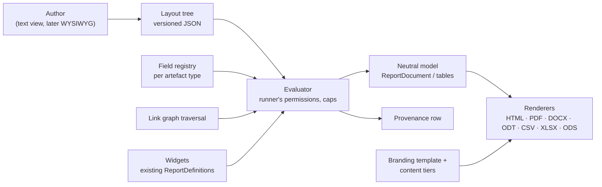
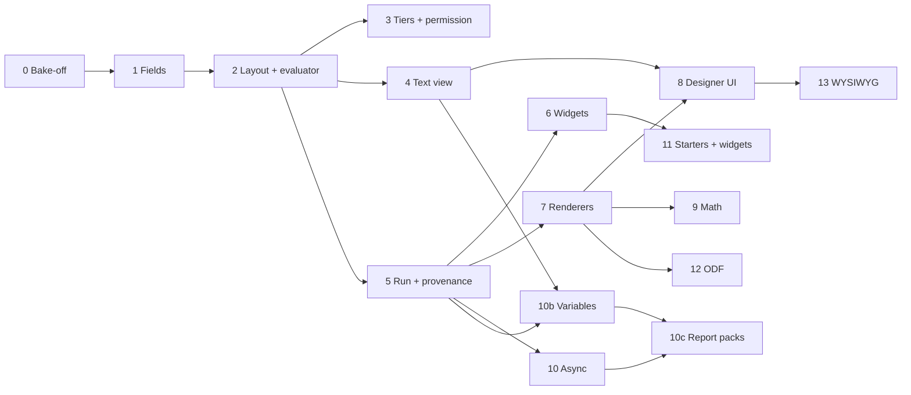

# Module 10 — Reporting & Analysis — Plan

See [future-modules-2026-09-index.md](future-modules-2026-09-index.md) for cross-cutting architecture. Source requirement: [overview §47](completed/future-modules-2026-09-overview.md) (read-only; `docs/requirements.md` stays authoritative).

**Status:** Re-planned 2026-10-20 (supersedes the 2026-09 plan, which predated the core report framework). Phases 0 to 9 done 2026-10-26/27. Phases 10b (run-time variables) and 10c (report packs) added 2026-10-27 at the User's request. **Decision tags:** every decision says `Decided by: User` or `Decided by: Agent`.

## What this module is now

The 2026-09 plan built one bespoke phase per report type (BRD, Engineering Spec, Gap Analysis, Change Impact, …). Since then the core already ships the report framework (`ReportDefinition` + `collect_*`, catalogue, `ReportRunner`, branded PDF/DOCX/CSV from one neutral `ReportDocument`, per-report-type intro/chapters/appendices across template/project/organisation tiers, record codes and tags). So this module becomes **a custom-report designer on top of that framework**:

- A **layout** is a versioned tree of blocks that a person authors: document structure, tables, nested "for each record" blocks over the link graph, `{{record.field}}` values, and **widgets** (`[[widget.gap-analysis]]`) that embed any existing computed report.
- One layout renders to a **document family** (PDF, DOCX, ODT, HTML) or a **table family** (CSV, XLSX, ODS).
- Computed analysis (anti-joins, traversal, scoring) stays in code as collectors; they reach layouts as widgets. Document-shaped reports (BRD, Engineering Spec, review package, design description) become **starter layouts**, not code.

Three orthogonal axes, kept separate: **layout** (what is reported), **branding template** (`ReportTemplate`: how it looks) and **content tiers** (`ReportContent`: boilerplate intro/chapters/appendices). A custom report composes all three; it is keyed `custom.<layout id>` in `ReportContent`, which therefore needs a dynamic key source (today's `valid_report_keys` is registry-only).

## Decisions

| # | Decision | By |
|---|----------|----|
| D1 | Reports are built as custom layouts wherever document- or table-shaped; computed analysis stays code and is reached through widgets. | User |
| D2 | Not limited to documents: table layouts give CSV and multi-sheet XLSX/ODS. | User |
| D3 | Canonical stored form is a versioned JSON tree (`schema_version`); a human-readable text view (directives) is generated from it and editable back, kept lossless by a round-trip test. Each block type declares both forms in one place. | User (JSON durable, text readable), Agent (design) |
| D4 | Group 1 = coded templating (text view + live preview). Group 2 = WYSIWYG editing the same tree, library chosen in its own Phase 0. | User |
| D5 | Widgets sit on their own line, `[[widget.key param=value]]`; parameters validated by the widget's existing `ReportParamDefinition`s; run with the runner's permissions. | User |
| D6 | Output formats: PDF, DOCX, ODT, HTML, CSV, XLSX, ODS, as pluggable renderers. DOCX and XLSX ship first; ODT/ODS follow once the renderer interface has proved itself (Phase 12). Signed off 2026-10-26. | User |
| D7 | **PDF engine: stay on ReportLab.** The Phase 0 bake-off measured WeasyPrint at up to 14 times the memory (2.2 GB at 20,000 rows) and 3 to 10 times the time, so it was rejected; ReportLab embeds equations and SVG figures as vector through `svglib` (tested). HTML preview and the HTML format get their own renderer over the same neutral model. Known PDF limit: no Arabic/Indic shaping, and CJK needs a CJK font (`docs/decisions.md`, "Custom reports Phase 0"). | User |
| D8 | Rejected: Jinja/Liquid/Handlebars. They emit text, not the block model, and open template injection and unvalidated field access. The parser is ours: each, if, field, widget; no expressions. | Agent |
| D9 | Math: delimiters `\( \)` and `$$ $$`, never bare `$`. Recognised in authored text **and in record fields a provider marks math-capable**. TeX is untrusted: a command allow-list runs before conversion (no links, no includes). PDF/HTML show a server-made `ziamath` SVG (plain SVG 1 mode; the PDF embeds it through `svglib`), DOCX a tested OMML subset with an image fallback. | User (scope), Agent (delimiters, sanitiser, renderers) |
| D10 | Every artefact type declares report fields or a stated reason, enforced by a test (same pattern as global search). Fields are opt-in; Restricted and consent-sensitive columns are excluded by omission. | User |
| D11 | Provenance: a `GeneratedReport` row per run (layout id+version, params, scope, caller, UTC time, engine version, format, widgets used, record counts and, for versioned types, record versions; baseline optional until Module 8). No output at rest for synchronous runs. | User (row only), Agent (fields) |
| D12 | Layouts live at organisation **and** project level from day one. | User |
| D13 | New fine-grained permissions "manage organisation report layouts" and "manage project report layouts" (two, signed off 2026-10-26), grantable to users and groups; org admins hold the first by default; project admins the second for their own project. Running needs only access to the report and the data. | User |
| D14 | Runs are synchronous with node/depth/row caps and a timeout; a run expected to exceed a threshold becomes an async job, the user is notified when the download is ready, and **only async output is stored**, expiring after an organisation-set limit (capped by a platform ceiling). | User, Agent (mechanism) |
| D15 | Project-level layout visibility is **additive** (platform starters + organisation + nearest ancestors' + own, de-duplicated by name; a project can hide an inherited one). The Action Types "own rows, else ancestor's" rule would hide every inherited layout as soon as a project made one. Signed off 2026-10-26. | User |
| D16 | A layout is configuration, not an artefact type: no `PREFIX-nnn` code, not linkable, not in global search. Signed off 2026-10-26 with the condition that nothing may prevent promoting a layout to an artefact type later (decisions log, "Custom reports Phase 2", decision 14). | User |
| D17 | An organisation-scope run is a **fan-out**: the organisation layout runs once per project the caller can read and the results are merged, with a selector for which projects are included. Signed off 2026-10-26. | User |
| D18 | **Run-time variables.** A layout declares typed variables (text, number, date, boolean, enum; one value or a list); the person supplies values when running or downloading. Used in conditions (`category in $categories`), `{{var.name}}` text and widget parameters. A value is a typed literal checked at run, never parsed as markup and never an expression, so D8 holds. | User (need), Agent (design) |
| D19 | **Report pack:** a named configuration listing several reports (custom layouts and module reports), each with its own format, rendered with one set of variables into a **zip** with a `manifest.json`. Named "report pack", not "bundle", because "project bundle" already means the project/organisation export and import. | User (need), Agent (name, shape) |
| D20 | A pack declares variables; each entry receives the pack variable of the same name and type, or fixes its own value. A variable names a source field of **any** registered type (requirement category, Pain Point type, Engagement channel, a module's own enums) and offers that field's selectable values as options through a generic value-domain hook on the field provider; a field with no declared domain takes free input with a not-found warning. Never a per-type or per-module case in core. | User (any record type, signed off 2026-10-27), Agent (mechanism) |
| D21 | An entry the runner cannot run (no access, module off) is skipped and listed in the manifest as not available, never silently dropped; a pack with no runnable entry is an error. Signed off 2026-10-27. | User |
| D22 | Packs live at organisation and project level with D15's additive visibility, hide/restore, and travel in the bundles. Managing one needs the same D13 permissions as managing layouts (no new permission). Signed off 2026-10-27. | User |
| D23 | Variables **narrow what a report shows; they are not access control.** The zip holds whatever the runner can read within the chosen values, so the download form shows record counts per entry before download, and the manifest records the values used. | Agent |
| D24 | **Saved variable sets** per pack (for example "Team Alpha: categories A, B"): named values a downloader picks, so a repeat download for the same external team is one click. An organisation pack's sets can be **overridden per project** (the values, per variable; a variable left unset falls back, and the override can be reset to the organisation value), and a project can **add its own sets** beside them. Nearest ancestor project's override wins, then the organisation's (the nested-project fallback rule). Editing needs the D13 project permission. Signed off 2026-10-27. | User (sets, per-project override, own sets, permission), Agent (per-variable fallback, nested rule applied) |
| D25 | In an organisation pack's fan-out run, each project's entries use that project's effective saved set (its override applied), and the manifest lists the values used per project. Signed off 2026-10-27. | User (agreed Agent's recommendation) |

## Status / Resume Here

10 / 18 phases complete (Phases 0 to 9, 2026-10-26 and 2026-10-27; findings in `docs/decisions.md`, "Custom reports Phase 0" to "Phase 9"). Phase 9 shipped math: an `equation` block and `\( \)` / `$$ $$` in text (the author's text and record fields a provider marks math-capable), a TeX command allow-list, `ziamath` SVG for HTML and PDF, native Word equations for a tested subset (a picture otherwise), and the source as written when an equation cannot be drawn (`services/report_math.py`, decisions log "Custom reports Phase 9"); equations also work in headings, list items and table cells, and KaTeX draws the math-capable requirement fields on record screens (**User**, decisions 3 and 5). Phase 8 shipped the designer: layout list (Report Setup, Templates & reports), text editor with checked problems by line, block/field/widget insertion at the caret, sandboxed live preview (`POST .../preview`, nothing stored), save as versions with conflict handling, History with line comparison, hide/restore and copy of shared layouts; no condition builder (deferred to Phase 13, decisions log "Custom reports Phase 8", decision 5). It builds on the text view endpoints, the HTML format and the widget list (`GET …/report-layouts/widgets`). Phase 6 shipped widgets: a widget is one component of a report (a declared table, its `figures` or its `notes`), keyed `<module key>.<slug>.<part>` and written `[[widget.<key> name=value]]`; it adds no heading or prose, so the layout owns the words (**User** correction); the report's own collector and gate run per project, once per report and settings (decisions log "Custom reports Phase 6"). Phase 11's Gap Analysis and Change Impact collectors become widgets by being registered as reports. The condition language grew in the same session at the User's request (`in` / `not_in` on every kind of field, `and` / `or` / `not` with brackets, widget `sort`; decisions log "Custom reports: conditions"); conditions are written in the text view (a condition builder is left to the WYSIWYG editor, Phase 13). Phase 5 shipped the run routes (project, and organisation-wide as a fan-out per project with a Projects selector), both catalogues, content tiers keyed `custom.<layout id>` (portable in bundles), the `generated_reports` provenance row and the MCP tools. Phase 7 shipped the renderer registry (`services/report_render.py`): HTML, PDF, Word (document) and CSV (zip for several sheets), XLSX (table), plus the sanitised SVG `Image` and the ReportLab 5.1 upgrade `svglib` needs; ODT/ODS (Phase 12) and the equation block (Phase 9) register on it. Open for Phase 10: provenance rows are never expired (retention policy gap 3). Provenance records the version of every versioned record (bounded at 20,000 per run, with a digest over all records alongside; **Decided by: User**, decisions log "Custom reports Phase 5", decision 8).

| # | Phase | Group | Status |
|---|-------|-------|--------|
| 0 | Exploratory: PDF-engine bake-off, math, ODF libraries, tree schema | 1 | [x] |
| 1 | Report field registry and traversal | 1 | [x] |
| 2 | Layout model, tree schema, versioning, evaluator | 1 | [x] |
| 3 | Tiers, permission, hide/restore, bundle export/import | 1 | [x] |
| 4 | Text view: parser, serialiser, round-trip | 1 | [x] |
| 5 | Run pipeline: caps, provenance, catalogue and MCP merge | 1 | [x] |
| 6 | Widgets | 1 | [x] |
| 7 | Renderers: interface, HTML, CSV/XLSX, DOCX, PDF | 1 | [x] |
| 8 | Designer UI (text view, field picker, live preview) | 1 | [x] |
| 9 | Math | 1 | [x] |
| 10 | Async runs, expiring output, notification | 1 | [ ] |
| 10b | Run-time variables | 1 | [ ] |
| 10c | Report packs (zip of several reports, with variables) | 1 | [ ] |
| 11 | Starter layouts; Executive Gap Analysis and Change Impact widgets | 1 | [ ] |
| 12 | ODT and ODS renderers | 1 | [ ] |
| 13 | WYSIWYG editor (its own Phase 0 first) | 2 | [ ] |
| 14 | AI-assisted analysis (exploratory, deferred) | 2 | [ ] |
| 15 | Docs website coverage (incremental) | — | [ ] |

## Phase specs

Each phase: **Why** (risk addressed) and **Outcome**. Every phase also carries the standing checklist below.

**0 — Exploratory.** Bake-off of three PDF paths: ReportLab with equation images, WeasyPrint on HTML, headless Chromium on HTML. Criteria: fidelity to the HTML view, image weight, lock-down of fetches (no `file://`, no network; images only as pre-resolved bytes), effort to migrate the 30+ existing reports, header/footer/page-number/landscape/repeating-header support, and SVG figures (needed by [Module 16](module-16-workflow-capture-plan.md)'s diagrams): inline-SVG fidelity per engine, the rasteriser DOCX needs because `python-docx` cannot embed SVG, bundled fonts and label wrapping. Also: LaTeX→OMML for DOCX (`latex2mathml` + Office's `MML2OMML.XSL`, whose redistribution terms need checking), ODF libraries for ODT/ODS, the draft tree vocabulary, how a Pain Point's affected Stakeholders are stored (assumed `ArtefactLink`; verify), and the sync/async threshold method. *Why:* the engine choice is expensive to reverse and switching engines alone does not solve math without a browser. *Outcome:* decisions in `docs/decisions.md` (done: stay on ReportLab, `ziamath` + `svglib`, OMML subset with image fallback, `resvg-py`, `odfpy`, `openpyxl`).

**1 — Field registry and traversal.** A generic `ModuleDefinition.report_fields[type]` provider (modelled on `search_providers`): opt-in fields with label, kind (text, number, date, enum with label map, math-capable text) and getter; batch loader; codes via `ctx.code`/`org_code`, tags via `ctx.tag_text`. Traversal reuses `link_graph` as the single authorisation point; hidden nodes are counted, never named. Coverage test with `not_reportable` reasons. *Why:* without a registry each layout would hand-query tables, leak columns or break the module boundary. *Outcome:* every registered type is selectable in a layout or has a recorded reason.

**2 — Layout model and evaluator.** `ReportLayout` and immutable `ReportLayoutVersion` rows (tree + hash; editing creates a version; a run pins one). Tree schema validated on save: depth and node caps, field names against the registry, widget params against declarations, no raw HTML block. Evaluator walks the tree for the caller and emits the neutral model; placeholders are substituted into parsed text blocks, extending the existing rule that a value never becomes markup. *Why:* §47.8 requires versioned templates; injection and unbounded work are the main risks. *Outcome:* the user's example (requirements by component and category → linked Pain Points by title → affected Stakeholders) runs from a layout.

**3 — Tiers, permission, hide/restore, bundle.** Organisation and project scope per D12/D15; two "manage report layouts" permissions, organisation and project (each grantable to users and groups, per the parity rule); hide/restore of inherited layouts via `ProjectDefinitionSuppression`; layouts and their versions travel in the org and project bundles. *Why:* project-level and org-default rules in CLAUDE.md. *Outcome:* a project admin can author, hide an inherited layout and restore it.

**4 — Text view.** Parser and serialiser for the directive syntax; round-trip property test (tree → text → tree) and error positions in messages. *Why:* D3 only holds if the two forms cannot drift. *Outcome:* every block type is editable as text.

**5 — Run pipeline.** `…/custom-reports/{id}/run?format=` for project and organisation scope, framework-level `report_template_id` and content tiers applied, `GeneratedReport` provenance, merge into both report catalogues and MCP. *Why:* custom reports must be indistinguishable from module reports to the Reports page. *Outcome:* a layout appears in the catalogue and runs in the shared `ReportRunner`.

**6 — Widgets.** Adapter exposing a component of any `ReportDefinition` result (a declared table, the figures, the notes) as blocks, never prose; per-widget parameter forms (the designer's, Phase 8, from the widget list); widget keys listed in the designer (the list endpoint and MCP tool are built). *Why:* D1/D5, reuse of existing computed reports. *Outcome:* `[[widget.gap-analysis]]` embeds in a document layout.

**7 — Renderers.** Pluggable renderer interface over the neutral model; HTML (also the live preview), CSV (zip when multi-table), XLSX, DOCX, PDF stays on ReportLab, with a separate HTML renderer for the preview and format; equations and SVG figures embed as vector through `svglib` (SVG rejected if it contains a DOCTYPE or entity; `resvg-py` PNG if `svglib` raises). A bundled Unicode font is registered, and the same font directory goes to `resvg-py`. Spreadsheet cells go through `csv_safe`-equivalent formula guards. The neutral `Image` block gains an SVG-source form that each renderer converts (today it holds raster bytes only), so modules can contribute vector figures without importing an engine. Existing reports keep their ReportLab path. *Why:* formats must not drift. *Outcome:* one layout, every shipped format, visually consistent documents.

**8 — Designer UI.** Create/edit/version/compare, text editor with parse errors, field picker (`{{…}}` insertion), widget picker, live preview, shared `Tabs`/`Toast`/confirm patterns, `help` text on non-obvious fields. *Outcome:* a non-developer can reproduce the example report.

**9 — Math.** `Equation` block; KaTeX for screen and HTML; PDF equations from `ziamath` with `svg2 = False`; DOCX native equations for the subset a golden test pins (square roots need `<m:deg>` added to `mathml2omml` output) with the equation image otherwise; verify one sample in Word and LibreOffice (with `libreoffice-math`) before release; command allow-list before TeX conversion and element allow-list on the SVG; fallback shows the source. *Why:* annotations; TeX in data is an injection path. *Outcome:* equations render in every document format or degrade to source.

**10 — Async runs.** Job state on `GeneratedReport` (queued, running, ready, expired, failed), object-storage output, a notification type, an organisation setting for retention (with a platform ceiling), a singleton expiry job started through the lifespan's `start_singletons`, download that re-checks caller and access, deletion with the organisation. Update the data-retention and classification policies and note any encryption gap. *Why:* D14; stored output is Confidential data at rest. *Outcome:* a large run notifies when ready and disappears on schedule.

**10b — Run-time variables.** A layout's root gains an optional `variables` list (name, type, label, default, single or list, optional source field of any registered type, whose declared value domain supplies the options; the hook is generic, with a coverage-style test that each core field with a closed vocabulary declares one or a reason). References: a condition value `{"var": "categories"}` (kind-checked against the field at save, so `in` takes a list variable and `eq` a single one), `{{var.name}}` in text (a global placeholder family, so it stays text, never markup) and a widget parameter bound to a variable of the declared type. Text view gets a matching `@var` directive in the same change (round-trip test). Run routes (project, organisation fan-out, preview, MCP `run_report`) accept values, validate them against the declaration (type, options, `MAX_IN_VALUES`) and record them in the `GeneratedReport` params. The Reports page and designer preview render a generated form from the declaration, like module report parameters. A date variable is the person's own calendar date (`X-Client-Date` for its default). Additive to tree schema 1, so no version bump. Values are never logged, only names and counts. *Why:* D18; one template layout must serve many scopes without copies that drift. *Outcome:* a layout of requirements by category runs for categories X and Y only, from the form, preview and MCP.

**10c — Report packs.** `ReportPack` and immutable `ReportPackVersion` rows (the layout versioning pattern): ordered entries `{layout ref | module report key, format, filename, fixed variable values}`, pack variables, optional default branding template. Layouts are referenced by name and tier (portable in bundles), resolved for the project it runs in. Run route `…/report-packs/{id}/run` (project and organisation) renders each entry through the existing `ReportRunner` as the caller, so every entry keeps its own gate, caps and record codes, and returns a zip: the files, plus `manifest.json` (pack and entry versions, variable values, record counts, entries not available, UTC time; no cell values). Filenames are sanitised, unique and flat (no paths); total size, entry count and wall time are capped. One `GeneratedReport` row per entry sharing a `pack_run_id`. A pack over the sync threshold goes through Phase 10's async path, which stores the zip like any async output. Download form: variables, a **preview of record counts per entry** (nothing stored), then download. Saved variable sets (D24): `ReportPackVariableSet` rows at organisation or project scope, plus a per-project override row (pack, set, variable values) that layers over an organisation set, nearest ancestor first. The project's sets screen shows each organisation default beside the project's value with a reset, as the style guide's platform-default pattern requires. Picked on the download form for a one-click repeat; a stored value naming an option that no longer exists is flagged on the form, not silently dropped. Sets and overrides travel in the org and project bundles (an override by portable key of its pack and set), with a round-trip test, and appear in the manifest by name. Values are config, never logged. Tiers, additive visibility, hide/restore, org and project bundle hooks, MCP `run_report_pack` (writes gated as D14's tools; skill updated), docs, e2e. *Why:* D19; handing an external team a standard set of documents should not be a manual run-and-collect per report. *Outcome:* one project pack (overview and strategy in PDF, requirements and Pain Points as XLSX) downloaded for categories X, Y, Z only; the manifest says what was included.

**11 — Starters and analysis widgets.** Read-only, clonable starter layouts: Business Requirements Document (§47.3), Engineering Specification (§47.4), review package, design description, plus the example as the e2e fixture. Executive Gap Analysis (§47.5) and Engineering Change Impact (§47.6, reusing Change Management and distinguishing direct, transitive and inferred impacts) as collectors exposed as widgets. A section whose source module is off is omitted, never an error. *Outcome:* acceptance criteria 1–4.

**12 — ODT and ODS.** Two renderers on the Phase 7 interface. *Outcome:* all seven formats.

**13 — WYSIWYG.** Phase 0 first: block-outline editor against a rich-text editor with custom nodes; HTML renderer as live preview; must edit the canonical tree and keep the text view in sync. *Outcome:* the same layouts editable without the text syntax.

**14 — AI-assisted analysis (§47.9).** Deferred as before; findings cite source artefacts and stay distinguishable from approved data. Its own Phase 0 when picked up.

**15 — Docs website.** Per slice as each phase ships: engine and provenance page with a Mermaid flow, designer how-to, widget list, format notes, starter layouts. Screenshots at 1440×900 against the seeded demo dataset under `docs/website/static/img/screenshots/`, with alt text and a caption; at least one screenshot or diagram per page. **Decided by: User** (2026-09-21/22, carried over).

## Standing checklist per phase

- **Module boundary:** nothing per-module in a core file; field providers, widgets and renderers are generic extension points. Check core enums, columns and constants for closed vocabularies a module would need an entry in.
- **Time:** run time and version times are past instants in UTC; date parameters use the caller's day via `X-Client-Date`/`effective_today()`; test boundary hours (09:00 UTC+10, 23:00 UTC-8). No scheduled future times are introduced.
- **Security:** identify → verify → remediate recorded in `docs/decisions.md` for each phase; consult the access-control, data-classification, retention and secure-development policies. Output of a run never exceeds what the runner can read; no Restricted columns; the layout text is never logged beyond ids and counts.
- **Users and groups parity:** any person-valued field, filter or permission accepts a group too.
- **MCP:** write-enabled tools (`list/get/create/update/delete` layouts, `run_report`) gated by `MCP_WRITES_ENABLED` and the caller's RBAC. Core tools update `mcp-server/skill/reqtrack-mcp/SKILL.md` and run `python scripts/generate_skill_reference.py`; widget-contributed module reports follow the module `mcp_guidance.md` rule. **Decided by: User** (2026-09-21/22, carried over).
- **Tests:** backend test per behaviour; Playwright spec per UI feature; Storybook stories per component; specs idempotent; seeds (`seed_demo_data.py`, `seed_e2e_dataset.py`) gain a layout; one pytest run at a time.
- **Docs:** `docs/modules.md` §4g, `docs/solution-architecture.md`, README, website, in-app help; run `python scripts/check_doc_links.py`.

## Risks

| Risk | Mitigation |
|------|------------|
| ReportLab cannot shape Arabic/Indic text | Accepted limit; DOCX, ODT and HTML are unaffected; revisit if such users appear |
| Text view and JSON drift | Single declaration per block type; round-trip property test |
| Unbounded traversal or huge output | Depth, node and row caps; async path; timeout |
| Layout author reads data they should not | Runs with the runner's permissions; hidden nodes counted not named |
| TeX or HTML in data used as an attack | Sanitiser, no raw HTML, locked-down fetchers |
| Wrong variable choice sends too much to an external team | D23: counts preview before download, values in manifest and provenance; docs say variables are not access control |
| A category filter scopes the root records only; linked records reached by traversal show whatever their category | Stated in the designer help and docs; the author puts the condition on every `each` that must be narrowed |
| A pack becomes slow or huge | Entry, size and time caps; async path (Phase 10) |
| Zip filenames from user text (path traversal) | Server-built flat names from a sanitiser; test with `../`, absolute paths and duplicates |
| Async output outlives its purpose | Organisation retention setting, platform ceiling, expiry job |

## Open questions

1. Tree vocabulary drafted in Phase 0; the text syntax's exact grammar is Phase 4's.
2. Sync/async threshold: a cheap count pre-pass against a limit is proposed (an in-flight hand-off across workers is not) — **Agent**, tune with data.
3. D15 and D16: signed off 2026-10-26.
4. D6 staging of ODT/ODS: signed off 2026-10-26.
5. Manage permission: two separate permissions (organisation layouts, project layouts), signed off 2026-10-26.
6. Restricted-TeX subset: `latex2mathml` has no macros, so the sanitiser allow-lists commands rather than capping expansion; the allow-list is in `services/report_math.py` (done, Phase 9).
7. Variable options: resolved 2026-10-27 (D20): a generic value-domain hook on field providers, for any record type. Its exact signature (project-scoped, organisation-scoped for fan-out runs) is 10b's first step. **Agent**
8. Saved variable sets: resolved 2026-10-27 (D24).
9. Inaccessible pack entries: resolved 2026-10-27 (D21).
10. Organisation fan-out: resolved 2026-10-27 (D25).

## Acceptance criteria (overview §48, plus this plan)

- Business Requirements Documents and Engineering Specifications can be generated from authoritative project data (starter layouts).
- Executive Gap Analyses compare defined current and future states, each finding tracing to artefacts.
- Engineering Change Impact reports identify direct and transitive impacts of an existing change.
- Generated reports record source baseline/version and report/layout provenance.
- Layouts are versioned.
- Reports do not silently become a second source of truth.
- AI-assisted analysis is distinguishable from approved project information.
- A person can author a custom layout (the requirements → Pain Points → Stakeholders example) and export it as PDF, DOCX, ODT, HTML, CSV, XLSX and ODS.
- A layout never shows data its runner cannot read.
- A layout with variables runs for chosen values from the Reports page, the preview and MCP, and records the values used.
- A report pack downloads as one zip of several reports in their chosen formats, with a manifest, for a chosen set of variable values; an entry the runner cannot run is listed, not hidden.
