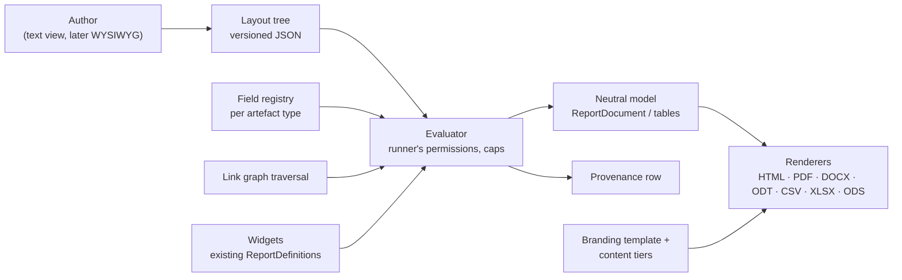
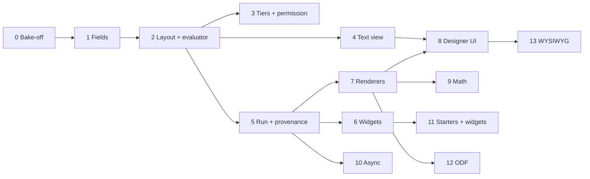

# Module 10 — Reporting & Analysis — Plan

See [future-modules-2026-09-index.md](future-modules-2026-09-index.md) for cross-cutting architecture. Source requirement: [overview §47](completed/future-modules-2026-09-overview.md) (read-only; `docs/requirements.md` stays authoritative).

**Status:** Re-planned 2026-10-20 (supersedes the 2026-09 plan, which predated the core report framework). Phase 0 done 2026-10-26. **Decision tags:** every decision says `Decided by: User` or `Decided by: Agent`.

## What this module is now

The 2026-09 plan built one bespoke phase per report type (BRD, Engineering Spec, Gap Analysis, Change Impact, …). Since then the core already ships the report framework (`ReportDefinition` + `collect_*`, catalogue, `ReportRunner`, branded PDF/DOCX/CSV from one neutral `ReportDocument`, per-report-type intro/chapters/appendices across template/project/organisation tiers, record codes and tags). So this module becomes **a custom-report designer on top of that framework**:

- A **layout** is a versioned tree of blocks that a person authors: document structure, tables, nested "for each record" blocks over the link graph, `{{record.field}}` values, and **widgets** (`[[widget.gap-analysis]]`) that embed any existing computed report.
- One layout renders to a **document family** (PDF, DOCX, ODT, HTML) or a **table family** (CSV, XLSX, ODS).
- Computed analysis (anti-joins, traversal, scoring) stays in code as collectors; they reach layouts as widgets. Document-shaped reports (BRD, Engineering Spec, review package, design description) become **starter layouts**, not code.

Three orthogonal axes, kept separate: **layout** (what is reported), **branding template** (`ReportTemplate`: how it looks) and **content tiers** (`ReportContent`: boilerplate intro/chapters/appendices). A custom report composes all three; it is keyed `custom.<layout id>` in `ReportContent`, which therefore needs a dynamic key source (today's `valid_report_keys` is registry-only).

## Decisions

| # | Decision | By |
|---|----------|----|
| D1 | Reports are built as custom layouts wherever document- or table-shaped; computed analysis stays code and is reached through widgets. | User |
| D2 | Not limited to documents: table layouts give CSV and multi-sheet XLSX/ODS. | User |
| D3 | Canonical stored form is a versioned JSON tree (`schema_version`); a human-readable text view (directives) is generated from it and editable back, kept lossless by a round-trip test. Each block type declares both forms in one place. | User (JSON durable, text readable), Agent (design) |
| D4 | Group 1 = coded templating (text view + live preview). Group 2 = WYSIWYG editing the same tree, library chosen in its own Phase 0. | User |
| D5 | Widgets sit on their own line, `[[widget.key param=value]]`; parameters validated by the widget's existing `ReportParamDefinition`s; run with the runner's permissions. | User |
| D6 | Output formats: PDF, DOCX, ODT, HTML, CSV, XLSX, ODS, as pluggable renderers. DOCX and XLSX ship first; ODT/ODS follow once the renderer interface has proved itself (staging is **Agent**; the user listed all seven for release one — confirm). | User / Agent |
| D7 | **PDF engine: stay on ReportLab.** The Phase 0 bake-off measured WeasyPrint at up to 14 times the memory (2.2 GB at 20,000 rows) and 3 to 10 times the time, so it was rejected; ReportLab embeds equations and SVG figures as vector through `svglib` (tested). HTML preview and the HTML format get their own renderer over the same neutral model. Known PDF limit: no Arabic/Indic shaping, and CJK needs a CJK font (`docs/decisions.md`, "Custom reports Phase 0"). | User |
| D8 | Rejected: Jinja/Liquid/Handlebars. They emit text, not the block model, and open template injection and unvalidated field access. The parser is ours: each, if, field, widget; no expressions. | Agent |
| D9 | Math: delimiters `\( \)` and `$$ $$`, never bare `$`. Recognised in authored text **and in record fields a provider marks math-capable**. TeX is untrusted: a command allow-list runs before conversion (no links, no includes). PDF/HTML show a server-made `ziamath` SVG (plain SVG 1 mode; the PDF embeds it through `svglib`), DOCX a tested OMML subset with an image fallback. | User (scope), Agent (delimiters, sanitiser, renderers) |
| D10 | Every artefact type declares report fields or a stated reason, enforced by a test (same pattern as global search). Fields are opt-in; Restricted and consent-sensitive columns are excluded by omission. | User |
| D11 | Provenance: a `GeneratedReport` row per run (layout id+version, params, scope, caller, UTC time, engine version, format, widgets used, record counts and, for versioned types, record versions; baseline optional until Module 8). No output at rest for synchronous runs. | User (row only), Agent (fields) |
| D12 | Layouts live at organisation **and** project level from day one. | User |
| D13 | New fine-grained permission "manage report layouts", grantable to users and groups; org admins hold it by default; project admins for their own project's layouts. Running needs only access to the report and the data. | User |
| D14 | Runs are synchronous with node/depth/row caps and a timeout; a run expected to exceed a threshold becomes an async job, the user is notified when the download is ready, and **only async output is stored**, expiring after an organisation-set limit (capped by a platform ceiling). | User, Agent (mechanism) |
| D15 | Project-level layout visibility is **additive** (platform starters + organisation + nearest ancestors' + own, de-duplicated by name; a project can hide an inherited one). The Action Types "own rows, else ancestor's" rule would hide every inherited layout as soon as a project made one. Needs user sign-off as it departs from the reference implementation. | Agent (proposed) |
| D16 | A layout is configuration, not an artefact type: no `PREFIX-nnn` code, not linkable, not in global search. Record in `docs/decisions.md` when built. | Agent (proposed) |

## Status / Resume Here

1 / 16 phases complete (Phase 0, 2026-10-26; findings in `docs/decisions.md`, "Custom reports Phase 0"). Phase 1 is next. D6, D15 and D16 still need user sign-off before Phases 3 and 12.

| # | Phase | Group | Status |
|---|-------|-------|--------|
| 0 | Exploratory: PDF-engine bake-off, math, ODF libraries, tree schema | 1 | [x] |
| 1 | Report field registry and traversal | 1 | [ ] |
| 2 | Layout model, tree schema, versioning, evaluator | 1 | [ ] |
| 3 | Tiers, permission, hide/restore, bundle export/import | 1 | [ ] |
| 4 | Text view: parser, serialiser, round-trip | 1 | [ ] |
| 5 | Run pipeline: caps, provenance, catalogue and MCP merge | 1 | [ ] |
| 6 | Widgets | 1 | [ ] |
| 7 | Renderers: interface, HTML, CSV/XLSX, DOCX, PDF | 1 | [ ] |
| 8 | Designer UI (text view, field picker, live preview) | 1 | [ ] |
| 9 | Math | 1 | [ ] |
| 10 | Async runs, expiring output, notification | 1 | [ ] |
| 11 | Starter layouts; Executive Gap Analysis and Change Impact widgets | 1 | [ ] |
| 12 | ODT and ODS renderers | 1 | [ ] |
| 13 | WYSIWYG editor (its own Phase 0 first) | 2 | [ ] |
| 14 | AI-assisted analysis (exploratory, deferred) | 2 | [ ] |
| 15 | Docs website coverage (incremental) | — | [ ] |

## Phase specs

Each phase: **Why** (risk addressed) and **Outcome**. Every phase also carries the standing checklist below.

**0 — Exploratory.** Bake-off of three PDF paths: ReportLab with equation images, WeasyPrint on HTML, headless Chromium on HTML. Criteria: fidelity to the HTML view, image weight, lock-down of fetches (no `file://`, no network; images only as pre-resolved bytes), effort to migrate the 30+ existing reports, header/footer/page-number/landscape/repeating-header support, and SVG figures (needed by [Module 16](module-16-workflow-capture-plan.md)'s diagrams): inline-SVG fidelity per engine, the rasteriser DOCX needs because `python-docx` cannot embed SVG, bundled fonts and label wrapping. Also: LaTeX→OMML for DOCX (`latex2mathml` + Office's `MML2OMML.XSL`, whose redistribution terms need checking), ODF libraries for ODT/ODS, the draft tree vocabulary, how a Pain Point's affected Stakeholders are stored (assumed `ArtefactLink`; verify), and the sync/async threshold method. *Why:* the engine choice is expensive to reverse and switching engines alone does not solve math without a browser. *Outcome:* decisions in `docs/decisions.md` (done: stay on ReportLab, `ziamath` + `svglib`, OMML subset with image fallback, `resvg-py`, `odfpy`, `openpyxl`).

**1 — Field registry and traversal.** A generic `ModuleDefinition.report_fields[type]` provider (modelled on `search_providers`): opt-in fields with label, kind (text, number, date, enum with label map, math-capable text) and getter; batch loader; codes via `ctx.code`/`org_code`, tags via `ctx.tag_text`. Traversal reuses `link_graph` as the single authorisation point; hidden nodes are counted, never named. Coverage test with `not_reportable` reasons. *Why:* without a registry each layout would hand-query tables, leak columns or break the module boundary. *Outcome:* every registered type is selectable in a layout or has a recorded reason.

**2 — Layout model and evaluator.** `ReportLayout` and immutable `ReportLayoutVersion` rows (tree + hash; editing creates a version; a run pins one). Tree schema validated on save: depth and node caps, field names against the registry, widget params against declarations, no raw HTML block. Evaluator walks the tree for the caller and emits the neutral model; placeholders are substituted into parsed text blocks, extending the existing rule that a value never becomes markup. *Why:* §47.8 requires versioned templates; injection and unbounded work are the main risks. *Outcome:* the user's example (requirements by component and category → linked Pain Points by title → affected Stakeholders) runs from a layout.

**3 — Tiers, permission, hide/restore, bundle.** Organisation and project scope per D12/D15; the "manage report layouts" permission (users and groups, per the parity rule); hide/restore of inherited layouts via `ProjectDefinitionSuppression`; layouts and their versions travel in the org and project bundles. *Why:* project-level and org-default rules in CLAUDE.md. *Outcome:* a project admin can author, hide an inherited layout and restore it.

**4 — Text view.** Parser and serialiser for the directive syntax; round-trip property test (tree → text → tree) and error positions in messages. *Why:* D3 only holds if the two forms cannot drift. *Outcome:* every block type is editable as text.

**5 — Run pipeline.** `…/custom-reports/{id}/run?format=` for project and organisation scope, framework-level `report_template_id` and content tiers applied, `GeneratedReport` provenance, merge into both report catalogues and MCP. *Why:* custom reports must be indistinguishable from module reports to the Reports page. *Outcome:* a layout appears in the catalogue and runs in the shared `ReportRunner`.

**6 — Widgets.** Adapter exposing any `ReportDefinition` result (sections, metrics, notes) as blocks; per-widget parameter forms; widget keys listed in the designer. *Why:* D1/D5, reuse of existing computed reports. *Outcome:* `[[widget.gap-analysis]]` embeds in a document layout.

**7 — Renderers.** Pluggable renderer interface over the neutral model; HTML (also the live preview), CSV (zip when multi-table), XLSX, DOCX, PDF stays on ReportLab, with a separate HTML renderer for the preview and format; equations and SVG figures embed as vector through `svglib` (SVG rejected if it contains a DOCTYPE or entity; `resvg-py` PNG if `svglib` raises). A bundled Unicode font is registered, and the same font directory goes to `resvg-py`. Spreadsheet cells go through `csv_safe`-equivalent formula guards. The neutral `Image` block gains an SVG-source form that each renderer converts (today it holds raster bytes only), so modules can contribute vector figures without importing an engine. Existing reports keep their ReportLab path. *Why:* formats must not drift. *Outcome:* one layout, every shipped format, visually consistent documents.

**8 — Designer UI.** Create/edit/version/compare, text editor with parse errors, field picker (`{{…}}` insertion), widget picker, live preview, shared `Tabs`/`Toast`/confirm patterns, `help` text on non-obvious fields. *Outcome:* a non-developer can reproduce the example report.

**9 — Math.** `Equation` block; KaTeX for screen and HTML; PDF equations from `ziamath` with `svg2 = False`; DOCX native equations for the subset a golden test pins (square roots need `<m:deg>` added to `mathml2omml` output) with the equation image otherwise; verify one sample in Word and LibreOffice (with `libreoffice-math`) before release; command allow-list before TeX conversion and element allow-list on the SVG; fallback shows the source. *Why:* annotations; TeX in data is an injection path. *Outcome:* equations render in every document format or degrade to source.

**10 — Async runs.** Job state on `GeneratedReport` (queued, running, ready, expired, failed), object-storage output, a notification type, an organisation setting for retention (with a platform ceiling), a singleton expiry job started through the lifespan's `start_singletons`, download that re-checks caller and access, deletion with the organisation. Update the data-retention and classification policies and note any encryption gap. *Why:* D14; stored output is Confidential data at rest. *Outcome:* a large run notifies when ready and disappears on schedule.

**11 — Starters and analysis widgets.** Read-only, clonable starter layouts: Business Requirements Document (§47.3), Engineering Specification (§47.4), review package, design description, plus the example as the e2e fixture. Executive Gap Analysis (§47.5) and Engineering Change Impact (§47.6, reusing Change Management and distinguishing direct, transitive and inferred impacts) as collectors exposed as widgets. A section whose source module is off is omitted, never an error. *Outcome:* acceptance criteria 1–4.

**12 — ODT and ODS.** Two renderers on the Phase 7 interface. *Outcome:* all seven formats.

**13 — WYSIWYG.** Phase 0 first: block-outline editor against a rich-text editor with custom nodes; HTML renderer as live preview; must edit the canonical tree and keep the text view in sync. *Outcome:* the same layouts editable without the text syntax.

**14 — AI-assisted analysis (§47.9).** Deferred as before; findings cite source artefacts and stay distinguishable from approved data. Its own Phase 0 when picked up.

**15 — Docs website.** Per slice as each phase ships: engine and provenance page with a Mermaid flow, designer how-to, widget list, format notes, starter layouts. Screenshots at 1440×900 against the seeded demo dataset under `docs/website/static/img/screenshots/`, with alt text and a caption; at least one screenshot or diagram per page. **Decided by: User** (2026-09-21/22, carried over).

## Standing checklist per phase

- **Module boundary:** nothing per-module in a core file; field providers, widgets and renderers are generic extension points. Check core enums, columns and constants for closed vocabularies a module would need an entry in.
- **Time:** run time and version times are past instants in UTC; date parameters use the caller's day via `X-Client-Date`/`effective_today()`; test boundary hours (09:00 UTC+10, 23:00 UTC-8). No scheduled future times are introduced.
- **Security:** identify → verify → remediate recorded in `docs/decisions.md` for each phase; consult the access-control, data-classification, retention and secure-development policies. Output of a run never exceeds what the runner can read; no Restricted columns; the layout text is never logged beyond ids and counts.
- **Users and groups parity:** any person-valued field, filter or permission accepts a group too.
- **MCP:** write-enabled tools (`list/get/create/update/delete` layouts, `run_report`) gated by `MCP_WRITES_ENABLED` and the caller's RBAC. Core tools update `mcp-server/skill/reqtrack-mcp/SKILL.md` and run `python scripts/generate_skill_reference.py`; widget-contributed module reports follow the module `mcp_guidance.md` rule. **Decided by: User** (2026-09-21/22, carried over).
- **Tests:** backend test per behaviour; Playwright spec per UI feature; Storybook stories per component; specs idempotent; seeds (`seed_demo_data.py`, `seed_e2e_dataset.py`) gain a layout; one pytest run at a time.
- **Docs:** `docs/modules.md` §4g, `docs/solution-architecture.md`, README, website, in-app help; run `python scripts/check_doc_links.py`.

## Risks

| Risk | Mitigation |
|------|------------|
| ReportLab cannot shape Arabic/Indic text | Accepted limit; DOCX, ODT and HTML are unaffected; revisit if such users appear |
| Text view and JSON drift | Single declaration per block type; round-trip property test |
| Unbounded traversal or huge output | Depth, node and row caps; async path; timeout |
| Layout author reads data they should not | Runs with the runner's permissions; hidden nodes counted not named |
| TeX or HTML in data used as an attack | Sanitiser, no raw HTML, locked-down fetchers |
| Async output outlives its purpose | Organisation retention setting, platform ceiling, expiry job |

## Open questions

1. Tree vocabulary drafted in Phase 0; the text syntax's exact grammar is Phase 4's.
2. Sync/async threshold: a cheap count pre-pass against a limit is proposed (an in-flight hand-off across workers is not) — **Agent**, tune with data.
3. D15 (additive project visibility) and D16 (layouts are not artefact types) need sign-off.
4. D6 staging of ODT/ODS: confirm Phase 12 is acceptable for release one.
5. Whether the manage permission is separate for org and project tiers (proposed: one permission, scoped by where it is granted).
6. Restricted-TeX subset: `latex2mathml` has no macros, so the sanitiser allow-lists commands rather than capping expansion; the exact allow-list is Phase 9's.

## Acceptance criteria (overview §48, plus this plan)

- Business Requirements Documents and Engineering Specifications can be generated from authoritative project data (starter layouts).
- Executive Gap Analyses compare defined current and future states, each finding tracing to artefacts.
- Engineering Change Impact reports identify direct and transitive impacts of an existing change.
- Generated reports record source baseline/version and report/layout provenance.
- Layouts are versioned.
- Reports do not silently become a second source of truth.
- AI-assisted analysis is distinguishable from approved project information.
- A person can author a custom layout (the requirements → Pain Points → Stakeholders example) and export it as PDF, DOCX, ODT, HTML, CSV, XLSX and ODS.
- A layout never shows data its runner cannot read.
