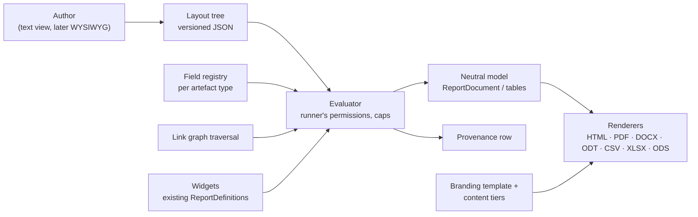
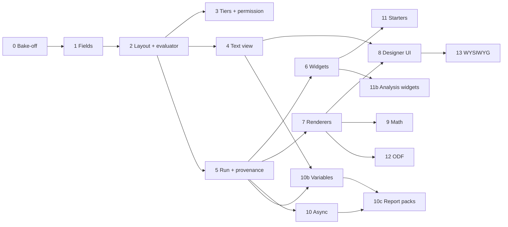

# Module 10 — Reporting & Analysis — Plan

See [future-modules-2026-09-index.md](future-modules-2026-09-index.md) for cross-cutting architecture. Source requirement: [overview §47](completed/future-modules-2026-09-overview.md) (read-only; `docs/requirements.md` stays authoritative).

**Status:** Re-planned 2026-10-20 (supersedes the 2026-09 plan, which predated the core report framework). Phases 0 to 10, 10b, 10c, 11, 12 and 13 (its Phase 0), 13a to 13d, 16 to 26 done 2026-10-26 to 2026-10-29; the User's third review (2026-10-29) added Phases 21 to 27 (27 left). Phases 10b (run-time variables) and 10c (report packs) added 2026-10-27 at the User's request. **Decision tags:** every decision says `Decided by: User` or `Decided by: Agent`.

## What this module is now

The 2026-09 plan built one bespoke phase per report type (BRD, Engineering Spec, Gap Analysis, Change Impact, …). Since then the core already ships the report framework (`ReportDefinition` + `collect_*`, catalogue, `ReportRunner`, branded PDF/DOCX/CSV from one neutral `ReportDocument`, per-report-type intro/chapters/appendices across template/project/organisation tiers, record codes and tags). So this module becomes **a custom-report designer on top of that framework**:

- A **layout** is a versioned tree of blocks that a person authors: document structure, tables, nested "for each record" blocks over the link graph, `{{record.field}}` values, and **widgets** (`[[widget.gap-analysis]]`) that embed any existing computed report.
- One layout renders to a **document family** (PDF, DOCX, ODT, HTML) or a **table family** (CSV, XLSX, ODS).
- Computed analysis (anti-joins, traversal, scoring) stays in code as collectors; they reach layouts as widgets. Document-shaped reports (BRD, Engineering Spec, review package, design description) become **starter layouts**, not code.

Three orthogonal axes, kept separate: **layout** (what is reported), **branding template** (`ReportTemplate`: how it looks) and **content tiers** (`ReportContent`: boilerplate intro/chapters/appendices). A custom report composes all three; it is keyed `custom.<layout id>` in `ReportContent`, which therefore needs a dynamic key source (today's `valid_report_keys` is registry-only).

## Decisions

| # | Decision | By |
|---|----------|----|
| D1 | Reports are built as custom layouts wherever document- or table-shaped; computed analysis stays code and is reached through widgets. | User |
| D2 | Not limited to documents: table layouts give CSV and multi-sheet XLSX/ODS. | User |
| D3 | Canonical stored form is a versioned JSON tree (`schema_version`); a human-readable text view (directives) is generated from it and editable back, kept lossless by a round-trip test. Each block type declares both forms in one place. | User (JSON durable, text readable), Agent (design) |
| D4 | Group 1 = coded templating (text view + live preview). Group 2 = WYSIWYG editing the same tree, library chosen in its own Phase 0. | User |
| D5 | Widgets sit on their own line, `[[widget.key param=value]]`; parameters validated by the widget's existing `ReportParamDefinition`s; run with the runner's permissions. | User |
| D6 | Output formats: PDF, DOCX, ODT, HTML, CSV, XLSX, ODS, as pluggable renderers. DOCX and XLSX ship first; ODT/ODS follow once the renderer interface has proved itself (Phase 12). Signed off 2026-10-26. | User |
| D7 | **PDF engine: stay on ReportLab.** The Phase 0 bake-off measured WeasyPrint at up to 14 times the memory (2.2 GB at 20,000 rows) and 3 to 10 times the time, so it was rejected; ReportLab embeds equations and SVG figures as vector through `svglib` (tested). HTML preview and the HTML format get their own renderer over the same neutral model. Known PDF limit: no Arabic/Indic shaping, and CJK needs a CJK font (`docs/decisions.md`, "Custom reports Phase 0"). | User |
| D8 | Rejected: Jinja/Liquid/Handlebars. They emit text, not the block model, and open template injection and unvalidated field access. The parser is ours: each, if, field, widget; no expressions. | Agent |
| D9 | Math: delimiters `\( \)` and `$$ $$`, never bare `$`. Recognised in authored text **and in record fields a provider marks math-capable**. TeX is untrusted: a command allow-list runs before conversion (no links, no includes). PDF/HTML show a server-made `ziamath` SVG (plain SVG 1 mode; the PDF embeds it through `svglib`), DOCX a tested OMML subset with an image fallback. | User (scope), Agent (delimiters, sanitiser, renderers) |
| D10 | Every artefact type declares report fields or a stated reason, enforced by a test (same pattern as global search). Fields are opt-in; Restricted and consent-sensitive columns are excluded by omission. | User |
| D11 | Provenance: a `GeneratedReport` row per run (layout id+version, params, scope, caller, UTC time, engine version, format, widgets used, record counts and, for versioned types, record versions; baseline optional until Module 8). No output at rest for synchronous runs. | User (row only), Agent (fields) |
| D12 | Layouts live at organisation **and** project level from day one. | User |
| D13 | New fine-grained permissions "manage organisation report layouts" and "manage project report layouts" (two, signed off 2026-10-26), grantable to users and groups; org admins hold the first by default; project admins the second for their own project. Running needs only access to the report and the data. | User |
| D14 | Runs are synchronous with node/depth/row caps and a timeout; a run expected to exceed a threshold becomes an async job, the user is notified when the download is ready, and **only async output is stored**, expiring after an organisation-set limit (capped by a platform ceiling). | User, Agent (mechanism) |
| D15 | Project-level layout visibility is **additive** (platform starters + organisation + nearest ancestors' + own, de-duplicated by name; a project can hide an inherited one). The Action Types "own rows, else ancestor's" rule would hide every inherited layout as soon as a project made one. Signed off 2026-10-26. | User |
| D16 | A layout is configuration, not an artefact type: no `PREFIX-nnn` code, not linkable, not in global search. Signed off 2026-10-26 with the condition that nothing may prevent promoting a layout to an artefact type later (decisions log, "Custom reports Phase 2", decision 14). | User |
| D17 | An organisation-scope run is a **fan-out**: the organisation layout runs once per project the caller can read and the results are merged, with a selector for which projects are included. Signed off 2026-10-26. | User |
| D18 | **Run-time variables.** A layout declares typed variables (text, number, date, boolean, enum; one value or a list); the person supplies values when running or downloading. Used in conditions (`category in $categories`), `{{var.name}}` text and widget parameters. A value is a typed literal checked at run, never parsed as markup and never an expression, so D8 holds. | User (need), Agent (design) |
| D19 | **Report pack:** a named configuration listing several reports (custom layouts and module reports), each with its own format, rendered with one set of variables into a **zip** with a `manifest.json`. Named "report pack", not "bundle", because "project bundle" already means the project/organisation export and import. | User (need), Agent (name, shape) |
| D20 | A pack declares variables; each entry receives the pack variable of the same name and type, or fixes its own value. A variable names a source field of **any** registered type (requirement category, Pain Point type, Engagement channel, a module's own enums) and offers that field's selectable values as options through a generic value-domain hook on the field provider; a field with no declared domain takes free input with a not-found warning. Never a per-type or per-module case in core. | User (any record type, signed off 2026-10-27), Agent (mechanism) |
| D21 | An entry the runner cannot run (no access, module off) is skipped and listed in the manifest as not available, never silently dropped; a pack with no runnable entry is an error. Signed off 2026-10-27. | User |
| D22 | Packs live at organisation and project level with D15's additive visibility, hide/restore, and travel in the bundles. Managing one needs the same D13 permissions as managing layouts (no new permission). Signed off 2026-10-27. | User |
| D23 | Variables **narrow what a report shows; they are not access control.** The zip holds whatever the runner can read within the chosen values, so the download form shows record counts per entry before download, and the manifest records the values used. | Agent |
| D24 | **Saved variable sets** per pack (for example "Team Alpha: categories A, B"): named values a downloader picks, so a repeat download for the same external team is one click. An organisation pack's sets can be **overridden per project** (the values, per variable; a variable left unset falls back, and the override can be reset to the organisation value), and a project can **add its own sets** beside them. Nearest ancestor project's override wins, then the organisation's (the nested-project fallback rule). Editing needs the D13 project permission. Signed off 2026-10-27. | User (sets, per-project override, own sets, permission), Agent (per-variable fallback, nested rule applied) |
| D25 | In an organisation pack's fan-out run, each project's entries use that project's effective saved set (its override applied), and the manifest lists the values used per project. Signed off 2026-10-27. | User (agreed Agent's recommendation) |
| D26 | **Three views over one tree**: text (exists), block outline, rich-text document, switchable at any time. Not three editors; switching never converts through another view. Signed off 2026-10-28. | User |
| D27 | **Block forms come from server-published schemas** (`BlockSpec.fields`), so a module block type needs no frontend edit. Signed off 2026-10-28. | User |
| D28 | **Rich-text library: TipTap** (ProseMirror; MIT, v3, React 19 peer). A strict node/mark schema maps to the strict tree and custom nodes get React node views. Lexical was set aside: pre-1.0 (0.52) and lower-level, so more of the schema would be hand-built. The choice is confirmed or reversed by 13c's proof of concept before the converter is written. | Agent |
| D29 | The rich-text view is a **document-family view only** and must round-trip: every valid document tree converts to a document and back to an identical tree (property test). A tree the view cannot show losslessly is refused with the reason, never approximated. | Agent |
| D30 | The outline moves blocks with buttons (up, down, indent, outdent) in 13b; no drag-and-drop dependency yet (accessible by default, and nested drop targets are the costly part). Add `@dnd-kit` later only if authors ask. | Agent |
| D31 | Phase 8's "the client holds no block model" is **superseded**: the outline and rich-text views must hold the tree. The safeguard is that the client edits the tree as JSON through server schemas, never parses text, and every change is checked by the server's validate endpoint. | Agent |
| D32 | **Report text formatting.** Bold (`**x**`), italic (`*x*`, `_x_`), inline code and numbered lists are drawn in every document format (PDF, Word, OpenDocument text, HTML), in a layout's text blocks **and** in report introductions, chapters and appendices (one shared reader). No links, so no hyperlink path is added. Supersedes the "inline Markdown is deliberately not interpreted" rule of the neutral model. Signed off 2026-10-28. | User |
| D33 | The Markdown reader sets equations aside before reading styles and puts them back unread, and placeholders and record values are filled after, run by run, so a value is never read for styles; the link, image, raw HTML, entity and strikethrough rules are off, so those stay as written. | Agent |
| D34 | The document view reads and writes only the canonical spelling of the styles and lists, escapes literal markers it writes, and leaves any text it is unsure of as a raw-Markdown source box, so no text is rewritten. Marks are offered only in text blocks (not headings). | Agent |
| D35 | **Links.** `[words](address)` is clickable in PDF, Word, OpenDocument text and HTML for an absolute http, https or mailto address and for `#heading` links within the document; bare addresses are not linked; an address may use a placeholder, checked after it is filled in (a record value can therefore choose where a link goes, within http, https and mailto). Signed off 2026-10-28. | User |

## Status / Resume Here

**Where things stand (2026-10-28).** Phases 0 to 15 are done or deferred as the table says (11b deferred by the User; the former Phase 14, AI-assisted analysis, was removed from this plan by the User on 2026-10-28; 15 is incremental). The User's reviews added Phases 16 to 20 (two reviews) and 21 to 27 (the third, 2026-10-29), worked in this order:

| Phase | What | State |
|---|---|---|
| 16 to 16d | Reports picker, folders, favourites, placements, list filters, widget tree, sub-component gate (review 1) | **Done; reviewed by the User 2026-10-28.** (A wider backend regression run was still going when this was written.) |
| 17 | Text designer fixes (review 2) | **Done 2026-10-28** (built and tested; awaiting the checkpoint review). |
| 18 | Block editor on Blockly | **Done 2026-10-28** (built and tested; awaiting the checkpoint review). |
| 19 | Remove report content and the project default template | **Done 2026-10-28** (built and tested; awaiting the checkpoint review). The User chose to drop the content, not convert it; decisions log "Custom reports Phase 19". |
| 20 | Download report from record lists | **Done 2026-10-28** (built and tested; awaiting the checkpoint review). Decisions log "Custom reports Phase 20". |
| 21 | Pickers remember their folders; favourite star on the right of the row | **Done 2026-10-29** (built and tested; awaiting the checkpoint review). Decisions log "Custom reports Phase 21". |
| 22 | One Download menu with every format (ODT and ODS for module reports too) | **Done 2026-10-29** (built and tested; awaiting the checkpoint review). Decisions log "Custom reports Phase 22". |
| 23 | Reports page replaced by a Reports dialog from the project overview | **Done 2026-10-29** (built and tested; awaiting the checkpoint review). Also an organisation default branding template and a per-layout override (User, 2026-10-29). Decisions log "Custom reports Phase 23". |
| 24 | Record-list Download report: two steps, project named, no preview, view-only reports separated | **Done 2026-10-29** (built and tested; awaiting the checkpoint review). The view-only report stays in the Reports dialog (Agent default, flagged for the User). Decisions log "Custom reports Phase 24". |
| 25 | Report packs downloadable everywhere reports are | **Done 2026-10-29** (built and tested; awaiting the checkpoint review). The project and organisation dialogs already listed packs after Phase 23; the record-list dialog now does, by `ReportPackOut.record_types`. Decisions log "Custom reports Phase 25". |
| 26 | Folder chooser with add, rename and delete (replaces the free-text folder field) | **Done 2026-10-29** (built and tested; awaiting the checkpoint review). User decisions: a per-scope `report_folders` table, delete moves contents up one level and deletes no report, placements share the chooser, rename included. Decisions log "Custom reports Phase 26". |
| 27 | Designer layout review: blocks editor space, palette replaced by the Add block dropdown, preview collapses or opens in a dialog | Planned, not started |
| R | Review checkpoint: the User reviews Phases 17 to 27 together (17 to 20 were built before the third review and are still unreviewed) | After Phase 27 |
| 15 | Docs website | After the review checkpoint (its screenshots must wait: Phases 23, 24 and 27 change the screens) |

The plan is not closed. The paragraph below is the history of Phases 0 to 15, kept as written.

26 / 27 phases complete (Phase 15 first slice 2026-10-28: the custom-reports docs are now their own section with screenshots; the plan is not closed, awaiting the User's review; 13d shipped 2026-10-28: the Document view joins the designer's Text and Outline views, Playwright, website, style guide; Phase 13 is closed, only 11b (deferred by the User), 14 and 15 remain; 13c4 shipped 2026-10-28: links, decisions log "Custom reports Phase 13c4"; 13c2 and 13c3 shipped 2026-10-28 at the User's request: bold, italic, code and numbered lists in the report engine's four document formats and in the document view, decisions log "Custom reports Phase 13c2"; 13c shipped 2026-10-28: the document view and its converter, built and tested but not yet reachable from the designer, decisions log "Custom reports Phase 13c"; 13a and 13b shipped 2026-10-28: block schemas and the tree check, then the block outline with a Text | Outline switch in the designer, decisions log "Custom reports Phase 13a" and "Custom reports Phase 13b"; 13c and 13d are next, in order (13d adds the document view to the switcher, the finish, docs and e2e for three views); Phases 0 to 10, 10b, 10c, 11 and 12, 2026-10-26 to 2026-10-28; Phase 12 shipped the ODT and ODS renderers on the Phase 7 interface, written as streamed XML rather than through `odfpy` (1.1 GB for 100,000 rows), checked in LibreOffice, equations as pictures in ODT, and a fix to apostrophe sheet names in XLSX; decisions log "Custom reports Phase 12", modules.md §4o. Phase 11 shipped the starter layouts: three document layouts every organisation is created with, assembled from parts that core and each module contribute (`ModuleDefinition.report_starter_sections`) and an `if` on a module so a part whose module is off is left out; decisions log, "Custom reports Phase 11"; the Gap Analysis and Change Impact widgets are Phase 11b, deferred; findings in `docs/decisions.md`, "Custom reports Phase 0" to "Phase 10b"). Phase 10b shipped run-time variables: a layout's `variables` (typed, one value or a list, options from a source field's value domain through the generic `ReportField.domain` hook), `{"var": name}` references in conditions and widget parameters, `{{var.name}}` in text, `@var` / `$name` in the text view, values on every run route, the draft preview, the queued job and MCP, a run form on the catalogue entry and `GET .../variables`, `ReportVariablesForm` on the Reports page and in the designer, and values recorded in the provenance row (`services/report_variables.py`, modules.md §4t, decisions log "Custom reports Phase 10b"). Phase 10 shipped background runs: a file run over the synchronous limits answers 409 `async_required`, the Reports page queues it (`POST .../runs`), the leader's job loop produces it as the requester with 5 times the limits and 10 minutes, stores the file, notifies the requester, and an expiry pass deletes it after the organisation's retention (capped by a platform ceiling) and deletes old provenance rows (retention gap 3 closed; `services/report_run_jobs.py`, modules.md §4s, decisions log "Custom reports Phase 10"). Phase 9 shipped math: an `equation` block and `\( \)` / `$$ $$` in text (the author's text and record fields a provider marks math-capable), a TeX command allow-list, `ziamath` SVG for HTML and PDF, native Word equations for a tested subset (a picture otherwise), and the source as written when an equation cannot be drawn (`services/report_math.py`, decisions log "Custom reports Phase 9"); equations also work in headings, list items and table cells, and KaTeX draws the math-capable requirement fields on record screens (**User**, decisions 3 and 5). Phase 8 shipped the designer: layout list (Report Setup, Templates & reports), text editor with checked problems by line, block/field/widget insertion at the caret, sandboxed live preview (`POST .../preview`, nothing stored), save as versions with conflict handling, History with line comparison, hide/restore and copy of shared layouts; no condition builder (deferred to Phase 13, decisions log "Custom reports Phase 8", decision 5). It builds on the text view endpoints, the HTML format and the widget list (`GET …/report-layouts/widgets`). Phase 6 shipped widgets: a widget is one component of a report (a declared table, its `figures` or its `notes`), keyed `<module key>.<slug>.<part>` and written `[[widget.<key> name=value]]`; it adds no heading or prose, so the layout owns the words (**User** correction); the report's own collector and gate run per project, once per report and settings (decisions log "Custom reports Phase 6"). Phase 11's Gap Analysis and Change Impact collectors become widgets by being registered as reports. The condition language grew in the same session at the User's request (`in` / `not_in` on every kind of field, `and` / `or` / `not` with brackets, widget `sort`; decisions log "Custom reports: conditions"); conditions are written in the text view (a condition builder is left to the WYSIWYG editor, Phase 13). Phase 5 shipped the run routes (project, and organisation-wide as a fan-out per project with a Projects selector), both catalogues, content tiers keyed `custom.<layout id>` (portable in bundles), the `generated_reports` provenance row and the MCP tools. Phase 7 shipped the renderer registry (`services/report_render.py`): HTML, PDF, Word (document) and CSV (zip for several sheets), XLSX (table), plus the sanitised SVG `Image` and the ReportLab 5.1 upgrade `svglib` needs; ODT/ODS (Phase 12) and the equation block (Phase 9) register on it. Provenance records the version of every versioned record (bounded at 20,000 per run, with a digest over all records alongside; **Decided by: User**, decisions log "Custom reports Phase 5", decision 8).

| # | Phase | Group | Status |
|---|-------|-------|--------|
| 0 | Exploratory: PDF-engine bake-off, math, ODF libraries, tree schema | 1 | [x] |
| 1 | Report field registry and traversal | 1 | [x] |
| 2 | Layout model, tree schema, versioning, evaluator | 1 | [x] |
| 3 | Tiers, permission, hide/restore, bundle export/import | 1 | [x] |
| 4 | Text view: parser, serialiser, round-trip | 1 | [x] |
| 5 | Run pipeline: caps, provenance, catalogue and MCP merge | 1 | [x] |
| 6 | Widgets | 1 | [x] |
| 7 | Renderers: interface, HTML, CSV/XLSX, DOCX, PDF | 1 | [x] |
| 8 | Designer UI (text view, field picker, live preview) | 1 | [x] |
| 9 | Math | 1 | [x] |
| 10 | Async runs, expiring output, notification | 1 | [x] |
| 10b | Run-time variables | 1 | [x] |
| 10c | Report packs (zip of several reports, with variables) | 1 | [x] |
| 11 | Starter layouts (Business Requirements Document, Engineering Specification, Review Package) | 1 | [x] |
| 11b | Executive Gap Analysis and Change Impact widgets (deferred by the User until Engineering Design, Verification and Baselines exist) | 1 | [ ] |
| 12 | ODT and ODS renderers | 1 | [x] |
| 13 | WYSIWYG editor, Phase 0 (views, library, block schemas decided 2026-10-28) | 2 | [x] |
| 13a | Server-published block schemas (`BlockSpec.schema`, `GET …/report-layouts/blocks`) and a tree validate endpoint | 2 | [x] |
| 13b | Block outline view (schema-driven forms, add/move/indent, preview beside it) | 2 | [x] |
| 13c | Rich-text view (TipTap proof of concept first, then the tree-to-document converter and round-trip test) | 2 | [x] |
| 13c2 | Report text formatting in the engine: bold, italic, code and numbered lists in all four document formats, for layouts and report content (User, 2026-10-28) | 2 | [x] |
| 13c3 | Formatting in the document view (bold, italic, code marks; numbered lists; toolbar) | 2 | [x] |
| 13c4 | Links in report text: web, email and in-document section links in all four formats, addresses with placeholders checked after filling, link dialog in the document view (User, 2026-10-28) | 2 | [x] |
| 13d | Three-view switcher on the designer, shared dirty state, e2e, docs | 2 | [x] |
| 16 | Reports picker: dialog with search, kind filter, favourites and nested folders; author folders on layouts and packs; placements to move or hide upstream reports (User review, 2026-10-28) | 3 | [x] |
| 16b | Report layouts and packs lists: search, filters, paging, folder column | 3 | [x] |
| 16c | Widget list as a collapsed tree (module, report, part) | 3 | [x] |
| 16d | Reports spanning several sub-components follow them (`any_subcomponents`) | 3 | [x] |
| 17 | Text designer fixes: icon toolbar with tooltips, Save popover for the change note, one searchable list of fields and placeholders, Document view removed (with TipTap), page size, project placeholders (User review 2, 2026-10-28) | 4 | [x] |
| 18 | Block editor on Blockly (themed), blocks generated from the server's block schemas, replacing the Outline; heading blocks by level, compact inline-label forms (decisions log "Custom reports Phase 18"; website screenshot left to Phase 15) | 4 | [x] |
| 19 | Report content (introduction, chapters, appendices) removed everywhere (dropped, not converted: User, 2026-10-28); the project default branding template pointer removed; "Requirements by Component" starter layout as the requirements counterpart (widgets for project facts: the `{{project_code}}` and `{{project_description}}` placeholders of Phase 17) | 4 | [x] |
| 20 | Download report from record lists: the list actions menu offers a report picker limited to reports that use the list's record type | 4 | [x] |
| 21 | Pickers remember which folders were open (per person, per picker) and open collapsed the first time; the favourite star moves inside the report's row, on the right (User review 3, 2026-10-29) | 5 | [x] |
| 22 | One **Download** dropdown listing every format a report offers, on the report runner and wherever a report is downloaded; ODT and ODS offered for module reports (today only custom layouts offer them) | 5 | [x] |
| 23 | Reports page removed: report choice and download move to a dialog opened from a dropdown at the top of the project overview; the Template & layout section goes (the template choice moves into the download step; the requirement report keeps its R-G-03 filters and R-G-04 resource sections); an organisation default template and a per-layout template override | 5 | [x] |
| 24 | Record-list Download report as steps (1 choose, 2 configure), the project named, no on-screen preview in the dialog, reports meant only to be viewed kept out of it (their parts stay available as widgets) | 5 | [x] |
| 25 | Report packs offered wherever a report can be downloaded: the project dialog, the record-list dialog and the organisation Reports group | 5 | [x] |
| 26 | Folder chooser (a tree to pick from, with add and delete folder buttons) in place of the free-text folder field on layouts and packs | 5 | [x] |
| 27 | Designer layout review: the Blocks view uses the full width (no left selection column), the live preview collapses to the right or opens in a dialog, and the palette is replaced by the Add block dropdown (the Blocks tab does not show a text view: the right column is the block inspector) | 5 | [ ] |
| R | **Review checkpoint (User):** the User reviews Phases 17 to 27 together, once all are built; Phases 16 to 16d were reviewed 2026-10-28. The plan is not closed before it, and Phase 15 (docs) waits for it | 5 | [ ] |
| 15 | Docs website coverage (incremental; first slice 2026-10-28: nested Custom reports section with eight screenshots, decisions log "Custom reports Phase 15"; background-reports, starters and organisation-run screenshots still to add) | — | [ ] |

## Phase specs

Each phase: **Why** (risk addressed) and **Outcome**. Every phase also carries the standing checklist below.

**0 — Exploratory.** Bake-off of three PDF paths: ReportLab with equation images, WeasyPrint on HTML, headless Chromium on HTML. Criteria: fidelity to the HTML view, image weight, lock-down of fetches (no `file://`, no network; images only as pre-resolved bytes), effort to migrate the 30+ existing reports, header/footer/page-number/landscape/repeating-header support, and SVG figures (needed by [Module 16](module-16-workflow-capture-plan.md)'s diagrams): inline-SVG fidelity per engine, the rasteriser DOCX needs because `python-docx` cannot embed SVG, bundled fonts and label wrapping. Also: LaTeX→OMML for DOCX (`latex2mathml` + Office's `MML2OMML.XSL`, whose redistribution terms need checking), ODF libraries for ODT/ODS, the draft tree vocabulary, how a Pain Point's affected Stakeholders are stored (assumed `ArtefactLink`; verify), and the sync/async threshold method. *Why:* the engine choice is expensive to reverse and switching engines alone does not solve math without a browser. *Outcome:* decisions in `docs/decisions.md` (done: stay on ReportLab, `ziamath` + `svglib`, OMML subset with image fallback, `resvg-py`, `odfpy`, `openpyxl`).

**1 — Field registry and traversal.** A generic `ModuleDefinition.report_fields[type]` provider (modelled on `search_providers`): opt-in fields with label, kind (text, number, date, enum with label map, math-capable text) and getter; batch loader; codes via `ctx.code`/`org_code`, tags via `ctx.tag_text`. Traversal reuses `link_graph` as the single authorisation point; hidden nodes are counted, never named. Coverage test with `not_reportable` reasons. *Why:* without a registry each layout would hand-query tables, leak columns or break the module boundary. *Outcome:* every registered type is selectable in a layout or has a recorded reason.

**2 — Layout model and evaluator.** `ReportLayout` and immutable `ReportLayoutVersion` rows (tree + hash; editing creates a version; a run pins one). Tree schema validated on save: depth and node caps, field names against the registry, widget params against declarations, no raw HTML block. Evaluator walks the tree for the caller and emits the neutral model; placeholders are substituted into parsed text blocks, extending the existing rule that a value never becomes markup. *Why:* §47.8 requires versioned templates; injection and unbounded work are the main risks. *Outcome:* the user's example (requirements by component and category → linked Pain Points by title → affected Stakeholders) runs from a layout.

**3 — Tiers, permission, hide/restore, bundle.** Organisation and project scope per D12/D15; two "manage report layouts" permissions, organisation and project (each grantable to users and groups, per the parity rule); hide/restore of inherited layouts via `ProjectDefinitionSuppression`; layouts and their versions travel in the org and project bundles. *Why:* project-level and org-default rules in CLAUDE.md. *Outcome:* a project admin can author, hide an inherited layout and restore it.

**4 — Text view.** Parser and serialiser for the directive syntax; round-trip property test (tree → text → tree) and error positions in messages. *Why:* D3 only holds if the two forms cannot drift. *Outcome:* every block type is editable as text.

**5 — Run pipeline.** `…/custom-reports/{id}/run?format=` for project and organisation scope, framework-level `report_template_id` and content tiers applied, `GeneratedReport` provenance, merge into both report catalogues and MCP. *Why:* custom reports must be indistinguishable from module reports to the Reports page. *Outcome:* a layout appears in the catalogue and runs in the shared `ReportRunner`.

**6 — Widgets.** Adapter exposing a component of any `ReportDefinition` result (a declared table, the figures, the notes) as blocks, never prose; per-widget parameter forms (the designer's, Phase 8, from the widget list); widget keys listed in the designer (the list endpoint and MCP tool are built). *Why:* D1/D5, reuse of existing computed reports. *Outcome:* `[[widget.gap-analysis]]` embeds in a document layout.

**7 — Renderers.** Pluggable renderer interface over the neutral model; HTML (also the live preview), CSV (zip when multi-table), XLSX, DOCX, PDF stays on ReportLab, with a separate HTML renderer for the preview and format; equations and SVG figures embed as vector through `svglib` (SVG rejected if it contains a DOCTYPE or entity; `resvg-py` PNG if `svglib` raises). A bundled Unicode font is registered, and the same font directory goes to `resvg-py`. Spreadsheet cells go through `csv_safe`-equivalent formula guards. The neutral `Image` block gains an SVG-source form that each renderer converts (today it holds raster bytes only), so modules can contribute vector figures without importing an engine. Existing reports keep their ReportLab path. *Why:* formats must not drift. *Outcome:* one layout, every shipped format, visually consistent documents.

**8 — Designer UI.** Create/edit/version/compare, text editor with parse errors, field picker (`{{…}}` insertion), widget picker, live preview, shared `Tabs`/`Toast`/confirm patterns, `help` text on non-obvious fields. *Outcome:* a non-developer can reproduce the example report.

**9 — Math.** `Equation` block; KaTeX for screen and HTML; PDF equations from `ziamath` with `svg2 = False`; DOCX native equations for the subset a golden test pins (square roots need `<m:deg>` added to `mathml2omml` output) with the equation image otherwise; verify one sample in Word and LibreOffice (with `libreoffice-math`) before release; command allow-list before TeX conversion and element allow-list on the SVG; fallback shows the source. *Why:* annotations; TeX in data is an injection path. *Outcome:* equations render in every document format or degrade to source.

**10 — Async runs.** Job state on `GeneratedReport` (queued, running, ready, expired, failed), object-storage output, a notification type, an organisation setting for retention (with a platform ceiling), a singleton expiry job started through the lifespan's `start_singletons`, download that re-checks caller and access, deletion with the organisation. Update the data-retention and classification policies and note any encryption gap. *Why:* D14; stored output is Confidential data at rest. *Outcome:* a large run notifies when ready and disappears on schedule.

**10b — Run-time variables.** A layout's root gains an optional `variables` list (name, type, label, default, single or list, optional source field of any registered type, whose declared value domain supplies the options; the hook is generic, with a coverage-style test that each core field with a closed vocabulary declares one or a reason). References: a condition value `{"var": "categories"}` (kind-checked against the field at save, so `in` takes a list variable and `eq` a single one), `{{var.name}}` in text (a global placeholder family, so it stays text, never markup) and a widget parameter bound to a variable of the declared type. Text view gets a matching `@var` directive in the same change (round-trip test). Run routes (project, organisation fan-out, preview, MCP `run_report`) accept values, validate them against the declaration (type, options, `MAX_IN_VALUES`) and record them in the `GeneratedReport` params. The Reports page and designer preview render a generated form from the declaration, like module report parameters. A date variable is the person's own calendar date (`X-Client-Date` for its default). Additive to tree schema 1, so no version bump. Values are never logged, only names and counts. *Why:* D18; one template layout must serve many scopes without copies that drift. *Outcome:* a layout of requirements by category runs for categories X and Y only, from the form, preview and MCP.

**10c — Report packs.** `ReportPack` and immutable `ReportPackVersion` rows (the layout versioning pattern): ordered entries `{layout ref | module report key, format, filename, fixed variable values}`, pack variables, optional default branding template. Layouts are referenced by name and tier (portable in bundles), resolved for the project it runs in. Run route `…/report-packs/{id}/run` (project and organisation) renders each entry through the existing `ReportRunner` as the caller, so every entry keeps its own gate, caps and record codes, and returns a zip: the files, plus `manifest.json` (pack and entry versions, variable values, record counts, entries not available, UTC time; no cell values). Filenames are sanitised, unique and flat (no paths); total size, entry count and wall time are capped. One `GeneratedReport` row per entry sharing a `pack_run_id`. A pack over the sync threshold goes through Phase 10's async path, which stores the zip like any async output. Download form: variables, a **preview of record counts per entry** (nothing stored), then download. Saved variable sets (D24): `ReportPackVariableSet` rows at organisation or project scope, plus a per-project override row (pack, set, variable values) that layers over an organisation set, nearest ancestor first. The project's sets screen shows each organisation default beside the project's value with a reset, as the style guide's platform-default pattern requires. Picked on the download form for a one-click repeat; a stored value naming an option that no longer exists is flagged on the form, not silently dropped. Sets and overrides travel in the org and project bundles (an override by portable key of its pack and set), with a round-trip test, and appear in the manifest by name. Values are config, never logged. Tiers, additive visibility, hide/restore, org and project bundle hooks, MCP `run_report_pack` (writes gated as D14's tools; skill updated), docs, e2e. *Why:* D19; handing an external team a standard set of documents should not be a manual run-and-collect per report. *Outcome:* one project pack (overview and strategy in PDF, requirements and Pain Points as XLSX) downloaded for categories X, Y, Z only; the manifest says what was included.

**11 — Starter layouts.** Business Requirements Document (§47.3), Engineering Specification (§47.4) and Review Package, written into every organisation as ordinary, editable layouts (**User**, 2026-10-28: seeded rows, not a read-only platform tier) at organisation creation and on request; each is assembled from core parts and the parts each module contributes, and a part whose module is off is omitted (`if` on a module). The design description is not built: it needs Engineering Design. *Outcome:* acceptance criterion 1.

**11b — Analysis widgets (deferred).** Executive Gap Analysis (§47.5) and Engineering Change Impact (§47.6, reusing Change Management and distinguishing direct, transitive and inferred impacts) as collectors exposed as widgets. **User**, 2026-10-28: deferred until Engineering Design, Verification/Validation and Baselines exist, so they are built once against real data. *Outcome:* acceptance criteria 2–3.

**12 — ODT and ODS.** Two renderers on the Phase 7 interface. *Outcome:* all seven formats. Done 2026-10-28: written as XML text (`odfpy` rejected on memory), LibreOffice-checked; equations are pictures in ODT (native formula objects left out, decisions log "Custom reports Phase 12").

**13 — WYSIWYG (done 2026-10-28; sub-phases 13a to 13d, with 13c2 to 13c4 added at the User's request for text formatting and links).** The designer gets three views of one tree, switchable at any time: the text view (exists), a **block outline** and a **rich-text document**. The tree stays canonical (D3); a view never holds a second copy of the layout. Decisions D26 to D30 below; the account is in `docs/decisions.md`, "Custom reports Phase 13 Phase 0". Sub-phases:

- **13a — Block schemas.** `BlockSpec` gains an editor `schema` (label, fields with key, label, kind, required and help; child lists; the name it brings into scope; a template), published at `GET …/report-layouts/blocks` for both tiers, plus `POST …/report-layouts/validate` (a tree in, positioned errors by node path out, nothing stored). Core blocks and the widget block declare theirs; a module block type (registered through `register_block_spec`) declares its own, so no frontend edit is needed per block type.
- **13b — Block outline.** Cards in a nested list, one form per block rendered from its schema, add (from the schema list), delete, duplicate, move up/down and indent/outdent (keyboard-first; drag and drop is not in this phase), field and widget pickers reused, errors shown on the card from the validate endpoint, the HTML preview beside it.
- **13c — Rich-text view.** Starts with a TipTap proof of concept that must pass before the converter is built: a strict schema (document, heading, paragraph with restricted-Markdown marks, list, table, equation, page break), `each`/`group`/`if` as container nodes and `widget` as an atom node with React node views, and a **tree → document → tree identity test** over every valid tree in the test corpus and the three starter layouts. Document family only; a table-family layout offers outline and text views.
- **13d — Switching and finish.** One view mounted at a time, the tree held by the designer; switching serialises through the tree (text view through the existing parse/format endpoints), a view that cannot show the tree as it stands refuses with the reason; Playwright, Storybook, docs website, style guide pattern.

**15 — Docs website.** Per slice as each phase ships: engine and provenance page with a Mermaid flow, designer how-to, widget list, format notes, starter layouts. Screenshots at 1440×900 against the seeded demo dataset under `docs/website/static/img/screenshots/`, with alt text and a caption; at least one screenshot or diagram per page. **Decided by: User** (2026-09-21/22, carried over).

### Third review (2026-10-29): Phases 21 to 27

Each phase starts by reading the code it changes; the first line below is the User's words, the rest is what the next session must settle. A decision the next session makes alone is tagged `Decided by: Agent`; the open questions go to the User interactively before building.

**21 — Pickers remember their folders; star on the right.** *User:* the project's "Choose a report" always opens with Platform expanded and the rest collapsed; it should remember what was open last time. The favourite star moves inside the report's row, on the right. *Settle:* the expansion state is a per-person preference (`ui_preferences`, like favourites) keyed by picker (Reports dialog, record-list dialog, anywhere else the panel is embedded) so each remembers its own; first use is all collapsed (the `DEFAULT_EXTRA_FOLDER` "Platform" auto-open goes). A search still opens every folder and must not overwrite the saved state. Applies to Phase 24's dialog too, which opens collapsed on first view. *Outcome:* closing and reopening shows the same folders open; the row is `[report title and description ... star]`.

**22 — One Download menu, every format.** *User:* a download dropdown with all formats; ODS and ODT are not available "for some reason". *Known cause:* module reports declare `REPORT_FORMATS = (json, pdf, csv, docx)`, so only custom layouts reach ODT and ODS. *Settle:* decide whether a module report's result can go through the existing ODT/ODS renderers (the neutral report model already feeds them for layouts), then offer html/odt/ods for a module report where its result fits (a table report as ODS, a document as ODT); a format a report cannot honestly make is not listed. One shared `ReportDownloadMenu` replaces the per-format buttons, used by the runner, the pack runner and Phase 23/24's dialogs. *Outcome:* one button, every format the report supports, each producing a real file (a test per format per report kind).

**23 — Reports dialog from the project overview.** *User:* the Reports page has only the report selection and the generate/download buttons now, so remove the page; open the selection and download in a dialog reached from a dropdown at the top of the project overview. *Settle (ask the User):* (a) where the branding template choice goes, now that "Template & layout" is removed (suggest: an optional field in the download step); (b) what the page's remaining parts become (the background runs list `ReportRunsPanel`, the on-screen result view, `section` deep links used by report figures and notifications); (c) the old `/projects/:id/reports` route redirects, with the report parameter kept; (d) whether the organisation Overview "Reports" group follows the same shape. The on-screen result of a report must stay reachable for view-only reports (Phase 24). *Outcome:* no Reports page or nav entry; a "Reports" dropdown on the overview opens the dialog (choose, configure, download); links to the old page still land somewhere useful.

**24 — Record-list Download report as steps.** *User:* collapsed on first view, then as last used (Phase 21); the report must not preview inside the dialog; a report meant to be viewed and not downloaded (the Context & Strategy summary) must not be listed, but its components stay widgets; name the chosen project on the second screen; show it as steps (1 choose a report, 2 configure). *Settle:* a catalogue flag on a report (`ReportDefinition.view_only`, or a `downloadable` default true; module reports declare it, nothing is hard-coded in core) that Phase 20's filter honours; widgets are unaffected because they key off `parts`. Step 2 shows the report's name, the project (or organisation) it runs for, its parameters and variables, the format menu (Phase 22) and the background-run hand-off, and no result table. *Ask the User:* where a view-only report is found (the Reports dialog of Phase 23 with an on-screen view, or its own entry). *Outcome:* the dialog is a two-step flow with a back path; a requirements list never offers the summary; `view_only` is covered by a registry test like `record_types`.

**25 — Packs everywhere.** *User:* confused how to download packs; they should be available wherever reports or tables are downloaded. *Settle:* today packs are in the Reports page picker only (`useReportPackEntries`, `ReportPackRunner`). Offer them in Phase 23's dialog, in the record-list dialog (a pack is shown when any of its reports uses the list's type: derive from its entries' `record_types`, same rule as Phase 20, which today leaves packs out) and in the organisation Reports group, each through the same Download menu (Phase 22) with the pack's variables form. A pack's single zip is the one download. *Outcome:* a person never has to know that packs live elsewhere; a test pins that a pack is offered in each place.

**26 — Folder chooser.** *User:* editing a report, the folder field is a text box prone to misspelling and needs a look at where other reports live; prefer choosing a folder, with add and delete buttons. *Settle:* folders are strings on layouts and packs today (nested `A/B`, three levels), so an empty folder has nowhere to live. Decide with the User: (a) derive the list from existing reports plus folders a person adds, kept in a small per-scope folder list (a new project/organisation table, which needs the nested-project fallback decision, bundle export/import and a round-trip test); (b) what deleting a folder does to the reports in it (suggest: move them to the parent, never delete reports; refuse nothing, but say how many moved); (c) whether placements (Phase 16) choose from the same list; (d) rename. The picker reuses `utils/reportFolders`. *Outcome:* `ReportFolderField` becomes a chooser (tree, add under the selected folder, delete) used on layouts, packs and placements; no free text.

**27 — Designer layout review.** *User:* the Blocks editor needs review: the left selection column is not needed; "to the right of it I have a text view, not a block view"; space is horizontally constrained; collapse the run preview to the right while editing blocks and/or show it in a dialog. *Finding from the User's screenshot (2026-10-29), so no separate reproduction is needed:* the Blocks tab is working as built but the layout starves it. The Design column is half the page (the preview takes the other half) and `.blocks-layout` (`styles/theme.css`) gives the inspector `minmax(16rem, 22rem)` of it, leaving the Blockly stage about 150px. Blockly's always-open palette (the "left column for selection": Heading, Text, Page break, Equation) fills that width, so **the layout's own blocks are not visible at all**. The "text view" on the right is the inspector: the selected Text block's own *Text* field, which reads as a text editor beside a palette. Two defects follow: the canvas has no room, and the inspector is mistaken for a second text view. *Settle:* fix the width first (this is a defect, not a redesign), then: Blocks view gets the full width (the layout list collapses or becomes a header picker while a layout is open); **the Blockly palette (flyout toolbox) is removed (User, 2026-10-29: it takes too much space and its top items are not the most useful)**: the existing Add block dropdown is the one way to add a block, moved above the canvas, listing blocks grouped and ordered by use (Heading, Text, Table first) from the server's block schemas, and inserting at a **stated** place: a label beside the dropdown names the target ("Adding after: Heading – Requirements", "Adding at the end of the layout"); after a selected leaf block, **Inside** or **After** (default Inside) for a selected container, the end of the layout when nothing is selected; the new block is selected at once (its settings open in the inspector) and can be dragged or undone with Ctrl+Z (User concern 2026-10-29: the dropdown must not guess a wrong location; **Decided by: Agent**, rule and label); blocks already on the canvas still drag; the hint text that says to drag from the left is rewritten. *Trade-off, Agent:* a new block can no longer be dropped straight into a nested spot, only inserted into the selected block and then dragged; if authors miss it, add the palette back as a toggle that is off by default; the inspector is titled by the selected block ("Text block") and sits under the canvas or as a collapsible side panel when the width is short; the preview is a collapsible right panel with a "Preview" button that opens it as a dialog; the choice is remembered per person. Screens affected: `ReportLayoutDesigner`, `ReportLayoutBlocks`, `ReportLayoutPreviewPanel`. *Outcome:* the canvas has the width of the page, the preview never squeezes it, and an e2e covers editing a block with the preview closed and open, and adding a block with a leaf selected, a container selected (Inside and After) and nothing selected, each landing where the label said.

**Order and dependencies.** 21 and 22 first (small, used by the rest); 23, then 24 (uses 21, 22 and 23); 25 (uses 22, 23 and 24); 26 and 27 are independent and can follow in either order. Then **R** (the User's review of 17 to 27 together), then 15. Each phase updates the Storybook stories, a Playwright spec and the decisions log, and none starts the docs website: its screenshots wait for R because 23, 24 and 27 change the screens.

## Standing checklist per phase

- **Module boundary:** nothing per-module in a core file; field providers, widgets and renderers are generic extension points. Check core enums, columns and constants for closed vocabularies a module would need an entry in.
- **Time:** run time and version times are past instants in UTC; date parameters use the caller's day via `X-Client-Date`/`effective_today()`; test boundary hours (09:00 UTC+10, 23:00 UTC-8). No scheduled future times are introduced.
- **Security:** identify → verify → remediate recorded in `docs/decisions.md` for each phase; consult the access-control, data-classification, retention and secure-development policies. Output of a run never exceeds what the runner can read; no Restricted columns; the layout text is never logged beyond ids and counts.
- **Users and groups parity:** any person-valued field, filter or permission accepts a group too.
- **MCP:** write-enabled tools (`list/get/create/update/delete` layouts, `run_report`) gated by `MCP_WRITES_ENABLED` and the caller's RBAC. Core tools update `mcp-server/skill/reqtrack-mcp/SKILL.md` and run `python scripts/generate_skill_reference.py`; widget-contributed module reports follow the module `mcp_guidance.md` rule. **Decided by: User** (2026-09-21/22, carried over).
- **Tests:** backend test per behaviour; Playwright spec per UI feature; Storybook stories per component; specs idempotent; seeds (`seed_demo_data.py`, `seed_e2e_dataset.py`) gain a layout; one pytest run at a time.
- **Docs:** `docs/modules.md` §4g, `docs/solution-architecture.md`, README, website, in-app help; run `python scripts/check_doc_links.py`.

## Risks

| Risk | Mitigation |
|------|------------|
| ReportLab cannot shape Arabic/Indic text | Accepted limit; DOCX, ODT and HTML are unaffected; revisit if such users appear |
| Text view and JSON drift | Single declaration per block type; round-trip property test |
| Unbounded traversal or huge output | Depth, node and row caps; async path; timeout |
| Layout author reads data they should not | Runs with the runner's permissions; hidden nodes counted not named |
| TeX or HTML in data used as an attack | Sanitiser, no raw HTML, locked-down fetchers |
| Wrong variable choice sends too much to an external team | D23: counts preview before download, values in manifest and provenance; docs say variables are not access control |
| A category filter scopes the root records only; linked records reached by traversal show whatever their category | Stated in the designer help and docs; the author puts the condition on every `each` that must be narrowed |
| A pack becomes slow or huge | Entry, size and time caps; async path (Phase 10) |
| Zip filenames from user text (path traversal) | Server-built flat names from a sanitiser; test with `../`, absolute paths and duplicates |
| Async output outlives its purpose | Organisation retention setting, platform ceiling, expiry job |

## Open questions

1. Tree vocabulary drafted in Phase 0; the text syntax's exact grammar is Phase 4's.
2. Sync/async threshold: resolved in Phase 10 — no pre-pass: the synchronous run is attempted and a file run that trips its limits answers 409 `async_required` (the work wasted is bounded by the 60 s sync timeout); tune the limits with data. **Agent**
3. D15 and D16: signed off 2026-10-26.
4. D6 staging of ODT/ODS: signed off 2026-10-26.
5. Manage permission: two separate permissions (organisation layouts, project layouts), signed off 2026-10-26.
6. Restricted-TeX subset: `latex2mathml` has no macros, so the sanitiser allow-lists commands rather than capping expansion; the allow-list is in `services/report_math.py` (done, Phase 9).
7. Variable options: resolved 2026-10-27 (D20): a generic value-domain hook on field providers, for any record type. Built in 10b as `ReportField.domain(db, project_ids)`: one signature serves a project run (its id) and an organisation fan-out (the readable projects). **Agent**
8. Saved variable sets: resolved 2026-10-27 (D24).
9. Inaccessible pack entries: resolved 2026-10-27 (D21).
10. Organisation fan-out: resolved 2026-10-27 (D25).

## Acceptance criteria (overview §48, plus this plan)

- Business Requirements Documents and Engineering Specifications can be generated from authoritative project data (starter layouts).
- Executive Gap Analyses compare defined current and future states, each finding tracing to artefacts.
- Engineering Change Impact reports identify direct and transitive impacts of an existing change.
- Generated reports record source baseline/version and report/layout provenance.
- Layouts are versioned.
- Reports do not silently become a second source of truth.
- ~~AI-assisted analysis is distinguishable from approved project information.~~ Removed from this plan 2026-10-28 (**Decided by: User**): it is not planned, and would be its own plan if it is ever wanted.
- A person can author a custom layout (the requirements → Pain Points → Stakeholders example) and export it as PDF, DOCX, ODT, HTML, CSV, XLSX and ODS.
- A layout never shows data its runner cannot read.
- A layout with variables runs for chosen values from the Reports page, the preview and MCP, and records the values used.
- A report pack downloads as one zip of several reports in their chosen formats, with a manifest, for a chosen set of variable values; an entry the runner cannot run is listed, not hidden.
