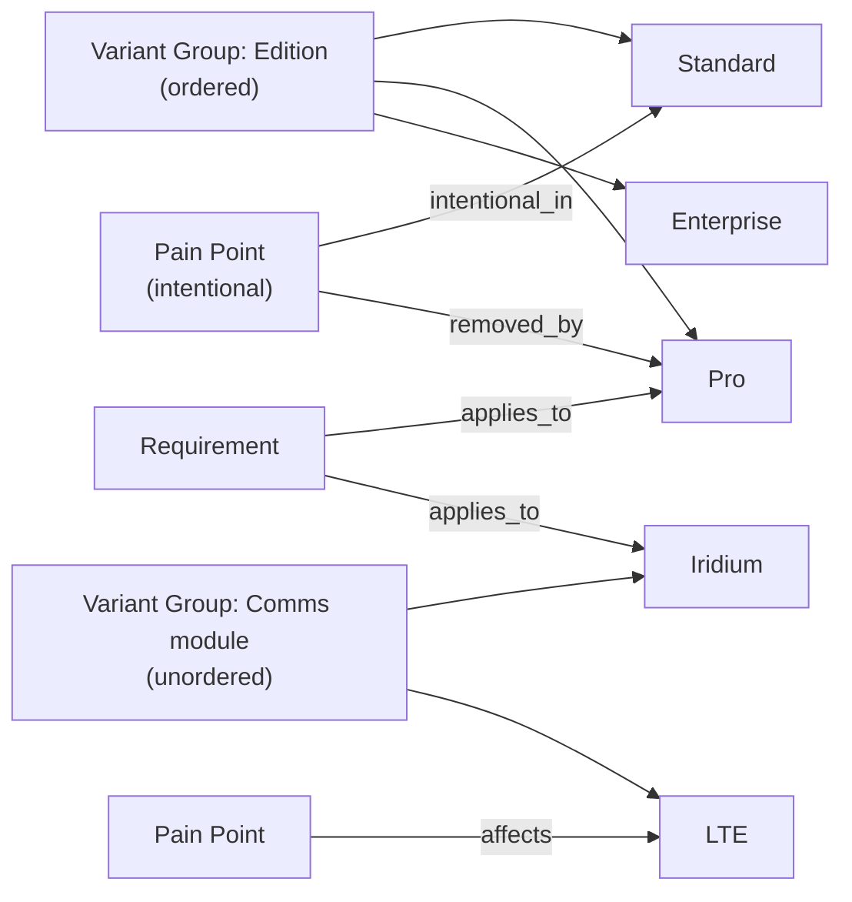

# Module 13 — Product Variants — Implementation Plan

See [future-modules-2026-09-index.md](future-modules-2026-09-index.md) for
cross-cutting architecture. Not in the overview. Requested by the user on
2026-10-04 while scoping
[Module 1's Reporting extension](module-01-context-and-strategy-plan.md)
(Phase 9 Q9–Q11), originally as "Product Tiers"; generalised to "Product
Variants" on 2026-10-12.

**Source:** user direction, 2026-10-04 and 2026-10-12. One product can ship
in several parallel forms. Two real shapes drive the design:

| Shape | Example | Relationship between variants |
|-------|---------|-------------------------------|
| Commercial **tiers** (software) | Standard, Pro, Enterprise | Ordered ladder; higher includes lower |
| **Hardware / configuration** variants | Telemetry module: Iridium vs LTE | Unordered alternatives; each has its own strengths and limitations |

Some pain points are therefore *intentional* (a lower tier withholds a
feature to push upgrades), and others are *variant-specific* (satellite
latency, LTE coverage gaps). **Decided by: User.**

**Status:** Proposed, not started. Hard-depends on Module 0. Soft
dependency: Module 1, whose intentional Pain Point → Variant links stay
reserved until this module lands.

## Status / Resume Here

0 / 4 phases complete. Phase 0 is next.

| # | Phase | Status |
|---|-------|--------|
| 0 | Exploratory: scope & open questions | [ ] Not started |
| 1 | Data model: Variant Group, Variant, ordering, RBAC, nested fallback | [ ] Not started |
| 2 | Relationships (Requirement/Pain Point ↔ Variant) + frontend UI | [ ] Not started |
| 3 | Docs website coverage, plus renaming Module 1's reserved "Tier" wording | [ ] Not started |

## Concept

- A **Variant Group** is one axis along which a product varies (Edition,
  Comms module, Region). It is either **ordered** (a ladder with a rank) or
  **unordered** (alternatives).
- A **Variant** belongs to exactly one group.
- A shipped configuration is one variant per group (Pro + Iridium). Groups
  are independent axes, so a product with two axes doesn't need a variant
  per combination.

## Settled so far

- **"Variants", not "versions" or "tiers".** "Version" implies a release
  over time; "tier" implies a ladder and doesn't fit hardware
  alternatives. This module models parallel packaging. **Decided by:
  Agent.**
- **Generalised from tiers to variants.** Tiers become the ordered case of a
  Variant Group. **Decided by: User.**
- **Project-scoped**, with nested fallback. A child project with no variants
  of its own uses its nearest ancestor's (the `resolve_effective_action_types`
  pattern), and variants are seeded only on root projects. **Decided by:
  User.**
- **Variant is a relationship target, not a scoring dimension.** This avoids
  persona × variant scoring explosion in Module 1. **Decided by: Agent.**

## Phase 0 — open questions

1. **Group model.** Recommend a two-level model (Variant Group → Variant)
   with a group-level `ordered` flag, rather than a flat Variant list with
   an optional rank. A flat list can't tell "Iridium" and "Pro" apart as
   different axes, so "applies to Pro on Iridium" is inexpressible.
   Confirm that multiple groups per project are needed, and whether the
   name should be "Variant Group" or "Axis".
2. **Ordering.** Rank is required for ordered groups and absent for
   unordered ones. "The variant that removes this pain point" and "upgrade
   path" only make sense on ordered groups; the Module 1 R9 "Upgrade
   drivers" report is limited to them. Confirm whether add-ons that aren't
   part of a ladder are just an unordered group.
3. **Requirement → Variant applicability.** Is "feature X is Pro-only" a
   relationship (`applies_to → Variant`) or a field on Requirement? A
   relationship keeps core Requirement untouched, per the module-boundary
   rule. Recommend a relationship.
4. **Default meaning of "no link".** Recommend: no `applies_to` link in a
   group means the requirement applies to every variant in that group, with
   a warning-only "applies to all" indicator (the same convention Module 1
   uses for personas). Confirm the semantics when links exist in several
   groups (recommend AND across groups, OR within a group).
5. **Inheritance.** In an ordered group, does Pro implicitly include
   everything in Standard? Recommend yes, derived from rank, so
   applicability is only recorded at the lowest variant that includes a
   feature. Unordered groups have no inheritance.
6. **Variant-specific pain points.** Besides `intentional_in` /
   `removed_by` (ordered groups, upgrade drivers), recommend one generic
   `affects → Variant` link for limitations that exist only on some
   variants (e.g. Iridium latency). Confirm the three link types are enough.
7. **Variant-specific requirement wording.** If Iridium and LTE need
   different thresholds for the same need, recommend two requirements each
   linked to its variant, not per-variant overrides of one requirement.
   Confirm.
8. **Scope creep guard.** Pricing, entitlement enforcement, licensing, SKUs,
   bills of materials, and configuration validity (e.g. "Iridium can't be
   combined with Region X") are out of scope. This module describes
   variants for requirements and context work; it doesn't run billing or
   manufacturing.

**Reasoning:** *Why:* product packaging, whether commercial or hardware,
drives which problems are fixed and which are deliberate or specific to one
form. *Risk addressed:* intentional limitations treated as defects,
variant-specific features and limitations undocumented, and a tiers-only
model that cannot represent hardware alternatives without a later rework.
*Expected outcome:* variants can be linked from Pain Points and
Requirements, enabling Module 1's R9 "Upgrade drivers" report and
per-variant coverage views.
