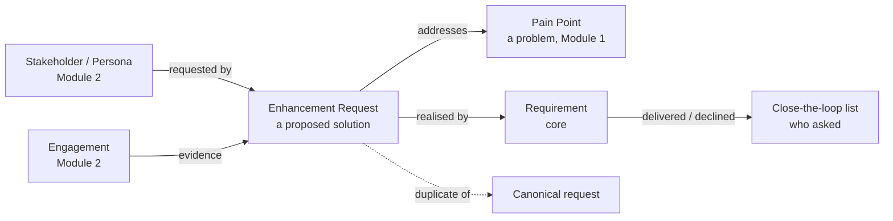
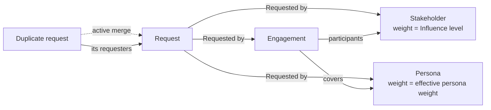

# Module 14 — Product Feedback (Enhancement Requests) — Implementation Plan

See [future-modules-2026-09-index.md](future-modules-2026-09-index.md) for
cross-cutting architecture. Not in the overview. Requested by the user on
2026-10-05 while scoping
[Module 2's Engagements](module-02-stakeholders-and-personas-plan.md)
(Phase 0 addendum 2): "a better place to store [enhancement requests]
rather than say something like Jira". **Decided by: User.**

**Status:** Phase 0 signed off 2026-11-04; Phases 1, 1b and 2 (backend) built 2026-11-04; Phase 3 next. Plan now, build after Modules 1 and 2
(**Decided by: User**). Hard-depends on Module 0. Soft dependencies:
Module 1 (Pain Point links, report framework from its Phases 12b and 13) and Module 2
(Stakeholder/Persona/Engagement links). Links to a disabled module's
artefacts simply aren't offered.

## Status / Resume Here

4 / 9 phases complete. Phases 0, 1, 1b and 2 done 2026-11-04 (Module 2 Phase 1.2 and
Module 1 Phase 13 had shipped). Phase 3 (ICE/RICE scoring on the core scoring matrix) is next.

| # | Phase | Status |
|---|-------|--------|
| 0 | Exploratory: open questions below | [x] Complete (2026-11-04) — see "Phase 0 resolutions" |
| 1 | Data model: Enhancement Request, lifecycle, RBAC | [x] Complete (2026-11-04) — see "Phase 1 notes" |
| 1b | Triage an organisation inbox request into a project | [x] Complete (2026-11-04) — see "Phase 1b notes" |
| 2 | Demand aggregation + duplicate merge | [x] Complete (2026-11-04) — see "Phase 2 notes" |
| 3 | ICE/RICE scoring on the core scoring matrix | [ ] Not started |
| 4 | Relationships + close-the-loop | [ ] Not started |
| 5 | Frontend UI | [ ] Not started |
| 6 | Reports (F1–F5) | [ ] Not started — needs Module 1 Phase 13 (Reports UI); Phase 12b (report framework) shipped 2026-10-06, see `docs/modules.md` §4g |
| 7 | Docs website coverage | [ ] Not started |

## Where it fits

## Settled so far (2026-10-05)

- **A new, independently toggleable module**, not part of Module 1 or 2.
  **Decided by: User.** *Why:* requests also come from internal staff and
  support, not only stakeholder contact, and the module should work
  without Modules 1/2 being enabled.
- **A request is a solution, a Pain Point is a problem.** A request with no
  linked Pain Point shows a warning and appears in report F2; it isn't
  blocked. **Decided by: User.** *Why:* ranking solutions purely by demand
  rewards the loudest voice; tying them to a scored problem keeps
  prioritisation grounded. Same "warnings only" stance as Module 1 Phase 9
  Q8.
- **In scope** (**Decided by: User**):
  - Demand aggregation: "requested by" links to Stakeholders, Personas and
    Engagements, weighted by stakeholder Influence and persona weight where
    available. Merging duplicates combines demand.
  - ICE/RICE scoring on the core scoring matrix (Module 1 Phase 10),
    chosen when viewing. *Why:* ICE was rejected for Pain Points because
    Ease describes a solution; requests *are* solutions, so it fits here.
  - Close-the-loop: when the realising Requirement is delivered or the
    request is declined, list who asked, so they can be told.
- **Out of scope** (**Decided by: Agent**, accepted by the user): delivery
  tracking (sprints, assignees, boards), which stays in Jira or similar,
  and a public, no-account submission portal, which is a large abuse and
  privacy surface. Revisit the portal only on explicit request.
- **Kept separate from scoping-stage requirements** (`docs/requirements.md`
  C-U-03). **Decided by: Agent.** *Why:* raw asks are often duplicates,
  often declined and often from people without accounts; putting them in
  the requirements list would pollute it.

## Phase 0 resolutions (2026-11-04)

Full table in `docs/decisions.md` ("Module 14 (Product Feedback) Phase 0").

1. **Lifecycle:** `New → Under review → Accepted → Delivered`, plus `Declined` (mandatory reason) and `Duplicate`. `Delivered` is set by hand with a prompt. **Decided by: User.**
2. **Scope:** org or project (Strategy's discriminator), org inbox triaged into projects. **An organisation admin can disable the org-level scope.** **Decided by: User.**
3. **Submit/triage:** default any member submits, module triage role decides; **a project admin can change this per project.** **Decided by: User.**
4. **Reach:** manual level, derived demand alongside. **Decided by: User.**
5. **Merge:** union of requesters, **reversible** (needs recorded merge history). **Decided by: User.**
6. **Close-the-loop:** per-requester informed checkbox with date; no external emails. **Decided by: User.**
7. **Delivery bridge:** external reference field (URL plus key). **Decided by: User.**
8. **Types:** none at first. **Decided by: Agent.**
9. **Personal data:** no free-text requester. **Decided by: User.**

## Phase 0 — open questions (original wording, now resolved above)

1. **Lifecycle.** Recommend `New → Under review → Accepted → Delivered`,
   plus terminal `Declined` (mandatory reason) and `Duplicate` (points to
   the canonical request). Should `Delivered` follow the realising
   Requirement's status automatically, or be set by hand with a prompt?
   Recommend a prompt: an automatic transition couples this module to core
   Requirement status semantics.
2. **Scope.** Requests often arrive before anyone knows which project they
   belong to. Recommend org or project scope, using the same discriminator
   as Strategy, with an org-level inbox triaged into projects.
3. **Who submits and who triages.** Recommend any project member can submit
   (including the Stakeholder project role), and a module-registered
   triage role accepts, declines or merges.
4. **RICE "Reach": manual or derived?** Demand data could derive Reach
   (the weighted count of requesters), or it could be a manual level.
   Recommend a manual level, with derived demand shown alongside, so the
   two can be compared without one silently overriding the other.
5. **Merge mechanics.** Recommend that merging keeps the canonical request,
   marks the other `Duplicate`, and counts demand as the union of
   requesters, so the same stakeholder asking twice counts once. Should
   merge be reversible?
6. **Close-the-loop tracking.** Recommend a per-requester "informed"
   checkbox with a date, so F3 can show loops still open. Notifications go
   to internal owners only; no emails go to external people.
7. **Bridge to delivery tools.** Recommend an external reference field
   (URL plus key, e.g. a Jira issue) now, with a real integration later.
8. **Types or categories.** If requests get a configurable type list,
   decide the nested-projects fallback at design time, per `CLAUDE.md`.
   Recommend no types at first; tags or components may be enough.
9. **Personal data.** Requester links point at Module 2 records, so erasure
   is covered there. Any free-text "requested by" for people without a
   Stakeholder record would be new personal data. Recommend not allowing
   it: create an anonymous Engagement participant or a Stakeholder instead.

## Phase 1 notes (2026-11-04)

Backend built; account and security review in `docs/decisions.md` ("Module 14 (Product Feedback) Phase 1").

- Both tiers: `EnhancementRequest` (`scope`, one of `organization_id` / `project_id`) + `EnhancementRequestVersion`, mirroring Strategy's shape. API at `/projects/{id}/modules/product_feedback/requests` and `/orgs/{id}/modules/product_feedback/requests`; settings at `.../settings`.
- Sub-components `enhancement_request` and `organization_requests` (the org admin's inbox switch). Roles `feedback_triager` and `org_feedback_triager`; project submission policy.
- Status model: `new → under_review → accepted → delivered`, `declined` (reason), `duplicate` (merge only, Phase 2).
- Migration `0130` (next `0131`). Frontend: types, label maps and path registration only.

**Phase 1b (new)** — moving an inbox request into a project changes its owner tier: renumber the code (the project's `ENH` counter), re-scope its tags, re-home its files, write one audit event, and leave the old code findable in the audit detail. Not folded into Phase 1 because doing it half-way leaves orphaned tags or files. Built; see below.

## Phase 1b notes (2026-11-04)

Backend built; account, security review and one finding in `docs/decisions.md` ("Module 14 (Product Feedback) Phase 1b").

- `POST /orgs/{org}/modules/product_feedback/requests/{id}/move-to-project` and MCP tool `move_inbox_request_to_project`; logic in `modules/product_feedback/triage.py`.
- The row is updated in place (same id, status, comments, history); new project code, tags re-resolved in the project vocabulary, files become project files, one `moved_to_project` audit event with the old code. One-way; refused if the request has links.
- Finding: an organisation triager is an effective triager in every project (permission cascade), so a project's `triagers` policy cannot exclude one. Left as is and pinned by a test.
- **Phase 2 must:** a merge only joins requests of the same tier and owner; decide whether a merged duplicate may be moved.
- **Phase 5 must add:** the Move to project action (project picker limited to projects the user can open with the list enabled) on the inbox detail page.

## Phase 2 notes (2026-11-04)

Backend built; account, security review and one finding in `docs/decisions.md` ("Module 14 (Product Feedback) Phase 2").

- **Requesters** are authored with the generic link endpoints (link type `Requested by`, a module `LinkTypeSeed`); there is no requester endpoint. `GET .../requests/{id}/demand` returns the breakdown; every request shape also carries `requester_count`, `weighted_demand`, `merged_into` and `merged_count`.
- **The hook:** core `ModuleDefinition.demand_party_providers` / `registry.resolve_demand_parties` (documented in `docs/modules.md` §4e2); Module 2 implements it in `stakeholders/demand.py`. Product Feedback imports nothing from Module 2.
- **Merge:** `POST .../requests/{id}/merge {canonical_id, note}`, `POST .../unmerge`, `GET .../merges`, on both tiers (the inbox merges inbox requests). Reversible; demand is the union, derived from active `EnhancementRequestMerge` rows (migration `0131`, next `0132`).
- **Phase 4 must:** the informed checkbox per requester reads `compute_demand`'s requesters (merged ones included); the "Delivered" prompt and close-the-loop list use the same union.
- **Phase 5 must add:** a Requesters panel (the quick-link/link finder restricted to `Requested by`), the demand breakdown with the merged-duplicates list, Merge and Unmerge actions (triager only; canonical picker limited to open non-duplicate requests of the same owner), the `duplicate` badge with "merged into ENH-nnn", and the demand columns on the list and its export.

**Phase 5 must add:** the module's `frontend_manifest` (nav entry), routes for the paths already registered in `frontend/src/modules/product_feedback/module.ts`, the org inbox page, the submission-policy setting on Project admin and the org inbox switch's explanation, plus stories, Playwright and the docs website.

## Phases 1–7 (outline, refined at Phase 0)

- **Phase 1 — Data model.** `EnhancementRequest` registered artefact type:
  title, description, scope, status, owner, external reference, decline
  reason. Includes `EnhancementRequestVersion`, module-local comments and
  files, RBAC and FGAC atoms, audit logging, write-enabled MCP tools,
  bundle hooks and seeds.
- **Phase 2 — Demand and merge.** "Requested by" links, weighted demand
  through Module 2's generic hooks (never an import), and merge with
  demand union.
- **Phase 3 — Scoring.** An `enhancement_request` scoring scheme (Reach,
  Impact, Confidence, Effort) with ICE and RICE models, org and project
  defaults, and Effort as a divisor. The core scoring matrix currently
  combines by product only (Module 1 Phase 10 notes), so this needs a
  generic divisor or inverse-axis extension in core — design it
  generically, not for this module alone.
- **Phase 4 — Relationships and close-the-loop.** "Addresses" → Pain
  Point, "realised by" → Requirement, "evidence" ← Engagement, plus the
  informed checkbox per requester.
- **Phase 5 — Frontend.** List, detail and create (as a layer), merge
  dialog, demand panel, scoring switcher, link panels, and the
  close-the-loop panel. Shared components and label maps; Playwright and
  Storybook.
- **Phase 6 — Reports**, registered as `ReportDefinition`s through Module 1
  Phase 12b's core report framework (and shown by Phase 13's Reports page):

  | # | Report | Content |
  |---|--------|---------|
  | F1 | **Demand ranking** | Open requests by weighted demand and the chosen ICE/RICE model, with no-problem-linked items flagged. |
  | F2 | **Unlinked requests** | Requests with no Pain Point. |
  | F3 | **Close-the-loop** | Delivered or declined requests with requesters not yet informed. |
  | F4 | **Triage ageing** | Requests in New or Under review longer than N days. |
  | F5 | **Problem demand** | Pain Points by number of requests addressing them, and whether a Requirement exists. |

- **Phase 7 — Docs website**, including the problem/solution distinction
  and a screenshot of the demand ranking.

**Reasoning:** *Why:* enhancement requests are scattered across email and
ticket trackers, with no link to the problems they solve or the people who
asked. *Risk addressed:* building for the loudest asker, duplicated asks
counted as separate demand, and requesters never told the outcome.
*Expected outcome:* one intake where demand adds up, rests on real
problems, and closes the loop.
