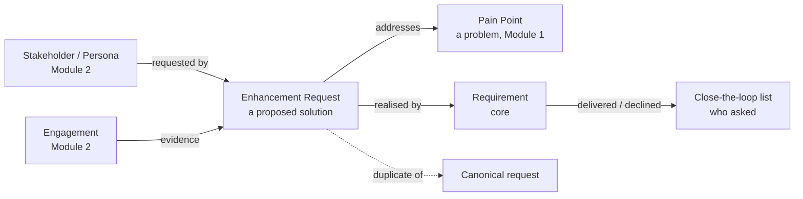
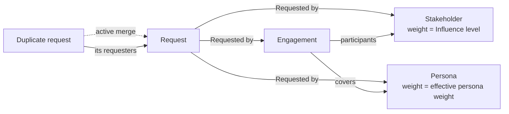
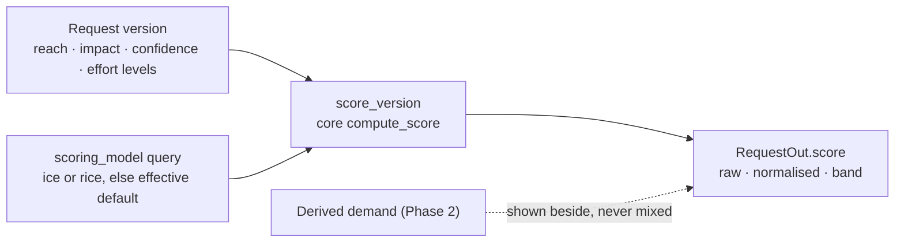
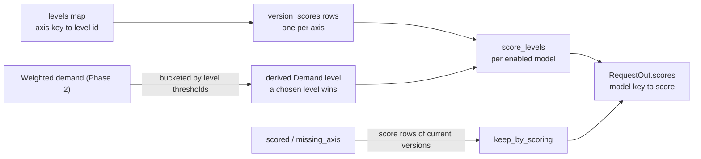
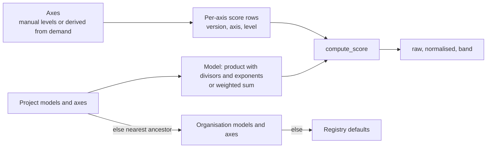

# Module 14 — Product Feedback (Enhancement Requests) — Implementation Plan

See [future-modules-2026-09-index.md](future-modules-2026-09-index.md) for
cross-cutting architecture. Not in the overview. Requested by the user on
2026-10-05 while scoping
[Module 2's Engagements](module-02-stakeholders-and-personas-plan.md)
(Phase 0 addendum 2): "a better place to store [enhancement requests]
rather than say something like Jira". **Decided by: User.**

**Status:** Phase 0 signed off 2026-11-04; Phases 1, 1b, 2 and 3 (backend) built 2026-11-04; Phases 3b and 3c (backend) built 2026-11-05; Phase 4 next. Plan now, build after Modules 1 and 2
(**Decided by: User**). Hard-depends on Module 0. Soft dependencies:
Module 1 (Pain Point links, report framework from its Phases 12b and 13) and Module 2
(Stakeholder/Persona/Engagement links). Links to a disabled module's
artefacts simply aren't offered.

## Status / Resume Here

7 / 11 phases complete. Phases 0, 1, 1b, 2 and 3 done 2026-11-04 (Module 2 Phase 1.2 and
Module 1 Phase 13 had shipped); Phases 3b and 3c (scoring extension) done 2026-11-05. Phase 4 is next.

| # | Phase | Status |
|---|-------|--------|
| 0 | Exploratory: open questions below | [x] Complete (2026-11-04) — see "Phase 0 resolutions" |
| 1 | Data model: Enhancement Request, lifecycle, RBAC | [x] Complete (2026-11-04) — see "Phase 1 notes" |
| 1b | Triage an organisation inbox request into a project | [x] Complete (2026-11-04) — see "Phase 1b notes" |
| 2 | Demand aggregation + duplicate merge | [x] Complete (2026-11-04) — see "Phase 2 notes" |
| 3 | ICE/RICE scoring on the core scoring matrix | [x] Complete (2026-11-04) — see "Phase 3 notes" |
| 3b | Scoring: Ease, demand-derived axis, generic per-axis score storage | [x] Complete (2026-11-05) — see "Phase 3b notes" |
| 3c | Scoring: organisation- and project-defined criteria and models (multiply or weighted sum) | [x] Complete (2026-11-05) — see "Phase 3c notes" |
| 4 | Relationships + close-the-loop | [ ] Not started |
| 5 | Frontend UI | [ ] Not started |
| 6 | Reports (F1–F5) | [ ] Not started — needs Module 1 Phase 13 (Reports UI); Phase 12b (report framework) shipped 2026-10-06, see `docs/modules.md` §4g |
| 7 | Docs website coverage | [ ] Not started |

## Where it fits

## Settled so far (2026-10-05)

- **A new, independently toggleable module**, not part of Module 1 or 2.
  **Decided by: User.** *Why:* requests also come from internal staff and
  support, not only stakeholder contact, and the module should work
  without Modules 1/2 being enabled.
- **A request is a solution, a Pain Point is a problem.** A request with no
  linked Pain Point shows a warning and appears in report F2; it isn't
  blocked. **Decided by: User.** *Why:* ranking solutions purely by demand
  rewards the loudest voice; tying them to a scored problem keeps
  prioritisation grounded. Same "warnings only" stance as Module 1 Phase 9
  Q8.
- **In scope** (**Decided by: User**):
  - Demand aggregation: "requested by" links to Stakeholders, Personas and
    Engagements, weighted by stakeholder Influence and persona weight where
    available. Merging duplicates combines demand.
  - ICE/RICE scoring on the core scoring matrix (Module 1 Phase 10),
    chosen when viewing. *Why:* ICE was rejected for Pain Points because
    Ease describes a solution; requests *are* solutions, so it fits here.
  - Close-the-loop: when the realising Requirement is delivered or the
    request is declined, list who asked, so they can be told.
- **Out of scope** (**Decided by: Agent**, accepted by the user): delivery
  tracking (sprints, assignees, boards), which stays in Jira or similar,
  and a public, no-account submission portal, which is a large abuse and
  privacy surface. Revisit the portal only on explicit request.
- **Kept separate from scoping-stage requirements** (`docs/requirements.md`
  C-U-03). **Decided by: Agent.** *Why:* raw asks are often duplicates,
  often declined and often from people without accounts; putting them in
  the requirements list would pollute it.

## Phase 0 resolutions (2026-11-04)

Full table in `docs/decisions.md` ("Module 14 (Product Feedback) Phase 0").

1. **Lifecycle:** `New → Under review → Accepted → Delivered`, plus `Declined` (mandatory reason) and `Duplicate`. `Delivered` is set by hand with a prompt. **Decided by: User.**
2. **Scope:** org or project (Strategy's discriminator), org inbox triaged into projects. **An organisation admin can disable the org-level scope.** **Decided by: User.**
3. **Submit/triage:** default any member submits, module triage role decides; **a project admin can change this per project.** **Decided by: User.**
4. **Reach:** manual level, derived demand alongside. **Decided by: User.**
5. **Merge:** union of requesters, **reversible** (needs recorded merge history). **Decided by: User.**
6. **Close-the-loop:** per-requester informed checkbox with date; no external emails. **Decided by: User.**
7. **Delivery bridge:** external reference field (URL plus key). **Decided by: User.**
8. **Types:** none at first. **Decided by: Agent.**
9. **Personal data:** no free-text requester. **Decided by: User.**

## Phase 0 — open questions (original wording, now resolved above)

1. **Lifecycle.** Recommend `New → Under review → Accepted → Delivered`,
   plus terminal `Declined` (mandatory reason) and `Duplicate` (points to
   the canonical request). Should `Delivered` follow the realising
   Requirement's status automatically, or be set by hand with a prompt?
   Recommend a prompt: an automatic transition couples this module to core
   Requirement status semantics.
2. **Scope.** Requests often arrive before anyone knows which project they
   belong to. Recommend org or project scope, using the same discriminator
   as Strategy, with an org-level inbox triaged into projects.
3. **Who submits and who triages.** Recommend any project member can submit
   (including the Stakeholder project role), and a module-registered
   triage role accepts, declines or merges.
4. **RICE "Reach": manual or derived?** Demand data could derive Reach
   (the weighted count of requesters), or it could be a manual level.
   Recommend a manual level, with derived demand shown alongside, so the
   two can be compared without one silently overriding the other.
5. **Merge mechanics.** Recommend that merging keeps the canonical request,
   marks the other `Duplicate`, and counts demand as the union of
   requesters, so the same stakeholder asking twice counts once. Should
   merge be reversible?
6. **Close-the-loop tracking.** Recommend a per-requester "informed"
   checkbox with a date, so F3 can show loops still open. Notifications go
   to internal owners only; no emails go to external people.
7. **Bridge to delivery tools.** Recommend an external reference field
   (URL plus key, e.g. a Jira issue) now, with a real integration later.
8. **Types or categories.** If requests get a configurable type list,
   decide the nested-projects fallback at design time, per `CLAUDE.md`.
   Recommend no types at first; tags or components may be enough.
9. **Personal data.** Requester links point at Module 2 records, so erasure
   is covered there. Any free-text "requested by" for people without a
   Stakeholder record would be new personal data. Recommend not allowing
   it: create an anonymous Engagement participant or a Stakeholder instead.

## Phase 1 notes (2026-11-04)

Backend built; account and security review in `docs/decisions.md` ("Module 14 (Product Feedback) Phase 1").

- Both tiers: `EnhancementRequest` (`scope`, one of `organization_id` / `project_id`) + `EnhancementRequestVersion`, mirroring Strategy's shape. API at `/projects/{id}/modules/product_feedback/requests` and `/orgs/{id}/modules/product_feedback/requests`; settings at `.../settings`.
- Sub-components `enhancement_request` and `organization_requests` (the org admin's inbox switch). Roles `feedback_triager` and `org_feedback_triager`; project submission policy.
- Status model: `new → under_review → accepted → delivered`, `declined` (reason), `duplicate` (merge only, Phase 2).
- Migration `0130` (next `0131`). Frontend: types, label maps and path registration only.

**Phase 1b (new)** — moving an inbox request into a project changes its owner tier: renumber the code (the project's `ENH` counter), re-scope its tags, re-home its files, write one audit event, and leave the old code findable in the audit detail. Not folded into Phase 1 because doing it half-way leaves orphaned tags or files. Built; see below.

## Phase 1b notes (2026-11-04)

Backend built; account, security review and one finding in `docs/decisions.md` ("Module 14 (Product Feedback) Phase 1b").

- `POST /orgs/{org}/modules/product_feedback/requests/{id}/move-to-project` and MCP tool `move_inbox_request_to_project`; logic in `modules/product_feedback/triage.py`.
- The row is updated in place (same id, status, comments, history); new project code, tags re-resolved in the project vocabulary, files become project files, one `moved_to_project` audit event with the old code. One-way; refused if the request has links.
- Finding: an organisation triager is an effective triager in every project (permission cascade), so a project's `triagers` policy cannot exclude one. Left as is and pinned by a test.
- **Phase 2 must:** a merge only joins requests of the same tier and owner; decide whether a merged duplicate may be moved.
- **Phase 5 must add:** the Move to project action (project picker limited to projects the user can open with the list enabled) on the inbox detail page.

## Phase 2 notes (2026-11-04)

Backend built; account, security review and one finding in `docs/decisions.md` ("Module 14 (Product Feedback) Phase 2").

- **Requesters** are authored with the generic link endpoints (link type `Requested by`, a module `LinkTypeSeed`); there is no requester endpoint. `GET .../requests/{id}/demand` returns the breakdown; every request shape also carries `requester_count`, `weighted_demand`, `merged_into` and `merged_count`.
- **The hook:** core `ModuleDefinition.demand_party_providers` / `registry.resolve_demand_parties` (documented in `docs/modules.md` §4e2); Module 2 implements it in `stakeholders/demand.py`. Product Feedback imports nothing from Module 2.
- **Merge:** `POST .../requests/{id}/merge {canonical_id, note}`, `POST .../unmerge`, `GET .../merges`, on both tiers (the inbox merges inbox requests). Reversible; demand is the union, derived from active `EnhancementRequestMerge` rows (migration `0131`, next `0132`).
- **Phase 4 must:** the informed checkbox per requester reads `compute_demand`'s requesters (merged ones included); the "Delivered" prompt and close-the-loop list use the same union.
- **Phase 5 must add:** a Requesters panel (the quick-link/link finder restricted to `Requested by`), the demand breakdown with the merged-duplicates list, Merge and Unmerge actions (triager only; canonical picker limited to open non-duplicate requests of the same owner), the `duplicate` badge with "merged into ENH-nnn", and the demand columns on the list and its export.

## Phase 3 notes (2026-11-04)

Backend built; account and security review in `docs/decisions.md` ("Module 14 (Product Feedback) Phase 3").

- **Core extension:** `ScoringModelDefinition.divisor_axis_keys` (Effort divides the product; maximum uses each divisor's lowest weight). Documented in `docs/modules.md` §4d.
- The `enhancement_request` scheme (`scoring.py`) has models `ice` and `rice` (Phase 3b changed ICE and replaced the four level columns with per-axis rows, see "Phase 3b notes"); `RequestOut` carries `score` and `scoring_model_key`.
- `GET .../requests` and `.../requests/{id}` take `scoring_model` (a list since Phase 3b); `GET .../scoring-scheme` (both tiers) lists the level ids. Level and band editing uses the core scoring endpoints (gated by `org_feedback_triager`).
- **Phase 5 must add:** a Reach/Impact/Confidence/Effort field group on the create and edit forms (the shared field group, with `help` text for each), a model switcher beside the score on the list and detail, the demand shown beside the score, the score and band columns on the list, and the scheme editor (`ScoringSchemeEditor`) in the module's org admin section. The band editor already hides cell ratings for a divisor model.
- **Phase 6 must:** report F1 ranks by weighted demand and the chosen model's `normalised` score; a request that is not scored (a missing axis) is listed as unscored, not as zero.

**Phase 5 also adds (2026-11-05):** a **Grid** view on the project request list (`ViewToggle showGridOption` and `<RecordGrid>`, see the style guide's "Pattern: bulk edit grid") with the scoring levels as cells, and an **Unscored** filter (`useUrlChoice`, in the `ListPageLayout` filter panel, with its count) that combines with the grid so a triager can filter to unscored requests and score them in bulk. The grid exists for the project tier only (a generic limit of the bulk edit grid); inbox requests are scored one at a time, or after triage into a project. **Decided by: Agent**; extending the grid to organisation-owned types is a generic change to `RecordGrid`, and is raised here for the User to decide.

**Phase 5 must add:** the module's `frontend_manifest` (nav entry), routes for the paths already registered in `frontend/src/modules/product_feedback/module.ts`, the org inbox page, the submission-policy setting on Project admin and the org inbox switch's explanation, plus stories, Playwright and the docs website.

## Phase 3b notes (2026-11-05)

Backend built; account and security review in `docs/decisions.md` ("Module 14 (Product Feedback) Phase 3b").

- **Storage:** `enhancement_request_version_scores (version_id, axis_key, level_id)` (migration `0134`, next `0135`) replaces the four level columns. The wire shape is `levels: {axis key: level id}` on create and update (a `null` clears an axis, an axis not mentioned is kept), `RequestOut.levels` and `RequestVersionOut.levels`; `RequestOut.derived_levels` is the level each derived axis resolves to where none is chosen.
- **Axes and models:** Reach, Impact, Confidence, Ease, Effort and Demand; `ice` = Impact × Confidence × Ease, `rice` unchanged, `rice_demand` = Demand × Impact × Confidence ÷ Effort. Demand is a *derived* axis: core `ScoringAxisDefinition.derived_source` plus `ScoringLevel.threshold` (migration `0133`, core), bucketed by `services.scoring.derived_level`. A level chosen by hand wins.
- **Several models:** `RequestOut.scores` (model key to score) for the enabled models, or the `scoring_model` list (repeat or comma-separate; first is primary and is also `score` / `scoring_model_key`). Core `scoring_enabled_models` and `PUT .../scoring-schemes/{key}/enabled-models` (org and project); `build_scheme_config` returns `enabled_model_keys` and `enabled_models_source`.
- **Unscored filter:** `scored=unscored|scored` and `missing_axis=<key>` on both lists, the record-table export and the MCP list tools, through `service.filter_requests` and `scoring_filter.keep_by_scoring` (one statement over the current versions' score rows).
- **Record tables:** one column per scheme axis (Ease is editable; Demand shows the effective level and is read-only).
- **Phase 5 must add (beyond the list above):** the level field group built from the scheme's axes (the shared field group for create and edit; Demand shows its derived level with a "Set manually" override and a way to clear it); a models picker on the list and detail showing a score column per chosen model; the **Unscored** filter and its count (counted client-side from `scores` over the held rows) with `missing_axis` in the filter panel; the enabled-models control and the level threshold field in the scheme editor (`ScoringSchemeEditor`, derived axes only); the grid cells for Reach, Impact, Confidence, Ease and Effort.
- **Phase 3c must:** project-scoped level and model rows with the nested-project fallback and tombstones, bundle carriage of the definitions (scoring configuration does not travel in a bundle today), and the weighted-sum combination. Per-axis storage, thresholds and enabled models are in place.

## Phase 3c notes (2026-11-05)

Backend built; account, the resolved design questions and security review in `docs/decisions.md` ("Module 14 (Product Feedback) Phase 3c").

- **Resolved with the User:** a project's criteria are an *additive layer* (not a whole-set replacement); registered criteria can only be *hidden* (organisation or project), never deleted; all of 3c built in one change.
- **Core:** `allow_custom_criteria`, `ScoringModelDefinition` gains `combination` (`product` | `weighted_sum`), `exponents`, `importance`, `inverted_axis_keys`; new `services/scoring_custom.py` (`effective_scheme`, axis and model writers, hide and restore, bundle carriage); tables `scoring_custom_axes`, `scoring_custom_models`, `scoring_hidden_criteria`, `scoring_levels.project_id` (migration `0135`, next `0136`). Endpoints on both tiers: axes, models, `hidden-criteria`, and the project's own level endpoints for axes it defined.
- **Module:** reads the effective scheme everywhere (`ratings.py`, `validate_levels`, the unscored filter, record-table columns and import, bundle import); `scoring_definitions` travels in the project and organisation bundles.
- **Phase 5 must add (beyond the lists above):** the axis and model editors with hide and restore on the organisation and project scoring settings, and level fields built from the effective scheme (an axis's `origin` as a quiet badge). The inbox shows only the organisation's models.
- **Phase 6 must:** report F1 states the model it ranks on and ranks the inbox on an organisation model only.

## Scoring extension (added 2026-11-05)

**Decided by: User** (2026-11-05): ICE/RICE alone is not enough. Both Ease and demand must be usable in a score; an organisation can define its own criteria and how they combine; and a project can have its own criteria (a consulting firm with software, hardware and services product teams scores very differently). Do the small change first (3b), then custom criteria (3c). Each model chooses its combination: multiply (with exponents) or weighted sum.

**Phase 3b** (small, but built on the right storage):
- **Per-axis score rows replace the four level columns** (`enhancement_request_version_scores(version_id, axis_key, level_id)`), because 3c adds axes the schema cannot know. Phase 3 is uncommitted, so this is a new migration (`0133`) that copies the four columns across and drops them. Doing Ease on four fixed columns first would only be rewritten in 3c.
- **Ease** is a new manual axis (Hard to Easy). `ice` becomes classic Impact × Confidence × Ease. `rice` (with Effort as divisor) is unchanged, so an organisation uses whichever of Ease or Effort it already estimates.
- **Demand** is a derived axis: the Phase 2 weighted demand is bucketed into levels by organisation-editable thresholds (a generic `ScoringAxisDefinition.derived_source` and a threshold on the level, in core, not a module hack). Bucketing, not the raw number, keeps the best case defined so bands and normalisation still work. A model `rice_demand` uses it in place of the manual Reach. A derived level can be overridden by hand on a request.
- The demand figure stays shown beside any score, as in Phase 3.
- **Unscored filter** (**Decided by: User**, 2026-11-05). The request lists (project and organisation inbox) take `scored=unscored|scored` against the first chosen model, and `missing_axis=<key>` to find who lacks one criterion. A request is unscored for a model when it has no level for one of the model's manual axes; a derived axis (demand) is never missing. It is a database condition on the per-axis score rows, not a filter applied after the page is read, so "Show more" and the total stay correct. The same filter applies to the CSV/PDF/Word export, the MCP list tool and the nested-project scope, and the unscored count is shown beside the filter. This is another reason to store per-axis rows: with four columns the filter would be a per-model condition on each column.
- **Grid-ready columns** (**Decided by: User**, 2026-11-05). The level columns on the record-table provider are already editable closed-value columns, so the generic bulk edit grid can edit them; 3b/3c keep that true by building the level columns from the project's effective axes (custom axes appear as grid columns, a derived axis is a locked cell until overridden). The score columns stay export-only and show read-only in the grid. Status is not a grid column (transitions keep their own gate, as for the other approval-style types).
- **Several models at once** (**Decided by: User**, 2026-11-05). Scores are derived on read, so any number of models can be computed for the same request without storing anything. A project has a set of *enabled* models (one marked default), not a single model. `RequestOut` gains `scores` (model key to score) for the enabled models, the list can show and sort by one column per chosen model (`scoring_model` becomes a list, the first is the sort key), and the detail page shows them side by side. A model that needs an axis the request has no level for shows as unscored in that column only. This replaces the single `score` / `scoring_model_key` pair, which stays for one release of the API.

**Phase 3c** (design decisions to record at the start; the points below are the known constraints):
- **Opt-in per scheme** (`ScoringSchemeDefinition.allow_custom_criteria`), so Pain Point and Risk scoring are untouched.
- **Organisation-defined axes** (key, name, help text, weighted levels) and **organisation-defined models** (axes to multiply, axes to divide, an importance exponent per axis; or a weighted sum with an importance percentage per axis and a "lower is better" flag that inverts an axis). The registry models (`ice`, `rice`, `rice_demand`) are seeded defaults.
- **Project-level axes and models.** Levels are organisation-only in core today, so this means a nullable project on the level and model rows. Resolution follows the nested-project rule: own rows if any, else the nearest ancestor's, else the organisation's, else the registry. A project hides an organisation default with a tombstone (`ProjectDefinitionSuppression`), per the standing rule on hideable defaults. Decisions to record: **Decided by: Agent** pending User sign-off.
- **Enabled models per tier.** Enabling is a per-project (or organisation) list resolved with the same fallback as the models themselves; the organisation inbox offers only models enabled at the organisation level, since a project's own model is not meaningful across projects.
- **Scores from different models are not comparable.** The organisation inbox ranks across projects, so it ranks on the organisation's model only; a project's own model scores its own list. Report F1 states the model used. A request whose model needs an axis it has no level for is unscored, not zero.
- **A weighted sum normalises each axis** to its top level (level weight ÷ top weight) before applying the importance percentage, so the maximum is 100% and bands are comparable to the product models.
- Definitions travel in the project and organisation bundles, and deleting a level, axis or model that records use needs a reassignment, as levels do today.
- Core files: `services/scoring.py` stays the one place that computes a score. The model and axis definitions are generic data in core, with no feedback-specific code.

## Phases 1–7 (outline, refined at Phase 0)

- **Phase 1 — Data model.** `EnhancementRequest` registered artefact type:
  title, description, scope, status, owner, external reference, decline
  reason. Includes `EnhancementRequestVersion`, module-local comments and
  files, RBAC and FGAC atoms, audit logging, write-enabled MCP tools,
  bundle hooks and seeds.
- **Phase 2 — Demand and merge.** "Requested by" links, weighted demand
  through Module 2's generic hooks (never an import), and merge with
  demand union.
- **Phase 3 — Scoring.** An `enhancement_request` scoring scheme (Reach,
  Impact, Confidence, Effort) with ICE and RICE models, org and project
  defaults, and Effort as a divisor. The core scoring matrix currently
  combines by product only (Module 1 Phase 10 notes), so this needs a
  generic divisor or inverse-axis extension in core — design it
  generically, not for this module alone.
- **Phases 3b and 3c — Scoring extension** (added 2026-11-05): see "Scoring extension".
- **Phase 4 — Relationships and close-the-loop.** "Addresses" → Pain
  Point, "realised by" → Requirement, "evidence" ← Engagement, plus the
  informed checkbox per requester.
- **Phase 5 — Frontend.** List, detail and create (as a layer), merge
  dialog, demand panel, scoring switcher, link panels, and the
  close-the-loop panel. Shared components and label maps; Playwright and
  Storybook.
- **Phase 6 — Reports**, registered as `ReportDefinition`s through Module 1
  Phase 12b's core report framework (and shown by Phase 13's Reports page):

  | # | Report | Content |
  |---|--------|---------|
  | F1 | **Demand ranking** | Open requests by weighted demand and the chosen ICE/RICE model, with no-problem-linked items flagged. |
  | F2 | **Unlinked requests** | Requests with no Pain Point. |
  | F3 | **Close-the-loop** | Delivered or declined requests with requesters not yet informed. |
  | F4 | **Triage ageing** | Requests in New or Under review longer than N days. |
  | F5 | **Problem demand** | Pain Points by number of requests addressing them, and whether a Requirement exists. |

- **Phase 7 — Docs website**, including the problem/solution distinction
  and a screenshot of the demand ranking.

**Reasoning:** *Why:* enhancement requests are scattered across email and
ticket trackers, with no link to the problems they solve or the people who
asked. *Risk addressed:* building for the loudest asker, duplicated asks
counted as separate demand, and requesters never told the outcome.
*Expected outcome:* one intake where demand adds up, rests on real
problems, and closes the loop.
