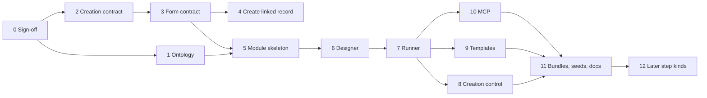
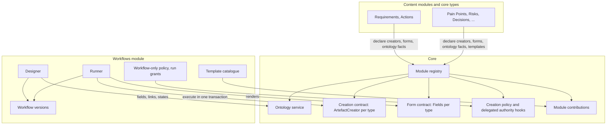
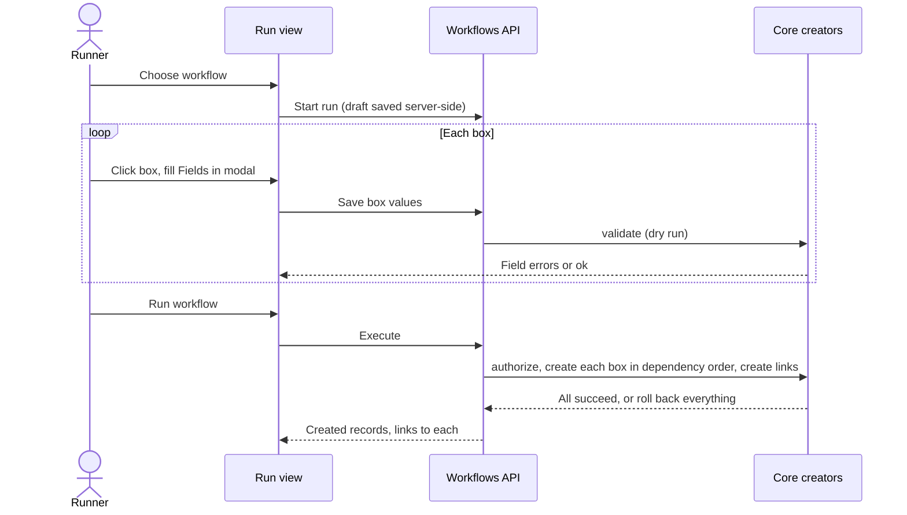

# Module 15 — Workflows (and the System Ontology) — Plan

**Status:** planned 2026-10-13. Phase 0 (design sign-off) is open: the questions in section 7 need the user's answers before Phase 1 starts. Nothing is built.

**Source:** user request 2026-10-13 (**Decided by: User**): a workflow is a reusable, org-wide or project-specific diagram of boxes (records to create) and edges (links between them). Box field values and edges can carry defaults and be locked. A user runs a workflow by filling in each box through the record's normal create form, then executes it. Project admins can switch off direct creation so records are made only through workflows, and permission to run a workflow is separate from permission to create directly. Modules contribute template workflows. An ontology of the whole system is developed alongside, for understanding and for the MCP skill. Later step kinds: state changes, updates, reports, report bundles.

## Status / Resume Here

0 / 12 phases complete. Start with Phase 0.

| # | Phase | Layer | Status |
|---|-------|-------|--------|
| 0 | Design sign-off (section 7) | — | [ ] |
| 1 | System ontology: registry-derived model, API, MCP tool, generated doc | Core | [ ] |
| 2 | Artefact creation contract (backend): one creator per type, no commit, deferred side effects | Core | [ ] |
| 3 | Shared create-form contract (frontend): controlled `Fields` per type, modals become shells | Core | [ ] |
| 4 | Create a linked record from the Links panel (proves 2 and 3) | Core | [ ] |
| 5 | Module skeleton: registration, entitlement, models, RBAC, admin sections | Module | [ ] |
| 6 | Designer: canvas, box defaults and locks, edges and locks, versions | Module | [ ] |
| 7 | Runner: draft runs, box forms, validation, atomic execute, new-or-existing boxes | Module | [ ] |
| 8 | Creation control and delegated run permission | Core hooks + Module | [ ] |
| 9 | Module-contributed templates | Core hook + Module + each module | [ ] |
| 10 | MCP tools and skill | Module | [ ] |
| 11 | Bundles, seeds, docs website, reports | Module | [ ] |
| 12 | Later step kinds: transition, update, report, report bundle (separate sign-off) | Core + Module | [ ] |



## 1. Challenges to the request (read first)

- **The cost is in core, not the module.** Every create path today puts validation, permission checks, audit logging, metrics, `db.commit()` and the pub/sub broadcast in the router (e.g. `routers/requirements/core.py::create_requirement_endpoint`, `modules/context_strategy/project_router.py::create_project_pain_point`), and every form is a bespoke modal holding its own state (`PainPointFormModal`, `RiskFormModal`, …). A workflow cannot reuse either as they stand. Without Phases 2 and 3 the module would have to duplicate both forms and validation for every type, which is exactly what the request wants to avoid. Expect Phases 2 and 3 to touch about 18 create endpoints and about 15 forms.
- **"Run but not create" is delegation, which is normal (GitHub Actions works this way) but must not escalate.** Following the GitHub Actions model (a token scoped by the workflow, not the author's own rights), a delegated workflow acts through its own **workflow service principal** rather than its author's permissions, so it does not break or keep stale power when a person leaves. The one guard is no escalation: whoever grants the service principal a permission must hold it. Every created record names the runner as creator and the run that made it (section 4.6; SOC 2 access-control and change-management policies). (**Decided by: User**, 2026-10-13: delegation is wanted; service-principal model proposed by Agent, Q15.)
- **"Workflow-only creation" can lock a project out.** If the module is disabled, a workflow is deleted, or no runnable workflow covers a type, nobody can create that type. Safety rails are in section 4.6.
- **"New or existing" is a box setting, not a logic block.** The user's example creates a new pain point and a new requirement, and suggested an "OR" so the requirement can instead be an existing one (**Decided by: User**, 2026-10-13). v1 gives each box a source of `new`, `existing` or `runner_chooses`; edges attach the same way whichever is chosen. General logic blocks (conditions, branches) are deferred until a real template needs more than this, because they complicate the designer, validation, runner and accessibility (**Decided by: Agent**, Q16).
- **Update, transition, report and bundle steps are a different contract.** Generalising them now would delay the creation feature for speculative shape. They are Phase 12, with their own sign-off, built on the same registry pattern.
- **Change requests are not a registered artefact type** (`registeredArtefactTypes.json` lists requirement and requirement_action from core, but not change request). Workflows can only create change requests after it is registered; Phase 2 decides that explicitly.
- **"Workflow" already means something here.** It is used for requirement and decision approval lifecycles (`routers/requirements/workflow.py`, `decisions/.../workflow`). Section 7 Q9 asks whether the user-facing name stays.

## 2. Module or core?

**Recommendation (Decided by: Agent, pending Q1): split.** The generic parts that every module and the MCP server benefit from go into core. The workflow engine, designer and runner are a module.

| Core (always on) | Workflows module (entitled, enable per org/project) |
|------------------|-----------------------------------------------------|
| Ontology service, API and MCP tool | Workflow and version tables, designer and runner UI |
| Artefact creation contract (backend) | Run drafts, atomic execution, run history |
| Shared create-form contract (frontend) | Workflow RBAC (designer, runner, per-workflow run grants) |
| Creation-policy and delegated-authority hooks (generic, unnamed) | The policy that blocks direct creation, plugged into the core hook |
| Generic module contributions mechanism | Template catalogue consuming contributions |

Why: a paid extra or opt-out maps directly onto the existing entitlement lever (`is_module_entitled`, `OrganizationModuleEntitlement`). The core pieces each pay for themselves without the module: the ontology feeds the MCP skill, and the creation and form contracts remove duplication and make Phase 4 possible. Under the boundary rules in `CLAUDE.md`, core never names the workflows module. It exposes generic hooks the module implements.



## 3. Ontology

Why: types, fields, lifecycles and allowed links are spread across `ModuleDefinition` fields, Pydantic schemas, enums and link-type seeds. Neither people nor agents can see how records fit together, and the designer needs the same facts to offer only valid boxes and edges. **Risk addressed:** an MCP agent or a workflow designer making links or field values the backend will reject, and documentation drifting from code. **Outcome:** one generated, always-current description of the system, scoped to what the caller's organisation has enabled.

- **Derived, not hand-written.** It is built at runtime from the registry: `artefact_types`, `artefact_type_labels`, `link_type_seeds` (allowed source and target types, flow, nesting scope), `principal_references`, `subtype_providers`, `entity_scopes`, the Phase 2 creators' create schemas (fields, types, required, enum labels) and status label maps. The only hand-written additions are one new optional `description` and `lifecycle` (states and transitions) per type on the registration.
- **Content per type:** key, label, description, owning module, scope (project or org), versioned or not, fields, lifecycle, structural parents (e.g. requirement belongs to component and category), allowed link types in each direction, principal fields, permission atoms.
- **Org-specific layer:** configured link types, custom fields, type vocabularies (pain point types, action types) are added for a given org or project.
- **Outputs:** `GET /api/orgs/{id}/ontology` (and a project variant that resolves the project's enabled modules), MCP tool `get_ontology`, generated `docs/ontology.md` with a Mermaid class diagram (a script like `generate_skill_reference.py`, with a test that fails when the doc is stale), and a reference file in the MCP skill.
- **Format:** our own JSON schema. JSON-LD or OWL export only if an external consumer appears (Q11).

## 4. Key designs

### 4.1 Artefact creation contract (Phase 2, core)

A new registration on `ModuleDefinition` (plus a `CORE_ARTEFACT_CREATORS` list for requirement, action and, if Q12 is approved, change request, mirroring `CORE_PRINCIPAL_REFERENCES`):

```python
@dataclass(frozen=True)
class ArtefactCreator:
    artefact_type: str
    scope: Literal["project", "org"]
    create_schema: type[BaseModel]          # today's *Create schema
    authorize: Callable[[Session, User, CreationScope], None]   # raises 403/404
    validate: Callable[[Session, User, CreationScope, BaseModel], None]  # raises 400
    create: Callable[[Session, User, CreationScope, BaseModel, CreationContext], uuid.UUID]  # no commit
    subcomponent: str | None = None
```

- Each existing endpoint becomes a thin wrapper: authorize, validate, create, `db.commit()`, then run the deferred effects. There is one code path, so the HTTP endpoint, the workflow runner and MCP cannot drift apart.
- `CreationContext` carries `channel` (`direct` or `delegated`), an optional `delegation_ref` (e.g. a workflow run id), and an `after_commit` queue. Pub/sub broadcasts, Prometheus counters and anything else that must not fire for a rolled-back transaction go on the queue. Audit events stay inside the transaction (`services/audit.py` pattern), with `delegation_ref` in `detail`.
- `validate` alone is the dry-run used by the runner to validate a box before execution.

### 4.2 Shared create-form contract (Phase 3, core)

Answers "generalise forms without the workflows module keeping duplicates" (Q2):

- Each type's form is split into a controlled `Fields` component: `{ scope, value, onChange, lockedFields, errors, renderFieldAdornment? }`. The existing modal becomes a shell around it (`Modal` + `Fields` + save), so there is still exactly one form per type.
- Registered on `TierAModuleDefinition.artefactForms[type]` (`frontend/src/modules/types.ts`) and a core map for core types. The designer and runner look forms up by type and never import a module.
- `lockedFields` disables inputs and shows a lock badge. `renderFieldAdornment` lets the designer put a "lock" toggle beside each field without the form knowing about workflows.
- **Fallback:** a generic form rendered from the creator's JSON schema (enum labels from the ontology, `PrincipalFormField` for principal fields) for any type, such as a third-party module's, with no registered `Fields`. Built-in types must register one.
- Style guide: create-as-a-layer, one component per pattern, labelled controls, label maps for every enum (Principle 12).

### 4.3 Workflow definition model (Phase 5)

| Table | Purpose |
|-------|---------|
| `Workflow` | Name, description, `organization_id`, nullable `project_id` (null = org-wide), `template_origin` (key and version), archived flag |
| `WorkflowVersion` | Immutable once published; `status` draft or published; `definition` JSON; `published_by`, `published_at` |
| `WorkflowRunGrant` | Principal (user or group, parity rule) who may run this workflow; `delegated` flag (section 4.6) |
| `WorkflowRun` | Version run, project, runner, status (`draft`, `executed`, `failed`, `abandoned`), per-box draft values, `created_records` |

`definition` JSON (validated against the ontology on save and on publish):

- **Box:** `id`, `source` (`new`, `existing` or `runner_chooses`; an `existing` box can be prefilled when the run is started from that record's page), `artefact_type`, `label`, `defaults` (field to value or token), `locked` (field list), `required` (whether the run may skip the box), canvas position.
- **Edge:** `from`, `to`, `link_type_key`, `locked`, `optional`. The link type is restricted to the ontology's allowed pairs.
- **Tokens** for defaults: `$runner` (principal), `$today`, `$project`, `$box.<id>` (another box's record, for reference fields). Values are resolved at execution time.

Editing a published workflow creates a new draft version. Draft runs stay on the version they started with.

### 4.4 Run model (Phase 7)



- **Atomic (Q3):** one transaction for all boxes and links. Any failure rolls everything back and the run stays a draft with errors per box.
- **Server-side drafts (Q4):** resumable across devices and usable by MCP. Unexecuted drafts expire after a configurable period (data-retention policy).
- **Locked values are enforced on the server.** A submitted value that differs from a locked one is rejected, never silently overwritten.
- Boxes are created in topological order of reference tokens. Cycles in tokens are rejected at publish time. Link edges are created after all boxes.

### 4.5 Canvas (Phase 6)

**Direction (Decided by: User, 2026-10-13):** a node-editor canvas in the style of React Flow or Rete.js, visually like the trace map. **Recommendation (Q10, Decided by: Agent):** React Flow (`@xyflow/react`, MIT, React 19 compatible, only `zustand` and `classcat` as dependencies) over Rete.js, whose React plugin also needs `styled-components` and several Rete plugins and which is built for dataflow programming.

- Boxes are React Flow custom nodes rendered with the trace map's `ChipFace` and theme tokens (light and dark); edges carry the link-type label. Initial positions come from `layoutLinkMap`; after that the designer drags them freely, and positions are saved in the definition.
- Connecting by dragging between handles is offered, but the box `SidePanel`'s "Add link" control stays the keyboard-accessible way to connect boxes (React Flow cannot draw a connection from the keyboard). Every node is focusable and has an accessible name.
- The runner uses the same canvas read-only (no drag or connect); clicking a box opens its form.
- The trace map stays hand-built SVG: its no-library decision (platform-enhancements plan Q1) was for a read-only map, and it does not need an editor.
- The library loads lazily on the workflows routes only. It is added with `frontend/scripts/sync-lockfile.sh` and pinned by the lockfile (change-management policy point 6).

### 4.6 Creation control and RBAC (Phase 8)

| Control | Design |
|---------|--------|
| Workflow-only creation | Project setting per artefact type (Q6): `direct` (default) or `workflow_only`. Enforced through a generic core hook `creation_policies` that every `ArtefactCreator` wrapper consults. The workflows module implements it. Core never names the module. |
| Who designs | Module roles `workflow_designer` (org and project). Publishing requires the designer to hold `PROPOSE_CREATE` (and `LINK` where needed) on every box type in the workflow's scope, so nobody can delegate a power they do not hold. |
| Who runs | `WorkflowRunGrant` principals (users and groups). Without `delegated`, the runner also needs `PROPOSE_CREATE` on each type: the workflow is only a convenience. With `delegated`, the run executes with the workflow's service principal's authority, through the core `delegated_authority` hook. `view` on the project is always required. |
| Workflow service principal (Q15) | A non-login system identity per delegated workflow, like a GitHub Actions token scoped by the workflow. It holds only `PROPOSE_CREATE`/`LINK` on the box types in the published version, granted by a project administrator (org admin for org workflows) who must hold them (no escalation), and is revoked with the grant or on archive. It does not depend on the author staying in post. Records show the runner as creator and "via workflow X" (run id and service principal in the audit event). |
| Granting `delegated` | Project administrator (or org admin for org workflows), audited. |
| Traceability | Each created record's audit event carries `workflow_run_id` and the version. The run stores the ids it created. |
| Lock-out rails | The module's `validate_*` hooks block disabling the module, archiving the last runnable published workflow for a type, or removing the last delegated grant, while a `workflow_only` policy depends on it. Project admins can always switch a policy back to `direct`. |
| Other entry points | CSV import, bundle import and MCP direct-create tools are covered by the same hook (Q6 proposes exemptions for admin imports only). |

SOC 2 check: this touches authorization, so Phase 8 follows the identify, verify and remediate review in `docs/decisions.md`, and updates the access-control policy's narrative.

### 4.7 Templates contributed by modules (Phase 9)

- **Generic mechanism:** a new core field `ModuleDefinition.contributions: Mapping[str, tuple[Any, ...]]`, keyed by an extension-point name (`"workflows.templates"`). Any module can consume any key, so this is not a workflows-specific field in core and is reusable for later module-to-module extension.
- A template is the same `definition` JSON plus key, version, title and description, shipped as a data file in the contributing module's directory.
- A template is offered only when every artefact type it uses is enabled in the target scope.
- **Instantiating copies it (Q8)** into a new org or project workflow with `template_origin`. A later template version shows "update available" rather than changing existing workflows.
- Initial templates: Pain Point to Requirement (existing pain point, new requirement, link), Stakeholder Need to Requirement, Risk to mitigating Requirement and Action, Decision to follow-up Actions, Open Question to Decision.

### 4.8 Nesting and parity checks (`CLAUDE.md`)

- **Nested projects (Q7):** `Workflow` is a project-scoped definition table, so the fallback check applies. Recommendation: a project sees the org's workflows, its own and every ancestor project's (a union, not a fallback), because workflows add options rather than define a closed vocabulary. Record this decision in `docs/decisions.md` in Phase 5.
- **Users and groups parity:** run grants, designer roles, `$runner` and principal defaults all accept groups. Group membership is effective membership via `services.rbac`.
- **Module boundary:** core gets `ArtefactCreator`, `artefactForms`, `creation_policies`, `delegated_authority` and `contributions`, each consumed generically. Nothing in core names `workflows`.

## 5. Phases

Every phase follows the definition of done in section 6. Each phase states why it exists, the risk it addresses and the expected outcome.

### Phase 1 — System ontology (core)
- **Why:** both the designer and agents need a trustworthy, current map of types, fields, states and links. **Risk:** invalid links or field values, and documentation drift. **Outcome:** `get_ontology` API and MCP tool, a generated `docs/ontology.md`, and a staleness test.
- **Scope:** `description` and `lifecycle` on registrations for every existing type; `services/ontology.py`; API; MCP tool and `SKILL.md`; generator script and test. Fields are added in Phase 2 once creators expose their schemas (the ontology's field section is empty until then).

### Phase 2 — Artefact creation contract (core)
- **Why:** one create path per type for HTTP, workflows and MCP. **Risk:** duplicated validation drifting; side effects firing for rolled-back transactions. **Outcome:** every create endpoint is a thin wrapper; a test proves no creator commits and deferred effects run only after a commit.
- **Sub-phases:** 2a core (requirement, action; change request if Q12); 2b Context & Strategy; 2c Stakeholders; 2d Decisions; 2e Risk; 2f Compliance (project-scoped types only, Q13).
- Behaviour of existing endpoints must not change: the existing backend tests are the regression check.

### Phase 3 — Shared create-form contract (core)
- **Why:** one form per type usable in modals, the runner and the designer. **Risk:** a second, diverging form per type. **Outcome:** each type has a registered `Fields`, existing modals use it, and the JSON-schema fallback is in place.
- Sub-phases mirror 2a to 2f. Storybook story per `Fields` (including the locked state); existing Playwright specs must pass unchanged.

### Phase 4 — Create a linked record from the Links panel (core, Q5)
- **Why:** the cheapest proof of Phases 2 and 3, and on its own it delivers much of "stop flicking between pages". **Risk:** finding contract gaps only in the more complex runner. **Outcome:** "New linked …" in `ArtefactLinksPanel` opens the target type's `Fields` and creates record and link in one transaction.

### Phase 5 — Module skeleton
- `backend/app/modules/workflows/` and `frontend/src/modules/workflows/`; entitlement; tables from section 4.3 (migration number from the global maximum across core and module directories); roles; org and project admin sections; list pages; Q7 decision recorded.

### Phase 6 — Designer
- React Flow canvas (section 4.5) with `ChipFace` custom nodes; add, remove and drag boxes; box `SidePanel` with the type's `Fields` in defaults mode plus lock toggles and token pickers; edge editor restricted by the ontology; validate, save draft, publish (with the section 4.6 publish check); version history.

### Phase 7 — Runner
- Start run; box status (empty, incomplete, valid, error); box modal with `Fields` (defaults filled, locked fields disabled); "new or existing" box choice (existing picked with the link finder, `services.link_browse`); "Run workflow" from a record page prefills its box; service-principal execution for delegated runs; per-box validation; execute; results view; resume and abandon drafts; draft expiry job (`scheduled_jobs`, singleton).

### Phase 8 — Creation control and delegated run permission
- Core hooks `creation_policies` and `delegated_authority` on `ModuleDefinition`, consulted in every creator wrapper; module implementation; per-type project setting UI; run grants UI (`PrincipalPicker`); lock-out rails; UI hides direct "New …" buttons for `workflow_only` types and points to runnable workflows; SOC 2 review recorded in `docs/decisions.md`.

### Phase 9 — Templates
- Core `contributions` field; template files in Context & Strategy, Stakeholders, Risk and Decisions; catalogue UI; instantiate; "update available".

### Phase 10 — MCP
- Tools: `list_workflows`, `get_workflow`, `start_workflow_run`, `set_workflow_box_values`, `validate_workflow_run`, `execute_workflow_run`. Update the module's `mcp_guidance.md` and run `generate_mcp_module_tools_reference.py`; the skill explains when to use a workflow versus direct create (and that `workflow_only` types require one).

### Phase 11 — Bundles, seeds, docs, reports
- Org and project bundle hooks for workflows (grants remapped like other principal fields); `seed_demo_data.py` and `seed_e2e_dataset.py` with a template-based workflow, a run and a `workflow_only` type; docs website page with Mermaid; `docs/modules.md`, `docs/solution-architecture.md`, README; a run-history report (`ReportDefinition`).

### Phase 12 — Later step kinds (separate sign-off)
- Transition, update, report and report-bundle steps, each needing its own core contract (`ArtefactTransitioner`, `ArtefactUpdater`) following the Phase 2 pattern. Scope and order are agreed with the user when Phase 11 is done.

## 6. Definition of done (every phase)

Backend tests pinning behaviour; Storybook for new UI; Playwright spec for new UI (idempotent, own fixtures); seeds updated; `docs/decisions.md` entry with Decided-by tags; docs website reviewed; MCP skill and generated references updated where tools change; README and architecture doc where structure changes; no new warnings; module-boundary checks (imports, closed enums, core maps) and nested-project and parity checks done.

## 7. Open questions for Phase 0

| # | Question | Recommendation |
|---|----------|----------------|
| Q1 | Module or core? | Split, as in section 2: core extension points and ontology; engine, designer and runner as an entitled module. |
| Q2 | How are forms shared? | Controlled `Fields` per type registered on the module definition, with existing modals refactored to use them, and a schema-generated fallback. Rejected: a fully schema-driven form everywhere (a large rewrite that loses bespoke pickers), and a second workflow-only form per type (duplication). |
| Q3 | All-or-nothing execution? | Yes, one transaction. Partial success leaves half-linked records to clean up. |
| Q4 | Store drafts on the server? | Yes, with expiry (default 30 days). |
| Q5 | Include Phase 4 (create a linked record from the Links panel)? | Yes: cheap, proves the contracts, useful on its own. |
| Q6 | Granularity and exemptions of workflow-only creation | Per artefact type per project. CSV and bundle import exempt for project administrators only; MCP direct create is blocked like the UI. |
| Q7 | Workflows in nested projects | Union: org, own and ancestors' workflows. |
| Q8 | Templates: copied or live-linked? | Copied, with an "update available" note. |
| Q9 | Name: "Workflows" collides with the approval-lifecycle meaning | Keep "Workflows" as the user-facing name (it is what users will look for); use "approval process" for the other meaning in new UI text. Alternatives: "Playbooks", "Guided creation". |
| Q10 | Canvas library | React Flow (`@xyflow/react`) with trace-map-styled nodes; side-panel controls as the keyboard path. Rete.js rejected (heavier dependency set, dataflow-oriented). HTML `<canvas>` libraries (Konva, Fabric) rejected: pixels cannot use the app's CSS, theme tokens or shared components, are invisible to assistive technology, and would mean rebuilding drag, connect, zoom and selection; their only advantage (thousands of nodes) does not apply under the box cap. |
| Q11 | Ontology format | Own JSON plus generated Markdown and Mermaid; no OWL or JSON-LD until needed. |
| Q12 | Register change request as an artefact type so workflows can create one? | Yes, in Phase 2a; this also puts it into links, ontology and FGAC. Needs care because a change request targets an existing requirement. |
| Q13 | Org-scoped types (strategy, standards) in workflows | Allowed only in org workflows run from the org view; project workflows create project-scoped types only. |
| Q14 | Who may grant `delegated` | Project administrator for project workflows, org admin for org workflows. |
| Q15 | Whose authority does a delegated run use: the author's, or a workflow service principal? | Service principal scoped to the workflow's types (GitHub Actions token model). The author's own rights break or go stale when the author leaves or changes role. Relates to the Module 11 (Acting on Behalf Of) plan. |
| Q16 | Logic blocks (OR, conditions) beyond "new or existing" per box? | Not in v1. The `runner_chooses` box source covers the stated case; revisit with a concrete template. |

## 8. Risks

| Risk | Mitigation |
|------|------------|
| The Phase 2 and 3 refactor regresses existing create paths | Sub-phase per module; existing backend and Playwright suites must pass unchanged; one module at a time |
| Delegated runs used to escalate privilege | Publish requires the designer to hold the delegated powers; grants audited; locked fields limit what runners can set; run id on every created record's audit event |
| A project locked out of creating a type | Lock-out rails (section 4.6); admins can always revert to `direct` |
| Side effects (pub/sub, metrics, notifications) firing for rolled-back runs | `after_commit` queue in `CreationContext`, with a test |
| Templates referencing types that are not enabled | Offered only when every type is enabled; validated against the ontology on instantiate and publish |
| A large workflow becomes a slow, single long transaction | Box count cap per workflow (e.g. 25), checked on publish |
| Ontology drifting from code | Generated from the registry; staleness test on the generated doc |
| A third-party module without `Fields` gives a poor form | Schema-generated fallback; `docs/modules.md` documents how to register `Fields` |
