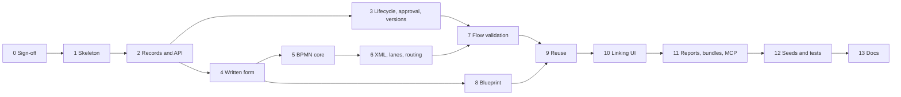
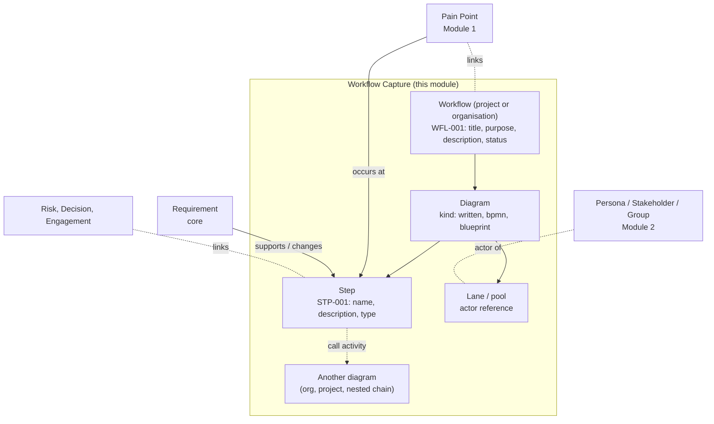
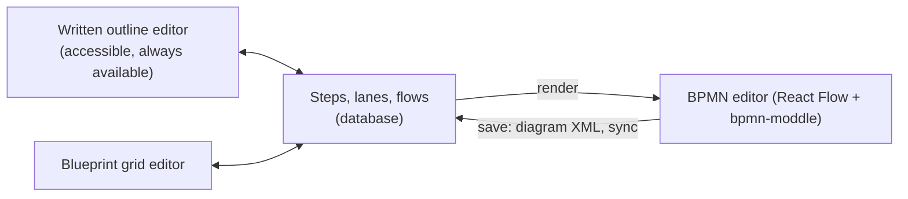

# Module 16 — Workflow Capture (BPMN and Service Blueprints) — Plan

**Status:** planned 2026-10-22; Phase 0 signed off (section 6). Nothing is built. **Decision tags:** every decision says `Decided by: User` or `Decided by: Agent`.

**Source:** user request 2026-10-22 (**Decided by: User**): a module to document how stakeholders use a system, so workflows can be linked to pain points and requirements. A workflow can be written, drawn, or both. The drawing uses standard BPMN 2.0 styling and each activity/step is linkable. The module also captures service blueprint diagrams. Each workflow has title, purpose and description.

## Status / Resume Here

0 / 13 phases complete. Phase 0 sign-off: 15 decisions recorded, none open (section 6). Next: Phase 1.

| # | Phase | Status |
|---|-------|--------|
| 0 | Design sign-off (section 6) | [x] Complete (2026-10-22) |
| 1 | Module skeleton: registration, entitlement, RBAC, models, migration | [ ] |
| 2 | Workflow, diagram and step records: project and organisation API, codes, links, search, tags, audit | [ ] |
| 3 | Lifecycle, approval setting (organisation default, project override) and version history | [ ] |
| 4 | Written form: narrative plus ordered step outline (accessible baseline) | [ ] |
| 5 | BPMN editor core: React Flow canvas, BPMN shapes, palette, step sync | [ ] |
| 6 | BPMN XML import/export, lanes and pools, edge routing, auto-layout | [ ] |
| 7 | Flow validation: failure paths, default failure mode, Check workflow, activation gate | [ ] |
| 8 | Service blueprint designer and viewer | [ ] |
| 9 | Reuse: call a diagram from another workflow (organisation, project, project tree) | [ ] |
| 10 | Linking UI: step links to pain points, requirements, personas; lane actors | [ ] |
| 11 | Reports, export/import bundle, MCP tools and skill | [ ] |
| 12 | Seeds, Storybook, Playwright | [ ] |
| 13 | Docs website, README, architecture doc, decisions log, SOC 2 check | [ ] |

## 1. Challenges to the request (read first)

- **Name clash with Module 15 (resolved).** Module 15 is a record-creation engine; "workflow" also names requirement/decision approval lifecycles. This module is **Workflow Capture** (key `workflow_capture`); Module 15's user-facing name becomes **Automations** (**Decided by: User**, 2026-10-22).
- **"Written and/or visual" needs one source of truth, or the two forms drift.** Design (section 3.2): the **steps are the shared model**; the written outline and the diagram are editors of it, never two copies.
- **BPMN 2.0 is large; "standard styling" is the real ask.** This module documents, it does not execute. Support the BPMN 2.0 **notation and interchange format** with the palette people draw stakeholder workflows with: pools/lanes, start/intermediate/end events, tasks (user, service, manual, send/receive), call activity, gateways (exclusive, parallel, inclusive), sub-process, sequence/message flow, data objects, annotations. No execution semantics. It does validate the *structure* of a workflow, chiefly that every activity has a known failure path (3.7) (**Decided by: User**, 2026-10-22).
- **Editor: build our own, no watermark (resolved).** `bpmn-js` was rejected because its licence requires the bpmn.io watermark to stay visible and forum answers indicate no exception is granted; JointJS's BPMN editor is commercial (**Decided by: User**, 2026-10-22). Approach: **React Flow** (`@xyflow/react`, MIT, verified 2026-10-22) for the canvas, with our own BPMN shapes drawn as SVG to the spec's notation, and **`bpmn-moddle`** (MIT, verified 2026-10-22; no watermark clause in its licence) to read and write standard BPMN 2.0 XML. `bpmn-auto-layout` (MIT) lays out imported or written-only workflows. React Flow's own attribution link is a default UI option (`proOptions.hideAttribution`), not a licence condition: its licence is plain MIT. Fallback if the canvas proves inadequate: `@maxgraph/core` (Apache-2.0).
- **Honest cost of building our own.** Hard parts: orthogonal edge routing with waypoints that survive import/export; resizable pools and lanes containing nodes; preserving BPMN elements we do not draw (kept as-is in the parsed XML model, never dropped on save); keyboard operation of the canvas. Mitigation: documentation-level palette only (about 15 elements), phased as 5 then 6 (flow validation is separate, Phase 7), with round-trip tests on real files from other tools.
- **Service blueprints are not BPMN.** A blueprint is a swim-lane grid over time separated by the lines of interaction, visibility and internal interaction. It gets a purpose-built grid editor (3.5) sharing the step records, links and written form.
- **"Each step linkable" means a step is a record, not a position in XML.** The link system is a polymorphic `(type, id)` table with no sub-reference, and every registered artefact type needs a code, search provider and tags. So a step is its own artefact type, `workflow_step` (`STP-001`), kept in step with its diagram.
- **Validation is a gate on a state, not on editing.** Drafts are never blocked, so people can sketch freely; the checks run on demand in draft and block only proposing and activating (3.7).
- **Multiple diagrams per workflow and reuse add a dependency graph.** A workflow holds several diagrams, and a step can call another diagram, so diagrams form a graph that can cross projects. This needs cycle detection, "used by" lists, delete/archive blocking, and visibility checks on every hop (3.6).
- **Organisation-owned from the start (user decision) roughly doubles surface area** (org routes, org admin UI, org-qualified codes, org search, org bundle) and creates cross-project visibility questions the project-only version avoids. Accepted (**Decided by: User**); built in the same record APIs through the existing scope-discriminator pattern (`Persona`, `organization_id` xor `project_id`), not as a second implementation.
- **Lanes and pools are actors, not steps.** A lane can name a Persona, Stakeholder or Stakeholder Group (if Module 2 is enabled) through the generic link-target mechanism, so a persona page can list the workflows it appears in.

## 2. Where it fits

Soft dependencies only: every link target is offered when its module is enabled. Hard dependency: Module 0 (link system, codes, tags, search, reports).

## 3. Key designs

### 3.1 Records

| Table | Purpose |
|-------|---------|
| `workflow` | Registered type `workflow`. `title`, `purpose`, `description` (markdown), `status` (`draft`, `proposed`, `active`, `archived`; `proposed` used only when the project requires approval), owner (principal reference: user or group), `default_failure_description` (text) and `default_failure_step_id` (optional step in one of its diagrams), `unique_code` (`WFL-nnn`, org-qualified when org-owned), `row_version`. Scope: exactly one of `organization_id` / `project_id` (the `Persona` pattern). |
| `workflow_diagram` | Child of a workflow (not an artefact type; links go to the workflow or its steps, recorded in `docs/decisions.md`). `name`, `kind` (`written`, `bpmn`, `service_blueprint`), `position`, `is_primary`, `diagram_xml` (BPMN only), `row_version`. |
| `workflow_step` | Registered type `workflow_step`. Child of a diagram. `unique_code` (`STP-nnn`), `name`, `description`, `step_type` (task, user task, service task, manual, event, gateway, call activity, sub-process, data object, annotation, or a blueprint cell type), `position` (outline order), `lane_id`, `diagram_element_id` (BPMN id) or `grid_row`/`grid_col` (blueprint), `called_diagram_id` (call activity only), `removed_at`. |
| `workflow_lane` | Pool/lane or blueprint row. `name`, `kind`, `position`, optional `actor_type`/`actor_id` (a registered link target), `diagram_element_id`. Not an artefact type (reason recorded in `docs/decisions.md`, as for the compliance 1:1 children exemption). |
| `workflow_flow` | Directed edge between two steps: `source_step_id`, `target_step_id`, `flow_kind` (sequence, message, association, **failure**), `label` (e.g. a gateway condition in words). A `failure` flow is the exception route out of an activity; in BPMN XML it is an error boundary event attached to the activity plus its outgoing sequence flow. |
| `workflow_version` | Immutable snapshot of the whole workflow (fields, every diagram's XML or rows, lanes, flows) taken on each lifecycle transition and on an explicit "Save version" with a comment; `version_no`, `created_by`, `created_at` (UTC). Restore creates a new draft from a snapshot (3.4). |

Time shape: all timestamps are past instants in UTC. No scheduled or calendar-date fields.

### 3.2 One model, three editors

- A `written` diagram has steps and flows but no drawing; "Convert to BPMN" auto-lays it out with `bpmn-auto-layout`, stores the XML and switches `kind` (one way; the user chooses).
- A `bpmn` diagram stores `diagram_xml` as the **canonical drawing** (shape, position, labels, waypoints). The step, lane and flow rows are a **projection** of that XML, rebuilt on every save. The outline view shows the projection and edits to a name write back into the XML; description, links and tags live on the row because BPMN does not hold them.
- A `service_blueprint` diagram has no XML; rows are canonical and the grid is the view.
- Imported `.bpmn` (from Camunda, Signavio, etc.) becomes a new `bpmn` diagram. Export writes standard BPMN 2.0 XML with no proprietary extension elements. Elements we do not draw are kept in the XML and shown as a generic grey box, so a round-trip never drops them.

### 3.3 Step sync rules (the risky part)

- Match on `diagram_element_id`. A new flow node creates a `workflow_step` with a fresh code; a renamed element updates the name and keeps code and links; a moved element changes nothing in the row.
- **Deleting an element that has links or comments does not silently delete the step.** The save is rejected with the list of affected steps and the user chooses *delete step and its links* or *keep as unplaced step*. Reason: a link to a pain point or requirement is evidence someone recorded; losing it while tidying a diagram is the defect class this rule exists for. A step with no links is soft-deleted; its code is never reused.
- Sync runs server-side in the same transaction as the save, with the diagram's `row_version` check, so two editors cannot overwrite one another.
- The XML is parsed with a parser that forbids external entities and DTDs, is size-capped and element-count-capped. Uploaded BPMN is untrusted input.

### 3.4 Approval (per project, organisation default) — **Decided by: User**

- Setting `workflow_approval_required`: an organisation admin sets the **default** (on/off) for the organisation; each project can override it. Follow the style guide's settings-hierarchy and platform-default-override-visibility patterns (the project page shows the inherited value and that it is overridden). Whether this fits the existing settings mechanism or needs a small generic key/value setting is a Phase 3 finding (**Decided by: Agent**: prefer the generic mechanism if one exists).
- **Approval covers the whole workflow, all diagrams together.** Lifecycle with approval on: `draft` → `proposed` → `active` (or back to `draft` with a comment); editing an `active` workflow reopens it as `draft`. The author cannot approve their own workflow (segregation of duties). Approval is a permission a role holds, not implied by edit.
- With approval off: `draft` ↔ `active` directly, and the create form offers **Save and activate** (`activate: bool` on the payload, own manage gate and own transition in one commit, two audit events). With approval on it is not offered. A row for this type goes in the review table in `docs/decisions.md`.
- An organisation-owned workflow uses the organisation's setting (there is no project to override). Switching the setting does not retroactively un-approve anything; switching on leaves existing `active` workflows active (**Decided by: Agent**).
- **Version history (**Decided by: User**, 2026-10-22).** Restoring replays the snapshot's XML/rows through the normal step sync (3.3). A step soft-deleted since then is revived by matching `diagram_element_id`, keeping its code; links removed with it are not brought back (stated in the restore confirmation). Restore always lands as `draft`, so approval and validation apply again. Audit records the restore with ids and version numbers, never content.
- Calls (3.6) may only target an `active` workflow when the caller's project requires approval.

### 3.5 Service blueprint

- Default lane set (editable names): Physical evidence, Customer actions, Frontstage actions, Backstage actions, Support processes. Columns are named, ordered stages. A step sits in one lane/column cell; flows are arrows between steps; the three lines are fixed between the standard lanes.
- A pain point on a step is a **link to a Pain Point record**, shown as a marker, not a column. A "fail point" or "moment of truth" is a tag.
- Built as an SVG/CSS grid with keyboard-operable selection and arrow-key movement.

### 3.6 Reuse: calling another diagram — **Decided by: User**

A call-activity step references a diagram; it renders as a collapsed `[+]` box that opens the called diagram. Allowed targets:

| Caller | May call |
|--------|----------|
| Project workflow | Diagrams in the same project; organisation-owned workflows of its organisation; workflows in any project in the **same project tree** (ancestors, descendants, siblings and other relatives sharing a root via `Project.parent_project_id`), where the viewer can open that project |
| Organisation workflow | Other organisation-owned workflows only (an org item must not depend on one project's private content) |

- Visibility check on every hop at **view time** and at **pick time**, through `link_nesting.can_open_project` (applies the token's project scope); a called diagram the viewer cannot open renders as a locked box with the step name only, never its content.
- No cycles: a call that would create a cycle is rejected at save (graph walk, depth-capped).
- "Used by" list on each diagram; deleting or archiving a called diagram is blocked while in use (the list names the callers the viewer may see and a count of the rest).
- A bundle export of a project that calls a diagram outside it carries the reference as information only and the importer re-resolves or marks it unresolved (consistent with how links to outside records are handled).
- "Nested chain" means the whole project tree under a common root, not just the direct line (**Decided by: User**, 2026-10-22). Projects in a different tree are not reachable except via an organisation-owned workflow. The tree walk is cycle-safe and capped, as in `project_hierarchy`.

### 3.7 Flow validation (**Decided by: User**, 2026-10-22)

Why: a documented workflow that shows only the happy path hides the failures that generate pain points and requirements. Risk addressed: undocumented failure behaviour in an approved workflow. Outcome: an active workflow states what happens when any activity fails.

- **Failure-capable steps are activities only:** tasks (all kinds), call activities and sub-processes. Events and gateways need no failure path.
- **A failure path** is a `failure` flow from the activity to another step (an error boundary event with an outgoing route in BPMN; a flow marked *failure* in the outline).
- **Default failure mode:** every workflow has `default_failure_description` (what happens to any failure not otherwise handled) and optionally `default_failure_step_id` (a handler step it routes to). An activity with no explicit failure path inherits the default. The check fails an activity only when it has no failure path **and** the workflow has no default.
- **Other structural checks** (errors unless marked): exactly one start event per process diagram (a warning for a sub-diagram that is only ever called), at least one end event, every non-end step has an outgoing flow, every step is reachable from the start, an exclusive or inclusive gateway's outgoing flows are labelled (a warning), a call activity's target exists and is visible, no call cycles. Blueprint diagrams check only that every step sits in a lane and column. A `written` diagram is checked the same way as a drawn one.
- **When it runs:** a **Check workflow** button is available in `draft` and on demand at any time; it lists problems with a link to each step and never blocks anything. **Proposing and activating (including Save and activate) run it and block on errors**; warnings never block (**Decided by: User**). An active workflow may be saved with new errors; its detail page shows a "no longer valid" badge from the last check, and the next transition re-runs it. Reason: drafts must stay free for sketching, and the gate sits on the state that other people rely on.
- **One validator, three callers:** a single service function returns `[{severity, code, step_id, message}]`, used by the check endpoint, the transition guard and the MCP tool. It reads the stored rows, not the XML, so written and drawn workflows share it. Messages never include step description text, only names and codes.
- **Called diagrams:** a call activity is failure-capable like any activity; the called diagram's own failures are validated in that diagram and handled inside it by its own workflow's default. The caller is not re-validated when a callee changes (the callee's own state governs); the "used by" list lets its owner see who relies on it.

### 3.8 Linking

- A step's **Links panel** is the existing shared panel (`QuickLinkField` on create; link types seeded through `link_type_seeds`). Seeded types: *Pain Point occurs at Step*, *Requirement implements/changes Step*, *Step performed by Persona/Stakeholder*, and generic related-to.
- Clicking a step in any diagram opens a `SidePanel` (style guide) with name, description, type, actor, tags, links and comments, so linking never leaves the picture.
- Pain points, requirements and personas get a reverse list ("Appears in workflows") from the same links, with no edit to their modules.

## 4. Module boundary and shared obligations (checklist)

- **Boundary:** module code lives only in `backend/app/modules/workflow_capture/` and `frontend/src/modules/workflow_capture/`. React Flow and bpmn-moddle are imported only there. No core file edits; a needed generic extension point (nav entry, org-admin section, settings entry) uses the existing declarative fields or becomes a new generic field.
- **Data boundary check:** no value added to a core enum/column. `artefact_types=("workflow", "workflow_step")`; link types via `link_type_seeds`; accent colour via `TierAModuleDefinition.entityAccentColor`.
- **Every artefact type:** `unique_code` via `generate_unique_code` (`WFL`/`STP`; org-owned passes the `Organization`), shown with `RecordCode`/`ScopedRecordCode`; search providers (`name`, `purpose`, `description`), `organization_subcomponent` and `orgArtefactPaths` for the org surface, `artefactPaths` for projects; tags (`TagField`, `useCommitTags`, `TagFilter`); `QuickLinkField`; `ProjectScope` nested-project filter; field `help`; required markers; label maps for `status`, `kind`, `step_type` (Principle 12).
- **Nested projects:** the module adds no project-scoped vocabulary table (lane and stage names are per diagram), so no ancestor fallback applies (**Decided by: Agent**). Reuse across the chain is the separate mechanism in 3.6.
- **Org defaults a project can hide:** n/a (no org-tier vocabulary).
- **Users and groups parity:** `owner` is a principal reference (user or group). A lane actor names a role in the process, not an assignee, so user/group parity does not apply (**Decided by: Agent**).
- **Gating/visibility:** three levels (entitlement, org enabled, project); defaults via the server default row, never `default_enabled`.
- **Audit:** every mutation through `services/audit.py`; diagram XML is **never** logged, audited or put in a URL; audit detail carries ids, counts and sizes only. A workflow may name real people, so free text never goes to logs or traces.
- **Security of the canvas:** labels render as text (no HTML injection); XML is parsed server-side before it is stored; exported SVG/PNG is generated client-side.
- **Performance:** the editor is a lazy-loaded chunk so lists and detail pages do not pay for it.
- **Dependencies:** adding `@xyflow/react`, `bpmn-moddle` and `bpmn-auto-layout` uses `frontend/scripts/sync-lockfile.sh`; licences re-verified at install.
- **Docs/skills:** `mcp_guidance.md` plus `generate_mcp_module_tools_reference.py`; docs website page with a Mermaid diagram; `docs/solution-architecture.md`, `docs/modules.md`, the index row.

## 5. Phase specs

Each phase states **Why**, **Risk addressed**, **Outcome** and its **tests**.

| Phase | Why / risk / outcome | Tests |
|-------|----------------------|-------|
| 1 Skeleton | Why: nothing can be gated or migrated without registration. Risk: a module enabled for the wrong org, or switched on by upgrade. Outcome: `ModuleDefinition`, roles (Workflow Author, Workflow Approver, Workflow Viewer), sub-components, migration, server default row. | 404 when disabled or not entitled; role grants. |
| 2 Records and API | Why: steps must be real records to be linkable. Risk: orphan or duplicate codes, cross-project or cross-org leaks. Outcome: CRUD for workflow, diagram, step, lane, flow at project and organisation scope; codes, links, tags, search, audit, row locks. | Per-endpoint behaviour, code race, org/project isolation, audit rows. |
| 3 Lifecycle, approval, versions | Why: some projects need a gate, others do not, and people need to recover earlier diagrams. Risk: segregation bypass, silent default flips, restore resurrecting invalid state. Outcome: org default plus project override, lifecycle, Save and activate only when off, snapshots and restore-as-draft. | Author cannot approve; setting inheritance; activate when approval is on is rejected; restore revives soft-deleted steps with their codes and lands as draft. |
| 4 Written form | Why: accessibility and the "written" half. Risk: outline and diagram diverging. Outcome: markdown narrative plus a full step/lane/flow outline editor. | Reorder, link, delete; axe check. |
| 5 BPMN core | Why: the standard-styling half. Risk: step loss on delete, version overwrites. Outcome: canvas, BPMN shape set, palette, selection, connect, undo/redo, keyboard operation, server-side sync per 3.3. | Sync add/rename/delete-with-links; version conflict. |
| 6 XML, lanes, routing | Why: interchange and layout are what make it "BPMN". Risk: malicious XML, losing unknown elements, broken waypoints. Outcome: import/export through bpmn-moddle, lanes and pools with resize, orthogonal routing, auto-layout, unknown elements preserved. | XXE and oversize XML rejected; round-trip of samples from other tools; unknown element survives. |
| 7 Flow validation | Why: the user wants every failure to have a known path. Risk: undocumented failure behaviour in approved workflows; draft sketching blocked. Outcome: the single validator (3.7), Check workflow in the UI, `failure` flow in the outline and BPMN editor (error boundary event), default failure mode fields, activation guard. | Each rule has a passing and failing case; draft never blocked; activate blocked on errors, not warnings; default failure satisfies the check; error boundary event round-trips to a `failure` flow. |
| 8 Blueprint | Why: the second diagram type. Risk: a drag-only inaccessible grid. Outcome: grid editor, lines, stages, keyboard use, PNG/SVG export. | Keyboard placement; step moves keep links. |
| 9 Reuse | Why: shared sub-workflows. Risk: cycles, visibility leaks across projects, dangling calls. Outcome: call activity, picker, used-by, block on delete, locked box for unreadable targets. | Cycle rejected; unreadable target shows no content; org, same-tree sibling and different-tree cases; token project scope. |
| 10 Linking UI | Why: the purpose of the module. Risk: links invisible from the other side. Outcome: side panel, quick links, reverse lists, lane actors. | Link both directions; disabled-module targets not offered. |
| 11 Reports, bundles, MCP | Why: evidence that travels. Risk: hand-formatted codes, XML in logs. Outcome: reports (steps with no requirement, pain points by step, workflows with unlinked steps, workflows relying on the default failure mode), project/org bundle with diagrams, MCP tools and skill. | Report record-code test, bundle round-trip, MCP skill tests. |
| 12 Seeds and tests | Why: standing requirement. Outcome: demo and e2e seeds, Storybook for each component, Playwright (write, draw, link a step, blueprint, call a diagram, delete-with-links, approval, validation, restore a version). | Idempotent e2e specs. |
| 13 Docs | Why: standing requirement. Outcome: docs website page, README, architecture, decisions, SOC 2 policy review (audit, data classification, access control), index rows, Module 15 renamed to Automations in its plan and the index. | `check_doc_links.py`, Mermaid validation. |

## 6. Phase 0 sign-off

**Decided (2026-10-22):**

| # | Decision | By |
|---|----------|----|
| D1 | Name: Workflow Capture; Module 15 becomes Automations | User |
| D2 | Editor: build our own on React Flow with bpmn-moddle; no bpmn-js, no watermark | User |
| D3 | A workflow holds multiple diagrams; diagrams are reusable via call activities | User |
| D4 | Reuse spans the organisation, the same project, and the nested-project chain where the viewer can see the target | User |
| D5 | Approval is per project with an organisation-admin default; covers the whole workflow | User |
| D6 | Organisation-owned and project-owned workflows from the start | User |
| D7 | Steps are their own record type (`STP-nnn`) | Agent |
| D8 | Service blueprint has its own grid editor | Agent |
| D9 | A diagram is not an artefact type; links go to workflows and steps | Agent |
| D10 | Reuse reaches the whole project tree (siblings and other relatives under a common root), not just ancestors and descendants | User |
| D11 | Diagram version history with restore, per whole workflow | User |
| D12 | Flow validation: every activity needs a known failure path, with a per-workflow default failure mode (description plus optional handler step) | User |
| D13 | Failure-capable steps are activities only (tasks, call activities, sub-processes) | User |
| D14 | Validation never blocks drafts (on-demand Check workflow); it blocks proposing and activating, not saving an active workflow | User |
| D15 | Version cadence: snapshot on every lifecycle transition and explicit Save version; restore lands as draft | Agent |

**Open:** none. Anything found while building is raised with the user, not decided silently.

## Risks

| Risk | Mitigation |
|------|------------|
| Own editor takes longer than estimated | Documentation-level palette only; phase 5/6 split; `@maxgraph/core` fallback decided at the end of Phase 5, not later. |
| Step sync silently destroys links | Reject-and-choose rule (3.3), tested. |
| Diagram inaccessible | Full outline editor (Phase 4), keyboard canvas and blueprint grid. |
| Imported BPMN from other tools loses data | Unknown elements preserved; round-trip fixtures. |
| Cross-project calls leak content | Per-hop visibility check, locked-box rendering, tests with scoped tokens. |
| Scope creep to execution/simulation | Validation is structural only (3.7); execution and simulation are a documented non-goal. |
| Restore resurrects a stale or invalid state | Restore always lands as draft; approval and validation apply again. |
| Validation noise puts people off documenting | Drafts exempt; warnings never block; activities only. |
| Large diagrams slow save | Element and size caps; one diff, not N queries. |

When the table reads 13/13: move this file to `docs/plans/completed/` and run `scripts/check_doc_links.py` (see CLAUDE.md "Plan Lifecycle").
