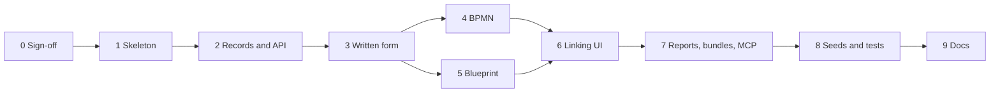
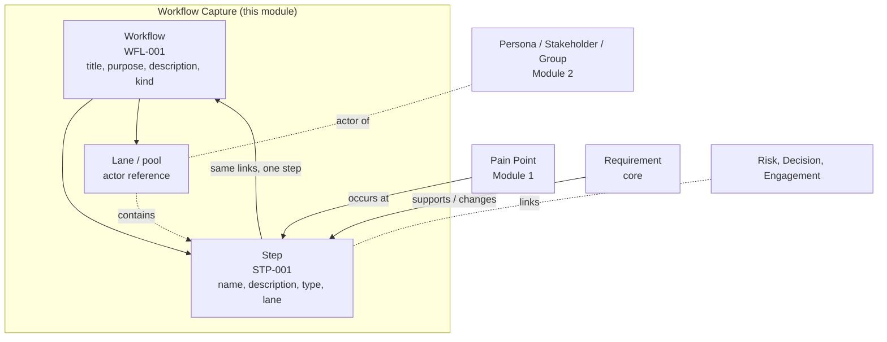
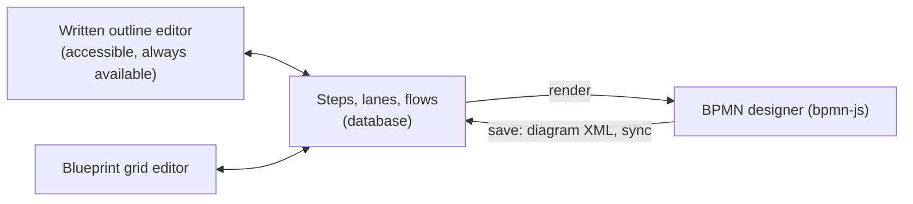

# Module 16 — Workflow Capture (BPMN and Service Blueprints) — Plan

**Status:** planned 2026-10-22. Phase 0 (design sign-off, section 6) is open; nothing is built. **Decision tags:** every decision says `Decided by: User` or `Decided by: Agent`.

**Source:** user request 2026-10-22 (**Decided by: User**): a module to document how stakeholders use a system, so workflows can be linked to pain points and requirements. A workflow can be written, drawn, or both. The drawing uses standard BPMN 2.0 styling and each activity/step is linkable. The module also captures service blueprint diagrams. Each workflow has title, purpose and description.

## Status / Resume Here

0 / 10 phases complete. Start with Phase 0.

| # | Phase | Status |
|---|-------|--------|
| 0 | Design sign-off (section 6) | [ ] |
| 1 | Module skeleton: registration, entitlement, RBAC, models, migration | [ ] |
| 2 | Workflow and step records: API, codes, links, search, tags, audit | [ ] |
| 3 | Written form: narrative plus ordered step outline (accessible baseline) | [ ] |
| 4 | BPMN designer and viewer: step sync from diagram XML | [ ] |
| 5 | Service blueprint designer and viewer | [ ] |
| 6 | Linking UI: step links to pain points, requirements, personas; lane actors | [ ] |
| 7 | Reports, export/import bundle, MCP tools and skill | [ ] |
| 8 | Seeds (demo and e2e), Storybook, Playwright | [ ] |
| 9 | Docs website, README, architecture doc, decisions log, SOC 2 check | [ ] |

## 1. Challenges to the request (read first)

- **The name collides with Module 15.** [module-15-workflows-plan.md](module-15-workflows-plan.md) is a record-creation engine (diagram of records to create and run), and "workflow" already names requirement/decision approval lifecycles. Two unrelated things called "Workflows" will confuse users and the MCP skill. **Recommendation (Decided by: Agent, pending Q1):** this module is **Workflow Capture** (key `workflow_capture`, records called *workflows*, steps called *steps*), and Module 15's user-facing name changes to something like "Guided creation" before it ships.
- **"Written and/or visual" needs one source of truth, or the two forms drift.** A text description that is not tied to the diagram goes stale the moment someone edits the drawing. Design (section 3): the **steps are the shared model**; the written outline and the diagram are two editors of it, never two copies.
- **BPMN 2.0 is large; "standard styling" is the real ask.** Full BPMN (collaboration, message flows, compensation, conditional events) is a modelling language with an execution semantics. This module documents, it does not execute. Support the BPMN 2.0 **notation and interchange format** (import/export valid `.bpmn`) with the element palette people actually draw stakeholder workflows with: pools/lanes, start/intermediate/end events, tasks (user, service, manual, send/receive), gateways (exclusive, parallel, inclusive), sub-processes, sequence/message flow, data objects, annotations. Do not validate execution semantics.
- **Use bpmn-js, do not build a modeller.** A hand-built editor would be months of work and never match the standard's shapes. `bpmn-js` (bpmn.io) is the reference web modeller. Two real costs: (1) its licence requires the bpmn.io watermark to stay visible on the canvas (**Q2**); (2) it is a vanilla-JS canvas that is only partly keyboard- and screen-reader-accessible, which the style guide and WCAG expectations care about. The written outline (Phase 3) is the accessible equivalent, so it must be a full editor of the steps, not a read-only echo.
- **Service blueprints are not BPMN.** A blueprint is a swim-lane grid over time (physical evidence, customer actions, frontstage, backstage, support processes) separated by the lines of interaction, visibility and internal interaction. bpmn-js cannot draw it faithfully, so it gets a purpose-built grid editor (section 3.4). It shares the step records, links and written form.
- **"Each step linkable" means a step is a record, not a position in XML.** The link system is a polymorphic `(type, id)` table with no sub-reference, and every registered artefact type needs a code, search provider and tags. So a step is its own artefact type, `workflow_step` (`STP-001`), created and kept in step with the diagram. This reuses links, trace, search and reports with no new mechanism, at the cost of the sync rules in section 3.3.
- **Lanes and pools are actors, not steps.** "How stakeholders use a system" is carried by *who* does each step. A lane can name a Persona, Stakeholder or Stakeholder Group (if Module 2 is enabled) through the generic link-target mechanism, so a step inherits its actor and a persona page can list the workflows it appears in.

## 2. Where it fits

Soft dependencies only: every link target is offered when its module is enabled, none is required. Hard dependency: Module 0 (link system, codes, tags, search, reports).

## 3. Key designs

### 3.1 Records

| Table | Purpose |
|-------|---------|
| `workflow` | Registered type `workflow`. `title`, `purpose`, `description` (markdown), `kind` (`written`, `bpmn`, `service_blueprint`), `status` (`draft`, `active`, `archived`), owner (principal reference: user or group), `unique_code` (`WFL-nnn`), `diagram_xml` (BPMN only), `row_version` for locking. |
| `workflow_step` | Registered type `workflow_step`. Child of a workflow. `unique_code` (`STP-nnn`), `name`, `description`, `step_type` (task, user task, service task, manual, event, gateway, sub-process, data object, annotation, or blueprint cell type), `position` (outline order), `lane_id`, `diagram_element_id` (BPMN id) or `grid_row`/`grid_col` (blueprint), `removed_at`. |
| `workflow_lane` | Pool/lane or blueprint row. `name`, `kind`, `position`, optional `actor_type`/`actor_id` (a registered link target), `diagram_element_id`. Not an artefact type (reason recorded in `docs/decisions.md`, as for the compliance 1:1 children exemption). |
| `workflow_flow` | Directed edge between two steps: `source_step_id`, `target_step_id`, `flow_kind` (sequence, message, association), `label` (e.g. a gateway condition in words). |

Time shape: all timestamps are past instants in UTC. No scheduled or calendar-date fields.

### 3.2 One model, three editors

- A `written` workflow has steps and flows but no diagram; an auto-laid-out read-only BPMN view is generated on demand so it can be previewed, and "Convert to BPMN" stores that layout and switches `kind` (one way; the user chooses).
- A `bpmn` workflow stores `diagram_xml` as the **canonical drawing** (shape, position, labels). The step, lane and flow rows are a **projection** of that XML, rebuilt on every save. The outline view shows the projection and edits to a step's name/description write back into the XML (name) or the row (description, links, which BPMN does not hold).
- A `service_blueprint` workflow has no XML; rows are canonical and the grid is the view.
- Imported `.bpmn` (from Camunda, Signavio, etc.) is accepted as a new `bpmn` workflow. Export writes standard BPMN 2.0 XML; the module adds no proprietary extension elements, only ids it can round-trip.

### 3.3 Step sync rules (the risky part)

- Match on `diagram_element_id`. A new flow node creates a `workflow_step` with a fresh code; a renamed element updates the name and keeps code and links; a moved element changes nothing in the row.
- **Deleting an element that has links or comments does not silently delete the step.** The save is rejected with the list of affected steps and the user chooses *delete step and its links* or *keep as unplaced step*. Reason: a link to a pain point or requirement is evidence someone recorded; losing it as a side effect of tidying a diagram is the defect class this rule exists for. A step with no links is removed (soft-deleted, code never reused).
- Sync runs server-side in the same transaction as the save, with the workflow's `row_version` check, so two editors cannot overwrite one another. Concurrent edit shows the standard version-lock conflict.
- The XML is parsed with a defusedxml-style parser (no external entities or DTDs), size-capped, and element counts capped. Uploaded BPMN is untrusted input.

### 3.4 Service blueprint

- Fixed lane set per blueprint (editable names): Physical evidence, Customer actions, Frontstage actions, Backstage actions, Support processes. Optional extra lanes.
- Columns are stages (named, ordered). A step sits in one lane/column cell. Flows are arrows between steps. The three lines (interaction, visibility, internal interaction) are drawn fixed between the standard lanes.
- Extra per-step attributes: `pain_point_flag` is **not** a field; a pain point is a link to a Pain Point record, shown as a marker on the step. Same for requirement links (a "moment of truth" or "fail point" are tags, not new columns).
- Implemented as an SVG/CSS grid component with keyboard-operable cell selection, drag to reposition and arrow keys, because the standard's conventions are simple enough that a library would cost more than it saves.

### 3.5 Linking

- A step's **Links panel** is the existing shared panel (`QuickLinkField` on create, link types seeded by the module through `link_type_seeds`). Seeded types: *Pain Point occurs at Step*, *Requirement implements/changes Step*, *Step performed by Persona/Stakeholder*, and generic related-to.
- Click a step in either diagram opens a `SidePanel` (style guide) with name, description, type, actor, tags, links and comments, so linking never leaves the picture.
- Pain points, requirements and personas get a reverse list ("Appears in workflows") from the same links, with no edit to their modules.

## 4. Module boundary and shared obligations (checklist)

- **Boundary:** module code lives only in `backend/app/modules/workflow_capture/` and `frontend/src/modules/workflow_capture/`. bpmn-js is imported only there. No core file edits; if the designer needs a generic extension point (a nav entry, an org-admin section), use the existing declarative fields.
- **Data boundary check:** no value added to a core enum/column. `artefact_types=("workflow", "workflow_step")`; link types via `link_type_seeds`; accent colour via `TierAModuleDefinition.entityAccentColor`.
- **Every artefact type:** `unique_code` via `generate_unique_code` with `WFL`/`STP`, shown with `RecordCode`; search providers (`name`, `purpose`, `description`) and `artefactPaths`; tags (`TagField`, `useCommitTags`, `TagFilter`); `QuickLinkField`; `ProjectScope` nested-project filter; field `help`; required markers; label maps for `kind`, `status`, `step_type` (Principle 12).
- **Nested projects:** no project-scoped vocabulary table is added (lane names and stage names are per-workflow), so no ancestor fallback applies. Recorded as a decision (**Decided by: Agent**).
- **Org defaults a project can hide:** n/a (no org-tier vocabulary).
- **Users and groups parity:** `owner` is a principal reference (user or group); a lane actor names a role in the process (persona, stakeholder, stakeholder group), not an assignee, so user/group parity does not apply there; recorded as a decision (**Decided by: Agent**).
- **Save and activate:** workflows have no approval gate (**Decided by: Agent**, pending Q4), so the create form offers it; add the row to the review table in `docs/decisions.md`.
- **Gating/visibility:** three levels (entitlement, org enabled, project); a server default row, not `default_enabled`.
- **Audit:** every mutation through `services/audit.py`; the diagram XML is **never** logged, audited or put in a URL; audit detail carries workflow id, step count and size only. Free text is Internal classification; a workflow may name real people, so it must not be pushed into logs or traces.
- **Security of the canvas:** bpmn-js renders labels as text (no HTML injection); XML import is parsed server-side before it is stored; exported SVG/PNG is generated client-side.
- **Performance:** bpmn-js is about 1 MB; the designer is a lazy-loaded chunk so lists and detail pages do not pay for it.
- **IPv6/Docker/monitoring:** no new listener, so nothing to add.
- **Docs/skills:** `mcp_guidance.md`, regenerate `generate_mcp_module_tools_reference.py`; docs website page with a Mermaid diagram; `docs/solution-architecture.md`, `docs/modules.md` index row, `docs/plans/future-modules-2026-09-index.md` row.

## 5. Phase specs

Each phase states **Why** (the need), **Risk addressed**, **Outcome**, and its **tests**.

| Phase | Why / risk / outcome | Tests |
|-------|----------------------|-------|
| 1 Skeleton | Why: nothing can be gated or migrated without registration. Risk: a module enabled for the wrong org, or flipped on by upgrade. Outcome: `ModuleDefinition`, roles (Workflow Author, Workflow Viewer), sub-components, migration, server default row. | 404 when disabled or not entitled; role grants. |
| 2 Records and API | Why: steps must be real records to be linkable. Risk: orphan or duplicate codes, cross-project leaks. Outcome: CRUD, codes, links, tags, search, audit, locks, nested-project scope. | Per-endpoint behaviour, code race, org/project isolation, audit rows. |
| 3 Written form | Why: accessibility and the "written" half of the request. Risk: outline and diagram diverging. Outcome: markdown narrative plus a full step/lane/flow outline editor. | Outline edits reorder, link and delete as specified; axe check on the page. |
| 4 BPMN | Why: the "standard workflow styling" half. Risk: step loss on delete, malicious XML, version overwrites. Outcome: bpmn-js modeller and viewer, import/export, server-side sync per 3.3. | Sync add/rename/delete-with-links; XXE and oversize XML rejected; round-trip of a Camunda sample; version conflict. |
| 5 Blueprint | Why: the second diagram type the user asked for. Risk: an inaccessible drag-only grid. Outcome: grid editor, lines, stages, keyboard use, PNG/SVG export. | Cell placement via keyboard; step moves keep links. |
| 6 Linking UI | Why: the purpose of the module. Risk: links invisible from the other side. Outcome: side panel, quick links, reverse lists, lane actors. | Link both directions; disabled-module targets not offered. |
| 7 Reports, bundles, MCP | Why: evidence that travels. Risk: codes hand-formatted, XML leaked in logs. Outcome: reports (workflows with unlinked steps; pain points by step; steps with no requirement), project bundle with diagram XML, MCP tools to read/create workflows and steps. | Report record-code test, bundle round-trip, MCP skill tests. |
| 8 Seeds and tests | Why: standing requirement. Outcome: demo and e2e seeds, Storybook for each component, Playwright (create written, draw BPMN, link a step, blueprint, delete-with-links). | Idempotent e2e specs. |
| 9 Docs | Why: standing requirement. Outcome: docs website page, README, architecture, decisions, SOC 2 policy review (audit, data classification), index rows. | `check_doc_links.py`, Mermaid validation. |

## 6. Open questions for Phase 0 (need user answers)

| # | Question | Recommendation |
|---|----------|----------------|
| Q1 | Name: "Workflow Capture" (key `workflow_capture`) and rename Module 15's user-facing name? | Yes. Alternative: "Process Maps". |
| Q2 | bpmn-js licence requires the bpmn.io watermark to stay on the canvas. Acceptable? Alternative is a custom SVG BPMN renderer/editor (months, non-standard fidelity). | Accept bpmn-js with the watermark; confirm before Phase 4. |
| Q3 | One workflow = one `kind`, or can a workflow hold both a BPMN and a blueprint of the same scenario? | One kind each; link two workflows to relate them. |
| Q4 | Lifecycle: `draft`/`active`/`archived` with no approval gate (so Save and activate is offered), or an approval like requirements? | No approval gate; workflows are descriptive, not a controlled baseline. |
| Q5 | Scope: project-only, or also organisation-owned reusable workflows (e.g. a company-wide onboarding process)? | Project-only in v1; org-owned later via the existing org-owned type mechanism. |
| Q6 | BPMN depth: notation plus interchange only (recommended), or also simulation/validation of flow correctness? | Notation and interchange only. |
| Q7 | Lane actors: personas, stakeholders and stakeholder groups only, or also free-text actors when Module 2 is off? | Both: a lane has a name always and an optional actor reference. |
| Q8 | Version history of a diagram (restore earlier XML)? | Reuse the existing record-versioning if the type opts in; otherwise defer. Needs a look at Module 0 versioning before committing. |

## Risks

| Risk | Mitigation |
|------|------------|
| Step sync silently destroys links | Reject-and-choose rule (3.3), tested. |
| Diagram inaccessible | Full outline editor (Phase 3), keyboard blueprint grid; BPMN canvas limitation documented. |
| bpmn-js upgrades break stored XML | XML is standard BPMN 2.0; pin the version; round-trip tests on fixtures. |
| Scope creep to execution/simulation | Q6; documented non-goal. |
| Large diagrams slow save | Element and size caps; sync does one diff, not N queries. |

When the table reads 10/10: move this file to `docs/plans/completed/` and run `scripts/check_doc_links.py` (see CLAUDE.md "Plan Lifecycle").
