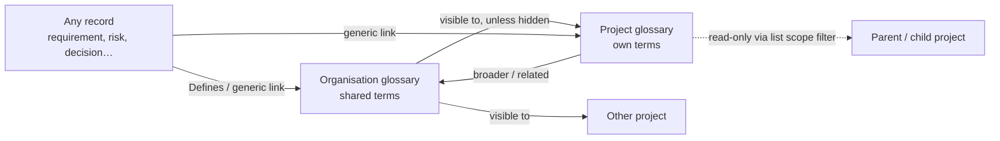
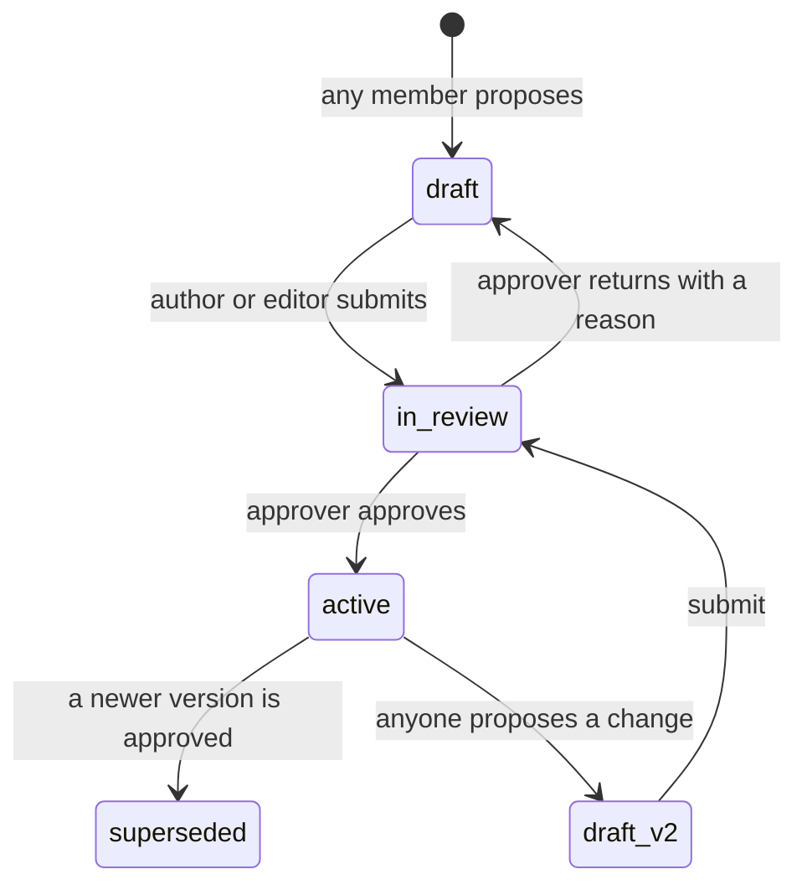
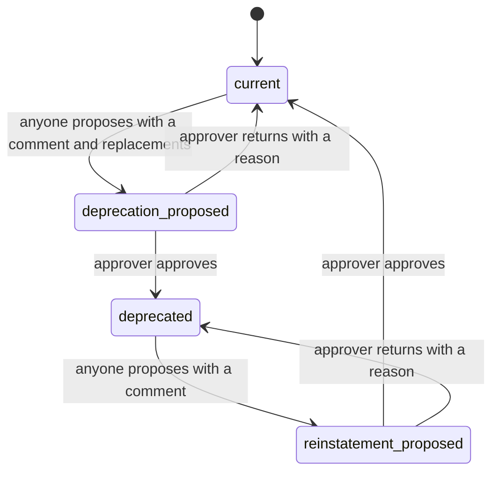
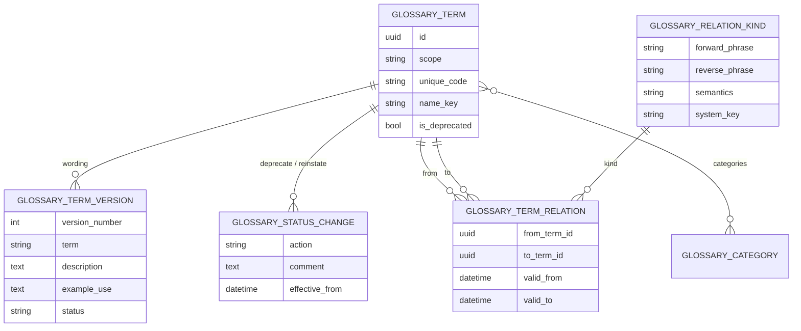

# Module 17 — Glossary — Plan

**Status:** planned 2026-10-25; Phase 0 signed off 2026-10-25 (section 6); nothing is built. **Decision tags:** every decision says `Decided by: User` or `Decided by: Agent`.

**Source:** user request 2026-10-25 (**Decided by: User**): a module that stores organisation and project glossaries. Terms can be put in categories and carry tags. Each term has a term, a description and an example use, and an ontology lets terms be linked together.

See [future-modules-2026-09-index.md](future-modules-2026-09-index.md) for the cross-cutting module architecture and [../modules.md](../modules.md) for the registration contract. Hard-depends on Module 0. No soft dependencies: any record in any enabled module can link to a term through the generic link system.

## Status / Resume Here

1 / 10 phases complete. Phase 1 is next. Deprecation and the as-at view were added 2026-10-25 and signed off the same day (section 6).

| # | Phase | Status |
|---|-------|--------|
| 0 | Design sign-off (section 6) | [x] Complete (2026-10-25) |
| 1 | Skeleton and data model: registration, entitlement, roles, tables, migration | [ ] |
| 2 | Term API (org and project): versions, approval, deprecation, codes, tags, links, search, summaries, audit, record tables | [ ] |
| 2b | As-at resolver: point-in-time reads of wording, status, relations and categories, in the API and record tables | [ ] |
| 3 | Ontology back end: relation-kind vocabulary, term relations, rules, link-type seeds | [ ] |
| 4 | Frontend: lists, detail, propose/edit/approve, deprecate/reinstate, as-at picker, categories | [ ] |
| 5 | Frontend: relation kinds admin, relations panel, hierarchy tree, relations graph | [ ] |
| 6 | Project and organisation bundles, reports G1–G5 (G1 and Export take an as-at date) | [ ] |
| 7 | MCP tools and agent skill (with `as_at`) | [ ] |
| 8 | Seeds, Storybook, Playwright, docs website, close-out | [ ] |

## 1. What it is

A shared vocabulary: what a word means in this organisation or project, with an example of it in use, and how it relates to other words. The organisation holds terms every project shares; a project holds terms only it needs, and may restate an organisation term for its own context. Wording is approved before it is relied on, and a change to approved wording is proposed as a new version while the approved one stays in force. A term that is no longer used is **deprecated** with a comment and, optionally, the term or terms it was replaced or split into. The whole glossary can be viewed **as it stood on a past date**, so older documents can be read in the terminology of their day.

A term is an **identity** (stable code, links, relations, categories, tags) with **versions** (the wording):

| On the identity | Notes |
|-----------------|-------|
| `unique_code` | `GLO-001`, from the shared sequence (organisation terms from the organisation counter). |
| `scope` / owner | Organisation or project (section 3.1). |
| `name_key` | Case-folded term of the active version (of the first draft until one is active); unique per owner. |
| categories | Zero or more, from the scope's category list (section 3.2). |
| tags | Core tag system, as every artefact type. |
| `steward` | A user or a group accountable for the term (principal reference). Optional. |
| `is_deprecated` | Denormalised from the latest approved status change (section 3.3); the history is in `glossary_term_status_changes`. Distinct from a *version* being superseded. |

| On each version (the wording) | Notes |
|-------------------------------|-------|
| `term` | The word or phrase. |
| `description` | The definition. Long text, grows (`TextAreaField`). |
| `example_use` | A sentence showing the term in use. Long text, grows. |
| `aliases` | Other spellings and acronyms (`SLA`, `service level agreement`). Searchable. |
| `source` | Where the definition comes from (a standard, a clause, a URL). Optional, short. |
| `status` | `draft` → `in_review` → `active`; replaced versions become `superseded`. |
| `change_note`, author, approver, UTC times | Why it changed, who proposed and who approved. |

Term-to-term relations are the ontology (section 3.3). Term-to-anything-else relations are ordinary artefact links.

## 2. Challenges to the request (read first)

- **"Ontology" is ambiguous here.** [Module 15](module-15-workflows-plan.md) already has a *System Ontology* (a generated map of the product's own record types, for agents). This module needs something else: a term relation model (broader/narrower, synonym, related, part of, replaced by, and organisation-defined kinds). The UI says "Relations", not "Ontology". No OWL/RDF/JSON-LD until someone needs interchange. **Decided by: Agent.**
- **The core link system cannot carry term-to-term links for organisation terms.** Artefact links are created and listed through project endpoints (`routers/artefact_links.py`), and link types have a `flow` (upstream/downstream) but no notion of *symmetric*, *transitive* or *acyclic*, which a glossary hierarchy needs. Resolved in Q1: a module-local relations table. Terms still link to any other record through the generic system.
- **Three overlapping classifications.** Category, tag and broader/narrower all group terms. Guidance, shown in the help text and docs site: *category* = named shelves (several allowed); *tag* = free, cross-cutting labels; *broader/narrower* = meaning (a hierarchy of concepts).
- **Shadowing.** A project may restate an organisation term. Allowed, with a "restates organisation term" badge and report G5, never blocked (Q3).
- **Approval is on the wording, not the structure.** Gating categories, tags and relations behind approval would make filing a term as slow as defining it. Only the wording is versioned and approved; the rest edits immediately under the editor permission. **Decided by: Agent** (revisit freely).
- **React Flow would be the frontend's first graph dependency** (Module 16 plans it but is unbuilt). The graph is therefore built as a generic, lazy-loaded wrapper so Module 16 reuses it (section 3.6).

## 3. Design

### 3.1 Ownership and visibility

- One `GlossaryTerm` identity table with the `scope` discriminator and exactly one of `organization_id` / `project_id` set, with the CHECK-constraint pattern Strategy and Future State use, and one `GlossaryTermVersion` table with the temporal shape of `StrategyVersion` (`version_number`, `valid_from` / `valid_to`). **Decided by: Agent.**
- A project's term list = its own terms + the organisation's, minus those the project has hidden. Hiding is a per-project override that never touches the shared term (the Stakeholder visibility pattern, resolved up the ancestor chain with nearest-row-wins and a `hidden` boolean so a child can re-show what a parent hid). **Decided by: Agent.**
- Nested projects: a project's own terms are **not** inherited by children through a silent fallback. Children reach a parent's terms through the standard **list scope filter** (`ProjectScope`, read-only rows from another project). The organisation tier is the home for "everyone shares this". **Decided by: Agent.**
- A project term may relate to an organisation term; an **organisation term may never relate to a project term**, and may use organisation relation kinds only. The shared record must not depend on something only one project can see.

### 3.2 Categories (several per term)

- A module vocabulary built on `services/type_vocabulary.py` (organisation base list plus per-project rename / reorder / disable / add, with **hide and restore** of organisation defaults through `ProjectDefinitionSuppression` and the shared `type_vocabulary_routes` and `ProjectTypeVocabularyPanel`). A term holds several, so a join table `glossary_term_categories` replaces the single type column other typed modules use. Org categories are never deleted while a term uses them (disable instead).
- Nested-projects check (required by `CLAUDE.md`): `TypeVocabulary` already has **no ancestor fallback** because the organisation list is the base every project sees. Recorded in `docs/decisions.md` at Phase 1. **Decided by: Agent.**
- Seeded organisation categories (fresh installs only): `Business`, `Technical`, `Regulatory`, `Acronym`. Editable.
- Category edits are not versioned or gated (section 2).

### 3.3 Lifecycle and approval

- States live on the **version**. At most one `active` version and at most one open (`draft` / `in_review`) version per term, enforced by partial unique indexes. **Decided by: User** (the new-version behaviour): editing an active term never alters it; it creates a new draft version while the old one stays active, and approving the new version marks the old one `superseded`, in one transaction.
- Naming: a *version* replaced by a newer approved one is `superseded`; a whole *term* withdrawn from use is `deprecated` (section 3.3a). The two are separate so history reads unambiguously. **Decided by: Agent.**
- Any member can propose a new term or a change to an active term. The author edits their own open version; editors can edit any. **The approver may not be the version's author** (segregation of duties, enforced in the transition, not only the UI). No **Save and activate** for this type. **Decided by: User** (approval gate, dedicated approver role).
- Everyone with read access sees the `active` version. The open draft is visible to its author, editors and approvers only; **search, reports, link summaries and MCP read the active version only**, so unapproved wording is never exposed or searchable. **Decided by: Agent.**
- Links, relations, categories and tags attach to the identity, so a new version never breaks them.
- A term can be **deleted** only while it has never had an approved version (a never-approved draft). After that it is deprecated, never deleted, so history and the as-at view stay complete. **Decided by: Agent.**
- A project import or CSV import never writes a status: it creates or updates **draft** versions only; a project bundle also imports as draft (an imported approval state never bypasses the gate).
- Time shape: past instants only (UTC, timezone-aware). No scheduled times or calendar dates in v1.

### 3.3a Deprecation and reinstatement

- **Deprecating** (**Decided by: User**): anyone who can propose proposes it with a **mandatory comment** and **zero or more replacement terms** (several for a term that was split). A `glossary_approver` who did not propose it approves or returns it; until approved the term is unchanged. Zero replacements is allowed for a term that is simply dropped. **Decided by: User.**
- Replacements must be **active, non-deprecated terms the project can see** (organisation term or the project's own; a project term may be replaced by an organisation term, never the reverse). Approval re-checks this, so a replacement deprecated in between is refused.
- Each proposal is a row in `glossary_term_status_changes` (`deprecate` / `reinstate`, proposer, approver, comment, return reason, `effective_from` = approval time in UTC) with its replacement terms in a join table. On approval, in one transaction, it sets `is_deprecated`, and creates one `replaced_by` relation per replacement (the kind with `system_key = replaced_by`, so graph, reports and links see them). Reinstating ends those relations (section 3.3b). At most one open status change per term.
- A deprecated term stays readable and findable, shows a **Deprecated** badge with the comment and its replacements, can be filtered out, cannot be newly related or chosen as a replacement, and takes no new versions until reinstated. Records already linked to it keep the link (report G4 lists them with their replacements so owners can move across).
- **Reinstating** is the same gated flow with a mandatory comment. **Decided by: Agent** (the user asked for deprecation only; reversing it needs the same control or the gate is bypassable).
- Deprecation is an identity-level change: it does not create a version and does not alter the approved wording.

### 3.3b History and the as-at view

Every part of the as-at scope has an explicit validity window, so a past state is reconstructed rather than approximated. **Decided by: User** (scope: wording, status, relations, categories).

| Part | How its history is kept |
|------|-------------------------|
| Wording | `GlossaryTermVersion.valid_from` is the **approval time** (not creation); `valid_to` is set when a newer version is approved. Only approved versions count. |
| Deprecated status, comment, replacements | The approved rows in `glossary_term_status_changes`, ordered by `effective_from`. |
| Relations | Each row has `valid_from` and `valid_to`. Removing a relation **ends** it (sets `valid_to`) instead of deleting the row; uniqueness and cycle checks apply to open rows only. |
| Categories | The join table rows carry the same `valid_from` / `valid_to`. |
| Existence | A term exists at T only from the first approval of any version at or before T. |
| Not covered (current values shown, flagged) | Tags, steward, per-project hiding, renamed categories and relation-kind phrases. The as-at banner states this. |

- **The date and its time shape.** A person picks a calendar date; it is a *past instant* on the wire. The browser converts "end of that local day" to a UTC instant and sends it as `as_at` (ISO 8601 with `Z`); the backend never converts timezones. A date in the future, or today, means "now". Tests cover the boundary hours (23:00 at UTC-8, 09:00 at UTC+10) and a term approved either side of local midnight. **Decided by: Agent.**
- **One resolver.** `services`-level `glossary_as_at` in the module resolves, for a term and an instant T: the version whose window contains T, the deprecation state and its replacements, and the relations and categories open at T. Every surface goes through it; none re-implements the windows. **Decided by: Agent.**
- **Read-only and approved-only.** As-at never shows drafts, returned versions or open proposals, and all write controls are hidden or refused when `as_at` is set. Anyone who can read active terms can use it; superseded wording was once approved, so seeing it is within the same audience.
- **Surfaces** (**Decided by: User**): the list, the detail page, the hierarchy tree and graph (an "as at" banner with a clear-date button, everywhere), report G1 and the list Export (a CSV / PDF / Word "glossary as at date"), and the MCP tools (`as_at` parameter). Import is disabled while an as-at date is set. Global search stays current-only (searching historical wording is out of scope). **Decided by: Agent.**

### 3.4 Ontology: relation kinds and term relations

Relation kinds are an **organisation-definable vocabulary** with a project tier (**Decided by: User**): an organisation base list; a project can add, rename, hide and restore. Each kind has a forward phrase, a reverse phrase and a **semantics** chosen at creation and fixed afterwards:

| Semantics | Meaning | Rules |
|-----------|---------|-------|
| `hierarchical` | Parent / child ("is a kind of" / "has narrower") | Acyclic across the owner's terms; a term may have several parents; shown in the hierarchy tree |
| `symmetric` | Same phrase both ways ("is the same as", "see also") | Stored once (lower id first); shown from both ends |
| `directed` | Different phrases each way ("is replaced by" / "replaces") | Cycles allowed; no self-relations |

Seeded organisation kinds (**Decided by: Agent**): `Broader / Narrower` and `Part of / Has part` (hierarchical), `Synonym`, `Antonym`, `Related` (symmetric), `Replaced by / Replaces` (directed). Each carries a `system_key` (`broader`, `part_of`, `synonym`, `antonym`, `related`, `replaced_by`) so the module can attach behaviour (for example `replaced_by` is created by deprecation approval and drives report G4) without depending on names an admin may edit. A seeded kind can be renamed or hidden, not deleted, and its semantics cannot change; a custom kind cannot change semantics once used. Seeds are created only for fresh installs and when an organisation first uses the module, never overwriting admin edits (the link-type seed rule).

- A relation row is `(kind, from_term, to_term)`, unique on that triple, no self-relations; the cycle check runs on create for hierarchical kinds. Both ends must be visible to the actor in the same project (organisation terms the project has not hidden; related projects only through nesting rules); a different organisation is always rejected; an organisation term uses organisation kinds only. A project-owned kind that is hidden or disabled keeps its existing relations but cannot be newly chosen. Relations are ended, never hard-deleted, once a term has been approved (section 3.3b); deprecating keeps them.
- Project kinds follow `TypeVocabulary`'s no-ancestor-fallback decision (the organisation list is the base). Whether the vocabulary is built by extending `TypeVocabulary` generically with the extra columns or by a module-local resolver on the same helpers (`definition_suppression`, `type_vocabulary_routes`) is decided at the start of Phase 3: prefer the generic extension if it stays small. **Decided by: Agent.**
- Relations edit immediately under the editor permission (section 2); adding or ending one records its validity window.

### 3.5 Registrations (no per-module edits to core)

All through the existing registries; nothing outside `modules/glossary/` names this module.

- `artefact_types=("glossary_term",)`, summary provider (label `GLO-001 term`, active wording), `artefact_type_labels`, `artefactPaths`, `registeredArtefactTypes.json`, `search_providers` (active version's `term`, `description`, `example_use`, `aliases`; `organization_owned=True`; no personal data or restricted columns), `project_bundle_hooks` and `org_bundle_hooks`, `link_type_seeds` (`Defines` / `Is defined by` from `glossary_term` to any record; seeds merge across modules).
- `record_tables` with `approval_gated=True`, an `as_at` entry in `filter_params`, and the `organization=` tier (Export/Import on both lists). The `columns` callable receives the project, so it adds **one column per effective relation kind** (cell: the related terms' codes, `;`-separated, reverse direction not exported) plus a `categories` column. Import creates draft versions only; relation and category columns apply immediately like the UI. **Decided by: User** (all kinds as columns). Organisation-level lists resolve the organisation's kinds only.
- Sub-components: `glossary_term`, `glossary_category`, `glossary_relation_kind`; the server default for module state is a `ServerModuleDefault` row, never `default_enabled`.
- `entityAccentColor` on the module's `TierAModuleDefinition`; nav entry through the module registration; notification types for "submitted for review", "approved" and "returned" (watchers are the proposer and the steward, a user or a group).
- MCP: `mcp_tools` plus `mcp_guidance.md` and a regenerated reference (Phase 7).

### 3.6 Permissions

Per [docs/soc2/policies/](../soc2/policies/): org/project scoped checks on every endpoint, audit event on every mutation through `services/audit.py`, no term wording in logs beyond the code. Roles (**Decided by: User**, with the organisation tier mirroring the project tier **Decided by: Agent**):

| Role | Scope | Can |
|------|-------|-----|
| (any member) | project and organisation | Read active terms and any as-at view; propose a term, a change, a deprecation or a reinstatement; edit and submit own open version |
| `glossary_editor` | project | Edit any open version, manage relations, categories and tags on project terms |
| `glossary_approver` | project | Approve or return a version, a deprecation or a reinstatement (not one they proposed) |
| `glossary_admin` | organisation | Manage organisation terms, categories and relation kinds, hide organisation terms for projects |
| `glossary_approver` (organisation role key) | organisation | Approve or return organisation term versions (not their own) |

FGAC atoms let a custom role take a subset. Steward is a **principal reference** (user or group), so a group can be accountable; group parity also applies to the approver roles through the existing group-grant mechanism.

### 3.7 Graph

A relations graph (**Decided by: User**, React Flow) shows a term's neighbourhood (depth 1–3, limited node count) and, in hierarchical kinds, the tree. Built as a generic lazy-loaded wrapper component (not glossary-specific) with an accessible list fallback beside it; the package is added through `frontend/scripts/sync-lockfile.sh`. Edges are coloured and labelled per kind with a legend; all text comes from the kind's phrases. Deprecated terms are drawn dashed with their `replaced_by` edges, and the graph honours the as-at date (relations and terms open at that instant).

## 4. Phases

### Phase 0 — Design sign-off
- Done 2026-10-25 interactively; answers in section 6.

### Phase 1 — Skeleton and data model
- **Why:** everything else needs the registered type and its tables. **Risk:** a module that needs per-module core edits (boundary rules). **Outcome:** `ModuleDefinition` registered; tables `glossary_terms`, `glossary_term_versions` (partial unique indexes for one active and one open version), `glossary_categories` and its project override / suppression rows, `glossary_term_categories` (with `valid_from` / `valid_to`), `glossary_term_status_changes` and its replacement join table, `glossary_term_visibility`; migration (next free number across core and module directories); roles and FGAC atoms; entitlement.
- **Tests:** migration up and down, scope CHECK, uniqueness of `name_key` per owner, one-active and one-open constraints (versions and status changes), registry tests (artefact type route, bundle hooks, search provider, module registry).

### Phase 2 — Term API, versions and approval
- **Why:** create, change and find terms at both tiers, with an approval gate. **Risk:** cross-organisation leakage, unapproved wording exposed, self-approval, a half-applied supersession. **Outcome:** org and project routers (list with `ProjectScope`, tag / category / status filters), propose / edit-open / submit / return / approve, deprecate and reinstate (comment, replacements, approval re-check, atomic effects), delete only a never-approved draft, new-version-on-edit with atomic supersession, `generate_unique_code`, summaries and search over the active version, record tables with the organisation tier, tags, quick links, hide / show per project, activity endpoint, notifications, audit on every transition.
- **Tests:** authorisation matrix (project, org, other org, non-member), approver ≠ author, draft invisible to ordinary members and to search / summaries / MCP, concurrent approvals, supersession atomicity, hidden-term 404, shadow detection, code uniqueness and organisation numbering, record-table round trip with draft-only import, deprecation (mandatory comment, zero / one / many replacements, split, replacement validity, self-approval, reinstatement).

### Phase 2b — As-at resolver
- **Why:** the user needs to see the terminology of a past date, for example to read an old document. **Risk:** a past state reconstructed differently by each surface, drafts leaking into history, timezone errors. **Outcome:** the single `glossary_as_at` resolver (section 3.3b), the `as_at` parameter on the term list, detail, relations, categories, hierarchy and graph endpoints and on the record-table list / export provider, validity-window writes in the relation and category code paths, read-only enforcement when `as_at` is set.
- **Tests:** a term walked through draft → approved → new version → deprecated → reinstated with a check at an instant between every step; relations and categories added and ended; drafts and returned versions never visible; boundary hours (23:00 at UTC-8, 09:00 at UTC+10); a future date equals now; every endpoint refuses writes with `as_at`; export with `as_at` matches the list with `as_at`.

### Phase 3 — Ontology back end
- **Why:** the user-requested relations between terms, with kinds organisations define. **Risk:** cycles, duplicate symmetric pairs, organisation terms depending on project terms or kinds, semantics changing under existing relations. **Outcome:** `glossary_relation_kinds` (organisation base, project override, hide / restore), seeds, `glossary_term_relations`, relation create / delete / list for both tiers, cycle and scope validation, relation and category columns for the record tables, `Defines` link-type seed.
- **Tests:** each semantics, reverse display, cycle rejection (depth 1, 2, n), symmetric dedupe, cross-scope and cross-organisation rejection, kind hide / restore, semantics immutability, nested-project visibility, ended-relation and deprecation behaviour.

### Phase 4 — Frontend: terms
- **Why:** the module is only done when a person can reach it. **Risk:** a fifth bespoke list or form pattern. **Outcome:** `ListPageLayout` lists for both tiers (side filters for status, category, tag), `GlossaryTermFormModal` shared by propose and edit, a deprecate dialog (mandatory comment, multi-select of replacement terms with the shared term picker, split explained) and a reinstate dialog, an **as-at date picker** on the list and the term page with an "as at <date>" banner, clear button and read-only mode, with `TagField`, `QuickLinkField`, `PrincipalFormField`, category multi-select, field help and required markers; detail page with `RecordHeader`, `RecordTags`, Links panel, version history, and submit / return / approve controls with reason dialogs; "propose a change" on active terms; category panels (`ProjectTypeVocabularyPanel` and an organisation equivalent); module-owned label maps for status; URL-held filters and kept list position; `RecordCode` / `ScopedRecordCode`.
- **Tests:** Storybook for every new component; Playwright: propose, submit, approve as a different person, self-approval blocked, deprecate with a comment and two replacements (split) and see the badge, reinstate, view the glossary as at an earlier date and see the older wording and status with writes disabled, propose a change to an active term (old stays active until approval), categories and tags, hide an organisation term in a project, export / import.

### Phase 5 — Frontend: ontology
- **Why:** relations and the graph are the point of the ontology. **Risk:** an unreadable graph and a dependency added without a fallback. **Outcome:** relation-kind admin panels (organisation and project, using the shared vocabulary UI), Relations panel on the term, hierarchy tree view on the list, relations graph (section 3.7) with list fallback, both honouring the as-at date; React Flow added via `sync-lockfile.sh`, lazy loaded.
- **Tests:** Storybook (graph with large and empty data), Playwright for add / remove relation, cycle error, custom kind creation, graph renders and falls back to the list.

### Phase 6 — Bundles and reports
- **Why:** an export that omits the glossary loses data on a move. **Risk:** silent data loss, approval bypass on import. **Outcome:** project and organisation bundle sections (terms with every version and status change (so history and the as-at view survive a move), categories, kinds, hidden defaults, relations by portable key with their validity windows, tags, links, steward via `principal_to_bundle`, imported as draft); reports through the core framework:

  | # | Report | Content |
  |---|--------|---------|
  | G1 | **Glossary (A–Z)** | Terms with categories, definition, example, aliases; grouped by letter. Takes an **as-at date** (parameter on the saved run, shown in the title) and an option to include deprecated terms with their comments and replacements. |
  | G2 | **Incomplete terms** | Terms missing a description or an example, or with a version in review or draft longer than N days. |
  | G3 | **Orphan terms** | Terms with no relation and no inbound link. |
  | G4 | **Deprecated but referenced** | Deprecated terms still linked from records, with the deprecation comment and replacement terms. |
  | G5 | **Conflicts** | Project terms restating an organisation term; terms sharing an alias. |

  Reports list `record_types=("glossary_term",)` and name records through `ReportContext.code`.
- **Tests:** bundle round trip (project and organisation) including history, section-key collisions, one test per report, saved run reads the same for every viewer.

### Phase 7 — MCP tools and skill
- **Why:** agents should look a term up rather than guess. **Risk:** skill drift (tests fail otherwise), and an agent reading unapproved wording. **Outcome:** `search_glossary`, `get_glossary_term` (active wording, deprecation comment, replacements and relations), `list_glossary_terms`, each with an optional `as_at` instant (current-only for `search_glossary`'s text search, which filters the as-at list instead), and write tools to propose, deprecate, relate and categorise under the same gates (an agent never approves its own proposal); `mcp_guidance.md`; reference regenerated with `python scripts/generate_mcp_module_tools_reference.py` in `backend/`.

### Phase 8 — Seeds, docs, close-out
- **Why:** demos and e2e depend on realistic data. **Outcome:** terms (active, in review, superseded, deprecated with a split into two replacements), a past-dated history so the as-at view has something to show, categories, kinds, relations and a hidden default in `seed_demo_data.py` and `seed_e2e_dataset.py`; docs site page with Mermaid diagrams (organisation vs project glossary, lifecycle, relation kinds); `docs/modules.md` and `docs/solution-architecture.md` updates; `docs/decisions.md` entries, including the nested-projects, Users-and-groups, Save-and-activate (not applicable: approval gate), bundle and quick-link reviews; SOC 2 review of authorisation, segregation of duties and audit; close-out per the plan lifecycle.

## 5. Standing checklist per phase

- Run the backend and frontend suites one `pytest` at a time; no state shared between tests.
- Every function, class and file documented per `CLAUDE.md`; no plan references in source.
- Module boundary: no import of `modules/glossary/` outside its own files and the two registries; no new core enum, `Record` or stylesheet entry.
- Core registrations present: code, summary, label, search, record tables (org tier), bundles (project and org), tags, quick links, `ProjectScope`.
- Users and groups on parity for any person field; nested-projects decision recorded.
- Docs website and README checked; `scripts/check_doc_links.py` passes.

## 6. Decisions (Phase 0, signed off 2026-10-25)

| # | Question | Decision | Decided by |
|---|----------|----------|------------|
| Q1 | Where term-to-term relations live | Module-local table | User |
| Q2 | Relation kinds | Organisation-definable, with project add / hide / restore; semantics `hierarchical` / `symmetric` / `directed` fixed at creation; six seeded | User (seed set: Agent) |
| Q3 | Project term sharing an organisation term's name | Allowed, with badge and report G5 | User |
| Q4 | Approval gate | Yes: dedicated approver role, author cannot approve; any member proposes; no Save and activate | User |
| Q4a | Editing an active term | Creates a new draft version; the old stays active until the new is approved, then is superseded | User |
| Q4b | Who approves organisation terms | Separate organisation-level `glossary_approver` | User |
| Q5 | Roles | `glossary_editor`, `glossary_approver` (project), `glossary_admin`, `glossary_approver` (organisation); any member proposes | User |
| Q6 | Categories | Several per term, flat | User |
| Q7 | Graph | In v1, with React Flow | User |
| Q8 | Review-by date | Not in v1 | User |
| Q9 | Auto-link terms in other text | Out of v1 | User |
| Q10 | Shared aliases | Allowed; reported in G5 | User |
| Q11 | CSV columns | Terms, categories and one column per relation kind | User |
| Q12 | Deprecating a term | Yes: a mandatory comment and zero or more replacement terms (a split), linked as `replaced_by` relations | User |
| Q13 | Deprecation approval | Anyone proposes, a `glossary_approver` (not the proposer) approves; reinstatement is gated the same way | User (reinstatement: Agent) |
| Q14 | Replacement terms | Zero or more; must be active, visible, non-deprecated terms | User |
| Q15 | As-at scope | Wording, status, relations, categories; tags, steward and hiding show current values | User |
| Q16 | As-at surfaces | List, detail, tree and graph; report G1 and Export; MCP tools | User |

Details I added that the user did not specify, all **Decided by: Agent**: gating only the wording (section 2), `superseded` (version) vs `deprecated` (term) naming, drafts hidden from search and summaries, relations and categories ungated but with validity windows, deletion limited to never-approved terms, as-at as a UTC instant resolved by the browser, a single shared resolver, global search staying current-only, organisation tier mirroring the project roles, notification set.

## 7. Risks

| Risk | Mitigation |
|------|------------|
| Glossary becomes a graveyard of unowned terms | Steward field (user or group), reports G2 / G3, draft ageing |
| Two definitions of the same term | Shadow badge, G5, the organisation tier as the default home |
| Hierarchy cycles corrupt the tree and graph | Validated at write; tested to depth n |
| Organisation term depends on a project term or kind | Rejected at write; hiding never deletes relations |
| Approval is a bottleneck | Notifications on submit; G2 shows age; steward group can be the approver group |
| Self-approval | Enforced in the transition, with tests for author, group membership and role overlap |
| As-at reconstruction drifts from reality (a surface ignores a window) | One resolver; a step-by-step history test; export and list compared under the same `as_at` |
| Past view hides that tags, steward or renamed categories are current values | Banner states exactly what is not historical |
| Soft-ended relations and categories complicate every query | Open rows via a shared helper and partial unique indexes; a test that lists, graph and cycle checks ignore ended rows |
| A replacement is itself deprecated later | Re-checked at approval; G4 and the graph show chains so owners can follow them |
| Draft wording leaks via search, summary or MCP | Everything reads the active version only; a test per surface |
| Dynamic CSV columns break import round trips when kinds change | Columns resolved per project at export and import; unknown column rejected with the kind list |
| First React Flow dependency adds weight and a11y gaps | Lazy-loaded, list fallback, size noted in `docs/decisions.md` |
| Module boundary drift (a core `Record` / enum gains a glossary entry) | Boundary checklist in section 5; registry tests |
| Confusion with Module 15's System Ontology | Different name in the UI ("Relations"); noted in both plans |

When the table reads 10/10: move this file to `docs/plans/completed/` and run `scripts/check_doc_links.py` (see `CLAUDE.md` "Plan Lifecycle").
