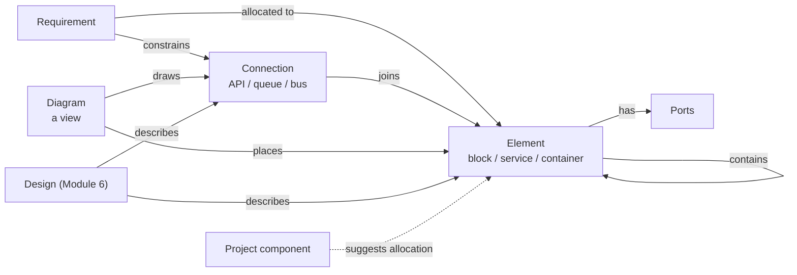
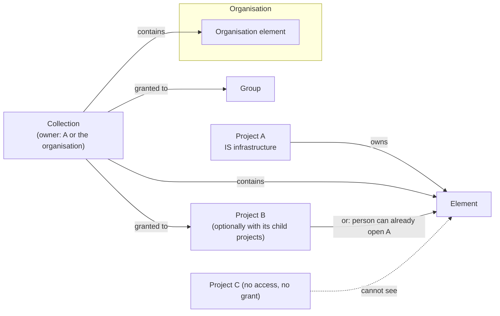

# Module 18 — System Architecture (block diagrams and interfaces) — Plan

**Status:** planned 2026-11-04; review round 1 added 2026-11-12; Phase 0 questions answered by the User 2026-11-04, reading tasks done and open points answered 2026-11-12, plan restructured to 17 phases the same day (Phase 0 signed off 2026-11-12); Phases 1 to 9 built. **Decision tags:** every decision says `Decided by: User` or `Decided by: Agent`.

**Source:** user request 2026-11-04 (**Decided by: User**): a way of linking product elements as part of design. Elements have types (a package, a container, a hardware block) and communicate through defined means (queues, APIs, buses). Block diagrams for software and hardware are part of planning and sit alongside requirements. **Deployments (how many of an element run where) are out of scope** (**Decided by: User**, same day): the module covers systems/hardware and software architecture only.

See [future-modules-2026-09-index.md](future-modules-2026-09-index.md) for the cross-cutting module architecture and [../modules.md](../modules.md) for the registration contract. Hard-depends on Module 0. Soft dependencies: Module 6 (a Design describes an element), Module 13 (an element can exist only in some variants), Modules 3 and 4 (risks and decisions link to elements through the generic link system).

## Status / Resume Here

11 / 22 phases complete (0 to 9 and 9a); review round 1 continues with Phase 9b, before Phase 10. Phase 0 signed off by the User 2026-11-12; Phases 1 to 4 built and committed 2026-11-12; Phase 5 built 2026-11-12 (committed); Phase 6 built 2026-11-12 (committed); Phase 7 built 2026-11-12 (committed); Phase 8 built 2026-11-12 (committed); Phase 9 built 2026-11-12 (committed); Phase 9a built 2026-11-12 (uncommitted). Review round 1 (section 4a, from the User's first review of the built screens 2026-11-12) is built before Phase 10 (allocation); the next migration is 0178. Phase 4 delivered the symbol library (built-in set in code, sanitised uploads, two tiers with hide, restore and nested fallback, assignment to element types and elements, the visibility rule for reading a symbol, bundles with files through new organisation-bundle file hooks; see `docs/decisions.md`); the symbol screens arrive in Phase 7. Phase 5 delivered the diagram API: the diagram type, the single resolver (toggles, bridging, roll-up, merging), the version lock, the server SVG and the bundle section (see `docs/decisions.md`); Phase 7 removes the element, and Phase 8 the diagram, from `not_creatable_from_links` when each adds its form dialog. Phase 6 delivered the shared `GraphCanvas` (`@xyflow/react`, lazy chunk, list view, sanitised symbols; see `docs/decisions.md` and the style guide's graph canvas pattern); the Playwright smoke test moves to Phase 8, the first consumer. Phase 7 delivered the Elements and Connections lists and pages, the Sharing page, the settings panels and the organisation panel (see `docs/decisions.md`); the element is now creatable from the Links panel, the diagram and its entry arrived in Phase 8, and the Sharing card lists only an element's direct collections until the security review (Phase 15) decides how a route listing is read. Phase 8 delivered the Diagrams list, the editor (local edits with undo and redo, Save with the version lock and a conflict reload, palette, add-existing picker, switches, line creation, notes, selection actions), the canvas's resize and drop callbacks, and the model endpoint with a browser port of the resolver so lines and switches redraw at once (see `docs/decisions.md`); its Playwright spec was first run in Phase 9, after two spec faults were fixed. Phase 9 delivered the Outline card (tree and connection table, following the switches and the unsaved layout), keyboard operation (Alt+arrow resize, Delete, a Connect to list), and PNG, SVG and Mermaid export from the server's own drawing and a new Mermaid endpoint (see `docs/decisions.md`). Phase 9a delivered the connection type tree: the parent link table (migration 0177), the cycle and depth rule, descendant expansion in the connection filters and the switch rules, bundles with `parent_names`, the fresh-install groups, and `TreeSelect` single/search with the new `TreeSelectField` (see `docs/decisions.md`).

Each phase ships everything its tables need in the same change: bundle section (project and organisation), template-project classification, scaling probe and generator, search, record tables, History kinds, seed-script updates and its own migration. Registry tests fail otherwise.

| # | Phase | Status |
|---|-------|--------|
| 0 | Design sign-off (section 6) | [x] |
| 1 | Skeleton and vocabularies: registration, entitlement, roles and permissions, element and connection types (organisation tier, hide/restore, nested fallback), their bundle sections | [x] |
| 2 | Elements, ports and connections (project-owned): hierarchy, codes, placements, tags, links, search, summaries, audit, record tables, bundle sections, probes | [x] |
| 3 | Collections, grants, organisation-owned elements, cross-project access and the visibility resolver | [x] |
| 4 | Symbol library: sanitised SVG symbols, organisation and project tiers, built-in generic set, assignment to element types and elements, bundle sections | [x] |
| 5 | Diagram API: placements, scope, view toggles, connection detail, roll-up resolver, version lock, server SVG, bundle section | [x] |
| 6 | Shared graph canvas in core components (reusable by Modules 16 and 17) | [x] |
| 7 | Frontend: lists, detail, element tree, ports, type vocabularies | [x] |
| 8 | Frontend: diagram editor interactions | [x] |
| 9 | Frontend: diagram accessibility (outline, keyboard) and export (PNG, SVG, Mermaid) | [x] |
| 9a | Review 1: connection type tree (any depth, several parents), generic-then-refine connections, grouped pickers | [x] |
| 9b | Review 1: soft guidance for connection types (domain filter, suggested types per element type, warnings) | [ ] |
| 9c | Review 1: editor tabs (Drawing, Configuration) and the Add menu | [ ] |
| 9d | Review 1: eight attach points, nearest-point routing, draggable custom anchors | [ ] |
| 9e | Review 1: one System Architecture page (Elements, Connections, Diagrams) and one navigation entry | [ ] |
| 10 | Allocation: requirement panel, suggestions from placements, dismissals, coverage | [ ] |
| 11 | Interchange and reports: JSON, Mermaid and Structurizr DSL, reports A1–A5, report fields and starters | [ ] |
| 12 | Baselines, core: polymorphic `BaselineItem`, `Baseline.kind`, the snapshot provider hook (proven on requirements) | [ ] |
| 13 | Baselines, architecture: snapshot, view and compare, Module 6 hand-off | [ ] |
| 14 | MCP tools and agent skill | [ ] |
| 15 | Security review: visibility, sharing and access (identify, verify, remediate) | [ ] |
| 16 | Seeds, Storybook and Playwright completeness, docs website, close-out | [ ] |

## 1. What it is

The structure of the thing being built: what it is made of, how the parts connect, and which requirements each part answers. Requirements say *what*; this module records *which part* and *across which interface*; a Module 6 Design records *why and how* (revisions, review, approval).

| Record | What it is | Code | Notes |
|--------|------------|------|-------|
| **Element type** | A project vocabulary entry: name, shape, colour, domain (`software`, `hardware`, `any`) | — | Seeded: System, Subsystem, Component, Service, Container, Package, Datastore, Queue, Board, Sensor, Connector, Enclosure. Organisation tier, hide/restore, nested fallback (section 3.2) |
| **Element** | A part of the product: name, description, type, parent, owner, status | `ELM-001` | Tree via `parent_id`. Ports are a child list. Owned by a project or by the organisation; shared through collections (section 3.9) |
| **Port** | A named attachment point on an element: name, direction (`in`, `out`, `both`), connection type | — | Child of an element, not a separate record type (Q3) |
| **Connection type** | A vocabulary entry: name, direction behaviour (`one-way`, `two-way`), domain; sits in a tree of any depth and may have several parents (section 4a) | — | Seeded: REST API, gRPC, Message queue, Event stream, Database access, File exchange, SPI, I2C, UART, CAN, Ethernet, USB, Power, Analogue signal |
| **Connection** | A link between two elements (optionally via a port each): type, protocol/detail, direction, description | `CON-001` | The "interface". Requirements and tests link to it |
| **Symbol** | A sanitised SVG drawing for an element type or one element, from a library with organisation and project tiers | — | Not a record type: no code, not linkable. A plain library entry, like a vocabulary row |
| **View toggle** | A named switch on a diagram (for example "Security devices") with a default state; hides its members when off | — | Part of a diagram, not a record |
| **Diagram** | A saved view: a scope element (or none for system context), placements, routing hints | `DGM-001` | Holds no truth of its own; delete a diagram, nothing is lost from the model |

## 2. Challenges to the request (read first)

- **Blocks are not the same thing as project components, though they overlap.** A project component (`ProjectComponent`, `backend/app/models/project.py`) is a core table whose prefix builds requirement codes and whose `component_id` is non-null on every requirement; it forms a two-level tree with categories and orders reports. It organises the *requirements document*. Many components will match a block (a "Telemetry" component and a Telemetry module), but cross-cutting components (Security, Usability, Regulatory) are not blocks, and a block hierarchy goes deeper than two levels and carries ports. Making blocks *be* components would put module-only data (ports, connections, kinds) into a core table, which the module boundary forbids. **Recommendation (Q1): keep elements separate; an element's component comes from the shared placement table (`artefact_placements`), not a column of its own; placement drives suggested allocations, never stored allocations.** **Decided by: User** (Q1, 2026-11-04; the shared table replaces the single column on 2026-11-12, which also allows an element to sit in several components and in categories).
- **Separate from Module 6, but linked.** Elements are lightweight and edited in place (audit plus baselines). A Design carries revisions, review and approval. Forcing every element through Design's lifecycle is too heavy; folding elements into Designs duplicates identity ("Payment service" the Design versus the element). Module 6's Interface Design then *describes* a connection rather than restating source, destination and protocol. **Decided by: User** (Q2, 2026-11-04).
- **Package and container are element types here, not build artefacts.** The original idea tied them to deployments (how many containers run where). With deployments out, "container" is just a type of software element. A deployment module can be added later against this model; nothing here blocks it.
- **"Module" and "artefact" are taken.** Architects call software parts "modules"; this product calls a feature a module and every registered record type an artefact type. The UI says **Element**, **Connection**, **Diagram**; "artefact" never means a build output.
- **Not a SysML or UML tool.** No metamodel, simulation, code or HDL generation, requirement-to-model validation, or round-trip with other tools in this plan. The test for any addition: does a requirement, risk, decision, design or test need it as a link target? If not, it is out.
- **Diagrams drift when they are drawings.** A diagram here is a *view over the model*: placing an element shows its real name, type and connections; renaming it updates every diagram. Free-form boxes with no element behind them are not offered (a plain text note is).
- **The canvas is a shared dependency, and none of the three planned users exists yet.** [Module 16](module-16-workflow-capture-plan.md) and [Module 17](module-17-glossary-plan.md) both plan React Flow; none is built. Phase 6 builds the generic wrapper in core components if no module has, or reuses the one that exists; this module never imports another module's directory. Q9.
- **Cross-project and organisation-owned elements widen the access model.** The User wants shared infrastructure (e.g. an IS-infrastructure project) usable by other projects without making it visible to the whole organisation, and organisation-owned elements whose visibility is restricted to chosen projects and groups. This is the hardest security surface in the module: every read of another owner's element goes through one visibility check (section 3.9), never a hand-written query. Collections (named sets of elements granted to projects and groups) are how both organisation-owned and project-owned elements are shared, which also serves nested projects. **Decided by: User.** **Decided by: User.**
- **Hierarchy makes connections hard to draw.** Two child elements connect inside a parent, but at the parent's level the diagram shows the parent connected to something else. Section 3.4 defines roll-up. It is the feature that makes decomposition useful and the main complexity; Q5.

## 3. Design

### 3.1 Data

All tables carry the standard `id`, UTC timestamps, creator, `is_archived` and optimistic `version`. Project-scoped tables are keyed by `project_id`. Each table arrives in the phase that first needs it, with its own migration: types (1), elements, ports and connections (2; `organization_id` and the exactly-one-owner constraint are added in 3), collections and grants (3), symbols and the symbol columns on types and elements (4), diagrams, placements, notes and toggles (5), dismissals (10), and the core baseline columns (12).

| Table | Key columns | Constraints |
|-------|-------------|-------------|
| `architecture_element_types` | `project_id` or `organization_id`, `name`, `shape`, `symbol_id` (nullable), `color` (hex pair), `domain`, `sort_order` | Unique name per owner. `shape` is from a fixed shape set in the frontend (a rendering choice, not a core enum a module extends) and is the fallback when no symbol is set |
| `architecture_elements` | `project_id` or `organization_id` (exactly one), `unique_code`, `name`, `description`, `element_type_id`, `symbol_id` (nullable override), `parent_id`, `owner` (principal), `status` (`draft`, `active`, `retired`) | `unique_code` unique per owner (project counter, or organisation counter for an organisation element). `parent_id` has the same owner, no cycles, depth cap 12. Retiring is blocked while active children exist. No component or category column: placement uses the shared table (an organisation-owned element is never placed). A project-owned element in use by another owner cannot be deleted, only retired or archived |
| `architecture_ports` | `element_id`, `name`, `direction`, `connection_type_id` (nullable), `sort_order` | Unique name per element |
| `architecture_connection_types` | as element types plus `directional` | As element types |
| `architecture_connections` | `project_id`, `unique_code`, `name`, `connection_type_id`, `source_element_id`, `source_port_id`, `target_element_id`, `target_port_id`, `protocol`, `description`, `status` | Each end is an element the creator may read (own project, another project via 3.9, or a visible organisation element). The connection belongs to the project that created it. Source ≠ target. A port, when given, belongs to its end's element. Two-way types ignore source/target order for display only |
| `architecture_diagrams` | `project_id`, `unique_code`, `name`, `purpose`, `scope_element_id` (nullable), `connection_detail` (bool, default false) | Unique code per project. When `connection_detail` is false the diagram draws plain lines (3.4) |
| `architecture_symbols` | `project_id` or `organization_id` (exactly one), `name`, `file_asset_id`, `builtin_key`, `sort_order` | Unique name per owner; exactly one of `file_asset_id` and `builtin_key`. An upload's file is a sanitised SVG held in the file store (3.11); a built-in row has a key and no file (`is_builtin` is derived), cannot be renamed and is seeded for each new organisation (rows are backfilled for existing ones) |
| `architecture_diagram_toggles` | `diagram_id`, `name`, `default_on`, `rule` (JSON: element type ids, domains, connection type ids, tags), `sort_order` | Unique name per diagram. A rule never names a record, so it travels in a bundle without references |
| `architecture_diagram_toggle_members` | `toggle_id`, `element_id` or `connection_id` | Manual members; exactly one of the two ids is set |
| `architecture_collections` | `project_id` or `organization_id` (exactly one), `name`, `description` | Unique name per owner. No code of its own: a collection is an access grouping, not something a requirement or report names (recorded in `docs/decisions.md`) |
| `architecture_collection_members` | `collection_id`, `element_id` | Element and collection have the same owner. An element may be in several collections. Children follow their top-most member ancestor |
| `architecture_collection_grants` | `collection_id`, `project_id` or `group_id`, `include_descendants` | Target in the same organisation. `include_descendants` applies to project targets only and is resolved at read time, so new child projects are covered |
| `architecture_diagram_placements` | `diagram_id`, `element_id`, `x`, `y`, `width`, `height`, `collapsed` | One placement per element per diagram |
| `architecture_allocation_dismissals` | `project_id`, `requirement_id`, `element_id`, `dismissed_by` | Unique per requirement and element. Cleared when the element is no longer placed in the requirement's component; carries no code |
| `architecture_diagram_notes` | `diagram_id`, `text`, position | Plain text, never HTML; the only free-form shape |

### 3.2 Vocabularies and nested projects

Element types and connection types follow the established shape: project rows, organisation defaults, a project may hide and restore a default (`TypeVocabulary`, `ProjectDefinitionSuppression`, `ProjectTypeVocabularyPanel`). **Nested fallback: yes** — a child project with no rows of its own resolves its nearest ancestor's, like Action Types; seeding runs for a root project only. **Decided by: Agent** (recorded in `docs/decisions.md` at Phase 1, per the nested-project rule). A type in use cannot be deleted; it can be hidden.

Elements themselves are not inherited. A parent project's elements are visible to a child project read-only through the list scope filter (`ProjectScope`); other cross-project use is section 3.9.

### 3.3 Links and allocation

Everything else attaches through the core link system; no relation tables of our own. `link_type_seeds` (merged across modules):

| From | Forward / reverse | To |
|------|-------------------|----|
| Requirement | Allocated to / Allocates | Element |
| Requirement | Constrains / Constrained by | Connection |
| Element or Connection | Affected by / Affects | Risk |
| Decision | Concerns / Concerned by | Element or Connection |
| Design (Module 6) | Describes / Described by | Element or Connection |
| Verification action | Verifies / Verified by | Connection or Element |

(The seeds target types that exist; a seed for a module that is off is simply not offered. Two rows are core defaults and need no seed: **Allocated to** reads "Has allocated" in reverse and is not restricted, and **Verified by** runs from the element or connection to the action, with "Verifies" as its reverse. A same-named seed with other phrases would be ignored, so the module reuses the core phrases.)

**Suggested allocation.** Where a project-owned element is placed in a project component, each requirement in that component has a *suggested* allocation to the element (an element shared from another owner is allocated manually, since a component belongs to one project). Suggestions are computed, shown in the requirement's Architecture panel and the element's Requirements tab, and become real links only when a person accepts them (one click, or bulk accept). Accepting calls the generic link authoring path (the change request proposed-link table does not fit; Phase 0). A person may dismiss a suggestion; the dismissal is stored (table of requirement and element pairs, undo, audit, bundle entry) and cleared if the element is no longer placed in the requirement's component. **Decided by: User** (Phase 0).

**Coverage** (report A1): requirements with no allocation; elements with no requirement; connections with none; leaf elements with no owner.

### 3.4 Diagrams and roll-up

A diagram has a scope: an element (shows its children) or none (shows root elements). Placing an element shows its name, code, type shape/colour and ports.

**Roll-up.** A connection is drawn between the nearest placed ancestors of its two ends, so a diagram that places only the parent still shows that it talks to something. A rolled-up connection is drawn dashed with a count when several collapse into one; selecting it lists the underlying connections. A connection with both ends inside one placed parent is hidden until that parent is opened as its own diagram or marked expanded. The resolver is one server function used by the API, the report part and the SVG export, so the screen and the document cannot differ.

**View toggles and connection detail.** A diagram has optional toggles (**Decided by: User**, 2026-11-12), for example "Firewalls and private endpoints" on a sensor-to-cloud data flow. A toggle is a named switch with a default state. An element or connection belongs to it by hand, by rule (element type, domain, connection type or tag), or both; the union applies. A viewer flips toggles on the page; the choice is not saved (it lives in the page address), and the saved default states are what a report, SVG, Mermaid or DSL export uses unless a call names the states. With `connection_detail` off (the default for a new diagram), connections are plain lines with no type, protocol or port labels, and several between the same pair collapse into one; on, they are typed, labelled and coloured.

**One resolver, in this order:** (1) hide the members of switched-off toggles; (2) join across hidden elements, so sensor → firewall → cloud with the firewall hidden draws sensor → cloud as a dashed bridged line whose selection lists the hidden hops (for a hidden element, every in-neighbour joins every out-neighbour its directions allow; a chain of hidden elements is followed to a depth of 12; a hidden element with one neighbour just disappears); (3) roll up to the nearest placed ancestors; (4) merge parallel lines when detail is off. The API, the server SVG, the report part and the Mermaid and DSL exports all call it. The editor also runs a TypeScript port of it (Phase 8) so lines redraw while a layout is edited; shared test cases keep the two equal, and a change to the rule is made in both.

**Editor.** React Flow through the shared graph wrapper. Palette lists element types; dropping one creates an element (name prompt) and places it; dragging from a port to another element creates a connection (type prompt); an existing element is added from a picker. Text alternative: every diagram has an accessible outline (tree plus connection table) beside it, and the canvas is keyboard operable. Labels render as text; element symbols are drawn from the sanitised SVG, never from user markup. Exports: SVG and Mermaid flowchart text from the server's resolved diagram, PNG drawn in the browser from that SVG (Q8).

### 3.5 Lifecycle, history and baselines

Elements, connections and diagrams carry `draft` → `active` → `retired` with no approval gate (Module 6 Designs carry approval), so **Save and activate** applies and is recorded in the `docs/decisions.md` review table. Edits are audited (before/after in the audit event, no free text beyond the code in logs). A baseline stores a snapshot of the architecture when it is taken (**Decided by: User**, Q4); there are no per-edit versions. The snapshot lives in the core `BaselineItem`, made polymorphic with a JSON `snapshot` (**Decided by: User**, Phase 0); a stage baseline snapshots automatically and an architect can take one manually, through a `ModuleDefinition` snapshot provider.

### 3.6 Registrations (no per-module edits to core)

Through existing registries only; nothing outside `modules/architecture/` names this module.

- `artefact_types=("architecture_element", "architecture_connection", "architecture_diagram")`, summary providers (`ELM-001 name`, `CON-001 name (A → B)`, `DGM-001 name`), labels, `artefactPaths`, `registeredArtefactTypes.json`.
- `search_providers` for all three (name, description, protocol, port names; no restricted or personal-data columns), `project_bundle_hooks` and `org_bundle_hooks` (organisation level: the two vocabularies and their defaults), `record_tables` (organisation tier too, 3.9; elements and connections import and export; diagrams give a `not_importable` reason: layout is authored visually) with `count` hooks, `scaling_probes`, `perf_generators`, `link_type_seeds`, tags, quick links, `ProjectScope` on each list, `entityAccentColor`, field help and required markers, `nested` decision recorded.
- Also: shared placements (`record_placements` in the bundle rows; the create form's `TagField`; elements, connections and diagrams are placeable, a record owned by the organisation never is), History page kinds (`activity_action_kinds`, `activity_link_ends`), template-project classification of every bundle key, report fields and starters for the layout designer, a baseline snapshot provider (3.5) and a module-enablement 404 gate on every permission check.
- Organisation level: `organization_subcomponent` and an `orgArtefactPaths` page for elements, `ScopedRecordCode`/`useRecordOwnerCode` for the code, org counter in `generate_unique_code`.
- Sub-components: `architecture_element`, `architecture_connection`, `architecture_diagram`, `architecture_type` (vocabularies). Server default for module state is a `ServerModuleDefault` row, never `default_enabled`.
- MCP: `mcp_tools` plus `mcp_guidance.md` and the regenerated reference (Phase 14). Reports A1–A5 become tools automatically; `record_types` lists the types each names.
- Frontend: diagram canvas and element tree live in `frontend/src/modules/architecture/`; the generic graph wrapper is in core components. Users and groups on parity: `owner` is a principal reference (user or group).

### 3.7 Permissions

Per [docs/soc2/policies/](../soc2/policies/): project-scoped checks on every endpoint, audit event on every mutation through `services/audit.py`.

| Role | Scope | Can |
|------|-------|-----|
| (any member) | project | Read elements, connections, diagrams |
| `architect` | project | Create and edit elements, connections, diagrams; accept suggested allocations; manage ports |
| `architecture_admin` | project and organisation | Manage the two vocabularies; organisation role manages organisation defaults |

FGAC atoms let a custom role take a subset. Groups may hold the roles through the existing group-grant mechanism. **Decided by: Agent.**

### 3.8 Time

All instants are past instants in UTC (created, edited, retired). No scheduled or calendar-date fields in this module.

### 3.9 Sharing: collections, cross-project access and organisation elements

An element is visible to a person when **either** route allows it (**Decided by: User**):

| Route | Applies to | Rule |
|-------|------------|------|
| Owner access | Project-owned elements | The person can open the owning project (`link_nesting.can_open_project`, which applies a token's project scope) |
| Collection grant | Project-owned and organisation-owned elements | The element, or an ancestor of it, is in a collection granted to the person's current project (including descendants when the grant says so) or to a group they effectively belong to |
| Organisation admin | Organisation-owned elements | `architecture_admin` at organisation level always sees and edits them |

An organisation element in no granted collection is visible to organisation admins only; an organisation member outside the grants cannot see, search or link it. Several collections give a **union** of grants (**Decided by: User**).

- **Rights of a recipient** (**Decided by: User**): read, place in a diagram, connect to, allocate requirements to, and link. Never edit, retire, move or add to the owner's tree; only the owner's `architect` (project) or `architecture_admin` (organisation) does that.
- **Managing collections:** the owner's `architect` creates collections, adds elements and grants them for a project-owned collection; `architecture_admin` for an organisation one. Granting outside the owning project is security-sensitive: the target must be in the same organisation, a foreign-organisation group is rejected, and every grant, revoke and membership change is an audit event (ids and counts, no names).
- **Nested projects:** a grant with `include_descendants` set reaches every current and future child project; without it, only the named project. A collection owned by a parent project does not reach children unless granted. The nested-project vocabulary fallback of 3.2 is unaffected.
- **Revocation:** removing a grant, a member, or the person's access hides the element everywhere (pickers, diagrams, lists, search). A connection or placement that named it stays, with the foreign end drawn as a locked placeholder showing only its code.
- **Ownership of a connection** is the project that created it; it may name an end owned by another owner. It is exported and imported by its owner only, with foreign ends as portable references (owner key and code). An unresolvable foreign end on import drops the connection and reports it.
- **One visibility resolver** in the module is the only path to another owner's elements; the list, search provider, link-candidate, summary, report collectors, bundle export, interchange export and MCP all call it, and a test enumerates every read path. A hidden element is indistinguishable from a missing one (404, no count, no code in a summary).
- **Roll-up** walks only an element's own `parent_id` chain, which has a single owner, so it never crosses a visibility boundary.
- **Codes:** organisation elements are numbered from the organisation counter and shown qualified by the organisation code.
- **Bundles:** collections and their members travel in the owner's bundle; **grants never do**, so an import can never publish anything to a project or group by itself (**Decided by: Agent**, recorded with its reason in `docs/decisions.md`).

### 3.10 Interchange

| Format | Import | Export | Notes |
|--------|--------|--------|-------|
| JSON (own versioned schema) | yes | yes | Elements, ports, connections, diagrams, with portable keys; shares helpers with the bundle code; round-trips losslessly; schema `version` rejects unknown majors. **Decided by: User** |
| Mermaid flowchart | no | yes | A diagram's roll-up output; text only. **Decided by: User** |
| Structurizr DSL | no | yes | Elements, relationships, one view per diagram; ports and codes become properties. Import is deliberately omitted: the format is niche (mostly Structurizr users), a full parser (`!include`, `!script`, variables, deployment) would be ours to maintain and secure, and the JSON route covers backup and move. Revisit when a user has a real file. **Decided by: User** |
| PNG / SVG | no | yes | The server SVG (the report drawing) for the page's switch states; the PNG is that SVG drawn in the browser |

JSON import is a preview then apply, goes through the type's own create path (version lock, audit, validation), applies to one project, never creates a foreign-owned element, and rejects over-size or over-deep files. Exports apply the visibility resolver: elements the caller cannot see are replaced by an external reference.

### 3.11 Symbol library

- **Source and tiers** (**Decided by: User**, 2026-11-12): symbols are uploaded as SVG into an organisation or project library, with hide and restore of organisation symbols in a project (`ProjectDefinitionSuppression`) and the nearest-ancestor fallback for child projects, as for the type vocabularies (3.2; **Decided by: Agent**). EPS and PDF are accepted when the isolated converter is configured, exactly as for report images. A small built-in generic set (device, server, database, queue, firewall, cloud, sensor, board, connector, user) is drawn by us, kept in code (no stored file) and given to each new organisation; its seeded types use the matching one. Vendor icon packs are uploaded by the organisation under their own licences and never bundled; this is stated on the upload page.
- **Reuse, not a second importer:** upload goes through the existing sanitiser (`services/report_images.sanitize_svg`, `normalise_raster`) and file store, so scripts, external references, entities and oversized files are refused in one place. A symbol is assigned to an element type and may be overridden on one element; with none assigned, the type's `shape` is drawn.
- **Where it renders:** the browser canvas, the server SVG (so reports match), and PNG/SVG export. Mermaid and Structurizr DSL carry names only.
- **Bundles:** symbols and their files travel in the project and organisation bundles through the file link helpers. A symbol is not an artefact type (no code, link, search or placement); the reason is recorded in `docs/decisions.md`.
- **Managed by** `architecture_admin` (3.7).

## 4. Phases

Each phase: **Why** it exists, **Risk** addressed, **Outcome**, **Tests**. Every phase with tables also carries, for those tables: bundle section (project and organisation), template-project classification of each key, scaling probe and generator, search provider, record table with `count`, History kinds, seed-script updates, and its own migration (section 3.1).

### Phase 0 — Design sign-off

Read `Baseline`/`BaselineItem`, the proposed-link mechanism and the state of the Module 16/17 canvas; record the Q1–Q9 answers in `docs/decisions.md`. **Exit:** the User confirms the reading results.

**Reading results (2026-11-12; recorded in `docs/decisions.md`, confirmed by the User 2026-11-12):**

| Topic | Finding | Consequence |
|-------|---------|-------------|
| Baselines | `Baseline` is stage-bound and `BaselineItem` is requirement-only; written only by `create_baseline_for_stage` | `BaselineItem` made polymorphic (`item_type`, `item_id`, JSON `snapshot`; requirement columns nullable), `Baseline.kind` plus nullable `stage_id`, a generic `ModuleDefinition` snapshot provider called on stage baseline and manual snapshot (**Decided by: User**) |
| Proposed links | `ChangeRequestProposedLink` is bound to change request versions | Not reused; suggestions are computed, accepting calls `link_authoring.create_link_for_artefact`; dismissals are stored in a small table (**Decided by: User**) |
| Canvas | No React Flow in `package.json`; Modules 16 and 17 have built none | Phase 6 builds the shared wrapper in core components (D13) |
| Migration | Next number is 0172 | Phase 1 |

**Restructure review (2026-11-12, approved by the User):** bundles, template classification, probes and generators move into the phase that adds each table (the registry tests fail otherwise); the canvas, the editor and baselines are split; a security review phase is added; the component mapping uses the shared placement table; there is no cap on placements per diagram.

### Phase 1 — Skeleton and vocabularies

- **Why:** register the module and prove the vocabulary pattern before records depend on it.
- **Risk:** a core enum or stylesheet edit for a module value; a migration seeding live installs; a registered module without bundle hooks.
- **Outcome:** module registration, entitlement and `ServerModuleDefault` row, roles and permission atoms with the module-enablement 404 gate, `architecture_element_types` and `architecture_connection_types` (organisation tier, hide/restore, nested fallback recorded in `docs/decisions.md`), seeds for a fresh install only, project and organisation bundle sections with hidden defaults, template classification, sequence counters for the three types through the dynamic `artefact_type` column (next migration 0172).
- **Tests:** migration up/down; boundary and registry tests; seeds only on a fresh install; vocabulary fallback and hide/restore; bundle round trip.

### Phase 2 — Elements, ports and connections

- **Why:** the model has to be correct before a canvas draws it.
- **Risk:** hierarchy cycles; a port or end in another project; per-row queries in lists.
- **Outcome:** project-owned elements, ports and connections with codes (`generate_unique_code`), cycle and depth checks, retire rules, version lock, audit, placements (component and category), tags, links and link seeds, summaries, search, record tables with export/import (code column, element type and parent by name, ports as `name:direction;…`), bundle sections with placements, probes and generators flat, History kinds.
- **Tests:** cycle, depth, cross-project rejection, port ownership, retire with children, CSV round trip, formula-injection prefix, flat statement counts at two sizes, bundle round trip, template classification.

### Phase 3 — Collections, organisation tier and the visibility resolver

- **Why:** shared infrastructure and reusable platform blocks, usable by other projects and the project tree, without exposing them to the whole organisation.
- **Risk:** a hand-written query leaking another owner's element; cross-tenant reach; a revoked person still seeing placeholders' contents; an element deleted or retired while in use elsewhere.
- **Outcome:** collections, members and grants (with `include_descendants`) and their bundle sections (grants never), `organization_id` on elements with org counter codes, the single visibility resolver (both routes) wired into every read path, recipient rights, cross-owner connection, locked placeholders, retire keeps an element visible to its users but out of pickers, delete blocked while in use (**Decided by: Agent**; project deletion rules checked against existing behaviour), org record tables with Export/Import, audit of grants.
- **Tests:** a read-path enumeration test (list, detail, search, link candidates, summary, graph, report, bundle, MCP; later phases add their paths to it) for a person with and without access; union of several collections; a grant with and without descendants (including a child added later); recipient cannot edit or retire; group grants (nested groups, foreign-org group rejected); foreign-organisation target rejected; token project scope respected; revoke hides; 404 not 403 for hidden; org counter numbering; flat statement counts.

### Phase 4 — Symbol library

- **Why:** engineers expect recognisable symbols, and element types must be able to carry one before diagrams draw them.
- **Risk:** a malicious or oversized upload; vendor artwork shipped without a licence; a second, weaker importer.
- **Outcome:** `architecture_symbols`, upload through the existing sanitiser and file store (organisation and project tiers, hide/restore, nested fallback), the built-in generic set for a fresh install, `symbol_id` on element types and elements with validation (same owner or a visible one), list and serve endpoints, project and organisation bundle sections with their files, template classification.
- **Tests:** a script, external reference, entity and oversized file are refused; tiers, hide/restore and fallback; built-ins seeded only on a fresh install and not editable; assignment to another owner's symbol rejected; bundle round trip with files.

### Phase 5 — Diagram API

- **Why:** diagrams are the point; the roll-up rule must exist once, on the server.
- **Risk:** the screen and the document drawing different things; lost updates on concurrent edits.
- **Outcome:** diagram, placement, note and toggle tables, endpoints, scope handling, `connection_detail`, the single resolver (3.4: toggles, bridging, roll-up, merge), version lock on save, server-side SVG renderer for one diagram that draws symbols, bundle section, probe and generator (including a large diagram). **Registers the third artefact type, `architecture_diagram`** (deferred from Phase 2, which registered the element and connection only), with the `architecture_diagram` sub-component and the `architect` role's `(architecture_diagram, manage)` atom: code `DGM-001` (`ModuleDefinition.artefact_types`, label, summary provider), search provider, record table with a `not_importable` reason (layout is authored visually) and a `count` hook, report fields, `no_record_attachments` reason, scaling probe, perf generator and ratio in `profiles.yaml` (bump `version`; add it to the `SMALL` profile in `test_perf_dataset.py`), link-type and placement support (placeable), `frontend/src/modules/registeredArtefactTypes.json`, `creatableRecordTypes.json` and the frontend `artefactPaths`/`artefactListPaths`/status labels, and a `not_creatable_from_links` entry until Phase 8 adds the creator.
- **Tests:** the registry tests pass with `architecture_diagram` registered (`test_search`, `test_scaling_shapes`, `test_perf_dataset`, `test_artefact_type_routes`, `test_creatable_record_types`, `test_record_tables`, `test_placements`); toggle cases (hidden transit bridged, a chain of hidden elements, a hidden dead end, a rule plus manual union, default states in exports, a bridged line never exposing a hidden element the person cannot see); roll-up cases (both ends placed, one ancestor placed, none, both inside one parent, several collapsing), stale-version conflict, an element the person cannot see rejected, hidden element drawn as a placeholder.

### Phase 6 — Shared graph canvas

- **Why:** Modules 16 and 17 plan the same dependency; one wrapper avoids three.
- **Risk:** an inaccessible or heavy dependency in the main bundle; a module importing another module's directory.
- **Outcome:** `@xyflow/react` added through `frontend/scripts/sync-lockfile.sh` with its licence and size recorded in `docs/decisions.md`; a generic, lazy-loaded wrapper in core components with a list fallback, text-only labels, node rendering from a supplied sanitised SVG, keyboard focus handling and theme tokens; stories; no architecture-specific code in it.
- **Tests:** stories for the wrapper states; lazy chunk not in the main bundle; a Playwright smoke test through a story page or the first consumer.

### Phase 7 — Frontend: lists, detail and tree

- **Why:** a consistent surface before the editor.
- **Risk:** a fifth bespoke list; an unplanned dependency between modules.
- **Outcome:** element and connection lists on `ListPageLayout` with `ProjectScope`, detail pages with `RecordHeader`, tags and placements (`TagField`, `RecordTags`), quick link, element tree view, ports panel, vocabularies through `ProjectTypeVocabularyPanel`, create and edit sharing one field group, `Save and activate`, Sharing panel (3.9), organisation element page, the symbol library panel and symbol picker on type and element forms, field help and required markers, module nav entry through the registration schema.
- **Tests:** stories for every new component, Playwright for list, create, edit, retire, hide a default type, list position kept.

### Phase 8 — Diagram editor: interactions

- **Why:** the feature a planner opens first.
- **Risk:** destructive deletes; lost edits; labels as HTML.
- **Outcome:** the toggle panel (create, rule and manual membership, default state, flip on the page), the connection-detail switch, "add matching elements", palette, add-existing picker, drag-to-connect, move/resize, open child as its own diagram, notes, undo/redo, roll-up display (dashed, counts, selection lists the underlying connections), save with version lock and conflict handling, deleting a placement never deletes the element (a separate, confirmed action does).
- **Tests:** Playwright covering create-by-drop, connect, roll-up, delete placement versus delete element, conflict; stories for shapes and states.

### Phase 9 — Diagram accessibility and export

- **Why:** a canvas alone excludes keyboard and screen reader users, and diagrams must leave the product.
- **Risk:** inaccessible canvas; exports that differ from the screen.
- **Outcome:** accessible outline (tree plus connection table) beside the canvas that follows the current toggle states and shows bridged lines with their hidden hops, full keyboard operation, PNG and SVG export (the server's drawing, the PNG rasterised in the browser), Mermaid flowchart text from the roll-up output (server).
- **Tests:** Playwright keyboard path, axe checks, export snapshots; Mermaid output validated and free of hidden elements.

### Phase 10 — Allocation

- **Why:** this is what ties architecture to requirements.
- **Risk:** silent auto-links; double entry between components and elements.
- **Outcome:** suggestions computed from an element's placement in the requirement's component; Architecture panel on a requirement (allocated, suggested, accept, bulk accept, dismiss and restore); Requirements tab on an element; dismissal table with audit and bundle entry; coverage counts on the project overview.
- **Tests:** suggestion appears and disappears with the placement, accept creates one link, never twice, a retired element is not suggested, a dismissal is cleared when the placement is removed, nested-project scope respected, bundle round trip.

### Phase 11 — Interchange and reports

- **Why:** an export that omits the architecture loses data on a move, and reports are how the architecture reaches documents.
- **Risk:** unresolved cross-references on import; reports that disagree with the screen.
- **Outcome:** JSON import/export (3.10, including toggles, rules and symbol references), Structurizr DSL export (default toggle states, or the states named), reports A1 allocation coverage, A2 interface list (connection table with endpoint codes, type, protocol, linked requirements), A3 element breakdown tree, A4 diagram part for the layout designer (server SVG), A5 unconnected and orphan elements, report fields and starters.
- **Tests:** JSON round trip, unknown major version and oversize file rejected, a foreign end unresolvable on import is reported; A4 equals the roll-up resolver output; DSL output snapshot-tested and free of hidden elements; the read-path enumeration test extended.

### Phase 12 — Baselines, core

- **Why:** the single baseline table must hold any module's records before the architecture uses it.
- **Risk:** breaking existing stage baselines and the project export; module data in a core table.
- **Outcome:** `BaselineItem` polymorphic (`item_type` validated against the registry, `item_id`, JSON `snapshot`; requirement columns nullable), `Baseline.kind` with a nullable `stage_id` and a check constraint, the generic `ModuleDefinition` snapshot provider called by `create_baseline_for_stage` and by a manual snapshot endpoint, a null review of every `stage_id` reader, project export and import carrying the new columns.
- **Tests:** existing baseline tests unchanged; manual baseline created and listed; export/import round trip; a test provider proves the hook without the architecture module.

### Phase 13 — Baselines, architecture

- **Why:** a baseline that omits the architecture does not record what was approved.
- **Risk:** snapshots that leak hidden elements or restricted columns; a compare view that disagrees with the live model.
- **Outcome:** the architecture provider (elements, ports, connections, placements, diagrams; foreign ends as portable references), automatic snapshot on a stage baseline and a manual one, a view and compare screen (snapshot against live, and snapshot against snapshot), Module 6's Interface Design links "describes" to a connection (tracked in that plan's Phase 0).
- **Tests:** snapshot content, visibility respected, compare differences, bundle round trip.

### Phase 14 — MCP tools and skill

Tools to list, read, create and link elements and connections through the visibility resolver; `mcp_guidance.md`; regenerated reference; skill tests pass.

### Phase 15 — Security review

- **Why:** the visibility resolver and sharing are the hardest access surface in the module, and `CLAUDE.md` requires a review for access control changes.
- **Risk:** a read path that bypasses the resolver; cross-tenant reach; an import that publishes by itself.
- **Outcome:** an identify, verify, remediate pass over every read and write path (list, detail, search, link finder, graph, reports, exports, bundles, JSON import, MCP, baselines, symbol upload and serving) against the SOC 2 access control, data classification and change management policies; the outcome in `docs/decisions.md`; policy gaps updated if closed.
- **Tests:** a regression test for each finding; the enumeration test complete.

### Phase 16 — Seeds, completeness and close-out

Demo and E2E seeds (a small product with a software system and a hardware module); Storybook and Playwright gaps; docs website pages with a diagram (decomposition, allocation, roll-up, sharing); perf profiles and ratios in `perf/datasets/profiles.yaml`, the findings re-run at two sizes; README and `docs/modules.md`; Module 6, 16 and 17 plans updated to point at the shared canvas and baseline hook; the review table in `docs/decisions.md`.

## 4a. Review round 1 (the User's first review of the built screens, 2026-11-12)

The requests, and what each becomes. Built before Phase 10 because 9a and 9b change the connection type model that Allocation, interchange and the reports read (**Decided by: User**).

| Request | Becomes |
|---------|---------|
| Group connection types; sane defaults per kind of block (a board does not connect to a board with an API) | 9a (tree) and 9b (soft guidance) |
| Start a hardware connection as "some form of comms", fix I2C or SPI after detailed design | 9a: a group is itself a usable connection type, refined later |
| "Add to diagram" as a drop-down like the report blocks | 9c |
| View switches in a configuration tab; tabs Drawing and Configuration | 9c |
| A dragged line goes to the nearest point, with eight points around a box | 9d |
| Elements, connections and diagrams under one System Architecture page; three navigation entries are excessive | 9e |

**Connection type tree (9a, Decided by: User).** Any depth, and a type may have **several parents** so it can be found several ways (I2C under "Serial bus" and under "Board-to-board"). Any node, group or leaf, can be a connection's type, so a connection can start as "Comms" and be changed to I2C later; a change of type is an ordinary edit (audited, version-locked). Stored as a parent link table (`architecture_connection_type_parents`: child, parent), not a column: no cycles (checked at write, depth cap 12), parents in the same owner tier or an organisation default visible to it, and a type in use cannot be deleted (it can be hidden), as today. Every filter by a type (a switch rule, a list filter, a report) expands to the type's descendants, so choosing "Serial bus" finds I2C and SPI connections. The picker shows the tree (a type under several parents appears under each) with search. Organisation tier, hide and restore, nested-project fallback and bundles follow the existing vocabulary rules; the parent links travel with the types. Seeds: a fresh install gets groups (Network, Serial bus, Power, Wired signal, Software interface, Data exchange) with the seeded types placed under them and "Unspecified" leaves for the hardware and software cases; a migration seeds nothing, so an existing organisation adds its own groups. Whether element types should also be a tree is not decided; it is not assumed.

**Soft guidance (9b, Decided by: User).** Nothing is blocked. The connection picker lists only the types whose domain fits both ends (a hardware end hides software-only types) with a "Show all types" control, an element type may name **suggested connection types** that are listed first (a small link table, an organisation default like the types), and a choice that does not fit shows a warning, never an error. Reason for not using a hard allowed-pair matrix: a firmware service on a board legitimately speaks an API, and an unforeseen legitimate pair would be refused (the Prefer the Flexible Reading rule).

**Attach points (9d, Decided by: User).** Eight points on every box (four corners, four mid-edges). A line is drawn between the closest pair and follows when boxes move; a person may drag an end of a line to another point, which is stored for that diagram. The stored anchor belongs to the drawn line, so it is keyed by the diagram and the pair of placed elements (a merged or rolled-up line has one anchor for all it stands for), as `architecture_diagram_line_anchors` (diagram, source element, target element, source point, target point; points are one of eight fixed values, so a bundle carries no ids beyond the elements). The server SVG and the browser use the same rule (nearest pair unless an anchor is stored), kept equal by shared test cases like the resolver. Dragging from a point to a box only starts a connection; it stores nothing.

**Editor and navigation (9c, 9e).** The editor has two tabs, **Drawing** (toolbar, canvas, Outline, Selection) and **Configuration** (view switches, connection detail, and later the diagram's other settings), using the shared `Tabs`. **Add to diagram** becomes one menu button (new element by type, add existing, note) built on the shared `MenuButton`, as the report designer's blocks. The module has one navigation entry, **System Architecture**, to a page with the shared tabs **Elements**, **Connections** and **Diagrams** (the chosen tab in the address; the old paths keep working), and the project overview and Links panel link to the same tabs.

### Phase 9a: connection type tree

- **Why:** a flat list of types does not scale, and engineering starts generic and refines.
- **Risk:** cycles; a filter that misses descendants; a type deleted while in use; a seeded group that changes a live organisation.
- **Outcome:** the parent link table and migration 0177, tree validation, parents on create and edit and in the type form (multi-select of parents), the tree picker used by the connection form, the switch rule and the connection filters, descendant expansion in every type filter that exists (the connection list and its export, the switch rule; search and report fields have no type filter, and a future one uses `closure_of`), project and organisation bundle sections with the links, fresh-install seeds, and the `ArchitectureTypesPanel` showing each type's groups (a flat list in picker order, since Move up and down act on the flat order).
- **Tests:** cycle and depth refused, two parents, a connection typed with a group and later refined, descendant filters, hide and restore with parents, bundle round trip, flat statement counts for the picker, the migration up and down.

### Phase 9b: soft guidance

- **Why:** pickers should offer the sensible choices first without forbidding the unusual.
- **Risk:** hiding a type a person needs; a guidance table that drifts from the vocabulary.
- **Outcome:** the suggested-types link table and migration 0178 (element type to connection types), organisation and project tiers with the type's other rules, the domain-filtered and suggestion-first picker with "Show all types", the non-blocking warning, bundles, the seeded suggestions for the seeded types (Sensor suggests I2C, SPI, UART, Analogue signal; Service suggests REST API, gRPC, Message queue).
- **Tests:** the filter and its override, suggestions first, a mismatched choice saves with a warning, the bundle round trip, the migration.

### Phase 9c: editor tabs and the Add menu

- **Outcome:** shared `Tabs` (Drawing, Configuration) with the selected tab in the address; Configuration holds the view switches panel and the connection-detail switch; the palette card becomes the Add menu (`MenuButton`: one entry per element type grouped by domain, Add existing elements, Add note); pending edits, selection and undo survive a tab change; the keyboard route (arrow keys in the menu) and the drop-on-canvas path are kept (a menu item can also be dragged).
- **Tests:** stories for both tabs and the menu, Playwright for adding by menu, flipping a switch on the Configuration tab and seeing the Drawing tab change, unsaved edits kept across tabs.

### Phase 9d: attach points

- **Why:** a line that wraps round the far side of a box is unreadable.
- **Risk:** the browser and the server SVG choosing different points; anchors on a line that merges or rolls up differently after an edit.
- **Outcome:** the shared canvas draws eight handles per node and routes each edge between the nearest pair (generic, with optional per-edge points and an `onEdgeAnchorChange` callback), the stored anchors table and migration 0179, the diagram API and bundle carrying them, the server SVG using the same rule, a changed pair of boxes dropping an anchor that no longer applies, a keyboard route for choosing a point (Selection card, two lists).
- **Tests:** nearest-pair cases shared between the TypeScript and Python implementations, a dragged anchor stored and restored, a deleted placement dropping its anchors, SVG equality with the browser for the shared cases, the bundle round trip, Playwright for dragging an end.

### Phase 9e: one System Architecture page

- **Outcome:** one navigation entry and one routed page with the tabs Elements, Connections and Diagrams (each tab the existing list, with its own filters and actions in the URL), the old list paths redirecting, the Diagrams entry and the Connections entry removed from the module's navigation, links elsewhere pointed at the tabs, list position kept per tab.
- **Tests:** the navigation registration test, stories, Playwright for switching tabs and keeping each tab's filters.

## 5. Standing checklist per phase

- Run the backend and frontend suites one `pytest` at a time; no state shared between tests.
- Every function, class and file documented per `CLAUDE.md`; no plan references in source.
- Module boundary: no import of `modules/architecture/` outside its own files and the two registries; no new core enum, `Record` or stylesheet entry.
- Core registrations present: code, summary, label, search, record tables, bundles, tags, quick links, `ProjectScope`, perf probe and generator.
- Users and groups on parity for any person field; nested-projects decision recorded.
- Field help, required markers, textarea auto-grow, form header, and enum labels through label maps.
- Each new table: its own migration, bundle section (project and organisation), template classification, probe and generator, History kinds and seed updates in the same phase.
- Docs website and README checked; `scripts/check_doc_links.py` passes.

## 6. Decisions and Phase 0 questions

| # | Decision | Decided by |
|---|----------|------------|
| D1 | Deployments and instance counts are out of scope | User |
| D2 | Systems/hardware and software architecture are in scope; no SysML/UML metamodel | User |
| D3 | Separate module from Module 6, linked by "Describes" | User (Q2) |
| D4 | Diagrams are views over the model; no free-form boxes | Agent |
| D5 | Vocabularies fall back to the nearest ancestor project; root-only seeding | Agent |
| D6 | A connection belongs to one project but may name an end in another project the person can read; reference by access, no share table | User |
| D7 | Allocation from components is a suggestion, accepted per link, never automatic | User (Q1) |
| D8 | Elements may be organisation-owned; they and project-owned elements are shared through collections granted to projects (optionally with descendants) and groups; owner access also grants visibility; several collections union | User |
| D14 | Recipients read, place, connect, allocate and link; never edit | User |
| D15 | Grants never travel in bundles | Agent |
| D20 | A diagram draws plain lines by default and typed detail when switched on (`connection_detail`) | User |
| D21 | View toggles: named switches per diagram, membership by hand and by rule, hidden transit elements are bridged | User |
| D22 | Symbol library: sanitised SVG upload, organisation and project tiers, small built-in set, vendor packs never bundled | User |
| D18 | Component and category placement uses the shared placement table; no `component_id` column | User |
| D19 | No cap on placements per diagram | User |
| D16 | Baseline: polymorphic `BaselineItem` with JSON snapshot, `Baseline.kind`, automatic on stage baseline and manual; module snapshot provider hook | User |
| D17 | Suggested allocations can be dismissed, stored with undo | User |
| D23 | Connection types form a tree of any depth; a type may have several parents; a group is itself a usable connection type, refined later (9a) | User |
| D24 | Connection type guidance is soft: domain filter with "Show all types", suggested types per element type, warnings, never a block (9b) | User |
| D25 | Eight attach points per box; lines use the nearest pair; a person may drag an end to another point, stored per diagram (9d) | User |
| D26 | Editor tabs Drawing and Configuration; Add to diagram is a menu button; one System Architecture navigation entry with tabs (9c, 9e) | User |
| D27 | Review round 1 is built before Phase 10 | User |
| D9 | Ports are a child list of an element, not coded records | User (Q3) |
| D10 | A baseline snapshots the architecture; no per-edit versions | User (Q4) |
| D11 | Roll-up is in v1 | User (Q5) |
| D12 | Interchange: JSON in/out, Mermaid and Structurizr DSL out only | User (Q8) |
| D13 | The first of Modules 16/17/18 to build extracts the shared canvas wrapper | User (Q9) |

All questions Q1–Q10 were answered by the User on 2026-11-04 (decisions D3, D6–D15 above; Q6 seed lists and shapes accepted as written in sections 1 and 3.1; Q10 resolved as named collections, applying to project- and organisation-owned elements). None remain open.

## 7. Risks

| Risk | Mitigation |
|------|------------|
| Scope creep into a modelling tool | The link-target test (section 2); out-of-scope list in docs |
| Two lists to maintain (components and elements) | Mapping plus suggested allocations; Q1 |
| Roll-up confuses users | Dashed style, counts, selection lists the underlying connections; documented |
| Canvas inaccessible or fragile | Outline fallback, keyboard operation, stories and Playwright |
| Large diagrams slow down | No placement cap (**Decided by: User**, 2026-11-12); lazy-loaded wrapper, probe at two sizes with a large diagram, the server's request size limit still applies; revisit if a real diagram is slow |
| Hierarchy cycles or cross-project parents | Validated at write, tested to depth cap |
| Deleting a placement deletes data | Placement delete never touches the element; element delete is separate and confirmed |
| Architecture changes escape change control | Baselines (Q4) plus audit; link to Module 6 for approval where needed |
| Drift from Module 6 Interface Design | "Describes" link; Module 6 Phase 0 updated |
| Organisation or cross-project leak of a restricted element | One visibility resolver, read-path enumeration test, 404 for hidden, audit of grants (Phase 3) |
| Two sharing routes confuse "why can this project see it?" | The element's Sharing panel lists each route that grants access (owner access, which collection and grant) |
| A grant to a parent with descendants over-exposes a tree | The flag is explicit per grant and shown in the grants list; audit event per change |
| Structurizr DSL users expect import | Documented as export only; JSON covers moves; revisit on a real file |
| A malicious or oversized symbol upload | Existing sanitiser and file store only (3.11), refusal tests, covered again in the security review |
| Vendor artwork shipped without a licence | Only a small built-in set drawn by us; vendor packs uploaded by the organisation under their own licence |
| A bridged line across a hidden element reveals or misleads | One resolver, bridged lines dashed and listing hidden hops, never bridging through an element the person cannot see |
| Module boundary drift | Checklist in section 5; registry tests |
| Name collisions ("module", "artefact") | UI uses Element, Connection, Diagram |

When the table reads 22/22: move this file to `docs/plans/completed/` and run `scripts/check_doc_links.py` (see `CLAUDE.md` "Plan Lifecycle").
