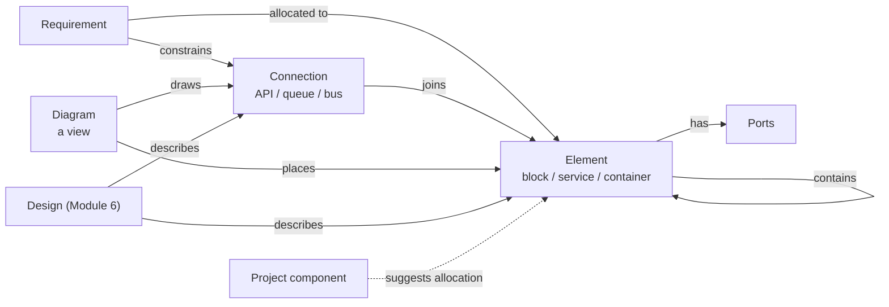
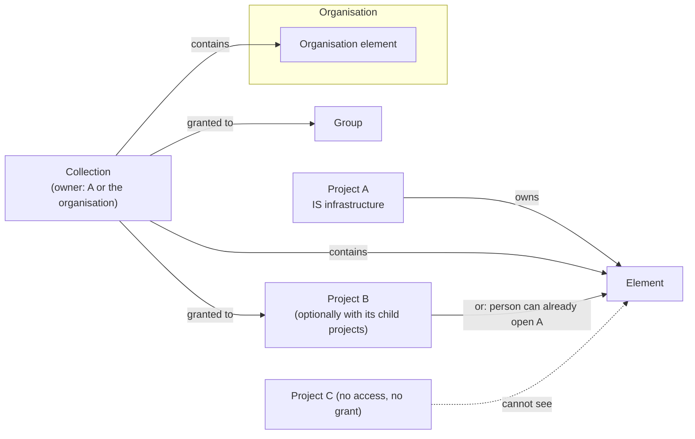

# Module 18 — System Architecture (block diagrams and interfaces) — Plan

**Status:** planned 2026-11-04; Phase 0 questions all answered by the User 2026-11-04 (Phase 0's code-reading tasks remain); nothing is built. **Decision tags:** every decision says `Decided by: User` or `Decided by: Agent`.

**Source:** user request 2026-11-04 (**Decided by: User**): a way of linking product elements as part of design. Elements have types (a package, a container, a hardware block) and communicate through defined means (queues, APIs, buses). Block diagrams for software and hardware are part of planning and sit alongside requirements. **Deployments (how many of an element run where) are out of scope** (**Decided by: User**, same day): the module covers systems/hardware and software architecture only.

See [future-modules-2026-09-index.md](future-modules-2026-09-index.md) for the cross-cutting module architecture and [../modules.md](../modules.md) for the registration contract. Hard-depends on Module 0. Soft dependencies: Module 6 (a Design describes an element), Module 13 (an element can exist only in some variants), Modules 3 and 4 (risks and decisions link to elements through the generic link system).

## Status / Resume Here

0 / 12 phases complete. Phase 0 is next (the reading tasks in section 4).

| # | Phase | Status |
|---|-------|--------|
| 0 | Design sign-off (section 6) | [ ] |
| 1 | Skeleton and data model: registration, entitlement, roles, tables, migration, type seeds | [ ] |
| 2 | Element and connection API: hierarchy, ports, codes, tags, links, search, summaries, audit, record tables | [ ] |
| 2b | Collections and grants, organisation-owned elements, cross-project access, the visibility resolver | [ ] |
| 3 | Diagram API: placements, scope, roll-up resolver, version lock | [ ] |
| 4 | Shared graph canvas (extract or reuse), then frontend: lists, detail, element tree, ports, type vocabularies | [ ] |
| 5 | Frontend: diagram editor | [ ] |
| 6 | Allocation: requirement panel, component mapping, suggestions, coverage | [ ] |
| 7 | Project and organisation bundles, JSON import/export, Mermaid and Structurizr DSL export, reports A1–A5, diagram report part (server SVG) | [ ] |
| 8 | Baselines and the Module 6 hand-off (shape set by Q4 and Q2) | [ ] |
| 9 | MCP tools and agent skill | [ ] |
| 10 | Seeds, Storybook, Playwright, perf probes, docs website, close-out | [ ] |

## 1. What it is

The structure of the thing being built: what it is made of, how the parts connect, and which requirements each part answers. Requirements say *what*; this module records *which part* and *across which interface*; a Module 6 Design records *why and how* (revisions, review, approval).

| Record | What it is | Code | Notes |
|--------|------------|------|-------|
| **Element type** | A project vocabulary entry: name, shape, colour, domain (`software`, `hardware`, `any`) | — | Seeded: System, Subsystem, Component, Service, Container, Package, Datastore, Queue, Board, Sensor, Connector, Enclosure. Organisation tier, hide/restore, nested fallback (section 3.2) |
| **Element** | A part of the product: name, description, type, parent, owner, status | `ELM-001` | Tree via `parent_id`. Ports are a child list. Owned by a project or by the organisation; shared through collections (section 3.9) |
| **Port** | A named attachment point on an element: name, direction (`in`, `out`, `both`), connection type | — | Child of an element, not a separate record type (Q3) |
| **Connection type** | A vocabulary entry: name, direction behaviour (`one-way`, `two-way`), domain | — | Seeded: REST API, gRPC, Message queue, Event stream, Database access, File exchange, SPI, I2C, UART, CAN, Ethernet, USB, Power, Analogue signal |
| **Connection** | A link between two elements (optionally via a port each): type, protocol/detail, direction, description | `CON-001` | The "interface". Requirements and tests link to it |
| **Diagram** | A saved view: a scope element (or none for system context), placements, routing hints | `DGM-001` | Holds no truth of its own; delete a diagram, nothing is lost from the model |

## 2. Challenges to the request (read first)

- **Blocks are not the same thing as project components, though they overlap.** A project component (`ProjectComponent`, `backend/app/models/project.py`) is a core table whose prefix builds requirement codes and whose `component_id` is non-null on every requirement; it forms a two-level tree with categories and orders reports. It organises the *requirements document*. Many components will match a block (a "Telemetry" component and a Telemetry module), but cross-cutting components (Security, Usability, Regulatory) are not blocks, and a block hierarchy goes deeper than two levels and carries ports. Making blocks *be* components would put module-only data (ports, connections, kinds) into a core table, which the module boundary forbids. **Recommendation (Q1): keep elements separate; an element may be mapped to one component; the mapping drives suggested allocations, never stored allocations.** **Decided by: User** (Q1, 2026-11-04).
- **Separate from Module 6, but linked.** Elements are lightweight and edited in place (audit plus baselines). A Design carries revisions, review and approval. Forcing every element through Design's lifecycle is too heavy; folding elements into Designs duplicates identity ("Payment service" the Design versus the element). Module 6's Interface Design then *describes* a connection rather than restating source, destination and protocol. **Decided by: User** (Q2, 2026-11-04).
- **Package and container are element types here, not build artefacts.** The original idea tied them to deployments (how many containers run where). With deployments out, "container" is just a type of software element. A deployment module can be added later against this model; nothing here blocks it.
- **"Module" and "artefact" are taken.** Architects call software parts "modules"; this product calls a feature a module and every registered record type an artefact type. The UI says **Element**, **Connection**, **Diagram**; "artefact" never means a build output.
- **Not a SysML or UML tool.** No metamodel, simulation, code or HDL generation, requirement-to-model validation, or round-trip with other tools in this plan. The test for any addition: does a requirement, risk, decision, design or test need it as a link target? If not, it is out.
- **Diagrams drift when they are drawings.** A diagram here is a *view over the model*: placing an element shows its real name, type and connections; renaming it updates every diagram. Free-form boxes with no element behind them are not offered (a plain text note is).
- **The canvas is a shared dependency, and none of the three planned users exists yet.** [Module 16](module-16-workflow-capture-plan.md) and [Module 17](module-17-glossary-plan.md) both plan React Flow; none is built. Phase 4 builds the generic wrapper in core components if no module has, or reuses the one that exists; this module never imports another module's directory. Q9.
- **Cross-project and organisation-owned elements widen the access model.** The User wants shared infrastructure (e.g. an IS-infrastructure project) usable by other projects without making it visible to the whole organisation, and organisation-owned elements whose visibility is restricted to chosen projects and groups. This is the hardest security surface in the module: every read of another owner's element goes through one visibility check (section 3.9), never a hand-written query. Collections (named sets of elements granted to projects and groups) are how both organisation-owned and project-owned elements are shared, which also serves nested projects. **Decided by: User.** **Decided by: User.**
- **Hierarchy makes connections hard to draw.** Two child elements connect inside a parent, but at the parent's level the diagram shows the parent connected to something else. Section 3.4 defines roll-up. It is the feature that makes decomposition useful and the main complexity; Q5.

## 3. Design

### 3.1 Data

All tables carry the standard `id`, UTC timestamps, creator, `is_archived` and optimistic `version`. Project-scoped tables are keyed by `project_id`.

| Table | Key columns | Constraints |
|-------|-------------|-------------|
| `architecture_element_types` | `project_id` or `organization_id`, `name`, `shape`, `color` (hex pair), `domain`, `sort_order` | Unique name per owner. `shape` is from a fixed shape set in the frontend (a rendering choice, not a core enum a module extends) |
| `architecture_elements` | `project_id` or `organization_id` (exactly one), `unique_code`, `name`, `description`, `element_type_id`, `parent_id`, `component_id` (nullable, mapping), `owner` (principal), `status` (`draft`, `active`, `retired`) | `unique_code` unique per owner (project counter, or organisation counter for an organisation element). `parent_id` has the same owner, no cycles, depth cap 12. Retiring is blocked while active children exist |
| `architecture_ports` | `element_id`, `name`, `direction`, `connection_type_id` (nullable), `sort_order` | Unique name per element |
| `architecture_connection_types` | as element types plus `directional` | As element types |
| `architecture_connections` | `project_id`, `unique_code`, `name`, `connection_type_id`, `source_element_id`, `source_port_id`, `target_element_id`, `target_port_id`, `protocol`, `description`, `status` | Each end is an element the creator may read (own project, another project via 3.9, or a visible organisation element). The connection belongs to the project that created it. Source ≠ target. A port, when given, belongs to its end's element. Two-way types ignore source/target order for display only |
| `architecture_diagrams` | `project_id`, `unique_code`, `name`, `purpose`, `scope_element_id` (nullable) | Unique code per project |
| `architecture_collections` | `project_id` or `organization_id` (exactly one), `name`, `description` | Unique name per owner. No code of its own: a collection is an access grouping, not something a requirement or report names (recorded in `docs/decisions.md`) |
| `architecture_collection_members` | `collection_id`, `element_id` | Element and collection have the same owner. An element may be in several collections. Children follow their top-most member ancestor |
| `architecture_collection_grants` | `collection_id`, `project_id` or `group_id`, `include_descendants` | Target in the same organisation. `include_descendants` applies to project targets only and is resolved at read time, so new child projects are covered |
| `architecture_diagram_placements` | `diagram_id`, `element_id`, `x`, `y`, `width`, `height`, `collapsed` | One placement per element per diagram |
| `architecture_diagram_notes` | `diagram_id`, `text`, position | Plain text, never HTML; the only free-form shape |

### 3.2 Vocabularies and nested projects

Element types and connection types follow the established shape: project rows, organisation defaults, a project may hide and restore a default (`TypeVocabulary`, `ProjectDefinitionSuppression`, `ProjectTypeVocabularyPanel`). **Nested fallback: yes** — a child project with no rows of its own resolves its nearest ancestor's, like Action Types; seeding runs for a root project only. **Decided by: Agent** (recorded in `docs/decisions.md` at Phase 1, per the nested-project rule). A type in use cannot be deleted; it can be hidden.

Elements themselves are not inherited. A parent project's elements are visible to a child project read-only through the list scope filter (`ProjectScope`); other cross-project use is section 3.9.

### 3.3 Links and allocation

Everything else attaches through the core link system; no relation tables of our own. `link_type_seeds` (merged across modules):

| From | Forward / reverse | To |
|------|-------------------|----|
| Requirement | Allocated to / Allocates | Element |
| Requirement | Constrains / Constrained by | Connection |
| Element or Connection | Affected by / Affects | Risk |
| Decision | Concerns / Concerned by | Element or Connection |
| Design (Module 6) | Describes / Described by | Element or Connection |
| Verification action | Verifies / Verified by | Connection or Element |

(The seeds target types that exist; a seed for a module that is off is simply not offered.)

**Suggested allocation.** Where an element is mapped to a project component, each requirement in that component has a *suggested* allocation to the element. Suggestions are computed, shown in the requirement's Architecture panel and the element's Requirements tab, and become real links only when a person accepts them (one click, or bulk accept). If the existing proposed-link mechanism fits, accepting converts a proposed link; Phase 0 reads it. **Decided by: Agent.**

**Coverage** (report A1): requirements with no allocation; elements with no requirement; connections with none; leaf elements with no owner.

### 3.4 Diagrams and roll-up

A diagram has a scope: an element (shows its children) or none (shows root elements). Placing an element shows its name, code, type shape/colour and ports.

**Roll-up.** A connection is drawn between the nearest placed ancestors of its two ends, so a diagram that places only the parent still shows that it talks to something. A rolled-up connection is drawn dashed with a count when several collapse into one; selecting it lists the underlying connections. A connection with both ends inside one placed parent is hidden until that parent is opened as its own diagram or marked expanded. The resolver is one server function used by the API, the report part and the SVG export, so the screen and the document cannot differ.

**Editor.** React Flow through the shared graph wrapper. Palette lists element types; dropping one creates an element (name prompt) and places it; dragging from a port to another element creates a connection (type prompt); an existing element is added from a picker. Text alternative: every diagram has an accessible outline (tree plus connection table) beside it, and the canvas is keyboard operable. Labels render as text. Exports: PNG and SVG in the browser, the server SVG for reports, and Mermaid flowchart text (Q8).

### 3.5 Lifecycle, history and baselines

Elements, connections and diagrams carry `draft` → `active` → `retired` with no approval gate (Module 6 Designs carry approval), so **Save and activate** applies and is recorded in the `docs/decisions.md` review table. Edits are audited (before/after in the audit event, no free text beyond the code in logs). A baseline stores a snapshot of the architecture when it is taken (**Decided by: User**, Q4); there are no per-edit versions. Phase 0 reads the `Baseline`/`BaselineItem` shape to settle where the snapshot lives.

### 3.6 Registrations (no per-module edits to core)

Through existing registries only; nothing outside `modules/architecture/` names this module.

- `artefact_types=("architecture_element", "architecture_connection", "architecture_diagram")`, summary providers (`ELM-001 name`, `CON-001 name (A → B)`, `DGM-001 name`), labels, `artefactPaths`, `registeredArtefactTypes.json`.
- `search_providers` for all three (name, description, protocol, port names; no restricted or personal-data columns), `project_bundle_hooks` and `org_bundle_hooks` (organisation level: the two vocabularies and their defaults), `record_tables` (organisation tier too, 3.9; elements and connections import and export; diagrams give a `not_importable` reason: layout is authored visually) with `count` hooks, `scaling_probes`, `perf_generators`, `link_type_seeds`, tags, quick links, `ProjectScope` on each list, `entityAccentColor`, field help and required markers, `nested` decision recorded.
- Organisation level: `organization_subcomponent` and an `orgArtefactPaths` page for elements, `ScopedRecordCode`/`useRecordOwnerCode` for the code, org counter in `generate_unique_code`.
- Sub-components: `architecture_element`, `architecture_connection`, `architecture_diagram`, `architecture_type` (vocabularies). Server default for module state is a `ServerModuleDefault` row, never `default_enabled`.
- MCP: `mcp_tools` plus `mcp_guidance.md` and the regenerated reference (Phase 9). Reports A1–A5 become tools automatically; `record_types` lists the types each names.
- Frontend: diagram canvas and element tree live in `frontend/src/modules/architecture/`; the generic graph wrapper is in core components. Users and groups on parity: `owner` is a principal reference (user or group).

### 3.7 Permissions

Per [docs/soc2/policies/](../soc2/policies/): project-scoped checks on every endpoint, audit event on every mutation through `services/audit.py`.

| Role | Scope | Can |
|------|-------|-----|
| (any member) | project | Read elements, connections, diagrams |
| `architect` | project | Create and edit elements, connections, diagrams; accept suggested allocations; manage ports |
| `architecture_admin` | project and organisation | Manage the two vocabularies; organisation role manages organisation defaults |

FGAC atoms let a custom role take a subset. Groups may hold the roles through the existing group-grant mechanism. **Decided by: Agent.**

### 3.8 Time

All instants are past instants in UTC (created, edited, retired). No scheduled or calendar-date fields in this module.

### 3.9 Sharing: collections, cross-project access and organisation elements

An element is visible to a person when **either** route allows it (**Decided by: User**):

| Route | Applies to | Rule |
|-------|------------|------|
| Owner access | Project-owned elements | The person can open the owning project (`link_nesting.can_open_project`, which applies a token's project scope) |
| Collection grant | Project-owned and organisation-owned elements | The element, or an ancestor of it, is in a collection granted to the person's current project (including descendants when the grant says so) or to a group they effectively belong to |
| Organisation admin | Organisation-owned elements | `architecture_admin` at organisation level always sees and edits them |

An organisation element in no granted collection is visible to organisation admins only; an organisation member outside the grants cannot see, search or link it. Several collections give a **union** of grants (**Decided by: User**).

- **Rights of a recipient** (**Decided by: User**): read, place in a diagram, connect to, allocate requirements to, and link. Never edit, retire, move or add to the owner's tree; only the owner's `architect` (project) or `architecture_admin` (organisation) does that.
- **Managing collections:** the owner's `architect` creates collections, adds elements and grants them for a project-owned collection; `architecture_admin` for an organisation one. Granting outside the owning project is security-sensitive: the target must be in the same organisation, a foreign-organisation group is rejected, and every grant, revoke and membership change is an audit event (ids and counts, no names).
- **Nested projects:** a grant with `include_descendants` set reaches every current and future child project; without it, only the named project. A collection owned by a parent project does not reach children unless granted. The nested-project vocabulary fallback of 3.2 is unaffected.
- **Revocation:** removing a grant, a member, or the person's access hides the element everywhere (pickers, diagrams, lists, search). A connection or placement that named it stays, with the foreign end drawn as a locked placeholder showing only its code.
- **Ownership of a connection** is the project that created it; it may name an end owned by another owner. It is exported and imported by its owner only, with foreign ends as portable references (owner key and code). An unresolvable foreign end on import drops the connection and reports it.
- **One visibility resolver** in the module is the only path to another owner's elements; the list, search provider, link-candidate, summary, report collectors, bundle export, interchange export and MCP all call it, and a test enumerates every read path. A hidden element is indistinguishable from a missing one (404, no count, no code in a summary).
- **Roll-up** walks only an element's own `parent_id` chain, which has a single owner, so it never crosses a visibility boundary.
- **Codes:** organisation elements are numbered from the organisation counter and shown qualified by the organisation code.
- **Bundles:** collections and their members travel in the owner's bundle; **grants never do**, so an import can never publish anything to a project or group by itself (**Decided by: Agent**, recorded with its reason in `docs/decisions.md`).

### 3.10 Interchange

| Format | Import | Export | Notes |
|--------|--------|--------|-------|
| JSON (own versioned schema) | yes | yes | Elements, ports, connections, diagrams, with portable keys; shares helpers with the bundle code; round-trips losslessly; schema `version` rejects unknown majors. **Decided by: User** |
| Mermaid flowchart | no | yes | A diagram's roll-up output; text only. **Decided by: User** |
| Structurizr DSL | no | yes | Elements, relationships, one view per diagram; ports and codes become properties. Import is deliberately omitted: the format is niche (mostly Structurizr users), a full parser (`!include`, `!script`, variables, deployment) would be ours to maintain and secure, and the JSON route covers backup and move. Revisit when a user has a real file. **Decided by: User** |
| PNG / SVG | no | yes | Browser-generated; the server SVG is for reports |

JSON import is a preview then apply, goes through the type's own create path (version lock, audit, validation), applies to one project, never creates a foreign-owned element, and rejects over-size or over-deep files. Exports apply the visibility resolver: elements the caller cannot see are replaced by an external reference.

## 4. Phases

Each phase: **Why** it exists, **Risk** addressed, **Outcome**, **Tests**.

### Phase 0 — Design sign-off

Read `Baseline`/`BaselineItem`, the proposed-link mechanism and the state of the Module 16/17 canvas; record the Q1–Q9 answers in `docs/decisions.md`. **Exit:** the User confirms the reading results.

### Phase 1 — Skeleton and data model

- **Why:** register the module and give every later phase its tables.
- **Risk:** a core enum or stylesheet edit for a module value; a migration seeding live installs.
- **Outcome:** module registration, entitlement, roles, the tables in 3.1, one migration (next free number across both directories), vocabulary seeds for a fresh install only, sequence counters for the three types through the dynamic `artefact_type` column.
- **Tests:** migration up/down; boundary and registry tests; seeds only on a fresh install; vocabulary fallback and hide/restore.

### Phase 2 — Element and connection API

- **Why:** the model has to be correct before a canvas draws it.
- **Risk:** hierarchy cycles; a port or end in another project; per-row queries in lists.
- **Outcome:** CRUD for elements, ports and connections with codes (`generate_unique_code`), cycle and depth checks, retire rules, version lock, audit, tags, links and seeds, summaries, search, record tables with export/import (code column, element type and parent by name, ports as `name:direction;…`), scaling probe flat.
- **Tests:** cycle, depth, cross-project rejection, port ownership, retire with children, CSV round trip, formula-injection prefix, flat statement counts at two sizes.

### Phase 2b — Collections, organisation tier and the visibility resolver

- **Why:** shared infrastructure and reusable platform blocks, usable by other projects and the project tree, without exposing them to the whole organisation.
- **Risk:** a hand-written query leaking another owner's element; cross-tenant reach; a revoked person still seeing placeholders' contents.
- **Outcome:** collections, members and grants (with `include_descendants`), organisation-owned elements with org counter codes, the single visibility resolver (both routes) wired into every read path, recipient rights, cross-owner placement and connection, locked placeholders, org record tables with Export/Import, audit of grants.
- **Tests:** a read-path enumeration test (list, detail, search, link candidates, summary, graph, report, bundle, MCP) for a person with and without access; union of several collections; a grant with and without descendants (including a child added later); recipient cannot edit or retire; group grants (nested groups, foreign-org group rejected); foreign-organisation target rejected; token project scope respected; revoke hides; 404 not 403 for hidden; org counter numbering; flat statement counts.

### Phase 3 — Diagram API

- **Why:** diagrams are the point; the roll-up rule must exist once, on the server.
- **Risk:** the screen and the document drawing different things; lost updates on concurrent edits.
- **Outcome:** diagram and placement endpoints, scope handling, the roll-up resolver (3.4), version lock on save, server-side SVG renderer for one diagram.
- **Tests:** roll-up cases (both ends placed, one ancestor placed, none, both inside one parent, several collapsing), stale-version conflict, placement of an element from another project rejected.

### Phase 4 — Shared canvas and frontend lists

- **Why:** a consistent surface before the editor.
- **Risk:** a fifth bespoke list; an unplanned dependency between modules.
- **Outcome:** generic graph wrapper (reused or extracted, lazy-loaded, list fallback), element and connection lists on `ListPageLayout`, detail pages with `RecordHeader`, tags, quick link, element tree view, ports panel, vocabularies through `ProjectTypeVocabularyPanel`, create/edit sharing one field group, `Save and activate`.
- **Tests:** stories for every new component, Playwright for list, create, edit, retire, hide a default type, list position kept.

### Phase 5 — Diagram editor

- **Why:** the feature a planner opens first.
- **Risk:** inaccessible canvas; destructive deletes; labels as HTML.
- **Outcome:** palette, add-existing picker, drag-to-connect, move/resize, open child as its own diagram, notes, undo/redo, accessible outline and keyboard operation, PNG/SVG/Mermaid export, deleting a placement never deletes the element (a separate, confirmed action does).
- **Tests:** Playwright covering create-by-drop, connect, roll-up, delete placement versus delete element, keyboard path, export; stories for shapes and states.

### Phase 6 — Allocation

- **Why:** this is what ties architecture to requirements.
- **Risk:** silent auto-links; double entry between components and elements.
- **Outcome:** component mapping on an element; Architecture panel on a requirement (allocated, suggested, accept, bulk accept); Requirements tab on an element; coverage counts on the project overview.
- **Tests:** suggestion appears and disappears with the mapping, accept creates one link, never twice, a retired element is not suggested, nested-project scope respected.

### Phase 7 — Bundles and reports

- **Why:** an export that omits the architecture loses data on a move.
- **Risk:** unresolved cross-references on import; reports that disagree with the screen.
- **Outcome:** JSON import/export (3.10), Mermaid and Structurizr DSL export, project and organisation bundle hooks with round-trip tests; reports A1 allocation coverage, A2 interface list (connection table with endpoint codes, type, protocol, linked requirements), A3 element breakdown tree, A4 diagram part for the layout designer (server SVG), A5 unconnected and orphan elements.
- **Tests:** export, import into a fresh project, compare; hidden vocabulary defaults travel; A4 equals the roll-up resolver output; JSON round trip, unknown major version and oversize file rejected, a foreign end unresolvable on import is reported; DSL and Mermaid output snapshot-tested and free of hidden elements.

### Phase 8 — Baselines and Module 6 hand-off

Shape depends on Q4 and Q2. Outcome: a baseline can capture the architecture state per Q4; Module 6's Interface Design links "describes" to a connection instead of duplicating its fields, tracked in that plan's Phase 0.

### Phase 9 — MCP tools and skill

Tools to list, read, create and link elements and connections; `mcp_guidance.md`; regenerated reference; skill tests pass.

### Phase 10 — Seeds, docs, close-out

Demo and E2E seeds (a small product with a software system and a hardware module); Storybook; docs website pages with a diagram (decomposition, allocation, roll-up); perf probes and generators with ratios in `perf/datasets/profiles.yaml`; README and `docs/modules.md`; review pass identify → verify → remediate recorded in `docs/decisions.md`.

## 5. Standing checklist per phase

- Run the backend and frontend suites one `pytest` at a time; no state shared between tests.
- Every function, class and file documented per `CLAUDE.md`; no plan references in source.
- Module boundary: no import of `modules/architecture/` outside its own files and the two registries; no new core enum, `Record` or stylesheet entry.
- Core registrations present: code, summary, label, search, record tables, bundles, tags, quick links, `ProjectScope`, perf probe and generator.
- Users and groups on parity for any person field; nested-projects decision recorded.
- Field help, required markers, textarea auto-grow, form header, and enum labels through label maps.
- Docs website and README checked; `scripts/check_doc_links.py` passes.

## 6. Decisions and Phase 0 questions

| # | Decision | Decided by |
|---|----------|------------|
| D1 | Deployments and instance counts are out of scope | User |
| D2 | Systems/hardware and software architecture are in scope; no SysML/UML metamodel | User |
| D3 | Separate module from Module 6, linked by "Describes" | User (Q2) |
| D4 | Diagrams are views over the model; no free-form boxes | Agent |
| D5 | Vocabularies fall back to the nearest ancestor project; root-only seeding | Agent |
| D6 | A connection belongs to one project but may name an end in another project the person can read; reference by access, no share table | User |
| D7 | Allocation from components is a suggestion, accepted per link, never automatic | User (Q1) |
| D8 | Elements may be organisation-owned; they and project-owned elements are shared through collections granted to projects (optionally with descendants) and groups; owner access also grants visibility; several collections union | User |
| D14 | Recipients read, place, connect, allocate and link; never edit | User |
| D15 | Grants never travel in bundles | Agent |
| D9 | Ports are a child list of an element, not coded records | User (Q3) |
| D10 | A baseline snapshots the architecture; no per-edit versions | User (Q4) |
| D11 | Roll-up is in v1 | User (Q5) |
| D12 | Interchange: JSON in/out, Mermaid and Structurizr DSL out only | User (Q8) |
| D13 | The first of Modules 16/17/18 to build extracts the shared canvas wrapper | User (Q9) |

All questions Q1–Q10 were answered by the User on 2026-11-04 (decisions D3, D6–D15 above; Q6 seed lists and shapes accepted as written in sections 1 and 3.1; Q10 resolved as named collections, applying to project- and organisation-owned elements). None remain open.

## 7. Risks

| Risk | Mitigation |
|------|------------|
| Scope creep into a modelling tool | The link-target test (section 2); out-of-scope list in docs |
| Two lists to maintain (components and elements) | Mapping plus suggested allocations; Q1 |
| Roll-up confuses users | Dashed style, counts, selection lists the underlying connections; documented |
| Canvas inaccessible or fragile | Outline fallback, keyboard operation, stories and Playwright |
| Large diagrams slow down | Placement count cap per diagram, lazy-loaded wrapper, probe at two sizes |
| Hierarchy cycles or cross-project parents | Validated at write, tested to depth cap |
| Deleting a placement deletes data | Placement delete never touches the element; element delete is separate and confirmed |
| Architecture changes escape change control | Baselines (Q4) plus audit; link to Module 6 for approval where needed |
| Drift from Module 6 Interface Design | "Describes" link; Module 6 Phase 0 updated |
| Organisation or cross-project leak of a restricted element | One visibility resolver, read-path enumeration test, 404 for hidden, audit of grants (Phase 2b) |
| Two sharing routes confuse "why can this project see it?" | The element's Sharing panel lists each route that grants access (owner access, which collection and grant) |
| A grant to a parent with descendants over-exposes a tree | The flag is explicit per grant and shown in the grants list; audit event per change |
| Structurizr DSL users expect import | Documented as export only; JSON covers moves; revisit on a real file |
| Module boundary drift | Checklist in section 5; registry tests |
| Name collisions ("module", "artefact") | UI uses Element, Connection, Diagram |

When the table reads 12/12: move this file to `docs/plans/completed/` and run `scripts/check_doc_links.py` (see `CLAUDE.md` "Plan Lifecycle").
