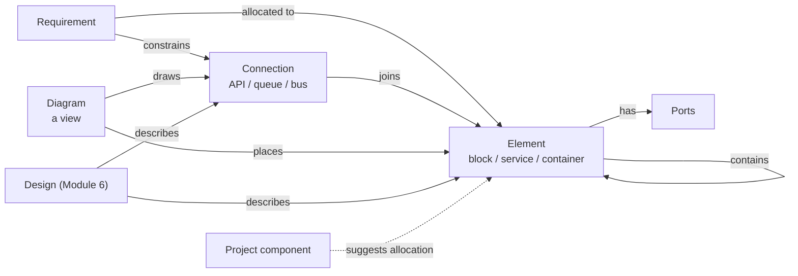
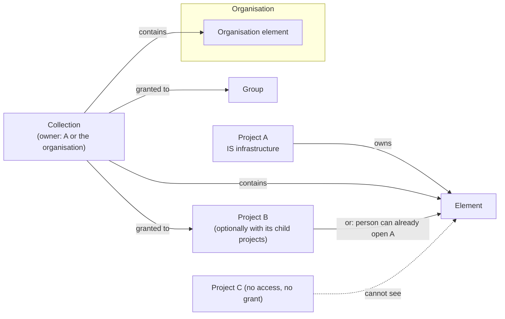
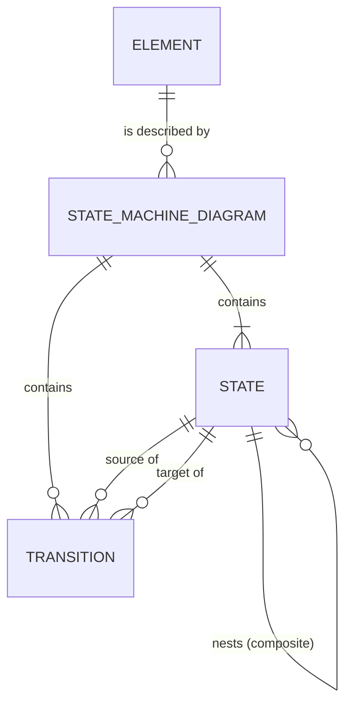

# Module 18 — System Architecture (block diagrams and interfaces) — Plan

**Status:** planned 2026-11-04; review round 1 added 2026-11-12; review round 5 (display notes, annotations, comments) added 2026-11-14; Phases 17a to 17d (state machine diagrams, section 4f) added 2026-11-14 and built before Phase 10; review round 6 (UI review of the diagram editors, section 4g) added 2026-11-14; Phase 0 questions answered by the User 2026-11-04, reading tasks done and open points answered 2026-11-12, plan restructured to 17 phases the same day (Phase 0 signed off 2026-11-12); Phases 1 to 9y, 10, 11, 12, 13 and 17a to 17d built. **Decision tags:** every decision says `Decided by: User` or `Decided by: Agent`.

**Source:** user request 2026-11-04 (**Decided by: User**): a way of linking product elements as part of design. Elements have types (a package, a container, a hardware block) and communicate through defined means (queues, APIs, buses). Block diagrams for software and hardware are part of planning and sit alongside requirements. **Deployments (how many of an element run where) are out of scope** (**Decided by: User**, same day): the module covers systems/hardware and software architecture only.

See [future-modules-2026-09-index.md](future-modules-2026-09-index.md) for the cross-cutting module architecture and [../modules.md](../modules.md) for the registration contract. Hard-depends on Module 0. Soft dependencies: Module 6 (a Design describes an element), Module 13 (an element can exist only in some variants), Modules 3 and 4 (risks and decisions link to elements through the generic link system).

## Status / Resume Here

43 / 47 phases complete (0 to 13, 9a to 9y, 17a to 17d; review round 6, Phase 17e, is planned in section 4g and not built (Phase 9y built 2026-11-14, uncommitted: `SelectionActions` and `selectionAction`, the shared `IconAction` (moved out of `CommentThreadView`), icon buttons in both Selection cards with unchanged accessible names, no migration; Phase 9x built 2026-11-14, uncommitted: `ItemRow revealActions`, icon buttons in `CommentThreadView`, and a fix so a delete confirmation no longer closes its pop-over; no migration; Phase 9w built 2026-11-14, committed: `help` on `ToggleButton` and `MenuButton`, the shared `CommentModeToggle`, `scripts/check_help_beside_button.py`, the style guide entry; no migration; Phase 9v built 2026-11-14, committed: `buttonHeightViolations`, small menu triggers in both editor toolbars, no migration; the next migration is 0188), 2026-11-14; review round 4, Phases 9l to 9r, is planned in section 4d and built, and review round 5, Phases 9s to 9u, in section 4e and built; both are built before Phase 10); review round 2 (section 4b, the User's review of the built System Architecture page and editor, 2026-11-13) is built as Phases 9f to 9i; Phase 9u built 2026-11-14 (uncommitted: core migration 0184 `record_comments` and `record_comment_pins`, `ModuleDefinition.record_comments` and the generic API, the architecture provider with per-type `/comments` routes, bundles (project and organisation) and template exclusion, the comment search field, the perf generator and ratio version 8, anchored threads on the element and connection pages, the generic `GraphCanvas` comment mode and pins, `useCanvasComments` with `CommentMarker`, `CommentThreadView` and `RecordCommentsCards`, the editor's Comment toggle, Comments tab and Selection card entries; the next migration is 0185, see `docs/decisions.md`). Phase 17a built 2026-11-14 (uncommitted: migration 0185, the two artefact types with every registration, `state_machine_checks`, the activation gate, bundles and template reset, probes and generators with profiles version 9, the demo seed; the next migration is 0186, see `docs/decisions.md`). Phase 17b built 2026-11-14 (uncommitted: generic `GraphCanvas` loop, multi-line label, marker and container support, `graphSelfLoop.ts`, `stateShapes.ts`, `state_shapes.py` and the three shared cases files, with `points` on `BoxGeometry` for marker sides; no migration, see `docs/decisions.md`). Phase 17c built 2026-11-14 (uncommitted: the editor, the merged Diagrams tab with its Type choice, the State list and the element's card; no migration, see `docs/decisions.md`). Phase 17d built 2026-11-14 (uncommitted: `state_machine_svg.py` and `state_machine_mermaid.py` with the `/svg` and `/mermaid` routes, the shared `useDiagramExport` and `DiagramExportMenu` for both editors, the "Change status" rename, the label cases shared with `stateMachineModel.ts`, the site page and glossary terms; no migration, see `docs/decisions.md`). Phase 10 built 2026-11-14 (uncommitted: migration 0186 `architecture_allocation_dismissals`, `allocation.py` with the computed suggestions, accept, dismiss, restore and coverage, the `/allocation` routes, the dismissal bundle key (excluded from templates), four overview metrics and the `allocation_coverage` widget, `AllocationPanel` on the requirement page and the element page; the next migration is 0187, see `docs/decisions.md`). Phase 11 built 2026-11-14 (committed; reports `ar2` to `ar7`, the interchange file, the Structurizr export; see `docs/decisions.md`). Phase 12 built 2026-11-14 (uncommitted: migration 0187 `baselines.kind`, nullable `stage_id`, typed `baseline_items` with a JSON `snapshot`, `ModuleDefinition.baseline_snapshots`, `services/baseline.py` manual baselines and `routers/projects/baselines.py`, the bundle carrying `kind` and `module_items`; the next migration is 0188, see `docs/decisions.md`). Phase 13 built 2026-11-14 (uncommitted: `baseline_snapshot.py` with the four providers, `baseline_compare.py`, `baseline_routes.py` with the view, record and compare reads, the Baselines tab, the baseline page and comparison view, no migration; see `docs/decisions.md`). Next is Phase 17e, before Phase 14. Phase 0 signed off by the User 2026-11-12; Phases 1 to 4 built and committed 2026-11-12; Phase 5 built 2026-11-12 (committed); Phase 6 built 2026-11-12 (committed); Phase 7 built 2026-11-12 (committed); Phase 8 built 2026-11-12 (committed); Phase 9 built 2026-11-12 (committed); Phase 9a built 2026-11-12 (committed); Phase 9b and Phase 9c built 2026-11-13 (committed); Phase 9d built 2026-11-13 (committed); Phase 9e built 2026-11-13 (committed); Phases 9f to 9j built 2026-11-13 (committed); Phase 9k built 2026-11-13 (committed); Phase 9l built 2026-11-13 (committed: `RecordHeader` `tagsInline`, `RecordTags inline` with its dialog, `useFillViewportHeight`; the dialog replaces the plan's popover because the pickers open popovers; see `docs/decisions.md`); Phase 9s built 2026-11-14 (committed: migration 0182 `display_note` on elements, drawn in the box by a generic `GraphCanvasNode.body`, the server SVG and Mermaid, a "Show notes" switch in the settings gear, the Selection card, Outline columns, CSV, bundles, search and probes; see `docs/decisions.md`); Phase 9t built 2026-11-14 (uncommitted: migration 0183 `tone` and the leader columns on `architecture_diagram_notes`, `NoteIn` with a kind-matching validator, the layout save's target rules, the generic `GraphCanvas` `tone`, `leaders`, `onLeaderTargetChange` and `onCanvasClick`, `DiagramNoteEditor` in the Selection card, the Outline's "Points at", the server SVG and Mermaid, bundles, probes and generators; the next migration is 0184, see `docs/decisions.md`); Phase 9r built 2026-11-14 (committed: the 26 baseline files sort on a header click, in the browser because none pages, the sort in the URL on a list page and local in a panel (`hooks/useTableSort.ts`); `scripts/check_sortable_columns.py`'s baseline is empty and `OrgUsageTable` is exempt with a reason; see `docs/decisions.md`); Phase 9q built 2026-11-14 (committed: migration 0181 `architecture_folders` and `folder_id` on the three record tables, `folders.py` with the per-kind `/element-folders`, `/connection-folders` and `/diagram-folders` routes and the organisation's element folders, a Folder column, field and filter-panel tree (`FolderPanel`) on the three lists and the organisation panel, a generic `DirectoryTable` `selection` with "Move to folder", the Add menu's owner-then-folder filter, the CSV `folder` path, project and organisation bundle sections and the probes and generators; the next migration is 0182, see `docs/decisions.md`); Phase 9p built 2026-11-14 (committed: the three lists sort on a header click in the browser with the sort in the URL, `scripts/check_sortable_columns.py` and its 26-file baseline; the lists are not paged, so no server sort, see `docs/decisions.md`); Phase 9o built 2026-11-14 (committed: an Edit button per connection in the line's Selection card opening the shared `ConnectionFormModal`, a shared connection having none; see `docs/decisions.md`); Phase 9n built 2026-11-13 (committed: `transitions.py` map, `allowed_status_moves` on each record, `proposed` and `rejected`, the "Change state" `MenuButton` through `RecordHeader` `stateMenu`; a Draft can no longer be retired directly, see `docs/decisions.md`); Phase 9m built 2026-11-13 (committed: `placementTree.ts` with the collapsible picker and filter, the Add menu filter, `RecordPlacements captioned` in the Selection card; a shared box shows no components, see `docs/decisions.md`). Review round 1 (section 4a, from the User's first review of the built screens 2026-11-12) is built before Phase 10 (allocation); the next migration is 0184. Phase 4 delivered the symbol library (built-in set in code, sanitised uploads, two tiers with hide, restore and nested fallback, assignment to element types and elements, the visibility rule for reading a symbol, bundles with files through new organisation-bundle file hooks; see `docs/decisions.md`); the symbol screens arrive in Phase 7. Phase 5 delivered the diagram API: the diagram type, the single resolver (toggles, bridging, roll-up, merging), the version lock, the server SVG and the bundle section (see `docs/decisions.md`); Phase 7 removes the element, and Phase 8 the diagram, from `not_creatable_from_links` when each adds its form dialog. Phase 6 delivered the shared `GraphCanvas` (`@xyflow/react`, lazy chunk, list view, sanitised symbols; see `docs/decisions.md` and the style guide's graph canvas pattern); the Playwright smoke test moves to Phase 8, the first consumer. Phase 7 delivered the Elements and Connections lists and pages, the Sharing page, the settings panels and the organisation panel (see `docs/decisions.md`); the element is now creatable from the Links panel, the diagram and its entry arrived in Phase 8, and the Sharing card lists only an element's direct collections until the security review (Phase 15) decides how a route listing is read. Phase 8 delivered the Diagrams list, the editor (local edits with undo and redo, Save with the version lock and a conflict reload, palette, add-existing picker, switches, line creation, notes, selection actions), the canvas's resize and drop callbacks, and the model endpoint with a browser port of the resolver so lines and switches redraw at once (see `docs/decisions.md`); its Playwright spec was first run in Phase 9, after two spec faults were fixed. Phase 9 delivered the Outline card (tree and connection table, following the switches and the unsaved layout), keyboard operation (Alt+arrow resize, Delete, a Connect to list), and PNG, SVG and Mermaid export from the server's own drawing and a new Mermaid endpoint (see `docs/decisions.md`). Phase 9a delivered the connection type tree: the parent link table (migration 0177), the cycle and depth rule, descendant expansion in the connection filters and the switch rules, bundles with `parent_names`, the fresh-install groups, and `TreeSelect` single/search with the new `TreeSelectField` (see `docs/decisions.md`). Phase 9b delivered the suggested-types link table (migration 0178), the guided connection picker (domain filter, suggestions first, "Show all types", non-blocking warning), the seeded suggestions and the bundle `suggested_names` (see `docs/decisions.md`). Phase 9c delivered the Drawing and Configuration tabs (`?tab=configuration`), the Add to diagram menu button (draggable entries through a generic `ActionMenuItem.onDragStart`) and a fix for edits lost while a save is read back (see `docs/decisions.md`). Phase 9d delivered the anchors table (migration 0179), the eight attach points with the shared nearest-point rule (`graphAttachPoints.ts` and `diagram_points.py`, kept equal by `graphAttachPointCases.json`), straight lines on the canvas, dragging a line's end (`onEdgeAnchorChange`), the Selection card's two lists, the anchors in the layout save, view, server SVG and bundle; an end may be left automatic (see `docs/decisions.md`). Phase 9e delivered the one System Architecture page (`?tab=` Elements, Connections, Diagrams, each tab keeping its filters), the single navigation entry (`nav_sub_components_any`), the redirects from the earlier list paths, and a fix for a saved layout that could look unsaved (see `docs/decisions.md`). Review round 2 (Phases 9f to 9i) delivered Diagrams as the default and a remembered tab, a capped opening zoom, the Outline tab, the diagram settings gear, element editing in a modal and ports in the Selection card, the neutral seeded element types with a setup entry in the Add menu (and a `capabilities` endpoint), and the selectable-row tree picker for connection types (see `docs/decisions.md`). Phase 9j delivered the Outline as a tree or table with collapsible sections, the components control help and double-clicking a box to open its inside. Phase 9k delivered boundary boxes (migration 0180), the "realises" link with a rule wider than the plan's wording (refinement allowed), the generic canvas `outline`, the boundary resolver input shared with the browser, the AR1 coverage report and its MCP tool, and the bundle, probe and generator support (see `docs/decisions.md`).

Each phase ships everything its tables need in the same change: bundle section (project and organisation), template-project classification, scaling probe and generator, search, record tables, History kinds, seed-script updates and its own migration. Registry tests fail otherwise.

| # | Phase | Status |
|---|-------|--------|
| 0 | Design sign-off (section 6) | [x] |
| 1 | Skeleton and vocabularies: registration, entitlement, roles and permissions, element and connection types (organisation tier, hide/restore, nested fallback), their bundle sections | [x] |
| 2 | Elements, ports and connections (project-owned): hierarchy, codes, placements, tags, links, search, summaries, audit, record tables, bundle sections, probes | [x] |
| 3 | Collections, grants, organisation-owned elements, cross-project access and the visibility resolver | [x] |
| 4 | Symbol library: sanitised SVG symbols, organisation and project tiers, built-in generic set, assignment to element types and elements, bundle sections | [x] |
| 5 | Diagram API: placements, scope, view toggles, connection detail, roll-up resolver, version lock, server SVG, bundle section | [x] |
| 6 | Shared graph canvas in core components (reusable by Modules 16 and 17) | [x] |
| 7 | Frontend: lists, detail, element tree, ports, type vocabularies | [x] |
| 8 | Frontend: diagram editor interactions | [x] |
| 9 | Frontend: diagram accessibility (outline, keyboard) and export (PNG, SVG, Mermaid) | [x] |
| 9a | Review 1: connection type tree (any depth, several parents), generic-then-refine connections, grouped pickers | [x] |
| 9b | Review 1: soft guidance for connection types (domain filter, suggested types per element type, warnings) | [x] |
| 9c | Review 1: editor tabs (Drawing, Configuration) and the Add menu | [x] |
| 9d | Review 1: eight attach points, nearest-point routing, draggable custom anchors | [x] |
| 9e | Review 1: one System Architecture page (Elements, Connections, Diagrams) and one navigation entry | [x] |
| 9f | Review 2: Diagrams as the default tab and a remembered tab, a readable initial zoom, no "Show as list" | [x] |
| 9g | Review 2: Outline tab, diagram settings gear (connection detail) beside Export | [x] |
| 9h | Review 2: edit an element in a modal from the diagram, add ports from the Selection card, ports offered only where they exist | [x] |
| 9i | Review 2: neutral standard element types, a setup link in the Add menu, connection type as a dropdown tree | [x] |
| 9j | Review 3: Outline as tree or table with collapsible sections, narrow components control with help, open an element's inside by double-click, help for the system context | [x] |
| 9k | Review 3: links from the parent layer inside an element's inside diagram (boundary boxes with port-style shapes, a "realises" link between connections) | [x] |
| 9l | Review 4: record header with tags inline beside the version, and a diagram editor that fits the screen | [x] |
| 9m | Review 4: components as a collapsible tree (picker and Add menu), assigned to a box from the Selection card | [x] |
| 9n | Review 4: "Change state" menu beside Edit, with `proposed` and `rejected` states and a server-defined transition map | [x] |
| 9o | Review 4: edit a connection in a modal from the diagram | [x] |
| 9p | Review 4: sortable column headers on the three lists, and the UI/UX rule | [x] |
| 9q | Review 4: folders for diagrams, elements and connections | [x] |
| 9r | Review 4: sortable columns on the remaining lists (sweep) | [x] |
| 9s | Review 5: display note inside a block (beside the long description) | [x] |
| 9t | Review 5: annotation notes with optional leader arrows | [x] |
| 9u | Review 5: comment mode with pinned threads (Miro style), on the shared canvas | [x] |
| 9v | Review 6: editor toolbar and a measured button-size check (neighbours match), on both editors | [x] |
| 9w | Review 6: help on the control itself, not a `(?)` beside a button; style guide entry for interactive elements | [x] |
| 9x | Review 6: comment thread rows as icon buttons, edit and delete revealed on hover and focus | [x] |
| 9y | Review 6: Selection cards as icon buttons (both editors) | [x] |
| 17e | Review 6: state machine diagrams: add straight to the diagram, set values in the Selection card, no Kind choice, no layout-shifting help text | [ ] |
| 17a | State machine diagrams: records, API and checks: state machine diagram (`SMD`) and state (`STE`) artefact types, transitions, the activation gate, bundles, probes, seeds; built before Phase 10 | [x] |
| 17b | State machine diagrams: generic `GraphCanvas` additions (self-loop edge, multi-line labels, marker nodes, containing nodes) and the shared geometry table | [x] |
| 17c | State machine diagrams: the editor (Type choice on the Diagrams tab, States view, drawing, outline, comments) | [x] |
| 17d | State machine diagrams: server SVG and PNG, Mermaid `stateDiagram-v2` export, "Change status" rename, glossary and docs | [x] |
| 10 | Allocation: requirement panel, suggestions from placements, dismissals, coverage | [x] |
| 11 | Interchange and reports: JSON, Mermaid and Structurizr DSL, reports A1–A6, report fields and starters | [x] |
| 12 | Baselines, core: polymorphic `BaselineItem`, `Baseline.kind`, the snapshot provider hook (proven on requirements) | [x] |
| 13 | Baselines, architecture: snapshot, view and compare, Module 6 hand-off | [x] |
| 14 | MCP tools and agent skill | [ ] |
| 15 | Security review: visibility, sharing and access (identify, verify, remediate) | [ ] |
| 16 | Seeds, Storybook and Playwright completeness, docs website, close-out | [ ] |

## 1. What it is

The structure of the thing being built: what it is made of, how the parts connect, and which requirements each part answers. Requirements say *what*; this module records *which part* and *across which interface*; a Module 6 Design records *why and how* (revisions, review, approval).

| Record | What it is | Code | Notes |
|--------|------------|------|-------|
| **Element type** | A project vocabulary entry: name, shape, colour, domain (`software`, `hardware`, `any`) | — | Seeded on a fresh install: System, Subsystem, Component (domain-neutral; an organisation adds the software and hardware types it wants, section 4b). Organisation tier, hide/restore, nested fallback (section 3.2) |
| **Element** | A part of the product: name, description, type, parent, owner, status | `ELM-001` | Tree via `parent_id`. Ports are a child list. Owned by a project or by the organisation; shared through collections (section 3.9) |
| **Port** | A named attachment point on an element: name, direction (`in`, `out`, `both`), connection type | — | Child of an element, not a separate record type (Q3) |
| **Connection type** | A vocabulary entry: name, direction behaviour (`one-way`, `two-way`), domain; sits in a tree of any depth and may have several parents (section 4a) | — | Seeded: REST API, gRPC, Message queue, Event stream, Database access, File exchange, SPI, I2C, UART, CAN, Ethernet, USB, Power, Analogue signal |
| **Connection** | A link between two elements (optionally via a port each): type, protocol/detail, direction, description | `CON-001` | The "interface". Requirements and tests link to it |
| **Symbol** | A sanitised SVG drawing for an element type or one element, from a library with organisation and project tiers | — | Not a record type: no code, not linkable. A plain library entry, like a vocabulary row |
| **View toggle** | A named switch on a diagram (for example "Security devices") with a default state; hides its members when off | — | Part of a diagram, not a record |
| **Diagram** | A saved view: a scope element (or none for system context), placements, routing hints | `DGM-001` | Holds no truth of its own; delete a diagram, nothing is lost from the model |

## 2. Challenges to the request (read first)

- **Blocks are not the same thing as project components, though they overlap.** A project component (`ProjectComponent`, `backend/app/models/project.py`) is a core table whose prefix builds requirement codes and whose `component_id` is non-null on every requirement; it forms a two-level tree with categories and orders reports. It organises the *requirements document*. Many components will match a block (a "Telemetry" component and a Telemetry module), but cross-cutting components (Security, Usability, Regulatory) are not blocks, and a block hierarchy goes deeper than two levels and carries ports. Making blocks *be* components would put module-only data (ports, connections, kinds) into a core table, which the module boundary forbids. **Recommendation (Q1): keep elements separate; an element's component comes from the shared placement table (`artefact_placements`), not a column of its own; placement drives suggested allocations, never stored allocations.** **Decided by: User** (Q1, 2026-11-04; the shared table replaces the single column on 2026-11-12, which also allows an element to sit in several components and in categories).
- **Separate from Module 6, but linked.** Elements are lightweight and edited in place (audit plus baselines). A Design carries revisions, review and approval. Forcing every element through Design's lifecycle is too heavy; folding elements into Designs duplicates identity ("Payment service" the Design versus the element). Module 6's Interface Design then *describes* a connection rather than restating source, destination and protocol. **Decided by: User** (Q2, 2026-11-04).
- **Package and container are element types here, not build artefacts.** The original idea tied them to deployments (how many containers run where). With deployments out, "container" is just a type of software element. A deployment module can be added later against this model; nothing here blocks it.
- **"Module" and "artefact" are taken.** Architects call software parts "modules"; this product calls a feature a module and every registered record type an artefact type. The UI says **Element**, **Connection**, **Diagram**; "artefact" never means a build output.
- **Not a SysML or UML tool.** No metamodel, simulation, code or HDL generation, requirement-to-model validation, or round-trip with other tools in this plan. The test for any addition: does a requirement, risk, decision, design or test need it as a link target? If not, it is out.
- **Diagrams drift when they are drawings.** A diagram here is a *view over the model*: placing an element shows its real name, type and connections; renaming it updates every diagram. Free-form boxes with no element behind them are not offered (a plain text note is).
- **The canvas is a shared dependency, and none of the three planned users exists yet.** [Module 16](module-16-workflow-capture-plan.md) and [Module 17](module-17-glossary-plan.md) both plan React Flow; none is built. Phase 6 builds the generic wrapper in core components if no module has, or reuses the one that exists; this module never imports another module's directory. Q9.
- **Cross-project and organisation-owned elements widen the access model.** The User wants shared infrastructure (e.g. an IS-infrastructure project) usable by other projects without making it visible to the whole organisation, and organisation-owned elements whose visibility is restricted to chosen projects and groups. This is the hardest security surface in the module: every read of another owner's element goes through one visibility check (section 3.9), never a hand-written query. Collections (named sets of elements granted to projects and groups) are how both organisation-owned and project-owned elements are shared, which also serves nested projects. **Decided by: User.** **Decided by: User.**
- **Hierarchy makes connections hard to draw.** Two child elements connect inside a parent, but at the parent's level the diagram shows the parent connected to something else. Section 3.4 defines roll-up. It is the feature that makes decomposition useful and the main complexity; Q5.

## 3. Design

### 3.1 Data

All tables carry the standard `id`, UTC timestamps, creator, `is_archived` and optimistic `version`. Project-scoped tables are keyed by `project_id`. Each table arrives in the phase that first needs it, with its own migration: types (1), elements, ports and connections (2; `organization_id` and the exactly-one-owner constraint are added in 3), collections and grants (3), symbols and the symbol columns on types and elements (4), diagrams, placements, notes and toggles (5), dismissals (10), and the core baseline columns (12).

| Table | Key columns | Constraints |
|-------|-------------|-------------|
| `architecture_element_types` | `project_id` or `organization_id`, `name`, `shape`, `symbol_id` (nullable), `color` (hex pair), `domain`, `sort_order` | Unique name per owner. `shape` is from a fixed shape set in the frontend (a rendering choice, not a core enum a module extends) and is the fallback when no symbol is set |
| `architecture_elements` | `project_id` or `organization_id` (exactly one), `unique_code`, `name`, `description`, `element_type_id`, `symbol_id` (nullable override), `parent_id`, `owner` (principal), `status` (`draft`, `active`, `retired`) | `unique_code` unique per owner (project counter, or organisation counter for an organisation element). `parent_id` has the same owner, no cycles, depth cap 12. Retiring is blocked while active children exist. No component or category column: placement uses the shared table (an organisation-owned element is never placed). A project-owned element in use by another owner cannot be deleted, only retired or archived |
| `architecture_ports` | `element_id`, `name`, `direction`, `connection_type_id` (nullable), `sort_order` | Unique name per element |
| `architecture_connection_types` | as element types plus `directional` | As element types |
| `architecture_connections` | `project_id`, `unique_code`, `name`, `connection_type_id`, `source_element_id`, `source_port_id`, `target_element_id`, `target_port_id`, `protocol`, `description`, `status` | Each end is an element the creator may read (own project, another project via 3.9, or a visible organisation element). The connection belongs to the project that created it. Source ≠ target. A port, when given, belongs to its end's element. Two-way types ignore source/target order for display only |
| `architecture_diagrams` | `project_id`, `unique_code`, `name`, `purpose`, `scope_element_id` (nullable), `connection_detail` (bool, default false) | Unique code per project. When `connection_detail` is false the diagram draws plain lines (3.4) |
| `architecture_symbols` | `project_id` or `organization_id` (exactly one), `name`, `file_asset_id`, `builtin_key`, `sort_order` | Unique name per owner; exactly one of `file_asset_id` and `builtin_key`. An upload's file is a sanitised SVG held in the file store (3.11); a built-in row has a key and no file (`is_builtin` is derived), cannot be renamed and is seeded for each new organisation (rows are backfilled for existing ones) |
| `architecture_diagram_toggles` | `diagram_id`, `name`, `default_on`, `rule` (JSON: element type ids, domains, connection type ids, tags), `sort_order` | Unique name per diagram. A rule never names a record, so it travels in a bundle without references |
| `architecture_diagram_toggle_members` | `toggle_id`, `element_id` or `connection_id` | Manual members; exactly one of the two ids is set |
| `architecture_collections` | `project_id` or `organization_id` (exactly one), `name`, `description` | Unique name per owner. No code of its own: a collection is an access grouping, not something a requirement or report names (recorded in `docs/decisions.md`) |
| `architecture_collection_members` | `collection_id`, `element_id` | Element and collection have the same owner. An element may be in several collections. Children follow their top-most member ancestor |
| `architecture_collection_grants` | `collection_id`, `project_id` or `group_id`, `include_descendants` | Target in the same organisation. `include_descendants` applies to project targets only and is resolved at read time, so new child projects are covered |
| `architecture_diagram_placements` | `diagram_id`, `element_id`, `x`, `y`, `width`, `height`, `collapsed` | One placement per element per diagram |
| `architecture_allocation_dismissals` | `project_id`, `requirement_id`, `element_id`, `dismissed_by` | Unique per requirement and element. Cleared when the element is no longer placed in the requirement's component; carries no code |
| `architecture_diagram_notes` | `diagram_id`, `text`, position | Plain text, never HTML; the only free-form shape |

### 3.2 Vocabularies and nested projects

Element types and connection types follow the established shape: project rows, organisation defaults, a project may hide and restore a default (`TypeVocabulary`, `ProjectDefinitionSuppression`, `ProjectTypeVocabularyPanel`). **Nested fallback: yes** — a child project with no rows of its own resolves its nearest ancestor's, like Action Types; seeding runs for a root project only. **Decided by: Agent** (recorded in `docs/decisions.md` at Phase 1, per the nested-project rule). A type in use cannot be deleted; it can be hidden.

Elements themselves are not inherited. A parent project's elements are visible to a child project read-only through the list scope filter (`ProjectScope`); other cross-project use is section 3.9.

### 3.3 Links and allocation

Everything else attaches through the core link system; no relation tables of our own. `link_type_seeds` (merged across modules):

| From | Forward / reverse | To |
|------|-------------------|----|
| Requirement | Allocated to / Allocates | Element |
| Requirement | Constrains / Constrained by | Connection |
| Element or Connection | Affected by / Affects | Risk |
| Decision | Concerns / Concerned by | Element or Connection |
| Design (Module 6) | Describes / Described by | Element or Connection |
| Verification action | Verifies / Verified by | Connection or Element |

(The seeds target types that exist; a seed for a module that is off is simply not offered. Two rows are core defaults and need no seed: **Allocated to** reads "Has allocated" in reverse and is not restricted, and **Verified by** runs from the element or connection to the action, with "Verifies" as its reverse. A same-named seed with other phrases would be ignored, so the module reuses the core phrases.)

**Suggested allocation.** Where a project-owned element is placed in a project component, each requirement in that component has a *suggested* allocation to the element (an element shared from another owner is allocated manually, since a component belongs to one project). Suggestions are computed, shown in the requirement's Architecture panel and the element's Requirements tab, and become real links only when a person accepts them (one click, or bulk accept). Accepting calls the generic link authoring path (the change request proposed-link table does not fit; Phase 0). A person may dismiss a suggestion; the dismissal is stored (table of requirement and element pairs, undo, audit, bundle entry) and cleared if the element is no longer placed in the requirement's component. **Decided by: User** (Phase 0).

**Coverage** (report A1): requirements with no allocation; elements with no requirement; connections with none; leaf elements with no owner.

### 3.4 Diagrams and roll-up

A diagram has a scope: an element (shows its children) or none (shows root elements). Placing an element shows its name, code, type shape/colour and ports.

**Roll-up.** A connection is drawn between the nearest placed ancestors of its two ends, so a diagram that places only the parent still shows that it talks to something. A rolled-up connection is drawn dashed with a count when several collapse into one; selecting it lists the underlying connections. A connection with both ends inside one placed parent is hidden until that parent is opened as its own diagram or marked expanded. The resolver is one server function used by the API, the report part and the SVG export, so the screen and the document cannot differ.

**View toggles and connection detail.** A diagram has optional toggles (**Decided by: User**, 2026-11-12), for example "Firewalls and private endpoints" on a sensor-to-cloud data flow. A toggle is a named switch with a default state. An element or connection belongs to it by hand, by rule (element type, domain, connection type or tag), or both; the union applies. A viewer flips toggles on the page; the choice is not saved (it lives in the page address), and the saved default states are what a report, SVG, Mermaid or DSL export uses unless a call names the states. With `connection_detail` off (the default for a new diagram), connections are plain lines with no type, protocol or port labels, and several between the same pair collapse into one; on, they are typed, labelled and coloured.

**One resolver, in this order:** (1) hide the members of switched-off toggles; (2) join across hidden elements, so sensor → firewall → cloud with the firewall hidden draws sensor → cloud as a dashed bridged line whose selection lists the hidden hops (for a hidden element, every in-neighbour joins every out-neighbour its directions allow; a chain of hidden elements is followed to a depth of 12; a hidden element with one neighbour just disappears); (3) roll up to the nearest placed ancestors; (4) merge parallel lines when detail is off. The API, the server SVG, the report part and the Mermaid and DSL exports all call it. The editor also runs a TypeScript port of it (Phase 8) so lines redraw while a layout is edited; shared test cases keep the two equal, and a change to the rule is made in both.

**Editor.** React Flow through the shared graph wrapper. Palette lists element types; dropping one creates an element (name prompt) and places it; dragging from a port to another element creates a connection (type prompt); an existing element is added from a picker. Text alternative: every diagram has an accessible outline (tree plus connection table) beside it, and the canvas is keyboard operable. Labels render as text; element symbols are drawn from the sanitised SVG, never from user markup. Exports: SVG and Mermaid flowchart text from the server's resolved diagram, PNG drawn in the browser from that SVG (Q8).

### 3.5 Lifecycle, history and baselines

Elements, connections and diagrams carry `draft` → `proposed` → `active` → `retired` (or `rejected`, reopened as a draft) along one server-side transition map (section 4d, Phase 9n) with no approval gate (Module 6 Designs carry approval), so **Save and activate** applies and is recorded in the `docs/decisions.md` review table. Edits are audited (before/after in the audit event, no free text beyond the code in logs). A baseline stores a snapshot of the architecture when it is taken (**Decided by: User**, Q4); there are no per-edit versions. The snapshot lives in the core `BaselineItem`, made polymorphic with a JSON `snapshot` (**Decided by: User**, Phase 0); a stage baseline snapshots automatically and an architect can take one manually, through a `ModuleDefinition` snapshot provider.

### 3.6 Registrations (no per-module edits to core)

Through existing registries only; nothing outside `modules/architecture/` names this module.

- `artefact_types=("architecture_element", "architecture_connection", "architecture_diagram")`, summary providers (`ELM-001 name`, `CON-001 name (A → B)`, `DGM-001 name`), labels, `artefactPaths`, `registeredArtefactTypes.json`.
- `search_providers` for all three (name, description, protocol, port names; no restricted or personal-data columns), `project_bundle_hooks` and `org_bundle_hooks` (organisation level: the two vocabularies and their defaults), `record_tables` (organisation tier too, 3.9; elements and connections import and export; diagrams give a `not_importable` reason: layout is authored visually) with `count` hooks, `scaling_probes`, `perf_generators`, `link_type_seeds`, tags, quick links, `ProjectScope` on each list, `entityAccentColor`, field help and required markers, `nested` decision recorded.
- Also: shared placements (`record_placements` in the bundle rows; the create form's `TagField`; elements, connections and diagrams are placeable, a record owned by the organisation never is), History page kinds (`activity_action_kinds`, `activity_link_ends`), template-project classification of every bundle key, report fields and starters for the layout designer, a baseline snapshot provider (3.5) and a module-enablement 404 gate on every permission check.
- Organisation level: `organization_subcomponent` and an `orgArtefactPaths` page for elements, `ScopedRecordCode`/`useRecordOwnerCode` for the code, org counter in `generate_unique_code`.
- Sub-components: `architecture_element`, `architecture_connection`, `architecture_diagram`, `architecture_type` (vocabularies). Server default for module state is a `ServerModuleDefault` row, never `default_enabled`.
- MCP: `mcp_tools` plus `mcp_guidance.md` and the regenerated reference (Phase 14). Reports A1–A5 become tools automatically; `record_types` lists the types each names.
- Frontend: diagram canvas and element tree live in `frontend/src/modules/architecture/`; the generic graph wrapper is in core components. Users and groups on parity: `owner` is a principal reference (user or group).

### 3.7 Permissions

Per [docs/soc2/policies/](../soc2/policies/): project-scoped checks on every endpoint, audit event on every mutation through `services/audit.py`.

| Role | Scope | Can |
|------|-------|-----|
| (any member) | project | Read elements, connections, diagrams |
| `architect` | project | Create and edit elements, connections, diagrams; accept suggested allocations; manage ports |
| `architecture_admin` | project and organisation | Manage the two vocabularies; organisation role manages organisation defaults |

FGAC atoms let a custom role take a subset. Groups may hold the roles through the existing group-grant mechanism. **Decided by: Agent.**

### 3.8 Time

All instants are past instants in UTC (created, edited, retired). No scheduled or calendar-date fields in this module.

### 3.9 Sharing: collections, cross-project access and organisation elements

An element is visible to a person when **either** route allows it (**Decided by: User**):

| Route | Applies to | Rule |
|-------|------------|------|
| Owner access | Project-owned elements | The person can open the owning project (`link_nesting.can_open_project`, which applies a token's project scope) |
| Collection grant | Project-owned and organisation-owned elements | The element, or an ancestor of it, is in a collection granted to the person's current project (including descendants when the grant says so) or to a group they effectively belong to |
| Organisation admin | Organisation-owned elements | `architecture_admin` at organisation level always sees and edits them |

An organisation element in no granted collection is visible to organisation admins only; an organisation member outside the grants cannot see, search or link it. Several collections give a **union** of grants (**Decided by: User**).

- **Rights of a recipient** (**Decided by: User**): read, place in a diagram, connect to, allocate requirements to, and link. Never edit, retire, move or add to the owner's tree; only the owner's `architect` (project) or `architecture_admin` (organisation) does that.
- **Managing collections:** the owner's `architect` creates collections, adds elements and grants them for a project-owned collection; `architecture_admin` for an organisation one. Granting outside the owning project is security-sensitive: the target must be in the same organisation, a foreign-organisation group is rejected, and every grant, revoke and membership change is an audit event (ids and counts, no names).
- **Nested projects:** a grant with `include_descendants` set reaches every current and future child project; without it, only the named project. A collection owned by a parent project does not reach children unless granted. The nested-project vocabulary fallback of 3.2 is unaffected.
- **Revocation:** removing a grant, a member, or the person's access hides the element everywhere (pickers, diagrams, lists, search). A connection or placement that named it stays, with the foreign end drawn as a locked placeholder showing only its code.
- **Ownership of a connection** is the project that created it; it may name an end owned by another owner. It is exported and imported by its owner only, with foreign ends as portable references (owner key and code). An unresolvable foreign end on import drops the connection and reports it.
- **One visibility resolver** in the module is the only path to another owner's elements; the list, search provider, link-candidate, summary, report collectors, bundle export, interchange export and MCP all call it, and a test enumerates every read path. A hidden element is indistinguishable from a missing one (404, no count, no code in a summary).
- **Roll-up** walks only an element's own `parent_id` chain, which has a single owner, so it never crosses a visibility boundary.
- **Codes:** organisation elements are numbered from the organisation counter and shown qualified by the organisation code.
- **Bundles:** collections and their members travel in the owner's bundle; **grants never do**, so an import can never publish anything to a project or group by itself (**Decided by: Agent**, recorded with its reason in `docs/decisions.md`).

### 3.10 Interchange

| Format | Import | Export | Notes |
|--------|--------|--------|-------|
| JSON (own versioned schema) | yes | yes | Elements, ports, connections, diagrams, with portable keys; shares helpers with the bundle code; round-trips losslessly; schema `version` rejects unknown majors. **Decided by: User** |
| Mermaid flowchart | no | yes | A diagram's roll-up output; text only. **Decided by: User** |
| Structurizr DSL | no | yes | Elements, relationships, one view per diagram; ports and codes become properties. Import is deliberately omitted: the format is niche (mostly Structurizr users), a full parser (`!include`, `!script`, variables, deployment) would be ours to maintain and secure, and the JSON route covers backup and move. Revisit when a user has a real file. **Decided by: User** |
| PNG / SVG | no | yes | The server SVG (the report drawing) for the page's switch states; the PNG is that SVG drawn in the browser |

JSON import is a preview then apply, goes through the type's own create path (version lock, audit, validation), applies to one project, never creates a foreign-owned element, and rejects over-size or over-deep files. Exports apply the visibility resolver: elements the caller cannot see are replaced by an external reference.

### 3.11 Symbol library

- **Source and tiers** (**Decided by: User**, 2026-11-12): symbols are uploaded as SVG into an organisation or project library, with hide and restore of organisation symbols in a project (`ProjectDefinitionSuppression`) and the nearest-ancestor fallback for child projects, as for the type vocabularies (3.2; **Decided by: Agent**). EPS and PDF are accepted when the isolated converter is configured, exactly as for report images. A small built-in generic set (device, server, database, queue, firewall, cloud, sensor, board, connector, user) is drawn by us, kept in code (no stored file) and given to each new organisation; the seeded types are neutral and carry no symbol (section 4b). Vendor icon packs are uploaded by the organisation under their own licences and never bundled; this is stated on the upload page.
- **Reuse, not a second importer:** upload goes through the existing sanitiser (`services/report_images.sanitize_svg`, `normalise_raster`) and file store, so scripts, external references, entities and oversized files are refused in one place. A symbol is assigned to an element type and may be overridden on one element; with none assigned, the type's `shape` is drawn.
- **Where it renders:** the browser canvas, the server SVG (so reports match), and PNG/SVG export. Mermaid and Structurizr DSL carry names only.
- **Bundles:** symbols and their files travel in the project and organisation bundles through the file link helpers. A symbol is not an artefact type (no code, link, search or placement); the reason is recorded in `docs/decisions.md`.
- **Managed by** `architecture_admin` (3.7).

## 4. Phases

Each phase: **Why** it exists, **Risk** addressed, **Outcome**, **Tests**. Every phase with tables also carries, for those tables: bundle section (project and organisation), template-project classification of each key, scaling probe and generator, search provider, record table with `count`, History kinds, seed-script updates, and its own migration (section 3.1).

### Phase 0 — Design sign-off

Read `Baseline`/`BaselineItem`, the proposed-link mechanism and the state of the Module 16/17 canvas; record the Q1–Q9 answers in `docs/decisions.md`. **Exit:** the User confirms the reading results.

**Reading results (2026-11-12; recorded in `docs/decisions.md`, confirmed by the User 2026-11-12):**

| Topic | Finding | Consequence |
|-------|---------|-------------|
| Baselines | `Baseline` is stage-bound and `BaselineItem` is requirement-only; written only by `create_baseline_for_stage` | `BaselineItem` made polymorphic (`item_type`, `item_id`, JSON `snapshot`; requirement columns nullable), `Baseline.kind` plus nullable `stage_id`, a generic `ModuleDefinition` snapshot provider called on stage baseline and manual snapshot (**Decided by: User**) |
| Proposed links | `ChangeRequestProposedLink` is bound to change request versions | Not reused; suggestions are computed, accepting calls `link_authoring.create_link_for_artefact`; dismissals are stored in a small table (**Decided by: User**) |
| Canvas | No React Flow in `package.json`; Modules 16 and 17 have built none | Phase 6 builds the shared wrapper in core components (D13) |
| Migration | Next number is 0172 | Phase 1 |

**Restructure review (2026-11-12, approved by the User):** bundles, template classification, probes and generators move into the phase that adds each table (the registry tests fail otherwise); the canvas, the editor and baselines are split; a security review phase is added; the component mapping uses the shared placement table; there is no cap on placements per diagram.

### Phase 1 — Skeleton and vocabularies

- **Why:** register the module and prove the vocabulary pattern before records depend on it.
- **Risk:** a core enum or stylesheet edit for a module value; a migration seeding live installs; a registered module without bundle hooks.
- **Outcome:** module registration, entitlement and `ServerModuleDefault` row, roles and permission atoms with the module-enablement 404 gate, `architecture_element_types` and `architecture_connection_types` (organisation tier, hide/restore, nested fallback recorded in `docs/decisions.md`), seeds for a fresh install only, project and organisation bundle sections with hidden defaults, template classification, sequence counters for the three types through the dynamic `artefact_type` column (next migration 0172).
- **Tests:** migration up/down; boundary and registry tests; seeds only on a fresh install; vocabulary fallback and hide/restore; bundle round trip.

### Phase 2 — Elements, ports and connections

- **Why:** the model has to be correct before a canvas draws it.
- **Risk:** hierarchy cycles; a port or end in another project; per-row queries in lists.
- **Outcome:** project-owned elements, ports and connections with codes (`generate_unique_code`), cycle and depth checks, retire rules, version lock, audit, placements (component and category), tags, links and link seeds, summaries, search, record tables with export/import (code column, element type and parent by name, ports as `name:direction;…`), bundle sections with placements, probes and generators flat, History kinds.
- **Tests:** cycle, depth, cross-project rejection, port ownership, retire with children, CSV round trip, formula-injection prefix, flat statement counts at two sizes, bundle round trip, template classification.

### Phase 3 — Collections, organisation tier and the visibility resolver

- **Why:** shared infrastructure and reusable platform blocks, usable by other projects and the project tree, without exposing them to the whole organisation.
- **Risk:** a hand-written query leaking another owner's element; cross-tenant reach; a revoked person still seeing placeholders' contents; an element deleted or retired while in use elsewhere.
- **Outcome:** collections, members and grants (with `include_descendants`) and their bundle sections (grants never), `organization_id` on elements with org counter codes, the single visibility resolver (both routes) wired into every read path, recipient rights, cross-owner connection, locked placeholders, retire keeps an element visible to its users but out of pickers, delete blocked while in use (**Decided by: Agent**; project deletion rules checked against existing behaviour), org record tables with Export/Import, audit of grants.
- **Tests:** a read-path enumeration test (list, detail, search, link candidates, summary, graph, report, bundle, MCP; later phases add their paths to it) for a person with and without access; union of several collections; a grant with and without descendants (including a child added later); recipient cannot edit or retire; group grants (nested groups, foreign-org group rejected); foreign-organisation target rejected; token project scope respected; revoke hides; 404 not 403 for hidden; org counter numbering; flat statement counts.

### Phase 4 — Symbol library

- **Why:** engineers expect recognisable symbols, and element types must be able to carry one before diagrams draw them.
- **Risk:** a malicious or oversized upload; vendor artwork shipped without a licence; a second, weaker importer.
- **Outcome:** `architecture_symbols`, upload through the existing sanitiser and file store (organisation and project tiers, hide/restore, nested fallback), the built-in generic set for a fresh install, `symbol_id` on element types and elements with validation (same owner or a visible one), list and serve endpoints, project and organisation bundle sections with their files, template classification.
- **Tests:** a script, external reference, entity and oversized file are refused; tiers, hide/restore and fallback; built-ins seeded only on a fresh install and not editable; assignment to another owner's symbol rejected; bundle round trip with files.

### Phase 5 — Diagram API

- **Why:** diagrams are the point; the roll-up rule must exist once, on the server.
- **Risk:** the screen and the document drawing different things; lost updates on concurrent edits.
- **Outcome:** diagram, placement, note and toggle tables, endpoints, scope handling, `connection_detail`, the single resolver (3.4: toggles, bridging, roll-up, merge), version lock on save, server-side SVG renderer for one diagram that draws symbols, bundle section, probe and generator (including a large diagram). **Registers the third artefact type, `architecture_diagram`** (deferred from Phase 2, which registered the element and connection only), with the `architecture_diagram` sub-component and the `architect` role's `(architecture_diagram, manage)` atom: code `DGM-001` (`ModuleDefinition.artefact_types`, label, summary provider), search provider, record table with a `not_importable` reason (layout is authored visually) and a `count` hook, report fields, `no_record_attachments` reason, scaling probe, perf generator and ratio in `profiles.yaml` (bump `version`; add it to the `SMALL` profile in `test_perf_dataset.py`), link-type and placement support (placeable), `frontend/src/modules/registeredArtefactTypes.json`, `creatableRecordTypes.json` and the frontend `artefactPaths`/`artefactListPaths`/status labels, and a `not_creatable_from_links` entry until Phase 8 adds the creator.
- **Tests:** the registry tests pass with `architecture_diagram` registered (`test_search`, `test_scaling_shapes`, `test_perf_dataset`, `test_artefact_type_routes`, `test_creatable_record_types`, `test_record_tables`, `test_placements`); toggle cases (hidden transit bridged, a chain of hidden elements, a hidden dead end, a rule plus manual union, default states in exports, a bridged line never exposing a hidden element the person cannot see); roll-up cases (both ends placed, one ancestor placed, none, both inside one parent, several collapsing), stale-version conflict, an element the person cannot see rejected, hidden element drawn as a placeholder.

### Phase 6 — Shared graph canvas

- **Why:** Modules 16 and 17 plan the same dependency; one wrapper avoids three.
- **Risk:** an inaccessible or heavy dependency in the main bundle; a module importing another module's directory.
- **Outcome:** `@xyflow/react` added through `frontend/scripts/sync-lockfile.sh` with its licence and size recorded in `docs/decisions.md`; a generic, lazy-loaded wrapper in core components with a list fallback, text-only labels, node rendering from a supplied sanitised SVG, keyboard focus handling and theme tokens; stories; no architecture-specific code in it.
- **Tests:** stories for the wrapper states; lazy chunk not in the main bundle; a Playwright smoke test through a story page or the first consumer.

### Phase 7 — Frontend: lists, detail and tree

- **Why:** a consistent surface before the editor.
- **Risk:** a fifth bespoke list; an unplanned dependency between modules.
- **Outcome:** element and connection lists on `ListPageLayout` with `ProjectScope`, detail pages with `RecordHeader`, tags and placements (`TagField`, `RecordTags`), quick link, element tree view, ports panel, vocabularies through `ProjectTypeVocabularyPanel`, create and edit sharing one field group, `Save and activate`, Sharing panel (3.9), organisation element page, the symbol library panel and symbol picker on type and element forms, field help and required markers, module nav entry through the registration schema.
- **Tests:** stories for every new component, Playwright for list, create, edit, retire, hide a default type, list position kept.

### Phase 8 — Diagram editor: interactions

- **Why:** the feature a planner opens first.
- **Risk:** destructive deletes; lost edits; labels as HTML.
- **Outcome:** the toggle panel (create, rule and manual membership, default state, flip on the page), the connection-detail switch, "add matching elements", palette, add-existing picker, drag-to-connect, move/resize, open child as its own diagram, notes, undo/redo, roll-up display (dashed, counts, selection lists the underlying connections), save with version lock and conflict handling, deleting a placement never deletes the element (a separate, confirmed action does).
- **Tests:** Playwright covering create-by-drop, connect, roll-up, delete placement versus delete element, conflict; stories for shapes and states.

### Phase 9 — Diagram accessibility and export

- **Why:** a canvas alone excludes keyboard and screen reader users, and diagrams must leave the product.
- **Risk:** inaccessible canvas; exports that differ from the screen.
- **Outcome:** accessible outline (tree plus connection table) beside the canvas that follows the current toggle states and shows bridged lines with their hidden hops, full keyboard operation, PNG and SVG export (the server's drawing, the PNG rasterised in the browser), Mermaid flowchart text from the roll-up output (server).
- **Tests:** Playwright keyboard path, axe checks, export snapshots; Mermaid output validated and free of hidden elements.

### Phase 10 — Allocation

- **Why:** this is what ties architecture to requirements.
- **Risk:** silent auto-links; double entry between components and elements.
- **Outcome:** suggestions computed from an element's placement in the requirement's component; Architecture panel on a requirement (allocated, suggested, accept, bulk accept, dismiss and restore); Requirements tab on an element; dismissal table with audit and bundle entry; coverage counts on the project overview.
- **Tests:** suggestion appears and disappears with the placement, accept creates one link, never twice, a retired element is not suggested, a dismissal is cleared when the placement is removed, nested-project scope respected, bundle round trip.

### Phase 11 — Interchange and reports

- **Why:** an export that omits the architecture loses data on a move, and reports are how the architecture reaches documents.
- **Risk:** unresolved cross-references on import; reports that disagree with the screen.
- **Outcome:** JSON import/export (3.10, including toggles, rules and symbol references), Structurizr DSL export (default toggle states, or the states named), reports A1 allocation coverage, A2 interface list (connection table with endpoint codes, type, protocol, linked requirements), A3 element breakdown tree, A4 diagram part for the layout designer (server SVG), A5 unconnected and orphan elements, A6 state machine diagrams (states and transitions per element) with a state machine diagram part for the layout designer (Phase 17 records), report fields and starters; state machine diagrams are in the JSON import and export.
- **Tests:** JSON round trip, unknown major version and oversize file rejected, a foreign end unresolvable on import is reported; A4 equals the roll-up resolver output; DSL output snapshot-tested and free of hidden elements; the read-path enumeration test extended.
- **Outcome (built 2026-11-14, uncommitted):** see `docs/decisions.md`'s "Phase 11: interchange and reports" entry. Reports are keys `ar2` to `ar7` (AR1 already existed); a generic `ReportSection.drawing` carries the diagram parts; the JSON file is the bundle section in a version envelope (previewed, then imported); the file leaves out comments, authors and owners (a flagged departure from "lossless", for the User); the Structurizr export covers the tree, relationships and one view per diagram; an Interchange menu on the Elements tab. The Playwright spec `interchange.spec.ts` is written and was not run (no stack in the session).

### Phase 12 — Baselines, core

- **Why:** the single baseline table must hold any module's records before the architecture uses it.
- **Risk:** breaking existing stage baselines and the project export; module data in a core table.
- **Outcome:** `BaselineItem` polymorphic (`item_type` validated against the registry, `item_id`, JSON `snapshot`; requirement columns nullable), `Baseline.kind` with a nullable `stage_id` and a check constraint, the generic `ModuleDefinition` snapshot provider called by `create_baseline_for_stage` and by a manual snapshot endpoint, a null review of every `stage_id` reader, project export and import carrying the new columns.
- **Tests:** existing baseline tests unchanged; manual baseline created and listed; export/import round trip; a test provider proves the hook without the architecture module.
- **Outcome (built 2026-11-14, uncommitted):** see `docs/decisions.md`'s "Phase 12: baselines, core" entry. Requirements stay core code with their version rows and are not forced through the provider (the table's "proven on requirements" is read as: the existing requirement items keep working on the new columns); `ModuleDefinition.baseline_snapshots` is per artefact type with a permission atom; the list route returns counts only and a module's content is read through its own routes (Phase 13); `item_id` is not exported and is NULL after an import.

### Phase 13 — Baselines, architecture

- **Why:** a baseline that omits the architecture does not record what was approved.
- **Risk:** snapshots that leak hidden elements or restricted columns; a compare view that disagrees with the live model.
- **Outcome:** the architecture provider (elements, ports, connections, placements, diagrams, state machine diagrams with their states and transitions; foreign ends as portable references), automatic snapshot on a stage baseline and a manual one, a view and compare screen (snapshot against live, and snapshot against snapshot), Module 6's Interface Design links "describes" to a connection (tracked in that plan's Phase 0).
- **Tests:** snapshot content, visibility respected, compare differences, bundle round trip.
- **Outcome (built 2026-11-14, uncommitted):** see `docs/decisions.md`'s "Phase 13: baselines, architecture" entry. The snapshot is the project bundle entry of each record, scrubbed of personal data and of references the project cannot read; a Baselines tab and a baseline page list, open and compare (with the live model or another baseline); the bundle round trip is Phase 12's, covered by its test. The Module 6 hand-off needs no change here. The Playwright spec `baselines.spec.ts` was written and not run.

### Phase 14 — MCP tools and skill

Tools to list, read, create and link elements, connections and state machine diagrams (with their states and transitions) through the visibility resolver; `mcp_guidance.md`; regenerated reference; skill tests pass.

### Phase 15 — Security review

- **Why:** the visibility resolver and sharing are the hardest access surface in the module, and `CLAUDE.md` requires a review for access control changes.
- **Risk:** a read path that bypasses the resolver; cross-tenant reach; an import that publishes by itself.
- **Outcome:** an identify, verify, remediate pass over every read and write path (list, detail, search, link finder, graph, reports, exports, bundles, JSON import, MCP, baselines, symbol upload and serving) against the SOC 2 access control, data classification and change management policies; the outcome in `docs/decisions.md`; policy gaps updated if closed.
- **Tests:** a regression test for each finding; the enumeration test complete.

### Phase 16 — Seeds, completeness and close-out

Demo and E2E seeds (a small product with a software system and a hardware module); Storybook and Playwright gaps; docs website pages with a diagram (decomposition, allocation, roll-up, sharing); perf profiles and ratios in `perf/datasets/profiles.yaml`, the findings re-run at two sizes; README and `docs/modules.md`; Module 6, 16 and 17 plans updated to point at the shared canvas and baseline hook; the review table in `docs/decisions.md`.

## 4a. Review round 1 (the User's first review of the built screens, 2026-11-12)

The requests, and what each becomes. Built before Phase 10 because 9a and 9b change the connection type model that Allocation, interchange and the reports read (**Decided by: User**).

| Request | Becomes |
|---------|---------|
| Group connection types; sane defaults per kind of block (a board does not connect to a board with an API) | 9a (tree) and 9b (soft guidance) |
| Start a hardware connection as "some form of comms", fix I2C or SPI after detailed design | 9a: a group is itself a usable connection type, refined later |
| "Add to diagram" as a drop-down like the report blocks | 9c |
| View switches in a configuration tab; tabs Drawing and Configuration | 9c |
| A dragged line goes to the nearest point, with eight points around a box | 9d |
| Elements, connections and diagrams under one System Architecture page; three navigation entries are excessive | 9e |

**Connection type tree (9a, Decided by: User).** Any depth, and a type may have **several parents** so it can be found several ways (I2C under "Serial bus" and under "Board-to-board"). Any node, group or leaf, can be a connection's type, so a connection can start as "Comms" and be changed to I2C later; a change of type is an ordinary edit (audited, version-locked). Stored as a parent link table (`architecture_connection_type_parents`: child, parent), not a column: no cycles (checked at write, depth cap 12), parents in the same owner tier or an organisation default visible to it, and a type in use cannot be deleted (it can be hidden), as today. Every filter by a type (a switch rule, a list filter, a report) expands to the type's descendants, so choosing "Serial bus" finds I2C and SPI connections. The picker shows the tree (a type under several parents appears under each) with search. Organisation tier, hide and restore, nested-project fallback and bundles follow the existing vocabulary rules; the parent links travel with the types. Seeds: a fresh install gets groups (Network, Serial bus, Power, Wired signal, Software interface, Data exchange) with the seeded types placed under them and "Unspecified" leaves for the hardware and software cases; a migration seeds nothing, so an existing organisation adds its own groups. Whether element types should also be a tree is not decided; it is not assumed.

**Soft guidance (9b, Decided by: User).** Nothing is blocked. The connection picker lists only the types whose domain fits both ends (a hardware end hides software-only types) with a "Show all types" control, an element type may name **suggested connection types** that are listed first (a small link table, an organisation default like the types), and a choice that does not fit shows a warning, never an error. Reason for not using a hard allowed-pair matrix: a firmware service on a board legitimately speaks an API, and an unforeseen legitimate pair would be refused (the Prefer the Flexible Reading rule).

**Attach points (9d, Decided by: User).** Eight points on every box (four corners, four mid-edges). A line is drawn between the closest pair and follows when boxes move; a person may drag an end of a line to another point, which is stored for that diagram. The stored anchor belongs to the drawn line, so it is keyed by the diagram and the pair of placed elements (a merged or rolled-up line has one anchor for all it stands for), as `architecture_diagram_line_anchors` (diagram, source element, target element, source point, target point; points are one of eight fixed values, so a bundle carries no ids beyond the elements). The server SVG and the browser use the same rule (nearest pair unless an anchor is stored), kept equal by shared test cases like the resolver. Dragging from a point to a box only starts a connection; it stores nothing.

**Editor and navigation (9c, 9e).** The editor has two tabs, **Drawing** (toolbar, canvas, Outline, Selection) and **Configuration** (view switches, connection detail, and later the diagram's other settings), using the shared `Tabs`. **Add to diagram** becomes one menu button (new element by type, add existing, note) built on the shared `MenuButton`, as the report designer's blocks. The module has one navigation entry, **System Architecture**, to a page with the shared tabs **Elements**, **Connections** and **Diagrams** (the chosen tab in the address; the old paths keep working), and the project overview and Links panel link to the same tabs.

### Phase 9a: connection type tree

- **Why:** a flat list of types does not scale, and engineering starts generic and refines.
- **Risk:** cycles; a filter that misses descendants; a type deleted while in use; a seeded group that changes a live organisation.
- **Outcome:** the parent link table and migration 0177, tree validation, parents on create and edit and in the type form (multi-select of parents), the tree picker used by the connection form, the switch rule and the connection filters, descendant expansion in every type filter that exists (the connection list and its export, the switch rule; search and report fields have no type filter, and a future one uses `closure_of`), project and organisation bundle sections with the links, fresh-install seeds, and the `ArchitectureTypesPanel` showing each type's groups (a flat list in picker order, since Move up and down act on the flat order).
- **Tests:** cycle and depth refused, two parents, a connection typed with a group and later refined, descendant filters, hide and restore with parents, bundle round trip, flat statement counts for the picker, the migration up and down.

### Phase 9b: soft guidance

- **Why:** pickers should offer the sensible choices first without forbidding the unusual.
- **Risk:** hiding a type a person needs; a guidance table that drifts from the vocabulary.
- **Outcome:** the suggested-types link table and migration 0178 (element type to connection types), organisation and project tiers with the type's other rules, the domain-filtered and suggestion-first picker with "Show all types", the non-blocking warning, bundles, the guidance mechanism; no type is seeded with suggestions since the seeded element types became neutral (section 4b), so an organisation sets suggestions on the types it adds.
- **Tests:** the filter and its override, suggestions first, a mismatched choice saves with a warning, the bundle round trip, the migration.

### Phase 9c: editor tabs and the Add menu

- **Outcome:** shared `Tabs` (Drawing, Configuration) with the selected tab in the address; Configuration holds the view switches panel and the connection-detail switch; the palette card becomes the Add menu (`MenuButton`: one entry per element type grouped by domain, Add existing elements, Add note); pending edits, selection and undo survive a tab change; the keyboard route (arrow keys in the menu) and the drop-on-canvas path are kept (a menu item can also be dragged).
- **Tests:** stories for both tabs and the menu, Playwright for adding by menu, flipping a switch on the Configuration tab and seeing the Drawing tab change, unsaved edits kept across tabs.

### Phase 9d: attach points

- **Why:** a line that wraps round the far side of a box is unreadable.
- **Risk:** the browser and the server SVG choosing different points; anchors on a line that merges or rolls up differently after an edit.
- **Outcome:** the shared canvas draws eight handles per node and routes each edge between the nearest pair (generic, with optional per-edge points and an `onEdgeAnchorChange` callback), the stored anchors table (either end may be left automatic) and migration 0179, the diagram API and bundle carrying them, the server SVG using the same rule, a changed pair of boxes dropping an anchor that no longer applies, a keyboard route for choosing a point (Selection card, two lists).
- **Tests:** nearest-pair cases shared between the TypeScript and Python implementations, a dragged anchor stored and restored, a deleted placement dropping its anchors, SVG equality with the browser for the shared cases, the bundle round trip, Playwright for dragging an end.

### Phase 9e: one System Architecture page

- **Outcome:** one navigation entry and one routed page with the tabs Elements, Connections and Diagrams (each tab the existing list, with its own filters and actions in the URL), the old list paths redirecting, the Diagrams entry and the Connections entry removed from the module's navigation, links elsewhere pointed at the tabs, list position kept per tab.
- **Tests:** the navigation registration test, stories, Playwright for switching tabs and keeping each tab's filters.

## 4b. Review round 2 (the User's review after Phase 9e, 2026-11-13)

Built before Phase 10, like round 1 (**Decided by: User**, by precedent; the Allocation work reads the element types and the editor).

| Request | Becomes |
|---------|---------|
| Diagrams is the default tab; remember the last tab used | 9f |
| A diagram with few boxes opens at a zoom where the box title reads at the size of normal text | 9f |
| "Show as list" does not help | 9f (off for the editor; the Outline remains the text alternative) |
| The Outline box under the diagram is of doubtful use: make it another tab | 9g |
| Connection detail moves from Configuration to a gear icon right of Export | 9g |
| Edit an element in a modal, as Create does, without leaving the diagram | 9h |
| Easy to add ports when a box is selected; no port choice in a connection when an element has none | 9h |
| Standard element types neutral (no software or hardware ones); a setup link at the foot of the Add menu for those allowed | 9i |
| Connection type shows as radio buttons, not a multi-level list | 9i |

**Tab (9f, Decided by: User).** Diagrams is the default of the System Architecture page. The last tab chosen is remembered **per person across projects, in this browser** (`localStorage`, guarded; **Decided by: User**). A link that names a tab (a back link, a search hit, the Links panel) opens that tab and does not change the remembered one; only a choice made on the tab strip does. The navigation entry has no tab, so it opens the remembered tab.

**Zoom (9f, Decided by: User; Agent for the rule).** The canvas fits the diagram to the view but never enlarges beyond 100% (`fitView` with `maxZoom` 1), so a small diagram opens with box text at the size of the application's text and a large one still fits. This is a generic canvas option (`fitMaxZoom`), not an architecture branch.

**Show as list (9f, Decided by: User).** The shared canvas keeps the toggle (Modules 16 and 17 may want it); the editor passes `showListToggle={false}`, since the Outline is the text alternative (9g keeps it one tab away).

**Outline tab (9g, Decided by: User; Agent for the consequences).** Tabs become Drawing, Outline and Configuration. The Outline tab shows the Selection card and the toolbar beside it, so choosing a row, Connect to, removing a box and Save all work from the tab, and the selection is shared with the Drawing tab (page state). Given up: the Outline is not visible while drawing, and a row chosen in the Outline is not shown on the canvas until the Drawing tab is open. The Outline remains the screen reader and keyboard route (a tab is reachable by keyboard).

**Diagram settings gear (9g, Decided by: User).** A gear icon button right of Export opens a popover with the connection-detail switch (stored at once, as today). Configuration keeps the view switches. The popover is the home for later diagram-level settings.

**Edit in a modal (9h, Decided by: User).** The Selection card's box actions gain Edit, opening the same `ElementFormModal` as Create and the detail page (one field group); Save stores the element (version lock, audit) and the diagram redraws from the new name, type or symbol without losing the pending layout. A shared element is read-only, as today.

**Ports (9h, Decided by: User for the request; Agent for the form).** The Selection card lists the selected box's ports with the shared `PortList` (add, rename, direction, remove) that saves each change at once, as on the element page; a read-only box lists them without controls. A connection form (and the line-creation prompt) offers a source or target port choice only when that element has ports; the port is not mentioned otherwise.

**Neutral standard element types (9i, Decided by: User, revising the Q6 seed list).** A fresh install seeds **System, Subsystem and Component** only (domain "any"). The software and hardware types (Service, Container, Package, Datastore, Queue, Board, Sensor, Connector, Enclosure) and their suggested connection types and built-in type symbols are no longer seeded; the built-in symbol library stays, so an organisation can add the types it wants and pick a symbol. A migration seeds nothing and existing organisations keep their types (the Module Availability rule). The Add menu ends with a **Set up element types** link (a gear) to the Element Types settings, shown only to a person who may manage them (project `architecture_admin`).

**Connection type picker (9i, Decided by: User).** The single-choice connection type control becomes a dropdown that opens the type tree (expand and collapse, search, any node selectable, the path shown in the closed control), not a list of radio buttons. It is a variant of the shared `TreeSelect` (generic, used wherever a single choice is made from a tree), not an architecture-specific control.

### Phase 9f: tab memory, zoom and the list toggle

- **Why:** the page should open where the work is, and a small diagram should be readable on opening.
- **Risk:** a remembered tab overriding an explicit link; a zoom option that breaks other canvases.
- **Outcome:** Diagrams default, the remembered tab (a link naming a tab never writes it), `fitMaxZoom` on the shared canvas used by the editor, `showListToggle={false}` in the editor, stories and Playwright updated.
- **Tests:** stories for default, remembered and explicit tabs and a blocked `localStorage`; canvas story for the zoom cap; Playwright for reopening on the last tab.

### Phase 9g: Outline tab and diagram settings

- **Outcome:** the Outline moves to its own `?tab=outline`, the gear popover holds connection detail, Configuration holds the view switches only, pending edits and selection survive the tabs.
- **Tests:** stories and Playwright for the Outline tab (Connect to, selection), the gear switch stored at once, and unsaved edits kept across the tabs.

### Phase 9h: element editing and ports in the editor

- **Outcome:** Edit in the Selection card opens `ElementFormModal`; the box redraws after a save without losing pending layout edits; the Selection card lists and edits ports; the connection form and line prompt show port choices only for an element with ports.
- **Tests:** stories for the modal save (layout kept), the ports list and the conditional port selects; Playwright for editing a box and adding a port from the diagram, then connecting through it.

### Phase 9i: neutral types, setup link, tree dropdown

- **Outcome:** the seeds above (backend constants, suggestion and symbol seeds trimmed), the Add menu's setup link gated on the manage permission, `TreeSelect` single mode as a dropdown tree used by the connection type fields, seed scripts and test fixtures that name removed types updated.
- **Tests:** a fresh organisation gets exactly three types; an existing organisation is unchanged by the migration; the link is absent without permission; stories for the dropdown tree (expand, search, choose a group, path shown) and Playwright for choosing a nested connection type.

## 4c. Review round 3: links from the parent layer (2026-11-13)

**Request (Decided by: User).** Working inside an element, the links of its parent layer must be available in the inside diagram, to connect inner elements to them. Chosen: **boundary boxes plus a "realises" link**, with boundary boxes drawn in a different shape per direction (input, output, input-output, a plain dot), as the schematic port symbols of Altium's IEEE symbol set (the exact artwork is to be confirmed by the User).

**Today.** The resolver rolls lines up only (a child end to its nearest placed ancestor). A connection `Scope -> Outside` made at the parent layer has an end (`Scope`) that is not placed inside, so it is drawn nowhere inside.

### Phase 9k: boundary boxes and "realises"

- **Boundary box (Decided by: User: one per outer connection).** Each connection between the scope (or a descendant) and an element outside it can be placed in the scoped diagram as its own boundary box, so two links to the same outside element are two boxes. Consequence (Decided by: Agent): a diagram placement is keyed by element, so a boundary box needs its own small table, `architecture_diagram_boundaries` (diagram, outer connection, position and size), in the same migration (0180) as the realisation table, with the same bundle, template, probe and generator work. The Add menu offers the scope's outer connections first ("Outside this element"); a box whose outer connection or outside element the viewer cannot read shows its code only.
- **Shape (Decided by: User).** From the direction of the outer connection: input (scope receives), output (scope sends), input-output (two-way), a dot (no direction). A generic `shape` option on `GraphCanvas` nodes (not an architecture branch), kept equal in the server SVG, the Mermaid export and the browser. Artwork follows the schematic port symbols of Altium's IEEE symbol set, to be confirmed against the image.
- **Realises link (Decided by: User; rule widened, Decided by: Agent).** An inner connection may be marked as realising an outer connection (`architecture_connection_realisations`: inner, outer; both ends inside one end element of the outer connection, or each end inside a different end of it, so the refinement from an inner element to the element outside is allowed; no cycles). The boundary box shows its outer link as covered or uncovered, a neutral marker with no warning wording (Decided by: User), and the connection's own page lists what realises it and what it realises.
- **Coverage report (Decided by: User, in this phase).** A `ReportDefinition` lists the outer connections of a scope with the inner connections that realise them and the uncovered ones; it becomes an MCP tool through the registry, so `mcp_guidance.md` and the generated module-tools reference are updated in the same change, and it names records by `ReportContext.code` and lists its `record_types`.
- **Also in the phase:** bundles (project and organisation), template classification, probe and generator, History kinds, seed updates and a round-trip test.
- **Where to work (pointers for a new session).**
  - *Resolver:* `diagram_resolver.resolve` (backend) and its browser port `frontend/src/modules/architecture/diagramResolver.ts` are kept equal by the golden file `diagramResolverCases.json` (regenerate with `UPDATE_RESOLVER_CASES=1`). An outer connection is not a resolver input today (`resolve` takes placed ids, parents and connection ends); boundary boxes are likely a separate input or a pre-step, decided at the start of the phase and covered by new golden cases.
  - *Data and view:* `diagram_view.build_view` (the view endpoint), `diagram_model.py` (the model endpoint that feeds the browser resolver), `diagrams.py` and `diagram_routes.py` (layout save with the version lock; the boundary boxes are saved with the layout like placements, notes and anchors), `models.py`, `export.py` (bundles; the anchors table is the nearest example of a diagram child table), `diagram_svg.py` and `diagram_mermaid.py` (the server drawings must show the boundary shapes).
  - *Frontend:* `GraphCanvas.tsx` and `GraphCanvasView.tsx` (generic node `shape`), `diagramEditorModel.ts` (layout shape and undo), `DiagramAddMenu.tsx` ("Outside this element"), `DiagramSelectionPanel.tsx` (realises control), `ConnectionDetailPage.tsx`.
  - *Report and MCP:* the architecture module declares no `ReportDefinition` and has no `mcp_guidance.md` yet, so this phase adds `reports.py` and `REPORT_DEFINITIONS`, and a `mcp_guidance.md`, then sets `reports=` and `mcp_guidance=` on the `ModuleDefinition` in `module.py`. Model on `risk_management/reports.py`, `risk_management/module.py` and its `mcp_guidance.md`; run `python scripts/generate_mcp_module_tools_reference.py` in `backend/`; `backend/tests/test_report_record_codes.py` and `test_mcp_skill_reference.py` guard it.
  - *Traps (from earlier phases):* one `pytest` at a time from `backend/`; `npx playwright test` needs `--project=default --no-deps <path>`; the frontend container does not mount source (rebuild and recreate before Playwright); migration ids are one sequence across core and module directories (next 0180); `tests/test_link_nesting.py`, `test_perf_dataset.py` and `test_scaling_shapes.py` fail for a new table without its probe, generator and ratios in `perf/datasets/profiles.yaml` (bump `version`).

- **Risk:** an inner connection realising the wrong outer one; a cycle of realisations; a boundary box that looks like an ordinary element. **Tests:** resolver cases for outer links, backend tests for the link rules, the report and the bundle round trip, stories for the shapes and the Add menu section, Playwright for the whole flow. No open points remain; the artwork is the only item to confirm.

## 4d. Review round 4 (the User's review after Phase 9k, 2026-11-13)

Built before Phase 10, like rounds 1 to 3 (**Decided by: User**, by precedent).

| Request | Becomes |
|---------|---------|
| Folders for diagrams, elements and connections (for example Software and Hardware, each with sub-folders), at project and organisation level; optional, everything defaults to top level; other projects' elements browsable by project and folder | 9q |
| Column headers of the three lists sort on click; make it a UI/UX rule | 9p (the three lists, the rule), 9r (the remaining lists) |
| Editing a connection from a diagram opens a modal | 9o |
| Space above a diagram's tabs makes the drawing need scrolling, and a scroll over the canvas zooms it; tags go beside the version | 9l |
| "Not placed in a component": a collapsible multi-level list, the same in the Add menu; assign a project component to a block instead of the header text | 9m |
| "Activate" is unclear: beside Edit, named for what it does, with several paths (Draft to Proposed, Active or Rejected, Proposed to Active) | 9n |

**Header (9l, Decided by: User for tags beside the version; Agent for the rest).** `RecordHeader` gains a generic option that draws the tags in the badges row beside the version, and the tags row shows **only when a record has tags or components**; the empty "Not placed in a component" line disappears. Tags and components are added from a small "Tags and components" popover button on that row (the same `TagField`, which already renders `ComponentField`), so nothing is lost for a record with none. Used by the three architecture record pages; other modules keep their layout until the User asks (the option is generic, so adopting it elsewhere is a one-line change). The Drawing tab's canvas takes the height left on the screen (never less than a set minimum), so a diagram needs no page scroll on a normal window. Canvas interactions, including wheel zoom, are unchanged (**Decided by: User**: the scroll is the reason to remove the bulk above the diagram, not a request to change zooming).

**Components (9m, Decided by: User; Agent for the form).**
- The shared component picker (`ComponentField`) and the component filter show the project's tree **collapsible at every level** (a flat list is a defect: fix it in the core component, so every record type benefits). The Add menu's lists of existing elements use the same tree control, grouped by the element folder tree once 9q exists and filterable by component.
- The header's component text is removed (9l). A project component is assigned to a box from the **Selection card**: a Components control (shared `RecordPlacements` editing, saved at once, as ports are); a shared (read-only) box lists it without controls. This keeps the one shared `artefact_placements` table; no column is added.

**State menu (9n, Decided by: User for the menu, the placement and the extra paths; Agent for the details).**
- One **Change state** button (a `MenuButton`) beside Edit in the record header, replacing the single Activate/Retire/Reactivate button. Its items name the move from the current state, for example "Move from Draft to Proposed", "Move from Draft to Active", with a (?) help listing every state and what it means. It is not called Approve: there is no second approver (segregation of duties is not involved), and approval wording would promise one.
- States: `draft`, `proposed`, `active`, `retired`, `rejected` (a validated string, no migration; `proposed` and `rejected` are new; the User named them after the first build, which had `planned`). The allowed moves are one transition map on the server, `draft -> proposed | active | rejected`, `proposed -> active | draft | rejected`, `active -> retired`, `retired -> active`, `rejected -> draft`, **returned by the API with each record**, so the menu draws exactly what the server allows and a later state needs a map entry and a label, not a frontend change. A configurable per-project state set is not built (no stated need); the map is the extension point.
- The create form's "Save and activate" is unchanged. Every place the states appear (labels and tones, filters, record tables and CSV import, search fields, reports, the AR1 report, bundles, perf generators) takes the new value, checked by a test that walks `ARCHITECTURE_STATUS_LABEL`. Whether a retire is blocked by `planned` children is decided at the start of the phase from the existing rule (children that are not retired).

**Connection modal (9o, Decided by: User).** The Selection card for a line gains Edit, opening `ConnectionFormModal` (the one used by Create and the detail page; a field group, version lock, audit); the lines redraw without losing the pending layout, as 9h did for boxes. A shared connection is read-only.

**Sortable columns (9p, Decided by: User; Agent for the mechanism).**
- Elements, Connections and Diagrams lists: every column with a natural order (code, name, type, status, owner, dates, folder) is sortable through `DirectoryTable`'s `sortable` and `SortableHeader` (already shared, style guide "Pattern: sortable column header"). These lists page by `limit`/`offset`, so the sort is **server-side** (`sort`, `order` on the three list endpoints, an allow-list of keys, a stable tie-break on the code) and stored in the URL with `useUrlSort`, so a list keeps its place. The sort keys are also honoured by the record-table export, since export respects the page's filters and order.
- **The rule (Decided by: User).** Every list rendered with `DirectoryTable` makes its sortable columns sortable. Written into `CLAUDE.md` and the style guide's sortable-header pattern now; `scripts/check_sortable_columns.py` fails a file that renders a `DirectoryTable` with no `sortable` column (a column with no natural order, an actions or badge-only column, stays unsortable). The 29 files that fail today are its **baseline**, burned down by 9r; the baseline is empty when 9r is done. A baseline, not an empty start, because the sweep needs server sort on paged lists and cannot land with a first change.

**Folders (9q, Decided by: User for what is foldered, that they are optional and that the organisation has them too; Agent for the design).**
- A **folder** is a name in a tree (any depth, cap 12 like elements, no cycles) used only to organise a list. **Diagrams, elements and connections** each have their own folder tree (`kind`): a "Software" folder of diagrams does not appear, empty, in the element list. A record is in one folder or none (top level, the default); a person who never creates a folder sees no change but one control.
- Table `architecture_folders` (`project_id`, `kind`, `name`, `parent_id`, `sort_order`; unique name per parent and kind) and a nullable `folder_id` on the three record tables. No code and not linkable, like a collection. Deleting a folder moves its records and sub-folders to its parent (nothing is deleted with a folder). A folder has no meaning in the roll-up, the resolver or reports; it is navigation only. Each list shows a folder tree beside the list (select a folder to filter, with "include sub-folders"; add, rename, move, delete there), a Folder column, a Folder field in the create and edit forms through the one shared field group (a `TreeSelectField`), and a "Move to folder" bulk action. The CSV carries the folder as a path (`Software/Modules`), and the project bundle carries folders and each record's folder path; a template classifies the folders as configuration.
- **Challenge, recorded:** three groupings now exist for an element: its parent and child elements (structure), its components (the shared product tree, every record type) and its folder (navigation only). The plan keeps them distinct by meaning; the cost is a third control. If the User finds components enough, 9q is the phase to drop.
- **Organisation-owned and shared elements (Decided by: User: organisation elements get their own folders).** A folder is owned by a project **or** by the organisation, exactly as an element is (`ElementOwner`). The organisation's element list has the same folder panel, Folder field, bulk move, CSV path and bundle section (organisation bundle), for `kind = element` only (connections and diagrams are always project-owned). Folders are navigation only, so nothing about visibility changes.
- **Folders seen across owners (Decided by: Agent).** Where a project lists, picks or adds elements it can see from another owner (an organisation element, or one in another project), they are grouped under the **owner** (`Organisation`, or the project's name) and then by the owner's folders, but **only the folders on the path to an element the viewer can see** are drawn, so no folder name or structure the viewer cannot reach is shown. The viewer's own folders are shown in full. This is the one tree used by the Add menu and the connection and link pickers.
- **Cross-project links.** Connecting elements of different projects already works through the visibility rules in 3.9: the person can open the owning project, or the element is in a collection granted to their project or group. For example, a manufacturer with one project per product and another for the cloud software connects a product's element to a cloud service either because the people hold access to both projects or because the cloud project grants a collection to the product projects (with their child projects if wanted). The connection belongs to the project that created it; the foreign end is drawn as a locked placeholder if access is later withdrawn. What 9q adds is **finding** them: the grouped-by-owner tree above, so another project's elements are browsable by project and folder rather than searched for. Whether any further cross-project linking is wanted (for example a project asking another for access from the picker) is deliberately not built until requested.
- **Nested projects (Decided by: Agent):** folders are per-project content, not a vocabulary a child falls back to, so no ancestor fallback; recorded in `docs/decisions.md` at build.
- **Also in the phase:** the project bundle section and import round trip, template classification, the scaling probe (the folder name read in bulk, so the lists stay flat), seed updates, History kinds for folder changes, stories and Playwright. A folder deleted in a bundle never drops a record.

**Sweep (9r, Decided by: User, by the rule).** Every file in the baseline gains sortable columns, with server-side `sort`/`order` where its endpoint pages, until the baseline is empty. Most files sit in other modules; each follows that module's own list code, with no architecture-specific change.

### Phase 9l: header and editor height

- **Why:** the space above the tabs pushes the drawing below the fold, so the scroll wheel zooms the diagram.
- **Risk:** hiding the only way to add tags; a minimum canvas height that breaks small windows.
- **Outcome:** inline tags row (only when set) with the "Tags and components" popover, the editor fills the screen, Playwright asserts the canvas is in view without scrolling at 1280x720.
- **Tests:** stories (header with and without tags, popover add), a Playwright check of the canvas position.

### Phase 9m: components as a tree

- **Outcome:** collapsible multi-level `ComponentField`, filter and Add menu lists; Components in the Selection card; empty-state text removed.
- **Tests:** stories (expand, collapse, search keeps ancestors open), the Selection card save at once and read-only for a shared box, Playwright for placing a box in a component and filtering the Add menu by it.

### Phase 9n: Change state menu

- **Outcome:** the transition map and the `proposed` and `rejected` states (server), the `Change state` menu with help, label and tone maps, filters, import and bundles accepting `planned`.
- **Risk:** a move the UI offers and the server refuses (the map is the one source); `proposed` or `rejected` missing from a label map (a test walks it).
- **Tests:** backend test per allowed and refused move and for the status returned with each record; stories for the menu on each state; Playwright for Draft to Proposed to Active.

### Phase 9o: connection modal

- **Outcome:** Edit on a selected line; modal save redraws the lines and keeps the pending layout.
- **Tests:** story (save keeps layout, shared connection has no Edit); Playwright edit a connection's type from the diagram.

### Phase 9p: sortable lists and the rule

- **Outcome:** `SortableHeader` columns with `useUrlSort` on the three lists, sorted in the browser through `sortRows` (the lists load their whole set, so no server `sort`/`order`, and the export keeps its order; see `docs/decisions.md`), the rule in `CLAUDE.md` and the style guide, `scripts/check_sortable_columns.py` with a 26-file baseline, pinned by a backend test like the other check scripts.
- **Tests:** backend tests for each key and direction and a stable order across pages; a story per list; Playwright for sorting and reload; a script test for the baseline.

### Phase 9q: folders

- **Why:** a project with many diagrams, elements and connections has no way to group them.
- **Risk:** a bundle or move losing a record's folder; a folder that makes a list slow (bulk read); a cycle.
- **Outcome:** as above, in migration 0181 (built; Phase 10 takes 0182). Built as designed except where `docs/decisions.md`'s Phase 9q entry records otherwise: the folder tree sits in the filter panel, the list filter runs in the browser (the lists are not paged) and is sent to the export, and the bulk move uses a new generic `DirectoryTable` `selection`.
- **Tests:** tree rules (cycle, depth, unique name), delete moves content up, list filter with and without sub-folders, bundle round trip, probe flat, stories for the folder panel and the form field, Playwright for create, move, filter and delete.

### Phase 9r: sweep

- **Outcome:** the baseline reaches zero; each list's tests pin its sort. Built as designed except where `docs/decisions.md`'s Phase 9r entry records otherwise: no list pages, so no server sort; one fixed key-value table is exempt with its reason.

## 4e. Review round 5 (the User's review after Phase 9o, 2026-11-14)

Built before Phase 10, like rounds 1 to 4 (**Decided by: User**, by precedent). The three items are independent; 9s and 9t are small, 9u is the large one. Several are wanted by the other React Flow modules (16 and 17), so each adds a **generic** capability to the shared `GraphCanvas` and a module supplies only its own storage.

| Request | Becomes |
|---------|---------|
| Notes inside a block describing what it does; blocks keep a long description and gain a note that shows on the diagram | 9s |
| Annotation text blocks on a diagram, some with leader arrows | 9t |
| Comments as in Miro: a comment mode, click to place a comment, a marker that opens a pop-over with the thread and replies | 9u |

**Display note (9s, Decided by: User for the idea; Agent for the form).**
- The element already has a long `description` (record page, search, reports). **The description is never drawn on a diagram** (**Decided by: User**, 2026-11-14): it is read where an element's details are read: the record page, the Selection card (read-only, a few lines with "Show more"), the Outline's table view (a Description column) and tabular output (record table export, report fields, the reports of Phase 11). It gains a **display note**: short plain text (cap 500 characters, multi-line) drawn **inside the box under its name**, clipped with an ellipsis when the box is too small; the full note is in the Selection card. It is a column on the element (`display_note`), so one note shows on every diagram that places the element, the same as its name; a per-diagram override is not built (no stated need).
- Both fields sit in the one shared element field group (create, edit and the diagram's element modal), with `help` text separating them: the description says what the element is and does for readers of the record; the display note is the line a reader of a diagram needs.
- Drawn by the shared canvas (a generic node `body` text), the server SVG (wrapped, never overflowing the box), the PNG (from that SVG) and Mermaid (a second line in the node label). Boundary boxes show no note. A viewer-only **Show notes** switch in the diagram settings gear (in the page address, like view toggles; the exports use the default, shown) lets a dense diagram hide them.
- **Not built:** a note on a connection. A line already has a label and a description, and a free note pointing at a line is 9t's leader arrow.
- Also in the phase: record-table export and import (a `Display note` column), search field, project and organisation bundles, report field, MCP tool schemas and the agent skill (`mcp-server/skill`, module `mcp_guidance.md` and the generated reference), seed scripts, scaling probe and generator populate it; a shared (read-only) element shows the note, as it already shows the description.
- **Tests:** backend (cap, round trip through bundle and CSV, search, the SVG wraps and clips), stories (box with and without a note, clipped, the switch), Playwright (set a note, see it in the box, hide it with the switch).

**Annotation notes (9t, Decided by: User for the idea; Agent for the design).**
- Notes already exist (`architecture_diagram_notes`: plain text and a position, no size or target). They become full **annotations**: a resizable text block with a **tone** (a small named set, theme tokens, light and dark) and an optional **leader**: a thin line with an arrowhead from the note to what it describes.
- A leader targets one of: a **box** (the line ends on its nearest of the eight attach points, the rule and shared test cases from 9d), a **connection** (its midpoint), or a **free point** on the canvas. The target end is draggable like a line anchor. Columns on the note: `width`, `height`, `tone`, `leader_kind` (`none`, `element`, `connection`, `point`), `leader_element_id`, `leader_connection_id`, `leader_x`, `leader_y`, `leader_arrow` (bool); a check constraint allows only the column that matches the kind. A deleted target clears the leader and keeps the note; a target not drawn on the diagram (switched off, rolled up, removed) hides the leader and keeps its place, so it returns with the target.
- The shared canvas gets a generic annotation node with an optional leader to a node id, an edge id or a point (a module such as 16 uses it with its own ids). Plain text only, never markup.
- Editing: **Add note** in the Add menu (exists), a Selection card with the text (grows), tone, size, "Point at" (a box or connection list, which is also the keyboard path) and "Point at a spot" (click the canvas), arrowhead on or off, remove leader, remove note. Saved with the layout under the version lock, with undo and redo, like boxes.
- Exports: the server SVG draws the block and leader (the attach-point rule in `diagram_points.py`, kept equal to the browser by `graphAttachPointCases.json`); Mermaid draws a note with a leader to a box as a node with a dotted link, and one with another target as an unlinked note node (Mermaid cannot point at a line); the Outline lists each note and what it points at.
- Bundles carry the new columns with the leader target by portable key (element code, connection code); template classification unchanged (notes are diagram content).
- **Risk:** a leader to a hidden target silently vanishing (shown in the Outline as "points at a hidden item"); two attach rules drifting between browser and server (shared cases). **Tests:** backend (kind constraint, target cleared on delete, bundle round trip, SVG), shared attach cases for the leader end, stories (each target kind, hidden target), Playwright (add note, point at a box, drag to a point, undo).

**Comments (9u, Decided by: User for the behaviour; Agent for the design).**
- **Behaviour (Miro's, in this product's style).** A **Comment** toggle in the editor toolbar switches to comment mode (a distinct cursor); a click on **empty canvas** (free space, the common case: a note about a gap, a missing connection or an area), a box or a line opens a composer at that spot; saving leaves a **marker**: a round pin in the accent colour showing the author's initials and, when a thread has replies, a count. Markers keep one screen size at any zoom. Clicking a marker opens a **pop-over** with the thread: first comment, replies in order, a reply box, **Resolve** and **Reopen**, edit and delete of one's own comment, and delete of a thread. A resolved thread's marker is outlined and muted; a **Show comments** switch hides every marker and **Show resolved** filters them. A click on a box anchors the marker to it (it moves when the box moves), on a line to its midpoint, and **anywhere else it is a free marker at that canvas position** (**Decided by: User**), which stays where it was put when boxes move. A marker can be dragged to move it, by its author or a manager.
- **Not layout.** Comments are saved at once, are not under the diagram's version lock, are not in undo and redo and never make the layout look unsaved, so a reviewer who cannot edit the layout can still comment, and two people commenting never conflict. They are not live: new ones appear on the next refresh or window focus, not by push (**Decided by: Agent**; a live channel is not built until asked).
- **Accessible path.** Markers are focusable buttons that open the pop-over; the **Comments** card (beside the Outline) lists every thread with its anchor, state and a link that centres the canvas, with Open, Resolved and All filters. "Comment on this box" and "Comment on this connection" in the Selection card place one without a mouse.
- **Storage: one central comment system that is also the record's standard comments (Decided by: User for a central system and for linking it to the standard comments; Agent for the form).** Architecture records have **no comments today** (the scaling probes set `has_comments=False`), so the diagram's comments are not a second system beside an existing one: they are the first comments these records get, and a pin is an optional place on the drawing for a comment.
  - **Core, generic tables** keyed by the registered artefact type and record, as tags and placements are: `record_comments` (`project_id` or `organization_id`, `artefact_type`, `record_id`, `pin_id` nullable, `body`, author, `edited_at`) and `record_comment_pins` (the same keys, `anchor_kind` `none`, `node` or `edge`, `anchor_key`, `x`, `y`, `resolved_at`, `resolved_by`). A comment with no `pin_id` is an ordinary comment on the record; comments sharing a `pin_id` are one pinned thread. Resolving belongs to the pin.
  - **One list, two views.** The diagram's record page gets the shared Comments card (`ArtefactCommentsSection`, edit on one's own comments) listing every comment, with a **Pinned** chip on those in a pin that opens the diagram with that thread selected; a comment written there may be placed on the drawing later (**Pin to diagram**). The pop-over on the canvas shows the same comments. An element's or connection's own page lists the pinned threads anchored to it across diagrams (read-only, each linking to its diagram) and carries its own ordinary comments, so a note made about a box while reviewing a diagram is found from the box.
  - **Opt-in by a generic provider:** `ModuleDefinition.record_comments[type]` (resolve the record, who may read and comment, validate an anchor key), so any module's records, including Modules 16 and 17, get comments and pins with no core edit. Existing module-local comment tables (`AttachmentKit`) are not migrated or changed; the shared card already renders either shape. The architecture probes set `has_comments=True` and its comments are searchable on request.
  - **Not built:** file attachments on these comments (the module-local kit has them; no stated need) and a migration of the older comment tables onto the central one. Notifications and subscriptions follow whatever the module-local comments do today (checked at the start of the phase; a difference is recorded in `docs/decisions.md`, not silently skipped).
- **Frontend (generic).** `GraphCanvas` gains `mode` (`select` or `comment`), `onCanvasPoint(point, anchor)`, `pins`, `onPinSelect`, `onPinMove` and a pin render slot; a core `CanvasCommentLayer` owns the markers, composer and pop-over (reusing `ArtefactCommentsSection` and the shared `Popover`) and talks to the generic comments API through a hook; a module passes its type and record only.
- **Permission and audit.** Anyone who may read the diagram and holds the module's existing comment right may comment (confirmed against the access-control policy at the start of the phase; no new role); deleting another person's comment or moving their marker needs the diagram's manage right. Every create, reply, edit, resolve, reopen, move and delete is audited by id and counts only, never the text. A thread anchored to an element the viewer cannot read draws as a locked marker without the element's name (reviewed again in Phase 15).
- **Not in a drawing.** Markers are not drawn in the SVG, PNG, Mermaid or Structurizr exports or in reports: they are review conversation, not diagram content. Comment text is searchable only on request (`SearchComments` through the generic provider) and is never logged or traced.
- **Bundles and templates.** Comments and pins travel with their record in the project bundle (author through `principal_to_bundle`/`UserResolver`, anchor by portable key, a resolved state carried as information); a project made from a template does not copy them, since they are review history about that project's records, as comments on requirements are (`docs/decisions.md`, clone behaviour). Both are registered through the generic provider, so a module declares nothing more.
- **Not built (no stated need):** unread markers (needs per-person read state), mentions (if added, users and groups on parity), a live channel.
- **Profiling.** Threads and their reply counts are read in bulk for a diagram view (two statements however many threads); the diagram's generator adds threads and replies through `add_comments`-style helpers with a ratio in `perf/datasets/profiles.yaml` (bump `version`); a scaling probe checks flatness; the provider declares its `record_types` for the perf manifest. The MCP read tool for threads belongs to Phase 14 (listing, no writes), updating the skill in the same change.
- **Risk:** a comment visible to someone who cannot read what it is about (provider read rule, tested with a viewer on a hidden foreign element); a marker left at a stale spot after its box leaves the diagram (it keeps its last position and is flagged "box removed" in the Comments card); a core change breaking Modules 16 and 17's later use (the provider and `GraphCanvas` props are the only contract, covered by a story with a non-architecture type).
- **Tests:** backend (thread and comment lifecycle, read and comment rights, cross-project and cross-organisation isolation, anchor validation, bundle round trip, template exclusion, flat probe, audit carries no text), stories (marker states, composer, pop-over with replies and resolve, comment mode, a second module type), Playwright (comment mode, place on a box, reply as a second person, resolve, hide, reload keeps the layout unsaved-free).

### Phase 9s: display note

- **Why:** a box shows only a name, so what an element does needs a trip to its record. **Outcome:** as above, one migration (next free number at build; take the maximum across the core and module directories). **Tests:** as above.

### Phase 9t: annotations

- **Why:** free text and a pointer to what it explains is what a reviewer reaches for first. **Outcome:** as above, one migration. **Tests:** as above.

### Phase 9u: comments

- **Why:** review conversation about a drawing has no home; people use screenshots in e-mail. **Outcome:** as above, one core migration (the two generic tables; the three architecture types start carrying comments), the generic comments provider, the Comments card on the three record pages, `CanvasCommentLayer` and the editor wiring. **Risk and tests:** as above. Update `docs/modules.md` (the provider), `docs/ux-style-guide.md` (graph canvas pattern: comment mode and annotations), the SOC 2 access-control policy if the comment right changes, and the docs website pages for the editor.

## 4f. State machine diagrams (requested 2026-11-14)

The User asked for state machine diagrams to be captured and chose this module over Module 6 (**Decided by: User**, 2026-11-14). They are built as Phases 17a to 17d, numbered 17 but built after 9u and before Phase 10, because they need the generic canvas additions and the comment layer of 9u and nothing from Phase 10 onward. The reasons it fits here and not elsewhere: a state machine diagram describes the behaviour of an element, so it hangs off an element; Module 6 is the Design record (rationale, revisions, approval) and has no canvas; Module 15 (Automations) creates records from a diagram and Module 16 (Workflow Capture) documents how people work, and neither models the modes of a thing being built. It passes section 2's link-target test: a requirement, risk or decision can name "the safe-mode state of the flight controller". Modules 16 and 17 gain from the generic canvas additions below (a marker node supplied as SVG draws a BPMN event as well as a UML pseudostate; each module draws its own notation, the canvas knows neither).

### Decisions

| # | Decision | Decided by |
|---|----------|------------|
| S1 | State machine diagrams share the **Diagrams** tab and list with block diagrams; creating one starts with a **Type** choice (Block diagram or State machine diagram). Each type keeps its own artefact type, code, tables and endpoints; the type is fixed after creation | User |
| S2 | A state is a coded, linkable record inside its state machine diagram (`STE-001`), so a requirement, risk or decision links to one state | User |
| S3 | Modelling checks have two severities; errors block activation, warnings never block (S6) | User for "block on activation"; Agent for the split |
| S4 | Notation is UML state machine (also the SysML notation), not Module 16's BPMN (below) | User for standard symbols; Agent for the standard |
| S5 | Phase 9n's lifecycle menu is renamed "Change status" so a state is never the word for a record's lifecycle | User |
| S6 | The gate applies on the transition to `active` only (including Save and activate, where a failed activation stores neither); an edit to an active state machine diagram that introduces an error is saved and shown, never rejected, so a record is never locked out of repair | Agent |
| S7 | A transition is an uncoded child row (like a port, D9); a link names its source or target state, or the state machine diagram. Giving transitions a code is a later addition through the same generator, not a schema change | Agent |
| S8 | A state has no status of its own; it follows its state machine diagram. A state machine diagram of a retired element stays readable | Agent |
| S9 | No simulation, code generation or executable guards (extends D2); guards and actions are plain text a person reads | Agent |

S3's blocking rule is the one place this module restricts, and the stated reason (an integrity reason, per "Prefer the Flexible Reading") is that an active state machine diagram with no single initial state, or with arrows that the notation forbids, cannot be read unambiguously by the requirements and decisions that cite it. Draft state machine diagrams are never blocked.

### Records

- **State machine diagram** (`architecture_state_machine_diagrams`): `project_id`, `unique_code` (`SMD-001`), `name`, `description`, `element_id` (required: the element it describes; one element may have several, for example operating modes and a connection lifecycle), `status` (the lifecycle and transition map of elements, no approval gate), standard columns. Registered as an artefact type `architecture_state_machine_diagram` with its own sub-component, `architect` manage atom, label and summary provider (`"SMD-001 name"`), search provider (`name`, `description`), record table with `count`, tags, placements, quick link, `ProjectScope` and `ProjectScopedRow`. Like a connection it belongs to the project that created it and may name an element in another project the person can read (D6); every read goes through the visibility resolver, and a state machine diagram of an element the person cannot see answers 404.
- **State** (`architecture_states`): `state_machine_diagram_id`, `project_id` (same project as the state machine diagram, kept for the counter and scope), `unique_code` (`STE-001`, `generate_unique_code`, unique per project, never reused), `name` (unique per state machine diagram), `description`, `kind` (`initial`, `state`, `final`, `choice`), `parent_state_id` (composite state; same state machine diagram, no cycles, depth cap 12), `entry_action`, `exit_action`, `activity` (plain text, never HTML, never evaluated), `x`, `y`, `width`, `height`, `collapsed`. The layout is on the state because a state machine diagram has exactly one drawing, so there is no placement table. Registered as artefact type `architecture_state` (same sub-component and role atom as the state machine diagram): label and summary provider (`"STE-001 name"`), search provider (`name`, `description`, `entry_action`, `exit_action`, `activity`; no comment text), record table with `count` (a project-wide **States** view, below), tags, quick link, `ProjectScope`; `not_placeable` with the reason that a state exists only inside its state machine diagram, which is itself placed; `open_owner_type` names the state machine diagram so a search result opens the state machine diagram with the state selected (`?state=`). Deleting a state removes its transitions and its links through the same confirmed delete path elements use, and the confirmation states how many transitions and links go with it.
- **Transition** (`architecture_transitions`): `state_machine_diagram_id`, `source_state_id`, `target_state_id` (same state machine diagram; a self transition is allowed), `event`, `guard`, `action`, `description`, `sort_order`, and the two attach points of 9d. No code, not a registered type (S7).
- **Access to the shared tab (Agent).** The Diagrams tab shows a type's rows, Type filter value, Type choice and Export group only to a person who can read that type's sub-component, so someone with no state machine diagram access sees the tab exactly as today; the tab itself is visible when either sub-component is readable (`nav_sub_components_any`, 9e). A person may hold one type's role and not the other.
- **Pages and Type choice (S1).** The Diagrams tab lists both types (`ListPageLayout`, one `DirectoryTable`) with a **Type** column and a **Type** filter (All, Block diagram, State machine diagram); there is no new tab. The list loads each type's own endpoint, merges and sorts in the browser (as 9p does), with the code and name columns shared, an **Element** column (a block diagram's scope element; the element a state machine diagram describes) and a **Contents** column (element or state count). Each row links to its own editor route. The list is also where **Export** and **Import** live: one `ListActions` per type shown (its own `recordType` and `kindLabel`, so the menu groups "Block diagrams" and "State machine diagrams" and each acts on its own filtered rows); the Type filter hides the other group. The Diagrams tab has a second view, **States** (a flat list across state machine diagrams: code, name, state machine diagram, kind, element, tags), because a registered type's list must filter and export like any other. **New diagram** opens one `DiagramFormModal` whose first field is **Type** (`LabeledSelect`, `help` describing each type); the type's own field group follows (block: scope element optional, purpose, connection detail; state: element required), and the type is read-only on edit. The state machine diagram's page is the editor: Drawing, Outline and Configuration tabs as the block diagram editor (9c, 9g), a Selection card, and a State machine diagrams card on an element's page. Create and edit share one field group per type; each create form carries `TagField`, `QuickLinkField` and the element picker; a state is created by dropping the palette item, which opens the shared state form (name, kind, description, entry, exit, activity, `TagField`, `QuickLinkField`) and Cancel removes the drop, as an element is created by a drop with a name prompt. `Save and activate` applies to the state machine diagram (no approval gate; a row is added to the review table in `docs/decisions.md`) and runs the checks first.
- **Mutations** use the existing audit pattern (`services/audit.py`), with before and after and no free text beyond what the other architecture events carry. State machine diagram, state and each transition change are History kinds.

### Notation (S4)

UML state machine notation, which is also the SysML state machine notation. Not Module 16's BPMN: BPMN is a process notation whose events (plain and thick rings) and gateways (diamonds that route) mean something else, so reusing it would mislead a reader.

| Item | Drawn as |
|------|----------|
| State | Rounded rectangle: name, then below a rule `entry /`, `exit /` and `do /` lines when set |
| Initial | Filled dot |
| Final | Ringed dot |
| Choice | Diamond |
| Composite state | Rounded rectangle containing its child states |
| Transition | Arrow labelled `event [guard] / action`; a self transition is a loop |

These map one to one onto Mermaid `stateDiagram-v2` (`[*]`, `<<choice>>`, nested blocks). The shapes are fixed standard geometry, not the symbol library (D22). The client canvas and the server renderer share one geometry table pinned by a cases file, as the attach points do (`graphAttachPointCases.json`). Not built (no stated need): fork and join, orthogonal regions, history states; each would be a new `kind` value, not a schema change.

### Checks (S3, S6)

One server function (`state_machine_diagram_checks`) returns a list of findings, each `{severity, code, subject}`; the editor, the outline and the lists read it, with no second implementation in the browser.

| Severity | Finding |
|----------|---------|
| Error (blocks activation) | No initial state at the top level; more than one initial state in a level; an initial state with an incoming transition; a final state with an outgoing transition; a transition ending outside its state machine diagram (already refused at write, kept as a defence) |
| Warning (never blocks) | An unreachable state; a non-final state with no outgoing transition; two transitions from one state with the same event and no guard (ambiguous); a choice with fewer than two outgoing transitions; a composite state with no initial child |

A failed activation returns the error list; the editor shows it beside the Change status menu. Lists show a small count badge for a state machine diagram with errors or warnings.

### Canvas and editor

Built on the shared `GraphCanvas` with generic additions only, each with a story using a non-architecture type: a self-loop edge, multi-line edge labels, a marker node shape (filled dot, ringed dot, diamond) supplied as sanitised SVG by the consumer, and a rounded node that contains child nodes (reusing the 9k boundary-box mechanism for composite states). The editor reuses the diagram editor's pieces: palette (state, initial, final, choice), drag-to-connect, double-click to edit in a modal (9o pattern), Selection card, undo and redo, save with the version lock, the comment layer (9u; both types register the generic comment provider), and the Change status menu. The Outline tab shows the state tree beside a transition table and the findings. Display notes and annotations (9s, 9t) are not repeated here (no stated need; a state's description is in the Selection card).

### Export

PNG and SVG from the server renderer (extended for states, markers, choices and self loops), and Mermaid `stateDiagram-v2` text built on the server (composite states as nested blocks, events, guards and actions as transition labels, validated in the tests the way the Mermaid flowchart output is). JSON, a report and baselines follow in Phases 11 and 13.

### Wording

One term for one thing: the state machine diagram's items are **states**, a record's lifecycle is its **status**. Phase 9n's menu, labelled "Change state", becomes **Change status** in 17d (strings, stories and specs only). The glossary gains **State machine diagram** (the short form "state machine" is used in running text once defined; the interface always uses the full name for the record), **State machine**, **State**, **Transition**, **Guard**, **Event**, **Initial state**, **Final state** and **Choice**.

### Not applicable, with reasons

- **Nested-project fallback:** no new vocabulary table (the state kinds are a fixed set owned by this module's rendering and checks), so there is nothing to inherit.
- **Users and groups on parity:** no person field (the owner is the element's).
- **Time:** none.
- **Organisation bundle:** state machine diagrams and states are project-owned, so there is no organisation section; the module already has organisation hooks for its other tables, so no `no_org_bundle` reason is needed.
- **Record import:** the state machine diagram is `not_importable` (it is meaningful only with its states and transitions, which a flat table cannot carry; JSON interchange in Phase 11 does); the state is `not_importable` for the same reason.

### Phases

**Why:** behaviour (modes, lifecycle, fault handling) is a large share of what requirements say about a part, and today it can only be written in prose. **Risk:** drifting into a modelling tool; a canvas change that breaks the module's own diagrams or later Modules 16 and 17; a state machine diagram or state leaking a hidden element's name; a checks gate that locks out repair. **Outcome:** an architect draws the states of an element, links requirements, risks and decisions to a state machine diagram or to one state, exports it as an image or Mermaid, sees warnings freely, and cannot activate a state machine diagram that cannot be read unambiguously.

**Phase 17a: records, API and checks.**
- **Outcome:** one migration (next free number at build; the maximum across the core and module directories) adding the three tables; the two artefact types with every registration listed above (code, label, summary, search, record tables with `count`, tags, placements or `not_placeable`, quick link, `ProjectScope`, artefact paths, sub-component, role atom, `not_importable` reasons); endpoints with the version lock; the visibility rules; `state_machine_diagram_checks`; the gate on the transition to `active` and on Save and activate; the state machine diagram and state project bundle sections with the state code as information only and transitions referring to states by portable key; `template_record_keys` classification (`template_reset` returns state machine diagrams to `draft`); the scaling probes and generators for both types (ratios in `perf/datasets/profiles.yaml`, version bumped, generator links only to earlier types, states per state machine diagram read in bulk so the probe stays flat); seeds (one state machine diagram on a seeded element in the demo and E2E datasets); a `docs/decisions.md` entry.
- **Tests:** lifecycle and audit; element visibility on every read path including a hidden foreign element answering 404; cross-project and cross-organisation isolation; parent cycle and depth cap; each finding one by one; activation refused with errors and allowed with warnings; Save and activate storing neither on failure; version-lock conflict; deleting a state removes its transitions and links; bundle round trip; template reset; flat probe at two sizes; generator parity with API-created rows; search finds the listed fields and never comment text; the registry tests (`test_search`, `test_scaling_shapes`, `test_perf_dataset`, `test_artefact_type_routes`, `test_creatable_record_types`, `test_record_tables`, `test_placements`, `test_template_content`).

**Phase 17b: generic canvas additions.**
- **Why:** the additions are reusable by Modules 16 and 17 and must not carry state-specific code; building them first keeps the editor phase about the module.
- **Outcome:** the four `GraphCanvas` additions (self-loop edge, multi-line edge labels, marker node shapes supplied as sanitised SVG, a rounded node containing child nodes) as optional props with no behaviour change for existing consumers; the geometry table for the state shapes and its cases file, shared with the server renderer; `docs/ux-style-guide.md` graph canvas pattern updated.
- **Tests:** stories for each addition using a non-architecture type; the existing block diagram stories and Playwright specs pass unchanged; a cases-file test pins the geometry on both sides.

**Phase 17c: the editor.**
- **Outcome:** the Type column, Type filter and per-type Export and Import on the Diagrams tab, the Type choice in `DiagramFormModal`, the States view, the state machine diagram page with Drawing, Outline and Configuration tabs, palette, drag-to-connect, state form modal, transition edit modal, Selection card, undo and redo, save with conflict handling, comment layer, an element page State machine diagrams card, field help and required markers, sortable columns with the URL sort (the merged list sorts in the browser), list position kept. Build check: two `ListActions` on one page register separate groups in the shared actions menu; if `ListPageLayout` supports only one, the shared actions component is extended generically (a list of record types), never a per-page copy.
- **Tests:** stories for every new component (markers, self loop, composite state, each finding, outline); Playwright (create a state machine diagram on an element, add states by the palette, connect with a self loop, nest a state, an error then a warning appear and clear, activation refused then allowed, comment as a second person, reload keeps the layout, list position kept, sort a column).

**Phase 17d: export, wording and docs.**
- **Outcome:** the server renderer for PNG and SVG, the Mermaid `stateDiagram-v2` export, the Change status rename across strings, stories and specs, the glossary terms, `docs/modules.md`, `docs/ux-style-guide.md` (graph canvas pattern: markers, self loops, containment), `docs/solution-architecture.md` if its data model section lists the tables, the docs website editor pages, and the review table row for Save and activate.
- **Tests:** export snapshots; Mermaid output validated and equal to the stored states; renaming a state updates every export; Playwright keyboard path and axe checks on the outline.

**Later phases carry it:** Phase 11 (JSON in and out, report A6 listing each element's states and transitions, and a state machine diagram part for the layout designer), Phase 13 (the baseline snapshot includes state machine diagrams, states and transitions), Phase 14 (MCP list, read and create through the same rules, skill regenerated), Phase 15 (the visibility enumeration test covers every state machine diagram and state read path), Phase 16 (seeds, stories and specs completeness).

## 4g. Review round 6 (the User's review after Phase 13, 2026-11-14)

Seven review items, grouped into five phases. Like rounds 1 to 5 they are built before Phase 14 (**Decided by: User**, by precedent). They are UI and UX corrections to screens already built, so each phase fixes the cause (a missing rule, a missing check, or a shared component) and not only the one screen, per the style guide's "one component per pattern" and the fix-don't-defer rule.

| Request | Becomes |
|---------|---------|
| The Undo, Redo, Add to diagram, Export row mixes element sizes; a UI review is wanted | 9v |
| The Comment tooltip belongs on the button, not on a `(?)` beside it; add a style guide entry for interactive elements | 9w |
| Comment threads: buttons take most of the pop-over; use icons and reveal edit and delete on hover | 9x |
| The Selection card is full of long text buttons; use icons | 9y |
| State machine empty-state text shifts the layout | 17e |
| Add to a state machine diagram should just add; values are set in the Selection card | 17e |
| The Kind field repeats the choice already made in the Add menu | 17e |

**Challenges to the request (Decided by: Agent, for the User to confirm or overrule).**
- **The button-size rule already exists** ([Pattern: button sizes](../ux-style-guide.md#pattern-button-sizes): "Neighbours match", one icon size per button size). The defect is that nothing *measures* it: `iconSizeViolations` and `orphanedControlViolations` check icon sizes and wrapping, not that neighbouring controls share a height. A style guide entry alone would repeat the miss, so 9v adds a measured check and runs it on every editor toolbar and card.
- **The empty-state sentence is a how-to, not an empty state.** The style guide allows a short empty state to stay visible, so the fault is narrower than "no help text": it is multi-sentence instruction in the layout (above the canvas, so the canvas jumps down then up when the first state is added). 17e moves the instruction into the Add to diagram button's tooltip and leaves, at most, a short empty state drawn **inside** the canvas frame, so nothing moves.
- **Hover-only actions fail on touch and keyboard.** Revealing edit and delete on hover (9x) is adopted only with the same actions revealed on keyboard focus and always visible on a device with no hover (`@media (hover: none)`), so it never hides an action from someone who cannot hover. This is written into the style guide entry.
- **Removing Kind outright removes a repair path.** Kind has a purpose in an edit (a person who picked State and wants a Choice). 17e removes it from the **add** flow (where the Add menu already decided it) and keeps it, as "Kind", in the Selection card's edit group only, which is a flexible reading of the request (**Decided by: Agent**; remove it there too if the User prefers, at the cost of deleting and re-adding the state).
- **Add-then-edit drops the create form's fields.** The project rules require `QuickLinkField` and `TagField` on every create form and one field group shared by create and edit. An add with no form has no create form, so tags and quick links are applied from the Selection card after the state exists, through the same shared field group; the omission from a create form is recorded in `docs/decisions.md` with this reason (**Decided by: Agent**). Block diagram elements dropped from the palette still prompt for a name: 17e records whether the two editors should match and asks the User, not changed here.

### Phase 9v: toolbar sizes and a measured check

- **Why:** the Drawing toolbar (Undo, Redo, Add to diagram, Comment, Export, settings gear) shows controls of different heights side by side, against the button sizes pattern.
- **Outcome:**
  - A UI review of both editors (block and state machine): every toolbar, card header and the Selection card, listing each group by who it acts on (page, panel, item) per the pattern's checklist, and fixing each mismatch at its cause (shared `MenuButton`, `ToggleButton`, `DiagramExportMenu`, the settings gear), never with inline padding.
  - A measured check, `buttonHeightViolations` in `frontend/src/testing/` beside `iconSizeViolations`: within one row, sibling `.btn` controls (including menu and split-button triggers and switches that look like buttons) must share a rendered height. It runs in the stories of both editors' toolbars and in the editor Playwright specs; `data-button-size-ok` opts out with a reason.
  - The style guide's button sizes pattern names the check.
- **Tests:** stories (each toolbar at default and narrow width, both editors, with the check), Playwright (the check on the Drawing tab of each editor), a unit test for the check itself with a failing and a passing row.
- **Built as:** the toolbar is **small** (a medium toolbar wrapped the gear onto a second line and pushed the canvas past the window), so `MenuButton` gained `size` and the Add and Export menus pass `sm`; the Selection cards measured clean. See `docs/decisions.md`.

### Phase 9w: help on the control, and the interactive elements entry

- **Why:** a `(?)` beside the Comment toggle makes two controls out of one, adds a second target to the toolbar, and is the form-field pattern applied to something that is not a field.
- **Outcome:**
  - The Comment toggle, and any other toolbar or card button that has help today, shows its help through the shared `Tooltip` on the button itself (hover, keyboard focus and touch press), with `aria-describedby`; a toggle's tooltip states both states in one line each. No `(?)` is rendered beside a button.
  - A sweep: find every `FieldHelp` or `(?)` placed beside a button, menu trigger or toggle in the frontend and move the help onto the control. A `(?)` stays only on the caption of a form field, filter or settings row, where it is the caption's own help.
  - **New style guide entry, "Pattern: help on interactive elements":** where help goes by control kind (a field caption: `(?)`; a button, toggle, menu trigger or icon button: `Tooltip` on the control; a read-only value: the same `Tooltip`); icon-only buttons always carry an `aria-label` and a tooltip with the same text; a tooltip never holds the only copy of something needed to avoid an error; the rule is cross-linked from "Pattern: explain in help, not in the layout" and "Pattern: button sizes". A check script (`scripts/check_help_beside_button.py`, empty baseline from the sweep) fails a `FieldHelp` rendered as a sibling of a `.btn`.
- **Tests:** stories (button with tooltip, toggle with two states, an icon-only button), Playwright (hover and keyboard focus open the tooltip; no `(?)` in the toolbar), the check script's own test.
- **Built as:** `ToggleButton` and `MenuButton` take `help`; `CommentModeToggle` replaces the two hand-written toggles; the sweep found five (two Comment toggles, Change status, a report block toggle, the grid editor toolbar, whose hint became the toolbar's caption). See `docs/decisions.md`.

### Phase 9x: comment threads

- **Why:** each comment row carries full-size "Edit" and "Delete" text buttons, and the thread footer adds "Resolve" and "Delete thread", so the buttons take most of the pop-over.
- **Outcome:**
  - **A shared row-actions pattern** (`ItemRow`-based, reusing the existing `ItemRow` actions rather than a new component): small icon buttons (`btn btn-sm btn-icon`; pencil, bin) with `aria-label` and tooltip. On a pointer device they appear on row hover and on keyboard focus within the row; on a device with no hover (`@media (hover: none)`) they are always visible. A tooltip names each.
  - The thread footer becomes: the reply box with one **Reply** button, and icon buttons for Resolve or Reopen (check, undo arrow) and Delete thread; Save and Cancel while editing stay text (they commit or discard an edit).
  - The same row applies everywhere `CommentThreadView` is used: the canvas pop-over, the Comments tab, the record page Comments cards.
  - Style guide: a "Pattern: actions revealed on hover" entry, with the focus and no-hover rules above and a statement that the revealed actions never change the row's height or width (reserved space, so nothing jumps).
- **Built as:** `ItemRow revealActions`, `IconAction` in `CommentThreadView`, and a `Popover` fix (a confirmation answered inside it no longer closes it). See `docs/decisions.md`.
- **Tests:** stories (a thread with a long comment, hover, focus and no-hover states), Playwright (edit and delete a comment by keyboard; the pop-over's rendered button area is below a stated share of its height), the layout-shift check `orphanedControlViolations` on the story.

### Phase 9y: Selection cards

- **Why:** the Selection card (block diagram) and its state machine twin are full of long text buttons ("Comment on this box", "Add port", "Remove from diagram", and so on) that crowd the card and compete with its fields.
- **Outcome:**
  - **Review each action** in both cards (`DiagramSelectionPanel`, `StateMachineSelectionPanel`): a frequent, unmistakable action becomes an icon button (`btn btn-sm btn-icon`, `aria-label` and `Tooltip` per 9w): Edit, Comment on this box or connection, Add port, Remove from diagram, Open inside, Delete. A rare or hard-to-picture action goes into a single overflow menu (`MenuButton` with an icon trigger and a labelled list), never a row of text buttons. Delete keeps its confirmation tier.
  - Actions that appear in both cards come from one shared set (`SelectionActions`), so a new action reaches both editors; the card's own lists (attach points, ports, components) keep their controls but follow the same sizing.
  - The keyboard alternatives named in the canvas pattern are unchanged: every pointer action still has a labelled keyboard route, and an icon button is a real focusable button with an accessible name.
- **Tests:** stories (each selection kind in both cards, with the 9v check), Playwright (the existing selection-card specs updated to address buttons by accessible name; an axe check on the card), no loss of any action (a test lists the actions each selection kind offers).
- **Built as:** `SelectionActions` draws the row and `selectionAction` fixes each icon; `IconAction` (shared, also a link, with an optional `help` line) replaced the private one in `CommentThreadView`. Every action keeps its accessible name. No action was rare enough for the overflow menu, which is built (`menu: true`) and covered by a story. The Playwright axe check was replaced by named, icon-only, equal-height and keyboard-order assertions in both editor specs, since no axe helper exists for these specs. See `docs/decisions.md`.

### Phase 17e: state machine diagrams, add directly

- **Why:** adding a state asks twice for the same decision (the Add menu names the kind, and then the form asks for it again), puts a form between the person and the drawing, and the how-to text above the canvas shifts the layout.
- **Outcome:**
  - **Add to diagram adds at once.** Choosing Initial state, State, Final state or Choice from the Add menu, or dropping the palette item, creates the state straight away (default name unique within the diagram: a marker is named for its kind, a state "State 1", "State 2", and so on; position at the drop, or the next free spot; inside a frame if dropped into one), selects it and moves focus to the Selection card's name field. A failed create is shown as a toast and nothing is added (**feedback on every mutation**, as elsewhere). The state's form modal (`StateFormModal`) is no longer used to add.
  - **Values are set in the Selection card** through the one shared state field group (`StateFields`: name, description, entry, exit, activity, tags, links), saved on blur or an explicit Save with the version lock as the other state edits are; the double-click edit modal stays and uses the same field group.
  - **No Kind choice when adding.** Kind is fixed by the Add menu item. A selected state's edit group keeps **Kind** (with `help` listing each kind) so a wrong choice is repairable without deleting; the marker kinds that have no editable fields show only their name.
  - **No layout-shifting help.** The "No states yet..." paragraph above the canvas is removed. The how-to ("Add to diagram, then Initial state to mark where the machine starts, then State for each state it can be in") becomes the tooltip of the Add to diagram button (per 9w). A short empty state, if kept, is drawn inside the canvas frame and does not change the canvas's position or size when the first state is added.
  - **Tags and quick links** move from the create form to the shared field group in the Selection card; record the reason in `docs/decisions.md` (the project rule on `QuickLinkField` and `TagField` for create forms). `docs/ux-style-guide.md` gains the pattern "Pattern: add, then edit in the selection" (a canvas creation that has nothing to ask up front adds at once and edits in the Selection card), and the Playwright and story pages that used the add dialog follow.
  - **Question left for the User (not changed here):** a block diagram element dropped from the palette still prompts for a name; whether that should become add-then-edit too is for the User to decide, since an element is a coded, shared record with a type choice and permissions that a state is not.
- **Tests:** backend none expected (the add endpoint is unchanged; a test pins that a state is created with a default name and a duplicate default name is made unique); stories (Selection card with each kind, the empty canvas with no layout shift); Playwright (add each kind from the menu and by a drop, see it selected with focus in its name, edit values in the card, reload keeps them, a failed add shows an error, the canvas's top edge is the same before and after the first state is added). Update the existing state machine specs and stories that went through the add dialog.
- **Docs:** the state machine pages of the docs website, `docs/decisions.md` (the decisions above, with who decided), and this plan's section 4f editor text so it describes the latest state.

## 5. Standing checklist per phase

- Run the backend and frontend suites one `pytest` at a time; no state shared between tests.
- Every function, class and file documented per `CLAUDE.md`; no plan references in source.
- Module boundary: no import of `modules/architecture/` outside its own files and the two registries; no new core enum, `Record` or stylesheet entry.
- Core registrations present: code, summary, label, search, record tables, bundles, tags, quick links, `ProjectScope`, perf probe and generator.
- Users and groups on parity for any person field; nested-projects decision recorded.
- Field help, required markers, textarea auto-grow, form header, and enum labels through label maps.
- Each new table: its own migration, bundle section (project and organisation), template classification, probe and generator, History kinds and seed updates in the same phase.
- Docs website and README checked; `scripts/check_doc_links.py` passes.

## 6. Decisions and Phase 0 questions

| # | Decision | Decided by |
|---|----------|------------|
| D1 | Deployments and instance counts are out of scope | User |
| D2 | Systems/hardware and software architecture are in scope; no SysML/UML metamodel | User |
| D3 | Separate module from Module 6, linked by "Describes" | User (Q2) |
| D4 | Diagrams are views over the model; no free-form boxes | Agent |
| D5 | Vocabularies fall back to the nearest ancestor project; root-only seeding | Agent |
| D6 | A connection belongs to one project but may name an end in another project the person can read; reference by access, no share table | User |
| D7 | Allocation from components is a suggestion, accepted per link, never automatic | User (Q1) |
| D8 | Elements may be organisation-owned; they and project-owned elements are shared through collections granted to projects (optionally with descendants) and groups; owner access also grants visibility; several collections union | User |
| D14 | Recipients read, place, connect, allocate and link; never edit | User |
| D15 | Grants never travel in bundles | Agent |
| D20 | A diagram draws plain lines by default and typed detail when switched on (`connection_detail`) | User |
| D21 | View toggles: named switches per diagram, membership by hand and by rule, hidden transit elements are bridged | User |
| D22 | Symbol library: sanitised SVG upload, organisation and project tiers, small built-in set, vendor packs never bundled | User |
| D18 | Component and category placement uses the shared placement table; no `component_id` column | User |
| D19 | No cap on placements per diagram | User |
| D16 | Baseline: polymorphic `BaselineItem` with JSON snapshot, `Baseline.kind`, automatic on stage baseline and manual; module snapshot provider hook | User |
| D17 | Suggested allocations can be dismissed, stored with undo | User |
| D23 | Connection types form a tree of any depth; a type may have several parents; a group is itself a usable connection type, refined later (9a) | User |
| D24 | Connection type guidance is soft: domain filter with "Show all types", suggested types per element type, warnings, never a block (9b) | User |
| D25 | Eight attach points per box; lines use the nearest pair; a person may drag an end to another point, stored per diagram (9d) | User |
| D26 | Editor tabs Drawing and Configuration; Add to diagram is a menu button; one System Architecture navigation entry with tabs (9c, 9e) | User |
| D27 | Review round 1 is built before Phase 10 | User |
| D29 | State machine diagrams belong to this module (not Module 6, 15 or 16), as Phases 17a to 17d built before Phase 10 | User |
| D30 | State machine diagram design decisions S1 to S9 (one Diagrams list with a Type choice and a separate artefact type, coded states, errors block activation, UML notation, Change status rename, and the Agent decisions) are in section 4f | User and Agent, tagged per row |
| D28 | Review round 2 is built before Phase 10: tab default and memory (per person, all projects, this browser), initial zoom capped at 100%, no list toggle in the editor, Outline as a tab, a diagram settings gear, element editing in a modal, ports from the Selection card, neutral seeded types (System, Subsystem, Component) with a setup link, the connection type as a dropdown tree (9f to 9i) | User |
| D9 | Ports are a child list of an element, not coded records | User (Q3) |
| D10 | A baseline snapshots the architecture; no per-edit versions | User (Q4) |
| D11 | Roll-up is in v1 | User (Q5) |
| D12 | Interchange: JSON in/out, Mermaid and Structurizr DSL out only | User (Q8) |
| D13 | The first of Modules 16/17/18 to build extracts the shared canvas wrapper | User (Q9) |

All questions Q1–Q10 were answered by the User on 2026-11-04 (decisions D3, D6–D15 above; Q6 seed lists and shapes accepted as written in sections 1 and 3.1; Q10 resolved as named collections, applying to project- and organisation-owned elements). None remain open.

## 7. Risks

| Risk | Mitigation |
|------|------------|
| Scope creep into a modelling tool | The link-target test (section 2); out-of-scope list in docs |
| Two lists to maintain (components and elements) | Mapping plus suggested allocations; Q1 |
| Roll-up confuses users | Dashed style, counts, selection lists the underlying connections; documented |
| Canvas inaccessible or fragile | Outline fallback, keyboard operation, stories and Playwright |
| Large diagrams slow down | No placement cap (**Decided by: User**, 2026-11-12); lazy-loaded wrapper, probe at two sizes with a large diagram, the server's request size limit still applies; revisit if a real diagram is slow |
| Hierarchy cycles or cross-project parents | Validated at write, tested to depth cap |
| Deleting a placement deletes data | Placement delete never touches the element; element delete is separate and confirmed |
| Architecture changes escape change control | Baselines (Q4) plus audit; link to Module 6 for approval where needed |
| Drift from Module 6 Interface Design | "Describes" link; Module 6 Phase 0 updated |
| Organisation or cross-project leak of a restricted element | One visibility resolver, read-path enumeration test, 404 for hidden, audit of grants (Phase 3) |
| Two sharing routes confuse "why can this project see it?" | The element's Sharing panel lists each route that grants access (owner access, which collection and grant) |
| A grant to a parent with descendants over-exposes a tree | The flag is explicit per grant and shown in the grants list; audit event per change |
| Structurizr DSL users expect import | Documented as export only; JSON covers moves; revisit on a real file |
| A malicious or oversized symbol upload | Existing sanitiser and file store only (3.11), refusal tests, covered again in the security review |
| Vendor artwork shipped without a licence | Only a small built-in set drawn by us; vendor packs uploaded by the organisation under their own licence |
| A bridged line across a hidden element reveals or misleads | One resolver, bridged lines dashed and listing hidden hops, never bridging through an element the person cannot see |
| Module boundary drift | Checklist in section 5; registry tests |
| Name collisions ("module", "artefact") | UI uses Element, Connection, Diagram |

When the table reads 26/26: move this file to `docs/plans/completed/` and run `scripts/check_doc_links.py` (see `CLAUDE.md` "Plan Lifecycle").
