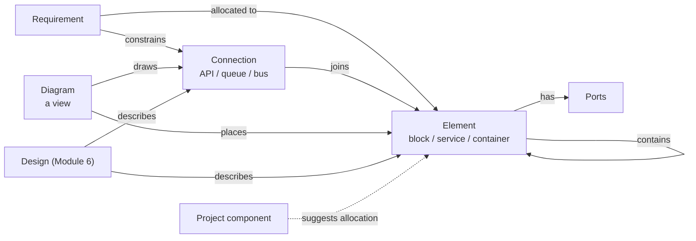
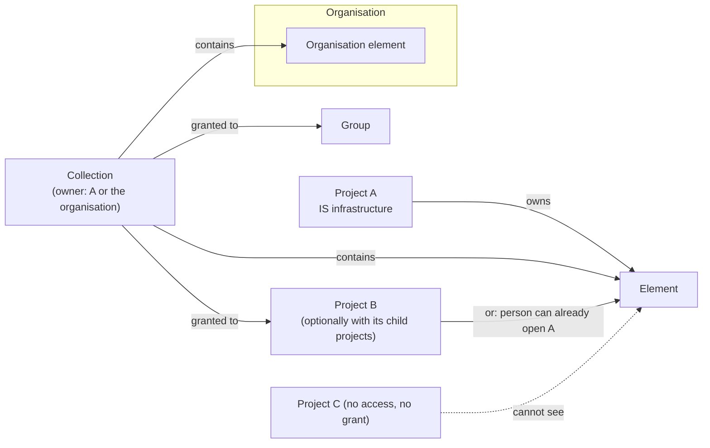
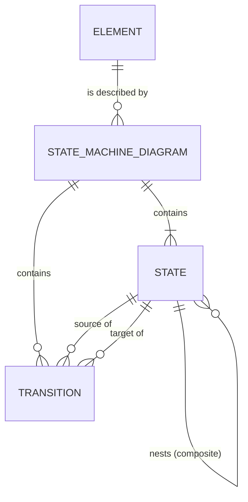
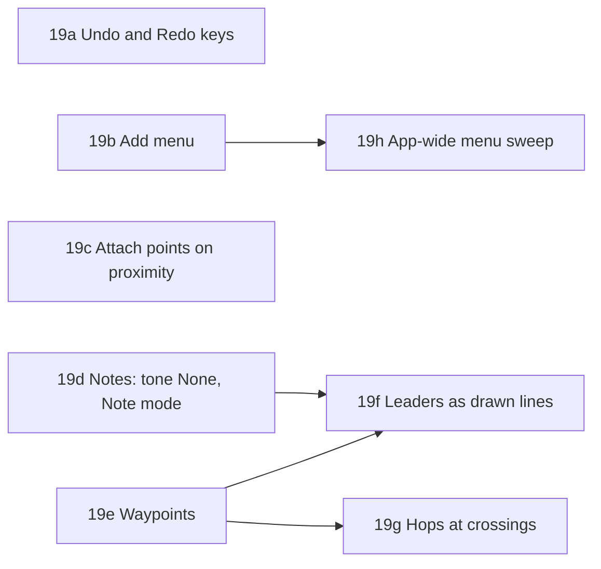
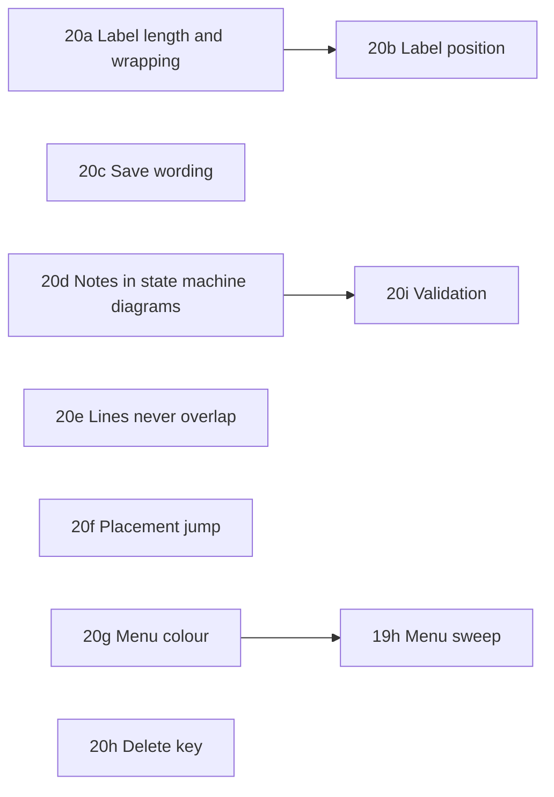
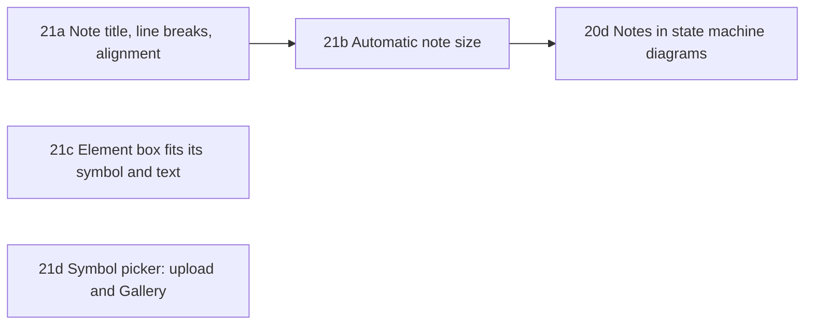
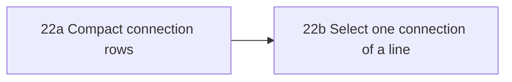

# Module 18 — System Architecture (block diagrams and interfaces) — Plan

**Status:** planned 2026-11-04; review round 1 added 2026-11-12; review round 5 (display notes, annotations, comments) added 2026-11-14; Phases 17a to 17d (state machine diagrams, section 4f) added 2026-11-14 and built before Phase 10; review round 6 (UI review of the diagram editors, section 4g) added 2026-11-14; Phase 0 questions answered by the User 2026-11-04, reading tasks done and open points answered 2026-11-12, plan restructured to 17 phases the same day (Phase 0 signed off 2026-11-12); Phases 1 to 9y, 10, 11, 12, 13, 17a to 17e and 18a to 18h built; review round 7 (UI review after Phase 13, section 4h) added 2026-11-15 as Phases 18a to 18h, to be built before Phase 14 (**Decided by: User**); review round 8 (UI review after Phase 13, section 4i) added 2026-11-15 as Phases 19a to 19h, to be built after Phase 18h and before Phase 14 (**Decided by: Agent**, by precedent); review round 9 (UI review after Phase 19g, section 4j) added 2026-11-16 as Phases 20a to 20i, to be built after Phase 19h and before Phase 14 (**Decided by: Agent**, by precedent); review round 10 (UI review after Phase 19g, section 4k) added 2026-11-16 as Phases 21a to 21d, to be built before Phase 20d (**Decided by: Agent**, by precedent). Review round 11 (UI review after Phase 20f, section 4l) added 2026-11-17 as Phases 22a and 22b, to be built before Phase 14 (**Decided by: Agent**, by precedent). **Decision tags:** every decision says `Decided by: User` or `Decided by: Agent`.

**Source:** user request 2026-11-04 (**Decided by: User**): a way of linking product elements as part of design. Elements have types (a package, a container, a hardware block) and communicate through defined means (queues, APIs, buses). Block diagrams for software and hardware are part of planning and sit alongside requirements. **Deployments (how many of an element run where) are out of scope** (**Decided by: User**, same day): the module covers systems/hardware and software architecture only.

See [future-modules-2026-09-index.md](future-modules-2026-09-index.md) for the cross-cutting module architecture and [../modules.md](../modules.md) for the registration contract. Hard-depends on Module 0. Soft dependencies: Module 6 (a Design describes an element), Module 13 (an element can exist only in some variants), Modules 3 and 4 (risks and decisions link to elements through the generic link system).

## Status / Resume Here

83 / 88 phases complete (review round 13, Phases 24a to 24d in section 4n, is planned 2026-11-17: 24b is built (2026-11-17, uncommitted: migration 0199; domains are a vocabulary of their own with the two tiers, hide and restore and the nested fallback, and an element or connection type is in any number of them, none meaning every domain; bundles carry domains by name and read an older bundle's one value; the Domains settings page, the multi-select on the type form, the Add menu's groups, the Add elements filter and the toggle rule's `domain_ids` use the project's domains; see `docs/decisions.md`); 24a is built (2026-11-17, uncommitted: no migration; Curved leaves each box along its outward direction and bends only as much as the boxes need, the fixed bow removed; `outward_direction`/`line_directions` and `outwardDirection`/`lineDirections` pinned by `graphAttachPointCases.json`, `LineDirections` passed to `linePath`, `lineMiddle`, `segmentMiddles`, `shapeSpans` and the hop rule, the canvas's routed edge and both server SVGs compute them for Curved lines only; see `docs/decisions.md`); 24c and 24d take the next free numbers (0200 onward); review round 12, Phases 23a to 23f in section 4m, is planned 2026-11-17: 23d is built (a line's shape is Straight, Curved or Spline with a diagram default, for connections, transitions and leaders in both editors; migration 0198 replaces the `smooth` flag with a nullable `line_shape` and adds the diagram default; one rule in both implementations; see `docs/decisions.md`), 23b is built (a connection's own route is a row of the anchors table keyed by the connection and is drawn as a line of its own; a migration, a resolver change in both implementations, a bundle field; see `docs/decisions.md`), 23a is built (a leader's end dot has its handle on its centre, so the line ends exactly on its target; stylesheet only), 23f is built (the symbol picker is one button opening one panel with Search, List, Gallery and Upload views inside it), 23e is built (the scope is the title's tooltip and a chevron beside the title switches diagrams), 23c is built (a leader's arrowhead is the canvas's own marker filled with `context-stroke`, so it follows the line's colour); review round 11, Phases 22a and 22b in section 4l, is planned 2026-11-17; 22b is built (2026-11-17, uncommitted: no migration; choosing a row of a merged line's connection list is a second level of selection kept by the page (`{ edgeId, connectionId }`, derived against the canvas selection, ended by any other selection, not in undo or the address): the card shows that connection's fields under a heading with **Back to the N connections** and **Open**, the line's own attach point and vertex fields below; `ConnectionSummaryRow onChoose` makes a row one button and the code text, with `Open CON-001` as a link beside `Edit CON-001`; Escape outside a text field goes back; the Outline has one row per line so nothing there is marked (a deviation recorded in `docs/decisions.md`)) and 22a is built (2026-11-17, committed: no migration; `ConnectionSummaryList` and `ConnectionSummaryRow` replace the Selection card's five-column table with two-line rows in the shared `ItemRow` (code, type and protocol, then the two ends, the Edit icon at the end, the code never wrapped), the same list the element page's Connections card now uses; the Outline's table stays a table; see `docs/decisions.md`); 20i is built (2026-11-17, uncommitted: no migration; **Validation** replaces **Findings** in the interface and the API with no alias (`findings` is `validation`, `ValidationIssueOut`, `ValidationSeverity`, `ValidationIssue`, `validation_by_diagram`, `ActivationRefused.issues`); a toolbar `ValidationButton` with a count badge opens a popover list whose row selects its state, the Selection card keeps one "N issues" button that opens the list at that state, and the old Findings card is gone; the block diagram editor has no diagram-wide results so no second host; `test_architecture_validation_term.py` pins the term; see `docs/decisions.md`); 20h is built (2026-11-17, uncommitted: no migration; reproduced first: the key worked only while the focus was inside the canvas, so a symbol selected from the Outline, after an add at once or with the card clicked never heard it; `GraphCanvas deleteKeyScope="page"` (both editors) hears it anywhere except a text field, a select, a dialog, an open menu or a vertex handle, once; `utils/keyboardTargets.ts` is the shared block rule, shared with Undo and Redo; Escape in a Selection card text field returns the focus to the selected item (`utils/canvasFocus.ts`, `DetailCard onKeyDown`), because the name field must keep the key after an add at once; a connection on a block diagram answers with a message; the delete tooltips name the key; see `docs/decisions.md`); 20g is built (2026-11-17, uncommitted: no migration; `.menu-parent[aria-expanded="true"]` takes `--color-primary` with its weight instead of `--color-accent`, no other menu rule used the accent for text; see `docs/decisions.md`); 20f is built (2026-11-17, uncommitted: no migration; the plain drop with Snap off was reproduced for every symbol kind and is correct, so the one cause in the drop path stays the labelled marker fixed in 20b; the second cause is the invert key tracked from key-down and key-up alone, which a lost key-up (a screenshot shortcut) left held so Snap off snapped every drag: `graphSnap.invertKeyHeld` reads the modifier flags of each key and mouse event; see `docs/decisions.md`); 20e is built (2026-11-17, committed: lines never overlap); 20d is built (2026-11-16, uncommitted: migration 0196; a state machine diagram's notes are the block diagram's rows, an owner column and `state_id`/`transition_id` leader targets, saved with the layout (`notes` complete when given) through the one `sync_notes`; the editor has Add note, a Note mode beside Comment, leaders to a state, a transition or a spot, and the shared note and leader cards, Outline section and server drawing; Mermaid writes a note beside the first state it points at; the bundle, probe, generator and seed carry notes; `noteModel.ts` is the shared editor model; see `docs/decisions.md`); review round 10, Phases 21a to 21d in section 4k, is planned 2026-11-16 and is built before 20d; 21d is built (2026-11-16, uncommitted: no migration; the symbol picker has a List and a Gallery view (a `Popover` with a name filter, a None tile and a radio grid whose tiles read their drawing when scrolled into view; the view is kept in browser storage) and **Upload a symbol** for a person the capabilities read allows, chosen in the draft and stored with the form; `useSymbolUpload` and `SymbolUploadField` are shared with the Symbols settings; one added read, `GET /orgs/{org}/modules/architecture/capabilities`, because only the project had one; see `docs/decisions.md`); 21c is built (2026-11-16, uncommitted: no migration; the cause was a symbol taking 60% of the box while the text block shrank (the label squeezed to one line) and the server cutting the name to two lines; `elementBoxFit.ts` with `diagram_box_fit.py` and `elementBoxFitCases.json` give the least size from the symbol (fixed 40 units), the caption and the name's lines; `boxFrame` and `_framed_nodes` draw the larger of the stored size and that fit and never rewrite the stored size; the generic `GraphCanvasNode.symbolHeight`, `minWidth` and `minHeight`; see `docs/decisions.md`); 21b is built (2026-11-16, uncommitted: migration 0195 `size_mode` on `architecture_diagram_notes` (Automatic or Manual; existing notes with no tone become Automatic, the rest stay Manual; the API default is Manual); `diagram_note_layout.py` and `noteLayout.ts` with `noteLayoutCases.json` give a note's lines and frame on the shared width table (`text_width` and `wrap_label` take a font size and a percentage); the generic `GraphCanvasNode.inset`; the editor draws `noteFrame` and a resize makes the note Manual; the server SVG draws every note from the same lines; a Size select in the note card; bundle, perf and seed; the next migration is 0196, see `docs/decisions.md`); 21a is built (2026-11-16, uncommitted: migration 0194 `title` and `text_align` on `architecture_diagram_notes`; the generic `GraphCanvasNode.title` and `textAlign` with a label that keeps typed line breaks; the server SVG wraps each typed line and draws the title in bold with `text-anchor`, Mermaid writes the title in bold; `DiagramNoteEditor` has Title, Note text and Alignment with one `onChange(patch)`; bundle, perf and seed; the next migration is 0195, see `docs/decisions.md`); review round 9, Phases 20a to 20i in section 4j, is planned 2026-11-16; 20a is built (2026-11-16, uncommitted: migration 0192 widens `architecture_states.label` to 256 characters; `diagram_symbol_label.py` and `symbolLabelLayout.ts` with `symbolLabelCases.json` break a label between words only and grow the symbol to hold it (a word too long for the largest symbol stays whole and the field warns); parametric `labelled_svg`/`labelledSvg` replace the fixed labelled markers; the generic `GraphMarkerText` now carries `lines`; committed) and 20b (built 2026-11-16, uncommitted: migration 0193 `label_position` on `architecture_states` (inside, left, right, above, below); `besideLabel`/`beside_label` place the text 4 units from the symbol, which keeps its plain size; the generic `GraphMarkerText.block` and `GraphCanvasNode.attachPoints` with the opening view leaving room for the text; an open line end avoids the label's side; `markerOffsets` stops a symbol grown by a label inside it from jumping when moved (the cause found for 20f's report); bundle, export column, SVG, seeds and perf; the next migration is 0194, see `docs/decisions.md`) are built and 20c (built 2026-11-16, uncommitted: the four Selection card save buttons read **Save** and keep their names "Save state", "Save transition", "Save element" and "Save connection" through `aria-label`; the toolbar save of both editors reads **Save** and is named **Save diagram**; `testing/labelInName.ts`; no migration, see `docs/decisions.md`) is built and 20d to 20i are not; review round 8, Phases 19a to 19h in section 4i, is planned 2026-11-15; 19a to 19h are built; 0 to 13, 9a to 9y, 17a to 17e, 19h (built 2026-11-16, uncommitted: no migration; the split-button alternatives and export formats on `ActionMenuList`, `menu-item` rows for the switcher, badge list and listbox options, `scripts/check_menu_rows.py` and `expectTextRows`, see `docs/decisions.md`), 19g (built 2026-11-16, uncommitted: migration 0191 `line_hops` on `architecture_diagrams` and `architecture_state_machine_diagrams`; `graphLineHops.ts` with `diagram_line_hops.py` and `graphLineHopCases.json` (a grid index, flattened curves, the later id hops, no hop near an end, between lines sharing an end or where the arc would not fit); `GraphCanvas lineHops` with a `hopPath` on the routed edge; the shared `LineHopsSetting` in both editors' gears, stored with the version lock; the server SVGs draw the arcs through `_edge_runs`/`_leader_runs`; bundles, perf (profiles version 12) and seeds; the next migration is 0192, see `docs/decisions.md`), 19f (built 2026-11-16, committed: migration 0190 `architecture_note_leaders` replacing the leader columns of a note, several leaders per note each a drawn line with a start attach point, vertices, a smooth curve and a start and an end style (none, arrow or dot); selectable leaders and `onLeaderPointsChange`, `onConnect`'s `via.sourcePoint` and `onConnectEmpty` on the generic `GraphCanvas`; `DiagramLeaderEditor`, the note card's leader list and Add leader; the server SVG and Mermaid, bundles (an older single `leader` is still read), perf and seeds; the next migration is 0191, see `docs/decisions.md`), 19e (built 2026-11-15, uncommitted: vertices and a smooth curve on block diagram lines and state machine transitions; migration 0189 `points` and `smooth` on `architecture_diagram_anchors` and `architecture_transitions`; `graphLinePath.ts` with `diagram_line_path.py` and `graphLinePathCases.json`; route-aware attach points (`routeAttachPoints`); the generic `GraphCanvas` `points`, `smooth`, `routable` and `onEdgePointsChange` with handles on the selected line; the shared `LineVertexFields` Selection card section and an Outline column, named "Vertices" because "Route" is an existing term; bundle, SVG and perf support; the next migration is 0190, see `docs/decisions.md`), 19d (built 2026-11-15, uncommitted: the note tone `none` (text alone, no fill, border, dashed edge or "Note" caption; a faint outline while hovered, selected or empty through the generic `GraphCanvasNode.placeholder`), a **Note** mode beside **Comment** through the shared `CanvasModeToggle` (one mode at a time; a click on empty canvas places a note and puts the cursor in its text; Escape leaves either mode through `useEscapeToLeaveMode`), the server SVG drawing a none-tone note as text alone and skipping an empty one; no migration, see `docs/decisions.md`), 19c (built 2026-11-15, uncommitted: `graphAttachProximity.ts` and `GraphCanvasView` set `data-attach-near` on the boxes the pointer is within 24 screen pixels of, the stylesheet draws a box's points only then, on the selected or focused box and on the handle a line is drawn from, `GraphCanvas attachPointVisibility` (`near` or `always`) with an **Always show attach points** switch in both editors' gears (stored per user in `ui_preferences`, the User's request), no React state on a pointer move; no migration, see `docs/decisions.md`), 19b (built 2026-11-15, uncommitted: `Popover` closes on a capture-phase `pointerdown` because React Flow stops `mousedown`, text-row menus and a tree for groups and `children` in `ActionMenuList`, `Popover menu` caret, Tab closes a menu, `testing/menuTree.ts` and `tests/menuTree.ts` helpers; no migration, see `docs/decisions.md`), 19a (built 2026-11-15, uncommitted: `EditHistoryButtons` with `useHistoryShortcuts`, `isApplePlatform` and `historyButtonHelp` replacing the two hand-written buttons in both editors, the document listener in the capture phase because React Flow marks a key pressed on a box as handled, and a fix in `GraphCanvasView` for a spent drag override that re-applied on an Undo; no migration, see `docs/decisions.md`), 18h (built 2026-11-15, uncommitted: `ARCHITECTURE_TERMS` with `TermCaption`, `DetailCard help`, the shared `HelpHeader`, help on every Outline and transition column header, the section and card headings and the read-only Selection card labels, a help text for each port select, `scripts/check_architecture_term_help.py`, 16 glossary terms and two new website pages; no migration, see `docs/decisions.md`), 18g (built 2026-11-15, uncommitted: the generic `GraphCanvasNode.badges` drawn by `GraphNodeBadges`, `ModelElement.state_machines` from one bulk read in `diagram_model.build_model`, the badge, the Selection card action and the Outline column on the block diagram, `?from=` and `?select=` through `stateMachineLinks.ts`, `RecordHeader returnTo` with `ReturnLink` and `ReturnToDiagram` (Return link or Open in diagram menu); no migration, see `docs/decisions.md`), 18f (built 2026-11-15, uncommitted: `RecordDiagramsCard` under the details card on the element and connection pages replacing `ElementStateMachinesCard`, `NewStateMachineDiagramButton`, the `/elements/{id}/diagrams` and `/connections/{id}/diagrams` reads in `record_diagram_routes.py` and `record_diagrams.py`; no migration, see `docs/decisions.md`), 18e (built 2026-11-15, uncommitted: `graphSnap.ts` (`snapCoordinate`, `snapResize`, `snapApplies`), the generic `GraphCanvas` `snapGrid`, `snapOn` and `snapInvertKey`, `hooks/useSnapToGrid.ts`, `SnapToGridSetting` in the block diagram gear and a new state machine gear, React Flow's Shift box selection turned off because it blocked a Shift drag; no migration, see `docs/decisions.md`), 18d (built 2026-11-15, committed: migration 0188 `architecture_states.label`, `LABELLED_MARKERS` and `marker_frame` on both sides with `stateShapeCases.json`, the generic `GraphCanvasNode.markerText`, the Symbol label field, the exports, bundle, search and seeds, and the "Condition (guard)" wording; the next migration is 0189, see `docs/decisions.md`), 18c (built 2026-11-15, uncommitted: elements and connections created at once with defaults and edited in the Selection card through `ElementSelectionFields` and `ConnectionSelectionFields`, the shared `ConnectionFieldGroup`, `defaultElementName` and `defaultConnectionType`, `canvasCreations.json` with `test_canvas_creations.py`; no migration, see `docs/decisions.md`), 18b (built 2026-11-15, committed: transitions added at once), 18a (built 2026-11-15, uncommitted: `useCanvasComments` owns the `?pin=` link and clears it on every close, `GraphCanvas` `onBackgroundClick`, an explicit fit before the first move to a thread; no migration, see `docs/decisions.md`); review round 6 (section 4g) is built (Phase 17e built 2026-11-14, uncommitted: states added at once with a default name, the Selection card edits a state in place through the shared `StateFieldGroup`, `StateFormModal` is the double-click edit dialog only, the Add to diagram tooltip carries the how-to, no migration; Phase 9y built 2026-11-14, uncommitted: `SelectionActions` and `selectionAction`, the shared `IconAction` (moved out of `CommentThreadView`), icon buttons in both Selection cards with unchanged accessible names, no migration; Phase 9x built 2026-11-14, uncommitted: `ItemRow revealActions`, icon buttons in `CommentThreadView`, and a fix so a delete confirmation no longer closes its pop-over; no migration; Phase 9w built 2026-11-14, committed: `help` on `ToggleButton` and `MenuButton`, the shared `CommentModeToggle`, `scripts/check_help_beside_button.py`, the style guide entry; no migration; Phase 9v built 2026-11-14, committed: `buttonHeightViolations`, small menu triggers in both editor toolbars, no migration; the next migration is 0188), 2026-11-14; review round 4, Phases 9l to 9r, is planned in section 4d and built, and review round 5, Phases 9s to 9u, in section 4e and built; both are built before Phase 10); review round 2 (section 4b, the User's review of the built System Architecture page and editor, 2026-11-13) is built as Phases 9f to 9i; Phase 9u built 2026-11-14 (uncommitted: core migration 0184 `record_comments` and `record_comment_pins`, `ModuleDefinition.record_comments` and the generic API, the architecture provider with per-type `/comments` routes, bundles (project and organisation) and template exclusion, the comment search field, the perf generator and ratio version 8, anchored threads on the element and connection pages, the generic `GraphCanvas` comment mode and pins, `useCanvasComments` with `CommentMarker`, `CommentThreadView` and `RecordCommentsCards`, the editor's Comment toggle, Comments tab and Selection card entries; the next migration is 0185, see `docs/decisions.md`). Phase 17a built 2026-11-14 (uncommitted: migration 0185, the two artefact types with every registration, `state_machine_checks`, the activation gate, bundles and template reset, probes and generators with profiles version 9, the demo seed; the next migration is 0186, see `docs/decisions.md`). Phase 17b built 2026-11-14 (uncommitted: generic `GraphCanvas` loop, multi-line label, marker and container support, `graphSelfLoop.ts`, `stateShapes.ts`, `state_shapes.py` and the three shared cases files, with `points` on `BoxGeometry` for marker sides; no migration, see `docs/decisions.md`). Phase 17c built 2026-11-14 (uncommitted: the editor, the merged Diagrams tab with its Type choice, the State list and the element's card; no migration, see `docs/decisions.md`). Phase 17d built 2026-11-14 (uncommitted: `state_machine_svg.py` and `state_machine_mermaid.py` with the `/svg` and `/mermaid` routes, the shared `useDiagramExport` and `DiagramExportMenu` for both editors, the "Change status" rename, the label cases shared with `stateMachineModel.ts`, the site page and glossary terms; no migration, see `docs/decisions.md`). Phase 10 built 2026-11-14 (uncommitted: migration 0186 `architecture_allocation_dismissals`, `allocation.py` with the computed suggestions, accept, dismiss, restore and coverage, the `/allocation` routes, the dismissal bundle key (excluded from templates), four overview metrics and the `allocation_coverage` widget, `AllocationPanel` on the requirement page and the element page; the next migration is 0187, see `docs/decisions.md`). Phase 11 built 2026-11-14 (committed; reports `ar2` to `ar7`, the interchange file, the Structurizr export; see `docs/decisions.md`). Phase 12 built 2026-11-14 (uncommitted: migration 0187 `baselines.kind`, nullable `stage_id`, typed `baseline_items` with a JSON `snapshot`, `ModuleDefinition.baseline_snapshots`, `services/baseline.py` manual baselines and `routers/projects/baselines.py`, the bundle carrying `kind` and `module_items`; the next migration is 0188, see `docs/decisions.md`). Phase 13 built 2026-11-14 (uncommitted: `baseline_snapshot.py` with the four providers, `baseline_compare.py`, `baseline_routes.py` with the view, record and compare reads, the Baselines tab, the baseline page and comparison view, no migration; see `docs/decisions.md`). Next is Phase 24b, then 24c and 24d, then Phase 14 (MCP tools; the next migration is 0199), then 15 and 16. Phase 0 signed off by the User 2026-11-12; Phases 1 to 4 built and committed 2026-11-12; Phase 5 built 2026-11-12 (committed); Phase 6 built 2026-11-12 (committed); Phase 7 built 2026-11-12 (committed); Phase 8 built 2026-11-12 (committed); Phase 9 built 2026-11-12 (committed); Phase 9a built 2026-11-12 (committed); Phase 9b and Phase 9c built 2026-11-13 (committed); Phase 9d built 2026-11-13 (committed); Phase 9e built 2026-11-13 (committed); Phases 9f to 9j built 2026-11-13 (committed); Phase 9k built 2026-11-13 (committed); Phase 9l built 2026-11-13 (committed: `RecordHeader` `tagsInline`, `RecordTags inline` with its dialog, `useFillViewportHeight`; the dialog replaces the plan's popover because the pickers open popovers; see `docs/decisions.md`); Phase 9s built 2026-11-14 (committed: migration 0182 `display_note` on elements, drawn in the box by a generic `GraphCanvasNode.body`, the server SVG and Mermaid, a "Show notes" switch in the settings gear, the Selection card, Outline columns, CSV, bundles, search and probes; see `docs/decisions.md`); Phase 9t built 2026-11-14 (uncommitted: migration 0183 `tone` and the leader columns on `architecture_diagram_notes`, `NoteIn` with a kind-matching validator, the layout save's target rules, the generic `GraphCanvas` `tone`, `leaders`, `onLeaderTargetChange` and `onCanvasClick`, `DiagramNoteEditor` in the Selection card, the Outline's "Points at", the server SVG and Mermaid, bundles, probes and generators; the next migration is 0184, see `docs/decisions.md`); Phase 9r built 2026-11-14 (committed: the 26 baseline files sort on a header click, in the browser because none pages, the sort in the URL on a list page and local in a panel (`hooks/useTableSort.ts`); `scripts/check_sortable_columns.py`'s baseline is empty and `OrgUsageTable` is exempt with a reason; see `docs/decisions.md`); Phase 9q built 2026-11-14 (committed: migration 0181 `architecture_folders` and `folder_id` on the three record tables, `folders.py` with the per-kind `/element-folders`, `/connection-folders` and `/diagram-folders` routes and the organisation's element folders, a Folder column, field and filter-panel tree (`FolderPanel`) on the three lists and the organisation panel, a generic `DirectoryTable` `selection` with "Move to folder", the Add menu's owner-then-folder filter, the CSV `folder` path, project and organisation bundle sections and the probes and generators; the next migration is 0182, see `docs/decisions.md`); Phase 9p built 2026-11-14 (committed: the three lists sort on a header click in the browser with the sort in the URL, `scripts/check_sortable_columns.py` and its 26-file baseline; the lists are not paged, so no server sort, see `docs/decisions.md`); Phase 9o built 2026-11-14 (committed: an Edit button per connection in the line's Selection card opening the shared `ConnectionFormModal`, a shared connection having none; see `docs/decisions.md`); Phase 9n built 2026-11-13 (committed: `transitions.py` map, `allowed_status_moves` on each record, `proposed` and `rejected`, the "Change state" `MenuButton` through `RecordHeader` `stateMenu`; a Draft can no longer be retired directly, see `docs/decisions.md`); Phase 9m built 2026-11-13 (committed: `placementTree.ts` with the collapsible picker and filter, the Add menu filter, `RecordPlacements captioned` in the Selection card; a shared box shows no components, see `docs/decisions.md`). Review round 1 (section 4a, from the User's first review of the built screens 2026-11-12) is built before Phase 10 (allocation); the next migration is 0184. Phase 4 delivered the symbol library (built-in set in code, sanitised uploads, two tiers with hide, restore and nested fallback, assignment to element types and elements, the visibility rule for reading a symbol, bundles with files through new organisation-bundle file hooks; see `docs/decisions.md`); the symbol screens arrive in Phase 7. Phase 5 delivered the diagram API: the diagram type, the single resolver (toggles, bridging, roll-up, merging), the version lock, the server SVG and the bundle section (see `docs/decisions.md`); Phase 7 removes the element, and Phase 8 the diagram, from `not_creatable_from_links` when each adds its form dialog. Phase 6 delivered the shared `GraphCanvas` (`@xyflow/react`, lazy chunk, list view, sanitised symbols; see `docs/decisions.md` and the style guide's graph canvas pattern); the Playwright smoke test moves to Phase 8, the first consumer. Phase 7 delivered the Elements and Connections lists and pages, the Sharing page, the settings panels and the organisation panel (see `docs/decisions.md`); the element is now creatable from the Links panel, the diagram and its entry arrived in Phase 8, and the Sharing card lists only an element's direct collections until the security review (Phase 15) decides how a route listing is read. Phase 8 delivered the Diagrams list, the editor (local edits with undo and redo, Save with the version lock and a conflict reload, palette, add-existing picker, switches, line creation, notes, selection actions), the canvas's resize and drop callbacks, and the model endpoint with a browser port of the resolver so lines and switches redraw at once (see `docs/decisions.md`); its Playwright spec was first run in Phase 9, after two spec faults were fixed. Phase 9 delivered the Outline card (tree and connection table, following the switches and the unsaved layout), keyboard operation (Alt+arrow resize, Delete, a Connect to list), and PNG, SVG and Mermaid export from the server's own drawing and a new Mermaid endpoint (see `docs/decisions.md`). Phase 9a delivered the connection type tree: the parent link table (migration 0177), the cycle and depth rule, descendant expansion in the connection filters and the switch rules, bundles with `parent_names`, the fresh-install groups, and `TreeSelect` single/search with the new `TreeSelectField` (see `docs/decisions.md`). Phase 9b delivered the suggested-types link table (migration 0178), the guided connection picker (domain filter, suggestions first, "Show all types", non-blocking warning), the seeded suggestions and the bundle `suggested_names` (see `docs/decisions.md`). Phase 9c delivered the Drawing and Configuration tabs (`?tab=configuration`), the Add to diagram menu button (draggable entries through a generic `ActionMenuItem.onDragStart`) and a fix for edits lost while a save is read back (see `docs/decisions.md`). Phase 9d delivered the anchors table (migration 0179), the eight attach points with the shared nearest-point rule (`graphAttachPoints.ts` and `diagram_points.py`, kept equal by `graphAttachPointCases.json`), straight lines on the canvas, dragging a line's end (`onEdgeAnchorChange`), the Selection card's two lists, the anchors in the layout save, view, server SVG and bundle; an end may be left automatic (see `docs/decisions.md`). Phase 9e delivered the one System Architecture page (`?tab=` Elements, Connections, Diagrams, each tab keeping its filters), the single navigation entry (`nav_sub_components_any`), the redirects from the earlier list paths, and a fix for a saved layout that could look unsaved (see `docs/decisions.md`). Review round 2 (Phases 9f to 9i) delivered Diagrams as the default and a remembered tab, a capped opening zoom, the Outline tab, the diagram settings gear, element editing in a modal and ports in the Selection card, the neutral seeded element types with a setup entry in the Add menu (and a `capabilities` endpoint), and the selectable-row tree picker for connection types (see `docs/decisions.md`). Phase 9j delivered the Outline as a tree or table with collapsible sections, the components control help and double-clicking a box to open its inside. Phase 9k delivered boundary boxes (migration 0180), the "realises" link with a rule wider than the plan's wording (refinement allowed), the generic canvas `outline`, the boundary resolver input shared with the browser, the AR1 coverage report and its MCP tool, and the bundle, probe and generator support (see `docs/decisions.md`).

Each phase ships everything its tables need in the same change: bundle section (project and organisation), template-project classification, scaling probe and generator, search, record tables, History kinds, seed-script updates and its own migration. Registry tests fail otherwise.

| # | Phase | Status |
|---|-------|--------|
| 0 | Design sign-off (section 6) | [x] |
| 1 | Skeleton and vocabularies: registration, entitlement, roles and permissions, element and connection types (organisation tier, hide/restore, nested fallback), their bundle sections | [x] |
| 2 | Elements, ports and connections (project-owned): hierarchy, codes, placements, tags, links, search, summaries, audit, record tables, bundle sections, probes | [x] |
| 3 | Collections, grants, organisation-owned elements, cross-project access and the visibility resolver | [x] |
| 4 | Symbol library: sanitised SVG symbols, organisation and project tiers, built-in generic set, assignment to element types and elements, bundle sections | [x] |
| 5 | Diagram API: placements, scope, view toggles, connection detail, roll-up resolver, version lock, server SVG, bundle section | [x] |
| 6 | Shared graph canvas in core components (reusable by Modules 16 and 17) | [x] |
| 7 | Frontend: lists, detail, element tree, ports, type vocabularies | [x] |
| 8 | Frontend: diagram editor interactions | [x] |
| 9 | Frontend: diagram accessibility (outline, keyboard) and export (PNG, SVG, Mermaid) | [x] |
| 9a | Review 1: connection type tree (any depth, several parents), generic-then-refine connections, grouped pickers | [x] |
| 9b | Review 1: soft guidance for connection types (domain filter, suggested types per element type, warnings) | [x] |
| 9c | Review 1: editor tabs (Drawing, Configuration) and the Add menu | [x] |
| 9d | Review 1: eight attach points, nearest-point routing, draggable custom anchors | [x] |
| 9e | Review 1: one System Architecture page (Elements, Connections, Diagrams) and one navigation entry | [x] |
| 9f | Review 2: Diagrams as the default tab and a remembered tab, a readable initial zoom, no "Show as list" | [x] |
| 9g | Review 2: Outline tab, diagram settings gear (connection detail) beside Export | [x] |
| 9h | Review 2: edit an element in a modal from the diagram, add ports from the Selection card, ports offered only where they exist | [x] |
| 9i | Review 2: neutral standard element types, a setup link in the Add menu, connection type as a dropdown tree | [x] |
| 9j | Review 3: Outline as tree or table with collapsible sections, narrow components control with help, open an element's inside by double-click, help for the system context | [x] |
| 9k | Review 3: links from the parent layer inside an element's inside diagram (boundary boxes with port-style shapes, a "realises" link between connections) | [x] |
| 9l | Review 4: record header with tags inline beside the version, and a diagram editor that fits the screen | [x] |
| 9m | Review 4: components as a collapsible tree (picker and Add menu), assigned to a box from the Selection card | [x] |
| 9n | Review 4: "Change state" menu beside Edit, with `proposed` and `rejected` states and a server-defined transition map | [x] |
| 9o | Review 4: edit a connection in a modal from the diagram | [x] |
| 9p | Review 4: sortable column headers on the three lists, and the UI/UX rule | [x] |
| 9q | Review 4: folders for diagrams, elements and connections | [x] |
| 9r | Review 4: sortable columns on the remaining lists (sweep) | [x] |
| 9s | Review 5: display note inside a block (beside the long description) | [x] |
| 9t | Review 5: annotation notes with optional leader arrows | [x] |
| 9u | Review 5: comment mode with pinned threads (Miro style), on the shared canvas | [x] |
| 9v | Review 6: editor toolbar and a measured button-size check (neighbours match), on both editors | [x] |
| 9w | Review 6: help on the control itself, not a `(?)` beside a button; style guide entry for interactive elements | [x] |
| 9x | Review 6: comment thread rows as icon buttons, edit and delete revealed on hover and focus | [x] |
| 9y | Review 6: Selection cards as icon buttons (both editors) | [x] |
| 17e | Review 6: state machine diagrams: add straight to the diagram, set values in the Selection card, no Kind choice, no layout-shifting help text | [x] |
| 17a | State machine diagrams: records, API and checks: state machine diagram (`SMD`) and state (`STE`) artefact types, transitions, the activation gate, bundles, probes, seeds; built before Phase 10 | [x] |
| 17b | State machine diagrams: generic `GraphCanvas` additions (self-loop edge, multi-line labels, marker nodes, containing nodes) and the shared geometry table | [x] |
| 17c | State machine diagrams: the editor (Type choice on the Diagrams tab, States view, drawing, outline, comments) | [x] |
| 17d | State machine diagrams: server SVG and PNG, Mermaid `stateDiagram-v2` export, "Change status" rename, glossary and docs | [x] |
| 10 | Allocation: requirement panel, suggestions from placements, dismissals, coverage | [x] |
| 11 | Interchange and reports: JSON, Mermaid and Structurizr DSL, reports A1–A6, report fields and starters | [x] |
| 12 | Baselines, core: polymorphic `BaselineItem`, `Baseline.kind`, the snapshot provider hook (proven on requirements) | [x] |
| 13 | Baselines, architecture: snapshot, view and compare, Module 6 hand-off | [x] |
| 18a | Review 7: a diagram opens with no comment thread showing and a view fitted to the drawing; a thread opens only from a link to it | [x] |
| 18b | Review 7: transitions are added at once and edited in the Selection card (state machine diagrams) | [x] |
| 18c | Review 7: block diagram elements and connections are added at once and edited in the Selection card | [x] |
| 18d | Review 7: text inside initial, final and choice symbols (new Symbol label field); transition condition wording | [x] |
| 18e | Review 7: snap to grid (a setting, and a key held while dragging), both editors | [x] |
| 18f | Review 7: a Diagrams card directly under the details card on element and connection pages | [x] |
| 18g | Review 7: state machine badge on a block, and a round trip between a block diagram and its state machine diagram | [x] |
| 18h | Review 7: plain-language help for notation and domain terms (guard, event, port and the rest), on fields, headings and column headers | [x] |
| 19a | Review 8: Undo and Redo on the keyboard (Cmd or Ctrl with Z; Shift or Y for Redo), both editors | [x] |
| 19b | Review 8: the Add to diagram menu closes on a click outside it (a defect in a shared component), and takes the tree style; style guide updated | [x] |
| 19c | Review 8: attach points appear only when the pointer is near a box or a line is being drawn nearby | [x] |
| 19d | Review 8: notes with no tone (no box, fill or "Note" text) and notes placed from a Note mode beside Comment | [x] |
| 19e | Review 8: waypoints on lines (vertices and optional smooth curves) for connections and transitions, one shared mechanism | [x] |
| 19f | Review 8: note leaders become free drawn lines (from an attach point, to anywhere or to a box, with waypoints and a start and end style) | [x] |
| 19g | Review 8: a line jumps over a line it crosses (a diagram setting, drawn the same in the exports) | [x] |
| 19h | Review 8: every menu and popover list in the app follows the text-row and tree style, with a check that keeps it so | [x] |
| 20a | Review 9: symbol labels are longer, never split a word between lines, and the symbol grows to fit (state machine diagrams) | [x] |
| 20b | Review 9: a symbol label can sit inside, left, right, above or below its symbol | [x] |
| 20c | Review 9: the state Selection card's save is "Save" (accessible names tell the two saves apart) | [x] |
| 20d | Review 9: notes and note leaders in state machine diagrams, with a Note mode | [x] |
| 20e | Review 9: lines never draw over each other; automatic anchors face each other and spread over free attach points, in both editors | [x] |
| 20f | Review 9: a symbol stays where it is dropped with Snap to grid off (a defect; reproduce first) | [x] |
| 20g | Review 9: the open entry of a menu tree takes the product's own colour, not the green accent | [x] |
| 20h | Review 9: the Delete key deletes the selected symbol, in both editors (a defect; reproduce first) | [x] |
| 20i | Review 9: modelling checks are "Validation", not "Findings": a toolbar button beside Comment and Note opening the list | [x] |
| 21a | Review 10: a note has a title (bold), keeps the line breaks typed and has an alignment | [x] |
| 21b | Review 10: a note sizes itself to its content (Automatic or Manual) and its leaders end close to the text | [x] |
| 21c | Review 10: an element box is never drawn smaller than its symbol, code and name need (a defect; reproduce first) | [x] |
| 21d | Review 10: upload a symbol from the symbol picker, and a Gallery mode that shows the symbols as a scrolling grid | [x] |
| 22a | Review 11: the Selection card lists a line's connections as compact rows that fit the card (no clipped table, no code broken over three lines) | [x] |
| 22b | Review 11: choosing a connection of a merged line selects it in the diagram and the card shows that connection; the record page is a separate action | [x] |
| 23a | Review 12: a leader to a line or a free position ends exactly on its target, on the side it arrives from (a defect; reproduced first) | [x] |
| 23b | Review 12: with one connection of a merged line chosen, dragging a vertex routes that connection only (a route per connection, not per pair of boxes) | [x] |
| 23c | Review 12: the arrowhead of a note's leader takes the colour of its line (a defect; reproduced first) | [x] |
| 23d | Review 12: a line's style is Straight, Curved or Spline, with a diagram default, for every line in both editors | [x] |
| 23e | Review 12: the diagram's scope is read from the title's tooltip, not a line of its own; a chevron beside the title of a block or state machine diagram switches to another diagram | [x] |
| 23f | Review 12: the symbol picker is one field opening one panel with Search above and List, Gallery and Upload views below, not toggles and an upload field beside the field | [x] |
| 24a | Review 13: a Curved line leaves each box along its outward direction and bends only as much as the boxes need, on the screen and in the exports, for connections, transitions and leaders | [x] |
| 24b | Review 13: domains are a vocabulary of their own (organisation and project tiers, hide and restore, nested fallback) and an element or connection type can be in several domains | [x] |
| 24c | Review 13: a diagram setting shows the connection's name beside its line, on the screen and in the exports | [ ] |
| 24d | Review 13: a connection type has a Default protocol that pre-fills a new connection, and a merged line shows the protocol its connections share | [ ] |
| 14 | MCP tools and agent skill | [ ] |
| 15 | Security review: visibility, sharing and access (identify, verify, remediate) | [ ] |
| 16 | Seeds, Storybook and Playwright completeness, docs website, close-out | [ ] |

## 1. What it is

The structure of the thing being built: what it is made of, how the parts connect, and which requirements each part answers. Requirements say *what*; this module records *which part* and *across which interface*; a Module 6 Design records *why and how* (revisions, review, approval).

| Record | What it is | Code | Notes |
|--------|------------|------|-------|
| **Element type** | A project vocabulary entry: name, shape, colour, domain (`software`, `hardware`, `any`) | — | Seeded on a fresh install: System, Subsystem, Component (domain-neutral; an organisation adds the software and hardware types it wants, section 4b). Organisation tier, hide/restore, nested fallback (section 3.2) |
| **Element** | A part of the product: name, description, type, parent, owner, status | `ELM-001` | Tree via `parent_id`. Ports are a child list. Owned by a project or by the organisation; shared through collections (section 3.9) |
| **Port** | A named attachment point on an element: name, direction (`in`, `out`, `both`), connection type | — | Child of an element, not a separate record type (Q3) |
| **Connection type** | A vocabulary entry: name, direction behaviour (`one-way`, `two-way`), domain; sits in a tree of any depth and may have several parents (section 4a) | — | Seeded: REST API, gRPC, Message queue, Event stream, Database access, File exchange, SPI, I2C, UART, CAN, Ethernet, USB, Power, Analogue signal |
| **Connection** | A link between two elements (optionally via a port each): type, protocol/detail, direction, description | `CON-001` | The "interface". Requirements and tests link to it |
| **Symbol** | A sanitised SVG drawing for an element type or one element, from a library with organisation and project tiers | — | Not a record type: no code, not linkable. A plain library entry, like a vocabulary row |
| **View toggle** | A named switch on a diagram (for example "Security devices") with a default state; hides its members when off | — | Part of a diagram, not a record |
| **Diagram** | A saved view: a scope element (or none for system context), placements, routing hints | `DGM-001` | Holds no truth of its own; delete a diagram, nothing is lost from the model |

## 2. Challenges to the request (read first)

- **Blocks are not the same thing as project components, though they overlap.** A project component (`ProjectComponent`, `backend/app/models/project.py`) is a core table whose prefix builds requirement codes and whose `component_id` is non-null on every requirement; it forms a two-level tree with categories and orders reports. It organises the *requirements document*. Many components will match a block (a "Telemetry" component and a Telemetry module), but cross-cutting components (Security, Usability, Regulatory) are not blocks, and a block hierarchy goes deeper than two levels and carries ports. Making blocks *be* components would put module-only data (ports, connections, kinds) into a core table, which the module boundary forbids. **Recommendation (Q1): keep elements separate; an element's component comes from the shared placement table (`artefact_placements`), not a column of its own; placement drives suggested allocations, never stored allocations.** **Decided by: User** (Q1, 2026-11-04; the shared table replaces the single column on 2026-11-12, which also allows an element to sit in several components and in categories).
- **Separate from Module 6, but linked.** Elements are lightweight and edited in place (audit plus baselines). A Design carries revisions, review and approval. Forcing every element through Design's lifecycle is too heavy; folding elements into Designs duplicates identity ("Payment service" the Design versus the element). Module 6's Interface Design then *describes* a connection rather than restating source, destination and protocol. **Decided by: User** (Q2, 2026-11-04).
- **Package and container are element types here, not build artefacts.** The original idea tied them to deployments (how many containers run where). With deployments out, "container" is just a type of software element. A deployment module can be added later against this model; nothing here blocks it.
- **"Module" and "artefact" are taken.** Architects call software parts "modules"; this product calls a feature a module and every registered record type an artefact type. The UI says **Element**, **Connection**, **Diagram**; "artefact" never means a build output.
- **Not a SysML or UML tool.** No metamodel, simulation, code or HDL generation, requirement-to-model validation, or round-trip with other tools in this plan. The test for any addition: does a requirement, risk, decision, design or test need it as a link target? If not, it is out.
- **Diagrams drift when they are drawings.** A diagram here is a *view over the model*: placing an element shows its real name, type and connections; renaming it updates every diagram. Free-form boxes with no element behind them are not offered (a plain text note is).
- **The canvas is a shared dependency, and none of the three planned users exists yet.** [Module 16](module-16-workflow-capture-plan.md) and [Module 17](module-17-glossary-plan.md) both plan React Flow; none is built. Phase 6 builds the generic wrapper in core components if no module has, or reuses the one that exists; this module never imports another module's directory. Q9.
- **Cross-project and organisation-owned elements widen the access model.** The User wants shared infrastructure (e.g. an IS-infrastructure project) usable by other projects without making it visible to the whole organisation, and organisation-owned elements whose visibility is restricted to chosen projects and groups. This is the hardest security surface in the module: every read of another owner's element goes through one visibility check (section 3.9), never a hand-written query. Collections (named sets of elements granted to projects and groups) are how both organisation-owned and project-owned elements are shared, which also serves nested projects. **Decided by: User.** **Decided by: User.**
- **Hierarchy makes connections hard to draw.** Two child elements connect inside a parent, but at the parent's level the diagram shows the parent connected to something else. Section 3.4 defines roll-up. It is the feature that makes decomposition useful and the main complexity; Q5.

## 3. Design

### 3.1 Data

All tables carry the standard `id`, UTC timestamps, creator, `is_archived` and optimistic `version`. Project-scoped tables are keyed by `project_id`. Each table arrives in the phase that first needs it, with its own migration: types (1), elements, ports and connections (2; `organization_id` and the exactly-one-owner constraint are added in 3), collections and grants (3), symbols and the symbol columns on types and elements (4), diagrams, placements, notes and toggles (5), dismissals (10), and the core baseline columns (12).

| Table | Key columns | Constraints |
|-------|-------------|-------------|
| `architecture_element_types` | `project_id` or `organization_id`, `name`, `shape`, `symbol_id` (nullable), `color` (hex pair), `domain`, `sort_order` | Unique name per owner. `shape` is from a fixed shape set in the frontend (a rendering choice, not a core enum a module extends) and is the fallback when no symbol is set |
| `architecture_elements` | `project_id` or `organization_id` (exactly one), `unique_code`, `name`, `description`, `element_type_id`, `symbol_id` (nullable override), `parent_id`, `owner` (principal), `status` (`draft`, `active`, `retired`) | `unique_code` unique per owner (project counter, or organisation counter for an organisation element). `parent_id` has the same owner, no cycles, depth cap 12. Retiring is blocked while active children exist. No component or category column: placement uses the shared table (an organisation-owned element is never placed). A project-owned element in use by another owner cannot be deleted, only retired or archived |
| `architecture_ports` | `element_id`, `name`, `direction`, `connection_type_id` (nullable), `sort_order` | Unique name per element |
| `architecture_connection_types` | as element types plus `directional` | As element types |
| `architecture_connections` | `project_id`, `unique_code`, `name`, `connection_type_id`, `source_element_id`, `source_port_id`, `target_element_id`, `target_port_id`, `protocol`, `description`, `status` | Each end is an element the creator may read (own project, another project via 3.9, or a visible organisation element). The connection belongs to the project that created it. Source ≠ target. A port, when given, belongs to its end's element. Two-way types ignore source/target order for display only |
| `architecture_diagrams` | `project_id`, `unique_code`, `name`, `purpose`, `scope_element_id` (nullable), `connection_detail` (bool, default false) | Unique code per project. When `connection_detail` is false the diagram draws plain lines (3.4) |
| `architecture_symbols` | `project_id` or `organization_id` (exactly one), `name`, `file_asset_id`, `builtin_key`, `sort_order` | Unique name per owner; exactly one of `file_asset_id` and `builtin_key`. An upload's file is a sanitised SVG held in the file store (3.11); a built-in row has a key and no file (`is_builtin` is derived), cannot be renamed and is seeded for each new organisation (rows are backfilled for existing ones) |
| `architecture_diagram_toggles` | `diagram_id`, `name`, `default_on`, `rule` (JSON: element type ids, domains, connection type ids, tags), `sort_order` | Unique name per diagram. A rule never names a record, so it travels in a bundle without references |
| `architecture_diagram_toggle_members` | `toggle_id`, `element_id` or `connection_id` | Manual members; exactly one of the two ids is set |
| `architecture_collections` | `project_id` or `organization_id` (exactly one), `name`, `description` | Unique name per owner. No code of its own: a collection is an access grouping, not something a requirement or report names (recorded in `docs/decisions.md`) |
| `architecture_collection_members` | `collection_id`, `element_id` | Element and collection have the same owner. An element may be in several collections. Children follow their top-most member ancestor |
| `architecture_collection_grants` | `collection_id`, `project_id` or `group_id`, `include_descendants` | Target in the same organisation. `include_descendants` applies to project targets only and is resolved at read time, so new child projects are covered |
| `architecture_diagram_placements` | `diagram_id`, `element_id`, `x`, `y`, `width`, `height`, `collapsed` | One placement per element per diagram |
| `architecture_allocation_dismissals` | `project_id`, `requirement_id`, `element_id`, `dismissed_by` | Unique per requirement and element. Cleared when the element is no longer placed in the requirement's component; carries no code |
| `architecture_diagram_notes` | `diagram_id`, `text`, position | Plain text, never HTML; the only free-form shape |

### 3.2 Vocabularies and nested projects

Element types and connection types follow the established shape: project rows, organisation defaults, a project may hide and restore a default (`TypeVocabulary`, `ProjectDefinitionSuppression`, `ProjectTypeVocabularyPanel`). **Nested fallback: yes** — a child project with no rows of its own resolves its nearest ancestor's, like Action Types; seeding runs for a root project only. **Decided by: Agent** (recorded in `docs/decisions.md` at Phase 1, per the nested-project rule). A type in use cannot be deleted; it can be hidden.

Elements themselves are not inherited. A parent project's elements are visible to a child project read-only through the list scope filter (`ProjectScope`); other cross-project use is section 3.9.

### 3.3 Links and allocation

Everything else attaches through the core link system; no relation tables of our own. `link_type_seeds` (merged across modules):

| From | Forward / reverse | To |
|------|-------------------|----|
| Requirement | Allocated to / Allocates | Element |
| Requirement | Constrains / Constrained by | Connection |
| Element or Connection | Affected by / Affects | Risk |
| Decision | Concerns / Concerned by | Element or Connection |
| Design (Module 6) | Describes / Described by | Element or Connection |
| Verification action | Verifies / Verified by | Connection or Element |

(The seeds target types that exist; a seed for a module that is off is simply not offered. Two rows are core defaults and need no seed: **Allocated to** reads "Has allocated" in reverse and is not restricted, and **Verified by** runs from the element or connection to the action, with "Verifies" as its reverse. A same-named seed with other phrases would be ignored, so the module reuses the core phrases.)

**Suggested allocation.** Where a project-owned element is placed in a project component, each requirement in that component has a *suggested* allocation to the element (an element shared from another owner is allocated manually, since a component belongs to one project). Suggestions are computed, shown in the requirement's Architecture panel and the element's Requirements tab, and become real links only when a person accepts them (one click, or bulk accept). Accepting calls the generic link authoring path (the change request proposed-link table does not fit; Phase 0). A person may dismiss a suggestion; the dismissal is stored (table of requirement and element pairs, undo, audit, bundle entry) and cleared if the element is no longer placed in the requirement's component. **Decided by: User** (Phase 0).

**Coverage** (report A1): requirements with no allocation; elements with no requirement; connections with none; leaf elements with no owner.

### 3.4 Diagrams and roll-up

A diagram has a scope: an element (shows its children) or none (shows root elements). Placing an element shows its name, code, type shape/colour and ports.

**Roll-up.** A connection is drawn between the nearest placed ancestors of its two ends, so a diagram that places only the parent still shows that it talks to something. A rolled-up connection is drawn dashed with a count when several collapse into one; selecting it lists the underlying connections. A connection with both ends inside one placed parent is hidden until that parent is opened as its own diagram or marked expanded. The resolver is one server function used by the API, the report part and the SVG export, so the screen and the document cannot differ.

**View toggles and connection detail.** A diagram has optional toggles (**Decided by: User**, 2026-11-12), for example "Firewalls and private endpoints" on a sensor-to-cloud data flow. A toggle is a named switch with a default state. An element or connection belongs to it by hand, by rule (element type, domain, connection type or tag), or both; the union applies. A viewer flips toggles on the page; the choice is not saved (it lives in the page address), and the saved default states are what a report, SVG, Mermaid or DSL export uses unless a call names the states. With `connection_detail` off (the default for a new diagram), connections are plain lines with no type, protocol or port labels, and several between the same pair collapse into one; on, they are typed, labelled and coloured.

**One resolver, in this order:** (1) hide the members of switched-off toggles; (2) join across hidden elements, so sensor → firewall → cloud with the firewall hidden draws sensor → cloud as a dashed bridged line whose selection lists the hidden hops (for a hidden element, every in-neighbour joins every out-neighbour its directions allow; a chain of hidden elements is followed to a depth of 12; a hidden element with one neighbour just disappears); (3) roll up to the nearest placed ancestors; (4) merge parallel lines when detail is off. The API, the server SVG, the report part and the Mermaid and DSL exports all call it. The editor also runs a TypeScript port of it (Phase 8) so lines redraw while a layout is edited; shared test cases keep the two equal, and a change to the rule is made in both.

**Editor.** React Flow through the shared graph wrapper. Palette lists element types; dropping one creates an element (name prompt) and places it; dragging from a port to another element creates a connection (type prompt); an existing element is added from a picker. Text alternative: every diagram has an accessible outline (tree plus connection table) beside it, and the canvas is keyboard operable. Labels render as text; element symbols are drawn from the sanitised SVG, never from user markup. Exports: SVG and Mermaid flowchart text from the server's resolved diagram, PNG drawn in the browser from that SVG (Q8).

### 3.5 Lifecycle, history and baselines

Elements, connections and diagrams carry `draft` → `proposed` → `active` → `retired` (or `rejected`, reopened as a draft) along one server-side transition map (section 4d, Phase 9n) with no approval gate (Module 6 Designs carry approval), so **Save and activate** applies and is recorded in the `docs/decisions.md` review table. Edits are audited (before/after in the audit event, no free text beyond the code in logs). A baseline stores a snapshot of the architecture when it is taken (**Decided by: User**, Q4); there are no per-edit versions. The snapshot lives in the core `BaselineItem`, made polymorphic with a JSON `snapshot` (**Decided by: User**, Phase 0); a stage baseline snapshots automatically and an architect can take one manually, through a `ModuleDefinition` snapshot provider.

### 3.6 Registrations (no per-module edits to core)

Through existing registries only; nothing outside `modules/architecture/` names this module.

- `artefact_types=("architecture_element", "architecture_connection", "architecture_diagram")`, summary providers (`ELM-001 name`, `CON-001 name (A → B)`, `DGM-001 name`), labels, `artefactPaths`, `registeredArtefactTypes.json`.
- `search_providers` for all three (name, description, protocol, port names; no restricted or personal-data columns), `project_bundle_hooks` and `org_bundle_hooks` (organisation level: the two vocabularies and their defaults), `record_tables` (organisation tier too, 3.9; elements and connections import and export; diagrams give a `not_importable` reason: layout is authored visually) with `count` hooks, `scaling_probes`, `perf_generators`, `link_type_seeds`, tags, quick links, `ProjectScope` on each list, `entityAccentColor`, field help and required markers, `nested` decision recorded.
- Also: shared placements (`record_placements` in the bundle rows; the create form's `TagField`; elements, connections and diagrams are placeable, a record owned by the organisation never is), History page kinds (`activity_action_kinds`, `activity_link_ends`), template-project classification of every bundle key, report fields and starters for the layout designer, a baseline snapshot provider (3.5) and a module-enablement 404 gate on every permission check.
- Organisation level: `organization_subcomponent` and an `orgArtefactPaths` page for elements, `ScopedRecordCode`/`useRecordOwnerCode` for the code, org counter in `generate_unique_code`.
- Sub-components: `architecture_element`, `architecture_connection`, `architecture_diagram`, `architecture_type` (vocabularies). Server default for module state is a `ServerModuleDefault` row, never `default_enabled`.
- MCP: `mcp_tools` plus `mcp_guidance.md` and the regenerated reference (Phase 14). Reports A1–A5 become tools automatically; `record_types` lists the types each names.
- Frontend: diagram canvas and element tree live in `frontend/src/modules/architecture/`; the generic graph wrapper is in core components. Users and groups on parity: `owner` is a principal reference (user or group).

### 3.7 Permissions

Per [docs/soc2/policies/](../soc2/policies/): project-scoped checks on every endpoint, audit event on every mutation through `services/audit.py`.

| Role | Scope | Can |
|------|-------|-----|
| (any member) | project | Read elements, connections, diagrams |
| `architect` | project | Create and edit elements, connections, diagrams; accept suggested allocations; manage ports |
| `architecture_admin` | project and organisation | Manage the two vocabularies; organisation role manages organisation defaults |

FGAC atoms let a custom role take a subset. Groups may hold the roles through the existing group-grant mechanism. **Decided by: Agent.**

### 3.8 Time

All instants are past instants in UTC (created, edited, retired). No scheduled or calendar-date fields in this module.

### 3.9 Sharing: collections, cross-project access and organisation elements

An element is visible to a person when **either** route allows it (**Decided by: User**):

| Route | Applies to | Rule |
|-------|------------|------|
| Owner access | Project-owned elements | The person can open the owning project (`link_nesting.can_open_project`, which applies a token's project scope) |
| Collection grant | Project-owned and organisation-owned elements | The element, or an ancestor of it, is in a collection granted to the person's current project (including descendants when the grant says so) or to a group they effectively belong to |
| Organisation admin | Organisation-owned elements | `architecture_admin` at organisation level always sees and edits them |

An organisation element in no granted collection is visible to organisation admins only; an organisation member outside the grants cannot see, search or link it. Several collections give a **union** of grants (**Decided by: User**).

- **Rights of a recipient** (**Decided by: User**): read, place in a diagram, connect to, allocate requirements to, and link. Never edit, retire, move or add to the owner's tree; only the owner's `architect` (project) or `architecture_admin` (organisation) does that.
- **Managing collections:** the owner's `architect` creates collections, adds elements and grants them for a project-owned collection; `architecture_admin` for an organisation one. Granting outside the owning project is security-sensitive: the target must be in the same organisation, a foreign-organisation group is rejected, and every grant, revoke and membership change is an audit event (ids and counts, no names).
- **Nested projects:** a grant with `include_descendants` set reaches every current and future child project; without it, only the named project. A collection owned by a parent project does not reach children unless granted. The nested-project vocabulary fallback of 3.2 is unaffected.
- **Revocation:** removing a grant, a member, or the person's access hides the element everywhere (pickers, diagrams, lists, search). A connection or placement that named it stays, with the foreign end drawn as a locked placeholder showing only its code.
- **Ownership of a connection** is the project that created it; it may name an end owned by another owner. It is exported and imported by its owner only, with foreign ends as portable references (owner key and code). An unresolvable foreign end on import drops the connection and reports it.
- **One visibility resolver** in the module is the only path to another owner's elements; the list, search provider, link-candidate, summary, report collectors, bundle export, interchange export and MCP all call it, and a test enumerates every read path. A hidden element is indistinguishable from a missing one (404, no count, no code in a summary).
- **Roll-up** walks only an element's own `parent_id` chain, which has a single owner, so it never crosses a visibility boundary.
- **Codes:** organisation elements are numbered from the organisation counter and shown qualified by the organisation code.
- **Bundles:** collections and their members travel in the owner's bundle; **grants never do**, so an import can never publish anything to a project or group by itself (**Decided by: Agent**, recorded with its reason in `docs/decisions.md`).

### 3.10 Interchange

| Format | Import | Export | Notes |
|--------|--------|--------|-------|
| JSON (own versioned schema) | yes | yes | Elements, ports, connections, diagrams, with portable keys; shares helpers with the bundle code; round-trips losslessly; schema `version` rejects unknown majors. **Decided by: User** |
| Mermaid flowchart | no | yes | A diagram's roll-up output; text only. **Decided by: User** |
| Structurizr DSL | no | yes | Elements, relationships, one view per diagram; ports and codes become properties. Import is deliberately omitted: the format is niche (mostly Structurizr users), a full parser (`!include`, `!script`, variables, deployment) would be ours to maintain and secure, and the JSON route covers backup and move. Revisit when a user has a real file. **Decided by: User** |
| PNG / SVG | no | yes | The server SVG (the report drawing) for the page's switch states; the PNG is that SVG drawn in the browser |

JSON import is a preview then apply, goes through the type's own create path (version lock, audit, validation), applies to one project, never creates a foreign-owned element, and rejects over-size or over-deep files. Exports apply the visibility resolver: elements the caller cannot see are replaced by an external reference.

### 3.11 Symbol library

- **Source and tiers** (**Decided by: User**, 2026-11-12): symbols are uploaded as SVG into an organisation or project library, with hide and restore of organisation symbols in a project (`ProjectDefinitionSuppression`) and the nearest-ancestor fallback for child projects, as for the type vocabularies (3.2; **Decided by: Agent**). EPS and PDF are accepted when the isolated converter is configured, exactly as for report images. A small built-in generic set (device, server, database, queue, firewall, cloud, sensor, board, connector, user) is drawn by us, kept in code (no stored file) and given to each new organisation; the seeded types are neutral and carry no symbol (section 4b). Vendor icon packs are uploaded by the organisation under their own licences and never bundled; this is stated on the upload page.
- **Reuse, not a second importer:** upload goes through the existing sanitiser (`services/report_images.sanitize_svg`, `normalise_raster`) and file store, so scripts, external references, entities and oversized files are refused in one place. A symbol is assigned to an element type and may be overridden on one element; with none assigned, the type's `shape` is drawn.
- **Where it renders:** the browser canvas, the server SVG (so reports match), and PNG/SVG export. Mermaid and Structurizr DSL carry names only.
- **Bundles:** symbols and their files travel in the project and organisation bundles through the file link helpers. A symbol is not an artefact type (no code, link, search or placement); the reason is recorded in `docs/decisions.md`.
- **Managed by** `architecture_admin` (3.7). A form chooses a symbol in the picker, which has a List and a Gallery view and offers an in-place upload to a person who may change the library (21d).

## 4. Phases

Each phase: **Why** it exists, **Risk** addressed, **Outcome**, **Tests**. Every phase with tables also carries, for those tables: bundle section (project and organisation), template-project classification of each key, scaling probe and generator, search provider, record table with `count`, History kinds, seed-script updates, and its own migration (section 3.1).

### Phase 0 — Design sign-off

Read `Baseline`/`BaselineItem`, the proposed-link mechanism and the state of the Module 16/17 canvas; record the Q1–Q9 answers in `docs/decisions.md`. **Exit:** the User confirms the reading results.

**Reading results (2026-11-12; recorded in `docs/decisions.md`, confirmed by the User 2026-11-12):**

| Topic | Finding | Consequence |
|-------|---------|-------------|
| Baselines | `Baseline` is stage-bound and `BaselineItem` is requirement-only; written only by `create_baseline_for_stage` | `BaselineItem` made polymorphic (`item_type`, `item_id`, JSON `snapshot`; requirement columns nullable), `Baseline.kind` plus nullable `stage_id`, a generic `ModuleDefinition` snapshot provider called on stage baseline and manual snapshot (**Decided by: User**) |
| Proposed links | `ChangeRequestProposedLink` is bound to change request versions | Not reused; suggestions are computed, accepting calls `link_authoring.create_link_for_artefact`; dismissals are stored in a small table (**Decided by: User**) |
| Canvas | No React Flow in `package.json`; Modules 16 and 17 have built none | Phase 6 builds the shared wrapper in core components (D13) |
| Migration | Next number is 0172 | Phase 1 |

**Restructure review (2026-11-12, approved by the User):** bundles, template classification, probes and generators move into the phase that adds each table (the registry tests fail otherwise); the canvas, the editor and baselines are split; a security review phase is added; the component mapping uses the shared placement table; there is no cap on placements per diagram.

### Phase 1 — Skeleton and vocabularies

- **Why:** register the module and prove the vocabulary pattern before records depend on it.
- **Risk:** a core enum or stylesheet edit for a module value; a migration seeding live installs; a registered module without bundle hooks.
- **Outcome:** module registration, entitlement and `ServerModuleDefault` row, roles and permission atoms with the module-enablement 404 gate, `architecture_element_types` and `architecture_connection_types` (organisation tier, hide/restore, nested fallback recorded in `docs/decisions.md`), seeds for a fresh install only, project and organisation bundle sections with hidden defaults, template classification, sequence counters for the three types through the dynamic `artefact_type` column (next migration 0172).
- **Tests:** migration up/down; boundary and registry tests; seeds only on a fresh install; vocabulary fallback and hide/restore; bundle round trip.

### Phase 2 — Elements, ports and connections

- **Why:** the model has to be correct before a canvas draws it.
- **Risk:** hierarchy cycles; a port or end in another project; per-row queries in lists.
- **Outcome:** project-owned elements, ports and connections with codes (`generate_unique_code`), cycle and depth checks, retire rules, version lock, audit, placements (component and category), tags, links and link seeds, summaries, search, record tables with export/import (code column, element type and parent by name, ports as `name:direction;…`), bundle sections with placements, probes and generators flat, History kinds.
- **Tests:** cycle, depth, cross-project rejection, port ownership, retire with children, CSV round trip, formula-injection prefix, flat statement counts at two sizes, bundle round trip, template classification.

### Phase 3 — Collections, organisation tier and the visibility resolver

- **Why:** shared infrastructure and reusable platform blocks, usable by other projects and the project tree, without exposing them to the whole organisation.
- **Risk:** a hand-written query leaking another owner's element; cross-tenant reach; a revoked person still seeing placeholders' contents; an element deleted or retired while in use elsewhere.
- **Outcome:** collections, members and grants (with `include_descendants`) and their bundle sections (grants never), `organization_id` on elements with org counter codes, the single visibility resolver (both routes) wired into every read path, recipient rights, cross-owner connection, locked placeholders, retire keeps an element visible to its users but out of pickers, delete blocked while in use (**Decided by: Agent**; project deletion rules checked against existing behaviour), org record tables with Export/Import, audit of grants.
- **Tests:** a read-path enumeration test (list, detail, search, link candidates, summary, graph, report, bundle, MCP; later phases add their paths to it) for a person with and without access; union of several collections; a grant with and without descendants (including a child added later); recipient cannot edit or retire; group grants (nested groups, foreign-org group rejected); foreign-organisation target rejected; token project scope respected; revoke hides; 404 not 403 for hidden; org counter numbering; flat statement counts.

### Phase 4 — Symbol library

- **Why:** engineers expect recognisable symbols, and element types must be able to carry one before diagrams draw them.
- **Risk:** a malicious or oversized upload; vendor artwork shipped without a licence; a second, weaker importer.
- **Outcome:** `architecture_symbols`, upload through the existing sanitiser and file store (organisation and project tiers, hide/restore, nested fallback), the built-in generic set for a fresh install, `symbol_id` on element types and elements with validation (same owner or a visible one), list and serve endpoints, project and organisation bundle sections with their files, template classification.
- **Tests:** a script, external reference, entity and oversized file are refused; tiers, hide/restore and fallback; built-ins seeded only on a fresh install and not editable; assignment to another owner's symbol rejected; bundle round trip with files.

### Phase 5 — Diagram API

- **Why:** diagrams are the point; the roll-up rule must exist once, on the server.
- **Risk:** the screen and the document drawing different things; lost updates on concurrent edits.
- **Outcome:** diagram, placement, note and toggle tables, endpoints, scope handling, `connection_detail`, the single resolver (3.4: toggles, bridging, roll-up, merge), version lock on save, server-side SVG renderer for one diagram that draws symbols, bundle section, probe and generator (including a large diagram). **Registers the third artefact type, `architecture_diagram`** (deferred from Phase 2, which registered the element and connection only), with the `architecture_diagram` sub-component and the `architect` role's `(architecture_diagram, manage)` atom: code `DGM-001` (`ModuleDefinition.artefact_types`, label, summary provider), search provider, record table with a `not_importable` reason (layout is authored visually) and a `count` hook, report fields, `no_record_attachments` reason, scaling probe, perf generator and ratio in `profiles.yaml` (bump `version`; add it to the `SMALL` profile in `test_perf_dataset.py`), link-type and placement support (placeable), `frontend/src/modules/registeredArtefactTypes.json`, `creatableRecordTypes.json` and the frontend `artefactPaths`/`artefactListPaths`/status labels, and a `not_creatable_from_links` entry until Phase 8 adds the creator.
- **Tests:** the registry tests pass with `architecture_diagram` registered (`test_search`, `test_scaling_shapes`, `test_perf_dataset`, `test_artefact_type_routes`, `test_creatable_record_types`, `test_record_tables`, `test_placements`); toggle cases (hidden transit bridged, a chain of hidden elements, a hidden dead end, a rule plus manual union, default states in exports, a bridged line never exposing a hidden element the person cannot see); roll-up cases (both ends placed, one ancestor placed, none, both inside one parent, several collapsing), stale-version conflict, an element the person cannot see rejected, hidden element drawn as a placeholder.

### Phase 6 — Shared graph canvas

- **Why:** Modules 16 and 17 plan the same dependency; one wrapper avoids three.
- **Risk:** an inaccessible or heavy dependency in the main bundle; a module importing another module's directory.
- **Outcome:** `@xyflow/react` added through `frontend/scripts/sync-lockfile.sh` with its licence and size recorded in `docs/decisions.md`; a generic, lazy-loaded wrapper in core components with a list fallback, text-only labels, node rendering from a supplied sanitised SVG, keyboard focus handling and theme tokens; stories; no architecture-specific code in it.
- **Tests:** stories for the wrapper states; lazy chunk not in the main bundle; a Playwright smoke test through a story page or the first consumer.

### Phase 7 — Frontend: lists, detail and tree

- **Why:** a consistent surface before the editor.
- **Risk:** a fifth bespoke list; an unplanned dependency between modules.
- **Outcome:** element and connection lists on `ListPageLayout` with `ProjectScope`, detail pages with `RecordHeader`, tags and placements (`TagField`, `RecordTags`), quick link, element tree view, ports panel, vocabularies through `ProjectTypeVocabularyPanel`, create and edit sharing one field group, `Save and activate`, Sharing panel (3.9), organisation element page, the symbol library panel and symbol picker on type and element forms, field help and required markers, module nav entry through the registration schema.
- **Tests:** stories for every new component, Playwright for list, create, edit, retire, hide a default type, list position kept.

### Phase 8 — Diagram editor: interactions

- **Why:** the feature a planner opens first.
- **Risk:** destructive deletes; lost edits; labels as HTML.
- **Outcome:** the toggle panel (create, rule and manual membership, default state, flip on the page), the connection-detail switch, "add matching elements", palette, add-existing picker, drag-to-connect, move/resize, open child as its own diagram, notes, undo/redo, roll-up display (dashed, counts, selection lists the underlying connections), save with version lock and conflict handling, deleting a placement never deletes the element (a separate, confirmed action does).
- **Tests:** Playwright covering create-by-drop, connect, roll-up, delete placement versus delete element, conflict; stories for shapes and states.

### Phase 9 — Diagram accessibility and export

- **Why:** a canvas alone excludes keyboard and screen reader users, and diagrams must leave the product.
- **Risk:** inaccessible canvas; exports that differ from the screen.
- **Outcome:** accessible outline (tree plus connection table) beside the canvas that follows the current toggle states and shows bridged lines with their hidden hops, full keyboard operation, PNG and SVG export (the server's drawing, the PNG rasterised in the browser), Mermaid flowchart text from the roll-up output (server).
- **Tests:** Playwright keyboard path, axe checks, export snapshots; Mermaid output validated and free of hidden elements.

### Phase 10 — Allocation

- **Why:** this is what ties architecture to requirements.
- **Risk:** silent auto-links; double entry between components and elements.
- **Outcome:** suggestions computed from an element's placement in the requirement's component; Architecture panel on a requirement (allocated, suggested, accept, bulk accept, dismiss and restore); Requirements tab on an element; dismissal table with audit and bundle entry; coverage counts on the project overview.
- **Tests:** suggestion appears and disappears with the placement, accept creates one link, never twice, a retired element is not suggested, a dismissal is cleared when the placement is removed, nested-project scope respected, bundle round trip.

### Phase 11 — Interchange and reports

- **Why:** an export that omits the architecture loses data on a move, and reports are how the architecture reaches documents.
- **Risk:** unresolved cross-references on import; reports that disagree with the screen.
- **Outcome:** JSON import/export (3.10, including toggles, rules and symbol references), Structurizr DSL export (default toggle states, or the states named), reports A1 allocation coverage, A2 interface list (connection table with endpoint codes, type, protocol, linked requirements), A3 element breakdown tree, A4 diagram part for the layout designer (server SVG), A5 unconnected and orphan elements, A6 state machine diagrams (states and transitions per element) with a state machine diagram part for the layout designer (Phase 17 records), report fields and starters; state machine diagrams are in the JSON import and export.
- **Tests:** JSON round trip, unknown major version and oversize file rejected, a foreign end unresolvable on import is reported; A4 equals the roll-up resolver output; DSL output snapshot-tested and free of hidden elements; the read-path enumeration test extended.
- **Outcome (built 2026-11-14, uncommitted):** see `docs/decisions.md`'s "Phase 11: interchange and reports" entry. Reports are keys `ar2` to `ar7` (AR1 already existed); a generic `ReportSection.drawing` carries the diagram parts; the JSON file is the bundle section in a version envelope (previewed, then imported); the file leaves out comments, authors and owners (a flagged departure from "lossless", for the User); the Structurizr export covers the tree, relationships and one view per diagram; an Interchange menu on the Elements tab. The Playwright spec `interchange.spec.ts` is written and was not run (no stack in the session).

### Phase 12 — Baselines, core

- **Why:** the single baseline table must hold any module's records before the architecture uses it.
- **Risk:** breaking existing stage baselines and the project export; module data in a core table.
- **Outcome:** `BaselineItem` polymorphic (`item_type` validated against the registry, `item_id`, JSON `snapshot`; requirement columns nullable), `Baseline.kind` with a nullable `stage_id` and a check constraint, the generic `ModuleDefinition` snapshot provider called by `create_baseline_for_stage` and by a manual snapshot endpoint, a null review of every `stage_id` reader, project export and import carrying the new columns.
- **Tests:** existing baseline tests unchanged; manual baseline created and listed; export/import round trip; a test provider proves the hook without the architecture module.
- **Outcome (built 2026-11-14, uncommitted):** see `docs/decisions.md`'s "Phase 12: baselines, core" entry. Requirements stay core code with their version rows and are not forced through the provider (the table's "proven on requirements" is read as: the existing requirement items keep working on the new columns); `ModuleDefinition.baseline_snapshots` is per artefact type with a permission atom; the list route returns counts only and a module's content is read through its own routes (Phase 13); `item_id` is not exported and is NULL after an import.

### Phase 13 — Baselines, architecture

- **Why:** a baseline that omits the architecture does not record what was approved.
- **Risk:** snapshots that leak hidden elements or restricted columns; a compare view that disagrees with the live model.
- **Outcome:** the architecture provider (elements, ports, connections, placements, diagrams, state machine diagrams with their states and transitions; foreign ends as portable references), automatic snapshot on a stage baseline and a manual one, a view and compare screen (snapshot against live, and snapshot against snapshot), Module 6's Interface Design links "describes" to a connection (tracked in that plan's Phase 0).
- **Tests:** snapshot content, visibility respected, compare differences, bundle round trip.
- **Outcome (built 2026-11-14, uncommitted):** see `docs/decisions.md`'s "Phase 13: baselines, architecture" entry. The snapshot is the project bundle entry of each record, scrubbed of personal data and of references the project cannot read; a Baselines tab and a baseline page list, open and compare (with the live model or another baseline); the bundle round trip is Phase 12's, covered by its test. The Module 6 hand-off needs no change here. The Playwright spec `baselines.spec.ts` was written and not run.

### Phase 14 — MCP tools and skill

Tools to list, read, create and link elements, connections and state machine diagrams (with their states and transitions) through the visibility resolver; `mcp_guidance.md`; regenerated reference; skill tests pass.

### Phase 15 — Security review

- **Why:** the visibility resolver and sharing are the hardest access surface in the module, and `CLAUDE.md` requires a review for access control changes.
- **Risk:** a read path that bypasses the resolver; cross-tenant reach; an import that publishes by itself.
- **Outcome:** an identify, verify, remediate pass over every read and write path (list, detail, search, link finder, graph, reports, exports, bundles, JSON import, MCP, baselines, symbol upload and serving) against the SOC 2 access control, data classification and change management policies; the outcome in `docs/decisions.md`; policy gaps updated if closed.
- **Tests:** a regression test for each finding; the enumeration test complete.

### Phase 16 — Seeds, completeness and close-out

Demo and E2E seeds (a small product with a software system and a hardware module); Storybook and Playwright gaps; docs website pages with a diagram (decomposition, allocation, roll-up, sharing); perf profiles and ratios in `perf/datasets/profiles.yaml`, the findings re-run at two sizes; README and `docs/modules.md`; Module 6, 16 and 17 plans updated to point at the shared canvas and baseline hook; the review table in `docs/decisions.md`.

## 4a. Review round 1 (the User's first review of the built screens, 2026-11-12)

The requests, and what each becomes. Built before Phase 10 because 9a and 9b change the connection type model that Allocation, interchange and the reports read (**Decided by: User**).

| Request | Becomes |
|---------|---------|
| Group connection types; sane defaults per kind of block (a board does not connect to a board with an API) | 9a (tree) and 9b (soft guidance) |
| Start a hardware connection as "some form of comms", fix I2C or SPI after detailed design | 9a: a group is itself a usable connection type, refined later |
| "Add to diagram" as a drop-down like the report blocks | 9c |
| View switches in a configuration tab; tabs Drawing and Configuration | 9c |
| A dragged line goes to the nearest point, with eight points around a box | 9d |
| Elements, connections and diagrams under one System Architecture page; three navigation entries are excessive | 9e |

**Connection type tree (9a, Decided by: User).** Any depth, and a type may have **several parents** so it can be found several ways (I2C under "Serial bus" and under "Board-to-board"). Any node, group or leaf, can be a connection's type, so a connection can start as "Comms" and be changed to I2C later; a change of type is an ordinary edit (audited, version-locked). Stored as a parent link table (`architecture_connection_type_parents`: child, parent), not a column: no cycles (checked at write, depth cap 12), parents in the same owner tier or an organisation default visible to it, and a type in use cannot be deleted (it can be hidden), as today. Every filter by a type (a switch rule, a list filter, a report) expands to the type's descendants, so choosing "Serial bus" finds I2C and SPI connections. The picker shows the tree (a type under several parents appears under each) with search. Organisation tier, hide and restore, nested-project fallback and bundles follow the existing vocabulary rules; the parent links travel with the types. Seeds: a fresh install gets groups (Network, Serial bus, Power, Wired signal, Software interface, Data exchange) with the seeded types placed under them and "Unspecified" leaves for the hardware and software cases; a migration seeds nothing, so an existing organisation adds its own groups. Whether element types should also be a tree is not decided; it is not assumed.

**Soft guidance (9b, Decided by: User).** Nothing is blocked. The connection picker lists only the types whose domain fits both ends (a hardware end hides software-only types) with a "Show all types" control, an element type may name **suggested connection types** that are listed first (a small link table, an organisation default like the types), and a choice that does not fit shows a warning, never an error. Reason for not using a hard allowed-pair matrix: a firmware service on a board legitimately speaks an API, and an unforeseen legitimate pair would be refused (the Prefer the Flexible Reading rule).

**Attach points (9d, Decided by: User).** Eight points on every box (four corners, four mid-edges). A line is drawn between the closest pair and follows when boxes move; a person may drag an end of a line to another point, which is stored for that diagram. The stored anchor belongs to the drawn line, so it is keyed by the diagram and the pair of placed elements (a merged or rolled-up line has one anchor for all it stands for), as `architecture_diagram_line_anchors` (diagram, source element, target element, source point, target point; points are one of eight fixed values, so a bundle carries no ids beyond the elements). The server SVG and the browser use the same rule (nearest pair unless an anchor is stored), kept equal by shared test cases like the resolver. Dragging from a point to a box only starts a connection; it stores nothing.

**Editor and navigation (9c, 9e).** The editor has two tabs, **Drawing** (toolbar, canvas, Outline, Selection) and **Configuration** (view switches, connection detail, and later the diagram's other settings), using the shared `Tabs`. **Add to diagram** becomes one menu button (new element by type, add existing, note) built on the shared `MenuButton`, as the report designer's blocks. The module has one navigation entry, **System Architecture**, to a page with the shared tabs **Elements**, **Connections** and **Diagrams** (the chosen tab in the address; the old paths keep working), and the project overview and Links panel link to the same tabs.

### Phase 9a: connection type tree

- **Why:** a flat list of types does not scale, and engineering starts generic and refines.
- **Risk:** cycles; a filter that misses descendants; a type deleted while in use; a seeded group that changes a live organisation.
- **Outcome:** the parent link table and migration 0177, tree validation, parents on create and edit and in the type form (multi-select of parents), the tree picker used by the connection form, the switch rule and the connection filters, descendant expansion in every type filter that exists (the connection list and its export, the switch rule; search and report fields have no type filter, and a future one uses `closure_of`), project and organisation bundle sections with the links, fresh-install seeds, and the `ArchitectureTypesPanel` showing each type's groups (a flat list in picker order, since Move up and down act on the flat order).
- **Tests:** cycle and depth refused, two parents, a connection typed with a group and later refined, descendant filters, hide and restore with parents, bundle round trip, flat statement counts for the picker, the migration up and down.

### Phase 9b: soft guidance

- **Why:** pickers should offer the sensible choices first without forbidding the unusual.
- **Risk:** hiding a type a person needs; a guidance table that drifts from the vocabulary.
- **Outcome:** the suggested-types link table and migration 0178 (element type to connection types), organisation and project tiers with the type's other rules, the domain-filtered and suggestion-first picker with "Show all types", the non-blocking warning, bundles, the guidance mechanism; no type is seeded with suggestions since the seeded element types became neutral (section 4b), so an organisation sets suggestions on the types it adds.
- **Tests:** the filter and its override, suggestions first, a mismatched choice saves with a warning, the bundle round trip, the migration.

### Phase 9c: editor tabs and the Add menu

- **Outcome:** shared `Tabs` (Drawing, Configuration) with the selected tab in the address; Configuration holds the view switches panel and the connection-detail switch; the palette card becomes the Add menu (`MenuButton`: one entry per element type grouped by domain, Add existing elements, Add note); pending edits, selection and undo survive a tab change; the keyboard route (arrow keys in the menu) and the drop-on-canvas path are kept (a menu item can also be dragged).
- **Tests:** stories for both tabs and the menu, Playwright for adding by menu, flipping a switch on the Configuration tab and seeing the Drawing tab change, unsaved edits kept across tabs.

### Phase 9d: attach points

- **Why:** a line that wraps round the far side of a box is unreadable.
- **Risk:** the browser and the server SVG choosing different points; anchors on a line that merges or rolls up differently after an edit.
- **Outcome:** the shared canvas draws eight handles per node and routes each edge between the nearest pair (generic, with optional per-edge points and an `onEdgeAnchorChange` callback), the stored anchors table (either end may be left automatic) and migration 0179, the diagram API and bundle carrying them, the server SVG using the same rule, a changed pair of boxes dropping an anchor that no longer applies, a keyboard route for choosing a point (Selection card, two lists).
- **Tests:** nearest-pair cases shared between the TypeScript and Python implementations, a dragged anchor stored and restored, a deleted placement dropping its anchors, SVG equality with the browser for the shared cases, the bundle round trip, Playwright for dragging an end.

### Phase 9e: one System Architecture page

- **Outcome:** one navigation entry and one routed page with the tabs Elements, Connections and Diagrams (each tab the existing list, with its own filters and actions in the URL), the old list paths redirecting, the Diagrams entry and the Connections entry removed from the module's navigation, links elsewhere pointed at the tabs, list position kept per tab.
- **Tests:** the navigation registration test, stories, Playwright for switching tabs and keeping each tab's filters.

## 4b. Review round 2 (the User's review after Phase 9e, 2026-11-13)

Built before Phase 10, like round 1 (**Decided by: User**, by precedent; the Allocation work reads the element types and the editor).

| Request | Becomes |
|---------|---------|
| Diagrams is the default tab; remember the last tab used | 9f |
| A diagram with few boxes opens at a zoom where the box title reads at the size of normal text | 9f |
| "Show as list" does not help | 9f (off for the editor; the Outline remains the text alternative) |
| The Outline box under the diagram is of doubtful use: make it another tab | 9g |
| Connection detail moves from Configuration to a gear icon right of Export | 9g |
| Edit an element in a modal, as Create does, without leaving the diagram | 9h |
| Easy to add ports when a box is selected; no port choice in a connection when an element has none | 9h |
| Standard element types neutral (no software or hardware ones); a setup link at the foot of the Add menu for those allowed | 9i |
| Connection type shows as radio buttons, not a multi-level list | 9i |

**Tab (9f, Decided by: User).** Diagrams is the default of the System Architecture page. The last tab chosen is remembered **per person across projects, in this browser** (`localStorage`, guarded; **Decided by: User**). A link that names a tab (a back link, a search hit, the Links panel) opens that tab and does not change the remembered one; only a choice made on the tab strip does. The navigation entry has no tab, so it opens the remembered tab.

**Zoom (9f, Decided by: User; Agent for the rule).** The canvas fits the diagram to the view but never enlarges beyond 100% (`fitView` with `maxZoom` 1), so a small diagram opens with box text at the size of the application's text and a large one still fits. This is a generic canvas option (`fitMaxZoom`), not an architecture branch.

**Show as list (9f, Decided by: User).** The shared canvas keeps the toggle (Modules 16 and 17 may want it); the editor passes `showListToggle={false}`, since the Outline is the text alternative (9g keeps it one tab away).

**Outline tab (9g, Decided by: User; Agent for the consequences).** Tabs become Drawing, Outline and Configuration. The Outline tab shows the Selection card and the toolbar beside it, so choosing a row, Connect to, removing a box and Save all work from the tab, and the selection is shared with the Drawing tab (page state). Given up: the Outline is not visible while drawing, and a row chosen in the Outline is not shown on the canvas until the Drawing tab is open. The Outline remains the screen reader and keyboard route (a tab is reachable by keyboard).

**Diagram settings gear (9g, Decided by: User).** A gear icon button right of Export opens a popover with the connection-detail switch (stored at once, as today). Configuration keeps the view switches. The popover is the home for later diagram-level settings.

**Edit in a modal (9h, Decided by: User).** The Selection card's box actions gain Edit, opening the same `ElementFormModal` as Create and the detail page (one field group); Save stores the element (version lock, audit) and the diagram redraws from the new name, type or symbol without losing the pending layout. A shared element is read-only, as today.

**Ports (9h, Decided by: User for the request; Agent for the form).** The Selection card lists the selected box's ports with the shared `PortList` (add, rename, direction, remove) that saves each change at once, as on the element page; a read-only box lists them without controls. A connection form (and the line-creation prompt) offers a source or target port choice only when that element has ports; the port is not mentioned otherwise.

**Neutral standard element types (9i, Decided by: User, revising the Q6 seed list).** A fresh install seeds **System, Subsystem and Component** only (domain "any"). The software and hardware types (Service, Container, Package, Datastore, Queue, Board, Sensor, Connector, Enclosure) and their suggested connection types and built-in type symbols are no longer seeded; the built-in symbol library stays, so an organisation can add the types it wants and pick a symbol. A migration seeds nothing and existing organisations keep their types (the Module Availability rule). The Add menu ends with a **Set up element types** link (a gear) to the Element Types settings, shown only to a person who may manage them (project `architecture_admin`).

**Connection type picker (9i, Decided by: User).** The single-choice connection type control becomes a dropdown that opens the type tree (expand and collapse, search, any node selectable, the path shown in the closed control), not a list of radio buttons. It is a variant of the shared `TreeSelect` (generic, used wherever a single choice is made from a tree), not an architecture-specific control.

### Phase 9f: tab memory, zoom and the list toggle

- **Why:** the page should open where the work is, and a small diagram should be readable on opening.
- **Risk:** a remembered tab overriding an explicit link; a zoom option that breaks other canvases.
- **Outcome:** Diagrams default, the remembered tab (a link naming a tab never writes it), `fitMaxZoom` on the shared canvas used by the editor, `showListToggle={false}` in the editor, stories and Playwright updated.
- **Tests:** stories for default, remembered and explicit tabs and a blocked `localStorage`; canvas story for the zoom cap; Playwright for reopening on the last tab.

### Phase 9g: Outline tab and diagram settings

- **Outcome:** the Outline moves to its own `?tab=outline`, the gear popover holds connection detail, Configuration holds the view switches only, pending edits and selection survive the tabs.
- **Tests:** stories and Playwright for the Outline tab (Connect to, selection), the gear switch stored at once, and unsaved edits kept across the tabs.

### Phase 9h: element editing and ports in the editor

- **Outcome:** Edit in the Selection card opens `ElementFormModal`; the box redraws after a save without losing pending layout edits; the Selection card lists and edits ports; the connection form and line prompt show port choices only for an element with ports.
- **Tests:** stories for the modal save (layout kept), the ports list and the conditional port selects; Playwright for editing a box and adding a port from the diagram, then connecting through it.

### Phase 9i: neutral types, setup link, tree dropdown

- **Outcome:** the seeds above (backend constants, suggestion and symbol seeds trimmed), the Add menu's setup link gated on the manage permission, `TreeSelect` single mode as a dropdown tree used by the connection type fields, seed scripts and test fixtures that name removed types updated.
- **Tests:** a fresh organisation gets exactly three types; an existing organisation is unchanged by the migration; the link is absent without permission; stories for the dropdown tree (expand, search, choose a group, path shown) and Playwright for choosing a nested connection type.

## 4c. Review round 3: links from the parent layer (2026-11-13)

**Request (Decided by: User).** Working inside an element, the links of its parent layer must be available in the inside diagram, to connect inner elements to them. Chosen: **boundary boxes plus a "realises" link**, with boundary boxes drawn in a different shape per direction (input, output, input-output, a plain dot), as the schematic port symbols of Altium's IEEE symbol set (the exact artwork is to be confirmed by the User).

**Today.** The resolver rolls lines up only (a child end to its nearest placed ancestor). A connection `Scope -> Outside` made at the parent layer has an end (`Scope`) that is not placed inside, so it is drawn nowhere inside.

### Phase 9k: boundary boxes and "realises"

- **Boundary box (Decided by: User: one per outer connection).** Each connection between the scope (or a descendant) and an element outside it can be placed in the scoped diagram as its own boundary box, so two links to the same outside element are two boxes. Consequence (Decided by: Agent): a diagram placement is keyed by element, so a boundary box needs its own small table, `architecture_diagram_boundaries` (diagram, outer connection, position and size), in the same migration (0180) as the realisation table, with the same bundle, template, probe and generator work. The Add menu offers the scope's outer connections first ("Outside this element"); a box whose outer connection or outside element the viewer cannot read shows its code only.
- **Shape (Decided by: User).** From the direction of the outer connection: input (scope receives), output (scope sends), input-output (two-way), a dot (no direction). A generic `shape` option on `GraphCanvas` nodes (not an architecture branch), kept equal in the server SVG, the Mermaid export and the browser. Artwork follows the schematic port symbols of Altium's IEEE symbol set, to be confirmed against the image.
- **Realises link (Decided by: User; rule widened, Decided by: Agent).** An inner connection may be marked as realising an outer connection (`architecture_connection_realisations`: inner, outer; both ends inside one end element of the outer connection, or each end inside a different end of it, so the refinement from an inner element to the element outside is allowed; no cycles). The boundary box shows its outer link as covered or uncovered, a neutral marker with no warning wording (Decided by: User), and the connection's own page lists what realises it and what it realises.
- **Coverage report (Decided by: User, in this phase).** A `ReportDefinition` lists the outer connections of a scope with the inner connections that realise them and the uncovered ones; it becomes an MCP tool through the registry, so `mcp_guidance.md` and the generated module-tools reference are updated in the same change, and it names records by `ReportContext.code` and lists its `record_types`.
- **Also in the phase:** bundles (project and organisation), template classification, probe and generator, History kinds, seed updates and a round-trip test.
- **Where to work (pointers for a new session).**
  - *Resolver:* `diagram_resolver.resolve` (backend) and its browser port `frontend/src/modules/architecture/diagramResolver.ts` are kept equal by the golden file `diagramResolverCases.json` (regenerate with `UPDATE_RESOLVER_CASES=1`). An outer connection is not a resolver input today (`resolve` takes placed ids, parents and connection ends); boundary boxes are likely a separate input or a pre-step, decided at the start of the phase and covered by new golden cases.
  - *Data and view:* `diagram_view.build_view` (the view endpoint), `diagram_model.py` (the model endpoint that feeds the browser resolver), `diagrams.py` and `diagram_routes.py` (layout save with the version lock; the boundary boxes are saved with the layout like placements, notes and anchors), `models.py`, `export.py` (bundles; the anchors table is the nearest example of a diagram child table), `diagram_svg.py` and `diagram_mermaid.py` (the server drawings must show the boundary shapes).
  - *Frontend:* `GraphCanvas.tsx` and `GraphCanvasView.tsx` (generic node `shape`), `diagramEditorModel.ts` (layout shape and undo), `DiagramAddMenu.tsx` ("Outside this element"), `DiagramSelectionPanel.tsx` (realises control), `ConnectionDetailPage.tsx`.
  - *Report and MCP:* the architecture module declares no `ReportDefinition` and has no `mcp_guidance.md` yet, so this phase adds `reports.py` and `REPORT_DEFINITIONS`, and a `mcp_guidance.md`, then sets `reports=` and `mcp_guidance=` on the `ModuleDefinition` in `module.py`. Model on `risk_management/reports.py`, `risk_management/module.py` and its `mcp_guidance.md`; run `python scripts/generate_mcp_module_tools_reference.py` in `backend/`; `backend/tests/test_report_record_codes.py` and `test_mcp_skill_reference.py` guard it.
  - *Traps (from earlier phases):* one `pytest` at a time from `backend/`; `npx playwright test` needs `--project=default --no-deps <path>`; the frontend container does not mount source (rebuild and recreate before Playwright); migration ids are one sequence across core and module directories (next 0180); `tests/test_link_nesting.py`, `test_perf_dataset.py` and `test_scaling_shapes.py` fail for a new table without its probe, generator and ratios in `perf/datasets/profiles.yaml` (bump `version`).

- **Risk:** an inner connection realising the wrong outer one; a cycle of realisations; a boundary box that looks like an ordinary element. **Tests:** resolver cases for outer links, backend tests for the link rules, the report and the bundle round trip, stories for the shapes and the Add menu section, Playwright for the whole flow. No open points remain; the artwork is the only item to confirm.

## 4d. Review round 4 (the User's review after Phase 9k, 2026-11-13)

Built before Phase 10, like rounds 1 to 3 (**Decided by: User**, by precedent).

| Request | Becomes |
|---------|---------|
| Folders for diagrams, elements and connections (for example Software and Hardware, each with sub-folders), at project and organisation level; optional, everything defaults to top level; other projects' elements browsable by project and folder | 9q |
| Column headers of the three lists sort on click; make it a UI/UX rule | 9p (the three lists, the rule), 9r (the remaining lists) |
| Editing a connection from a diagram opens a modal | 9o |
| Space above a diagram's tabs makes the drawing need scrolling, and a scroll over the canvas zooms it; tags go beside the version | 9l |
| "Not placed in a component": a collapsible multi-level list, the same in the Add menu; assign a project component to a block instead of the header text | 9m |
| "Activate" is unclear: beside Edit, named for what it does, with several paths (Draft to Proposed, Active or Rejected, Proposed to Active) | 9n |

**Header (9l, Decided by: User for tags beside the version; Agent for the rest).** `RecordHeader` gains a generic option that draws the tags in the badges row beside the version, and the tags row shows **only when a record has tags or components**; the empty "Not placed in a component" line disappears. Tags and components are added from a small "Tags and components" popover button on that row (the same `TagField`, which already renders `ComponentField`), so nothing is lost for a record with none. Used by the three architecture record pages; other modules keep their layout until the User asks (the option is generic, so adopting it elsewhere is a one-line change). The Drawing tab's canvas takes the height left on the screen (never less than a set minimum), so a diagram needs no page scroll on a normal window. Canvas interactions, including wheel zoom, are unchanged (**Decided by: User**: the scroll is the reason to remove the bulk above the diagram, not a request to change zooming).

**Components (9m, Decided by: User; Agent for the form).**
- The shared component picker (`ComponentField`) and the component filter show the project's tree **collapsible at every level** (a flat list is a defect: fix it in the core component, so every record type benefits). The Add menu's lists of existing elements use the same tree control, grouped by the element folder tree once 9q exists and filterable by component.
- The header's component text is removed (9l). A project component is assigned to a box from the **Selection card**: a Components control (shared `RecordPlacements` editing, saved at once, as ports are); a shared (read-only) box lists it without controls. This keeps the one shared `artefact_placements` table; no column is added.

**State menu (9n, Decided by: User for the menu, the placement and the extra paths; Agent for the details).**
- One **Change state** button (a `MenuButton`) beside Edit in the record header, replacing the single Activate/Retire/Reactivate button. Its items name the move from the current state, for example "Move from Draft to Proposed", "Move from Draft to Active", with a (?) help listing every state and what it means. It is not called Approve: there is no second approver (segregation of duties is not involved), and approval wording would promise one.
- States: `draft`, `proposed`, `active`, `retired`, `rejected` (a validated string, no migration; `proposed` and `rejected` are new; the User named them after the first build, which had `planned`). The allowed moves are one transition map on the server, `draft -> proposed | active | rejected`, `proposed -> active | draft | rejected`, `active -> retired`, `retired -> active`, `rejected -> draft`, **returned by the API with each record**, so the menu draws exactly what the server allows and a later state needs a map entry and a label, not a frontend change. A configurable per-project state set is not built (no stated need); the map is the extension point.
- The create form's "Save and activate" is unchanged. Every place the states appear (labels and tones, filters, record tables and CSV import, search fields, reports, the AR1 report, bundles, perf generators) takes the new value, checked by a test that walks `ARCHITECTURE_STATUS_LABEL`. Whether a retire is blocked by `planned` children is decided at the start of the phase from the existing rule (children that are not retired).

**Connection modal (9o, Decided by: User).** The Selection card for a line gains Edit, opening `ConnectionFormModal` (the one used by Create and the detail page; a field group, version lock, audit); the lines redraw without losing the pending layout, as 9h did for boxes. A shared connection is read-only.

**Sortable columns (9p, Decided by: User; Agent for the mechanism).**
- Elements, Connections and Diagrams lists: every column with a natural order (code, name, type, status, owner, dates, folder) is sortable through `DirectoryTable`'s `sortable` and `SortableHeader` (already shared, style guide "Pattern: sortable column header"). These lists page by `limit`/`offset`, so the sort is **server-side** (`sort`, `order` on the three list endpoints, an allow-list of keys, a stable tie-break on the code) and stored in the URL with `useUrlSort`, so a list keeps its place. The sort keys are also honoured by the record-table export, since export respects the page's filters and order.
- **The rule (Decided by: User).** Every list rendered with `DirectoryTable` makes its sortable columns sortable. Written into `CLAUDE.md` and the style guide's sortable-header pattern now; `scripts/check_sortable_columns.py` fails a file that renders a `DirectoryTable` with no `sortable` column (a column with no natural order, an actions or badge-only column, stays unsortable). The 29 files that fail today are its **baseline**, burned down by 9r; the baseline is empty when 9r is done. A baseline, not an empty start, because the sweep needs server sort on paged lists and cannot land with a first change.

**Folders (9q, Decided by: User for what is foldered, that they are optional and that the organisation has them too; Agent for the design).**
- A **folder** is a name in a tree (any depth, cap 12 like elements, no cycles) used only to organise a list. **Diagrams, elements and connections** each have their own folder tree (`kind`): a "Software" folder of diagrams does not appear, empty, in the element list. A record is in one folder or none (top level, the default); a person who never creates a folder sees no change but one control.
- Table `architecture_folders` (`project_id`, `kind`, `name`, `parent_id`, `sort_order`; unique name per parent and kind) and a nullable `folder_id` on the three record tables. No code and not linkable, like a collection. Deleting a folder moves its records and sub-folders to its parent (nothing is deleted with a folder). A folder has no meaning in the roll-up, the resolver or reports; it is navigation only. Each list shows a folder tree beside the list (select a folder to filter, with "include sub-folders"; add, rename, move, delete there), a Folder column, a Folder field in the create and edit forms through the one shared field group (a `TreeSelectField`), and a "Move to folder" bulk action. The CSV carries the folder as a path (`Software/Modules`), and the project bundle carries folders and each record's folder path; a template classifies the folders as configuration.
- **Challenge, recorded:** three groupings now exist for an element: its parent and child elements (structure), its components (the shared product tree, every record type) and its folder (navigation only). The plan keeps them distinct by meaning; the cost is a third control. If the User finds components enough, 9q is the phase to drop.
- **Organisation-owned and shared elements (Decided by: User: organisation elements get their own folders).** A folder is owned by a project **or** by the organisation, exactly as an element is (`ElementOwner`). The organisation's element list has the same folder panel, Folder field, bulk move, CSV path and bundle section (organisation bundle), for `kind = element` only (connections and diagrams are always project-owned). Folders are navigation only, so nothing about visibility changes.
- **Folders seen across owners (Decided by: Agent).** Where a project lists, picks or adds elements it can see from another owner (an organisation element, or one in another project), they are grouped under the **owner** (`Organisation`, or the project's name) and then by the owner's folders, but **only the folders on the path to an element the viewer can see** are drawn, so no folder name or structure the viewer cannot reach is shown. The viewer's own folders are shown in full. This is the one tree used by the Add menu and the connection and link pickers.
- **Cross-project links.** Connecting elements of different projects already works through the visibility rules in 3.9: the person can open the owning project, or the element is in a collection granted to their project or group. For example, a manufacturer with one project per product and another for the cloud software connects a product's element to a cloud service either because the people hold access to both projects or because the cloud project grants a collection to the product projects (with their child projects if wanted). The connection belongs to the project that created it; the foreign end is drawn as a locked placeholder if access is later withdrawn. What 9q adds is **finding** them: the grouped-by-owner tree above, so another project's elements are browsable by project and folder rather than searched for. Whether any further cross-project linking is wanted (for example a project asking another for access from the picker) is deliberately not built until requested.
- **Nested projects (Decided by: Agent):** folders are per-project content, not a vocabulary a child falls back to, so no ancestor fallback; recorded in `docs/decisions.md` at build.
- **Also in the phase:** the project bundle section and import round trip, template classification, the scaling probe (the folder name read in bulk, so the lists stay flat), seed updates, History kinds for folder changes, stories and Playwright. A folder deleted in a bundle never drops a record.

**Sweep (9r, Decided by: User, by the rule).** Every file in the baseline gains sortable columns, with server-side `sort`/`order` where its endpoint pages, until the baseline is empty. Most files sit in other modules; each follows that module's own list code, with no architecture-specific change.

### Phase 9l: header and editor height

- **Why:** the space above the tabs pushes the drawing below the fold, so the scroll wheel zooms the diagram.
- **Risk:** hiding the only way to add tags; a minimum canvas height that breaks small windows.
- **Outcome:** inline tags row (only when set) with the "Tags and components" popover, the editor fills the screen, Playwright asserts the canvas is in view without scrolling at 1280x720.
- **Tests:** stories (header with and without tags, popover add), a Playwright check of the canvas position.

### Phase 9m: components as a tree

- **Outcome:** collapsible multi-level `ComponentField`, filter and Add menu lists; Components in the Selection card; empty-state text removed.
- **Tests:** stories (expand, collapse, search keeps ancestors open), the Selection card save at once and read-only for a shared box, Playwright for placing a box in a component and filtering the Add menu by it.

### Phase 9n: Change state menu

- **Outcome:** the transition map and the `proposed` and `rejected` states (server), the `Change state` menu with help, label and tone maps, filters, import and bundles accepting `planned`.
- **Risk:** a move the UI offers and the server refuses (the map is the one source); `proposed` or `rejected` missing from a label map (a test walks it).
- **Tests:** backend test per allowed and refused move and for the status returned with each record; stories for the menu on each state; Playwright for Draft to Proposed to Active.

### Phase 9o: connection modal

- **Outcome:** Edit on a selected line; modal save redraws the lines and keeps the pending layout.
- **Tests:** story (save keeps layout, shared connection has no Edit); Playwright edit a connection's type from the diagram.

### Phase 9p: sortable lists and the rule

- **Outcome:** `SortableHeader` columns with `useUrlSort` on the three lists, sorted in the browser through `sortRows` (the lists load their whole set, so no server `sort`/`order`, and the export keeps its order; see `docs/decisions.md`), the rule in `CLAUDE.md` and the style guide, `scripts/check_sortable_columns.py` with a 26-file baseline, pinned by a backend test like the other check scripts.
- **Tests:** backend tests for each key and direction and a stable order across pages; a story per list; Playwright for sorting and reload; a script test for the baseline.

### Phase 9q: folders

- **Why:** a project with many diagrams, elements and connections has no way to group them.
- **Risk:** a bundle or move losing a record's folder; a folder that makes a list slow (bulk read); a cycle.
- **Outcome:** as above, in migration 0181 (built; Phase 10 takes 0182). Built as designed except where `docs/decisions.md`'s Phase 9q entry records otherwise: the folder tree sits in the filter panel, the list filter runs in the browser (the lists are not paged) and is sent to the export, and the bulk move uses a new generic `DirectoryTable` `selection`.
- **Tests:** tree rules (cycle, depth, unique name), delete moves content up, list filter with and without sub-folders, bundle round trip, probe flat, stories for the folder panel and the form field, Playwright for create, move, filter and delete.

### Phase 9r: sweep

- **Outcome:** the baseline reaches zero; each list's tests pin its sort. Built as designed except where `docs/decisions.md`'s Phase 9r entry records otherwise: no list pages, so no server sort; one fixed key-value table is exempt with its reason.

## 4e. Review round 5 (the User's review after Phase 9o, 2026-11-14)

Built before Phase 10, like rounds 1 to 4 (**Decided by: User**, by precedent). The three items are independent; 9s and 9t are small, 9u is the large one. Several are wanted by the other React Flow modules (16 and 17), so each adds a **generic** capability to the shared `GraphCanvas` and a module supplies only its own storage.

| Request | Becomes |
|---------|---------|
| Notes inside a block describing what it does; blocks keep a long description and gain a note that shows on the diagram | 9s |
| Annotation text blocks on a diagram, some with leader arrows | 9t |
| Comments as in Miro: a comment mode, click to place a comment, a marker that opens a pop-over with the thread and replies | 9u |

**Display note (9s, Decided by: User for the idea; Agent for the form).**
- The element already has a long `description` (record page, search, reports). **The description is never drawn on a diagram** (**Decided by: User**, 2026-11-14): it is read where an element's details are read: the record page, the Selection card (read-only, a few lines with "Show more"), the Outline's table view (a Description column) and tabular output (record table export, report fields, the reports of Phase 11). It gains a **display note**: short plain text (cap 500 characters, multi-line) drawn **inside the box under its name**, clipped with an ellipsis when the box is too small; the full note is in the Selection card. It is a column on the element (`display_note`), so one note shows on every diagram that places the element, the same as its name; a per-diagram override is not built (no stated need).
- Both fields sit in the one shared element field group (create, edit and the diagram's element modal), with `help` text separating them: the description says what the element is and does for readers of the record; the display note is the line a reader of a diagram needs.
- Drawn by the shared canvas (a generic node `body` text), the server SVG (wrapped, never overflowing the box), the PNG (from that SVG) and Mermaid (a second line in the node label). Boundary boxes show no note. A viewer-only **Show notes** switch in the diagram settings gear (in the page address, like view toggles; the exports use the default, shown) lets a dense diagram hide them.
- **Not built:** a note on a connection. A line already has a label and a description, and a free note pointing at a line is 9t's leader arrow.
- Also in the phase: record-table export and import (a `Display note` column), search field, project and organisation bundles, report field, MCP tool schemas and the agent skill (`mcp-server/skill`, module `mcp_guidance.md` and the generated reference), seed scripts, scaling probe and generator populate it; a shared (read-only) element shows the note, as it already shows the description.
- **Tests:** backend (cap, round trip through bundle and CSV, search, the SVG wraps and clips), stories (box with and without a note, clipped, the switch), Playwright (set a note, see it in the box, hide it with the switch).

**Annotation notes (9t, Decided by: User for the idea; Agent for the design).**
- Notes already exist (`architecture_diagram_notes`: plain text and a position, no size or target). They become full **annotations**: a resizable text block with a **tone** (a small named set, theme tokens, light and dark) and an optional **leader**: a thin line with an arrowhead from the note to what it describes.
- A leader targets one of: a **box** (the line ends on its nearest of the eight attach points, the rule and shared test cases from 9d), a **connection** (its midpoint), or a **free point** on the canvas. The target end is draggable like a line anchor. Columns on the note: `width`, `height`, `tone`, `leader_kind` (`none`, `element`, `connection`, `point`), `leader_element_id`, `leader_connection_id`, `leader_x`, `leader_y`, `leader_arrow` (bool); a check constraint allows only the column that matches the kind. A deleted target clears the leader and keeps the note; a target not drawn on the diagram (switched off, rolled up, removed) hides the leader and keeps its place, so it returns with the target.
- The shared canvas gets a generic annotation node with an optional leader to a node id, an edge id or a point (a module such as 16 uses it with its own ids). Plain text only, never markup.
- Editing: **Add note** in the Add menu (exists), a Selection card with the text (grows), tone, size, "Point at" (a box or connection list, which is also the keyboard path) and "Point at a spot" (click the canvas), arrowhead on or off, remove leader, remove note. Saved with the layout under the version lock, with undo and redo, like boxes.
- Exports: the server SVG draws the block and leader (the attach-point rule in `diagram_points.py`, kept equal to the browser by `graphAttachPointCases.json`); Mermaid draws a note with a leader to a box as a node with a dotted link, and one with another target as an unlinked note node (Mermaid cannot point at a line); the Outline lists each note and what it points at.
- Bundles carry the new columns with the leader target by portable key (element code, connection code); template classification unchanged (notes are diagram content).
- **Risk:** a leader to a hidden target silently vanishing (shown in the Outline as "points at a hidden item"); two attach rules drifting between browser and server (shared cases). **Tests:** backend (kind constraint, target cleared on delete, bundle round trip, SVG), shared attach cases for the leader end, stories (each target kind, hidden target), Playwright (add note, point at a box, drag to a point, undo).

**Comments (9u, Decided by: User for the behaviour; Agent for the design).**
- **Behaviour (Miro's, in this product's style).** A **Comment** toggle in the editor toolbar switches to comment mode (a distinct cursor); a click on **empty canvas** (free space, the common case: a note about a gap, a missing connection or an area), a box or a line opens a composer at that spot; saving leaves a **marker**: a round pin in the accent colour showing the author's initials and, when a thread has replies, a count. Markers keep one screen size at any zoom. Clicking a marker opens a **pop-over** with the thread: first comment, replies in order, a reply box, **Resolve** and **Reopen**, edit and delete of one's own comment, and delete of a thread. A resolved thread's marker is outlined and muted; a **Show comments** switch hides every marker and **Show resolved** filters them. A click on a box anchors the marker to it (it moves when the box moves), on a line to its midpoint, and **anywhere else it is a free marker at that canvas position** (**Decided by: User**), which stays where it was put when boxes move. A marker can be dragged to move it, by its author or a manager.
- **Not layout.** Comments are saved at once, are not under the diagram's version lock, are not in undo and redo and never make the layout look unsaved, so a reviewer who cannot edit the layout can still comment, and two people commenting never conflict. They are not live: new ones appear on the next refresh or window focus, not by push (**Decided by: Agent**; a live channel is not built until asked).
- **Accessible path.** Markers are focusable buttons that open the pop-over; the **Comments** card (beside the Outline) lists every thread with its anchor, state and a link that centres the canvas, with Open, Resolved and All filters. "Comment on this box" and "Comment on this connection" in the Selection card place one without a mouse.
- **Storage: one central comment system that is also the record's standard comments (Decided by: User for a central system and for linking it to the standard comments; Agent for the form).** Architecture records have **no comments today** (the scaling probes set `has_comments=False`), so the diagram's comments are not a second system beside an existing one: they are the first comments these records get, and a pin is an optional place on the drawing for a comment.
  - **Core, generic tables** keyed by the registered artefact type and record, as tags and placements are: `record_comments` (`project_id` or `organization_id`, `artefact_type`, `record_id`, `pin_id` nullable, `body`, author, `edited_at`) and `record_comment_pins` (the same keys, `anchor_kind` `none`, `node` or `edge`, `anchor_key`, `x`, `y`, `resolved_at`, `resolved_by`). A comment with no `pin_id` is an ordinary comment on the record; comments sharing a `pin_id` are one pinned thread. Resolving belongs to the pin.
  - **One list, two views.** The diagram's record page gets the shared Comments card (`ArtefactCommentsSection`, edit on one's own comments) listing every comment, with a **Pinned** chip on those in a pin that opens the diagram with that thread selected; a comment written there may be placed on the drawing later (**Pin to diagram**). The pop-over on the canvas shows the same comments. An element's or connection's own page lists the pinned threads anchored to it across diagrams (read-only, each linking to its diagram) and carries its own ordinary comments, so a note made about a box while reviewing a diagram is found from the box.
  - **Opt-in by a generic provider:** `ModuleDefinition.record_comments[type]` (resolve the record, who may read and comment, validate an anchor key), so any module's records, including Modules 16 and 17, get comments and pins with no core edit. Existing module-local comment tables (`AttachmentKit`) are not migrated or changed; the shared card already renders either shape. The architecture probes set `has_comments=True` and its comments are searchable on request.
  - **Not built:** file attachments on these comments (the module-local kit has them; no stated need) and a migration of the older comment tables onto the central one. Notifications and subscriptions follow whatever the module-local comments do today (checked at the start of the phase; a difference is recorded in `docs/decisions.md`, not silently skipped).
- **Frontend (generic).** `GraphCanvas` gains `mode` (`select` or `comment`), `onCanvasPoint(point, anchor)`, `pins`, `onPinSelect`, `onPinMove` and a pin render slot; a core `CanvasCommentLayer` owns the markers, composer and pop-over (reusing `ArtefactCommentsSection` and the shared `Popover`) and talks to the generic comments API through a hook; a module passes its type and record only.
- **Permission and audit.** Anyone who may read the diagram and holds the module's existing comment right may comment (confirmed against the access-control policy at the start of the phase; no new role); deleting another person's comment or moving their marker needs the diagram's manage right. Every create, reply, edit, resolve, reopen, move and delete is audited by id and counts only, never the text. A thread anchored to an element the viewer cannot read draws as a locked marker without the element's name (reviewed again in Phase 15).
- **Not in a drawing.** Markers are not drawn in the SVG, PNG, Mermaid or Structurizr exports or in reports: they are review conversation, not diagram content. Comment text is searchable only on request (`SearchComments` through the generic provider) and is never logged or traced.
- **Bundles and templates.** Comments and pins travel with their record in the project bundle (author through `principal_to_bundle`/`UserResolver`, anchor by portable key, a resolved state carried as information); a project made from a template does not copy them, since they are review history about that project's records, as comments on requirements are (`docs/decisions.md`, clone behaviour). Both are registered through the generic provider, so a module declares nothing more.
- **Not built (no stated need):** unread markers (needs per-person read state), mentions (if added, users and groups on parity), a live channel.
- **Profiling.** Threads and their reply counts are read in bulk for a diagram view (two statements however many threads); the diagram's generator adds threads and replies through `add_comments`-style helpers with a ratio in `perf/datasets/profiles.yaml` (bump `version`); a scaling probe checks flatness; the provider declares its `record_types` for the perf manifest. The MCP read tool for threads belongs to Phase 14 (listing, no writes), updating the skill in the same change.
- **Risk:** a comment visible to someone who cannot read what it is about (provider read rule, tested with a viewer on a hidden foreign element); a marker left at a stale spot after its box leaves the diagram (it keeps its last position and is flagged "box removed" in the Comments card); a core change breaking Modules 16 and 17's later use (the provider and `GraphCanvas` props are the only contract, covered by a story with a non-architecture type).
- **Tests:** backend (thread and comment lifecycle, read and comment rights, cross-project and cross-organisation isolation, anchor validation, bundle round trip, template exclusion, flat probe, audit carries no text), stories (marker states, composer, pop-over with replies and resolve, comment mode, a second module type), Playwright (comment mode, place on a box, reply as a second person, resolve, hide, reload keeps the layout unsaved-free).

### Phase 9s: display note

- **Why:** a box shows only a name, so what an element does needs a trip to its record. **Outcome:** as above, one migration (next free number at build; take the maximum across the core and module directories). **Tests:** as above.

### Phase 9t: annotations

- **Why:** free text and a pointer to what it explains is what a reviewer reaches for first. **Outcome:** as above, one migration. **Tests:** as above.

### Phase 9u: comments

- **Why:** review conversation about a drawing has no home; people use screenshots in e-mail. **Outcome:** as above, one core migration (the two generic tables; the three architecture types start carrying comments), the generic comments provider, the Comments card on the three record pages, `CanvasCommentLayer` and the editor wiring. **Risk and tests:** as above. Update `docs/modules.md` (the provider), `docs/ux-style-guide.md` (graph canvas pattern: comment mode and annotations), the SOC 2 access-control policy if the comment right changes, and the docs website pages for the editor.

## 4f. State machine diagrams (requested 2026-11-14)

The User asked for state machine diagrams to be captured and chose this module over Module 6 (**Decided by: User**, 2026-11-14). They are built as Phases 17a to 17d, numbered 17 but built after 9u and before Phase 10, because they need the generic canvas additions and the comment layer of 9u and nothing from Phase 10 onward. The reasons it fits here and not elsewhere: a state machine diagram describes the behaviour of an element, so it hangs off an element; Module 6 is the Design record (rationale, revisions, approval) and has no canvas; Module 15 (Automations) creates records from a diagram and Module 16 (Workflow Capture) documents how people work, and neither models the modes of a thing being built. It passes section 2's link-target test: a requirement, risk or decision can name "the safe-mode state of the flight controller". Modules 16 and 17 gain from the generic canvas additions below (a marker node supplied as SVG draws a BPMN event as well as a UML pseudostate; each module draws its own notation, the canvas knows neither).

### Decisions

| # | Decision | Decided by |
|---|----------|------------|
| S1 | State machine diagrams share the **Diagrams** tab and list with block diagrams; creating one starts with a **Type** choice (Block diagram or State machine diagram). Each type keeps its own artefact type, code, tables and endpoints; the type is fixed after creation | User |
| S2 | A state is a coded, linkable record inside its state machine diagram (`STE-001`), so a requirement, risk or decision links to one state | User |
| S3 | Modelling checks have two severities; errors block activation, warnings never block (S6) | User for "block on activation"; Agent for the split |
| S4 | Notation is UML state machine (also the SysML notation), not Module 16's BPMN (below) | User for standard symbols; Agent for the standard |
| S5 | Phase 9n's lifecycle menu is renamed "Change status" so a state is never the word for a record's lifecycle | User |
| S6 | The gate applies on the transition to `active` only (including Save and activate, where a failed activation stores neither); an edit to an active state machine diagram that introduces an error is saved and shown, never rejected, so a record is never locked out of repair | Agent |
| S7 | A transition is an uncoded child row (like a port, D9); a link names its source or target state, or the state machine diagram. Giving transitions a code is a later addition through the same generator, not a schema change | Agent |
| S8 | A state has no status of its own; it follows its state machine diagram. A state machine diagram of a retired element stays readable | Agent |
| S9 | No simulation, code generation or executable guards (extends D2); guards and actions are plain text a person reads | Agent |

S3's blocking rule is the one place this module restricts, and the stated reason (an integrity reason, per "Prefer the Flexible Reading") is that an active state machine diagram with no single initial state, or with arrows that the notation forbids, cannot be read unambiguously by the requirements and decisions that cite it. Draft state machine diagrams are never blocked.

### Records

- **State machine diagram** (`architecture_state_machine_diagrams`): `project_id`, `unique_code` (`SMD-001`), `name`, `description`, `element_id` (required: the element it describes; one element may have several, for example operating modes and a connection lifecycle), `status` (the lifecycle and transition map of elements, no approval gate), standard columns. Registered as an artefact type `architecture_state_machine_diagram` with its own sub-component, `architect` manage atom, label and summary provider (`"SMD-001 name"`), search provider (`name`, `description`), record table with `count`, tags, placements, quick link, `ProjectScope` and `ProjectScopedRow`. Like a connection it belongs to the project that created it and may name an element in another project the person can read (D6); every read goes through the visibility resolver, and a state machine diagram of an element the person cannot see answers 404.
- **State** (`architecture_states`): `state_machine_diagram_id`, `project_id` (same project as the state machine diagram, kept for the counter and scope), `unique_code` (`STE-001`, `generate_unique_code`, unique per project, never reused), `name` (unique per state machine diagram), `description`, `kind` (`initial`, `state`, `final`, `choice`), `parent_state_id` (composite state; same state machine diagram, no cycles, depth cap 12), `entry_action`, `exit_action`, `activity` (plain text, never HTML, never evaluated), `x`, `y`, `width`, `height`, `collapsed`. The layout is on the state because a state machine diagram has exactly one drawing, so there is no placement table. Registered as artefact type `architecture_state` (same sub-component and role atom as the state machine diagram): label and summary provider (`"STE-001 name"`), search provider (`name`, `description`, `entry_action`, `exit_action`, `activity`; no comment text), record table with `count` (a project-wide **States** view, below), tags, quick link, `ProjectScope`; `not_placeable` with the reason that a state exists only inside its state machine diagram, which is itself placed; `open_owner_type` names the state machine diagram so a search result opens the state machine diagram with the state selected (`?state=`). Deleting a state removes its transitions and its links through the same confirmed delete path elements use, and the confirmation states how many transitions and links go with it.
- **Transition** (`architecture_transitions`): `state_machine_diagram_id`, `source_state_id`, `target_state_id` (same state machine diagram; a self transition is allowed), `event`, `guard`, `action`, `description`, `sort_order`, and the two attach points of 9d. No code, not a registered type (S7).
- **Access to the shared tab (Agent).** The Diagrams tab shows a type's rows, Type filter value, Type choice and Export group only to a person who can read that type's sub-component, so someone with no state machine diagram access sees the tab exactly as today; the tab itself is visible when either sub-component is readable (`nav_sub_components_any`, 9e). A person may hold one type's role and not the other.
- **Pages and Type choice (S1).** The Diagrams tab lists both types (`ListPageLayout`, one `DirectoryTable`) with a **Type** column and a **Type** filter (All, Block diagram, State machine diagram); there is no new tab. The list loads each type's own endpoint, merges and sorts in the browser (as 9p does), with the code and name columns shared, an **Element** column (a block diagram's scope element; the element a state machine diagram describes) and a **Contents** column (element or state count). Each row links to its own editor route. The list is also where **Export** and **Import** live: one `ListActions` per type shown (its own `recordType` and `kindLabel`, so the menu groups "Block diagrams" and "State machine diagrams" and each acts on its own filtered rows); the Type filter hides the other group. The Diagrams tab has a second view, **States** (a flat list across state machine diagrams: code, name, state machine diagram, kind, element, tags), because a registered type's list must filter and export like any other. **New diagram** opens one `DiagramFormModal` whose first field is **Type** (`LabeledSelect`, `help` describing each type); the type's own field group follows (block: scope element optional, purpose, connection detail; state: element required), and the type is read-only on edit. The state machine diagram's page is the editor: Drawing, Outline and Configuration tabs as the block diagram editor (9c, 9g), a Selection card, and a State machine diagrams card on an element's page. Create and edit share one field group per type; each create form carries `TagField`, `QuickLinkField` and the element picker; a state is created by dropping the palette item, which opens the shared state form (name, kind, description, entry, exit, activity, `TagField`, `QuickLinkField`) and Cancel removes the drop, as an element is created by a drop with a name prompt. `Save and activate` applies to the state machine diagram (no approval gate; a row is added to the review table in `docs/decisions.md`) and runs the checks first.
- **Mutations** use the existing audit pattern (`services/audit.py`), with before and after and no free text beyond what the other architecture events carry. State machine diagram, state and each transition change are History kinds.

### Notation (S4)

UML state machine notation, which is also the SysML state machine notation. Not Module 16's BPMN: BPMN is a process notation whose events (plain and thick rings) and gateways (diamonds that route) mean something else, so reusing it would mislead a reader.

| Item | Drawn as |
|------|----------|
| State | Rounded rectangle: name, then below a rule `entry /`, `exit /` and `do /` lines when set |
| Initial | Filled dot |
| Final | Ringed dot |
| Choice | Diamond |
| Composite state | Rounded rectangle containing its child states |
| Transition | Arrow labelled `event [guard] / action`; a self transition is a loop |

These map one to one onto Mermaid `stateDiagram-v2` (`[*]`, `<<choice>>`, nested blocks). The shapes are fixed standard geometry, not the symbol library (D22). The client canvas and the server renderer share one geometry table pinned by a cases file, as the attach points do (`graphAttachPointCases.json`). Not built (no stated need): fork and join, orthogonal regions, history states; each would be a new `kind` value, not a schema change.

### Checks (S3, S6)

One server function (`state_machine_diagram_checks`) returns a list of validation issues, each `{severity, code, subject}`; the editor, the outline and the lists read it, with no second implementation in the browser.

| Severity | Finding |
|----------|---------|
| Error (blocks activation) | No initial state at the top level; more than one initial state in a level; an initial state with an incoming transition; a final state with an outgoing transition; a transition ending outside its state machine diagram (already refused at write, kept as a defence) |
| Warning (never blocks) | An unreachable state; a non-final state with no outgoing transition; two transitions from one state with the same event and no guard (ambiguous); a choice with fewer than two outgoing transitions; a composite state with no initial child |

A failed activation returns the error list; the editor shows it beside the Change status menu. Lists show a small count badge for a state machine diagram with errors or warnings.

### Canvas and editor

Built on the shared `GraphCanvas` with generic additions only, each with a story using a non-architecture type: a self-loop edge, multi-line edge labels, a marker node shape (filled dot, ringed dot, diamond) supplied as sanitised SVG by the consumer, and a rounded node that contains child nodes (reusing the 9k boundary-box mechanism for composite states). The editor reuses the diagram editor's pieces: Add to diagram menu and drop (state, initial, final, choice; added at once, 17e), drag-to-connect, double-click to edit in a modal (9o pattern), Selection card (edits a state in place), undo and redo, save with the version lock, the comment layer (9u; both types register the generic comment provider), and the Change status menu. The Outline tab shows the state tree beside a transition table; the checks are the toolbar's Validation list. Display notes and annotations (9s, 9t) are not repeated here (no stated need; a state's description is in the Selection card).

### Export

PNG and SVG from the server renderer (extended for states, markers, choices and self loops), and Mermaid `stateDiagram-v2` text built on the server (composite states as nested blocks, events, guards and actions as transition labels, validated in the tests the way the Mermaid flowchart output is). JSON, a report and baselines follow in Phases 11 and 13.

### Wording

One term for one thing: the state machine diagram's items are **states**, a record's lifecycle is its **status**. Phase 9n's menu, labelled "Change state", becomes **Change status** in 17d (strings, stories and specs only). The glossary gains **State machine diagram** (the short form "state machine" is used in running text once defined; the interface always uses the full name for the record), **State machine**, **State**, **Transition**, **Guard**, **Event**, **Initial state**, **Final state** and **Choice**.

### Not applicable, with reasons

- **Nested-project fallback:** no new vocabulary table (the state kinds are a fixed set owned by this module's rendering and checks), so there is nothing to inherit.
- **Users and groups on parity:** no person field (the owner is the element's).
- **Time:** none.
- **Organisation bundle:** state machine diagrams and states are project-owned, so there is no organisation section; the module already has organisation hooks for its other tables, so no `no_org_bundle` reason is needed.
- **Record import:** the state machine diagram is `not_importable` (it is meaningful only with its states and transitions, which a flat table cannot carry; JSON interchange in Phase 11 does); the state is `not_importable` for the same reason.

### Phases

**Why:** behaviour (modes, lifecycle, fault handling) is a large share of what requirements say about a part, and today it can only be written in prose. **Risk:** drifting into a modelling tool; a canvas change that breaks the module's own diagrams or later Modules 16 and 17; a state machine diagram or state leaking a hidden element's name; a checks gate that locks out repair. **Outcome:** an architect draws the states of an element, links requirements, risks and decisions to a state machine diagram or to one state, exports it as an image or Mermaid, sees warnings freely, and cannot activate a state machine diagram that cannot be read unambiguously.

**Phase 17a: records, API and checks.**
- **Outcome:** one migration (next free number at build; the maximum across the core and module directories) adding the three tables; the two artefact types with every registration listed above (code, label, summary, search, record tables with `count`, tags, placements or `not_placeable`, quick link, `ProjectScope`, artefact paths, sub-component, role atom, `not_importable` reasons); endpoints with the version lock; the visibility rules; `state_machine_diagram_checks`; the gate on the transition to `active` and on Save and activate; the state machine diagram and state project bundle sections with the state code as information only and transitions referring to states by portable key; `template_record_keys` classification (`template_reset` returns state machine diagrams to `draft`); the scaling probes and generators for both types (ratios in `perf/datasets/profiles.yaml`, version bumped, generator links only to earlier types, states per state machine diagram read in bulk so the probe stays flat); seeds (one state machine diagram on a seeded element in the demo and E2E datasets); a `docs/decisions.md` entry.
- **Tests:** lifecycle and audit; element visibility on every read path including a hidden foreign element answering 404; cross-project and cross-organisation isolation; parent cycle and depth cap; each finding one by one; activation refused with errors and allowed with warnings; Save and activate storing neither on failure; version-lock conflict; deleting a state removes its transitions and links; bundle round trip; template reset; flat probe at two sizes; generator parity with API-created rows; search finds the listed fields and never comment text; the registry tests (`test_search`, `test_scaling_shapes`, `test_perf_dataset`, `test_artefact_type_routes`, `test_creatable_record_types`, `test_record_tables`, `test_placements`, `test_template_content`).

**Phase 17b: generic canvas additions.**
- **Why:** the additions are reusable by Modules 16 and 17 and must not carry state-specific code; building them first keeps the editor phase about the module.
- **Outcome:** the four `GraphCanvas` additions (self-loop edge, multi-line edge labels, marker node shapes supplied as sanitised SVG, a rounded node containing child nodes) as optional props with no behaviour change for existing consumers; the geometry table for the state shapes and its cases file, shared with the server renderer; `docs/ux-style-guide.md` graph canvas pattern updated.
- **Tests:** stories for each addition using a non-architecture type; the existing block diagram stories and Playwright specs pass unchanged; a cases-file test pins the geometry on both sides.

**Phase 17c: the editor.**
- **Outcome:** the Type column, Type filter and per-type Export and Import on the Diagrams tab, the Type choice in `DiagramFormModal`, the States view, the state machine diagram page with Drawing, Outline and Configuration tabs, Add to diagram menu, drag-to-connect, state edit dialog, transition edit modal, Selection card with the state's fields, undo and redo, save with conflict handling, comment layer, an element page State machine diagrams card, field help and required markers, sortable columns with the URL sort (the merged list sorts in the browser), list position kept. Build check: two `ListActions` on one page register separate groups in the shared actions menu; if `ListPageLayout` supports only one, the shared actions component is extended generically (a list of record types), never a per-page copy.
- **Tests:** stories for every new component (markers, self loop, composite state, each finding, outline); Playwright (create a state machine diagram on an element, add states by the palette, connect with a self loop, nest a state, an error then a warning appear and clear, activation refused then allowed, comment as a second person, reload keeps the layout, list position kept, sort a column).

**Phase 17d: export, wording and docs.**
- **Outcome:** the server renderer for PNG and SVG, the Mermaid `stateDiagram-v2` export, the Change status rename across strings, stories and specs, the glossary terms, `docs/modules.md`, `docs/ux-style-guide.md` (graph canvas pattern: markers, self loops, containment), `docs/solution-architecture.md` if its data model section lists the tables, the docs website editor pages, and the review table row for Save and activate.
- **Tests:** export snapshots; Mermaid output validated and equal to the stored states; renaming a state updates every export; Playwright keyboard path and axe checks on the outline.

**Later phases carry it:** Phase 11 (JSON in and out, report A6 listing each element's states and transitions, and a state machine diagram part for the layout designer), Phase 13 (the baseline snapshot includes state machine diagrams, states and transitions), Phase 14 (MCP list, read and create through the same rules, skill regenerated), Phase 15 (the visibility enumeration test covers every state machine diagram and state read path), Phase 16 (seeds, stories and specs completeness).

## 4g. Review round 6 (the User's review after Phase 13, 2026-11-14)

Seven review items, grouped into five phases. Like rounds 1 to 5 they are built before Phase 14 (**Decided by: User**, by precedent). They are UI and UX corrections to screens already built, so each phase fixes the cause (a missing rule, a missing check, or a shared component) and not only the one screen, per the style guide's "one component per pattern" and the fix-don't-defer rule.

| Request | Becomes |
|---------|---------|
| The Undo, Redo, Add to diagram, Export row mixes element sizes; a UI review is wanted | 9v |
| The Comment tooltip belongs on the button, not on a `(?)` beside it; add a style guide entry for interactive elements | 9w |
| Comment threads: buttons take most of the pop-over; use icons and reveal edit and delete on hover | 9x |
| The Selection card is full of long text buttons; use icons | 9y |
| State machine empty-state text shifts the layout | 17e |
| Add to a state machine diagram should just add; values are set in the Selection card | 17e |
| The Kind field repeats the choice already made in the Add menu | 17e |

**Challenges to the request (Decided by: Agent, for the User to confirm or overrule).**
- **The button-size rule already exists** ([Pattern: button sizes](../ux-style-guide.md#pattern-button-sizes): "Neighbours match", one icon size per button size). The defect is that nothing *measures* it: `iconSizeViolations` and `orphanedControlViolations` check icon sizes and wrapping, not that neighbouring controls share a height. A style guide entry alone would repeat the miss, so 9v adds a measured check and runs it on every editor toolbar and card.
- **The empty-state sentence is a how-to, not an empty state.** The style guide allows a short empty state to stay visible, so the fault is narrower than "no help text": it is multi-sentence instruction in the layout (above the canvas, so the canvas jumps down then up when the first state is added). 17e moves the instruction into the Add to diagram button's tooltip and leaves, at most, a short empty state drawn **inside** the canvas frame, so nothing moves.
- **Hover-only actions fail on touch and keyboard.** Revealing edit and delete on hover (9x) is adopted only with the same actions revealed on keyboard focus and always visible on a device with no hover (`@media (hover: none)`), so it never hides an action from someone who cannot hover. This is written into the style guide entry.
- **Removing Kind outright removes a repair path.** Kind has a purpose in an edit (a person who picked State and wants a Choice). 17e removes it from the **add** flow (where the Add menu already decided it) and keeps it, as "Kind", in the Selection card's edit group only, which is a flexible reading of the request (**Decided by: Agent**; remove it there too if the User prefers, at the cost of deleting and re-adding the state).
- **Add-then-edit drops the create form's fields.** The project rules require `QuickLinkField` and `TagField` on every create form and one field group shared by create and edit. An add with no form has no create form, so tags and quick links are applied from the Selection card after the state exists, through the same shared field group; the omission from a create form is recorded in `docs/decisions.md` with this reason (**Decided by: Agent**). Block diagram elements dropped from the palette still prompt for a name: 17e records whether the two editors should match and asks the User, not changed here.

### Phase 9v: toolbar sizes and a measured check

- **Why:** the Drawing toolbar (Undo, Redo, Add to diagram, Comment, Export, settings gear) shows controls of different heights side by side, against the button sizes pattern.
- **Outcome:**
  - A UI review of both editors (block and state machine): every toolbar, card header and the Selection card, listing each group by who it acts on (page, panel, item) per the pattern's checklist, and fixing each mismatch at its cause (shared `MenuButton`, `ToggleButton`, `DiagramExportMenu`, the settings gear), never with inline padding.
  - A measured check, `buttonHeightViolations` in `frontend/src/testing/` beside `iconSizeViolations`: within one row, sibling `.btn` controls (including menu and split-button triggers and switches that look like buttons) must share a rendered height. It runs in the stories of both editors' toolbars and in the editor Playwright specs; `data-button-size-ok` opts out with a reason.
  - The style guide's button sizes pattern names the check.
- **Tests:** stories (each toolbar at default and narrow width, both editors, with the check), Playwright (the check on the Drawing tab of each editor), a unit test for the check itself with a failing and a passing row.
- **Built as:** the toolbar is **small** (a medium toolbar wrapped the gear onto a second line and pushed the canvas past the window), so `MenuButton` gained `size` and the Add and Export menus pass `sm`; the Selection cards measured clean. See `docs/decisions.md`.

### Phase 9w: help on the control, and the interactive elements entry

- **Why:** a `(?)` beside the Comment toggle makes two controls out of one, adds a second target to the toolbar, and is the form-field pattern applied to something that is not a field.
- **Outcome:**
  - The Comment toggle, and any other toolbar or card button that has help today, shows its help through the shared `Tooltip` on the button itself (hover, keyboard focus and touch press), with `aria-describedby`; a toggle's tooltip states both states in one line each. No `(?)` is rendered beside a button.
  - A sweep: find every `FieldHelp` or `(?)` placed beside a button, menu trigger or toggle in the frontend and move the help onto the control. A `(?)` stays only on the caption of a form field, filter or settings row, where it is the caption's own help.
  - **New style guide entry, "Pattern: help on interactive elements":** where help goes by control kind (a field caption: `(?)`; a button, toggle, menu trigger or icon button: `Tooltip` on the control; a read-only value: the same `Tooltip`); icon-only buttons always carry an `aria-label` and a tooltip with the same text; a tooltip never holds the only copy of something needed to avoid an error; the rule is cross-linked from "Pattern: explain in help, not in the layout" and "Pattern: button sizes". A check script (`scripts/check_help_beside_button.py`, empty baseline from the sweep) fails a `FieldHelp` rendered as a sibling of a `.btn`.
- **Tests:** stories (button with tooltip, toggle with two states, an icon-only button), Playwright (hover and keyboard focus open the tooltip; no `(?)` in the toolbar), the check script's own test.
- **Built as:** `ToggleButton` and `MenuButton` take `help`; `CommentModeToggle` replaces the two hand-written toggles; the sweep found five (two Comment toggles, Change status, a report block toggle, the grid editor toolbar, whose hint became the toolbar's caption). See `docs/decisions.md`.

### Phase 9x: comment threads

- **Why:** each comment row carries full-size "Edit" and "Delete" text buttons, and the thread footer adds "Resolve" and "Delete thread", so the buttons take most of the pop-over.
- **Outcome:**
  - **A shared row-actions pattern** (`ItemRow`-based, reusing the existing `ItemRow` actions rather than a new component): small icon buttons (`btn btn-sm btn-icon`; pencil, bin) with `aria-label` and tooltip. On a pointer device they appear on row hover and on keyboard focus within the row; on a device with no hover (`@media (hover: none)`) they are always visible. A tooltip names each.
  - The thread footer becomes: the reply box with one **Reply** button, and icon buttons for Resolve or Reopen (check, undo arrow) and Delete thread; Save and Cancel while editing stay text (they commit or discard an edit).
  - The same row applies everywhere `CommentThreadView` is used: the canvas pop-over, the Comments tab, the record page Comments cards.
  - Style guide: a "Pattern: actions revealed on hover" entry, with the focus and no-hover rules above and a statement that the revealed actions never change the row's height or width (reserved space, so nothing jumps).
- **Built as:** `ItemRow revealActions`, `IconAction` in `CommentThreadView`, and a `Popover` fix (a confirmation answered inside it no longer closes it). See `docs/decisions.md`.
- **Tests:** stories (a thread with a long comment, hover, focus and no-hover states), Playwright (edit and delete a comment by keyboard; the pop-over's rendered button area is below a stated share of its height), the layout-shift check `orphanedControlViolations` on the story.

### Phase 9y: Selection cards

- **Why:** the Selection card (block diagram) and its state machine twin are full of long text buttons ("Comment on this box", "Add port", "Remove from diagram", and so on) that crowd the card and compete with its fields.
- **Outcome:**
  - **Review each action** in both cards (`DiagramSelectionPanel`, `StateMachineSelectionPanel`): a frequent, unmistakable action becomes an icon button (`btn btn-sm btn-icon`, `aria-label` and `Tooltip` per 9w): Edit, Comment on this box or connection, Add port, Remove from diagram, Open inside, Delete. A rare or hard-to-picture action goes into a single overflow menu (`MenuButton` with an icon trigger and a labelled list), never a row of text buttons. Delete keeps its confirmation tier.
  - Actions that appear in both cards come from one shared set (`SelectionActions`), so a new action reaches both editors; the card's own lists (attach points, ports, components) keep their controls but follow the same sizing.
  - The keyboard alternatives named in the canvas pattern are unchanged: every pointer action still has a labelled keyboard route, and an icon button is a real focusable button with an accessible name.
- **Tests:** stories (each selection kind in both cards, with the 9v check), Playwright (the existing selection-card specs updated to address buttons by accessible name; an axe check on the card), no loss of any action (a test lists the actions each selection kind offers).
- **Built as:** `SelectionActions` draws the row and `selectionAction` fixes each icon; `IconAction` (shared, also a link, with an optional `help` line) replaced the private one in `CommentThreadView`. Every action keeps its accessible name. No action was rare enough for the overflow menu, which is built (`menu: true`) and covered by a story. The Playwright axe check was replaced by named, icon-only, equal-height and keyboard-order assertions in both editor specs, since no axe helper exists for these specs. See `docs/decisions.md`.

### Phase 17e: state machine diagrams, add directly

- **Why:** adding a state asks twice for the same decision (the Add menu names the kind, and then the form asks for it again), puts a form between the person and the drawing, and the how-to text above the canvas shifts the layout.
- **Outcome:**
  - **Add to diagram adds at once.** Choosing Initial state, State, Final state or Choice from the Add menu, or dropping the palette item, creates the state straight away (default name unique within the diagram: a marker is named for its kind, a state "State 1", "State 2", and so on; position at the drop, or the next free spot; inside a frame if dropped into one), selects it and moves focus to the Selection card's name field. A failed create is shown as a toast and nothing is added (**feedback on every mutation**, as elsewhere). The state's form modal (`StateFormModal`) is no longer used to add.
  - **Values are set in the Selection card** through the one shared state field group (`StateFields`: name, description, entry, exit, activity, tags, links), saved on blur or an explicit Save with the version lock as the other state edits are; the double-click edit modal stays and uses the same field group.
  - **No Kind choice when adding.** Kind is fixed by the Add menu item. A selected state's edit group keeps **Kind** (with `help` listing each kind) so a wrong choice is repairable without deleting; the marker kinds that have no editable fields show only their name.
  - **No layout-shifting help.** The "No states yet..." paragraph above the canvas is removed. The how-to ("Add to diagram, then Initial state to mark where the machine starts, then State for each state it can be in") becomes the tooltip of the Add to diagram button (per 9w). A short empty state, if kept, is drawn inside the canvas frame and does not change the canvas's position or size when the first state is added.
  - **Tags and quick links** move from the create form to the shared field group in the Selection card; record the reason in `docs/decisions.md` (the project rule on `QuickLinkField` and `TagField` for create forms). `docs/ux-style-guide.md` gains the pattern "Pattern: add, then edit in the selection" (a canvas creation that has nothing to ask up front adds at once and edits in the Selection card), and the Playwright and story pages that used the add dialog follow.
  - **Question left for the User (not changed here):** a block diagram element dropped from the palette still prompts for a name; whether that should become add-then-edit too is for the User to decide, since an element is a coded, shared record with a type choice and permissions that a state is not.
- **Tests:** backend none expected (the add endpoint is unchanged; a test pins that a state is created with a default name and a duplicate default name is made unique); stories (Selection card with each kind, the empty canvas with no layout shift); Playwright (add each kind from the menu and by a drop, see it selected with focus in its name, edit values in the card, reload keeps them, a failed add shows an error, the canvas's top edge is the same before and after the first state is added). Update the existing state machine specs and stories that went through the add dialog.
- **Docs:** the state machine pages of the docs website, `docs/decisions.md` (the decisions above, with who decided), and this plan's section 4f editor text so it describes the latest state.
- **Built as:** an add posts the state with a default name (`defaultStateName`: "State 1", "State 2", a marker named for its kind) and then selects it and focuses its name; `StateFieldGroup` is the one field group, used in the Selection card (`StateSelectionFields`, stored when the focus leaves the card or **Save state** is pressed) and in `StateFormModal` (opened by double-clicking a state), which is edit-only. The card's **Edit state** button is gone (the fields are in the card); tags and links are in the card through `RecordTags` and a compact `ArtefactLinksPanel`. The add tooltip is `ARCHITECTURE_HELP.stateAdd`; no empty-state text is drawn in the canvas. See `docs/decisions.md`.

## 4h. Review round 7 (the User's review after Phase 13, 2026-11-15)

Seven review items, grouped into eight phases. Like rounds 1 to 6 they are built before Phase 14 (**Decided by: User**, "between phase 13 and 14"). Each fixes the cause or the shared component, not one screen.

| Request | Becomes |
|---------|---------|
| A diagram opened from an element showed a comment thread at once, the only way out was its comment symbol, and the view was off-centre | 18a |
| Add-then-edit (17e, states) should apply to transitions "and other types" | 18b, 18c |
| Text inside the initial state and choice symbols; labelled transitions, especially after a choice | 18d |
| Snap to grid when moving a box, as a setting, a key, or both | 18e |
| Drawings directly under the details card on detail pages, to navigate between diagrams and where an element is used | 18f |
| A symbol on a block whose element has state machine diagrams, one click to open it, and a way back | 18g |
| Tooltips that say what the fields do for UML-specific terms (guard) and for terms such as ports that are not obvious | 18h |

**Decisions and challenges (Decided by: Agent unless tagged; the User's answers on 2026-11-15 are tagged).**

| # | Decision | Decided by |
|---|----------|------------|
| R1 | 17e left transitions (and every block diagram creation) on a create dialog because it was scoped to states; the pattern "Pattern: add, then edit in the selection" applies to **every** creation on either canvas whose required values can be defaulted. 18b and 18c apply it and a test lists each canvas creation and which path it takes, so a new one cannot skip the decision | User (the request), Agent (the audit) |
| R2 | The 17e open question (a palette element still asks for a name) is answered by the request: elements and connections are added at once too. A code is spent on a mistaken add (codes are never reused, as for states); the cost is accepted because a mistaken record is deleted with Delete and confirmed | Agent, from the User's request |
| R3 | "Guard" is the standard UML and SysML term for the condition on a transition, and is unfamiliar outside those notations. The interface says **Condition (guard)** in the caption, help and column headers, with a worked example (a line leaving a choice is labelled with its condition, for example "battery low"); the stored field and exports keep `guard`. No separate plain label is added: the drawn text is already `event [condition] / action`, and a second label would give a line two sources of text. Overrule by asking for a free Label field | User (answered the question; asked for the term to be clearer), Agent (the wording) |
| R4 | Text inside an initial, final or choice symbol is a **new optional field, Symbol label** on the state, because the state's name is unique within the diagram (it keys the Outline, the transition end pickers, the exports and links), so two choices would have to read "Choice 1" and "Choice 2". The name stays the identifier; the label is only what is drawn. The name field is shown in the Selection card of a marker as "Name (Outline and exports)" so the two are not confused | User ("if it has to be unique, add a new field"), Agent (the naming) |
| R5 | Snap to grid is a **per-person viewing preference** (this browser, like the tab and zoom memory of 9f), not a stored property of the diagram: it needs no column, bundle entry or migration and does not change what another person sees. It is **off** by default; holding **Shift** while dragging or resizing inverts it, so one route is always on when chosen and the other applies only when wanted. Existing box positions are never moved by switching it on | Agent, from the User's either-or request |
| R6 | A diagram never starts with a comment thread open. A thread opens only from a link naming it (`?pin=`), and then the view is first fitted to the drawing and moved to the thread | User |
| R8 | Every term specific to a notation or to this module is explained where it appears, in plain language with an example, never assumed known: on a form field (`help`), and also on a card heading, a table or Outline column header and a Selection card label, which carry no field caption today | User |
| R7 | The element and connection pages put a **Diagrams** card directly under the details card, replacing the State machine diagrams card, so one card answers "where is this drawn or described". State has no page of its own (it opens its state machine diagram), so it needs none. "Details pages" is read as every architecture record page that has diagrams | User (answered: every architecture detail page) |

**Challenges to the request.**
- **18a is a defect, not a preference.** `useCanvasComments` is only meant to select a thread from `?pin=`. The cause is not yet established (candidates in 18a), so the phase starts by reproducing it and fixing the cause rather than hiding the symptom; a fix that only closes the pop-over would leave the off-centre view, which is a separate fault (the view is moved to a thread, or the pin layer is counted when fitting).
- **A snap key that clashes.** Shift is the common choice, but it is also the canvas's box-selection key on empty canvas. It does not clash during a drag of a box, and 18e proves that in a test rather than assuming it; if it clashes, Alt is not available (Alt+arrow resizes), so the choice returns to the User.
- **Add at once spends codes.** Recorded as R2.
- **A badge on a block is a second way into a record from a diagram**, so it is added only with a keyboard route (the Selection card action and the Outline link), not as a canvas-only control.

### Phase 18a: comments closed on load

- **Why:** a diagram opened via an element showed a comment thread immediately, the thread could only be closed by clicking a comment symbol, and the initial view was offset as if the thread were part of the drawing.
- **Risk:** the fault is in shared code (`useCanvasComments`, `GraphCanvas`), so it affects both editors and every later consumer of the comment layer.
- **Outcome:**
  - **Reproduce first** from an element's page into a diagram that has threads, with and without a `pin` parameter, and record the cause in `docs/decisions.md`. Candidates, none verified: a `pin` parameter carried by the link from the element's page; `selectedPin` initialised from `initialPin` and never cleared; the `focusPin` effect moving the view (`centerOn`) after the first fit; pins counted in the fit bounds.
  - **Rule:** with no `?pin=` no thread is open or selected, and the initial view is the fit of the drawing's boxes and lines alone (pins never change the bounds). With `?pin=` the thread opens, after the fit, and the view moves to it. Closing a thread (a second click on its symbol, **Escape**, a click on empty canvas, or its close button) removes `pin` from the address (a replace, so Back does not reopen it) and a reload does not reopen it.
  - Both editors, through the shared layer; no per-editor copy.
- **Tests:** stories (a diagram with threads: nothing open, view fitted; a linked thread: open and centred); Playwright on both editors (open from the element's page into a diagram with unresolved and resolved threads: no pop-over, the same viewport as the same diagram with no threads; open from a thread link: open; Escape, empty-canvas click and the close button each close it and clear the address; reload keeps it closed).

### Phase 18b: transitions added at once

- **Why:** drawing a line between two states still opens `TransitionFormModal` to create, the same defect 17e removed for states; the dialog hides the drawing and asks for values the Selection card can take.
- **Outcome:**
  - Drawing a line from one state to another, and the Selection card's "Add transition to" list, create the transition at once (event, condition and action empty; ends and attach points as drawn), select it and move focus to the Selection card. A transition leaving a choice focuses **Condition**. A failed create is a toast and nothing is added. Build check: confirm the API accepts a transition with no event, condition or action (else the create sends a defined empty value); a backend test pins it.
  - **One shared field group** (`TransitionFieldGroup`: ends, event, condition (guard), action, description) used by a transition's Selection card (saved when focus leaves the card or on Save, with the version lock, as `StateSelectionFields` does) and by `TransitionFormModal`, which becomes the double-click edit dialog only.
  - The style guide's "Pattern: add, then edit in the selection" lists transitions with states.
- **Tests:** stories (transition Selection card, a transition leaving a choice with Condition focused); Playwright (draw a line, see it selected with the card focused, set a condition, reload keeps it; a failed create shows an error and adds nothing; the existing specs that used the dialog follow); a backend test for the empty values.
- **Built as:** `addTransition` (page) posts an empty transition and selects it; `TransitionFieldGroup` is the one field group (card: `TransitionSelectionFields`, dialog: `TransitionFormModal`, edit-only, opened by the new generic `GraphCanvas onEdgeOpen`); the draft logic is the shared `useSelectionDraft`. The card's Edit icon is gone. The guard takes the focus for a line leaving a choice (the field is still captioned "Guard" until 18d). See `docs/decisions.md`.

### Phase 18c: block diagram elements and connections added at once

- **Why:** R1 and R2: a drop from the palette still asks for a name, and a drawn connection still asks for a type, though the editor already knows the element type (the palette) and suggests connection types (9b).
- **Outcome:**
  - **Elements:** dropping a palette type, or choosing it in the Add menu, creates the element at once, placed at the drop, named for its type with a number ("Sensor 1"), selected, focus on the Selection card's name field. Everything else (description, owner, tags, quick links, ports) is in the Selection card through the existing `ElementFields` group.
  - **Connections:** drawing a line creates the connection at once with the connection type 9b suggests for the two ends' element types, else the first domain-matching top-level type; the type, protocol and description are then edited in the Selection card through `ConnectionFormModal`'s field group. The one exception is when no type can be chosen (a project with no connection types): the existing dialog opens with a link to set them up, since a connection cannot exist without a type.
  - **Notes** (the free-text shapes) are checked against the same rule and recorded.
  - **A test enumerates every creation on both canvases** (state, transition, element, connection, note, boundary links) and the path each takes, so a new creation cannot skip the decision (R1).
  - `NewElementDialog`/`CreateElementDialog` stay for the Elements list and the Links panel (a list has no canvas to edit in); the shared field group is unchanged.
- **Tests:** stories; Playwright (drop an element and see it selected with its name focused, rename it in the card, reload keeps it; draw a connection and see the suggested type, change it in the card; a project with no types opens the dialog); the enumeration test; existing block diagram specs and stories that used the dialogs follow.
- **Built as:** `addElementAt` and `addConnection` (page) create at once; `ElementSelectionFields` and `ConnectionSelectionFields` edit in the card through `ElementFields` and the new `ConnectionFieldGroup` (extracted from `ConnectionFormModal`, whose dialog now opens for a creation only when the project has no connection type, with a setup link). A line standing for several connections keeps the dialog through its rows' Edit buttons; the Edit element icon is gone. `canvasCreations.json` and `backend/tests/test_canvas_creations.py` are the enumeration (a creation handler must exist; a dialog an editor renders must be listed with a role and reason). `NewElementDialog` is deleted. See `docs/decisions.md`.

### Phase 18d: text in symbols, and condition wording

- **Why:** an initial state, final state or choice draws as a bare shape, so a branch point cannot say what it decides; and "Guard" is a term many people do not know, so they do not realise a transition can carry a condition (R3, R4).
- **Outcome:**
  - **Symbol label** (R4): a nullable plain-text `label` column on `architecture_states` (up to 40 characters, never HTML), one migration (next free number at build; 0188 at planning). It is drawn **inside** the symbol: a choice's diamond and a final state's ring grow to a fixed larger size to hold it; an initial state's dot is drawn larger with the label in a contrasting colour only when a label is set, and stays the standard small dot when not. The text wraps and is cut with an ellipsis at the symbol's width; the full text is in the Selection card and Outline. The field is in the shared state field group for the marker kinds only; an ordinary state's name is already drawn in the box.
  - **Everywhere the symbol is drawn**: the canvas geometry table and the cases file (`stateShapeCases.json`), the server SVG and PNG, the state record table (a **Symbol label** column) and CSV export, the project bundle and the JSON interchange (a state's other fields travel already), the baseline snapshot (it uses the bundle entry), the scaling probe, the generator (populated for markers) and `profiles.yaml` version, the demo and E2E seeds (a choice and an initial state with labels), search (the label is added to the state's search fields). Mermaid `stateDiagram-v2` cannot carry a label on `[*]` or `<<choice>>`; the limit is stated on the export page and the label is not lost from the other exports.
  - **Condition wording** (R3): the transition field caption, help, Outline column and stories read **Condition (guard)**; the help gives the choice example; the glossary entry **Guard** is renamed "Condition (guard)" with a cross-reference from "Guard"; a transition leaving a choice focuses Condition (18b). Stored names, API and exports keep `guard`.
- **Tests:** migration up and down; the field on create and edit; the cases file pins the larger symbol sizes on both sides; export snapshots (SVG draws the label, Mermaid does not break); bundle, template and baseline round trips carry it; generator parity; stories (each marker with no label, a short and a long label); Playwright (set a label on a choice, see it in the diamond, reload keeps it).
- **Built as:** migration 0188 (`label VARCHAR(40)`); `state_shapes.LABELLED_MARKERS` (initial 52, final 72, choice 96) and `marker_frame`, with `stateShapes.ts` and `stateShapeCases.json`; the larger symbol is a render-time frame centred on the stored box, not a rewrite of the layout; `GraphCanvasNode.markerText`; the Symbol label in `StateFieldGroup` for markers only (the API refuses one on an ordinary state and a kind change clears it); the label in the SVG, record table, bundle, search, report, Outline, probe, generator and demo seed; Mermaid keeps a choice's label in its comment line only. The field, Outline column, card, findings text, help, website page and glossary read "Condition (guard)". See `docs/decisions.md`.

### Phase 18e: snap to grid

- **Why:** boxes are placed by eye, so a diagram's boxes rarely line up.
- **Outcome:**
  - `GraphCanvas` (generic, so Modules 16 and 17 gain it): optional `snapGrid` (a size in canvas units) and `snapInvertKey`, applied to a box's drag, resize and key-driven move (arrow keys move by one grid step when snapping), in absolute canvas coordinates so a nested state keeps the same grid as its parent. A faint dot grid is drawn only while snapping is on.
  - **The setting (R5):** a **Snap to grid** switch in each editor's settings gear, off by default, remembered per person in this browser through one shared hook (browser storage wrapped in try and catch, rendering correctly without it). **Shift** held while dragging or resizing inverts the setting for that move (snap when the setting is off, move freely when it is on). The switch's tooltip states both routes and both states in one line each (9w).
  - Grid size is fixed at 20 canvas units (**Decided by: Agent**; a size option is not added without a stated need). Switching it on never moves an existing box.
- **Tests:** a unit test of the snap function (positive and negative coordinates, nested boxes, resize edges); stories (grid shown only when on); Playwright on both editors (a drag ends on the grid when on; Shift inverts both ways; arrow keys step by the grid; the setting survives a reload; Shift does not start a box selection while dragging a box).
- **Built as:** `graphSnap.ts` (the rule, shared by the canvas and its tests), `GraphCanvas` `snapGrid`/`snapOn`/`snapInvertKey`, `useSnapToGrid` (browser storage, one choice for both editors and tabs), `SnapToGridSetting` in the block diagram gear and in a new state machine gear. The Shift clash was real: React Flow's Shift box selection swallowed a press on a box, so it is switched off for every canvas (selection is single). Resizes snap the edges they moved when released; Alt+arrow steps by the grid. See `docs/decisions.md`.

### Phase 18f: Diagrams card under the details

- **Why:** to move between diagrams, or see how an element is used, a person must scroll past ports, children and connections to the State machine diagrams card, and the block diagrams that draw the element are not listed at all (R7).
- **Outcome:**
  - **A shared `RecordDiagramsCard`** (`DetailCard` titled **Diagrams**) placed directly under the first details card on the element and connection pages, replacing `ElementStateMachinesCard` (which keeps its **New state machine diagram** action, now in this card's header for an element). One list: code, name and type (Block diagram or State machine diagram), each linking to its editor; an element's card also shows how it appears ("Placed" or "Inside <parent>" when only an ancestor is drawn); a connection's card lists the diagrams that draw it, including a rolled-up line.
  - **Backend:** one read per record (`/elements/{id}/diagrams`, `/connections/{id}/diagrams`) returning both types in a single bulk read of placements and state machine diagrams (no query per row), through the visibility resolver: a diagram of a project the person cannot open, or a type whose sub-component they cannot read, is absent, indistinguishable from none (404 for a hidden record). The scaling probe's detail check covers the new reads.
  - The style guide records the rule: a record page's cards that lead to another view of the record come directly after its details card.
- **Tests:** backend (both types listed; a hidden foreign element answers 404; a person without state machine access sees block diagrams only; a rolled-up connection lists the diagram; flat statement counts at two sizes); stories (empty, one of each type, many); Playwright (the card is the second card, links open each editor).
- **Built as:** `RecordDiagramsCard` (heading **Diagrams**; code, name, type, how it appears, status) is the second card on both pages; an element's heading carries `NewStateMachineDiagramButton` (hidden while the state machine sub-component is off). The reads are `record_diagram_routes.py` over `record_diagrams.py`; a connection is "drawn" where `diagram_resolver.resolve` would draw it over that one connection (`drawn` or `rolled_up`, view toggles not applied). The generic scaling probe has no extra-read hook, so `test_architecture_record_diagrams.py` carries the statement-count test. The style guide's detail-page pattern records the rule. See `docs/decisions.md`.

### Phase 18g: state machine badge and round trip

- **Why:** a block gives no sign that its element has behaviour drawn elsewhere, and there is no quick path to it or back.
- **Outcome:**
  - **Generic canvas badge:** `GraphCanvasNode.badges` (an icon from the consumer's sanitised SVG or the shared icon set, an accessible name, an optional count, an activate callback) drawn on the box's corner; it is a real button, reachable by keyboard after its box, and never changes the box's size. No architecture-specific code in the canvas; Modules 16 and 17 can mark a sub-process or a linked glossary term.
  - **The block shows a state machine badge** when its element has at least one state machine diagram the person can read; one diagram opens at once, several open a small list (`Popover`). The diagram model response carries each placed element's state machine diagrams (code, name; bulk, through the visibility resolver, so a foreign hidden element gives none). **Keyboard and non-pointer routes:** the Selection card gains an **Open state machine diagram** icon action (a menu when several) through `SelectionActions`, and the Outline lists them in a column.
  - **Round trip:** the link carries `?from=<block diagram id>` (accepted only when it names a diagram of the same project the person can read, else ignored). The state machine diagram's header then shows a **Return** link ("DGM-001 Main system") beside the list **back** link, through a generic `RecordHeader` `returnTo`, which the style guide adds as "Pattern: return to where you came from". Without `from` (a reload from the list, a pasted link) the header shows an **Open in diagram** menu of the block diagrams that place its element (the 18f read), so the way back never depends on history. Opening the block diagram from either route selects and centres the element's box (`?select=`).
  - Nothing here changes a block diagram's layout, resolver or exports.
- **Tests:** stories (badge with and without a count, focus, keyboard); backend (the model carries the diagrams; hidden or unreadable gives none; flat counts); Playwright (a badge appears only for an element with a state machine diagram, opens it, Return brings back the block diagram with the element selected, a reload shows the Open in diagram menu, an unreadable `from` is ignored, keyboard-only route works).
- **Built as:** `GraphCanvasNode.badges` (`GraphNodeBadge`, drawn by `GraphNodeBadges` at the box's top left corner, beside the clipped box; one item opens at once, several open a `Popover` list); `ModelElement.state_machines` (one bulk query, the diagram's own project, off with the sub-component); one `openMachine` for the badge, the Selection card (`stateMachineActions`: an icon action, or overflow menu entries for several) and the Outline (a table column and tree buttons), asking before leaving unsaved changes; `stateMachineLinks.ts` (`?from=`, `?select=`); `RecordHeader returnTo`, `ReturnLink` and `ReturnToDiagram` (the Return link when `from` names a readable block diagram, else the Open in diagram menu from the Diagrams card's read). The block diagram's selection from `?select=` ends when anything else is selected. See `docs/decisions.md`.

### Phase 18h: help for notation and domain terms

- **Why:** UML and module terms are unfamiliar to most readers (guard, event, action, entry, exit, activity, composite state, port, boundary, roll-up), and help exists only on the form fields: the Ports heading on the element page, the port list, the **To** field (marked as needing none), the Outline and transition table headers and the Selection card labels have none (R8).
- **Outcome:**
  - **An audit of every visible domain term** on both editors, the element, connection and state machine pages, the lists, the Outline, the Selection cards and the Add menus, recorded as a table (term, where it appears, how it is explained now). Terms at least: **Port** (and its direction and connection type), **Condition (guard)**, **Event**, **Action**, **Entry**, **Exit**, **Activity**, **Initial**, **Final** and **Choice**, **Composite state**, **Transition**, **Boundary box** and **Realises**, **Roll-up** and **Bridged** lines, **Attach point**, **Display note**, **View toggle**, **Allocation** and **Baseline**.
  - **Wording rule** for each tooltip (the project's field-help rule, tightened): one or two sentences saying what it is in plain words, what it changes, and one concrete example from the product (a port: "a named point where a connection meets the part, for example 'CAN bus' or 'Power in'; optional, and it lets a connection say which interface it uses"). A term is never explained with another unexplained term. Options of a choice get one line each. The wording matches the glossary entry for the term, which is updated in the same change.
  - **Where help goes:** form fields keep `help`; the **To** field gets help (it shares the From text, so it states its own half); a card heading, a table or Outline column header and a Selection card label use the shared caption with `FieldHelp` (`FieldCaption`), and a column header gains `help` generically on the shared header component if it does not have it. A button or toggle uses a `Tooltip` (9w), never a `(?)` beside it.
  - **The docs website defines the same terms** (`docs/website/docs/`), not only the tooltips. Today the glossary has State, Transition, Event, Guard, Initial state, Final state, Choice and State machine diagram, and lacks **Port**, **Element**, **Connection**, **Connection type**, **Action**, **Entry**, **Exit**, **Activity**, **Composite state**, **Boundary box**, **Realises**, **Roll-up**, **Bridged line**, **Attach point**, **View toggle** and **Display note**; each is added in the glossary's format with the tooltip's wording plus a fuller definition and an example. `modules/system-architecture-module/` has pages for allocation, baselines, reports and state machine diagrams only, so a page is added for elements, ports and connections and one for the block diagram editor, each opening with a short "terms used here" table linking to the glossary and with a Mermaid diagram where structure helps (an element with ports and a connection between two of them; a state machine with a choice and labelled transitions). The state machine page explains condition (guard), event and action with the `event [condition] / action` pattern and a choice example. A test or the link check fails on a glossary link that does not resolve.
  - **A guard against regression:** a test renders each surface in the audit table and fails when a listed term appears without a help control (the terms live in one list in `help.ts` with their text), so a term added later joins the list or is stated not to need help, as the field help check does for fields.
- **Tests:** `python scripts/check_doc_links.py` and the docs site build pass; stories (each surface, with the help open); Playwright (hover and keyboard focus show the text for guard, event, action, port, direction and the Outline headers; no help is a `(?)` beside a button); the term-list test; `scripts/check_field_help.py` still passes with an empty baseline.
- **Built as:** `ARCHITECTURE_TERMS` (`help.ts`: label and help for every term that is not a form field), `TermCaption` (read-only Selection card labels), `DetailCard help`, the shared `HelpHeader` for column headers, tooltips on a port's direction and type selects, and `help` on the Outline and transition-table headers, the States, Transitions, Outer connections and Notes sections and the Ports, Realisation, View switches, Allocation and Comparison headings. The regression guard is a static check, `scripts/check_architecture_term_help.py`, pinned by `backend/tests/test_architecture_term_help.py`, rather than a rendering test. The glossary gained 16 terms (the interface calls a view toggle a **View switch**) and two pages arrived, Elements, ports and connections, and Block diagram editor. See `docs/decisions.md`.

**Docs for the round:** `docs/decisions.md` entries (the cause found in 18a, R1 to R7 with who decided), `docs/ux-style-guide.md` (add-then-edit extended to transitions, elements and connections; snap to grid; cards that lead elsewhere; return link; canvas badge), `docs/modules.md` if the canvas or `RecordHeader` extension points are listed, the docs website editor and state machine pages (snap, labels, the badge and round trip) and the glossary (each audited term with the same wording as its tooltip), section 4f's editor text updated to the latest state, and the review table row for Save and activate is unchanged.

## 4i. Review round 8 (the User's review after Phase 13, 2026-11-15)

Eight review items, grouped into eight phases. They are built after Phase 18h and before Phase 14 (**Decided by: Agent**, by precedent from rounds 1 to 7; overrule to build them after Phase 14). Each fixes the cause or the shared component, not one screen. Phase 19b fixes a defect and may be built at any time, ahead of the rest of the round; Phase 19h is the app-wide sweep that follows 19b.

| Request | Becomes |
|---------|---------|
| Notes get a tone of None: no bounding box or fill, and no "Note" wording | 19d |
| Menus stop being stacked standard buttons and take the reference picture's style across the whole app, as a tree wherever a menu has more than one level; the Add to diagram menu is the first; the UI/UX style guide records it | 19b (shared menu), 19h (rest of the app) |
| A click outside the Add to diagram menu does not close it | 19b |
| Notes are added like comments (a mode, then a click) | 19d |
| "I also wonder if we move the line above the diagram to..." (cut off) | 19d, as answered: the toolbar stays above and Note sits beside Comment |
| Leader lines are drawn from an attach point to anywhere, with an arrow or dot end, as multi-point lines or splines | 19e, 19f |
| Connections that cross: vertices on the line, and/or a visible hop over the line crossed | 19e (vertices), 19g (hops) |
| Attach points show only when the pointer is near, or a line is being drawn nearby | 19c |
| Cmd+Z and Cmd+Shift+Z, and the Windows and Linux equivalents | 19a |

**Decisions and challenges (Decided by: Agent, for the User to confirm or overrule; the User's answer on 2026-11-15 is tagged).**

| # | Decision | Decided by |
|---|----------|------------|
| V1 | The crossing question is answered with both: vertices (a) are the base and a hop (b) is a diagram setting on top. Vertices let a person route around an obstacle; a hop makes the crossings that remain unambiguous (two lines that merely touch read as a junction without it). Vertices are needed anyway for multi-point leaders, so one mechanism serves both | Agent |
| V2 | **One routing mechanism for every drawn line** (connections, transitions, leaders): an ordered list of points in canvas coordinates plus a shape, **Straight** (segments between the points) or **Smooth** (a curve through them). Coordinates are absolute, so a nested box and the snap grid of 18e behave the same. A shared path function in the canvas (`graphLinePath.ts`) and its server twin (`diagram_line_path.py`) are held equal by one cases file, as the attach points are. Orthogonal routing is not built (no stated need) | Agent |
| V3 | A leader becomes a **drawn line owned by a note**, in its own table, several per note, because "a leader is just a drawing" and one note may explain two things. An end is a free point, a box or a line; the existing three target kinds are kept so no stored leader changes meaning. The cost of a table over extra note columns is accepted; narrowing to one leader per note is a smaller change if the User prefers | Agent |
| V4 | A note with tone **None** draws its text only: no fill, no border, no dashed outline. An empty note of this tone would be invisible, so the editor draws a faint outline on hover and selection and when the text is empty (never saved, never in an export), and exports skip an empty note. A new note keeps the default tone **Neutral**; a person chooses None | Agent |
| V5 | Placing a note works as comments do: a **Note** toggle beside **Comment**, one mode active at a time, a click on empty canvas places a note there, selects it and focuses its text in the Selection card (add-then-edit). The mode stays on until toggled off or **Escape**, as Comment does, so several notes can be placed. **Add note** stays in the Add menu as the keyboard route (it places at the next free spot) | Agent, from the User's request |
| V6 | Attach points are drawn only near the pointer, on the selected box, on a box with keyboard focus, and during a line drag. They stay in the document (so the keyboard routes, `Connect to` lists and tests are unchanged); only their visibility and pointer reach change. A consumer can ask for them always shown (`GraphCanvas` prop), so Modules 16 and 17 choose | Agent |
| V7 | Undo and Redo keys act on the editor's local edit history only, exactly as the toolbar buttons do. They **do not undo a record created at once** (18b and 18c create on the server immediately, and a save clears the history), so Cmd+Z after adding a state or element removes nothing. This is a real gap against what a person expects of Cmd+Z, stated in the buttons' tooltips and the docs; an add that records an undo step deleting what it created is a larger change and is **left for the User to decide** | Agent (limit), User (open) |
| V8 | A hop is a diagram setting stored on the diagram (the exports must draw what the screen draws, so it cannot be a per-browser preference like snap to grid). It is off by default so no existing diagram changes on upgrade. The later line in a fixed order (by id) hops, so the same crossing looks the same on every screen and in every export | Agent |
| V9 | The point of the reference picture is that menu rows are not stacked standard buttons, and the User wants this **across the whole app, and a tree layout for any multi-level menu** (**User**, clarified 2026-11-15). Rows become plain text rows (no `btn` class, no border or fill at rest, a hover and focus tint, the accent on the open entry); a menu with groups or nested items is a collapsible tree (a parent row with a chevron, children indented under a thin guide line, up to three levels, a soft shadow, a caret toward the trigger), replacing the side flyout of the present submenu. A flat menu stays flat. Both are in the shared `ActionMenu` list, so its ~30 call sites and `MenuButton` change together (one component for the pattern); the rest of the app's popover lists follow in 19h. No menu changes what it offers | User |

**Challenges to the request.**
- **19b's second item is a defect and the cause is not yet known.** `ActionMenu` is documented to close on an outside click, so the fault is likely in the shared `Popover` listening to `mousedown` while the canvas pane may suppress it (a `preventDefault` on `pointerdown` also suppresses the compatibility `mousedown`). The phase reproduces it first; fixing it in `Popover` also fixes any other popover opened over the canvas (settings, Export, comment thread), which a fix in the Add menu alone would not.
- **Hiding attach points costs discoverability.** A person who does not know to bring the pointer near a box sees no way to start a line. The selected box shows them, the Add menu and the Selection card keep the keyboard route, and the style guide states it; a story and a Playwright check prove a line can still be started from a box's edge with only a pointer.
- **Undo keys must not break text editing.** In a text field Cmd+Z undoes the typing, as the browser does; the shortcut acts only when focus is on the canvas, the toolbar or nowhere in particular, never inside a field or a dialog (V7 and 19a).
- **Hops and smooth curves grow the cost of a drawing.** Hops compare every pair of lines, which is quadratic. 19g measures it on a large diagram and uses a spatial index; if it is still too slow at the scaling probe's large size the hops are limited at a stated number of lines and the setting says so, never dropped silently.

### Phase 19a: Undo and Redo on the keyboard

- **Why:** the toolbar buttons exist, but the usual keys do nothing, so a person who expects Cmd+Z leaves the diagram unchanged or triggers the browser's own history.
- **Outcome:**
  - One shared hook (`useHistoryShortcuts`) used by both editors, calling the editor's own `undo` and `redo`. **Undo:** Cmd+Z on Apple platforms, Ctrl+Z elsewhere. **Redo:** Cmd+Shift+Z on Apple platforms, Ctrl+Shift+Z and Ctrl+Y elsewhere. The platform comes from one helper (`isApplePlatform`), so the Windows key is never taken. The key is matched by character, not by physical position, and a Shift state of either case is accepted.
  - It acts only when focus is not in a text field, text area, select or editable region, no dialog or pop-over is open and the editor is not read-only; it calls `preventDefault` only when it acted, so the browser keeps its own behaviour otherwise. With nothing to undo it does nothing and does not announce an error.
  - The Undo and Redo tooltips state the key for the person's platform (9w) and that created records are not undone (V7).
  - The style guide's graph canvas keyboard list and the docs website editor pages list the keys.
- **Tests:** unit tests of the matcher (each platform, each case of the key, Shift, a field focused, a dialog open); stories (the tooltips); Playwright on both editors using the platform's own modifier (`ControlOrMeta`): move a box, undo and redo with the keys; a name typed in the Selection card is undone as text and the layout is not touched; the keys do nothing in a dialog.

### Phase 19b: the Add menu

- **Why:** the Add to diagram menu cannot be closed by clicking away; its rows are standard `btn` buttons stacked in a list, which the User finds rudimentary (the point of the reference picture), and the flat grouped list is hard to scan once a project has many element types.
- **Outcome:**
  - **The defect (first):** reproduce it (open the menu over a diagram and click empty canvas, a box, a line, the toolbar and the page outside the editor) and record the cause in `docs/decisions.md`. Candidates, none verified: `Popover` listens only to `mousedown` and the canvas pane suppresses it; a capture-phase `pointerdown` listener is the likely fix. The fix is in the shared `Popover`, with the same Escape and focus-return behaviour.
  - **The tree style (V9):** `ActionMenu` takes the reference look. **First, rows stop being buttons:** `ActionMenu`, its submenu rows and `MenuButton`'s list drop the `btn` class (`.menu-item` is restyled in `theme.css` as a text row: no border or fill at rest, a hover and focus tint, a focus ring, danger as coloured text); this is the core of the change and applies to every menu. **Then the tree, for every menu that has more than one level** (items with `children`, or groups with several items), not only the Add menu and with no minimum length: a parent row with a chevron (`aria-expanded`, children in a labelled `role="group"`) expands inline in place of the side flyout, children indented under a vertical guide line, nesting to three levels as in the reference, the open parent in the accent colour, a soft shadow and a small caret toward the trigger, all from tokens so both themes hold. The group holding the current entry starts open, else the first. Keyboard: Up and Down move through the visible rows, Right opens a parent and moves to its first child, Left or Escape closes it and returns to its row (Escape closes only the innermost open level first), as submenus already do. A flat menu stays flat. Dragging an entry onto the canvas, the Settings entry and each item's `hint`, `title` and `danger` are unchanged. The tree is `ActionMenu`'s own behaviour (a `children` item or a `group` with more than one item), so no caller opts in.
  - **Style guide:** "Pattern: action menu" describes the text-row and tree styles (with a Mermaid sketch, per the documentation rule), that a multi-level menu is always a tree, the dismissal rule (a click outside, Escape and Tab out all close it and return focus to the trigger) and states that every menu is `ActionMenu`.
- **Tests:** stories (the Add menu open with groups collapsed and open, in both themes, with the 9v height check; another existing menu to show the shared look; a check that no menu row carries the `btn` class); Playwright on both editors (outside click on each target above closes the menu and returns focus; Escape and Tab out close it; a group opens and closes by keyboard; dragging an entry still drops an element); the dismissal covered for the settings gear and the Export menu as well.

### Phase 19c: attach points near the pointer

- **Why:** eight dots on every box clutter a diagram all the time, though they are only needed when a line is being started or ended.
- **Outcome:**
  - **Rule (V6):** a box's attach points are visible while the pointer is within a stated margin of the box (24 screen pixels, so the margin does not change with zoom), on the selected box, on a box with keyboard focus, and, during a line or leader drag, on every box the pointer is near. A line's own end handle is visible when the line is selected and during its drag, as now. A device with no hover shows them on the selected box and during a drag.
  - **Mechanism:** the proximity is read from the pointer position and set as an attribute on the box's element, never as React state, so a pointer move does not re-render a large diagram; the points stay in the document and keep their size, so starting a drag from one is unchanged, and the margin includes the points' own hit area so they do not vanish under the pointer. `GraphCanvas` gets `attachPointVisibility` (`"near"` by default, `"always"`) so a consumer can opt out.
  - The style guide's graph canvas pattern states the rule and the discoverability routes (V6, the challenge above).
- **Tests:** stories (hidden, near, selected, focused and mid-drag states; `"always"`); Playwright on both editors (the points are hidden at rest, appear on approach, a line can be started from a box's edge with the pointer alone, a drag near a second box shows its points and ends on one, the existing drag specs updated to approach first); a performance check that moving the pointer over a large diagram causes no React re-render of the boxes (a render counter in a story).

### Phase 19d: notes with no tone, and a Note mode

- **Why:** a note always draws a filled, outlined box labelled as a note, which is wrong for a plain label on a drawing; and placing one means a menu, a drop at the next free spot and then moving it, where placing a comment is one click.
- **Outcome:**
  - **Tone None (V4):** `none` joins the tones (`NoteTone`, the label map, the backend value check, the server SVG and Mermaid). It draws the text only, with no fill, border or dashed outline, and without the "Note" wording that other tones show; the faint editing outline and the empty-note rule are in V4. **Find out at build where "Note" is drawn** (a label in the box, a placeholder, an accessible name) and treat each: a visible word is removed for None; the accessible name stays, since a control with no name is not acceptable. The tone's help lists every tone, one line each (None included). No migration is expected (`tone` is a plain string validated by `NoteIn`); confirm at build.
  - **Note mode (V5):** a **Note** toggle beside **Comment** through the shared mode-toggle component (generalised from `CommentModeToggle`, one mode at a time, a tooltip stating both states, 9w), driven by the canvas's existing `onCanvasClick`. A click places the note at the click, selects it and moves focus to its text. **Escape** leaves the mode. The toolbar stays above the diagram (the User's answer) and 9v's equal-height check covers the new toggle.
  - Applies to every editor that offers notes, through the shared toggle.
- **Tests:** backend (tone None accepted, an unknown tone refused, the SVG draws text only and skips an empty note, the Mermaid export is unchanged in structure); stories (each tone including None, selected and empty-note outlines, the toggle on and off); Playwright (switch to None and see no box, reload keeps it; place two notes from Note mode, the mode ends on Escape; Comment and Note are never both on; the Add menu's Add note still works by keyboard).
- **Built as:** `NoteTone` gained `none` (a plain string column, so no migration). The "Note" word is the node's caption (`canvasNodes`): a none-tone note has no caption and no dashed edge, and its text stays the accessible name. The canvas is generic: `GraphNodeTone` `none` and `GraphCanvasNode.placeholder` (an empty note's stand-in text, muted with a faint outline, never exported). The server SVG draws a none-tone note as its text with no block (its leader keeps the neutral line colour) and skips an empty one; Mermaid already skipped empty notes. `CanvasModeToggle` is the one mode switch (`CommentModeToggle` and `NoteModeToggle` use it); the editor turns the other mode off when one is turned on. Plan correction: comment mode did not leave on Escape, so `useEscapeToLeaveMode` now does it for both modes (never while text is typed or a dialog, menu or pop-over is open). A note added from the Add menu or from Note mode puts the cursor in its text a frame after it mounts, because the closing menu returns focus to its button after the mount. See `docs/decisions.md`.

### Phase 19e: waypoints on lines

- **Why:** a line between two boxes is one straight segment, so a person cannot route it around another box, and two lines that must cross cannot be arranged to cross cleanly.
- **Outcome:**
  - **Model (V2):** a line stores an ordered list of points (up to 16, each finite and within the canvas limits, validated on the server) and a shape, Straight or Smooth. A connection's points are stored with its anchors for the diagram (the existing anchors row widens: its "something is set" rule includes points), a state machine transition's on the transition row, since a transition is drawn once. Lines that have no element pair of their own to key on (a boundary box's line) stay automatic, and the Selection card says why. A line with no points is drawn exactly as today.
  - **Canvas (generic):** `graphLinePath.ts` builds the path; `GraphCanvas` draws it, with `onEdgePointsChange`. On a selected line a small handle sits at each point and at the middle of each segment; dragging the middle one makes a new vertex, dragging a point moves it (snapping to the grid of 18e), double-clicking a point or pressing Delete with it selected removes it. Self-loops stay automatic.
  - **Keyboard and non-pointer route:** the Selection card's **Route** section lists the points with X and Y fields, an Add point action and a Remove icon per point, a **Smooth** switch and a **Reset route** action; this is the keyboard route, in the style of 9d's attach-point lists.
  - **Everywhere the line is drawn:** `diagram_line_path.py` and the cases file (`graphLinePathCases.json`) pin the browser and server paths together, the server SVG and PNG, the Mermaid export (which has no routing; the limit is stated on the export page), the layout save with its version lock and the history, the bundle (a point list is information a person drew, so it travels), the baseline snapshot, template classification (configuration), the scaling probe and generator (a ratio of routed lines, `profiles.yaml` version bumped), the demo and E2E seeds (one routed line), the Outline (a "Routed" mark on the line). One migration (next free number at build; 0189).
- **Tests:** migration up and down; the validation (a cap, a non-finite value, a point on a line of another diagram); the cases file pinning the path on both sides, straight and smooth; export snapshots; round trips (bundle, template, baseline); stories (a line with vertices, selected with handles, smooth); Playwright (add a vertex by dragging a segment middle, move it, remove it by double-click and by the Route list; reload keeps it; the same on a state machine transition; keyboard-only route edit).

- **Built as:** as specified, with these differences. The section, Outline column and help term are **Vertices**, not Route ("Route" is already the Outline's Direct, Rolled up and Bridged column); the Outline mark is a count. Every line of an editable canvas is drawn by one routed edge so its label looks the same selected or not, and a consumer sets `routable: false` for a line that cannot keep a route (a boundary box's line, which the card says). An open end follows the vertex beside it, not the other box, with four shared cases. A drag adds a vertex only after 4 pixels, so a click adds nothing; the canvas's own Delete steps aside for a focused vertex. `InlineTextInput` gained `commitOnBlur` so a typed position is one undo step. Parallel connections between one pair share one route, so the server drawing skips their sideways offset for a routed line. Vertices are absolute, so moving a box does not move them (Reset vertices). See `docs/decisions.md`.

### Phase 19f: leaders as drawn lines

- **Why:** a leader today must point at an element or connection (or a fixed point set from a list), is a straight line and has only an arrowhead switch, where a person wants to draw it as freely as a connection.
- **Outcome:**
  - **Records (V3):** a new table of leaders owned by a note: its start attach point (one of the eight, automatic when empty), its end (a free point, a box or a line, as today's three kinds), its points and shape (V2), and a **start style** and an **end style**, each None, Arrow or Dot. The migration moves every existing note leader into a row (its kind, target and point carried over; `leader_arrow` becomes an end style of Arrow or None, the start style None), then removes the leader columns from the note; the down migration restores them from the first leader of each note. Deleting a target removes that leader and the note stays, as today.
  - **Drawing:** drag from an attach point of a note onto empty canvas and the leader is created at once with a free end where it is released, selected, with an Arrow end (add-then-edit); released on a box or a line, it attaches and follows it. The end handle is draggable to re-aim it, and the points of 19e shape it. The Selection card keeps the "points at" picker (a box, a line or a point with X and Y), adds the two style choices (with help listing each) and the Route section, and lists a note's leaders so one note can have several.
  - **Everywhere:** the canvas `leaders` input and `onLeaderTargetChange` (extended, with a creation callback), the server SVG with the end styles, the Mermaid export (a dotted link; a style limit stated), bundles (a note carries its leaders; an older bundle with the single-leader fields is still read), the baseline snapshot, history kinds, the Outline's "Points at" column (several), probes, generators and `profiles.yaml` version, the seeds, and the project and organisation bundle round trips.
- **Tests:** migration up and down with existing leaders of each kind (an element, a connection, a point, none) unchanged in meaning; backend (the validation of each end kind, several leaders per note, a deleted target removes the leader only, isolation across projects); stories (each start and end style, free end, attached end, several leaders); Playwright (draw a leader to empty canvas, add a vertex, switch the end to Dot, reload keeps it; draw one onto a box and move the box; two leaders on one note; the keyboard route through the Selection card).

### Phase 19g: hops at crossings

- **Why:** where two lines cross a diagram cannot tell a crossing from a junction, and a person cannot always route around (19e).
- **Outcome:**
  - A **Line hops** switch in each editor's settings gear (V8; its tooltip states both states in one line each), stored on the diagram (one migration, next free number at build, a column on the diagram with its bundle entry, baseline snapshot, template classification as configuration, and an audit event like the other settings), off by default.
  - **Rule:** the lines drawn are flattened to segments (curves included, through the shared path function of 19e); where two segments of different lines cross, the line later in id order is drawn with a small arc (radius 6 canvas units) over the other. No hop is drawn within 12 units of an end, where the two lines share an end, or between a line and itself. Connections, transitions and leaders are all lines of one set.
  - **Everywhere:** the same function in the browser and the server (`diagram_line_path.py`, the same cases file extended with crossings), so the server SVG and PNG match the screen. Mermaid has no hops (stated on the export page).
  - **Cost:** a spatial index so the work is not quadratic; the large diagram of the scaling probe is the measure, with a stated limit (and a visible note in the gear when it applies) only if the index is not enough.
- **Tests:** migration up and down; the cases file with a crossing, a shared end, a near-end crossing, a crossing of a curve and ties in id order; export snapshots with and without the switch; round trips; stories (hops on and off); Playwright (switch on, see the arc, reload keeps it, a moved box redraws the hop); a timing check on the large diagram.
- **Built as:** as specified, with these differences. The cases are a separate file, `graphLineHopCases.json` (a case is a set of lines, not one). "Within 12 units of an end" is measured along the line, and an arc must fit inside one straight segment or one curve span of the hopping line; two hops closer than 12 on one line leave the second out. A loop on one box is not one of the lines. The setting is on the state machine diagram too (`line_hops` on both tables) and is set only from the gears, not the create and edit forms. A hopping line is drawn as its flattened segments. Measured: 800 lines in 0.2 s and 300 long random smooth lines in 1.3 s on the server, so no line limit was built. The state machine table has no Line hops column (it imports). See `docs/decisions.md`.

### Phase 19h: menu sweep across the app

- **Why:** the User wants the whole app styled, not only the Add menu (V9). 19b changes the shared `ActionMenu` list (about 30 call sites) and `MenuButton`; other lists that open in a popover or dropdown are built separately and would still read as stacks of buttons.
- **Outcome:**
  - **An audit** of every menu-like surface in `frontend/src`, recorded as a table (surface, what it renders now, the change): at least `ResourceMenu` and its nested form, `SplitButtonTrigger`'s revealed list, `MultiSelectDropdown`, `ListExportMenu` and `ReportSnippetMenu` (built on the shared list or not), `AddUserMenu`, the `FilterSelect`, `LabeledSelect` and `TreeSelect` option lists, and any hand-written list of `btn` rows inside a `Popover`. Each is moved onto the shared text-row style, and a surface with more than one level onto the tree, by reusing the shared list component and not copying its look; a surface that cannot (a select with its own listbox semantics) takes the same row styles and a stated reason.
  - **A check that keeps it so:** `scripts/check_menu_rows.py` fails a `btn` class on a menu row (`role="menuitem"`, `.menu-item`, or a `btn` inside a `Popover` list), empty baseline, and a story-level assertion that no rendered menu row is a bordered button; a new menu is expected to use the shared list.
  - Pages, stories and Playwright specs that address a menu item keep their accessible names and roles; only the styling and the tree layout change.
- **Tests:** stories for each swept surface (flat, grouped and nested, both themes) with the 9v equal-height check where a toolbar holds the trigger; the check script's own test; Playwright (a representative menu from each family opens, selects, and closes by keyboard and outside click).
- **Built as:** as specified, with these differences. The audit found 11 rows in 8 files (the table is in the style guide); `ResourceMenu`, `HeaderSearch`, `TreeSelect` and `ProjectNavSection` were already text rows or a tree, and the native-select wrappers keep the browser's list (a stated reason; `FilterSelect`, `LabeledSelect` and `InlineSelect` render `<select>`). No surface needed a second level, so none changed to the tree. `menu-item` (not a new class) serves links and listbox options, with `aria-selected` as the highlight. The check is a heuristic over JSX text (`role` or `menu-item` with `btn`, and a `btn` repeated by `.map(` in a `Popover`), opt-out `data-menu-row-ok`. Playwright covers the split-button list and the list actions tree. See `docs/decisions.md`.

**Docs for the round:** `docs/decisions.md` (the cause found in 19b, V1 to V9 with who decided), `docs/ux-style-guide.md` ("Pattern: action menu" with the tree style and dismissal, the graph canvas pattern for attach points on proximity, line routing, hops, place modes and the keyboard keys, and the toolbar's mode toggles), `docs/modules.md` if the `GraphCanvas` or `ActionMenu` extension points are listed, `docs/solution-architecture.md` if its data model lists the diagram tables (the leader table), the docs website editor pages and glossary (**Waypoint**, **Smooth line**, **Leader**, **Line hop**, **Note tone**, with the tooltip wording, per 18h), the SOC 2 package only if an access rule changes (none is expected: no permission changes), section 4h's and 4f's editor text updated to the latest state, and `scripts/check_doc_links.py` passing.

## 4j. Review round 9 (the User's review after Phase 19g, 2026-11-16)

Eight review items (the first becomes two phases), grouped into nine phases, built after Phase 19h and before Phase 14 (**Decided by: Agent**, by precedent from rounds 1 to 8; overrule to build them after Phase 14). Phases 20c, 20f, 20g and 20h are small corrections and may be built at any time, ahead of the rest of the round; 20f and 20h are defects, so each reproduces first.

| Request | Becomes |
|---------|---------|
| Symbol label words are never split between lines; make the symbol larger if needed | 20a |
| Symbol labels can be longer (the wanted choice label cannot be typed) | 20a |
| An option to put the label beside the symbol (left, right, top or bottom) | 20b |
| "Save State" is just "Save"; the diagram save may be "Save diagram" under the hood | 20c |
| Notes in state machine diagrams as well | 20d |
| A loop back from a choice drew on top of the line into the choice; lines must not draw over each other; lines use the attach points between the two boxes by default; the same in architecture drawings | 20e |
| With Snap to grid off, symbols still jump from where they are placed (seen in state machine diagrams) | 20f |
| In the Add menu of 19b, "New" is green, which matches nothing in the product | 20g |
| The Delete key deletes a symbol | 20h |
| State diagram symbols show "Findings", a term from the Engagements module; offer a Validation button beside Comment that opens the issues, or tabs on the Selection card | 20i |

**Decisions and challenges (Decided by: Agent, for the User to confirm or overrule).**

| # | Decision | Decided by |
|---|----------|------------|
| W1 | **A label never breaks inside a word.** The symbol's size is derived from its label: the text keeps at least `LABEL_PADDING` (4 units, the User's reading, 2026-11-16) from the symbol's inner edge, then lines wrap between words only, and the height follows. A single word longer than the largest allowed symbol is the one case with no good answer; it is drawn on one line at the largest size and the Selection card warns that it will not fit (never a mid-word break, never a clipped label). The same measure runs in the browser and in the server drawing (one shared function and a cases file, as the line path has), so the exports match the screen | Agent |
| W2 | The label limit rises from 40 to **256 characters** (a column widening, one migration, and the same maximum in the API schema, the bundle reader, Mermaid and the field's counter). The User asked for an over-cautious limit (2026-11-16) because the wanted label was not given. The cost is a bigger symbol for a long label, which W1 handles, and a label that long is better as a note (20d), which the field's help says | User |
| W3 | **Label position** is a per-symbol choice: Inside (today), Left, Right, Above, Below. Beside the symbol the text is outside it, so the symbol stays its notation size (a filled circle, a ring, a diamond) and the text sits against it in the stated direction, wrapped to a maximum width and aligned toward the symbol. Inside stays the default so no stored diagram changes. For a diamond or circle too small for its label, Inside is what W1 enlarges; the Selection card says Left, Right, Above or Below keeps the symbol small | Agent |
| W4 | The Selection card's state save reads **Save** on the screen. Two saves visible at once (the card's and the editor's) is why the names differ underneath: the card's has the accessible name **Save state** and the editor's **Save diagram**, each beginning with the visible word so a speech-control user saying "click Save" matches both and is asked which (the visible label sits inside the accessible name, WCAG 2.5.3). Tests address each by its accessible name, so none changes except the one that used the visible "Save State" text | Agent, from the User's request |
| W5 | **A state machine diagram's notes use the block diagram's mechanism, not a copy.** The note and leader tables gain a second owner (a state machine diagram, exactly one of the two set, a check constraint), and a leader's targets are the diagram's own boxes or lines (a state or a transition) as a block diagram's are elements or connections. The canvas, the Selection card editors, the Note mode toggle and the server drawing are the shared ones; Mermaid's `stateDiagram-v2` has its own note syntax (`note right of`), so a note with a state target exports as one and the rest are dropped with the stated limit. The cost, a wider shared table over a parallel one, is accepted because a parallel table would repeat the "second copy of one pattern" failure the style guide names | Agent |
| W6 | **No two lines draw over each other, and an automatic line uses the facing attach points.** The cause of the User's case is that a transition from A to B and one from B back to A (or a loop back) both pick the same two attach points, so the later line covers the earlier. The rule: (1) an automatic line takes the attach points on the sides of the two boxes that face each other; (2) when an attach point is already the end of another line, the next line takes the nearest free attach point (the eight of 9d); (3) when none is free, lines between the same pair are spread sideways in parallel lanes, as parallel connections are today; (4) the user's own choice of an attach point is never moved. A line with its own vertices (19e) is the user's drawing and is never rerouted. The assignment is a pure function over the diagram's boxes and lines, in the shared canvas and its server twin, held equal by a cases file; it is stable (the same diagram gives the same lines on every screen and every export, and adding a line moves no earlier one unless it must) | Agent |
| W7 | **Validation replaces Findings everywhere, the API included** (the term by **User**, 2026-11-16: "its not finding anything, its issues with the diagram", and a different term in the API than on the screen would confuse; the layout by **Agent**, the User having offered two). A **Validation** toolbar button with a count badge opening a popover list is chosen, because the checks cover the whole diagram while the Selection card covers one selection (tabs would hide a diagram-wide count behind a tab on a card that is empty when nothing is selected), because a count on the toolbar shows a problem without opening anything, and because the button sits with the other modes and views. The card keeps a one-line note with a link when the selected state or transition has issues (the reason a box is tinted), without the full list. The API response field `findings` becomes `validation` (a list of issues, each with a severity, code, message and subject), `FindingOut` becomes `ValidationIssueOut`, `FindingSeverity` becomes `ValidationSeverity`, the check module's `Finding` and `findings_by_diagram` become `ValidationIssue` and `validation_by_diagram`, and the activation refusal's `findings` attribute becomes `issues`. **No alias is kept** (one term for one thing; an alias is a second spelling to maintain), so this is a breaking change for any client that reads `findings` of a state machine diagram: the frontend, the MCP server and skill, the perf and seed scripts, and any external script. Every reader inside the repository changes in the same change, and the release notes state it. If the User prefers tabs, the list component is the same and only its host changes | User (term), Agent (layout) |
| W8 | The accent colour (green) is a real token used in about twenty places (focus rings, selection outlines, charts), so it is not changed. The tree's open entry is not an accent use: the product's own selected state is the primary slate and a weight, so the open entry takes that. 20g checks every other menu rule in `theme.css` for the same mismatch | Agent |

**Challenges to the request.**
- **"Findings" is also a term the Engagements module owns** (an engagement finding is a real record with a code, owner and status), and the style rules say one term for one thing. The User's reading is right; 20i uses **Validation** for the checks and **error** and **warning** for each result (the severities already shown), in the interface and in the API (W7). The Engagements module's own use of the word is untouched, and a search at build tells the two apart so no engagement page, report or MCP tool is renamed by mistake.
- **Renaming the API field breaks outside readers.** The cost is accepted at the User's direction (W7); the mitigation is that every reader in the repository changes together and a test pins the new name, so none is missed.
- **Where a symbol "jumps" is not yet known** (20f). A drop with Snap to grid off should store exactly where the pointer put it. Candidates, none verified: the drop is quantised by a library setting that is not switched off with ours; a containing state pulls a dropped symbol inside it; a marker node's size (its frame) shifts its stored corner from its centre; the stored position is rounded or clamped on save. The phase reproduces it on an initial, a choice and a final symbol first, and records the cause in `docs/decisions.md`.
- **Delete already exists in the canvas** (it asks the consumer to delete the selection), so the report means it fails somewhere. Candidates: focus is not on the canvas after a symbol is added at once (18b and 18c) or the Selection card is open; a marker node is not selectable by keyboard; the editor's own handler declines a symbol with transitions. 20h reproduces which, and states what a person sees when Delete is declined (the confirm that names what goes with it, as the Delete button shows).
- **Lines that never overlap is a layout promise with limits.** Two lines that must pass through the same region still cross, and 19g's hops handle that; W6 is about lines that share an end or a path, and it cannot spread more lines than there are attach points and lanes. A box with more lines than that shows lanes, and the Outline still lists every line. The cost is a pass over every pair of boxes with more than one line; it is linear in the lines and measured on the scaling probe's large diagram.

### Phase 20a: symbol labels, longer and whole words

- **Why:** a label wraps inside a fixed-size symbol and breaks words across lines, and the 40-character limit stops the User typing the choice label wanted.
- **Outcome:**
  - **Limit (W2):** `SYMBOL_LABEL_LENGTH` rises to 256; the column widening is one migration (the next free number across both migration directories at build), with the same maximum in the schemas, the bundle reader, the bundle round trip, the baseline snapshot and the field's character counter, and help on the field that a long text is better as a note. No stored label changes.
  - **Whole words (W1):** a shared measuring function (`symbolLabelLayout.ts`, with its server twin `diagram_symbol_label.py` and one cases file) returns the lines and the symbol's size from the label and the font. The symbol's width is the larger of its notation width and the longest word plus padding; lines break between words only; the height follows. The canvas, the server SVG and PNG and the Mermaid export (which has no sizes) use it. A word longer than the largest symbol is the stated exception (a warning in the Selection card, drawn on one line).
  - A symbol the person has resized is kept at least as large as the label needs, not smaller; the card's size fields say the minimum.
- **Tests:** migration up and down; the schema accepts 256 and refuses 257; the cases file (a long phrase, one very long word, a word exactly at the limit, spaces and a hyphen, non-Latin text, a label with a line break); export snapshots; bundle and baseline round trips; stories (short, long and over-long-word labels on initial, choice and final symbols, both themes); Playwright (type the long choice label, see no word split, reload keeps it, the same on the server PNG).

### Phase 20b: label position

- **Why:** a label inside a small symbol makes the symbol large (20a), and a person drawing a flow often wants the text beside a small choice or marker.
- **Outcome:**
  - A **Label position** choice (W3) on initial, final and choice symbols: Inside, Left, Right, Above, Below, through the shared `LabeledSelect` with enum-typed options and a label map, its help listing each option on one line. Stored as a short validated string on the state row (one migration, default Inside), with its bundle entry, baseline snapshot, template classification (configuration), history kind and the Outline's column.
  - Beside the symbol the label is drawn outside it in the stated direction, wrapped to a maximum width (W1's whole words), aligned toward the symbol; it is part of the symbol's box for selection, snapping, line attach points and the Outline, so a line never runs through its text. The text sits at least `LABEL_PADDING` (4 units, the same gap 20a keeps between text inside a symbol and its inner edge; **Decided by: User**, 2026-11-16) from the symbol's outer edge. The Selection card's field is the keyboard route, as everything else.
  - Everywhere: the canvas marker node, the server SVG and PNG, and Mermaid (which has no position; a stated limit).
- **Tests:** migration up and down; the value check; stories (each position on each symbol); Playwright (change to Right, the symbol shrinks to its notation size and the text sits beside it; reload keeps it; a line to the symbol still attaches at its edge); export and round-trip snapshots.

### Phase 20c: Save wording

- **Why:** "Save State" is the wrong name for the card's button once a person thinks of the card as the thing being edited; the User wants "Save" (W4).
- **Outcome:** the Selection card's button (`StateSelectionFields`) reads **Save** on the screen with the accessible name **Save state**; the editor's save control reads **Save** with the accessible name **Save diagram**, in both editors, since the block diagram editor has the same pair. The other buttons named by their screen text are searched for (`strings.ts`, stories, specs) and any that read as two identical names to a screen reader are given distinct accessible names the same way.
- **Tests:** stories (the visible and accessible names); the existing Playwright specs that used the visible "Save State" text change to the role and accessible name; a story-level check that a visible label is contained in its accessible name for these two controls.

### Phase 20d: notes in state machine diagrams

- **Why:** a state machine diagram has no way to hold a remark, where a block diagram does (V3, V4, V5 of round 8), and a person explaining a transition needs one.
- **Outcome:**
  - **Records (W5):** the note and note-leader tables gain a state machine diagram owner beside the block diagram owner (a check constraint of exactly one, one migration with its down); a leader targets a state, a transition, a point or nothing. Existing rows are unchanged in meaning. The note API, validation, version lock, audit events and history kinds are the shared ones, with a state machine route over them.
  - **Editor:** the Add menu gains **Add note**; the toolbar gains the shared **Note** mode toggle beside **Comment** (19d), with Escape leaving it; the note tone, text and leaders are edited in the same shared Selection card editors as in a block diagram (tones including None, leaders as drawn lines with start and end styles, vertices and Smooth). The Outline lists notes and their targets.
  - **Everywhere:** the server SVG and PNG (shared drawing), the Mermaid export (W5), project and organisation bundles (a note and its leaders, older bundles still read), baseline snapshot, template classification (configuration), scaling probe and generator (a ratio of notes, `profiles.yaml` version bumped), search where the block diagram's notes are searchable, the seeds (one note on a state machine diagram), the docs website and glossary.
- **Tests:** migration up and down; backend (the owner constraint, a leader aimed at a state of another diagram refused, isolation across projects and the version lock, the record round trips); stories (a state machine diagram with each tone and a leader to a state and to a transition); Playwright (place two notes from Note mode, draw a leader to a state, switch to Dot, reload keeps them, Comment and Note are never both on, the keyboard route).

### Phase 20e: lines never overlap

- **Why:** a transition into a choice and the loop back out of it were drawn on one path, so one hid the other; the cause is that automatic lines pick the same attach points regardless of other lines, in both editors (W6).
- **Outcome:**
  - **Reproduce first:** a block, a choice, a transition each way and a loop back from one outcome to the block, in a story and a cases file, both editors (block diagram elements with a connection each way).
  - **Rule (W6):** one pure assignment function in the shared canvas (`graphLineAnchors.ts`) and its server twin (`diagram_line_anchors.py`), held equal by a cases file: facing attach points first, then the nearest free attach point, then parallel lanes; the person's own choice and any line with vertices are never moved; stable on the addition of a line. A self-loop keeps its own treatment (several loops on one box spread to different corners).
  - **Selection card:** the attach point fields show the automatic choice as "Automatic (right)" so a person can see which was used, and choosing one pins it. The 9d keyboard route is unchanged.
  - **Everywhere:** the server SVG and PNG use the same function; Mermaid has no layout (a stated limit); the Outline needs no change. A diagram saved before this change redraws with the new assignment on its next view, which moves only lines that were overlapping or sharing an attach point (stated in the release notes and `docs/decisions.md`); no stored value changes.
- **Tests:** the cases file (opposite pair, three lines between one pair, a loop back, a self-loop beside a pair, a pinned end, a line with vertices, an unmoved earlier line when one is added, ties by id); a timing check on the scaling probe's large diagram; export snapshots in both editors; stories (the User's case and a crowded box, both themes); Playwright on both editors (draw the transition each way and the loop back, and see three distinct paths; a pinned end stays; reload gives the same drawing).

### Phase 20f: a symbol stays where it is dropped

- **Why:** with Snap to grid off a symbol still moves from where it was placed.
- **Outcome:**
  - **Reproduce first** on an initial, a choice, a final and an ordinary state, dragged and dropped, added at once (18b) and moved by keyboard, with Snap off, on, and the Shift inversion; record the cause in `docs/decisions.md` (candidates in the challenge above). **Phase 20b found and fixed one cause** (a marker whose label inside it grew its drawn frame was stored at the frame's corner when moved, so it shifted by half the growth on every drop; `markerOffsets` now converts it back); this phase confirms with Snap off that an unlabelled initial, choice, final and ordinary state also stay where they are dropped, and records anything else found.
  - Fix the cause in the shared canvas (or the consumer's storage), not by a per-symbol correction. The rule to state in the style guide's canvas pattern: with snapping off, the stored position is the pointer's drop position, rounded only to a whole canvas unit, whatever the symbol's kind; a container's pull-in applies only to a drop inside it.
- **Tests:** a canvas unit test of the drop for each symbol kind with snapping off; a story that drags and checks the stored position; Playwright on the state machine editor (drop at a point, reload, the position is the same within one unit; Snap on still snaps; Shift inverts).

### Phase 20g: menu colour

- **Why:** the open entry of the tree style takes the green accent, which matches nothing the User sees elsewhere (W8): the product's navigation and selected states are the primary slate.
- **Outcome:** `.menu-parent[aria-expanded="true"]` and any other new menu rule that used `--color-accent` take the primary colour or the text colour with the weight; both themes hold, with the contrast checked for each. Every other rule added in 19b and 19h is read for the same mismatch. The style guide's "Pattern: action menu" names the colour, and the accent token is listed as used for focus and selection outlines only.
- **Tests:** a story of the Add menu open in both themes with a contrast check; the 19h menu stories and the check script do not change.

### Phase 20h: the Delete key

- **Why:** a person cannot delete a symbol with the Delete key. The User is on a Mac, where the key labelled Delete sends `Backspace` (the forward Delete key is Fn with it). The canvas already accepts both `Delete` and `Backspace` on a focused selection (`GraphCanvasView`), so the key mapping is not the cause unless the editor's own handler differs; the fault is most likely that the key never reaches the canvas (focus is elsewhere, for example in the Selection card or on the toolbar after a symbol is added at once) or that a symbol is not the canvas's selection.
- **Outcome:**
  - **Reproduce first** (the candidates are in the challenges above), on macOS with the Backspace key, with Fn+Delete, and on a keyboard with a Delete key: add a symbol at once and press Delete straight away; click a symbol and press it; press it with the Selection card focused; a marker symbol, an ordinary state and a block diagram element, a transition and a connection; record which fail and why in `docs/decisions.md`.
  - Fix at the cause. Delete and Backspace both act, on every platform, wherever the focus is and never in a text field or a dialog, as Undo does (19a) (the page scope of the shared canvas); a newly added symbol leaves the focus in its name field, which keeps the key for its text, so Escape in a Selection card text field returns the focus to the selected item; deleting a symbol with transitions or links opens the same confirm as the Delete button, naming what goes with it; one delete is one undo step where the editor's history allows (V7 states the exception for records created at once).
  - The tooltip on the Delete button states the key; the style guide's keyboard list and the docs website editor pages list it.
- **Tests:** stories; Playwright on both editors (add, press Delete, confirm; each symbol kind and a transition; the key does nothing in the Selection card's name field and in a dialog; Cancel on the confirm keeps everything).

### Phase 20i: Validation

- **Why:** "Findings" is another module's term and, drawn on a design, reads as the output of an engagement, and the User wants the one word, Validation, in the API as well; the check results should be reachable without selecting anything (W7).
- **Outcome:**
  - **A Validation button** in the editor's toolbar beside Comment and Note, through the shared toolbar button (`ToggleButton` or `MenuButton`, with the 9v equal height and the 9w tooltip), with a count badge (errors in the danger tone, otherwise warnings, otherwise none). It opens the shared `Popover` listing the diagram's errors and warnings, each row naming its state or transition by code and selecting it on the canvas; an empty list says there is nothing to report. The popover is a shared list component, used by the state machine editor now and the block diagram editor for its own soft-guidance results (9b) if the diagram has any (find out at build; if so, one component for both, never a second one).
  - **In the Selection card:** the full list goes; a selected state or transition with issues keeps a single line ("2 issues", a link that opens the popover at that subject), since it is the reason a box is tinted.
  - **Wording and API (W7):** the heading, help, empty state, docs and glossary read **Validation**, with **error** and **warning**. The API field is renamed `validation` and the backend types as listed in W7, in the schemas, the state machine routes and services, the checks module, the server drawing's issue marks, the activation refusal, the MCP server and skill if they pass it through (run `generate_skill_reference.py` and `generate_mcp_module_tools_reference.py` per the MCP rule), the frontend types and mocks, the seeds, the perf scripts and the docs website's state machine page. A search of the architecture module, `frontend/src/modules/architecture`, `mcp-server` and `docs/website` for `finding` (case-insensitive) confirms every remaining use is the Engagements module's own.
  - The old Findings card beside Change status is removed.
- **Tests:** stories (the button with errors, warnings and none, the popover with each, both themes, the 9v height); Playwright (create an ambiguous pair of transitions, see the count, open the list, choose a row and the state is selected; fix it and the count clears; activation is still blocked by an error); the existing specs that read the Findings card change to the new surface; backend tests change to `validation` and one asserts the response has no `findings` key; a check that no string in the architecture module, user-facing or in the API, says "findings".

**Docs for the round:** `docs/decisions.md` (the causes found in 20f and 20h, W1 to W8 with who decided), `docs/ux-style-guide.md` (the canvas pattern: whole-word labels, label position, placement rule, line anchors, the Delete key; the toolbar's Validation button; the action menu colour), `docs/modules.md` if the `GraphCanvas` extension points are listed (the label layout and line anchor inputs), `docs/solution-architecture.md` if its data model lists the note tables (the second owner), the docs website editor pages and glossary (**Validation**, **Symbol label**, **Label position**, the removal of the old term), the SOC 2 package only if an access rule changes (none is expected: no permission changes), section 4i's and 4f's editor text updated to the latest state, and `scripts/check_doc_links.py` passing.

## 4k. Review round 10 (the User's review after Phase 19g, 2026-11-16)

Four review items (the first two overlap, so they become four phases with the later two), built before Phase 20d and Phase 14 (**Decided by: Agent**, by precedent from rounds 1 to 9; overrule to build them later). They are built before 20d because state machine diagrams reuse the note table and the note card (W5 of round 9), so the new note fields then arrive there with no second change. 21c is a defect and reproduces first.

| Request | Becomes |
|---------|---------|
| A note with no tone: the box shrinks or extends to its content, and the leaders end close to the text (a short note has them far away) | 21b |
| A note can have a title, shown in bold | 21a |
| A note can be deliberately multiline | 21a |
| A note has justification settings | 21a |
| A symbol added to an element does not grow the box, so text is cut horizontally | 21c |
| Upload a symbol while choosing it, with no first visit to the module settings (for a person allowed to upload) | 21d |
| A second picker mode: a scrolling grid that shows the symbols | 21d |

**Decisions and challenges (Decided by: Agent, for the User to confirm or overrule).**

| # | Decision | Decided by |
|---|----------|------------|
| X1 | **A note has an optional Title** (a short text, at most 120 characters, drawn in bold above the text, empty for none): one new column on the shared note table. Rejected: "the first line is the title", because a hidden convention cannot carry field help, a limit or its own search field. | Agent |
| X2 | **Line breaks a person types are kept**, on the canvas, in the server SVG and PNG and in Mermaid; a line longer than the note's width still wraps between words. The cause is checked at build, but the code reads as two defects: the server's note wrapping splits on any whitespace (`_wrap` joins the words of the whole text), and the canvas label has no `white-space` rule that keeps a break. | Agent |
| X3 | **Alignment** is Left (default), Centre or Right, applying to the title and the text. **Full justification is not offered**: SVG has no justified text, so the exports could not match the screen, and the product's rule is that the screen and the exports agree. Stated reason; overrule to offer it with an approximation in the exports. | Agent |
| X4 | **Size is Automatic or Manual** (a per-note choice, so a person who wants a large empty note, or a fixed box, keeps that: the flexible reading). Automatic sizes the note to its content: the width is the widest line (typed breaks respected, wrapping at a maximum width of 320 units) and the height is the lines, the title and `NOTE_PADDING` (6 units) on every side. New notes are Automatic. **Existing notes keep their drawn size, except notes with no tone, which become Automatic** (that is the request; a toned note's box is something the person sized). Overrule to make every existing note Automatic or none. | Agent |
| X5 | **Leaders attach to the computed frame**, which for a note with no tone is `NOTE_PADDING` from the text, so a leader ends close to the words (the report) whether the box is drawn or not. A note's x and y (its top left) are kept; a width or height that Automatic computes is shown, not stored over the Manual size. Dragging a resize handle on an Automatic note makes it Manual at that size (one undo step, stated in the field's help), so no handle is ever dead. | Agent |
| X6 | **One text measure** for symbol labels, notes and element boxes: the note layout reuses the width table and word wrapping of `symbolLabelLayout.ts` and `diagram_symbol_label.py` (moved to one shared module with its cases file), so a note breaks at the same words on the screen and in the exports, and the table changes in one place. | Agent |
| X7 | **An element box is never drawn smaller than its content needs.** The fit is a pure function of the symbol, the code, the name and its width, in the shared canvas and its server twin (one cases file): the symbol's height plus the code and the name's lines (words kept whole, a very long word sets the minimum width), with padding. The drawn size is the larger of the stored size and the fit, the resize handles' minimum is the fit, and **the stored size is not rewritten**. This covers a symbol set on the element, on its type, or changed on the type later, which touches boxes on diagrams nobody has open, so adding the symbol cannot be the moment a stored size is changed. A box therefore grows to the right and down on existing diagrams that were already cut (stated in the release notes and the decision log; nothing stored changes). The element's display note keeps its own rule (clipped to the lines the box has room for, and a resize shows more). | Agent |
| X8 | **The symbol picker uploads in place.** An **Upload a symbol** control in the picker (type form, element form and the Selection card's edit) stores the file in the library of the record's owner (the project, or the organisation for an organisation-owned element or type) through the existing upload endpoints, then selects the new symbol. It is offered only to a person who may upload there: the capability the Symbols settings already uses (`manage_types` for a project, its organisation equivalent, confirmed at build); everyone else sees the picker without it. **No new endpoint and no new permission**, so the server's `architecture_admin` check stays the only gate and the control is a convenience over it, never the control. Rejected: a per-element private upload, which would add a second symbol store and a second hide/restore story. | Agent |
| X9 | **The upload is the Symbols settings' upload, shared.** Its file field, error text (a refused file shows the server's reason inline) and toast move into one hook and field (`useSymbolUpload(scope)`) used by both the settings panel and the picker, with the panel updated in the same change. A symbol uploaded from a picker joins the shared library, so the field's help says it is added to the library for everyone in that project or organisation, not to this record only; the name defaults to the file's name and is renamed in the Symbols settings as today. In a child project that inherits a library, the first upload copies the inherited symbols down (the existing `materialize_inherited` step), as the settings upload already does; the help says so. | Agent |
| X10 | **The picker has two modes: List and Gallery.** List is today's select. Gallery opens a `Popover` holding a grid of tiles (the drawing and its name), scrolling inside a fixed maximum height, with a name filter, a **None** tile (the default shape or the type's symbol, with the same label the select uses) and the current choice marked. A tile is a radio in a group (arrow keys move, Enter or Space chooses, Escape closes, focus returns to the field) with the symbol's name as its accessible name; a tile is not a `btn` row, so the menu-row check (`check_menu_rows.py`) is neither bypassed nor triggered. The mode is a per-person convenience kept in browser storage (never state that must persist), List by default. Tiles read their drawings through `useSymbolSvgs`, fetched as a tile scrolls into view, so a library of hundreds opens without hundreds of requests at once. Symbols in the picker are exactly the ones the select lists (organisation symbols the project hid stay hidden). | Agent |

**Challenges to the request.**
- **"Justification" usually means full justification**, which the exports cannot draw the same way (X3). The request most probably means the alignment of the text in the note, and that is what is built.
- **An automatic size can move a line.** A note that shrinks or extends changes where its leaders start; a leader with a chosen start attach point keeps it and the rest follow the new frame. The 19g hops and 20e line assignment read the computed frame, not the stored one, so there is one source for where the box is (the tests pin the same frame in the canvas, the Outline and the exports).
- **A note is text typed by a person, so the measure errs wide** (X6), as the symbol label's does: a note may draw a little larger than its text needs, never smaller, so no word is cut. The title in bold is measured with the wider bold table.
- **Existing boxes may overlap a neighbour after 21c** because a cut box now draws larger (X7). The alternative, rewriting stored sizes, was rejected because a type's symbol is shared by many diagrams and a change to it cannot move boxes on diagrams nobody has opened.
- **Where the cut came from** (21c, reproduced and recorded in `docs/decisions.md`): the canvas symbol took up to 60% of the box and the text block was allowed to shrink, so the label was squeezed to one line; the server SVG cut the name to two lines of `width / 7` characters with an ellipsis.

### Phase 21a: note title, line breaks and alignment

- **Why:** a note holds a remark that often needs a heading and its own paragraphs, and lines the person typed are lost today (X1 to X3).
- **Outcome:**
  - **Records:** the shared note table gains `title` (120 characters, empty by default) and `text_align` (`left`, `center`, `right`, validated against an enum with a label map; one migration with its down, the next free number across both migration directories at build). The same maximum and enum in the API schema, the bundle reader and writer (older bundles read with the defaults), the baseline snapshot, template classification (configuration), history kinds, the note's search fields (`title` reuses the key another type uses), the perf probe and generator (populating both columns), the seeds (one note with a title and two paragraphs) and the Selection card's Outline column.
  - **Selection card** (`DiagramNoteEditor`): a **Title** field (a shared text field, help on what it shows and its limit) above **Note text**, and an **Alignment** select (`LabeledSelect`, a label map, help listing each option). Typed line breaks are kept in the text field's value.
  - **Drawing:** the canvas note node (title in bold, then the text, each line aligned), the server SVG and PNG (`<text>` per line with `text-anchor`) and Mermaid (title, then the lines joined with ` `, an alignment stated as a limit) use the same lines.
- **Tests:** migration up and down; the schema accepts 120 characters and refuses 121 and an unknown alignment; export snapshots for a title, three paragraphs and each alignment; bundle, baseline and template round trips; stories (each alignment, a long title, a long line, both themes); Playwright (set a title, type two paragraphs, change the alignment, reload keeps them, the server PNG shows the same lines).

### Phase 21b: automatic note size

- **Why:** the box of a note with no tone is invisible, so its leaders appear to float away from the words when the box is larger than the text (X4, X5).
- **Outcome:**
  - **Records:** `size_mode` (`automatic`, `manual`) on the note, the migration setting existing notes with no tone to `automatic` and the rest to `manual`, with the bundle, baseline, template, history, probe and generator entries of 21a.
  - **Layout:** one pure function (`noteLayout.ts`, its twin `diagram_note_layout.py`, one cases file) returns the lines and the frame from the title, the text, the alignment and the maximum width, on the shared measure (X6). The canvas node, the leaders' attach points, the Outline, the server SVG and PNG and Mermaid all read the frame it returns for an Automatic note.
  - **Selection card:** a **Size** select (Automatic, Manual) with help that states a resize makes the note Manual (X5); choosing Manual keeps the size last drawn.
  - A note with no tone shows its faint outline while hovered, selected or empty, as today, at the computed frame.
- **Tests:** the cases file (one short line, a long line wrapping at 320, typed breaks, a title wider than the text, an empty note, a very long word kept whole, non-Latin text); a leader's start is `NOTE_PADDING` from the text for a note with no tone; a chosen start attach point is kept; the canvas and the exports draw the same frame; migration up and down; stories (a short note beside a long one with a leader to each, both themes); Playwright (a short note's leader ends next to its text, type more and the box and leader follow, switch to Manual and resize, reload keeps both).

### Phase 21c: an element box fits its symbol and text

- **Why:** a symbol on an element or its type leaves the box its old size, and the code and name are cut sideways (X7).
- **Outcome:**
  - **Reproduce first** on the canvas and in the server SVG: a box of the default size with a long name, and with a name of one long word, before and after a symbol is set on the element, on its type, and changed on the type later; the cause is recorded in `docs/decisions.md` (candidates in the challenges above).
  - **Fit:** one pure function (`elementBoxFit.ts`, its twin `diagram_box_fit.py`, one cases file) returns the least width and height from the symbol, the code and the name, on the shared measure (X6). The canvas draws `max(stored, fit)`, the resize handles' minimum is the fit, the server SVG and PNG do the same, and a line attaches to the drawn frame. The stored size is not rewritten (X7).
  - The Selection card's size fields state the minimum when it is the larger of the two.
- **Tests:** the cases file (no symbol, a symbol with a short name, a long name, one very long word, a name of two long words, a locked box); a story that adds a symbol to the default box and shows the name whole, in both themes; the canvas resize cannot go below the fit; export snapshots; Playwright (set the symbol on an element with a long name, the box grows and no text is cut; change the type's symbol and open another diagram with the same type; reload keeps the stored size unchanged).

### Phase 21d: upload from the symbol picker, and a Gallery mode

- **Why:** choosing a symbol you do not have yet means leaving the form, uploading in the module settings, coming back and finding it in a select by name; and a select of names says nothing about what the drawings look like (X8 to X10).
- **Outcome:**
  - **Shared upload (X9):** `useSymbolUpload(scope)` and its field are extracted from `SymbolLibraryPanel`, which is changed to use them. The picker gets the scope from its caller (the element's or type's owner) and a `canUpload` flag from the existing capabilities read; without it the control is absent, not disabled.
  - **Upload in the picker (X8):** a file field under the select and inside the Gallery popover. On success the symbol list reloads (the reference hook exposes a reload the forms call), the new symbol is selected in the draft (not saved until the form is) and a toast confirms it. A refused file (not an SVG, a script in it, too large) shows the server's message under the field and leaves the choice unchanged. The picker's `help` states the library effect (X9).
  - **Gallery (X10):** a **View** toggle on the picker (List, Gallery) with help naming both; the grid, filter, None tile, keyboard model and lazy drawings as decided. Empty library: the grid shows the empty state and, where allowed, the upload control; filter with no match shows "No symbols match".
  - One `SymbolPicker` stays the only picker: `TypeFormModal` and `ElementFields` already share it, so every form gains both changes with no per-form code.
- **Tests:** stories (List and Gallery, an empty library, a filter with no match, a long name, a library of 200 with the lazy load, a person who may and may not upload, an upload error, both themes); a component test for the keyboard model; Playwright (as an Architecture Admin, open an element's edit form, upload an SVG from the picker, it is selected, save, reload, the drawing shows on the canvas and the file is listed in the Symbols settings; switch to Gallery, filter, choose a tile and the None tile; as a member without the role the upload control is absent and `POST /symbols` still returns 403); the backend suite's existing upload tests stay green with one added only if the capabilities read changes (none is expected).

**Docs for the round:** `docs/decisions.md` (the causes found in 21c, X1 to X10 with who decided), `docs/ux-style-guide.md` (the canvas pattern: a note's title, alignment and automatic size; a box is never drawn smaller than its content; the symbol picker's upload and Gallery mode), `docs/modules.md` if the note table or the `GraphCanvas` node inputs are listed, `docs/solution-architecture.md` if its data model lists the note columns, the docs website notes and editor pages and glossary (**Title**, **Alignment**, **Size**: Automatic and Manual; choosing a symbol: upload and Gallery), the SOC 2 package only if an access rule changes (none is expected: no permission changes), the MCP guidance if a note is exposed through a tool (searched at build), section 4i's text updated to the latest state, and `scripts/check_doc_links.py` passing.

## 4l. Review round 11 (the User's review after Phase 20f, 2026-11-17)

Two review items from a screenshot of a block diagram: two connections between the same pair of boxes drawn as one line ("x2"), with the Selection card listing both. Built before Phase 14, in either order with Phases 20g to 20i (**Decided by: Agent**, by precedent from rounds 1 to 10; overrule to build them later). 22a comes first because 22b adds behaviour to the rows it builds.

| Request | Becomes |
|---------|---------|
| The table of connections is too large for the Selection panel | 22a |
| Clicking one of the connections opens its record page; it should select that connection in the diagram and change the Selection card | 22b |

**Decisions and challenges (Decided by: Agent, for the User to confirm or overrule).**

| # | Decision | Decided by |
|---|----------|------------|
| Y1 | **The table becomes a list of rows, not a narrower table.** The card is a single narrow column and the table has five columns (Code, Type, From, To, Actions); a code such as `F3ID-CON-003` wraps over three lines and the edit button runs past the card's edge (the screenshot). A row shows the code with the type and protocol beside it on one line, then **From** to **To** on a second line, and the actions at the end; nothing wraps inside a code, and the row wraps as a whole. This is the shared row shape (`ItemRow` or the text row the style guide names) so the Outline's connection table and other cards are checked for the same shape at build; a table stays where a wide area holds it (the Outline tab) | User (the problem), Agent (the shape) |
| Y2 | **A merged line is one line with several connections, and choosing a connection inside it is a second level of selection, not a new line.** The two connections are drawn as one line because they share both ends and Connection detail is off, so the canvas has one thing to select. The line stays the canvas selection (highlighted, its attach points and vertices editable, since those belong to the line); the card's content changes to the chosen connection. The state is the page's, not the canvas's, so the generic `GraphCanvas` gains nothing | Agent |
| Y3 | **The card shows the chosen connection with a way back.** For a connection of this project the card shows the same fields a single-connection line shows (`ConnectionSelectionFields`, saved in place) under a heading naming it, with a **Back to the N connections** control that returns to the list; for a shared connection of another project it shows a read-only summary, as the list does today. The line's own attach point and vertex fields remain below it, labelled as the line's. Escape returns to the list when the focus is on the card, and selecting anything else on the canvas clears it | Agent |
| Y4 | **The record page stays one click away, as a labelled icon action, not the default.** The code stops being a link that leaves the diagram; each row and the chosen connection's heading carry an **Open** icon action (accessible name `Open CON-003`, tooltip the same) that goes to the record page. No route is removed and the Outline's links are unchanged | Agent |
| Y5 | **Selecting a row also tells the person which part of the line it is.** Both ends and the type are named in the row; with the chosen connection open the card heading names it by code (the code rule: `RecordCode`, never a hand-formatted string). A line of a single connection already shows its fields directly and is unchanged | Agent |

**Challenges to the request.**
- **The two connections are not two lines, so there is no second thing to click on the canvas.** Selecting "in the diagram" is therefore the card's list choosing within the one drawn line; the alternative (turn Connection detail on so each connection is its own line, drawn side by side by 20e) already exists in the settings and is not changed. Y2 states this so it is not read as a missed request.
- **Edits to a merged line's ends apply to every connection it stands for** (the anchors belong to the pair of boxes). The card says so beside the line's own fields once a connection is chosen, so choosing one connection is not read as choosing one line.
- **Keyboard and screen reader operation** must not regress: today the rows are reachable by tab as links; the rows become buttons in a list with the same order, and the chosen connection is announced by the card heading change (a live region on the card is not added, the focus moves to the heading).

### Phase 22a: compact connection rows

- **Why:** the five-column table does not fit the card; the code wraps and the edit button is clipped (Y1).
- **Outcome:**
  - The "N connections" body of the Selection card draws each connection as a row of the shared list shape: code and type (with protocol) on the first line, **From** to **To** on the second, the Edit icon action at the end. No horizontal overflow at the card's narrowest width (the editor's two-column layout and its stacked layout), a long code or name wraps as a whole row and never inside a code.
  - The rows are one shared component used by the card and by any other place that lists the same connection summary (searched at build: the shared-box list and the Outline's expanded rows), never a second copy.
  - The "Passes through" and bridged notes keep their place above the list.
- **Tests:** stories (one, two and twelve connections; a long type and protocol; a shared connection of another project (no Edit); the narrowest card width with no overflow measured, both themes); Playwright (a diagram with two connections between one pair: the card lists both with no clipped control, at a narrow window).

### Phase 22b: select one connection of a line

- **Why:** a row opens the record page and leaves the diagram, and there is no way to work on one connection of a merged line from the drawing (Y2 to Y5).
- **Outcome:**
  - Choosing a row (click, Enter or Space) makes it the chosen connection: the card shows its fields (Y3), the row is marked as chosen in the list view of the Outline where the same selection is shared, and the line stays highlighted on the canvas. **Back to the N connections**, Escape on the card and any other canvas selection clear it.
  - The record link becomes the **Open** icon action (Y4); the code in a row is text.
  - A saved edit to the chosen connection redraws the line and keeps the choice; deleting or moving it to another pair clears the choice and falls back to the line or its new line.
  - The choice is not in the undo history and not in the URL (the `?select=` link names the line).
- **Tests:** stories (choose a row, the card shows its fields and the line's own fields below; Back and Escape return; a shared connection is read-only; keyboard operation; the Open action's name and target); Playwright (create two connections between two elements, select the merged line, choose the second, rename it in the card, Save, the row shows the new name; the Open action goes to the record page; choosing another box clears the choice); the existing specs that clicked a code link in the card change to the Open action.

**Docs for the round:** `docs/decisions.md` (Y1 to Y5 with who decided), `docs/ux-style-guide.md` (the canvas pattern: a merged line's connections are a second level of selection; the shared connection row), the docs website block diagram editor page (choosing one connection of a merged line; the **Open** action), the SOC 2 package only if an access rule changes (none is expected: no permission changes), and `scripts/check_doc_links.py` passing.

## 4m. Review round 12 (the User's review after Phase 22b, 2026-11-17)

Items arrive during the session; each is a row below.

| Request | Becomes |
|---------|---------|
| A note's leader line does not always end on the correct side of what it points at (screenshot: the arrow stops beside the line it describes) | 23a |
| After choosing one connection of a merged line in the Selection card, dragging a vertex on the diagram moves that connection's route, not the merged line's | 23b |
| The arrowhead on a note's line is a different colour from the line | 23c |
| A line can be styled curved, straight or spline, with a diagram default | 23d |
| The symbol picker's List and Gallery toggles and the upload field sit beside the field; they should be inside the picker, as an emoji picker has a search above and view buttons below (List, Gallery, Upload) | 23f |
| The scope element should not have its own line (perhaps shown on hovering the title or code); a chevron beside the title switches between diagrams, as for projects and organisations | 23e |

**Decisions and challenges (Decided by: Agent unless stated).**

| # | Decision | Decided by |
|---|----------|------------|
| Z1 | **The cause of 23a is the end dot's handle, not the routing.** A leader to a line's middle or a free position ends on a small end node whose handle was React Flow's default top handle, drawn about 10 canvas units above the node's centre, so the arrow stopped above the target and, on a steep line, beside it, whichever side the leader came from. The handle now sits on the dot's centre (stylesheet only; a leader to a box already chose the nearest attach point) | Agent |
| Z2 | **A chosen connection gets a route of its own (23b).** Routes (attach points, vertices, curve) are stored once per pair of boxes (`diagram_line_anchors`, `DiagramAnchor`), so every connection on a merged line moves together. A chosen connection stores its own route keyed by the connection and, once it has one, is drawn as its own line apart from the merged line; connections with no route of their own keep the pair's. This supersedes Y2's "the anchors belong to the pair" for a connection a person has routed | User (chose per-connection route) |
| Z3 | **The arrowhead was React Flow's own marker, which has a fixed grey of its own.** A leader's line is the muted text colour (the accent when selected), so the head differed from it. The canvas defines its own closed arrow beside the dot marker, filled with `context-stroke`, so the head follows the line's colour in every state and theme | Agent |
| Z4 | **Three styles, one choice, replacing the Smooth curve switch (23d).** **Straight** is segments through the vertices (today's default); **Curved** is one bowed arc between the ends that needs no vertices (through them when there are any); **Spline** is today's smooth curve through the vertices. A line's own style overrides a diagram default (a diagram setting, new diagrams start at Straight); it applies to connections, note leaders and state transitions in both editors; the stored `smooth` flag is migrated (true becomes Spline) and the SVG/PNG export draws the same three shapes. **Refinement:** a flag that was false becomes *no shape of its own* (it follows the diagram, which starts at Straight, so nothing changes on upgrade), not an explicit Straight, so changing a diagram's default reaches every line that never had a shape chosen | User (meaning and scope chosen), Agent (migration of `smooth`, default of Straight, false becomes follow-the-diagram) |
| Z7 | **Named *shape*, not *style*.** *Line style* already means solid, dashed or dotted on a connection type (`ConnectionType.line_style`, the Line style field of its form, the `LineStyle` enum), so the stored field, the API, the types and the interface say **Line shape** (`line_shape`, `LineShape`, `LineShapeSelect`, "Default line shape"). The plan's rows keep the User's word | Agent |
| Z8 | **Curved with vertices is the Spline.** Curved with no vertices is one cubic arc bowed to the left of the direction of travel by a quarter of its length, at most 60 units (`bow_span`); with vertices it passes through them exactly as a Spline does (the request's "through them when there are any"). The only difference between the two is therefore a line with no vertices: Spline is straight, Curved is bowed. The label and the segment handle of an unrouted Curved line sit on the arc (`(start + 3 c1 + 3 c2 + end) / 8`), the hop rule flattens the arc like any curve span, and a zero-length line is straight. The bow side is fixed by the direction the line is stored in, so a line stored the other way round bows to the other side of the same chord | Agent |
| Z5 | **The scope moves into the title's tooltip; the chevron reuses `EntitySwitcher`.** The line "Inside ELM-003 Battery Management" or "System context" (with its help) was one of two header lines, and rarely changes. It is the tooltip of the title (the shared `Tooltip`, so a hover or focus shows it). The purpose stays as the header's own line. The chevron is the shared `EntitySwitcher` through a module-local `DiagramSwitcher` that lists the project's live diagrams of the same kind (a block diagram lists block diagrams, a state machine diagram lists state machine diagrams) as links, labelled by code and name; a state machine diagram's "Describes <element>" line is a link people use, so it stays | Agent, on the User's request |
| Z6 | **One panel, three views, a search above (23f).** The field is one button (the drawing and name); the panel it opens has the filter first, the symbols, then List, Gallery and Upload as view buttons. Upload is a view, not a mode of the field: it is offered only to a person who may change the library, hides the filter, and is never the remembered view (List or Gallery is). This replaces Phase 21d's toggle buttons beside the field and its upload control under it | User (the layout), Agent (Upload not remembered, filter hidden in Upload) |

**Challenges to the request (23b).**
- **It is a cross-stack change, not a canvas tweak.** The route is read by the browser (`graphLineAnchors.ts`) and by the server's SVG/PNG (`diagram_line_anchors.py`), is saved with the diagram, travels in the project bundle and the template classification, and the merged-line view (`diagram_view.py`) must stop merging a connection that has its own route. It needs a migration, a bundle round trip, a perf generator check and both implementations of the rule kept equal.
- **A route keyed by a connection id breaks when the connection leaves the pair** (moved to other boxes, deleted): the route is removed with it, and a bundle import maps it by portable key.
- **What the canvas selection is.** The chosen connection stays the second level of selection (Y2); its own line is then a drawn line, so selecting it from the canvas selects the connection directly.

### Phase 23a: leader ends exactly on its target

- **Why:** the arrow of a leader to a line or a free position stopped about 10 canvas units from the target (Z1).
- **Outcome:** the end dot's handle is on its centre; the leader's last point equals the line's middle or the free position, from any side.
- **Tests:** story `LeaderEndsExactlyOnItsTarget` (`GraphCanvas.stories.tsx`): a leader from the right and from the left to one line and a free position end within 1.5 units of the target (failed at 10 before the change).

### Phase 23c: the arrowhead follows its line

- **Why:** the head of a leader had a grey of its own, different from the line (Z3).
- **Outcome:** the leader's arrow is the canvas's own marker, in the line's colour, plain, selected or of a selected note, in both themes.
- **Tests:** story `ALeaderArrowheadTakesTheColourOfItsLine` (`GraphCanvas.stories.tsx`; failed while React Flow's marker was used).

### Phase 23d: Straight, Curved or Spline

- **Why:** the only choice was a Smooth curve switch that worked only with vertices (Z4).
- **Outcome:**
  - **Storage (migration `0198`).** `line_shape` (nullable `straight|curved|spline`, check constraint) replaces `smooth` on `architecture_diagram_anchors`, `architecture_transitions` and `architecture_note_leaders`; null follows the diagram. `architecture_diagrams` and `architecture_state_machine_diagrams` gain `line_shape` (not null, default `straight`). A true flag becomes `spline`, a false one null. A pair's anchor that sets only a shape is stored (the "something is set" rule counts it).
  - **One rule in both implementations.** `diagram_line_path.py` and `graphLinePath.ts` (`LineShape`, `effectiveShape`, `bowSpan`, `shapeSpans`, `linePath`, `lineMiddle`, `segmentMiddles`), pinned by `graphLinePathCases.json`; the hop rule takes the shape (`HopLine.shape`) and flattens the arc like any curve span (`graphLineHopCases.json`).
  - **API.** A diagram's `line_shape` on create, edit and read (a block diagram and a state machine diagram); a line's own `line_shape` (nullable) on anchors, transitions (`null` given is a value: follow the diagram; left out keeps) and leaders. `smooth` is gone, with no alias; a bundle written before shapes still reads `smooth: true` as a spline.
  - **Canvas.** `GraphCanvasEdge.lineShape` and `GraphCanvasLeader.lineShape` carry the shape drawn (the editor resolves its own against the diagram's default); a Curved line is drawn by the routed edge even when read-only.
  - **Editors.** One `LineShapeSelect` (a Selection card's **Line shape**, leading with **Diagram default (X)**, inside `LineVertexFields` for connections, transitions and leaders) and the **Default line shape** in both settings gears (stored with the diagram's version check, like Line hops). The Smooth curve switch and its help are removed.
  - **Exports and bundles.** The server SVG and PNG draw the three shapes, resolved the same way; the project bundle carries the diagram's default and each line's own shape; the diagram record table gains a **Line shape** column. Mermaid leaves shapes out, as it does vertices.
- **Tests:** backend `test_architecture_line_shape.py` (default, own shape, refused values, drawing, state machines, bundle and legacy bundle, migration), `test_architecture_line_path.py` and `test_architecture_line_hops.py` (shared cases); stories `graphLinePath`, `graphLineHops`, `GraphCanvas`, `LineVertexFields`, `DiagramSettingsButton`, `DiagramLeaderEditor`, both editor pages; Playwright `diagram-line-shape.spec.ts`.

### Phase 23e: scope in the title, chevron to switch diagram

- **Why:** the scope took a line of the header on every visit (Z5), and moving between diagrams meant going back to the list.
- **Outcome:** the header has no scope line; the title's tooltip says what the diagram shows; `DiagramSwitcher` beside the title (both editors) lists the project's other live diagrams of the kind.
- **Tests:** stories `TheTitleChevronSwitchesToAnotherDiagram`, `TheScopeIsInTheTitleTooltipNotOnALineOfItsOwn`, `AnInsideDiagramNamesItsElementInTheTitleTooltip` (`DiagramEditorPage.stories.tsx`) and `TheTitleChevronSwitchesToAnotherStateMachineDiagram` (`StateMachineEditorPage.stories.tsx`); Playwright `diagram-switcher.spec.ts` (written; not yet run against a rebuilt stack).

### Phase 23f: the symbol picker's views inside the panel

- **Why:** the List and Gallery toggles and the upload control sat around the field instead of inside the picker (Z6).
- **Outcome:** `SymbolPicker` is one button; `SymbolPickerPanel` holds Search, the view (`SymbolList`, `SymbolGallery` or the upload control) and the view buttons.
- **Tests:** `SymbolPicker.stories.tsx` rewritten for the panel (views are inside it, the list's choice and keyboard model, Upload and its refusal, Upload not remembered, the gallery's stories kept); `TypeFormModal.stories.tsx`; Playwright `symbol-picker.spec.ts` updated (written to the new layout; not yet run against a rebuilt stack).

### Phase 23b: a route per connection

- **Why:** a vertex dragged on a merged line moves every connection under it, even when one is chosen (Z2).
- **Outcome:**
  - `architecture_diagram_anchors.connection_id` (migration `0197`): a connection's own route, one per connection per diagram, removed with the connection; the pair's rows are unchanged.
  - The resolver takes a routed connection out of its merged line (`routed`, `Line.routable`, `Line.own_route`), in the server and the browser port; the view's lines carry `routable_connection_ids` and `route_connection_id`.
  - Setting a route with a connection chosen, on a line drawn for one connection on its own route, or on the only connection of a line that shares its boxes with another line stores a connection route; the connection is a line of its own and stays selected. **Use the shared route** gives it up. The Selection card's route fields are headed **Route of the line** or **Route of CON-002** (scope in the help).
  - The layout save checks the connection is the project's; the SVG and PNG draw each connection on its own route; the project bundle carries it by `connection_code` and a template copies it.
- **Tests:** backend `test_architecture_diagram_anchors.py` and `test_architecture_diagram_resolver_cases.py`; stories in `DiagramEditorPage.stories.tsx` and the shared resolver cases; Playwright `diagram-connection-routes.spec.ts`.

## 4n. Review round 13 (the User's review after Phase 23f, 2026-11-17)

The User made Curved the default line shape and found it too pushy (screenshot: Battery Management to MCU is nearly straight but bows hard; MCU to Sensor Head bows the wrong way). Four items, one phase each (the later ones rows below), built before Phase 14 (**Decided by: Agent**, by precedent from rounds 1 to 12). Items arrive during the session; each is a row below.

| Request | Becomes |
|---------|---------|
| Curved adds curves where none are needed (Battery Management to MCU); MCU to Sensor Head curves the wrong way; take the direction a line leaves a block from the edge point to the centre of the box | 24a |
| Domains of elements and connections (software, hardware, any) should be custom | 24b |
| An option to show the connection name next to a connection in a diagram | 24c |
| Where is the protocol set (the demo's SPI connections show none)? Let a connection type carry a default protocol | 24d |
| Are the connection colours used anywhere? | Answered, no phase: they colour a line and its arrowhead on the screen and in the SVG and PNG (see B8) |

**Decisions and challenges (Decided by: Agent unless stated).**

| # | Decision | Decided by |
|---|----------|------------|
| A1 | **The cause is Z8's rule, not the data.** A Curved line with no vertices is one cubic arc bowed to the left of its stored direction by a quarter of its length, at most 60 units (`bow_span`), whatever the boxes look like. So it bows even when the straight line is right, by an amount that has nothing to do with where the line meets its boxes, and it bows to whichever side the line was stored in (a connection stored MCU to Sensor Head bows the opposite way to Sensor Head to MCU). Both reported faults follow. The fixed bow is removed | Agent |
| A2 | **A Curved line leaves and arrives along an outward direction.** At each end the curve's tangent is the **outward direction of the box at that attach point**: the direction from the box's centre through the point (the User's rule), so a line leaves a side straight out of it and a box's own shape decides which way the line bends, as with the connector curves of diagram tools. The two control points are placed that direction from each end by a handle of `HANDLE_RATIO` (0.4) of the chord, at least `HANDLE_MIN` (24) and at most `HANDLE_MAX` (120) units, so two boxes that face each other in line give a straight line (the control points lie on the chord), boxes offset sideways give a gentle S, and a line that must turn back (an end pointing away from the other box) gives a rounded bend with room to turn, not a tight loop. A zero-length line is straight | User (the direction rule), Agent (handle length and bounds) |
| A3 | **A corner attach point has three candidate directions and takes the one nearest to the line** (**User**: "both, choose the one with the smallest angle off a straight line"). For a corner the candidates are the centre-to-corner diagonal and the two side normals it lies on; the one with the smallest angle to the straight line towards the other end (the other end's point, or the nearest vertex when there are vertices) is used; a tie goes to the diagonal, then to the vertical side. A side attach point has one direction (its side's normal, which is also the centre-to-point direction). Corners therefore bend no more than the boxes' positions need | User (rule), Agent (tie order, reference direction) |
| A4 | **With vertices, Curved passes through them as Spline does and its two end tangents are the outward directions too** (**User**: "smooth through vertices, ends leave the box outward"). The inside of the line is unchanged; only the first and last spans take the outward end tangent, with handles one third of the span's length so the curve does not overshoot a nearby vertex. **Spline is unchanged** (it stays the Catmull-Rom curve with free ends), so the two shapes differ both with and without vertices | User |
| A5 | **The line needs each end's outward direction, so the path function takes it.** `linePath`, `lineMiddle`, `segmentMiddles`, `shapeSpans` and the hop rule gain `startDirection` and `endDirection` (unit vectors, optional; without them a Curved line with no vertices is straight, so a caller that has no box, such as a leader's free end, is not bowed). The directions come from the end's box and attach point (the canvas's routed edge, the server's `diagram_svg` and `state_machine_svg`), and a leader's free end or an end on a line's middle has none (it arrives straight from its last vertex). One function `outward_direction(box, point, toward)` in the attach-point module (`graphAttachPoints.ts`, `diagram_points.py`, with its cases file) chooses per A3, so the screen and the exports cannot differ | Agent |
| A6 | **Nothing stored changes.** Existing diagrams keep their `line_shape` values and vertices; only how Curved is drawn changes, so no migration, bundle or template change is needed. A diagram that defaulted to Curved simply looks calmer on the next load. The label, comment pin and segment handle of a Curved line with no vertices sit on the new curve's middle (`t = 1/2`), as now | Agent |

| B1 | **A domain is a vocabulary row, not an enum value.** `architecture_domains` is the module's fourth vocabulary (with element types, connection types and the symbol library): `OwnedNamedMixin` (a project or the organisation owns it, a name unique within the owner, a sort order), no colour. It has the same two tiers as the types: an organisation list, a project list, a project hiding an organisation default through `ProjectDefinitionSuppression` (kind `architecture_domain`) and restoring it, and **the nested fallback** (a child project with no domain configuration of its own shows the nearest ancestor's, else the organisation's; the first change copies the inherited rows into it, `materialize_inherited`), the explicit nested-projects decision this rule asks for. A domain in use (linked by a type or named by a toggle rule) is never deleted | User (two tiers), Agent (nested fallback, as every vocabulary here) |
| B2 | **A type is in zero or more domains** (join tables `architecture_element_type_domains` and `architecture_connection_type_domains`, the pattern of the suggestions and the parents: validated to a domain of the same tier or a visible organisation default, copied and remapped when a project materialises). **No domain is today's Any**: it fits everything, the form says "Any domain" for an empty choice, and `any` stops being a value. The flexible reading was chosen by the User over a single domain | User |
| B3 | **The fit rule** is `domains_fit(a, b)`: true when either side has no domain or the two share a domain (by row identity inside the project's effective list, which materialising keeps consistent). It replaces `domainFits` in the connection picker's guidance (the soft filter and warning, both unchanged in behaviour), the Add elements dialog's Domain filter (an element matches a filter when its type has the domain or has none) and the Add to diagram menu (a type is listed under each of its domains and, with none, under "New element"). A toggle rule's `domains` becomes `domain_ids` and matches a type that has any listed domain (a type with none matches no domain rule, as `any` matched none before) | Agent |
| B4 | **Existing data is converted in the migration (0199), the seed is for a fresh install.** An organisation with a type in `software` or `hardware` (its own or in one of its projects) gets the Software and Hardware rows it uses, every such type is linked to them, a toggle rule's `domains` values become `domain_ids`, and `any` becomes no link; nothing else is created for an existing organisation. A fresh organisation is seeded with Software and Hardware, as it is with its types. The downgrade writes back the first linked domain named Software or Hardware, else `any` (a custom domain is lost, stated in the migration) | Agent |
| B5 | **A domain has no colour.** The seeded colours still come from the domain a seeded type was made for (`DOMAIN_COLORS`, a seed table, not a stored link); a type keeps its own colour pair. A domain colour used as the default for a type with none is not built: with several domains per type the choice of "the" colour is ambiguous, and the type's own colour already covers the need | Agent |
| B6 | **API.** A type's `domain_ids` (a list; a given list replaces, omitted leaves, like `parent_ids`) and read as `domain_ids`; the domain vocabulary has the same list, create, update, hide, restore and delete routes and the shared `type_vocabulary_routes` bodies as the types; the old `domain` string is removed with no alias, and every reader in the repository changes in the same change (the frontend, the bundle, the perf generator, the seed scripts, the MCP tools and skill, which a search at build lists) with a test pinning the new name | Agent |
| B7 | **Bundles carry domains by name.** The project and organisation bundles gain a `domains` section (names, order, the hidden organisation defaults) and each type row carries `domain_names` (a bundle written before this, with `domain: software`, still reads as the one domain of that name, created if absent); a toggle rule carries `domain_names`. A template project copies the domain list as configuration | Agent |
| B8 | **The answer to "are the connection colours used?"** Yes. A connection type's colour pair (light and dark) is the stroke and arrowhead colour of its line on the canvas (the dark colour in the dark theme) and, from the light colour, the line in the SVG and PNG export. It applies only while the diagram's **Connection detail** is on and only to a line whose connections share one type; a line merging several types, a plain line and a line to a boundary box use the neutral colour. Mermaid, Structurizr, the interchange file and the reports carry the type name, not the colour, and there is no legend on the diagram. Fresh installs seed each connection type's colour from its seeded domain (software blue, hardware amber, Any slate). No change is planned | Agent |

| C1 | **A diagram setting, off by default: Show connection names.** `show_connection_names` on `architecture_diagrams` (not null, default false, so no stored diagram changes), in the settings gear beside Connection detail, stored with the diagram's version check as Connection detail and Line hops are. It is independent of Connection detail: a person can name lines without the type and protocol text, or have both | Agent |
| C2 | **What is drawn.** A line of one connection with a name draws the name; with Connection detail also on, the type and protocol (today's label) follow on a second line. A connection with no name draws nothing extra (its code is not a name, and the Outline and the Selection card already list it). A line that merges several connections draws up to three of their names, one per line in code order, then "+ n more", above the existing "Type ×n" text when detail is on. A rolled-up or bridged line follows the same rule over the connections behind it. Text only, never markup, wrapped like any line label | Agent |
| C3 | **One label rule in both implementations.** The view's label function (`_edge_label` in `diagram_view.py`) and its browser port (`edgeLabelText`, `diagramLines.ts`) take the names and the setting, pinned by the shared view cases; the canvas label (a multi-line line label) and the server's SVG and PNG draw it where the label sits now, and Mermaid writes it as the edge text where it writes the type | Agent |
| C4 | **It is a diagram setting, not a per-line one**, because a person wants either every line named or none (the same reasoning as Show notes on elements). A per-line choice (hide one name) is not built; the line's route and shape are already per line | Agent |

| D1 | **Where the protocol is set today, and why it can be missing from a diagram.** Protocol is a free-text field of the connection itself (up to 200 characters): the **Protocol** field of the connection form, the Selection card of a line and the connection's page; the Connections list has a Protocol column. A line draws it only while the diagram's Connection detail is on, only on a line of **one** connection, and only after the type name (`Type · protocol`); a line that merges several connections draws `Type ×n` with no protocol at all. The demo's connections do carry one ("SPI mode 3, 8 MHz") and its diagrams have Connection detail on; a connection added at once from the canvas or the API has none unless typed | Agent |
| D2 | **A connection type has an optional Default protocol** (`default_protocol` on `architecture_connection_types`, up to 200 characters, empty by default). It is a column of the vocabulary row, so it inherits the two tiers, hiding, the nested fallback and the copy of an inherited configuration with no new mechanism, and travels in the project and organisation bundles and the template copy with the type | Agent |
| D3 | **It pre-fills; it is not a fallback** (**User**: pre-fill new connections). Choosing the type in a new connection's form fills **Protocol** with the type's default; changing the type in the form or the Selection card replaces the Protocol only while it is empty or still equals the previous type's default, so a protocol the person typed is never overwritten. A connection added at once from the canvas takes the default of the type it is created with. The value is stored on the connection, so lists, exports and diagrams read the connection and nothing else, and changing a type's default later leaves existing connections alone (no backfill) | User |
| D4 | **The server applies it when the client sends no protocol.** On create, a `protocol` left out takes the type's default and an explicit empty string means none, so the MCP tools and API clients behave like the form without each one reading the type. The schema's create `protocol` becomes optional with that meaning; an update never applies the default | Agent |
| D5 | **A merged line shows the protocol its connections share** (the flexible reading): `Type ×n · protocol` when every connection of the line has the same non-empty protocol, nothing extra when they differ. This is the same label rule as C2 (build 24c first, or both together), so the line label reads: names, then type, count and shared protocol | Agent |

**Challenges to the request.**
- **"Connection name" is optional today.** A connection's name may be empty (the summary then shows its ends), so with the setting on an unnamed line is unlabelled rather than showing a guess; the Selection card's help says so.
- **"Custom domains" is more than a list of names.** The enum is read by the picker guidance, the Add menu's grouping, the Add elements filter, the toggle rules and the bundle, and stored as a string on two tables and inside the toggle rules' JSON; making it a vocabulary needs a table, two link tables, a data migration, the two-tier machinery and a management panel, which is why it is a phase of its own and the largest of the round.
- **The grouping of the Add menu has to decide for a multi-domain type.** It is listed once under each domain it is in, not once, so a person looking under Hardware finds it; a type in none stays under "New element". The menu's order is the domains' sort order.
- **Hidden defaults keep their meaning.** A project that hides an organisation domain stops offering it for new use; a type already linked to it keeps the link (hiding stops new use only), as for the types.
- **Colour is not a domain property** (B5): stated so the omission is a decision, not a gap.

**Challenges to the request (24a).**
- **The User's rule is the right fix, with one refinement the answers already carry.** Outward direction alone would make every corner point leave at 45 degrees, which is the next source of unneeded bending (Battery Management's bottom-left corner to MCU is such a line), so A3 picks the least-bent candidate. Two lines leaving one corner then leave the same way, which is the intended look.
- **Parallel lines.** Connections between the same pair on separate lanes (20e) still run side by side: their attach points differ, so their curves differ, and none draws over another. A test pins this for three lanes between two boxes.
- **Hops over a curve.** The hop rule flattens each span; the new spans are cubic like the old, so it needs only the directions passed through.
- **Cost.** Two direction lookups per Curved line, linear in the lines, on top of the existing path work; the scaling probe's large diagram is re-measured.

### Phase 24a: Curved leaves a box along its outward direction

- **Why:** Curved bowed by a fixed amount to a side that depended on how the line was stored, so it curved where it did not need to and sometimes the wrong way (A1).
- **Outcome:**
  - `outward_direction` in `graphAttachPoints.ts` and `diagram_points.py` (A3), pinned by `graphAttachPointCases.json` (every point of boxes of several shapes, a corner with the other end in each octant, a tie).
  - `graphLinePath.ts` and `diagram_line_path.py` (A2, A4, A5): the end directions and handle length, `bowSpan` replaced by `endSpans`, the end tangents of a Curved line through vertices, all pinned by `graphLinePathCases.json`; `graphLineHops.ts` and `diagram_line_hops.py` pass the directions (`graphLineHopCases.json`).
  - The canvas's routed edge computes the directions from the box and the attach point of each end (a leader's free end and an end on a line's middle pass none); `diagram_svg.py` and `state_machine_svg.py` do the same, for connections, transitions and note leaders.
  - The segment handle, label and comment pin sit on the curve's middle.
  - `docs/ux-style-guide.md`'s canvas pattern states the rule (a Curved line leaves a box outward and bends only as needed; Spline has free ends); the website's diagram pages describe Straight, Curved and Spline in those words; `docs/decisions.md` records A1 to A6.
- **Tests:** shared cases for the direction and the path (facing boxes in line give a straight path; offset boxes give an S; an end pointing away gives a rounded bend; a corner in each octant; a tie; vertices with outward ends; a zero-length line); backend `test_architecture_line_path.py`, `test_architecture_line_hops.py` and `test_architecture_diagram_points.py`; the SVG of the screenshot's three-box diagram (Battery Management, MCU, Sensor Head) has the Battery Management to MCU line within a stated tolerance of straight and MCU to Sensor Head bending toward the side the boxes' offset needs, whichever way each connection is stored; stories for the routed edge in `GraphCanvas.stories.tsx` (the same three-box case, and the stored direction reversed gives the same curve); Playwright `diagram-line-shape.spec.ts` extended (Curved lines in both editors measured against the straight chord, a reload and the server's SVG agree).

### Phase 24b: domains are a vocabulary, and a type can be in several

- **Why:** domains were three fixed values, so a team working in another domain (mechanical, optical, firmware, safety) could not name it, and a type could be in only one (B1 to B3).
- **Outcome:**
  - **Tables (migration 0199).** `architecture_domains` and the two link tables (B1, B2), with the data conversion of B4 and a downgrade; the `domain` column and the `Domain` enum are removed from the types and the toggle rules (B6).
  - **Vocabulary.** `DomainVocabulary` in `service.py` beside the others (listing, effective list with the nested fallback, create, update, hide, restore, delete refused while used, seeded Software and Hardware for a fresh organisation); routes on the project and the organisation through the shared bodies; the types validate `domain_ids` as they validate `parent_ids` and copy them with an inherited configuration.
  - **Consumers (B3).** `domains_fit` in the browser and the server where the server needs it; the toggle rule resolver (`diagram_view.py`) takes `domain_ids`; the picker guidance, the Add menu, the Add elements dialog and the toggle form use the domains of the project's effective list.
  - **Screens.** A **Domains** section in the element types and connection types panels' settings (project and organisation), through the shared `ProjectTypeVocabularyPanel` pattern with hide and restore; the type form's Domain select becomes a multi-select with "Any domain" for none (shared multi-select field, help naming what a domain does); the toggle form lists the effective domains.
  - **Bundles and the rest (B7).** Project and organisation bundle `domains` section and `domain_names`, template classification (configuration), the perf generator and scaling probe, seeds, search not applicable (not a record), History kinds; the website's vocabulary pages and glossary; `docs/decisions.md` (B1 to B8 and the review table).
- **Tests:** backend (the migration up and down on data with software, hardware and any types and a toggle rule; vocabulary tiers, hide, restore, nested fallback and a refused delete; a type with several domains and none; the toggle rule matching by id; the old-bundle read; the round trip; the template copy); stories (the multi-select, the panel, the guidance fit rule in each combination, the Add menu grouping a multi-domain type under each of its domains); Playwright (create a domain, give a connection type two domains, see the picker offer and warn by the new rule, hide a default in a project, reload).

### Phase 24c: show the connection name beside its line

- **Why:** a line is labelled with its type and protocol only, so the name a person gave the connection never appears on the diagram (C1 to C4).
- **Outcome:**
  - **Storage (the next free migration, after 24b's 0199).** `architecture_diagrams.show_connection_names` (C1), with the diagram create, edit and read, the project bundle field (an older bundle reads false), the template classification (configuration), the record table's diagram column, the perf generator and probe, and the demo seed (on for one diagram).
  - **Label rule (C2, C3).** `_edge_label` and `edgeLabelText` take the names and the setting; `ViewEdge` carries the connections' names already (`connections`), so the view needs no new read; the canvas, the server SVG and PNG and the Mermaid export draw the same text.
  - **Screen.** A **Show connection names** switch in the block diagram's settings gear beside Connection detail (the shared setting switch, help with both states and the unnamed-connection note), stored with Save of the settings; both the Outline's connection table and the Selection card are unchanged.
  - `docs/decisions.md` (C1 to C4 and the review table), the website's block diagram editor page, `docs/ux-style-guide.md`'s canvas pattern if the label rule changes there.
- **Tests:** backend (the setting is stored and refused without the version, the label for one named connection, an unnamed one, with and without Connection detail, a merged line of two and of five connections, a rolled-up line; the SVG and Mermaid text; the bundle round trip and an older bundle; the migration up and down); shared view cases for the label rule; stories (the gear switch and its help, the canvas label in each case); Playwright (turn the setting on, see the name beside the line, reload keeps it, the exported SVG carries it).

### Phase 24d: a connection type's Default protocol

- **Why:** the protocol is typed connection by connection, so a diagram of SPI links shows none until each is filled in, and a merged line never shows one (D1 to D5).
- **Outcome:**
  - **Storage (the next free migration after 24c's).** `default_protocol` on `architecture_connection_types` (D2), in the create, update and read schemas, the shared vocabulary routes, the project and organisation bundle rows (an older bundle reads empty), the vocabulary copies, the perf generator and probe; no data conversion.
  - **Pre-fill (D3, D4).** The create endpoint applies the default when `protocol` is omitted; `ConnectionFieldGroup` pre-fills and re-fills by the rule of D3 in the form and the Selection card, and the at-once creation from the canvas uses the type's default (`defaultConnectionType`).
  - **Screens.** A **Default protocol** field on the connection type form (help: what it is, that it only pre-fills new connections and never changes existing ones, a typical value such as `SPI mode 0`); the type panel's list shows it beside the line style.
  - **Label (D5).** The label rule of 24c shows the shared protocol on a merged line, in both implementations and the exports.
  - The demo seed gives the SPI, UART and REST API types a default; `docs/decisions.md` (D1 to D5 and the review table), the website's connection types and connection pages (where the protocol is set, when it shows on a line), the glossary term **Protocol**.
- **Tests:** backend (create with the protocol omitted, empty and given; update never applies the default; the vocabulary field through both tiers, a hide and the nested fallback; the bundle round trip and an older bundle; the label for a merged line with a shared, mixed and empty protocol); the shared view cases; stories (the form pre-fills, re-fills only an untouched or default value, keeps a typed one, the type form field and help); Playwright (set a default on a type, add a connection from the canvas and from the form, see it stored and on the line with Connection detail on).

## 5. Standing checklist per phase

- Run the backend and frontend suites one `pytest` at a time; no state shared between tests.
- Every function, class and file documented per `CLAUDE.md`; no plan references in source.
- Module boundary: no import of `modules/architecture/` outside its own files and the two registries; no new core enum, `Record` or stylesheet entry.
- Core registrations present: code, summary, label, search, record tables, bundles, tags, quick links, `ProjectScope`, perf probe and generator.
- Users and groups on parity for any person field; nested-projects decision recorded.
- Field help, required markers, textarea auto-grow, form header, and enum labels through label maps.
- Each new table: its own migration, bundle section (project and organisation), template classification, probe and generator, History kinds and seed updates in the same phase.
- Docs website and README checked; `scripts/check_doc_links.py` passes.

## 6. Decisions and Phase 0 questions

| # | Decision | Decided by |
|---|----------|------------|
| D1 | Deployments and instance counts are out of scope | User |
| D2 | Systems/hardware and software architecture are in scope; no SysML/UML metamodel | User |
| D3 | Separate module from Module 6, linked by "Describes" | User (Q2) |
| D4 | Diagrams are views over the model; no free-form boxes | Agent |
| D5 | Vocabularies fall back to the nearest ancestor project; root-only seeding | Agent |
| D6 | A connection belongs to one project but may name an end in another project the person can read; reference by access, no share table | User |
| D7 | Allocation from components is a suggestion, accepted per link, never automatic | User (Q1) |
| D8 | Elements may be organisation-owned; they and project-owned elements are shared through collections granted to projects (optionally with descendants) and groups; owner access also grants visibility; several collections union | User |
| D14 | Recipients read, place, connect, allocate and link; never edit | User |
| D15 | Grants never travel in bundles | Agent |
| D20 | A diagram draws plain lines by default and typed detail when switched on (`connection_detail`) | User |
| D21 | View toggles: named switches per diagram, membership by hand and by rule, hidden transit elements are bridged | User |
| D22 | Symbol library: sanitised SVG upload, organisation and project tiers, small built-in set, vendor packs never bundled | User |
| D18 | Component and category placement uses the shared placement table; no `component_id` column | User |
| D19 | No cap on placements per diagram | User |
| D16 | Baseline: polymorphic `BaselineItem` with JSON snapshot, `Baseline.kind`, automatic on stage baseline and manual; module snapshot provider hook | User |
| D17 | Suggested allocations can be dismissed, stored with undo | User |
| D23 | Connection types form a tree of any depth; a type may have several parents; a group is itself a usable connection type, refined later (9a) | User |
| D24 | Connection type guidance is soft: domain filter with "Show all types", suggested types per element type, warnings, never a block (9b) | User |
| D25 | Eight attach points per box; lines use the nearest pair; a person may drag an end to another point, stored per diagram (9d) | User |
| D26 | Editor tabs Drawing and Configuration; Add to diagram is a menu button; one System Architecture navigation entry with tabs (9c, 9e) | User |
| D27 | Review round 1 is built before Phase 10 | User |
| D29 | State machine diagrams belong to this module (not Module 6, 15 or 16), as Phases 17a to 17d built before Phase 10 | User |
| D30 | State machine diagram design decisions S1 to S9 (one Diagrams list with a Type choice and a separate artefact type, coded states, errors block activation, UML notation, Change status rename, and the Agent decisions) are in section 4f | User and Agent, tagged per row |
| D31 | Review round 7 (section 4h, Phases 18a to 18h) is built before Phase 14; decisions R1 to R8 are tagged in section 4h | User and Agent, tagged per row |
| D32 | Review round 8 (section 4i, Phases 19a to 19h) is built after Phase 18h and before Phase 14; decisions V1 to V9 are tagged in section 4i | User and Agent, tagged per row |
| D28 | Review round 2 is built before Phase 10: tab default and memory (per person, all projects, this browser), initial zoom capped at 100%, no list toggle in the editor, Outline as a tab, a diagram settings gear, element editing in a modal, ports from the Selection card, neutral seeded types (System, Subsystem, Component) with a setup link, the connection type as a dropdown tree (9f to 9i) | User |
| D9 | Ports are a child list of an element, not coded records | User (Q3) |
| D10 | A baseline snapshots the architecture; no per-edit versions | User (Q4) |
| D11 | Roll-up is in v1 | User (Q5) |
| D12 | Interchange: JSON in/out, Mermaid and Structurizr DSL out only | User (Q8) |
| D13 | The first of Modules 16/17/18 to build extracts the shared canvas wrapper | User (Q9) |

All questions Q1–Q10 were answered by the User on 2026-11-04 (decisions D3, D6–D15 above; Q6 seed lists and shapes accepted as written in sections 1 and 3.1; Q10 resolved as named collections, applying to project- and organisation-owned elements). None remain open.

## 7. Risks

| Risk | Mitigation |
|------|------------|
| Scope creep into a modelling tool | The link-target test (section 2); out-of-scope list in docs |
| Two lists to maintain (components and elements) | Mapping plus suggested allocations; Q1 |
| Roll-up confuses users | Dashed style, counts, selection lists the underlying connections; documented |
| Canvas inaccessible or fragile | Outline fallback, keyboard operation, stories and Playwright |
| Large diagrams slow down | No placement cap (**Decided by: User**, 2026-11-12); lazy-loaded wrapper, probe at two sizes with a large diagram, the server's request size limit still applies; revisit if a real diagram is slow |
| Hierarchy cycles or cross-project parents | Validated at write, tested to depth cap |
| Deleting a placement deletes data | Placement delete never touches the element; element delete is separate and confirmed |
| Architecture changes escape change control | Baselines (Q4) plus audit; link to Module 6 for approval where needed |
| Drift from Module 6 Interface Design | "Describes" link; Module 6 Phase 0 updated |
| Organisation or cross-project leak of a restricted element | One visibility resolver, read-path enumeration test, 404 for hidden, audit of grants (Phase 3) |
| Two sharing routes confuse "why can this project see it?" | The element's Sharing panel lists each route that grants access (owner access, which collection and grant) |
| A grant to a parent with descendants over-exposes a tree | The flag is explicit per grant and shown in the grants list; audit event per change |
| Structurizr DSL users expect import | Documented as export only; JSON covers moves; revisit on a real file |
| A malicious or oversized symbol upload | Existing sanitiser and file store only (3.11), refusal tests, covered again in the security review |
| Vendor artwork shipped without a licence | Only a small built-in set drawn by us; vendor packs uploaded by the organisation under their own licence |
| A bridged line across a hidden element reveals or misleads | One resolver, bridged lines dashed and listing hidden hops, never bridging through an element the person cannot see |
| Module boundary drift | Checklist in section 5; registry tests |
| Name collisions ("module", "artefact") | UI uses Element, Connection, Diagram |

When the table reads 26/26: move this file to `docs/plans/completed/` and run `scripts/check_doc_links.py` (see `CLAUDE.md` "Plan Lifecycle").
