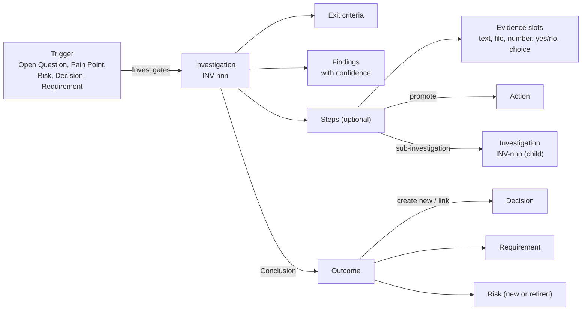
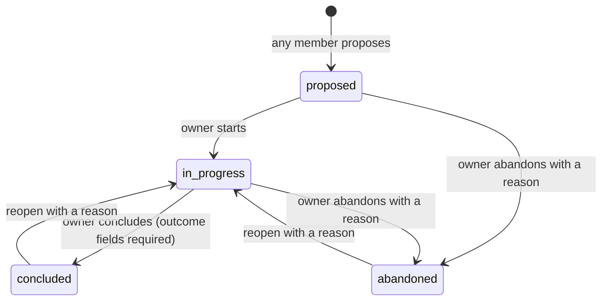
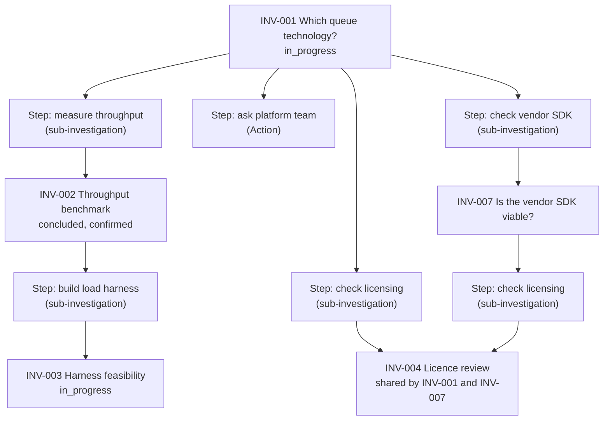

# Module 19 — Investigations (spikes, experiments, root-cause and discovery work) — Plan

**Status:** planned 2026-11-07; Phase 0 signed off 2026-11-07 (section 6), nothing is built. Depends on the navigation-name overrides in [platform-review-2026-11-plan.md](completed/platform-review-2026-11-plan.md) only for renaming; the module works with its built-in name without them. **Decision tags:** every decision says `Decided by: User` or `Decided by: Agent`.

**Source:** user request 2026-11-07 (**Decided by: User**): a module for investigations that interacts with decisions and other records. An investigation has a scope, optional steps and an outcome, and should also cover experiments. It exists because work often needs investigating before it can be implemented or its requirements determined. Existing experiment tools target academia, which this is not for. Added 2026-11-07 (**Decided by: User**): investigations are recursive, so a step of an investigation may itself be an investigation.

See [future-modules-2026-09-index.md](future-modules-2026-09-index.md) for the cross-cutting module architecture and [../modules.md](../modules.md) for the registration contract. Hard-depends on Module 0. Soft dependencies, all through generic links: Decisions ([Module 4](module-04-decision-management-plan.md)), Risk Management, Context & Strategy (Open Questions, Pain Points) and core Requirements and Actions.

## Status / Resume Here

1 / 11 phases complete. Phase 1 is next. Step evidence slots were added 2026-11-07 and signed off the same day (section 6).

| # | Phase | Status |
|---|-------|--------|
| 0 | Design sign-off (section 6) | [x] Complete (2026-11-07) |
| 1 | Skeleton and data model: registration, entitlement, roles, tables, migration (next is 0144) | [ ] |
| 2 | Investigation API: lifecycle, codes, tags, links, search, summaries, audit, record tables, count hook | [ ] |
| 3 | Criteria, findings and steps (with promote-to-Action and sub-investigations) | [ ] |
| 3b | Step evidence slots: typed slots (text, file, number, yes/no, choice), completion gating, skip with reason | [ ] |
| 4 | Conclusion and outcome create-new (Decision, Requirement, Risk, Action); concluding setting; approval advisories | [ ] |
| 4b | Type templates: default criteria, steps (with their evidence slots) and sub-investigation steps applied on create | [ ] |
| 5 | Frontend: list, detail, create and edit forms, panels, evidence slots, type template editor, settings | [ ] |
| 6 | Project and organisation bundles, reports I1–I6, notifications | [ ] |
| 7 | MCP tools and agent skill | [ ] |
| 8 | Seeds, Storybook, Playwright, perf probe and generator, docs website, close-out | [ ] |

## 1. What it is

A time-boxed piece of work whose purpose is to **answer a question**, with the evidence and the answer kept next to the records that depend on it.

Boundary with neighbouring modules (**Decided by: Agent**):

| Record | Role | Relationship to an Investigation |
|--------|------|----------------------------------|
| Open Question | A question nobody has answered | May be answered by one or more investigations |
| Investigation | Produces evidence and a recommendation | Never decides anything |
| Decision | Commits to a choice | Cites investigations as supporting evidence |
| Risk | An uncertain loss | May be retired or confirmed by an investigation |
| Action | A unit of work | A step can be promoted to one; an investigation never replaces the Actions list |

### 1.1 Fields

| On the investigation | Notes |
|----------------------|-------|
| `unique_code` | `INV-001`, from `generate_unique_code`; in the summary label (`"INV-001 title"`). |
| `title`, `question` | The one thing it must answer. `question` is long text and grows. |
| `hypothesis` | Optional free text. Not a separate table (see section 2). |
| `scope_in`, `scope_out` | What is and is not examined. Long text. |
| `investigation_type` | Organisation vocabulary: Spike, Proof of concept, Experiment, Feasibility, Root cause, Requirements discovery (fresh-install seeds). |
| `status` | `proposed` → `in_progress` → `concluded` or `abandoned` (section 3.1). |
| `owner` | A user or a group (principal reference). |
| `due_date` | Calendar date: the person's own day, compared with `effective_today()`. |
| `planned_effort`, `actual_effort` | Hours, optional. Overrun reporting only; no timesheet. |
| `method`, `environment` | How it is done; versions, configuration and data used, so the result can be reproduced or challenged. |
| `started_at`, `concluded_at` | UTC instants set by the transitions. |
| tags, links, comments, attachments | Core mechanisms. |

| Child table | Fields |
|-------------|--------|
| Exit criteria | `text`, optional `metric`, `target`, `observed`, `result` (`met` / `not_met` / `not_assessed`), `position`. One table serves a qualitative spike and a measured experiment. |
| Findings | `summary`, `detail`, `confidence` (`low` / `medium` / `high`), author, UTC time, optional `criterion_id`, attachments, links to what it supports. |
| Step evidence slots | `label`, `slot_type` (`text` / `file` / `number` / `yes_no` / `choice`), `required`, `prompt`, `options` (choice), `unit` (number), `position`. Values: typed value columns, setter, UTC time; files through the core attachment mechanism. See section 3.1b. |
| Steps (optional) | `text`, `status` (plain steps: `not_started` / `in_progress` / `done` / `skipped`), `skip_reason`, `owner`, `position`. A step is exactly one of: plain, promoted to an Action (`action_id`), or a sub-investigation (`child_investigation_id`, not unique, so one investigation can be a step of several parents). A database check allows at most one of the two ids, and a unique index stops the same child being a step of the same parent twice. See section 3.1a. |
| Conclusion (on the record) | `answer`, `result` (`confirmed` / `refuted` / `inconclusive` / `changed_direction`), `confidence`, `recommendation`, `follow_ups`. |

## 2. Challenges to the request (read first)

- **"Experiments" can swallow the module.** Statistics, datasets, protocols and peer review are what academic tools carry and what this product should not. The line: structured criteria with a measured value are in; analysis of the data is out (attach it). **Decided by: Agent.**
- **Hypothesis and exit criteria overlap.** A hypothesis table beside a criteria table makes people fill in both. One criteria table plus an optional free-text hypothesis. **Decided by: Agent.**
- **Steps must not become a second task tracker.** An inline ordered checklist, and a step promoted to an Action when it needs an owner, a due date and a trail. After promotion the Action is the source of truth; the step shows its status read-only. **Decided by: User** (inline checklist with promote-to-Action).
- **Evidence slots can grow into a form builder.** The line: five slot types, a label, a prompt, a required flag, and nothing else. No conditional slots, validation expressions or cross-slot rules, and at most 20 slots per step. Anything richer belongs in an attachment or a finding. **Decided by: Agent** (slots themselves: **Decided by: User**).
- **Recursion invites unbounded trees and a second, parallel "follow-up" idea.** Two relationships are kept distinct: a **sub-investigation** is a decomposition (the parent's answer depends on it, shown as a step) and a **follow-up** is a sequel (a "Related to" link, no dependency). Depth is capped and cycles are rejected at write (section 3.1a). **Decided by: Agent** (recursion itself: **Decided by: User**).
- **No approval gate on conclusion.** A gate would slow quick spikes. Concluding requires the answer, result, confidence and a recommendation, and every criterion assessed or marked not assessed. Segregation of duties is unaffected because an investigation commits nothing; the Decision it informs keeps its own gate. Save and activate therefore applies. **Decided by: User.**
- **Evidence can be mistaken for a decision.** A Decision citing "INV-004 confirmed X" must not auto-approve. Links are information only. **Decided by: Agent.**
- **Telling a Decision about open investigations reaches into the Decisions module.** It is an advisory, not a gate: approving a Decision linked to an investigation that is not concluded shows a warning naming it and still allows approval. It is built as a generic registry hook (`ModuleDefinition.approval_advisories`) that the Decisions approve path consults for every module, never a Decisions edit naming Investigations (section 3.4). **Decided by: User** (advisory).
- **Nesting.** The type vocabulary is a project-scoped definition table: it falls back to the nearest ancestor's rows as Action Types do, with root-only seeding (Q7).
- **Templates can fan out.** A template whose steps create sub-investigations, which have templates of their own, can create many records in one action. Cycles between types are rejected when a template is saved, and a preview, a record cap and a single transaction bound each application (section 3.3). **Decided by: Agent** (templates with sub-investigation steps: **Decided by: User**).

## 3. Design

### 3.1 Lifecycle

- Transitions are audited events through `services/audit.py`; `abandoned` and reopen require a reason. **Decided by: Agent.**
- A concluded investigation is read-only except comments, attachments and links; reopening is the only way to edit it. Step evidence slots and their values lock with it (section 3.1b). **Decided by: Agent.**
- Concluding while any step is incomplete (not done, not skipped, or awaiting evidence) shows a warning listing those steps and still proceeds; it is never refused on this ground. **Decided by: User.**
- Time shapes: `due_date` is a calendar date; `started_at`, `concluded_at` and finding times are past instants in UTC. No scheduled future instants, so no IANA zone is stored. Tests cover 23:00 at UTC-8 and 09:00 at UTC+10 for the overdue rule.

### 3.1a Sub-investigations (recursion)

- A sub-investigation is a full investigation with its own code, owner, criteria, findings, conclusion and lifecycle. It is created from a step ("Add sub-investigation") or an existing investigation is attached to a step. Parents are derived from the steps that point at it; there is no parent column to drift.
- **Many parents allowed** (**Decided by: User**). The structure is a directed acyclic graph, not a tree: INV-004 above answers a licensing step in two parents. `child_investigation_id` is not unique; only the same child twice in the same parent is rejected (a unique index on parent and child), since a second step to the same child adds nothing.
- **No cycles, depth cap of 5.** On create and attach the service rejects an attach when the parent is the child or is reachable from the child through any path of steps, and when the longest chain through the new edge (ancestors above plus descendants below) would exceed the cap. Both use one bounded recursive query. The cap is one named constant and is tested at the limit. **Decided by: Agent.**
- **The step mirrors the child, read-only** (as a promoted step mirrors its Action): `proposed` shows not started, `in_progress`, `concluded` shows done with the child's result and confidence, `abandoned` shows skipped. Each parent's step mirrors it independently. The parent shows a derived count of its direct sub-investigations ("2 of 3 concluded"), computed in bulk and not stored.
- **Concluding a parent** while a direct sub-investigation is `proposed` or `in_progress` is governed by a setting, `allow_conclude_with_open_sub_investigations` (**Decided by: User**). Resolution order: project, nearest ancestor, organisation default, built-in default of **allowed** (the built-in default is **Decided by: Agent**; flag if you want it off). When allowed, a confirmation dialog lists the open sub-investigations and requires a reason, which is stored with the conclusion, shown on it and carried in the audit event. When not allowed, the conclusion is refused with the list and the owner concludes or abandons each first. The setting follows the style guide's settings-hierarchy and platform-default override pattern (Project Admin and organisation admin panels, `(?)` help on every option) and travels in the project and organisation bundles.
- **Abandoning a parent never cascades silently.** The dialog lists open sub-investigations and offers to abandon them too, each audited as its own event. A sub-investigation that another open parent still uses is listed as "also used by INV-nnn" and is not offered for abandonment. **Decided by: Agent.**
- **Removing a sub-investigation step detaches that one link**; the child stays, and stays under its other parents, becoming top-level only if no parent remains. It never deletes the record. An investigation that is a step of another cannot be deleted until detached. **Decided by: Agent.**
- **A change to a shared child notifies the owners of every parent** (concluded, abandoned, reopened).
- **Same project only** (**Decided by: User**). A sub-investigation step can name only an investigation in its own project; the endpoint rejects any other. Cross-project relationships use ordinary links.
- **Lists:** every investigation is a row with a `Parents` column (codes through `<RecordCode>`, none for a top-level one) and a "Level" filter (Top-level means not a step of any other investigation, or All; default Top-level). Export respects the filter. The detail page shows "Used by" (parents) above and sub-investigations below; a shared descendant appears under each parent that uses it.
- **Reads are flat:** the graph around a page is one bounded recursive query returning each distinct investigation once with its edges, never one call per level or per path.

### 3.1b Step evidence slots

A step may define **evidence slots** (**Decided by: User**): named things the person doing the step must supply, for example "Photo of the rig" (file) or "What was observed?" (text).

| Slot type | Value | Satisfied when |
|-----------|-------|----------------|
| `text` | Long text, grows (`TextAreaField`) | Not empty |
| `file` | One or more files, through the core attachment mechanism | At least one file |
| `number` | Decimal with an optional unit | A number is set |
| `yes_no` | Boolean | A choice is made (neither is the default) |
| `choice` | One option from a list defined on the slot | An option is chosen |

- Slot types are a module-local closed list with one validator and one renderer each, so adding one is a single registration. A calendar-date type is deferred because it brings the calendar-date rules (and `effective_today()`) with it. **Decided by: Agent.**
- Each slot has `label` (required, short), `prompt` (help shown at entry), `required` (default true) and a position. An optional slot never blocks completion.
- **Every step kind can carry slots, answered on the parent's step** (**Decided by: User**), including a promoted Action or a sub-investigation, which also keep their own records.
- **Completion gating.** A plain step cannot be marked `done` until every required slot has a value. It can instead be marked `skipped` with a reason, which leaves the slots as they are. A step with no slots can always be marked done.
- **Mirrored steps** (Action or sub-investigation) keep their mirrored status; the Action or child is never blocked by the parent's slots. When the mirrored status is done or concluded but a required slot is empty, the step shows the derived state **Awaiting evidence** and counts as incomplete. A reason entered with "Waive evidence" clears that state, shown as "Evidence waived". Both use `skip_reason`, audited. **Decided by: Agent.**
- **Who:** the step owner, the investigation owner, and anyone allowed to edit the investigation (the same gate as findings); users and groups on parity.
- **Locking:** slot definitions and values are read-only once the investigation is `concluded` or `abandoned`; reopening unlocks them. A done or skipped plain step can be set back to `in_progress`.
- **Editing definitions:** slots can be added, reordered and renamed while the investigation is open. Removing a slot that has a value needs a confirmation and removes its value and file links; changing a slot's type is refused once it has a value.
- **Files** use the one core attachment mechanism with its limits and handling; the owning project is resolved through `ModuleDefinition.resolve_file_owner_project_id` so file access follows project membership.
- **Audit:** setting a value, clearing it, skipping and waiving are audited events carrying the step, slot label and type, never the value, since text and files can be sensitive. **Decided by: Agent.**
- **Search and reports:** text slot values are searchable under one reused key; number, yes/no and choice values are not text fields. Report I6 lists the evidence (section 4).

### 3.2 Links

Link-type seeds (`ModuleDefinition.link_type_seeds`, like the Risk module's):

| Forward | Reverse | Source → target |
|---------|---------|-----------------|
| Investigates | Is investigated by | Investigation → Open Question, Pain Point, Risk, Requirement, Decision |
| Supports | Is supported by | Investigation → Decision, Requirement |
| Retires | Is retired by | Investigation → Risk |

"Related to" and "Derived from" are core defaults. Outcome create-new reuses the Links-panel create-new mechanism (`linkedRecordCreators`) for Decision, Requirement, Risk and Action; no per-module code in a core file.

### 3.3 Type templates

An investigation type can carry a template (**Decided by: User**, including sub-investigation steps). It is copied onto a new investigation at creation; editing a template never changes existing investigations.

| Template part | Notes |
|---------------|-------|
| Exit criteria | Default `text`, `metric`, `target`, `position`. |
| Scope and method text | Starter text for `scope_in`, `scope_out`, `method`, `environment`. |
| Steps | Ordered. Each is **plain** (`text`) or a **sub-investigation** (`text`, `child_type`, optional `child_title`), and either may carry **evidence slots** (label, type, required, prompt, options, unit). A step is never pre-promoted to an Action. Applying copies the slots with the step; their values start empty. |

- **Storage:** child tables of the type row (`investigation_type_template_criteria`, `investigation_type_template_steps`), so templates follow the type's own rules: organisation defaults, project override, **nearest-ancestor fallback** (Q7), hide and restore, and travel with the type in the bundles.
- **Apply on create only,** from the create form's type choice, with a **preview** ("Will create 3 criteria, 5 steps and 2 sub-investigations") before saving. Applying creates the parent and every child in **one transaction**: all or nothing, each child with its own code, audit event and the parent's owner. A child's own type template is applied too, recursively.
- **Bounds:** a template is rejected at save if its sub-investigation steps lead back to its own type through any path of types; one application creates at most 25 investigations and the depth cap of 5 applies, and the preview refuses an application that would exceed either. **Decided by: Agent.**
- **A step naming a type the project has hidden or removed** is created as a plain step and listed in the preview. **Decided by: Agent.**
- **Permission:** the creator needs the permission to create investigations in the project, which also covers every child; nothing reaches another project.
- **MCP and CSV:** MCP create takes `apply_template` (default true). CSV import never applies a template (a row creates one investigation, as its columns say).

### 3.4 Approval advisories (generic hook)

- `ModuleDefinition.approval_advisories`: a module registers a provider per target artefact type, `provider(db, record) -> list[Advisory]` (`Advisory` carries a record code, a label key and a status). A shared registry function `collect_approval_advisories(db, artefact_type, record)` is what an approval path calls; it names no module.
- The Decisions approve path calls it before approval and the approve dialog shows the advisories with a confirm; approval is never blocked by an advisory. The approve audit event carries the advisory codes (codes only). First provider: Investigations, for `decision`, listing linked investigations (`Investigates` or `Supports`, either direction) that are `proposed` or `in_progress`. Other approval paths can adopt the hook later.
- An advisory does not weaken the approval control (it adds information, removes nothing), and `docs/decisions.md` records that with the SOC 2 change-management review. **Decided by: Agent.**

### 3.5 Cross-cutting obligations (all through `ModuleDefinition`)

- Code, summary provider, search provider (`question`, `scope_in`, `method`, `description`-style keys reused), comments searchable on request; never a Restricted column.
- `RecordTableProvider` with `count`, CSV in/out with `code` first, import creates drafts (`proposed`) only and never a status.
- Project and organisation bundle hooks: criteria, findings (with confidence and times), steps, type vocabulary with its templates and hidden defaults, the concluding setting, links by portable key; a round-trip test. The organisation level carries the type defaults, their templates and the setting's default.
- Type vocabulary through `TypeVocabulary` with hide and restore of organisation defaults (`ProjectTypeVocabularyPanel`) and the nearest-ancestor fallback of `resolve_effective_action_types`; seeded on root projects only.
- Roles through `ModuleRoleDefinition`: `investigation_contributor` (any member can propose and add findings), `investigation_lead` (owns and concludes any), `investigation_admin` (vocabulary). Owner may be a user or a group, effective group membership as `services/rbac.py` resolves it.
- Notifications through `notification_types`: due soon, overdue, concluded (to linked Decision owners), reopened.
- `scaling_probes`, `perf_generators` (criteria, findings and steps populated as the create path populates them), `mcp_tools` with `mcp_guidance`.
- Frontend: `TierAModuleDefinition` with `artefactPaths`, `entityAccentColor` literal pair, `help.ts` copy; create form has `QuickLinkField` and `TagField`, `RecordHeader` `back`, `ListPageLayout`, `ProjectScope`.

## 4. Phase specs

### Phase 1 — Skeleton and data model
- **Why:** everything else needs the tables and registration. **Risk:** per-module edits in core (enum, stylesheet, counter). **Outcome:** `ModuleDefinition`, entitlement, roles, tables `investigations`, `investigation_criteria`, `investigation_findings`, `investigation_steps`, `investigation_step_slots`, `investigation_step_slot_values`, `investigation_types` (with the template tables, including template slots), the concluding setting through the module's settings registration (confirm the mechanism first); `artefact_type="investigation"` as a plain registered string; migration 0144 (re-check the maximum across both migration directories first). Nested-projects decision (fallback, root-only seeding; **Decided by: User**, Q7) recorded in `docs/decisions.md`, and the type-vocabulary fallback built with the table, not afterwards.
- **Tests:** registry tests (boundary, bundle hooks or reasons, search, record table), migration up and down.

### Phase 2 — Investigation API
- **Why:** the record must exist before its parts. **Outcome:** CRUD with version lock, transitions, owner as principal, list through `ProjectScope`, tags filter, `unique_code`, audit events, summary, count hook, global search provider.
- **Tests:** transition table, permission matrix (user and group owners), cross-project isolation, code uniqueness under concurrency.

### Phase 3 — Criteria, findings and steps
- **Why:** these carry the evidence. **Risk:** per-row queries on lists; promoted steps drifting from their Action; cycles and runaway depth. **Outcome:** child endpoints; bulk reads for lists; promote-to-Action through the core create path with the link made; sub-investigation create and attach with the ancestor walk and depth cap; step status mirrors the Action or child.
- **Tests:** scaling probe flat across sizes, with nested records at two sizes; a promoted step follows its Action's status; a sub-investigation step follows its child; cycle (self, two-level, three-level) rejected; depth 5 accepted and 6 rejected; a second parent accepted and the same child twice in one parent rejected; a cycle through a shared child rejected; detach from one parent keeps the child under the other; delete refused while attached; concluding with an open child refused; abandon dialog excludes a child used by another open parent.

### Phase 3b — Step evidence slots
- **Why:** a step marked done is a claim; a photo, a report or a written outcome is the evidence, and the person completing the step should be told what is expected. **Risk:** drift into a form builder, per-row queries, evidence files readable by non-members, a value leaking into the audit log. **Outcome:** slot and value endpoints with one validator per type; completion gating and skip with reason; the derived Awaiting evidence state and waive; file slots through the core attachment mechanism with `resolve_file_owner_project_id`; locking on conclude; the 20-slot cap; bulk reads of slots and values for step lists and the detail page.
- **Tests:** each type's validation (empty, wrong type, option not in the list, unit); done refused with a missing required slot and allowed with only optional ones missing; skip needs a reason; a mirrored step shows Awaiting evidence while its Action or child is done, then clears on fill or waive; the Action or child is never blocked; definitions and values locked after conclude and unlocked on reopen; removing a slot with a value needs confirmation and removes its file links; type change refused with a value; a user from another project cannot fetch a slot file; audit events carry label and type only; scaling probe flat with slots and values at two sizes.

### Phase 4 — Conclusion and outcome
- **Why:** the point of the module. **Risk:** concluding with empty fields; evidence read as a decision; a Decision approved unaware of open evidence; touching Decisions with module-specific code. **Outcome:** conclude endpoint validating the required fields, applying `allow_conclude_with_open_sub_investigations` (confirmation and reason when allowed) and returning the incomplete steps as a warning the client confirms; outcome panel with create-new beside the link picker; `Supports`/`Retires` links; the generic `approval_advisories` hook, its consumption in the Decisions approve path and dialog, and the Investigations provider (section 3.4). SOC 2 change-management review (identify, verify, remediate) recorded in `docs/decisions.md`.
- **Tests:** conclude with an incomplete step (not done, awaiting evidence) returns the warning and succeeds once confirmed, and is never refused for it; conclude rejected with each field missing; reopen resets nothing but status; no approval state changes on a linked Decision; setting resolution (project, ancestor, organisation, built-in) and both branches (refused with the list; confirmed with reason, stored, audited); advisory listed for an open linked investigation in either link direction, absent once concluded, approval still succeeds, advisory codes in the audit event, no import of the module from the Decisions code.

### Phase 4b — Type templates
- **Why:** repeatable procedures (a standard feasibility or root-cause shape) should not be re-typed. **Risk:** runaway fan-out, partial creation, hidden types. **Outcome:** template tables and endpoints on the type row, with evidence slots on template steps copied to the new steps (values empty); preview endpoint; apply on create in one transaction with the cycle check at save, the 25-record cap and the depth cap; unavailable child types become plain steps; MCP `apply_template`.
- **Tests:** template round trip through the effective type list (own, ancestor fallback, hidden default); a template cycle (self, two-type, three-type) rejected at save; cap and depth refusals create nothing; a failure part-way rolls back every record; children get distinct codes, audit events and the parent's owner; a hidden child type yields a plain step; editing a template leaves existing investigations unchanged.

### Phase 5 — Frontend
- **Why:** reachable and readable output. **Outcome:** list, detail with criteria / findings / steps / outcome sections, "Used by" and sub-investigation panels, "Add sub-investigation" on a step, Parents column and Level filter, forms sharing one field group between create and edit, `FormActions` with Save and activate, `(?)` help on every non-obvious field, label maps for status, result and confidence; evidence slots on a step (a slot list with an editor, a typed input per slot, a file drop area, the Awaiting evidence, Skipped and Evidence waived states, and the skip and waive reason dialogs), the incomplete-steps warning on conclude; the type admin with its template editor (on the shared `ProjectTypeVocabularyPanel` shape) and the create form's template preview; the concluding setting panels (project and organisation) and the confirmation dialog; the advisory list in the Decision approve dialog (a generic component).
- **Tests:** Storybook stories for every new component; Playwright covering create, create from a template with a sub-investigation, fill a text slot and upload a file slot, blocked done then skip with reason, add finding, conclude (both setting values), create-new Decision, approve a Decision with an open linked investigation, reopen.

### Phase 6 — Bundles, reports, notifications
- **Reports** (each lists `record_types=("investigation",)`, names records through `ReportContext.code`):

  | # | Report | Content |
  |---|--------|---------|
  | I1 | Investigation register | Question, type, owner, status, due, result |
  | I2 | Overdue and stale | Past `due_date` (caller's day), or `in_progress` with no finding for n days |
  | I3 | Decision evidence | Each Decision with its supporting investigations and confidence; Decisions with none |
  | I4 | Open unanswered questions | Open Questions with no concluded investigation |
  | I5 | Outcomes by type | Result counts by type, effort planned versus actual |
  | I6 | Step evidence | Per investigation and step: slot label and type, value (or file names), who and when (UTC), skipped or waived reasons; steps awaiting evidence |

- **Recursion in bundles and CSV:** a step carries its child by portable key and a bundle imports children before parents (a cycle or a depth over the cap is rejected). The CSV has a `parents` column (codes, semicolon-separated) that is **export-only**, like the instants, because creating a step from a cell has no step text to take; structure is edited in the UI, the API and bundles. **Decided by: Agent.** Report I2 gains a "stalled by sub-investigation" column; I5 counts top-level and sub-investigations separately, a shared one once.
- **Evidence in bundles:** slot definitions, values and skip reasons travel with the steps; slot files go through the bundle file mechanism (`export_file_links` / `import_file_links`); setter and time are information only and an import never invents a setter. Report I2 gains a "steps awaiting evidence" count.
- **Types and settings in bundles:** type rows carry their templates (steps name their child type by portable key) and the hidden organisation defaults; the setting travels at both levels.
- **Tests:** bundle round trip (project and organisation) with a three-level graph that includes a shared child, a template with a sub-investigation step and evidence slots (values and a file) and the setting, CSV export of `parents` ignored on import, one test per report.

### Phase 7 — MCP and skill
- **Outcome:** tools to list, get, create (with `apply_template`), add a finding, add or attach a sub-investigation, define a slot and set a text, number, yes/no or choice slot value (file slots through the existing attachment tooling if the core has it; confirm in this phase), conclude (taking the confirmation reason where the setting requires it); guidance in `mcp_guidance.md`; run `generate_mcp_module_tools_reference.py`. **Tests:** `test_mcp_skill_reference.py` passes unchanged.

### Phase 8 — Seeds, docs, close-out
- **Outcome:** demo and e2e seeds (one concluded and linked to a Decision, one overdue, one abandoned, one with filled text and file slots, one awaiting evidence, one with a waived step); perf generator populating slots, values and file links as the create path does; docs website page with Mermaid diagrams (lifecycle, link map); `docs/modules.md`, `docs/solution-architecture.md`, README, decisions log, glossary terms; perf generator ratio in `perf/datasets/profiles.yaml` (bump `version`); `check_doc_links.py` passes.

## 5. Standing checklist per phase

- Run the backend and frontend suites one `pytest` at a time; no state shared between tests.
- Every function, class and file documented per `CLAUDE.md`; no plan references in source.
- Module boundary: no import of `modules/investigations/` outside its own files and the two registries; no new core enum, `Record` or stylesheet entry.
- Core registrations present: code, summary, label, search, record tables, bundles, tags, quick links, `ProjectScope`, scaling probe, perf generator.
- Users and groups on parity for every person field; nested-projects decision recorded.
- Formal wording in every label; enum values through label maps.
- `mypy`, lint and doc-link checks at zero.

## 6. Decisions

| # | Question | Decision | Decided by |
|---|----------|----------|------------|
| Q1 | Approval gate on conclusion | None; required outcome fields enforced instead; Save and activate allowed | User |
| Q2 | Steps | Inline optional checklist; a step can be promoted to an Action | User |
| Q3 | One module or one per type | One module with an organisation-definable type vocabulary | Agent |
| Q4 | Hypothesis | Optional free text; exit criteria carry the measurable part | Agent |
| Q5 | Decision and open investigations | Advisory warning on approval, never a gate, through a generic `approval_advisories` registry hook (section 3.4) | User (hook design: Agent) |
| Q6 | Organisation-owned investigations | Project-owned only in v1 | User |
| Q7 | Type vocabulary in nested projects | Fall back to the nearest ancestor as Action Types do; root-only seeding | User |
| Q8 | Per-type templates | In v1 (against the Agent's recommendation to defer) | User |
| Q8a | Template contents | Criteria, scope and method text, and steps that are plain or sub-investigations of a named type, applied recursively (section 3.3) | User (bounds, preview, plain-step fallback: Agent) |
| Q9 | Module name in the UI | Built-in name "Investigations"; a project or organisation renames the navigation entry, title, breadcrumb and back link through the navigation-name overrides (`nav_label_overrides`) | User (built-in name: Agent) |
| Q10 | Recursion | A step may be a sub-investigation; an investigation may be a step of several parents (acyclic graph); depth cap 5, step mirrors the child, abandon never cascades silently (section 3.1a) | User (cap, mirroring and abandon rules: Agent) |
| Q11 | Sub-investigation in another project | Same project only | User |
| Q12 | Concluding a parent with open sub-investigations | A setting (project, nearest ancestor, organisation default, built-in); when allowed, confirmation and a reason are required (section 3.1a) | User (resolution order and built-in default of allowed: Agent) |
| Q13 | Step requirements | Named evidence slots per step, each with a type; five types in v1 (text, file, number, yes/no, choice), date deferred (section 3.1b) | User (types beyond text and file, limits, no form-builder features: Agent) |
| Q14 | Step kinds that can carry slots | All kinds, answered on the parent step; mirrored steps show Awaiting evidence and never block the Action or child | User (derived state and waive: Agent) |
| Q15 | Unfinished steps | A plain step cannot be done until required slots are filled but can be skipped with a reason; concluding with incomplete steps warns and proceeds | User |

## 7. Risks

| Risk | Mitigation |
|------|------------|
| Scope creep toward a lab notebook | Section 2 boundary; attach data, do not analyse it |
| Overlap with Actions and Decisions | Boundary table in section 1; promote-to-Action; links are information only |
| Spikes never conclude | Due date, overdue report I2, stale rule, notifications |
| Evidence read as approval | No status change on linked records; test in Phase 4 |
| Per-row queries in lists and exports | Bulk reads; scaling probe from the start |
| Core boundary drift | Section 5 checklist; registry tests |
| Deep or cyclic graphs, or one shared child changed under several parents | Depth cap, reachability check on write (also for bundle import), bounded recursive read of distinct nodes, notifications to every parent owner |
| A parent stuck open behind a forgotten child | Q12 setting, report I2 column, notification to the parent owner when a child concludes or is abandoned |
| Slots become a form builder | Five types and no logic; 20-slot cap; richer needs go to findings and attachments |
| Evidence files or text readable by the wrong people, or copied into logs | Project-scoped file ownership hook; audit carries label and type only; cross-project access test; the search text is never logged |
| Steps look done while evidence is missing | Awaiting evidence state, report I6, warning on conclude; skip and waive are reasoned and audited |
| A template creates far more records than expected, or loops | Cycle check at save, preview before apply, 25-record and depth caps, one transaction |
| Advisory ignored, so a Decision is approved on unfinished evidence | Advisory codes recorded in the approve audit event; report I3 shows Decisions with open evidence |
| Decisions code coupled to Investigations | Generic registry hook only; a test fails on a module import from the Decisions code |
| Navigation rename does not cover the noun in sentences or the `INV` prefix | Rename scope is navigation, title, breadcrumb and back link only; help text and tooltips say "investigation" sparingly and are checked when the rename lands |
| Group owner left without access | Effective group membership; parity tests |

When the table reads 11/11: move this file to `docs/plans/completed/` and run `scripts/check_doc_links.py` (see `CLAUDE.md` "Plan Lifecycle").
