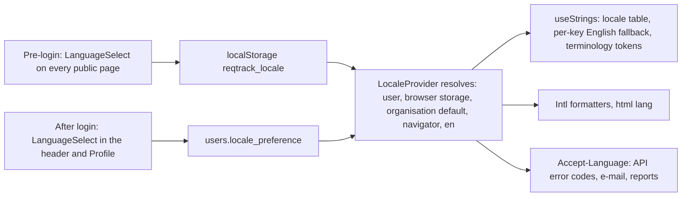

# Multi-Language Support — Plan

**Status:** planned 2026-11-09, not started. **Decision tags:** every decision says `Decided by: User` or `Decided by: Agent`. A question that arises during a phase is asked with `AskUserQuestion`; do not assume. Phase 0 questions Q1–Q5 were answered by the user on 2026-11-09 (see "Phase 0 sign-off"); the Phase 0 spike still has to confirm the mechanism before Phase 1 starts. **Release (Decided by: User):** one release containing the interface, e-mail, reports, export labels and the documentation website; nothing ships until Phase 11 is done. **Docs website (Decided by: User, 2026-11-09):** the documentation website also has translations enabled, starting with Spanish.

**Request (Decided by: User):** the interface can be switched between languages, including the login page. The first language added is Spanish (`es`).

**Authority:** requirement U-U-02 in [../requirements.md](../requirements.md) already asks for an interface that eases translation and excludes dynamic data. This plan builds on it and does not change it.

## Current state (verified 2026-11-09)

- `frontend/src/i18n/strings.ts` (4,326 lines) is one typed English table. `t(locale)` already accepts a locale but only `en` exists. About 50 files import it.
- `useStrings()` (`TerminologyContext.tsx`) walks the whole table and substitutes per-organisation terminology tokens (`{requirement}`, `{Stage}`). Function-valued entries handle plurals in English only.
- Module copy lives in `frontend/src/modules/<key>/help.ts` (six modules).
- Not yet translatable: JSX text literals, `aria-label`/`placeholder` literals (a rough count finds about 390 text literals in `.tsx`), the `*_LABEL` enum maps in `api/types.ts`, 58 `toLocale*`/`Intl` call sites, `<html lang="en">`, and about 490 backend `detail=` messages in 144 files.
- Backend e-mail templates (`backend/app/templates/email/*.jinja`) and generated reports are English only.
- Theme is stored per browser (`localStorage`) and per user (`theme_preference`); language can follow the same two-tier shape.

## Challenges to the request (read before approving)

| # | Challenge | Consequence for the plan |
| --- | --- | --- |
| 1 | "The UI" includes strings that are not in `strings.ts`. Translating only the table would leave a mixed-language product that looks broken. | Phase 3 extracts every literal first and adds a check script (empty baseline) so none can return. |
| 2 | Terminology overrides are English words injected into sentences. In Spanish, an article or adjective must agree with the substituted noun's gender and number (`un proyecto` / `una etapa`), so token substitution produces incorrect grammar. | Phase 2 is a design spike; the answer is recorded before any Spanish text is written. |
| 3 | Exported CSV is also the import file, and enum values use "the label the user sees". A Spanish export would not import for an English user. | Phase 8 makes import accept labels from every supported language. |
| 4 | Spanish copy needs a fluent reviewer. A machine draft is acceptable as a first pass; shipping it unreviewed in a compliance tool is not. | Phase 5 ends with a named human review; no sign-off, no release. |
| 5 | Spanish text runs roughly 20–30 % longer than English; fixed-width buttons, the navigation rail and table headers will overflow. | Phase 1 adds an expanded pseudo-locale used in Storybook and Playwright to find overflow before Spanish exists. |
| 6 | The documentation website has 142 pages, Mermaid diagrams with English labels and screenshots of the English interface. Translating it is the largest single body of text in this plan. | Phase 10 enables the mechanism first so untranslated pages fall back to English, then translates in priority order; the release gate is stated there. |

## Design

- **One registry of languages** (`SUPPORTED_LOCALES`: code, native name, text direction) on the frontend, mirrored by `backend/app/i18n.py`; a test fails if they differ. Adding a language is one table file plus one registry entry. *(Decided by: Agent.)*
- **i18next with ICU message format** (`react-i18next`, `i18next-icu`), one JSON file per locale and namespace, so plurals and gender agreement are written inside the message and translators or translation tools never edit code. Resource types are generated from the English files so a wrong key fails the build, a check lists keys missing from `es`, locale files load lazily by dynamic `import()`, and a missing key falls back to English at run time. The terminology tokens become ICU arguments (per-locale term forms, with `select` for gender). *(Decided by: User — preferred for the long run; a Phase 0 spike confirms the cost and type safety before Phase 1 commits to it.)*
- **Modules contribute their own tables** through a generic field on `TierAModuleDefinition` (and the matching hook on `ModuleDefinition` for backend text), never an edit to `strings.ts` for module copy, per the Modular Feature System Boundary rules. *(Decided by: Agent.)*
- **Never translated:** audit events, log lines, metric labels (SOC 2 evidence must read the same everywhere), the MCP server and its agent skill (agent-facing), and user-authored dynamic data (U-U-02). Each exclusion is recorded in `docs/decisions.md`. *(Decided by: Agent.)*

## Phase 0 sign-off (answered 2026-11-09)

| # | Question | Answer | Decided by |
| --- | --- | --- | --- |
| Q1 | Spanish variant and register | Neutral international Spanish (`es`), formal `usted`, consistent with the Formal Wording rule | User |
| Q2 | Mechanism | `i18next` + ICU, subject to a Phase 0 spike that measures migration cost and type safety; if the spike shows it is unworkable, return to the user with the findings before falling back | User |
| Q3 | Organisation default language | Yes (Phase 4); carried in the organisation bundle | User |
| Q4 | Backend messages | Stable error `code` plus parameters, translated in the browser; English `message` stays as fallback | User |
| Q5 | First-release scope | Everything in one release: interface, e-mail, reports and export labels | User |

## Status / Resume Here

0 / 12 phases complete.

| # | Phase | Notes | Status |
| --- | --- | --- | --- |
| 0 | i18next + ICU spike and terminology rule | Q1–Q5 answered; migrate the login strings and terminology tokens to prove cost and type safety; decide how tokens agree in gender and number; record in `docs/decisions.md` | [ ] |
| 1 | Locale infrastructure | `LocaleProvider`, i18next setup, registry, lazy `es` files, fallback, `<html lang>`, expanded pseudo-locale, missing-key check | [ ] |
| 2 | Language switcher and persistence | `LanguageSelect`, every public page, header, `users.locale_preference` (next migration 0151 after 0150), `PATCH /auth/me` | [ ] |
| 3 | String extraction | 3a shared components, 3b core pages, 3c modules; `scripts/check_i18n_literals.py` with empty baseline | [ ] |
| 4 | Organisation default language | Organisation column, login page default, bundle round trip | [ ] |
| 5 | Spanish translation | Core table, module tables, enum label maps; human review sign-off | [ ] |
| 6 | Dates, numbers, plurals | Central formatters over `Intl`; remove direct `toLocale*` calls | [ ] |
| 7 | Backend messages and e-mail | Error codes, `Accept-Language`, e-mail and notification templates by recipient locale | [ ] |
| 8 | Reports, export and import | Standard-report system text, CSV labels accepted in any language | [ ] |
| 9 | Tests, seeds and Storybook | Playwright, Storybook locale toolbar, seed scripts | [ ] |
| 10 | Documentation website translation | Docusaurus i18n, `es` locale, locale dropdown, translated pages and diagrams, deployment, links from the application | [ ] |
| 11 | Documentation and close-out | Style guide pattern, `docs/modules.md`, website, architecture, decisions, README | [ ] |

## Phase specs

### Phase 0 — i18next + ICU spike and terminology rule
- **Why:** the mechanism was chosen for the long run but its cost against this codebase (function-valued entries, the terminology token walker, the typed `Strings` access in about 50 files) is unmeasured, and token substitution assumes English grammar.
- **Risk addressed:** committing to a migration that loses type safety or stalls, and rework of thousands of strings after a wrong convention.
- **Outcome:** the login page strings and the terminology tokens working through i18next + ICU in a branch of the working tree, with generated key types, a plural, and a gendered Spanish example; a written finding of effort, bundle size, type safety and the call-site pattern (for example `useStrings()` kept as a typed facade over i18next so call sites change little); a recorded rule for tokens (per-locale default terms, locale-keyed organisation overrides, ICU `select` for gender); user confirmation before Phase 1. A gap or a showstopper goes back to the user with the findings.
- **Tests:** the spike's examples become Phase 1 unit tests.

### Phase 1 — Locale infrastructure
- **Why:** every later phase needs one place that decides the active language.
- **Risk addressed:** per-page language handling, and silent loss of a key in a new language.
- **Outcome:** `LocaleProvider` and `useLocale()` over i18next; JSON locale files (`en`, `es`) loaded lazily with per-key English fallback; `useStrings()` stays terminology-aware per locale; `document.documentElement.lang` follows the locale; a pseudo-locale (`en-XA`: accented, 30 % expanded, bracketed) selectable in development builds only; a check fails when `es` lacks a key `en` has (a deliberate allow-list is empty) or the frontend and backend registries differ.
- **Tests:** unit tests for resolution order and fallback; Storybook global locale toolbar.

### Phase 2 — Language switcher and persistence
- **Why:** the request requires switching on the login page and in the application.
- **Risk addressed:** a language chosen before login being lost at sign-in; a shared computer keeping another person's language.
- **Outcome:** one shared `LanguageSelect` (built on `InlineSelect`/`LabeledSelect`, option labels in each language's own name) on `LoginPage`, `OrgLoginPage`, reset-password, invite and self-signup pages, and in the application header and Profile; a pre-login choice is kept in `localStorage` and copied to the user's stored preference at first login only when none is stored; `locale_preference` (nullable, validated against the registry) on `User`, written through the existing profile update, with a migration whose id follows the highest core or module number; the choice is applied immediately without a reload and sent as `Accept-Language` on API calls. A security review confirms the field is not Restricted and that updates follow the existing audit pattern for profile changes.
- **Tests:** backend test (valid, invalid, null); Playwright: switch on the login page, sign in, language persists; switch in the header, reload, language persists; second user unaffected. Storybook for `LanguageSelect`.

### Phase 3 — String extraction (3a shared components, 3b core pages, 3c modules)
- **Why:** an untranslated literal is a defect in every non-English locale.
- **Risk addressed:** a mixed-language interface, and regression as new code is written.
- **Outcome:** every user-visible literal (text, `aria-label`, `placeholder`, tooltip, toast, empty state, document title) moves to the locale files (and `strings.ts` is retired or reduced to the typed facade the Phase 0 spike chose), with each module's copy in its own files; module copy is registered through the new generic extension field; `scripts/check_i18n_literals.py` fails a JSX text literal or accessibility attribute literal outside an allow-list of non-linguistic values, with an empty baseline, run in CI and the pre-commit hook. Existing check scripts (`check_field_help.py`, `check_required_markers.py`) keep passing.
- **Tests:** the check script; Storybook snapshots of each reworked component in the pseudo-locale to detect overflow.

### Phase 4 — Organisation default language
- **Why:** an organisation's login page and its users without a preference should open in that organisation's language (Prefer the Flexible Reading).
- **Risk addressed:** a Spanish-speaking organisation seeing English on its own login page.
- **Outcome:** `Organization.default_locale` (nullable), an organisation setting in the existing settings hierarchy with platform-default visibility, resolution order user → browser storage → organisation default → `navigator.language` → `en`; carried in the organisation bundle.
- **Tests:** backend test; organisation bundle export/import round trip; Playwright for the organisation login page.

### Phase 5 — Spanish translation
- **Why:** the first language.
- **Risk addressed:** incorrect or inconsistent compliance terminology; informal wording against the Formal Wording rule.
- **Outcome:** `es` core table, module tables and enum label maps (`REQUIREMENT_STATUS_LABEL` and the others become locale-aware, with a module registering its own), a glossary of fixed Spanish terms added to `docs/website/docs/reference/glossary.md`, and a fluent reviewer's sign-off recorded in `docs/decisions.md`.
- **Tests:** missing-key check; Playwright smoke across the main pages in `es`; layout check in the longest-string pages.

### Phase 6 — Dates, numbers, plurals
- **Why:** `12/11/2026` means different dates in different locales.
- **Risk addressed:** misread dates and inconsistent formatting.
- **Outcome:** shared `formatDate`, `formatDateTime`, `formatNumber` and relative-time helpers over `Intl` using the active locale; the 58 existing call sites use them; display only, so the time rules are unchanged: past instants stay UTC and are converted in the browser, scheduled times keep their IANA zone, calendar dates stay plain dates, and `X-Client-Date` is unaffected. Plurals are ICU `plural` messages (`es` one/many/other).
- **Tests:** boundary-hour tests (09:00 at UTC+10, 23:00 at UTC-8) formatted in `en` and `es`.

### Phase 7 — Backend messages and e-mail
- **Why:** an API error shown on the login page or in a form must read in the user's language.
- **Risk addressed:** English errors in a Spanish interface; wrong-language security e-mail.
- **Outcome:** user-facing errors carry a stable `code` and parameters beside the English `message` (login, authentication, permission and validation first, then the remainder in batches); the browser translates by code. E-mail, digest and notification templates render in the recipient's resolved locale (user, organisation default, `en`). Audit and log text remain English and never include translated text.
- **Tests:** a test that every code used has an English and Spanish entry; template rendering test per locale; password-reset e-mail in `es`.

### Phase 8 — Reports, export and import
- **Why:** system-generated text in reports and exports is part of the interface; user-authored report content is not (U-U-02).
- **Risk addressed:** a round-trip failure because an exported label cannot be imported by a user in another language.
- **Outcome:** standard-report headings, column names and enum labels follow the requester's locale and, for a saved run, the locale recorded with the run so it reads the same for everyone; CSV export uses the requester's language, and import accepts labels from every supported language through `resolve_export_columns`' shared path, with a test for each registered type's provider; fonts used by the four renderers are checked for Spanish glyph coverage.
- **Tests:** export in `es`, import by an `en` user; each renderer produces accented text correctly.

### Phase 9 — Tests, seeds and Storybook
- **Why:** a feature without end-to-end and Storybook coverage is not done.
- **Risk addressed:** a Playwright suite that assumes English text failing when the locale changes.
- **Outcome:** the Playwright suite pins `en` explicitly; a new spec covers switching; `seed_demo_data.py` creates a Spanish-preference user and `seed_e2e_dataset.py` a persona for the spec; Storybook gains a locale toolbar and a story per switcher state.
- **Tests:** the specs themselves, run alone and out of order.

### Phase 10 — Documentation website translation
- **Why:** the documentation website is part of what a Spanish-speaking person reads; a translated interface that links to English-only help is incomplete.
- **Risk addressed:** a broken or empty page in a locale, English text inside translated pages, and translated pages drifting from the English source.
- **Outcome:** `docs/website/docusaurus.config.ts` declares `es` beside `en` (the file's "no i18n yet" comment is replaced), using Docusaurus's built-in i18n: UI strings from `write-translations`, translated pages under `i18n/es/`, a locale dropdown in the navbar, and a production build per locale. An untranslated page falls back to the English page (verified in this phase, not assumed), with a visible notice on it. Translated: navigation and site chrome, then every page in priority order (introduction, core features, installation, then the rest), Mermaid diagram labels, and image captions; screenshots stay English unless recaptured in `es`, which is recorded as a known limitation. `Dockerfile.prod`, `nginx.conf.template` and the CI `docs` job serve and build both locales, and keep the IPv6 listeners. The application's help links open the page in the active locale. The Spanish glossary from Phase 5 is the single source of terms. A check fails a translated page whose English source changed after it (stale translation list), and `scripts/check_doc_links.py` is extended to cover the `i18n/` folder.
- **Release gate (Decided by: User, 2026-11-09):** untranslated pages may fall back to English with the notice. Release requires the navigation and site chrome, introduction, core features and installation pages translated and reviewed; the remaining pages are tracked on the untranslated and stale list and translated afterwards.
- **Tests:** a build of both locales with no broken links; a Playwright or script check that the locale dropdown switches and keeps the page; a fallback page test.

### Phase 11 — Documentation and close-out
- **Outcome:** a "Pattern: translatable text" in [../ux-style-guide.md](../ux-style-guide.md); an extension-point section in `docs/modules.md`; an architecture note; a docs website page for people (how to switch language) and administrators (organisation default), and a contributor note on adding a language to the application and the website; README known limitations (languages supported, what is not translated); `docs/decisions.md` entries with decision tags; a performance review of the lazy-loaded locale file size; `python scripts/check_doc_links.py` passing; then move this file to `docs/plans/completed/`.

## Standing checklist per phase

- Tests for the change, run one `pytest` invocation at a time; `python scripts/check_mypy.py` at zero findings.
- A new string goes in the table, never inline; a new enum value gets its label in every locale.
- Decision recorded in `docs/decisions.md` with its tag; no plan references in source files.
- Docs website reviewed; seed scripts still run.

## Risks

| Risk | Mitigation |
| --- | --- |
| Extraction (Phase 3) is large and touches most pages | Split into 3a–3c; the check script keeps each step's gain |
| Concurrent feature work adds literals during the effort | The check script lands once extraction is complete with an empty baseline and is never loosened; until then, new code follows the standing checklist |
| Spanish quality | Human review gate in Phase 5; glossary of fixed terms |
| Bundle size of locale files and the i18next runtime | Lazy loading per locale; measured in the Phase 0 spike and again in Phase 11 |
| The i18next migration loses type safety or stalls on the token walker | Phase 0 spike before commitment; return to the user with findings if it fails |
| One release holds back everything until e-mail and reports are done | Phases 7 and 8 are scheduled before testing and close-out; each is independently testable |
| Error code migration is long | Codes added by frequency; English `message` remains the fallback, so partial coverage is safe |

When the table reads 12/12: move this file to `docs/plans/completed/` and run `scripts/check_doc_links.py` (see CLAUDE.md "Plan Lifecycle").
