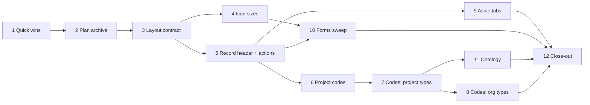

# Platform Review (October 2026) — Plan

**Status:** planned 2026-10-14, from a ten-note user review. Phases 1 and 2 are built. Phase 0 (sign-off) was done interactively on 2026-10-14: Q1–Q14 are answered (section 3), with Q9 (non-button icon scale) deferred to a UX review inside Phase 4. Ready to implement.
**Decision tags:** the ten notes and the answers in section 3 are **Decided by: User**. Every other design choice below is **Decided by: Agent** and can be revisited on the agent's own judgement.

## Status / Resume Here

2 / 12 phases complete (Phases 1 and 2 done 2026-10-14, uncommitted at hand-back). Start with Phase 3.

| # | Phase | Notes | Status |
|---|-------|-------|--------|
| 1 | Neutral report-template label; Help becomes a configurable link; docs site image | N3, N5 | [x] |
| 2 | Archive closed plans, rewrite links, link checker, agent rule | N6 | [x] |
| 3 | Layout contract: `Badge`, no-wrap rule, `ItemRow`, geometry checks | N1, N2 | [ ] |
| 4 | Icon sizes driven by CSS, sweep, check | N9 | [ ] |
| 5 | Shared record header and one object-action menu | N8 | [ ] |
| 6 | Codes I: project codes, org policy, qualified display | N7 | [ ] |
| 7 | Codes II: every codeless project-scoped type, change requests | N7 | [ ] |
| 8 | Codes III: organisation-scoped types | N7 | [ ] |
| 9 | Aside tabs: Links and Activity, one activity endpoint | N10 | [ ] |
| 10 | Forms aligned to the style guide | N7 (forms) | [ ] |
| 11 | Ontology: pull Module 15 Phase 1 forward, module-contributed concept map | N4 | [ ] |
| 12 | Docs website, seeds, README and close-out | all | [ ] |

Codes (6–8) and layout (3–5) touch the same pages for different reasons, so they run one after the other, not in parallel; layout goes first because codes then land in the new shared header once.

**Suggested delivery (Decided by: Agent):** three branches, each reviewable and shippable alone: **A** phases 1–5 (polish and consistency), **B** phases 6–8 (codes), **C** phases 9–12 (activity tab, forms, ontology, close-out). Twelve phases in one branch is the kind of size that stalls review.

## 1. Summary of the review (read this first)

| Note | Verdict | Where I disagree or reshaped it |
|------|---------|---------------------------------|
| N1 Pills | Do it; fix the primitive, not 149 call sites by eye. Answered: centred text, consistent width per use-site, justification set per use (Q1). | There is no pill component: 149 hand-written ``, a plain `.badge` that is `inline-block` with no `nowrap` (hence the two-line pills), inline-style one-offs (white-on-red in Compliance, `marginLeft` hacks), and five look-alike components. Widths will always vary with content; forcing equal widths would waste space and break on custom labels. What must be uniform is height, padding, font and "never wraps". |
| N1b "Pills should also have the text entered" | Answered (Q1) | Meant "centered". Text is centred; width is consistent within one use (for example a status column) and each use chooses left, centre or right justification. |
| N2 Buttons slipping to a new line | Do it; root cause is one CSS default | `.row` is `flex-wrap: wrap` and is used in hundreds of places, and `.artefact-links__row` wraps too. A long title therefore pushes the delete button to line two. Fixing the Links table alone repeats the bug elsewhere. Needs a primitive (`ItemRow`) plus a measured check, plus the directive in the style guide. |
| N3 Report label | Do it; trivial | Also search for other labels that name PDF/Word (one found in `ReportRunner`, its stories and one website page). |
| N4 Ontology | **Already planned** | `module-15-workflows-plan.md` Phase 1 specifies a registry-derived ontology (API, MCP tool, generated `docs/ontology.md`, staleness test). Building a second one by hand would rot. Pull that phase forward, standalone, add the human-facing concept map it lacks, and let modules contribute to both (Q14). See Phase 11. |
| N5 Remove Help, redirect | Do it, with one addition | The product is self-hosted, so a hard-coded GitHub Pages URL breaks air-gapped installs and always shows `main`'s docs, not the deployed version. Make the URL one server setting, default to the site, with an off switch, and ship the docs site as an image so it can be hosted internally (Q3, Phase 1). Also: removing the page lets us drop the `mermaid` dependency if nothing else uses it (to verify). |
| N6 Completed plans | Do it; the cost is the links | Ten closed plans are referenced from 156, 41, 38, 26, 24, 22, 20, 19, 17 and 3 files (including backend docstrings and migration comments). A plain `git mv` breaks about 785 references. Move, rewrite mechanically, and add a link checker so it cannot rot. `CLAUDE.md` already points at a wrong path for the UX audit (`docs/plans/completed/ux-audit-2026-08.md`; the file is under `docs/plans/`). |
| N7 Codes everywhere | Do it; larger than it looks | (a) Ten types have no code: change request, persona, stakeholder, need, stakeholder group, strategy, future state, guiding principle, pain point, open question (compliance types to be classified in Phase 6). Change requests are not even a registered artefact type, and `project_export.py` invents `CR-1…` per export that match nothing stored. (b) Org-scoped types cannot use a per-project counter. (c) **Do not store project codes inside item codes and do not build them from the parent chain** (Q7, Q8): answered as own-code-only, derived at display time. |
| N7b Forms | Do it, all forms (Q13) | About 98 files contain inputs and only 6 use `FormGrid`. You chose every form, including one- and two-field ones, so the phase is the largest after codes; it is batched so it can pause. |
| N8 Object actions | Do it; answered: record header, always a menu (Q4, Q5) | The Links panel lives in the aside, which collapses at 1280px+ and stacks under the content below it. A menu there disappears or moves to the page bottom. Put it in the record header, always visible, one position at every width. Also build a shared header: every detail page hand-builds its own `<h1>` row. |
| N9 Icon sizes | Do it; enforce in CSS | About 224 icons are `size={14}`, 65 are 16, 10 are 12, plus one each of 13 and 18. About 75 14px icons sit in medium buttons, where the guide says 16px (including the pencil on every detail page). Reviewing 84 files by eye regresses; sizing by CSS from the button class makes the rule structural. The scale for icons outside buttons is deferred to a UX review (Q9). |
| N10 History/activity in the aside | Do it, as Tabs; Activity is a timeline (Q12) | Tabs are the style guide's pattern for views of one object. The aside is 340px wide, so the full version *table* cannot go in it; the aside gets the activity timeline and the table stays in the page body. Only requirements and change requests have a per-record activity endpoint today, and module records' audit coverage is unverified (Phase 9a). |

### Interpretation of imprecise wording (CLAUDE.md: inputs may be casual)

- **"Pills"** = the `.badge` family (status, type, role, scope, warning chips), not removable chips.
- **"Slip to a new line"** = a control that sits beside text and wraps below it when the text is long. Wrapping is correct only when the *container* is narrower than the controls alone.
- **"Object action"** = an action on the whole record that is not a workflow step: Edit, Archive/Restore, Delete permanently, Export, Subscribe. **Workflow transitions** (Submit, Approve, Reject, Retire, Withdraw) are different: they depend on status and stay visible beside the status.
- **"Project codes … nested"** = each project gets its own short code used to qualify item codes; confirmed it does not concatenate down the tree (Q7).
- **"Forms"** = every create/edit form in a Modal, SidePanel or inline card, whatever its field count (Q13).

## 2. Findings that were not in the notes

- `CLAUDE.md` and `docs/ux-style-guide.md` link to `docs/plans/completed/ux-audit-2026-08.md`; the file is `docs/plans/completed/ux-audit-2026-08.md`. Fixed by Phase 2's link checker.
- The style guide's token table still lists `--color-entity-compliance` as a core variable; `theme.css` says it was removed (module boundary). The table is stale. Fixed in Phase 12.
- `RecordLifecycleControls` (archive, retire) lives in `frontend/src/modules/stakeholders/` but other modules need the same control. It moves to `components/` in Phase 5 (module-boundary rule: shared code must not live in one module).
- The style guide's "Not yet migrated" paragraph says to migrate pages "when next touched, not as a drive-by". N7b supersedes that for forms; Phase 10 updates the paragraph.

## 3. Decisions (answered 2026-10-14, **Decided by: User** unless marked)

| # | Question | Answer |
|---|----------|--------|
| Q1 | "Pills should also have the text entered" | Meant **centred**. Pill text is centred. Width is consistent for where a pill is used, and each use sets its justification (left, centre or right). |
| Q2 | Pill label too long for its width | **Allow wrapping to two lines.** *Agent refinement:* pills stay on one line up to a maximum width (about 20 characters) and only beyond it wrap, centred, to at most two lines, so ordinary pills never change height. Past two lines, truncate with a Tooltip. |
| Q3 | Help target | **Server setting, default to the docs site.** Plus an env var to **disable** the link when there is no internal mirror and no wish for an external link. Plus **build the docs site as an image in the pipeline** so it can be hosted internally (Phase 1). |
| Q4 | Object-action menu location | **Record header** (not above the Links panel). |
| Q5 | Single object action | **Always the menu.** Recorded as a stated exception to the `ActionMenu` two-or-more floor. Edit stays a visible pencil. |
| Q6 | Project-code policy | **Kind + length + auto/manual.** New codes only; existing never rewritten. |
| Q7 | Child project prefix | **Its own code only.** Nesting shown by breadcrumb. |
| Q8 | Qualified code display | **Always shown outside the record's own project.** Inside it: an org setting "enforce project code everywhere" (default not enforced) forces it on; when not enforced, each user's preference decides (default on). |
| Q9 | Icon scale outside buttons | **Not set now.** A proper UX/UI review decides it (Phase 4). |
| Q10 | Change requests as an artefact type | **Yes.** Registered and linkable; reverses the earlier agent reading. |
| Q11 | Codes for organisation-scoped records | **Org code prefix too** (for example `ACME-PER-001`), so organisations need a code as well as projects. |
| Q12 | Activity tab content | **Timeline of audit events, versions and link changes.** The full version table stays in the page body. |
| Q13 | Forms in scope | **Every form**, including one- and two-field forms. |
| Q14 | Ontology | **Pull Module 15 Phase 1 forward, with a hand-written concept map, and make both contributable by modules** so future modules extend them without core edits. |

## 4. Phase specs

Every phase also carries the standing checklist (section 5); only phase-specific items appear below.

### Phase 1 — Quick wins and the docs site image (N3, N5)

**Why:** two small defects that cost nothing to fix. **Risk addressed:** a label that will be wrong the day a third export type exists; two help systems that drift. **Outcome:** neutral wording; one help source.

- **Label:** `ReportRunner.tsx` "Branding template (PDF and Word)" becomes "Branding template". Update its three stories, the website page `context-strategy-module/reports.md`, and the decisions-log text that quotes it only if it is describing current behaviour. Search `frontend/src` and `docs/website/` for any other label naming an output type.
- **Help:** add `HELP_URL` (default the GitHub Pages site) and `HELP_ENABLED` (default true; false removes the header icon and makes `/help` render a plain "Help is not configured" page) to `backend/app/config.py`, expose both through the existing public config/branding payload (check which at build time), and document them in `docs/website/docs/installation-deployment/configuration-reference.md`. `Layout.tsx` header icon becomes an external link (`target="_blank" rel="noopener noreferrer"`, accessible name says it opens a new tab). `/help` redirects (`window.location.replace`) for old bookmarks when enabled. Both settings are server-wide, not per-organisation (Agent; revisit if an org needs its own).
- **Docs site image (Q3):** a production image for `docs/website/` (static build served by nginx, non-root, health check; the existing `docs/website/Dockerfile` is a dev-only `docusaurus serve` preview and stays for the test stack). `docusaurus.config.ts` takes `url` and `baseUrl` from build args/env (defaults unchanged for GitHub Pages) so an internal build can be served at `/docs/` behind the same reverse proxy or on its own host. CI's `docker-build` job builds it and pushes it to ghcr alongside the app images, tagged with the same version, so internal docs match the deployed version. Compose gets an optional `docs` service in a profile, and `docs/deployment.md` plus the website's installation pages explain "host the docs internally, then set `HELP_URL`". The `docs` CI job already fails on broken links; the image build reuses its output rather than rebuilding differently.
- **Tests (docs image):** CI smoke test that the image serves the home page and a nested page at the configured base path; backend test for both settings; the Playwright header-link step covers enabled and disabled via the e2e stack default (enabled).
- **Remove:** `HelpPage.tsx` and stories, `frontend/src/help/*.md`, the import in `App.tsx`. Before deleting, diff the six help files against the website's concept pages (roles, lifecycle, change requests, reports, user access) and move anything missing. Check whether `mermaid` is used elsewhere (`utils/markdown.ts` special-cases mermaid blocks only for the help page); if not, drop the dependency with `frontend/scripts/sync-lockfile.sh` and delete the dead branch in `markdown.ts`.
- **Tests (Help link):** replace the `preferences-and-theme.spec.ts` step that expects `/help` (assert the link's `href` and `target` instead; do not follow it); a story that `/help` redirects.

### Phase 2 — Archive closed plans (N6)

**Why:** `docs/plans/` mixes 28 files, 10 of them finished; an agent or person cannot tell what is live. **Risk addressed:** stale plans read as current; broken references after a move. **Outcome:** `docs/plans/completed/` holds closed plans; every reference still resolves; the move is a standing rule.

- **Closed now (verify each "N / N complete" line before moving):** `compliance-module-plan`, `core-fine-grained-access-control-plan`, `docs-website-plan`, `module-00-platform-foundations-plan`, `module-01-context-and-strategy-plan` (20/20), `module-03-risk-management-plan`, `platform-enhancements-2026-10-plan`, `platform-review-2026-09-plan`, `react19-eslint10-upgrade-plan`, `users-and-groups-parity-plan`. **Stay:** `module-02` (3d open), `module-04` (Phase 7 blocked), modules 5–15, indexes, `resource-profiling-plan`, `ux-audit-2026-08.md` (living roadmap), `Compliance_Module_Requirements.md` (requirements input, not a plan), `engineering-design-vs-decisions.md`.
- **Rewrite:** `git mv`, then one script that rewrites `docs/plans/<name>.md` to `docs/plans/completed/<name>.md` across docs, backend and frontend comments, `CLAUDE.md`, memory, and fixes the moved files' own relative links (`../x.md` becomes `../../x.md`). Alembic migration edits are comment-only. Review the diff by file count and a grep for any remaining old path.
- **Link checker:** `scripts/check_doc_links.py` validates relative Markdown links and `docs/…` paths in Markdown and in code comments; run in CI and as a pytest so a future move cannot silently break references. It also catches the existing `docs/plans/completed/ux-audit-2026-08.md` error.
- **Agent rule:** add to `CLAUDE.md`: "When the last phase of a plan is done and its Status table reads N/N, `git mv` it to `docs/plans/completed/`, run `scripts/check_doc_links.py`, and update the memory index." Write the same rule into the plan template so new plans carry it.
- **Open-question note:** the memory index lists plan status; update the entries for moved plans.

### Phase 3 — Layout contract: pills and no-wrap rows (N1, N2)

**Why:** pills wrap and vary; controls beside long text drop to a new line, which reads as unpolished. **Risk addressed:** a visual defect class with no structural prevention (the same reasoning as the stat-block rule, which fixed its class with a component plus a geometry check). **Outcome:** one `Badge`, one row primitive, and a measured check that fails when either regresses.

1. **Measure first.** A script (Storybook or Playwright against real pages) records, for every `.badge` and for every `.btn` that is the first item on a second line of its flex container: tag, computed height, padding, font size, line count, page. Output a table into this plan's Phase 3 notes. This is the "measure it" step the button-size pattern asks for and it defines "done".
2. **`Badge` component** (`components/Badge.tsx`): `tone` typed to the five existing tones (`muted`, `info`, `accent`, `danger`, `warning`, plus neutral); text centred (Q1); an `align` prop (`start`, `center`, `end`, default centre) and a `width` choice so a use-site (a status column, a list of statuses) gives all its pills one consistent width (Q1) — implemented as a shared CSS variable the container sets, not a fixed width on every pill; optional icon; one height; `flex: none`; nowrap up to a maximum width, then wrap to at most two lines and truncate with a Tooltip beyond that (Q2). `.badge` CSS gains the same guarantees so any stragglers are safe. Convert the 149 sites (mostly mechanical) and fold in `OverridePill`, `FilterBadge`, `ApplicabilityBadge`, `LinkTraceChip` and the Compliance inline-colour pills where they are the same shape; keep `PrincipalBadge` if it is genuinely a different control (decide in the audit, record why).
3. **Label maps.** While converting, every badge renders through its `*_LABEL`/`*_TONE` map (Principle 12); any raw enum string found is fixed in the same change.
4. **No-wrap directive.** `.btn` gets `flex: none; white-space: nowrap`. New `ItemRow` (`components/ItemRow.tsx`, with an `actions` slot): `flex-wrap: nowrap`, content `min-width: 0` with `overflow-wrap: anywhere`, actions `flex: none`. Use it for the Links panel rows first, then every row/card/table cell the measure step found. `.row` keeps wrapping on purpose for toolbars and filter bars; it is not changed globally (that would break them).
5. **Geometry check** (`frontend/src/testing/orphanedControls.ts` and a Playwright helper `expectNoOrphanedControls(page)`, following `statBlockGeometry.ts`): at 1280 and 1440px, no `.btn` or `.badge` may be the first item on a second line of a flex container, and no `.badge` below its maximum width may span two lines, unless the container opts out with `data-wrap-ok`. Worst-case stories (200-character titles, 40-character status names) for `ArtefactLinksPanel`, `DirectoryTable`, `AlignedRows`, `CappedList`, `RemovableItemList`, every detail page's header; one Playwright spec creates long-titled records through the API (self-cleaning, idempotent) and visits the main lists and details.
6. **Style guide:** new "Pattern: pills" (tones, centred text, per-use width and alignment, one-line-then-two-line wrapping, what is not a pill) and a directive under "Pattern: button sizes" or its own "Pattern: text beside controls": text wraps, controls beside it do not.

- **Tests:** the checks above; a Storybook story per `Badge` tone, per alignment, a shared-width column, and the two-line and truncation cases; existing specs that locate badges by class keep passing (the class stays).

### Phase 4 — Icon sizes (N9)

**Why:** the guide fixes 16px in medium buttons and 14px in small; the code has about 224/65/10/1/1 icons of 14/16/12/18/13px with about 75 mismatches. **Risk addressed:** drift returns after every sweep when size is a per-call prop. **Outcome:** an icon in a button is sized by the button; remaining sizes come from a named scale; a check proves it.

- **CSS first:** `.btn svg { width: 16px; height: 16px }`, `.btn-sm svg { 14px }`, `.badge svg { 12px }`. The CSS beats lucide's `size` attributes, so the fix is immediate and the codemod that removes now-redundant `size` props on icons inside buttons is cosmetic, not load-bearing.
- **Outside buttons (Q9, deferred to a UX review):** before changing any non-button icon, review how icons are used beside text, in pills and chips, in empty states and in spinners (screenshots of real pages at realistic data), propose a scale, and bring it back to you for sign-off. Only then replace the stray 12/13/18 uses (comment attachments, `Info` in `ProjectMembersTable`, `Spinner`) and add the scale to the style guide's Icons section. The CSS-driven button rule above does not wait for this.
- **Check:** `iconSizeViolations()` (computed width of every `svg` inside `.btn`, `.btn-sm`; pills once the scale is signed off) used by the long-text Playwright spec and by Storybook stories for each shared component.
- **Page review:** a table of every page and its result goes into this phase's notes (84 files import `lucide-react`); pages the CSS already corrects are listed as such.

### Phase 5 — Shared record header and object-action menu (N8)

**Why:** each of ~17 detail pages hand-builds its `<h1>` row and places Edit, Archive, Delete, Withdraw differently: Engagement has a "Delete permanently" button at the bottom, Persona, Stakeholder and Need use the bottom `RecordLifecycleControls`, Requirement and Action have a danger-styled Archive button, Decision a plain text Archive button. **Risk addressed:** users cannot learn where actions live; destructive actions at the bottom of a long page are hard to find and easy to hit unintentionally. **Outcome:** one component, one position, one menu.

- **`RecordHeader`** (`components/RecordHeader.tsx`): title or code, secondary line, status badges, the Edit icon button (medium, 16px), the object-action `ActionMenu` (kebab, `triggerLabel` "{Record} actions"), and a `transitions` slot for visible workflow buttons. Pages pass items; the component owns layout so the position is identical at every width.
- **Taxonomy** (goes into the style guide as a table): *Object actions* — Edit (button), Archive/Restore, Delete permanently (Tier-2 confirm), Export, Subscribe, Trace — live in the menu; *transitions* — Submit, Approve, Reject, Retire, Withdraw, Supersede — stay as visible buttons next to the status; *links actions* stay in the Links panel. Each item keeps its confirmation tier, Toast and permission gate; a hidden item for a user without permission, not a disabled one.
- **Migration:** requirement, action, change request, decision, risk, engagement, persona, stakeholder, need, strategy, future state, guiding principle, pain point, open question, plus the compliance record detail. Hoist `RecordLifecycleControls` to `components/` and delete the stakeholders-module copy (extract-and-update-all-call-sites rule). Core pages and modules both use the component; modules never import each other.
- **Style guide:** new "Pattern: record header and object actions" with a Mermaid decision flow; record the Q5 exception to the `ActionMenu` floor (a single object action still gets the menu); update the `ActionMenu` pattern.
- **Tests:** Storybook for the header (long title, many badges, no permissions, mobile); one Playwright spec asserting the menu is in the same position (header row, right edge) on a sample of pages at 375/1024/1440px and that Archive/Restore and Delete work through the menu. Existing specs that click the old Archive/Delete buttons are updated in the same phase (list them first with grep).

### Phase 6 — Codes I: project codes (N7)

**Why:** `REQ-001` exists in every project, so a code is ambiguous the moment records from two projects appear together (parent/child links, org dashboards, search). **Risk addressed:** wrong-record references; no org-wide lookup by code. **Outcome:** each project has an org-policy-valid code; any record can be named unambiguously.

- **Data:** `Project.code` (string, unique per organisation case-insensitively, letters and digits only); `Organization.code` (needed by Phase 8; same charset, and distinct from every project code in that organisation so a qualified code is never ambiguous); org policy per Q6 on `Organization` (a small structured column, not three new columns, so future format options need no migration): `kind` (letters, digits, alphanumeric), min and max `length`, `assignment` (manual or auto), plus `enforce_code_everywhere` (Q8, default false). Migration 0092 (take the max across core and module migration dirs before writing it): backfill existing projects from name initials with collision suffixes, then NOT NULL.
- **Nested projects:** own code only (Q7). The create/edit project form validates against the org policy; a child shows its parent in a breadcrumb. Import and template clone assign a fresh code and report conflicts in the existing import conflict panel.
- **Qualified code** (Q8): `services/codes.py` builds `{project.code}-{unique_code}` and resolves a qualified code back to a record org-wide (split on the first hyphen, valid because project and organisation codes contain none). Serialisers expose `qualified_code`; the stored `unique_code` never changes. Display rule: always qualified outside the record's own project (cross-project and parent/child link lists, trace, search, org dashboards, reports, exports, MCP); inside its own project qualified when the org enforces it, otherwise per the user's preference (new `ui_preferences` key `show_project_code`, default on). One frontend helper applies the rule so no page decides for itself. The org policy form lives in Org Admin with the usual override-visibility pattern.
- **Inventory step (first):** classify every registered artefact type — has code / needs code (project) / needs code (org-scoped) / exempt with a reason (for example compliance assessments that are 1:1 children of a requirement mapping and already carry the standard's own identifier). Record it in `docs/decisions.md`; exemptions need your sign-off.
- **Nested-project check (CLAUDE.md):** `Project.code` is per-project, not a definition table; the org policy is org-level. Not applicable, recorded.
- **Tests:** policy validation (every kind, length bounds, case, hyphen rejected), uniqueness, org-code/project-code distinctness, backfill, qualified round trip, import conflict, cross-organisation isolation, MCP lookup by qualified code, the enforce/preference matrix (enforced on; not enforced with preference on and off) in Storybook and one Playwright spec.

### Phase 7 — Codes II: every codeless project-scoped type (N7)

**Why:** the rule in `CLAUDE.md`; a user cannot name a pain point or a change request in conversation. **Outcome:** every project-scoped type ships `PREFIX-nnn`.

- **Types and proposed prefixes:** change request `CR`, stakeholder need `NEED`, pain point `PP`, open question `OQ`, plus any project-scoped types the inventory finds. Each gets a `unique_code` column unique per project, `generate_unique_code`, a summary label of `"CODE title"`, a backfill that numbers existing rows by creation order and moves the counter past them, and the code in list and detail header (and as a muted suffix in the Links panel).
- **Change requests:** register `change_request` as a core artefact type (Q10). Replace `project_export.py`'s per-export `CR-n` with the stored code; project import numbers records afresh (existing rule). Update the requirement-change-request screens, notifications, history rows and reports to show the code.
- **Tests:** per type — code on create, never reused after archive/delete, race-safe under concurrent creates, backfill order, migration up/down, link-finder and trace show the code.

### Phase 8 — Codes III: organisation-scoped types (N7)

- **Why:** a per-project counter cannot number an org-wide persona. **Risk addressed:** leaving these types codeless indefinitely, the gap `CLAUDE.md` already records. **Outcome:** org-scoped Personas, Stakeholders, Stakeholder Groups, Strategies, Future States and Guiding Principles have codes.
- **Design:** generalise `ProjectSequenceCounter` to a scope key, or add an organisation counter next to it; one `generate_unique_code` entry point takes a scope. Prefixes `PER`, `STK`, `SGP`, `STR`, `FUT`, `GP`. Unique per organisation for org-scoped rows and per project for project-scoped rows of the same type. Per Q11 an org-scoped record is qualified by the **organisation code** (`ACME-PER-001`) wherever a qualified code is shown, a project-scoped one by its project code; the display rule from Phase 6 applies, with the organisation standing in for the project. Org Admin gets the organisation-code field (set once, edit warns that references pasted elsewhere will no longer match). If a record can change scope (check whether any type allows it), define whether it keeps or reissues its code before building.
- **Tests:** as Phase 7, plus scope isolation and cross-organisation rejection.

### Phase 9 — Aside tabs: Links and Activity (N10)

**Why:** the Links aside is liked; history today lives in three different shapes (a bottom table on module pages, a toggle card on requirements, a side list on change requests). **Risk addressed:** inconsistent access to history; an activity endpoint that leaks fields or misses mutations. **Outcome:** one aside with two tabs on every detail page.

- **9a Audit coverage (first, backend):** for every registered artefact type, list the mutating endpoints and confirm each writes an audit event with an `entity_type` that maps to the artefact type. A missing event is a SOC 2 defect (`docs/soc2/policies/`, system operations and change management) and is fixed here, not deferred. Record the outcome in `docs/decisions.md`.
- **9b Endpoint:** `GET /projects/{pid}/records/{artefact_type}/{id}/activity` (paged), authorised exactly as the record itself (reuse the per-type read gate and module-enablement 404 gate, FGAC rules); the generic query merges audit events, version rows and link events; field-level `detail` is filtered through the existing `ChangeEntryOut` projection (no Restricted-classification values). Types register nothing extra if they follow the audit convention; a module that cannot supplies a provider on `ModuleDefinition`. Replaces `requirements/{id}/activity` and `change_requests/{id}/activity`, which become thin delegates until callers move.
- **9c Frontend:** `DetailLayout` aside renders `Tabs` (Links, Activity) when given both; Activity is `ActivityPanel` (bare). The selected tab is a per-viewer preference; the collapse toggle, narrow-screen stacking and `asideLabel` behave as today. The requirement page's History/Activity toggle card, the module pages' bottom version tables (kept as a body section, retitled "Versions") and the change request side list are migrated to this one shape.
- **Style guide:** extend "Pattern: detail page with a links aside" with the two tabs and the rule that wide tables never go in the aside.
- **Tests:** backend — each type's activity includes its own events and none from another record or project, permission and cross-org isolation, hidden fields; Storybook — tabbed aside, collapsed, stacked; Playwright — tab switch and preference persistence on a requirement and a module record.

### Phase 10 — Forms aligned to the style guide (N7b)

**Why:** 98 files contain inputs and 6 use `FormGrid`; you chose every form (Q13); the guide has since gained compact-form, add-on-demand and alignment rules. **Risk addressed:** a sweep with no definition of done. **Outcome:** every in-scope form follows the guide, with a recorded checklist per form.

- **Inventory (generated, you review):** every form regardless of field count, its container (Modal, SidePanel, inline) and the checklist columns below, ordered by traffic. One- and two-field forms get the lighter subset (labels, button and icon sizes, label maps, Toast, accessible names, no needless grid).
- **Per-form checklist:** `FormGrid`/`FormGridFull`; `PrincipalPicker compact` for single owners and `PrincipalListField` for lists; add control on the heading line; `AlignedRows` for repeating rows; `RemovableItemList` and Tier-1 confirm on removal; `CappedList` for unbounded lists; Modal vs Popover (no nested popovers); button sizes and icon sizes (phases 3–4); enum values through label maps; Toast on every mutation; accessible names; Storybook worst-case story.
- **Already known gaps to close:** Persona, Stakeholder and Need edit modals (single column), owner/assignee fields on six module detail pages still using the always-open picker, "other modules' link lists and per-row Remove buttons".
- **Batching:** by area, about eight forms per batch (org admin, project admin, requirements and actions, each module). Each batch ships with its stories and updated specs; the user can stop between batches.

### Phase 11 — Ontology (N4)

**Why:** types, fields, lifecycles and links are spread across registry fields, schemas, enums and seeds; nobody can see how it fits together. **Risk addressed:** a hand-drawn model that drifts. **Outcome:** a generated, current model plus a short map people can read.

- **Reuse, do not redo:** deliver `module-15-workflows-plan.md` Phase 1 (registry-derived service, `GET /api/orgs/{id}/ontology` and project variant, MCP tool `get_ontology`, generated `docs/ontology.md` with Mermaid, staleness test, MCP skill reference). Mark that phase as moved in the module-15 plan, with the date and who decided. Add each type's code prefix and scope (phases 6–8) to the registration so the ontology states them.
- **Module contribution (Q14):** the registration gets generic optional fields (for example an ontology `description`, `lifecycle` and `concept_map` fragment: a short Mermaid snippet plus prose naming the module's place in the whole). Core collects them through the registry; no core file names a module. The generated ontology and the concept map's "modules" section both read them, so installing a module (including a third-party or federated one) extends both automatically. A module that declares an artefact type but no description fails the staleness test, as the MCP-skill rule does for tools. Document the fields in `docs/modules.md` and `building-your-own-module.md`.
- **Concept map (new, small):** the core of it is hand-written; a page in `docs/website/docs/reference/` — organisation, project nesting, the core chain (requirement, change request, action, stage and baseline), the modules by purpose, how links connect any pair, where reports and MCP read from. Mermaid, with the explanatory sentence before each diagram. The generated tables link to it; a test confirms every registered type appears in the generated tables, not in the hand-written map.
- **Out of scope:** OWL/JSON-LD, the workflow designer.

### Phase 12 — Close-out

- Docs website audit for every user-visible change (the label, Help, header and menu, codes, activity tab, forms), retake affected screenshots, README, `docs/solution-architecture.md` (project codes, activity endpoint, ontology), `docs/modules.md` (any new registration fields), `docs/decisions.md` entries with Decided-by tags, style guide updates (list below), memory index.
- Seeds: both seed scripts get organisation and project codes under the org policy, a long-titled record per type for the layout check, and no codeless record.
- Style guide sections added or changed: pills, text beside controls, icon scale, record header and object actions, links aside tabs, form checklist, the stale token-table row.
- Move this plan to `docs/plans/completed/` (Phase 2's rule) when 12/12.

## 5. Standing checklist per phase

- Tests: backend pytest for every backend change (one `pytest` at a time); Playwright and Storybook for every UI change; tests independent and idempotent.
- SOC 2: consult the access-control, system-operations and data-classification policies for phases 6–9 (codes are not Restricted, but the activity endpoint reads audit data); identify → verify → remediate recorded in `docs/decisions.md`.
- Module boundary: no core file imports a module; per-module values (prefixes, accent, scope) come from registrations; Phase 8's counter change is a generic extension, not a per-module edit.
- Users and groups parity: no new person field is introduced; any one found is built for groups too.
- Nested projects: stated per phase where a table is added (none is a definition table).
- Seeds, docs website, README, decisions log, style guide: as listed in Phase 12, but updated in the phase that changes the behaviour.
- Git: the user commits; work is handed back verified.

## 6. Risks

| Risk | Mitigation |
|------|------------|
| Plan archive breaks hundreds of references | Mechanical rewrite, link checker in CI, review by count. |
| Pill/row sweep changes layout in unexpected places | Measure first; geometry check; `.row` is not changed globally. |
| Project-code backfill collides or produces ugly codes | Deterministic collision suffix; admins can edit before the policy is tightened; backfill tested on the demo and e2e datasets. |
| Org-scoped codes leak across organisations | Counter keyed by organisation; cross-org isolation tests. |
| Activity endpoint exposes data or misses events | 9a coverage audit first; reuse the read gate; filtered projection; isolation tests. |
| Header/menu change breaks many Playwright specs | Grep the old buttons up front; update in the same phase. |
| Organisation code collides with a project code, making a qualified code ambiguous | Codes share one namespace per organisation; the uniqueness check covers both; tested. |
| Docs image built with the wrong base path, so internal links 404 | `baseUrl` is a build arg; CI smoke test requests a nested page at the configured path. |
| Forms sweep never ends | Rule-based inventory, signed off; batches; user can stop between them. |
| Scope: this is large | Phases 1–2 ship alone; each later phase is independently shippable; order above is the recommendation, not a dependency chain beyond the arrows. |
