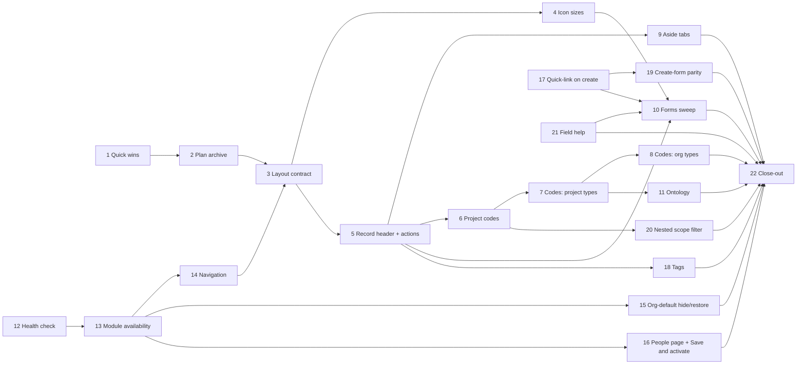
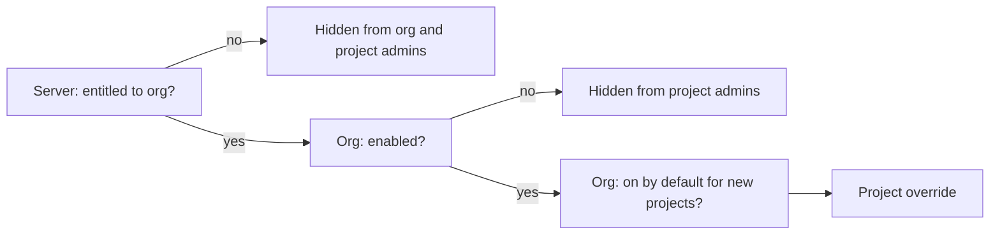

# Platform Review (October 2026) — Plan

**Status:** planned 2026-10-14, from a ten-note user review; extended 2026-10-18 with a second review (fifteen items, N11–N25, Phases 12–21). Phases 1, 2, 3, 4, 5 and 12 are built. Phase 0 (sign-off) was done interactively on 2026-10-14: Q1–Q14 are answered (section 3), with Q9 (non-button icon scale) deferred to a UX review inside Phase 4. Round-two questions Q15–Q24 (section 3b) carry a recommended answer and need sign-off before the phase they gate.
**Decision tags:** the notes (N1–N25) and the answers in section 3 are **Decided by: User**. Every other design choice below is **Decided by: Agent** and can be revisited on the agent's own judgement.

## Status / Resume Here

6 / 22 phases complete (Phases 1 and 2 done 2026-10-14, Phases 3, 4, 5 and 12 done 2026-10-18, uncommitted at hand-back). **Work the phases in table order (user instruction, 2026-10-18).** Phase 3 was built ahead of 12–14 earlier the same day; Phases 13 and 14 are still open and come after Phases 4–11 now. **Next: Phase 6.** The icon scale (Q9) was accepted 2026-10-18 and gets a user review after Phase 21.

| # | Phase | Notes | Status |
|---|-------|-------|--------|
| 1 | Neutral report-template label; Help becomes a configurable link; docs site image | N3, N5 | [x] |
| 2 | Archive closed plans, rewrite links, link checker, agent rule | N6 | [x] |
| 3 | Layout contract: `Badge`, no-wrap rule, `ItemRow`, geometry checks | N1, N2 | [x] |
| 4 | Icon sizes driven by CSS, sweep, check | N9 | [x] |
| 5 | Shared record header and one object-action menu | N8 | [x] |
| 6 | Codes I: project codes, org policy, qualified display | N7 | [ ] |
| 7 | Codes II: every codeless project-scoped type, change requests | N7 | [ ] |
| 8 | Codes III: organisation-scoped types | N7 | [ ] |
| 9 | Aside tabs: Links and Activity, one activity endpoint | N10 | [ ] |
| 10 | Forms aligned to the style guide | N7 (forms) | [ ] |
| 11 | Ontology: pull Module 15 Phase 1 forward, module-contributed concept map | N4 | [ ] |
| 12 | Container health check reports unhealthy on a working install | N11 | [x] |
| 13 | Module availability: new-install defaults, server admin UI, hide unavailable modules | N12, N13, N14 | [ ] |
| 14 | Navigation: ordering, scrollbar, sub-component hiding | N15, N16, N17 | [ ] |
| 15 | Org defaults can be hidden per project and restored (delete plus "add org defaults") | N18 | [ ] |
| 16 | One People page (Personas and Stakeholders) and "Save and activate" | N19, N20 | [ ] |
| 17 | Quick-link on create | N21 | [ ] |
| 18 | Tags on every item type | N22 | [ ] |
| 19 | Create forms accept every field the edit form does (pain point first) | N23 | [ ] |
| 20 | Nested-project scope filter on every list | N24 | [ ] |
| 21 | Field help (?) tooltips | N25 | [ ] |
| 22 | Docs website, seeds, README and close-out | all | [ ] |

Codes (6–8) and layout (3–5) touch the same pages for different reasons, so they run one after the other, not in parallel; layout goes first because codes then land in the new shared header once.

**Suggested delivery (Decided by: Agent; superseded for ordering by the user's 2026-10-18 instruction to work the table sequentially, so branch 0 now comes after A–E's earlier phases):** six branches, each reviewable and shippable alone, in this order. **0** phases 12–14 (defects and the missing module admin UI: ship first, they affect real deployments today). **A** phases 1–5 (polish and consistency). **B** phases 6–8 (codes), then phase 20 (the scope filter shows qualified codes, so it follows phase 6). **C** phases 15–17 and 19 (create/edit conventions: org-default hide/restore, People page, quick-link, create parity). **D** phases 18 and 21 (tags, field help). **E** phases 9–11 and 22 (activity tab, forms, ontology, close-out). Phases 17 and 21 build components the Phase 10 forms sweep then applies everywhere, so they precede it. Twenty-two phases in one branch is the kind of size that stalls review.

## 1. Summary of the review (read this first)

| Note | Verdict | Where I disagree or reshaped it |
|------|---------|---------------------------------|
| N1 Pills | Do it; fix the primitive, not 149 call sites by eye. Answered: centred text, consistent width per use-site, justification set per use (Q1). | There is no pill component: 149 hand-written ``, a plain `.badge` that is `inline-block` with no `nowrap` (hence the two-line pills), inline-style one-offs (white-on-red in Compliance, `marginLeft` hacks), and five look-alike components. Widths will always vary with content; forcing equal widths would waste space and break on custom labels. What must be uniform is height, padding, font and "never wraps". |
| N1b "Pills should also have the text entered" | Answered (Q1) | Meant "centered". Text is centred; width is consistent within one use (for example a status column) and each use chooses left, centre or right justification. |
| N2 Buttons slipping to a new line | Do it; root cause is one CSS default | `.row` is `flex-wrap: wrap` and is used in hundreds of places, and `.artefact-links__row` wraps too. A long title therefore pushes the delete button to line two. Fixing the Links table alone repeats the bug elsewhere. Needs a primitive (`ItemRow`) plus a measured check, plus the directive in the style guide. |
| N3 Report label | Do it; trivial | Also search for other labels that name PDF/Word (one found in `ReportRunner`, its stories and one website page). |
| N4 Ontology | **Already planned** | `module-15-workflows-plan.md` Phase 1 specifies a registry-derived ontology (API, MCP tool, generated `docs/ontology.md`, staleness test). Building a second one by hand would rot. Pull that phase forward, standalone, add the human-facing concept map it lacks, and let modules contribute to both (Q14). See Phase 11. |
| N5 Remove Help, redirect | Do it, with one addition | The product is self-hosted, so a hard-coded GitHub Pages URL breaks air-gapped installs and always shows `main`'s docs, not the deployed version. Make the URL one server setting, default to the site, with an off switch, and ship the docs site as an image so it can be hosted internally (Q3, Phase 1). Also: removing the page lets us drop the `mermaid` dependency if nothing else uses it (to verify). |
| N6 Completed plans | Do it; the cost is the links | Ten closed plans are referenced from 156, 41, 38, 26, 24, 22, 20, 19, 17 and 3 files (including backend docstrings and migration comments). A plain `git mv` breaks about 785 references. Move, rewrite mechanically, and add a link checker so it cannot rot. `CLAUDE.md` already points at a wrong path for the UX audit (`docs/plans/completed/ux-audit-2026-08.md`; the file is under `docs/plans/`). |
| N7 Codes everywhere | Do it; larger than it looks | (a) Ten types have no code: change request, persona, stakeholder, need, stakeholder group, strategy, future state, guiding principle, pain point, open question (compliance types to be classified in Phase 6). Change requests are not even a registered artefact type, and `project_export.py` invents `CR-1…` per export that match nothing stored. (b) Org-scoped types cannot use a per-project counter. (c) **Do not store project codes inside item codes and do not build them from the parent chain** (Q7, Q8): answered as own-code-only, derived at display time. |
| N7b Forms | Do it, all forms (Q13) | About 98 files contain inputs and only 6 use `FormGrid`. You chose every form, including one- and two-field ones, so the phase is the largest after codes; it is batched so it can pause. |
| N8 Object actions | Do it; answered: record header, always a menu (Q4, Q5) | The Links panel lives in the aside, which collapses at 1280px+ and stacks under the content below it. A menu there disappears or moves to the page bottom. Put it in the record header, always visible, one position at every width. Also build a shared header: every detail page hand-builds its own `<h1>` row. |
| N9 Icon sizes | Do it; enforce in CSS | About 224 icons are `size={14}`, 65 are 16, 10 are 12, plus one each of 13 and 18. About 75 14px icons sit in medium buttons, where the guide says 16px (including the pencil on every detail page). Reviewing 84 files by eye regresses; sizing by CSS from the button class makes the rule structural. The scale for icons outside buttons is deferred to a UX review (Q9). |
| N10 History/activity in the aside | Do it, as Tabs; Activity is a timeline (Q12) | Tabs are the style guide's pattern for views of one object. The aside is 340px wide, so the full version *table* cannot go in it; the aside gets the activity timeline and the table stays in the page body. Only requirements and change requests have a per-record activity endpoint today, and module records' audit coverage is unverified (Phase 9a). |
| N11 Health reports unhealthy on another device | Do it first; **not reproduced, one strong suspect** | The app serves, so the failing check is a container health probe, not the app. The frontend probe is `wget http://localhost:3000/health` (BusyBox) while nginx has `listen 3000;` (IPv4 only); on a host where `localhost` resolves to `::1` first, BusyBox `wget` does not fall back and the probe fails for ever while browsers (IPv4 port mapping) work. The repo already hit the same class on the storage service and on the docs image (which uses `127.0.0.1`). Separately, `/health` returns HTTP 200 with `"degraded"` when the database is down, so `curl -f` cannot ever detect that. Diagnose with the real output before changing anything (Phase 12). |
| N12 New installs: every module available | Do it, **as a seeded server default, not a registry flip** | Every module except Compliance has `default_enabled=False` (a deliberate opt-in). Flipping that constant would silently switch modules and nav sections on for every existing deployment on upgrade. Instead: a server-wide default module state table, seeded all-on on a fresh install only, consulted wherever the registry default is today (Phase 13). |
| N13 Server UI for default org module states and per-org availability | Confirmed missing; backend exists | `GET/PUT /system/module-entitlement-policy`, `GET /system/modules` and `GET/PUT /system/orgs/{id}/module-entitlements[/{key}]` exist; the only entitlement strings in the frontend are in Org Admin. There is no Server Management page for any of it, and no endpoint for "default org enabled / project default state" (Phase 13). |
| N14 Hide unavailable modules from admins | Do it; **reverses a recorded behaviour** | `list_org_modules` deliberately returns non-entitled modules so Org Admin can show them greyed. You want them gone: org-disabled modules vanish for project admins; server-disabled (not entitled) modules vanish for org and project admins. Server admins keep the full view. Record the reversal as Decided by: User (Phase 13). |
| N15 Project Admin and History last in the project nav | Do it | Today they sit before the module-contributed items. Ordering becomes: core work items, module items, then Project Admin and History pinned at the end (Phase 14). |
| N16 Nav scrollbar | Do it | The rail scrolls with the browser's native bar, which looks wrong in the dark theme and collides with the fixed collapse toggle. Style the scrollbar from tokens and keep the toggle outside the scroll container (Phase 14). |
| N17 Disabling a sub-component does not remove its nav item | Treat as a bug; root cause not yet known | Module nav entries come from the frontend manifest; the sub-component state is in `GET /projects/{id}/modules`. Either the nav is not filtered by sub-component state or the cached project-module query is not invalidated after the toggle. Reproduce first (Phase 14). |
| N18 Cannot hide an org default (for example pain point types) | Do it, for **every** definition table that has an org version | Today the project delete button only shows a message. Wanted: delete hides the org default in this project, and an "Add organisation defaults" button restores it. This is the same shape in several places (action types, decision types, pain point types, custom fields, statuses, ...), so build one mechanism and make it an agent rule (Phase 15). |
| N19 Personas and Stakeholders as one page | Do it for the **list and create**, not the detail | The two have different fields and lifecycles, so merging detail pages would be a regression. One People list with a type filter and a New ▾ menu; each row opens its own detail page (Phase 16). |
| N20 Save and activate | Do it, **gated on the existing transition permission** | A second button on create for users who may activate. Segregation of duties must not be bypassed: where an approval gate forbids self-approval, the button does not appear. A review of every draft-to-active type decides where it applies (Phase 16). |
| N21 Quick-link on create | Do it; shared component plus a rule | One compact search-and-add field in create forms, backed by an atomic bulk-link call, applied to every create form where linking makes sense (Phase 17). |
| N22 Tags | Do it; **largest item of the second round** | Project-scoped vocabulary, free or restricted by project setting, on every artefact type via the registry; rename, merge, delete, bulk reclassify; filter in every list; per-type usage tables with exclusion filters (Phase 18). |
| N23 Pain point: severity, frequency, confidence on create | Do it, and audit every create form for the same gap | A general class (create form narrower than edit form), so the audit is part of the phase (Phase 19). |
| N24 Nested-project scope filter | Do it; **authorisation is the hard part** | Items from other projects must obey that project's read gate and module enablement; the list must say which project a row is from (Phase 20). |
| N25 Field help tooltips | Do it; component plus a checkable rule | A `(?)` button on every non-obvious field; persona importance weighting is the motivating case (Phase 21). |

### Interpretation of imprecise wording (CLAUDE.md: inputs may be casual)

- **"Pills"** = the `.badge` family (status, type, role, scope, warning chips), not removable chips.
- **"Slip to a new line"** = a control that sits beside text and wraps below it when the text is long. Wrapping is correct only when the *container* is narrower than the controls alone.
- **"Object action"** = an action on the whole record that is not a workflow step: Edit, Archive/Restore, Delete permanently, Export, Subscribe. **Workflow transitions** (Submit, Approve, Reject, Retire, Withdraw) are different: they depend on status and stay visible beside the status.
- **"Project codes … nested"** = each project gets its own short code used to qualify item codes; confirmed it does not concatenate down the tree (Q7).
- **"Forms"** = every create/edit form in a Modal, SidePanel or inline card, whatever its field count (Q13).
- **"Available"** (N12) = a module is *entitled* to the organisation by the server, *enabled* by the organisation, and *on by default for new projects*. These are three existing tiers (`OrganizationModuleEntitlement`, `OrganizationModuleEnablement.enabled`, `.default_project_enabled`); "all available on new installs" means all three default to on.
- **"Org pain points" / "org versions"** (N18) = organisation-level definition rows (pain point types, action types, ...) that a project inherits when it has none of its own.
- **"Active"** (N20) = the state a record reaches when it leaves draft and becomes usable (persona `active`, requirement `approved`, ...), whatever each type calls it; the per-type mapping is in Phase 16's review.
- **"Tags (aka keywords)"** (N22) = free-text labels on a record, not custom fields (typed, structured) and not categories (a fixed type).
- **"Parent" / "children"** (N24) = ancestor and descendant projects along `Project.parent_project_id`; whether that means one level or the whole chain is Q22.

## 2. Findings that were not in the notes

- `CLAUDE.md` and `docs/ux-style-guide.md` link to `docs/plans/completed/ux-audit-2026-08.md`; the file is `docs/plans/completed/ux-audit-2026-08.md`. Fixed by Phase 2's link checker.
- The style guide's token table still lists `--color-entity-compliance` as a core variable; `theme.css` says it was removed (module boundary). The table is stale. Fixed in Phase 22.
- `RecordLifecycleControls` (archive, retire) lives in `frontend/src/modules/stakeholders/` but other modules need the same control. It moved to `components/` in Phase 5 (module-boundary rule: shared code must not live in one module).
- The style guide's "Not yet migrated" paragraph says to migrate pages "when next touched, not as a drive-by". N7b supersedes that for forms; Phase 10 updates the paragraph.
- Round two, module gating: `list_org_modules` returns non-entitled modules on purpose ("Non-entitled modules are included, not filtered out"); N14 reverses this for non-server-admin callers (Phase 13).
- Round two, health: three health probes disagree on the host: frontend and backend/MCP use `localhost`, the docs image uses `127.0.0.1`. Only the frontend can fail on an IPv6-first host, because nginx binds IPv4 only (Phase 12).

## 3. Decisions (answered 2026-10-14, **Decided by: User** unless marked)

| # | Question | Answer |
|---|----------|--------|
| Q1 | "Pills should also have the text entered" | Meant **centred**. Pill text is centred. Width is consistent for where a pill is used, and each use sets its justification (left, centre or right). |
| Q2 | Pill label too long for its width | **Allow wrapping to two lines.** *Agent refinement:* pills stay on one line up to a maximum width (about 20 characters) and only beyond it wrap, centred, to at most two lines, so ordinary pills never change height. Past two lines, truncate with a Tooltip. |
| Q3 | Help target | **Server setting, default to the docs site.** Plus an env var to **disable** the link when there is no internal mirror and no wish for an external link. Plus **build the docs site as an image in the pipeline** so it can be hosted internally (Phase 1). |
| Q4 | Object-action menu location | **Record header** (not above the Links panel). |
| Q5 | Single object action | **Always the menu.** Recorded as a stated exception to the `ActionMenu` two-or-more floor. Edit stays a visible pencil. |
| Q6 | Project-code policy | **Kind + length + auto/manual.** New codes only; existing never rewritten. |
| Q7 | Child project prefix | **Its own code only.** Nesting shown by breadcrumb. |
| Q8 | Qualified code display | **Always shown outside the record's own project.** Inside it: an org setting "enforce project code everywhere" (default not enforced) forces it on; when not enforced, each user's preference decides (default on). |
| Q9 | Icon scale outside buttons | **Not set now.** A proper UX/UI review decides it (Phase 4). |
| Q10 | Change requests as an artefact type | **Yes.** Registered and linkable; reverses the earlier agent reading. |
| Q11 | Codes for organisation-scoped records | **Org code prefix too** (for example `ACME-PER-001`), so organisations need a code as well as projects. |
| Q12 | Activity tab content | **Timeline of audit events, versions and link changes.** The full version table stays in the page body. |
| Q13 | Forms in scope | **Every form**, including one- and two-field forms. |
| Q14 | Ontology | **Pull Module 15 Phase 1 forward, with a hand-written concept map, and make both contributable by modules** so future modules extend them without core edits. |

### 3b. Round-two questions (2026-10-18; recommended answer given, **sign-off needed** before the phase named)

| # | Question | Recommendation (Decided by: Agent until you answer) | Gates |
|---|----------|-----------------------------------------------------|-------|
| Q15 | Existing deployments and "all modules available" | Fresh installs only. An upgrade keeps its current effective states; the new Server page lets an admin apply "enable all" in one action. Avoids switching on modules in live orgs. | 13 |
| Q16 | Does a server default of "all on" also pre-create module rows for new orgs? | No rows: the server default is consulted wherever the registry default is today, so a later change to the default reaches orgs that never overrode it. | 13 |
| Q17 | Hiding an org default in one project: tombstone or copy? | **Tombstone**: a generic `ProjectDefinitionSuppression(project_id, definition_kind, org_definition_id)` row. A copy would freeze the project away from later org changes (the problem the nested-project fallback exists to avoid). "Add organisation defaults" deletes the tombstones. | 15 |
| Q18 | An org default that is in use (for example a pain point type on existing pain points) | Hiding is allowed and only stops new use; existing records keep the value and still display it. Hard delete of a project's own row stays blocked while in use. | 15 |
| Q19 | What does "the various options" in the People New ▾ menu include? | Persona, Stakeholder, Stakeholder Need, Stakeholder Group (each only if its sub-component is on and the user can create it). Needs and groups are listed in the same table with a type column. | 16 |
| Q20 | Tags on organisation-scoped types (personas, stakeholders, strategies, ...) | Org-level tag vocabulary in addition to the project one; a record uses the vocabulary of its own scope. Project-only tags would leave these types untaggable. | 18 |
| Q21 | Tag vocabulary on nested projects | Follows the nested-project rule (CLAUDE.md): a child with no tags of its own and no mode set inherits its nearest ancestor's vocabulary and mode (always on). Decision recorded in `docs/decisions.md` before building. | 18 |
| Q22 | "Parent" and "children" in the scope filter | The whole ancestor chain and the whole descendant tree, with a "direct only" refinement not offered in v1. Nesting is rarely deeper than two or three levels, and "direct only" doubles the options. | 20 |
| Q23 | Where the per-project filter choice is stored | Per user, per project (`ui_preferences`, keyed by project id), seeded from the user's global default. Not stored on the project (it is a viewing choice, not project state). | 20 |
| Q24 | Tag character set and normalisation | Case-insensitive uniqueness, trimmed, internal spaces allowed, 1–40 characters, no commas; stored with the first-seen casing. Prevents `Safety`/`safety`/`safety ` becoming three tags. | 18 |

## 4. Phase specs

Every phase also carries the standing checklist (section 5); only phase-specific items appear below.

### Phase 1 — Quick wins and the docs site image (N3, N5)

**Why:** two small defects that cost nothing to fix. **Risk addressed:** a label that will be wrong the day a third export type exists; two help systems that drift. **Outcome:** neutral wording; one help source.

- **Label:** `ReportRunner.tsx` "Branding template (PDF and Word)" becomes "Branding template". Update its three stories, the website page `context-strategy-module/reports.md`, and the decisions-log text that quotes it only if it is describing current behaviour. Search `frontend/src` and `docs/website/` for any other label naming an output type.
- **Help:** add `HELP_URL` (default the GitHub Pages site) and `HELP_ENABLED` (default true; false removes the header icon and makes `/help` render a plain "Help is not configured" page) to `backend/app/config.py`, expose both through the existing public config/branding payload (check which at build time), and document them in `docs/website/docs/installation-deployment/configuration-reference.md`. `Layout.tsx` header icon becomes an external link (`target="_blank" rel="noopener noreferrer"`, accessible name says it opens a new tab). `/help` redirects (`window.location.replace`) for old bookmarks when enabled. Both settings are server-wide, not per-organisation (Agent; revisit if an org needs its own).
- **Docs site image (Q3):** a production image for `docs/website/` (static build served by nginx, non-root, health check; the existing `docs/website/Dockerfile` is a dev-only `docusaurus serve` preview and stays for the test stack). `docusaurus.config.ts` takes `url` and `baseUrl` from build args/env (defaults unchanged for GitHub Pages) so an internal build can be served at `/docs/` behind the same reverse proxy or on its own host. CI's `docker-build` job builds it and pushes it to ghcr alongside the app images, tagged with the same version, so internal docs match the deployed version. Compose gets an optional `docs` service in a profile, and `docs/deployment.md` plus the website's installation pages explain "host the docs internally, then set `HELP_URL`". The `docs` CI job already fails on broken links; the image build reuses its output rather than rebuilding differently.
- **Tests (docs image):** CI smoke test that the image serves the home page and a nested page at the configured base path; backend test for both settings; the Playwright header-link step covers enabled and disabled via the e2e stack default (enabled).
- **Remove:** `HelpPage.tsx` and stories, `frontend/src/help/*.md`, the import in `App.tsx`. Before deleting, diff the six help files against the website's concept pages (roles, lifecycle, change requests, reports, user access) and move anything missing. Check whether `mermaid` is used elsewhere (`utils/markdown.ts` special-cases mermaid blocks only for the help page); if not, drop the dependency with `frontend/scripts/sync-lockfile.sh` and delete the dead branch in `markdown.ts`.
- **Tests (Help link):** replace the `preferences-and-theme.spec.ts` step that expects `/help` (assert the link's `href` and `target` instead; do not follow it); a story that `/help` redirects.

### Phase 2 — Archive closed plans (N6)

**Why:** `docs/plans/` mixes 28 files, 10 of them finished; an agent or person cannot tell what is live. **Risk addressed:** stale plans read as current; broken references after a move. **Outcome:** `docs/plans/completed/` holds closed plans; every reference still resolves; the move is a standing rule.

- **Closed now (verify each "N / N complete" line before moving):** `compliance-module-plan`, `core-fine-grained-access-control-plan`, `docs-website-plan`, `module-00-platform-foundations-plan`, `module-01-context-and-strategy-plan` (20/20), `module-03-risk-management-plan`, `platform-enhancements-2026-10-plan`, `platform-review-2026-09-plan`, `react19-eslint10-upgrade-plan`, `users-and-groups-parity-plan`. **Stay:** `module-02` (3d open), `module-04` (Phase 7 blocked), modules 5–15, indexes, `resource-profiling-plan`, `ux-audit-2026-08.md` (living roadmap), `Compliance_Module_Requirements.md` (requirements input, not a plan), `engineering-design-vs-decisions.md`.
- **Rewrite:** `git mv`, then one script that rewrites `docs/plans/<name>.md` to `docs/plans/completed/<name>.md` across docs, backend and frontend comments, `CLAUDE.md`, memory, and fixes the moved files' own relative links (`../x.md` becomes `../../x.md`). Alembic migration edits are comment-only. Review the diff by file count and a grep for any remaining old path.
- **Link checker:** `scripts/check_doc_links.py` validates relative Markdown links and `docs/…` paths in Markdown and in code comments; run in CI and as a pytest so a future move cannot silently break references. It also catches the existing `docs/plans/completed/ux-audit-2026-08.md` error.
- **Agent rule:** add to `CLAUDE.md`: "When the last phase of a plan is done and its Status table reads N/N, `git mv` it to `docs/plans/completed/`, run `scripts/check_doc_links.py`, and update the memory index." Write the same rule into the plan template so new plans carry it.
- **Open-question note:** the memory index lists plan status; update the entries for moved plans.

### Phase 3 — Layout contract: pills and no-wrap rows (N1, N2)

**Why:** pills wrap and vary; controls beside long text drop to a new line, which reads as unpolished. **Risk addressed:** a visual defect class with no structural prevention (the same reasoning as the stat-block rule, which fixed its class with a component plus a geometry check). **Outcome:** one `Badge`, one row primitive, and a measured check that fails when either regresses.

1. **Measure first.** A script (Storybook or Playwright against real pages) records, for every `.badge` and for every `.btn` that is the first item on a second line of its flex container: tag, computed height, padding, font size, line count, page. Output a table into this plan's Phase 3 notes. This is the "measure it" step the button-size pattern asks for and it defines "done".
2. **`Badge` component** (`components/Badge.tsx`): `tone` typed to the five existing tones (`muted`, `info`, `accent`, `danger`, `warning`, plus neutral); text centred (Q1); an `align` prop (`start`, `center`, `end`, default centre) and a `width` choice so a use-site (a status column, a list of statuses) gives all its pills one consistent width (Q1) — implemented as a shared CSS variable the container sets, not a fixed width on every pill; optional icon; one height; `flex: none`; nowrap up to a maximum width, then wrap to at most two lines and truncate with a Tooltip beyond that (Q2). `.badge` CSS gains the same guarantees so any stragglers are safe. Convert the 149 sites (mostly mechanical) and fold in `OverridePill`, `FilterBadge`, `ApplicabilityBadge`, `LinkTraceChip` and the Compliance inline-colour pills where they are the same shape; keep `PrincipalBadge` if it is genuinely a different control (decide in the audit, record why).
3. **Label maps.** While converting, every badge renders through its `*_LABEL`/`*_TONE` map (Principle 12); any raw enum string found is fixed in the same change.
4. **No-wrap directive.** `.btn` gets `flex: none; white-space: nowrap`. New `ItemRow` (`components/ItemRow.tsx`, with an `actions` slot): `flex-wrap: nowrap`, content `min-width: 0` with `overflow-wrap: anywhere`, actions `flex: none`. Use it for the Links panel rows first, then every row/card/table cell the measure step found. `.row` keeps wrapping on purpose for toolbars and filter bars; it is not changed globally (that would break them).
5. **Geometry check** (`frontend/src/testing/orphanedControls.ts` and a Playwright helper `expectNoOrphanedControls(page)`, following `statBlockGeometry.ts`): at 1280 and 1440px, no `.btn` or `.badge` may be the first item on a second line of a flex container, and no `.badge` below its maximum width may span two lines, unless the container opts out with `data-wrap-ok`. Worst-case stories (200-character titles, 40-character status names) for `ArtefactLinksPanel`, `DirectoryTable`, `AlignedRows`, `CappedList`, `RemovableItemList`, every detail page's header; one Playwright spec creates long-titled records through the API (self-cleaning, idempotent) and visits the main lists and details.
6. **Style guide:** new "Pattern: pills" (tones, centred text, per-use width and alignment, one-line-then-two-line wrapping, what is not a pill) and a directive under "Pattern: button sizes" or its own "Pattern: text beside controls": text wraps, controls beside it do not.

- **Tests:** the checks above; a Storybook story per `Badge` tone, per alignment, a shared-width column, and the two-line and truncation cases; existing specs that locate badges by class keep passing (the class stays).

- **Done 2026-10-18 (notes).** Built ahead of Phases 13–14 at the user's instruction. Details and decisions in `docs/decisions.md`.
  - **Measured first** (`orphaned-controls.spec.ts`, `ORPHAN_REPORT=1`, 200-character titles, 1280px, before any change). After the change every pill is 21.8px.

    | Page | Pills | Pill heights before | Orphaned controls before |
    |------|-------|---------------------|--------------------------|
    | Project overview | 9 | 24.8px | 0 |
    | Requirements list | 2 | 21.8px | 0 |
    | Requirement detail | 1 | 24.8px | 1 (comment attach button) |
    | Actions list | 1 | 21.8px | 0 |
    | Action detail | 0 | – | 2 (Archive; comment attach button) |
    | Project history | 9 | 24.8px | 0 |
    | Change requests, project admin, files, reports, projects list, organisations list, organisation admin and overview, preferences | 0–8 | 21.8px where present | 0 |

  - **Pills:** `Badge` (`components/Badge.tsx`) plus `badgeClassName`; 153 sites converted, inline colours and margin hacks removed; `RemovableChip` for the five chips that hold a button; `FilterBadge` and the other-project link use `badgeClassName`.
  - **No-wrap:** `ItemRow`; `.btn` is `flex: none; nowrap`; applied to the Links panel, proposed links, comment composers and the action header. `.row` unchanged. Detail-page headers other than the action page are rebuilt in Phase 5 (`RecordHeader`), so they were not touched here; the long-title spec visits the requirement page and the main lists and admin pages, and found nothing else.
  - **Check:** `frontend/src/testing/orphanedControls.ts`, run by stories (Badge, ItemRow, RemovableChip, AlignedRows, RemovableItemList, DirectoryTable, ArtefactLinksPanel) and by the Playwright spec at 1280 and 1440px.
  - **Style guide:** "Pattern: pills" and "Pattern: text beside controls".

### Phase 4 — Icon sizes (N9)

**Why:** the guide fixes 16px in medium buttons and 14px in small; the code has about 224/65/10/1/1 icons of 14/16/12/18/13px with about 75 mismatches. **Risk addressed:** drift returns after every sweep when size is a per-call prop. **Outcome:** an icon in a button is sized by the button; remaining sizes come from a named scale; a check proves it.

- **CSS first:** `.btn svg { width: 16px; height: 16px }`, `.btn-sm svg { 14px }`, `.badge svg { 12px }`. The CSS beats lucide's `size` attributes, so the fix is immediate and the codemod that removes now-redundant `size` props on icons inside buttons is cosmetic, not load-bearing.
- **Outside buttons (Q9, deferred to a UX review):** before changing any non-button icon, review how icons are used beside text, in pills and chips, in empty states and in spinners (screenshots of real pages at realistic data), propose a scale, and bring it back to you for sign-off. Only then replace the stray 12/13/18 uses (comment attachments, `Info` in `ProjectMembersTable`, `Spinner`) and add the scale to the style guide's Icons section. The CSS-driven button rule above does not wait for this.
- **Check:** `iconSizeViolations()` (computed width of every `svg` inside `.btn`, `.btn-sm`; pills once the scale is signed off) used by the long-text Playwright spec and by Storybook stories for each shared component.
- **Page review:** a table of every page and its result goes into this phase's notes (84 files import `lucide-react`); pages the CSS already corrects are listed as such.

- **4a done 2026-10-18 (uncommitted at hand-back).** Details in `docs/decisions.md`. CSS rules `.btn svg` 16px, `.btn-sm svg` 14px, `.badge svg` 12px; codemod removed 181 redundant `size` props inside buttons; `frontend/src/testing/iconSizes.ts` plus `Patterns/Button icons` stories plus the check in `orphaned-controls.spec.ts`; style guide updated.

  | Page (long-title spec, 1280px) | Medium-button icons off-size before | After |
  |------|------|------|
  | Requirements list | 5 (14px) | 0 |
  | Requirement detail | 9 (14px) | 0 |
  | Action detail | 4 (14px) | 0 |
  | Project admin, organisation admin, preferences | 1 each | 0 |
  | Project overview, actions list, change requests, history, files, reports, projects list, organisations list, organisation overview | 0 (already correct) | 0 |

- **4b done 2026-10-18 (Q9 accepted by the user, review after Phase 21).** Scale: 12px pills and chips; 14px beside caption or small text, chevrons, menu items and in the collapsed nav rail; 16px beside body text, headings, expanded nav rail. Changed `Spinner` (18 to 16), `Info` in `ProjectMembersTable` (13 to 14), the nav "Customise navigation" icon (12 to 14). Found and fixed nav-rail icons squeezed to 12.8 and 15.8px by long labels (`.nav-link svg { flex: none }`). `iconSizeViolations` now also covers pills (12px) and nav links (whole-pixel square). Scale is in the style guide's Icons section. Done from code and measurement, not screenshots, hence the later review.

### Phase 5 — Shared record header and object-action menu (N8)

**Why:** each of ~17 detail pages hand-builds its `<h1>` row and places Edit, Archive, Delete, Withdraw differently: Engagement has a "Delete permanently" button at the bottom, Persona, Stakeholder and Need use the bottom `RecordLifecycleControls`, Requirement and Action have a danger-styled Archive button, Decision a plain text Archive button. **Risk addressed:** users cannot learn where actions live; destructive actions at the bottom of a long page are hard to find and easy to hit unintentionally. **Outcome:** one component, one position, one menu.

- **`RecordHeader`** (`components/RecordHeader.tsx`): title or code, secondary line, status badges, the Edit icon button (medium, 16px), the object-action `ActionMenu` (kebab, `triggerLabel` "{Record} actions"), and a `transitions` slot for visible workflow buttons. Pages pass items; the component owns layout so the position is identical at every width.
- **Taxonomy** (goes into the style guide as a table): *Object actions* — Edit (button), Archive/Restore, Delete permanently (Tier-2 confirm), Export, Subscribe, Trace — live in the menu; *transitions* — Submit, Approve, Reject, Retire, Withdraw, Supersede — stay as visible buttons next to the status; *links actions* stay in the Links panel. Each item keeps its confirmation tier, Toast and permission gate; a hidden item for a user without permission, not a disabled one.
- **Migration:** requirement, action, change request, decision, risk, engagement, persona, stakeholder, need, strategy, future state, guiding principle, pain point, open question, plus the compliance record detail. Hoist `RecordLifecycleControls` to `components/` and delete the stakeholders-module copy (extract-and-update-all-call-sites rule). Core pages and modules both use the component; modules never import each other.
- **Style guide:** new "Pattern: record header and object actions" with a Mermaid decision flow; record the Q5 exception to the `ActionMenu` floor (a single object action still gets the menu); update the `ActionMenu` pattern.
- **Tests:** Storybook for the header (long title, many badges, no permissions, mobile); one Playwright spec asserting the menu is in the same position (header row, right edge) on a sample of pages at 375/1024/1440px and that Archive/Restore and Delete work through the menu. Existing specs that click the old Archive/Delete buttons are updated in the same phase (list them first with grep).

- **Done 2026-10-18 (uncommitted at hand-back).** Details and decisions in `docs/decisions.md`.
  - **Built:** `RecordHeader`, `useConfirmedAction` / `useArchiveAction`, `RecordLifecycleControls` hoisted to `components/` (transitions only), `ActionMenu` `danger` items, `testing/recordActions` (Storybook) and `chooseRecordAction` / `recordActionNames` (Playwright). `SubscribeButton` removed (Subscribe is a menu item plus a **Subscribed** pill).
  - **Migrated:** Requirement, Action, Change Request, Decision, Risk, Engagement, Persona, Stakeholder, Need, Strategy, Future State, Guiding Principle, Pain Point, Open Question, Compliance Standard, compliance assignment. Bottom-of-page action rows and danger-styled Archive buttons are gone.
  - **Specs updated:** the nine Playwright specs that clicked Archive, Restore, Delete permanently or Subscribe, the `openRequirementByName` / `openRequirementByCode` helpers (they waited for an em dash in the `h1`; they now wait for `.record-header h1`), and seven Storybook detail-page stories. New: `record-header.spec.ts`, `RecordHeader` and `useConfirmedAction` stories.
  - **Style guide:** "Pattern: record header and object actions" with a decision flow; `ActionMenu` pattern points to it.
  - **Not done, on purpose:** Change Request Approve/Reject/vote controls stay in the page body; the Evidence side panel's Archive button is a row detail, not a record page.

### Phase 6 — Codes I: project codes (N7)

**Why:** `REQ-001` exists in every project, so a code is ambiguous the moment records from two projects appear together (parent/child links, org dashboards, search). **Risk addressed:** wrong-record references; no org-wide lookup by code. **Outcome:** each project has an org-policy-valid code; any record can be named unambiguously.

- **Data:** `Project.code` (string, unique per organisation case-insensitively, letters and digits only); `Organization.code` (needed by Phase 8; same charset, and distinct from every project code in that organisation so a qualified code is never ambiguous); org policy per Q6 on `Organization` (a small structured column, not three new columns, so future format options need no migration): `kind` (letters, digits, alphanumeric), min and max `length`, `assignment` (manual or auto), plus `enforce_code_everywhere` (Q8, default false). Migration 0092 (take the max across core and module migration dirs before writing it): backfill existing projects from name initials with collision suffixes, then NOT NULL.
- **Nested projects:** own code only (Q7). The create/edit project form validates against the org policy; a child shows its parent in a breadcrumb. Import and template clone assign a fresh code and report conflicts in the existing import conflict panel.
- **Qualified code** (Q8): `services/codes.py` builds `{project.code}-{unique_code}` and resolves a qualified code back to a record org-wide (split on the first hyphen, valid because project and organisation codes contain none). Serialisers expose `qualified_code`; the stored `unique_code` never changes. Display rule: always qualified outside the record's own project (cross-project and parent/child link lists, trace, search, org dashboards, reports, exports, MCP); inside its own project qualified when the org enforces it, otherwise per the user's preference (new `ui_preferences` key `show_project_code`, default on). One frontend helper applies the rule so no page decides for itself. The org policy form lives in Org Admin with the usual override-visibility pattern.
- **Inventory step (first):** classify every registered artefact type — has code / needs code (project) / needs code (org-scoped) / exempt with a reason (for example compliance assessments that are 1:1 children of a requirement mapping and already carry the standard's own identifier). Record it in `docs/decisions.md`; exemptions need your sign-off.
- **Nested-project check (CLAUDE.md):** `Project.code` is per-project, not a definition table; the org policy is org-level. Not applicable, recorded.
- **Tests:** policy validation (every kind, length bounds, case, hyphen rejected), uniqueness, org-code/project-code distinctness, backfill, qualified round trip, import conflict, cross-organisation isolation, MCP lookup by qualified code, the enforce/preference matrix (enforced on; not enforced with preference on and off) in Storybook and one Playwright spec.

### Phase 7 — Codes II: every codeless project-scoped type (N7)

**Why:** the rule in `CLAUDE.md`; a user cannot name a pain point or a change request in conversation. **Outcome:** every project-scoped type ships `PREFIX-nnn`.

- **Types and proposed prefixes:** change request `CR`, stakeholder need `NEED`, pain point `PP`, open question `OQ`, plus any project-scoped types the inventory finds. Each gets a `unique_code` column unique per project, `generate_unique_code`, a summary label of `"CODE title"`, a backfill that numbers existing rows by creation order and moves the counter past them, and the code in list and detail header (and as a muted suffix in the Links panel).
- **Change requests:** register `change_request` as a core artefact type (Q10). Replace `project_export.py`'s per-export `CR-n` with the stored code; project import numbers records afresh (existing rule). Update the requirement-change-request screens, notifications, history rows and reports to show the code.
- **Tests:** per type — code on create, never reused after archive/delete, race-safe under concurrent creates, backfill order, migration up/down, link-finder and trace show the code.

### Phase 8 — Codes III: organisation-scoped types (N7)

- **Why:** a per-project counter cannot number an org-wide persona. **Risk addressed:** leaving these types codeless indefinitely, the gap `CLAUDE.md` already records. **Outcome:** org-scoped Personas, Stakeholders, Stakeholder Groups, Strategies, Future States and Guiding Principles have codes.
- **Design:** generalise `ProjectSequenceCounter` to a scope key, or add an organisation counter next to it; one `generate_unique_code` entry point takes a scope. Prefixes `PER`, `STK`, `SGP`, `STR`, `FUT`, `GP`. Unique per organisation for org-scoped rows and per project for project-scoped rows of the same type. Per Q11 an org-scoped record is qualified by the **organisation code** (`ACME-PER-001`) wherever a qualified code is shown, a project-scoped one by its project code; the display rule from Phase 6 applies, with the organisation standing in for the project. Org Admin gets the organisation-code field (set once, edit warns that references pasted elsewhere will no longer match). If a record can change scope (check whether any type allows it), define whether it keeps or reissues its code before building.
- **Tests:** as Phase 7, plus scope isolation and cross-organisation rejection.

### Phase 9 — Aside tabs: Links and Activity (N10)

**Why:** the Links aside is liked; history today lives in three different shapes (a bottom table on module pages, a toggle card on requirements, a side list on change requests). **Risk addressed:** inconsistent access to history; an activity endpoint that leaks fields or misses mutations. **Outcome:** one aside with two tabs on every detail page.

- **9a Audit coverage (first, backend):** for every registered artefact type, list the mutating endpoints and confirm each writes an audit event with an `entity_type` that maps to the artefact type. A missing event is a SOC 2 defect (`docs/soc2/policies/`, system operations and change management) and is fixed here, not deferred. Record the outcome in `docs/decisions.md`.
- **9b Endpoint:** `GET /projects/{pid}/records/{artefact_type}/{id}/activity` (paged), authorised exactly as the record itself (reuse the per-type read gate and module-enablement 404 gate, FGAC rules); the generic query merges audit events, version rows and link events; field-level `detail` is filtered through the existing `ChangeEntryOut` projection (no Restricted-classification values). Types register nothing extra if they follow the audit convention; a module that cannot supplies a provider on `ModuleDefinition`. Replaces `requirements/{id}/activity` and `change_requests/{id}/activity`, which become thin delegates until callers move.
- **9c Frontend:** `DetailLayout` aside renders `Tabs` (Links, Activity) when given both; Activity is `ActivityPanel` (bare). The selected tab is a per-viewer preference; the collapse toggle, narrow-screen stacking and `asideLabel` behave as today. The requirement page's History/Activity toggle card, the module pages' bottom version tables (kept as a body section, retitled "Versions") and the change request side list are migrated to this one shape.
- **Style guide:** extend "Pattern: detail page with a links aside" with the two tabs and the rule that wide tables never go in the aside.
- **Tests:** backend — each type's activity includes its own events and none from another record or project, permission and cross-org isolation, hidden fields; Storybook — tabbed aside, collapsed, stacked; Playwright — tab switch and preference persistence on a requirement and a module record.

### Phase 10 — Forms aligned to the style guide (N7b)

**Why:** 98 files contain inputs and 6 use `FormGrid`; you chose every form (Q13); the guide has since gained compact-form, add-on-demand and alignment rules. **Risk addressed:** a sweep with no definition of done. **Outcome:** every in-scope form follows the guide, with a recorded checklist per form.

- **Inventory (generated, you review):** every form regardless of field count, its container (Modal, SidePanel, inline) and the checklist columns below, ordered by traffic. One- and two-field forms get the lighter subset (labels, button and icon sizes, label maps, Toast, accessible names, no needless grid).
- **Per-form checklist:** `FormGrid`/`FormGridFull`; `PrincipalPicker compact` for single owners and `PrincipalListField` for lists; add control on the heading line; `AlignedRows` for repeating rows; `RemovableItemList` and Tier-1 confirm on removal; `CappedList` for unbounded lists; Modal vs Popover (no nested popovers); button sizes and icon sizes (phases 3–4); enum values through label maps; Toast on every mutation; accessible names; Storybook worst-case story; `help` text on every non-obvious field (Phase 21); `QuickLinkField` on create forms of linkable types (Phase 17); create form field parity with edit (Phase 19); organisation-default hide/restore where the form edits a definition with an org version (Phase 15).
- **Already known gaps to close:** Persona, Stakeholder and Need edit modals (single column), owner/assignee fields on six module detail pages still using the always-open picker, "other modules' link lists and per-row Remove buttons".
- **Batching:** by area, about eight forms per batch (org admin, project admin, requirements and actions, each module). Each batch ships with its stories and updated specs; the user can stop between batches.

### Phase 11 — Ontology (N4)

**Why:** types, fields, lifecycles and links are spread across registry fields, schemas, enums and seeds; nobody can see how it fits together. **Risk addressed:** a hand-drawn model that drifts. **Outcome:** a generated, current model plus a short map people can read.

- **Reuse, do not redo:** deliver `module-15-workflows-plan.md` Phase 1 (registry-derived service, `GET /api/orgs/{id}/ontology` and project variant, MCP tool `get_ontology`, generated `docs/ontology.md` with Mermaid, staleness test, MCP skill reference). Mark that phase as moved in the module-15 plan, with the date and who decided. Add each type's code prefix and scope (phases 6–8) to the registration so the ontology states them.
- **Module contribution (Q14):** the registration gets generic optional fields (for example an ontology `description`, `lifecycle` and `concept_map` fragment: a short Mermaid snippet plus prose naming the module's place in the whole). Core collects them through the registry; no core file names a module. The generated ontology and the concept map's "modules" section both read them, so installing a module (including a third-party or federated one) extends both automatically. A module that declares an artefact type but no description fails the staleness test, as the MCP-skill rule does for tools. Document the fields in `docs/modules.md` and `building-your-own-module.md`.
- **Concept map (new, small):** the core of it is hand-written; a page in `docs/website/docs/reference/` — organisation, project nesting, the core chain (requirement, change request, action, stage and baseline), the modules by purpose, how links connect any pair, where reports and MCP read from. Mermaid, with the explanatory sentence before each diagram. The generated tables link to it; a test confirms every registered type appears in the generated tables, not in the hand-written map.
- **Out of scope:** OWL/JSON-LD, the workflow designer.

### Phase 12 — Container health check reports unhealthy on a working install (N11)

**Why:** an operator on a second device sees the app serving but a container reported unhealthy; monitoring and `depends_on: service_healthy` are only trustworthy if the probe matches reality. **Risk addressed:** false "unhealthy" (alert noise, blocked dependants) and its opposite, `/health` returning 200 while the database is down. **Outcome:** probes that agree with what users see on any host, IPv4-only, IPv6-first or dual-stack.

1. **Diagnose with evidence first.** Ask for, from the failing host: `docker compose ps`, `docker inspect --format '{{json .State.Health}}' <container>` (the last five probe outputs name the failing command and its error), `docker exec <frontend> getent hosts localhost`, and `docker exec <frontend> wget -qO- http://127.0.0.1:3000/health`. Ranked suspects: (1) frontend probe `localhost` resolves to `::1` and nginx listens on IPv4 only; (2) a slow host exceeding the 100-second retry budget during first-boot migrations (`HEALTHCHECK` has no `start-period`); (3) a monitor probing a path the reverse proxy does not expose (`/health` is not under `/api/`, see `docs/deployment.md`); (4) the MCP server or docs container rather than the app. Record the finding in `docs/decisions.md`.
2. **Fix (applies whichever suspect is confirmed, because all are cheap):** probes use `127.0.0.1` in `frontend/Dockerfile`, `backend/Dockerfile`, `mcp-server/Dockerfile`, `docs/website/Dockerfile` and `docker-compose.yml`; nginx gets `listen [::]:3000;` beside the IPv4 listener; every `HEALTHCHECK` and compose `healthcheck` gets a `start_period` (60s, backend 120s) so slow first boots do not burn the retry budget; keep the retry count.
3. **`/health` honesty.** Return HTTP 503 with the existing JSON body when the database is unreachable, so `curl -f` and load balancers see it. Keep the 200 body shape for healthy. Add a bounded timeout to the probe query so a hung database does not hang the check. `/metrics` unchanged.
4. **Docs:** troubleshooting page entry "container shows unhealthy but the app works" with the three commands above; `docs/deployment.md` and the website observability page mention the probe address.
- **Tests:** backend test that `/health` returns 503 and the degraded body with the database dependency forced to fail, 200 when healthy; a CI check (script) that every probe command in the Dockerfiles and compose files uses `127.0.0.1`, not `localhost`.
- **Done 2026-10-18 (notes).** Diagnosed on the local test stack (`localhost` is `::1`, services IPv4-only: suspect 1 confirmed). The IPv6 listeners were added too (user instruction, and a standing `CLAUDE.md` rule): nginx `[::]`, backend and docs dev server on `::`, MCP server on a pre-bound dual-stack socket. Details in `docs/decisions.md`.

### Phase 13 — Module availability: defaults, server UI, hiding (N12, N13, N14)

**Why:** a new install shows few modules because each is opt-in per organisation, and the server admin has no UI for the entitlement and default levers the backend already has. **Risk addressed:** a feature set that looks absent; admins offered switches they cannot meaningfully use. **Outcome:** a fresh install has everything on; the server admin controls defaults and per-organisation availability from Server Management; nobody sees a module they cannot use.

Reading the diagram: a module is checked at three levels from the server down. A "no" at the server hides it from the organisation and its projects; a "no" at the organisation hides it from project admins. Server administrators always see every module with its state.

- **Server default module states (Q15, Q16).** New table `ServerModuleDefault(module_key, org_enabled, project_default_enabled)` (explicit-override-only, same pattern as `OrganizationModuleEntitlement`); `registry.is_module_enabled` and `resolve_default_project_enabled` fall back to it before the registry's `default_enabled`. The first-run bootstrap seeds every registered module on/on for a **fresh** database only; the migration seeds nothing, so an upgrade changes nothing (Q15). `ModuleDefinition.default_enabled` stays the code-level fallback for third-party modules registered later.
- **Server Management UI (new "Modules" section, `ModuleAdministrator` or Server Admin):** (a) entitlement policy toggle (Open/Closed; exists as `PUT /system/module-entitlement-policy`); (b) default org module states grid (module × "enabled for new orgs" × "on for new projects"), with a "Apply to all organisations" confirm (Tier 2) that writes org rows; (c) per-organisation availability: pick an organisation, toggle entitlement per module, show the effective state and which tier decided it. Follows the style guide's override-visibility pattern ("platform default" vs "overridden") and uses `ModuleSettingsList`. Every change is audit-logged (`services/audit.py`) and covered by the access-control policy.
- **Hiding (N14, Decided by: User).** `GET /orgs/{id}/modules` omits non-entitled modules for non-server-admin callers; `GET /projects/{id}/modules` omits modules the organisation has disabled or has no entitlement for, and the sub-component lists follow. The project admin module list, project-module toggles and sub-component toggles render only what the API returns. Server admins calling the system endpoints see everything. A project that already holds an override for a now-hidden module keeps the row (re-enabling the module brings it back).
- **Existing orgs (Q15):** nothing changes automatically; the "Apply to all" action is the explicit route.
- **Module boundary:** no per-module code; the server table and UI iterate the registry. `org_creation_choices` seeding is unchanged (check at build time that it does not conflict with the new default).
- **Nested projects:** `ServerModuleDefault` is server-wide, not a project definition table; not applicable, recorded.
- **Tests:** resolution matrix (entitled/not × org enabled/not × server default × org override × project override) for module and sub-component; fresh-install bootstrap seeds all on, migration on an existing database seeds nothing; non-server-admin responses omit hidden modules, server admin sees all; audit rows for each change; Storybook for the Server Modules section; Playwright for the full path (server admin withdraws a module from an org; the org admin and project admin no longer see it).

### Phase 14 — Navigation: ordering, scrollbar, sub-component hiding (N15, N16, N17)

**Why:** three small nav defects with a shared root, the rail. **Risk addressed:** navigation that shows entries that lead nowhere, and a rail that looks broken when long. **Outcome:** an orderly rail that reflects what is enabled.

- **Order (N15):** `Layout.tsx` builds the project items as core entries, then Project Admin and History, then modules. New order: core work items (Overview ... Reviews due), module items, then History and Project Admin last. `ProjectNavSection` still applies the user's saved order and "More"; the new product default only changes the starting order. A user with a saved order keeps it (decision: Agent; offer a "Reset to default" if it is not already present).
- **Scrollbar (N16):** style the rail's scrollbar from tokens (`scrollbar-width: thin`, `scrollbar-color` plus `::-webkit-scrollbar` for older WebKit), in both themes; make the rail a flex column whose item list is the scroll container, so the fixed `.nav-rail-toggle-wrapper` sits outside the scroll area and never overlaps the bar. The scrollbar and toggle must not overlap at 1280px, collapsed and expanded.
- **Sub-component hiding (N17).** Root cause is visible in the code: `ModuleNavEntry` has no link to a sub-component, so every entry of an enabled module is shown. Add a generic optional field `sub_component: str | None` to `ModuleNavEntry` (backend) and the manifest schema (`ManifestNavEntryOut`), have `Layout.tsx` filter entries by the project's sub-component state from `GET /projects/{id}/modules`, and set the field on each existing entry in the modules that declare sub-components (Context & Strategy, Stakeholders, Risk). Invalidate the same query on toggle so the rail updates without a reload. Direct URLs to a disabled sub-component's pages already 404 server-side (check and pin with a test).
- **Module boundary:** the filter is generic over `sub_component`; no module key appears in `Layout.tsx`.
- **Tests:** Playwright: toggle a sub-component off in project admin and assert the nav entry disappears without a reload and returns when toggled on; ordering assertion; a geometry check that the rail's scrollbar and toggle do not overlap with 40 modules' worth of entries (story with a long rail). Storybook for the long rail in both themes.

### Phase 15 — Hide and restore organisation defaults per project (N18)

**Why:** a project cannot remove an organisation-level definition it does not want (the delete button only shows a message), and the same gap exists wherever an organisation version of a definition exists. **Risk addressed:** projects forced to carry irrelevant definitions; five different future workarounds. **Outcome:** one mechanism: delete hides an org default in this project, one button restores them, in every place with org versions; and an agent rule so new definition tables ship with it.

- **Inventory (first, generated list):** every definition table with an organisation tier and project use: action types, decision types, pain point types, risk categories/scoring, custom field definitions, requirement statuses/project statuses, personas' importance scale, scoring schemes, and any the scan finds. For each: does the project read path resolve org defaults (nearest-ancestor fallback, `resolve_effective_*`)? Record the table in this phase's notes and `docs/decisions.md`.
- **Mechanism (Q17, Q18):** a generic `ProjectDefinitionSuppression(project_id, definition_kind, org_definition_id)` (kind a registry-validated string, so modules register their own kinds: module boundary, same pattern as `ArtefactLink.source_type`). The effective-set resolver (`resolve_effective_action_types` and its siblings) subtracts suppressed ids from the inherited org set. A shared `DefinitionList` frontend component renders org-inherited rows with **Delete** (confirm tier 1; label "Hide in this project") and an **Add organisation defaults** button that appears only when something is hidden, and restores all (or a chosen subset) by deleting the tombstones. A project's own rows keep the real delete. Hidden-but-in-use values stay on existing records (Q18).
- **Nested projects (CLAUDE.md check):** the fallback chain order stays own rows, then nearest ancestor, then organisation; a tombstone applies to the layer it was created against. Decision recorded before building.
- **Agent rule (added to `CLAUDE.md` when the component lands):** "Any project-scoped definition with an organisation version must support hide-and-restore through `DefinitionList`; a delete that only shows an explanatory message is a defect." Also in the style guide ("Pattern: organisation defaults in a project").
- **Tests:** backend: hide, restore, in-use, nested chain, cross-project and cross-org isolation, audit logging, per kind; Storybook for `DefinitionList` (inherited, hidden, none left); Playwright: hide an org pain point type in a project, see it disappear from the project's choices, restore it.

### Phase 16 — One People page and "Save and activate" (N19, N20)

**Why:** Personas and Stakeholders are two pages for what a user thinks of as "the people we are designing for/with", and creating a persona then separately activating it is two steps for a user who is allowed to do both. **Risk addressed:** navigation sprawl; draft records nobody activates; self-approval where the process forbids it. **Outcome:** one list, one New ▾ menu, and a second create button only where the same user could already activate the record.

- **People page (module `stakeholders`, inside its own directory):** the existing Personas, Stakeholders, Needs (and Groups, Q19) lists become one `PeoplePage` with a type filter (multi-select, default all enabled), a type badge column, and a **New ▾** menu listing each creatable type (hidden when the sub-component is off or the user cannot create). Detail pages are unchanged. Old routes redirect (`/personas`, `/stakeholders`, `/needs`) so bookmarks keep working; the nav keeps one "People" entry instead of three (the sub-component nav filter from Phase 14 hides a type, not the page, unless all are off). The shared directory-table work and the `ENTITY_ACCENT_COLOR`-style per-kind colour stay module-registered (module boundary). Reuse the existing list shell; do not fork a second one.
- **Save and activate (N20):** a review table first (every type with a draft/active lifecycle: persona, stakeholder, need, requirement, decision, risk, strategy, future state, guiding principle, pain point, open question, engagement, action, change request) giving: lifecycle states, the permission that governs activation, whether a separation-of-duties rule applies, and a verdict (applies / does not apply, with reason). Where it applies, the create form shows **Save and activate** beside **Save**, only to a user who holds the transition permission for that type *and* would pass any self-approval rule; it performs create then the real transition in one request so the audit trail shows both events with the same actor, and one failing means neither is applied. Never a bypass of a gate: if the review finds a type whose transition requires a second person, it is listed as "not applicable" with that reason.
- **Users and groups parity:** no new person field; if activation is gated on a group, the gate uses effective membership.
- **Tests:** backend: atomic create+activate, permission and self-approval refusal, both audit events; Storybook for People page (types on/off, no create permission) and the dual button; Playwright: filter, New ▾ for each type, redirect from an old route, and Save and activate for a persona.

### Phase 17 — Quick-link on create (N21)

**Why:** records are rarely meaningful alone, and linking after creation means a second trip through a separate panel. **Risk addressed:** unlinked orphan records; a different linking widget per form. **Outcome:** one compact "Link to ..." field in create forms; an agent rule so it appears by default.

- **Component:** `QuickLinkField` in `components/` — a single-line search combobox (type to search records across the link types the registry allows for this record's type, add as removable chips, chosen link type defaulted per pair from the registry with a "change" affordance). It reuses the Links panel's finder and permission rules, not a second search. Chips show the code and title; qualified codes outside the project (Phase 6).
- **Backend:** one atomic `POST /projects/{pid}/links/bulk` (all or nothing, each link validated by the existing link service: registry-valid pair, same-organisation, caller can read the target, proposed-link rules apply). The create call stays unchanged; the form calls bulk-link immediately after a successful create. If the link step fails the record is kept, the user sees a Toast naming what failed and a retry on the new record (a record without links is valid state; making creation itself transactional with links would mean changing every create endpoint).
- **Inventory and rollout (generated):** every create form (modal, side panel, inline), the link types sensible for it (for example pain point to persona, risk to requirement, decision to requirement), and a verdict. Implement in all where relevant: pain point (persona first), stakeholder need, risk, decision, open question, action, change request, requirement.
- **Agent rule (added to `CLAUDE.md` and the style guide with the component):** "Every create form for a linkable item type includes `QuickLinkField`; omitting it needs a stated reason."
- **Tests:** backend bulk-link (atomic, permission, cross-org, duplicate, proposed link); Storybook (empty, with chips, no results, error); Playwright: create a pain point with a persona linked and see it in both Links panels.

### Phase 18 — Tags on every item type (N22)

**Why:** items need lightweight, cross-cutting classification (a theme, a release, a regulation) that no fixed field covers. **Risk addressed:** tag sprawl and near-duplicates, an unfindable folksonomy, tags that bypass project permissions. **Outcome:** tags on any item, a governed vocabulary, filters in every list, and the tools to keep it tidy.

- **Data (module boundary, dynamic):** `Tag(id, organization_id, project_id nullable, name, name_key)` with `(scope, name_key)` unique (Q24 normalisation); `ArtefactTag(tag_id, artefact_type, artefact_id)` where `artefact_type` is a plain string validated against `get_all_registered_artefact_types()` (the `ArtefactLink` reference implementation), so modules need no core edit. Project-scoped types use the project vocabulary; org-scoped types (personas, stakeholders, ...) use the organisation vocabulary (Q20). Project setting `tag_mode`: `free` (default) or `restricted` (only listed tags can be applied; only a project admin adds to the list). Child projects inherit the nearest ancestor's vocabulary and mode when they have none of their own (Q21; decision recorded first). Tags are not Restricted-classified data.
- **API (generic, one router):** list/add/remove tags on any record; manage vocabulary (create, rename, merge, delete with "remove from items" semantics, colour optional); **bulk reclassify** (selected items or all items with tag A: add B, remove A, optionally per item type, preview count first, one audit event per batch with per-record version rows); list endpoints gain `?tag=a&tag=b&tag_mode=any|all`; usage report `GET .../tags/usage?artefact_type=` giving tag × count per type. Permissions: apply/remove tags needs edit rights on the record; vocabulary management needs project admin; all FGAC and module-enablement gates apply; every mutation uses the audit pattern in `services/audit.py`.
- **UI:** `TagChips` + `TagInput` (autocomplete; in restricted mode a picker only) shown in the shared record header (Phase 5) and in every create form; a tag filter in every list through the shared list-filter component; a Project Admin "Tags" page: vocabulary table (rename, merge, delete, colour), mode switch, and **usage tables, one per item type** (tags as rows, counts, last used, sortable), each with a filter box and checkboxes to hide tags from the table while reviewing; bulk reclassify launched from a table row or from list multi-select. Org Admin gets the same for org-scoped types.
- **Elsewhere:** project export/import carries tags and the mode; search indexes tags; reports gain a tags column; MCP tools (`list_*` filter, `get_*` field, add/remove) with the skill and generated reference updated in the same change (CLAUDE.md MCP rule); demo and e2e seeds carry tags. Deleting a tag is a Tier-2 confirm that names the number of affected records.
- **Not done:** hierarchical tags, tag permissions per tag, tag-triggered workflows.
- **Sub-phases (each shippable):** 18a data, API, bulk operations, tests; 18b chips, filters, record integration; 18c admin tables, usage tables, MCP, export/import.
- **Tests:** normalisation and uniqueness, restricted vs free, inheritance, cross-project and cross-org isolation, module boundary (a module type is taggable with no core edit), bulk reclassify counts and atomicity, filter and/or semantics on a sample of list endpoints, usage table correctness; Storybook; Playwright: tag an item, filter by it, rename the tag, reclassify, delete it.

### Phase 19 — Create forms accept every field the edit form does (N23)

**Why:** a user cannot enter severity, frequency and confidence when creating a pain point and must reopen it to do so; probably true elsewhere. **Risk addressed:** unscored records that look complete; the class of "create narrower than edit". **Outcome:** create and edit show the same fields (except those that cannot exist before creation, such as comments or attachments).

- **Audit first:** for every create/edit pair, diff the writable fields in the create schema, the edit schema and the two forms; table in this phase's notes, ordered by user impact. Fix the pain point immediately (severity, frequency, confidence, and any derived score shown read-only on create).
- **Rule:** where possible the create and edit forms share one field-group component, so a field added later appears in both; the audit table lists which pairs were unified.
- **Tests:** per fixed form, a backend test that the create endpoint accepts and persists the fields, and a Playwright create with all fields set.

### Phase 20 — Nested-project scope filter on every list (N24)

**Why:** in a project tree a user often needs the picture across parent and children, but each list shows one project. **Risk addressed:** cross-project data exposure; slow queries; confusion about which project a row belongs to. **Outcome:** one filter, the same on every list, with a sensible default.

- **Filter options (Q22):** "This project", "This + parents", "This + children", "This + parents + children", shown only when the project has a parent or children. Items come from every project in the chosen set that the user can read (FGAC, project membership/inherited roles) **and** where the item's module and sub-component are enabled for that source project; anything else is silently omitted, never returned redacted.
- **Backend:** a generic `project_scope` query parameter handled by one helper (`services/project_hierarchy.py`) that resolves the allowed project id set once (cycle-safe, capped, like the existing resolver) and by a shared list-query builder, so each list endpoint changes by one dependency, not new logic; the response row carries `project_id`, `project_name`, `project_code` (Phase 6) so the UI can label it. Cross-organisation is impossible by construction (hierarchy stays inside one organisation). Writes are unchanged: a row from another project opens in that project's own page (the cross-project link behaviour already built).
- **Frontend:** `ProjectScopeFilter` in the shared list-filter bar; rows from another project show a muted project label; counts and stat blocks state their scope. **Preference (Q23):** user preference `default_project_scope` in `ui_preferences` (Preferences page, with an explainer), overridden per user and project by the filter itself, persisted under a project-keyed key so a change in one project sticks there without changing the global default.
- **Inventory:** the lists to cover (requirements, change requests, actions, files, every module list) with a verdict each; reports and exports keep their own scope control and are listed, not changed.
- **Tests:** backend: each option's id set on a three-level tree, a user with access to the parent but not the child, module disabled in the child, cross-org isolation, performance bound (one query for the id set, not per row); Storybook for the filter and a mixed list; Playwright: default from preference, change in a project and revisit.

### Phase 21 — Field help (?) tooltips (N25)

**Why:** several fields have no context for what they mean or do (persona importance weighting, scoring weights, severity scales, link types). **Risk addressed:** guessed values and inconsistent data. **Outcome:** a standard help affordance on every non-obvious field, enforced by a check.

- **Component:** extend the shared form field (`FormGrid` field/label primitive) with an optional `help` prop that renders a `(?)` icon button after the label: keyboard-focusable, accessible name "Help: {label}", opens a `Popover`/`Tooltip` (no nested popovers), dismisses on Escape, works on touch; the text may include a short example. Fields explicitly marked `helpNotNeeded` (title, name, description, obvious ones) opt out and the opt-out is greppable.
- **Copy:** help text lives in `i18n/strings.ts` beside the labels, written for the end user in one or two sentences stating what it is, what it affects and typical values. Start with the fields with no context: persona importance weighting, scoring weights and scales, severity/frequency/confidence, review cadence, sync and SCIM settings, project codes, RBAC role options, link types.
- **Check:** a unit test that scans form components for field wrappers that have neither `help` nor `helpNotNeeded`, and fails the build; the sweep batches follow Phase 10's batches.
- **Agent rule (added to `CLAUDE.md` and the style guide with the component):** "Every non-obvious form field has `help` text; opting out requires `helpNotNeeded` and is reserved for self-explanatory fields."
- **Tests:** Storybook (default, open, long text, narrow); Playwright: open and close help by mouse and keyboard on the persona form.

### Phase 22 — Close-out

- Docs website audit for every user-visible change (the label, Help, header and menu, codes, activity tab, forms, Server Management modules page, hide/restore of org defaults, People page, Save and activate, quick-link, tags, scope filter, field help, nav order), retake affected screenshots, README, `docs/solution-architecture.md` (project codes, activity endpoint, ontology), `docs/modules.md` (any new registration fields), `docs/decisions.md` entries with Decided-by tags, style guide updates (list below), memory index.
- Seeds: both seed scripts get organisation and project codes under the org policy, tags (free and restricted projects, one nested tree for the scope filter), a hidden org default in one project, server module defaults, all modules on, a long-titled record per type for the layout check, and no codeless record.
- `CLAUDE.md` agent rules added by their phases are confirmed present: org-default hide/restore (15), quick-link on create (17), field help (21), module-visibility (13), plus the save-and-activate review (16).
- Style guide sections added or changed: organisation defaults in a project, quick-link, field help, People list and New menu, scope filter, tags, pills, text beside controls, icon scale, record header and object actions, links aside tabs, form checklist, the stale token-table row.
- Move this plan to `docs/plans/completed/` (Phase 2's rule) when 22/22.

## 5. Standing checklist per phase

- Tests: backend pytest for every backend change (one `pytest` at a time); Playwright and Storybook for every UI change; tests independent and idempotent.
- SOC 2: consult the access-control, system-operations and data-classification policies for phases 6–9 (codes are not Restricted, but the activity endpoint reads audit data) and 13, 15, 18, 20 (module gating, RBAC-adjacent suppression, tag permissions, cross-project reads); identify → verify → remediate recorded in `docs/decisions.md`.
- Module boundary: no core file imports a module; per-module values (prefixes, accent, scope) come from registrations; Phase 8's counter change is a generic extension, not a per-module edit.
- Users and groups parity: no new person field is introduced; any one found is built for groups too.
- Nested projects: stated per phase where a table is added. Round two adds two that need the explicit decision: tags (Q21, definition-like) and org-default suppression (Phase 15); `ServerModuleDefault` is server-wide and not applicable.
- Seeds, docs website, README, decisions log, style guide: as listed in Phase 22, but updated in the phase that changes the behaviour.
- Git: the user commits; work is handed back verified.

## 6. Risks

| Risk | Mitigation |
|------|------------|
| Plan archive breaks hundreds of references | Mechanical rewrite, link checker in CI, review by count. |
| Pill/row sweep changes layout in unexpected places | Measure first; geometry check; `.row` is not changed globally. |
| Project-code backfill collides or produces ugly codes | Deterministic collision suffix; admins can edit before the policy is tightened; backfill tested on the demo and e2e datasets. |
| Org-scoped codes leak across organisations | Counter keyed by organisation; cross-org isolation tests. |
| Activity endpoint exposes data or misses events | 9a coverage audit first; reuse the read gate; filtered projection; isolation tests. |
| Header/menu change breaks many Playwright specs | Grep the old buttons up front; update in the same phase. |
| Organisation code collides with a project code, making a qualified code ambiguous | Codes share one namespace per organisation; the uniqueness check covers both; tested. |
| Docs image built with the wrong base path, so internal links 404 | `baseUrl` is a build arg; CI smoke test requests a nested page at the configured path. |
| Forms sweep never ends | Rule-based inventory, signed off; batches; user can stop between them. |
| Flipping module defaults switches modules on in live orgs | Fresh-install seeding only; server default table, not the registry constant; explicit "Apply to all" action (Q15). |
| Hiding modules from admins hides a module someone is still using | Hiding is display only; rows and data stay; server admin sees all; the module's own 404 gates are unchanged. |
| Health probe change masks a real fault | Probe still hits `/health`; `/health` now returns 503 on database failure; the diagnosis step records evidence before the fix. |
| Org-default tombstones diverge from the nested-project fallback | One resolver subtracts them; nested-chain tests; decision recorded before building (Phase 15). |
| Save and activate bypasses a separation-of-duties rule | Same permission and self-approval checks as the transition; atomic create plus transition; per-type review. |
| Quick-link leaves a record created but unlinked | Documented as valid state; Toast with retry; bulk call is atomic. |
| Tags become an unmanaged folksonomy, or leak across projects | Normalisation, restricted mode, merge and usage tables; tags carry the same read gate as the record; cross-project isolation tests. |
| Scope filter exposes or slows | Allowed project set resolved once and filtered by read gate and module enablement; omit, never redact; query-count test. |
| Help text written once and rotting | Text beside the labels in `strings.ts`, build-failing scan for missing `help`, reviewed in Phase 10 batches. |
| Scope: this is large | Phases 1–2 and 12–14 ship alone; each later phase is independently shippable; order above is the recommendation, not a dependency chain beyond the arrows. |
