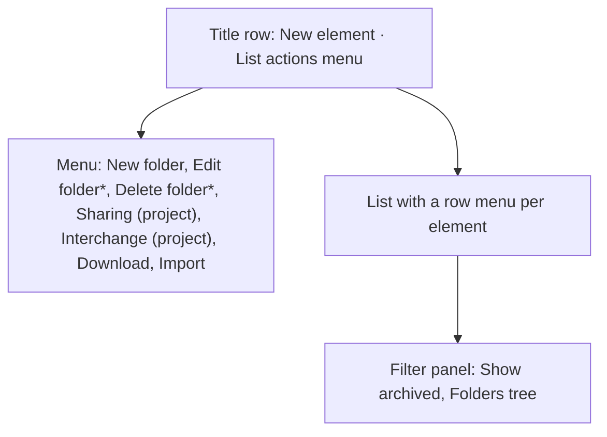

# Architecture elements and collections register (phase 30)

Part of [the platform review plan](platform-review-2026-11-19-plan.md). Review of the organisation page `/orgs/:orgId/resources/architecture-elements` (`OrgElementsPanel`, `CollectionsPanel`, `FolderPanel`) and of the same shape on the project System Architecture pages, checked on the demonstration organisation (an element in a folder, a collection shared with a project). **Status:** signed off by the user, 2026-11-22 (**Decided by: User**): Sharing and the interchange file move into the one actions menu; folder Edit and Delete are menu rows that appear once a folder is chosen.

## What the controls were

| Control | What it does | Finding |
|---------|--------------|---------|
| New folder, Edit folder, Delete folder (the "three buttons") | Under the Folders tree in the side column | Three bordered buttons that wrapped in a narrow column; the Folders box sat outside any filter panel. |
| Folders box | A tree of the list's folders; choosing one narrows the list, "Include sub-folders" widens it | Kept. Folders only organise the list and mean nothing else; Collections decide who may use an element. Two concepts, not one shown twice, so nothing is removed or merged. |
| Row buttons (Change status, Edit, Archive) | Per element | Three buttons that wrapped over two lines. |
| Collection card (Edit, Delete) | Per collection | Two text buttons in the card header. |
| Project Elements title row | Sharing link-button, Interchange menu button, New element and the List actions kebab | Four controls of three shapes. |
| Organisation Elements tab | New element, Show archived | No Export or Import, though the type declares an organisation record table (a gap against the rule that every list exports and imports). |

## Fixes

| Element | Becomes |
|---------|---------|
| Title row (project and organisation) | One primary button and one actions menu. Rows: New folder (Edit folder and Delete folder once a folder is chosen), Sharing, the Interchange parent row, then Download report, Download shown items, Download import template, Import from CSV |
| Folders box | The tree and "Include sub-folders" only, inside a filter panel with Show archived (organisation page) |
| Element row | One `Actions for {name}` menu: Edit, Change status (a parent row of the server's moves), Archive |
| Collection card | One `Actions for {name}` menu: Edit, Delete |
| Organisation Elements tab | Export and Import through `ListActions organizationId`, narrowed by the chosen folder and Show archived |

\* only once a folder is chosen.

## Same shape elsewhere

| Place | Result |
|-------|--------|
| `StageWorkflowsPanel` disclosure row (Edit, Delete icons) | Stays: icon-only buttons with tooltips inside a disclosure row, the stated exception. |
| `ReportFolderChooser` (New folder, Rename, Delete beside a field) | Stays: a control of a form field in a dialog, not of a page. |
| Selection bar (N selected, Move to folder, Clear selection) | Stays: appears only while records are chosen. |
| Other `ListPageLayout` pages | One primary action in `actions` and the kebab; no other title row holds two buttons. |
