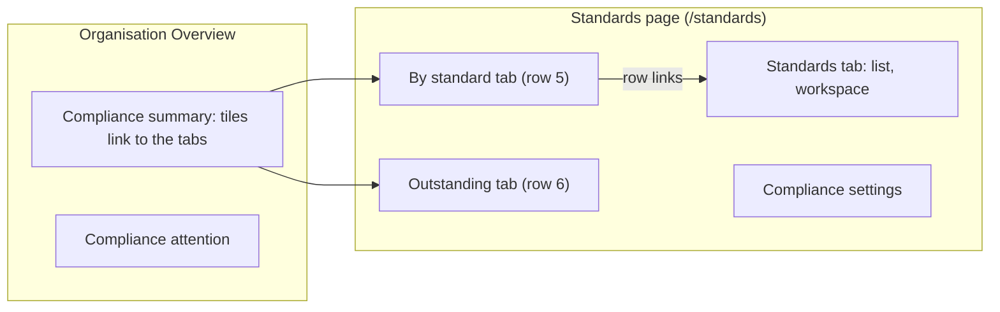

# Compliance surfaces register (phase 25)

Part of [the platform review plan](platform-review-2026-11-19-plan.md). Every place the Compliance module shows organisation-level rows, with what it shows and whether another surface shows the same rows. **Status:** signed off by the user, 2026-11-21 (**Decided by: User**), see "Sign-off". Rule applied: Org Resources holds what projects share, the Overview holds status computed from other data ([Org Resources register](platform-review-2026-11-19-org-resources-register.md)).

## Surfaces

| # | Surface | Address / registration | Shows | Kind | Same rows elsewhere? |
|---|---------|------------------------|-------|------|----------------------|
| 1 | Compliance Standards list | `/standards` (`StandardListPage`), nav rail `globalNavItems` | The organisation's standard records (reference, name, status), create and import | Records | No |
| 2 | Standard workspace | `/standards/:standardId/:section?` (`StandardWorkspacePage`) | One standard: versions, requirements, members, applicability, and a **Projects** section (`StandardProjectsPanel`: projects assigned and each one's overall state) | Records and per-standard status | Projects section repeats row 5's expanded row for one standard |
| 3 | Compliance settings | `/standards/settings/:orgId` (`ComplianceSettingsPage`) | Action types and mapping types | Configuration | No |
| 4 | Overview widget "Compliance summary" | `orgOverviewWidgets.summary` | Nine tiles (counts); each links into rows 5 and 6 with a filter | Status | Counts only |
| 5 | Resources "By standard" | `/orgs/:orgId/resources/compliance-by-standard` (`OrgComplianceStandardsPanel`) | Standard to project status table, group by standard or project, filters, export | Status (computed from project assessments) | Per standard: row 2's Projects section. Group by project and the cross-standard totals exist only here |
| 6 | Resources "Outstanding" | `/orgs/:orgId/resources/compliance-outstanding` (`OrgComplianceOutstandingPanel`) | Five lists: non-compliant requirements, pending approvals, outstanding actions, expiring evidence, overdue reviews; filters, export | Status | No (row 7 shows the top five issues by standard, not these rows) |
| 7 | Overview widget "Compliance attention" | `orgOverviewWidgets.attention` | Top five standards by issue count, upcoming reviews, recent activity | Status | A summary of row 6's rows |

## Findings

1. **Rows 5 and 6 are status views filed under Resources.** Neither has authored or shared content, so both fail the Resources test.
2. **Row 7 does not replace row 6.** It lists five rows per category at most; row 6 lists every row with filters and Export, so removing row 6 would lose the detail.
3. **Standards are an entity of their own** (a nav entry, a workspace), like a project, and rows 5 and 6 are cross-project views of them, so they belong with that entity.
4. **Rows 2 and 5 overlap for one standard** (the projects assigned and their state). They differ across standards: row 5 is the only cross-standard and group-by-project view.
5. **Rows 1 to 3 are not duplicated** and stay. The nav entry (row 1) is the home of standard records and is hidden when the module is off or the person has no standards.

## Sign-off

- **Decided by: User**, 2026-11-21: the Standards page is its own entity beside Projects, so both cross-project views (row 5 and row 6) become **tabs of the Standards page** (Standards, By standard, Outstanding), not Org Resources sections and not Overview widgets. Resources then has no Compliance section. The user first stated "Overview only" for Outstanding, then proposed this tab home as the alternative and chose it.
- **Decided by: User**: the organisation is chosen with an **Organisation filter** (a drop-down in the filter panel, shown only to a person in more than one organisation), not a picker above the tabs. Phase 40 (**Decided by: User**, 2026-11-22): the filter defaults to every organisation, the Standards list has it too, and each row names its organisation; Export (a per-organisation report) appears once one is chosen.
- **Decided by: Agent**: the tabs are offered, and the Organisation filter lists, only the organisations where the caller may read the status views (the endpoints need the Compliance Manager role), so a person who can only read standards is not shown a tab that fails. The summary widget's tiles link to the tabs. The earlier addresses do not redirect (**Decided by: User**: the Resources ones existed only on this branch). The Attention widget stays (a summary of row 6, not the same rows).

