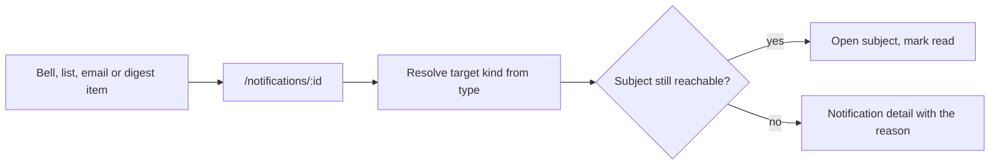

# Notification Target Register

Output of phase 2 of [platform-review-2026-11-19-plan.md](platform-review-2026-11-19-plan.md); phase 3 implements it. **Status:** signed off by the user, 2026-11-19; implemented in phase 3, with each type's kinds an ordered list (see `docs/decisions.md`) (four target choices, **Decided by: User**; the classification of every other type, **Decided by: Agent**, and open to correction).

**Scope:** the 40 core `NotificationType` values (`backend/app/models/notification.py`) and the 3 kinds the Risk module declares (`ModuleDefinition.notification_types`): 43 types, about 50 creation sites found by a syntax-tree scan for `notification_type=` outside tests.

## Findings

1. **One resolver exists for two of three surfaces.** The bell and the notification list call `getNotificationLink` (module `artefactPaths`, then core `notificationLink`). The email button does not: it opens `/projects/:id` when a project is set and `/notifications` otherwise, for every type. The daily digest lists titles and bodies with one link to `/notifications`.
2. **Eight types open the wrong page.** Every `project_stage` notification (the four stage transitions, the auto-approval and the three phase reminders) opens project administration, which the recipients (all members) often cannot use. The Delivery status page exists.
3. **Seven types open nothing from the bell in at least one case** (`permission_granted` at organisation or standard level, `password_changed`, `storage_limit_near`, `system_storage_alert`, `system_announcement`, and the standard-level `compliance_review_due` and `compliance_review_overdue`), and **four Compliance types open only the project root** (`compliance_assignment_created`, `compliance_target_date_approaching`, `compliance_target_date_exceeded`, `compliance_standard_update_review_needed`) plus project reviews, because the resolver does not know their entities (`project_compliance`, `compliance_review`, `compliance_standard`, `announcement`, `organization`).
4. **Three creation sites do not carry enough to name a destination:** an organisation-level access grant (no organisation id), a standard-level access grant (no standard id) and a standard-level compliance review (the review id, no standard id).
5. **A stored notification must keep working.** The resolver reads the type plus the stored fields, so a row created before phase 3 that lacks the new data falls back to the notification detail page rather than a wrong page.

## Target kinds

Each type declares one target kind; the browser resolves it (`/notifications/:id` calls the same function as the bell, so module paths are not duplicated on the server).

| Kind | Opens | Needs |
|------|-------|-------|
| `record` | The record's page (`getArtefactPath`, core and module paths) | entity type, entity id, project |
| `delivery_status` | `/projects/:id/stage-phases` | project |
| `project` | `/projects/:id` | project |
| `project_members` | `/projects/:id/admin/members` | project |
| `organization` | `/orgs/:orgId/overview` | organisation id as entity |
| `organization_files` | `/orgs/:orgId/files` | organisation id as entity |
| `policy` | `/policies/:id` | entity id |
| `report_run` | `/report-runs/:id` | entity id |
| `standard` | `/standards/:id` | standard id as entity |
| `project_compliance` | The project's Compliance page (`?tab=` where a tab applies) | project |
| `preferences_security` | `/preferences/security` | none |
| `server_files` | `/server/management/files` | none |
| `detail` | `/notifications/:id` (full title and body) | none |

A module's own kinds (`project_compliance`, `standard`, a record path) are declared on the module's registration, never in a core file (the module boundary rule).

## Register

Columns: **Bell** and **Email** are today's destination; **Target** is the signed-off one. **Change**: R resolver only, D data added where the notification is created, E email and digest link only (every row also moves to `/notifications/:id` for email), N none beyond E.

### Requirements and change requests

| Type | Created with (entity, project) | Bell | Email | Target kind | Change |
|------|-------------------------------|------|-------|-------------|--------|
| `change_request_submitted` | change_request, project | Change request | Project root | `record` | N |
| `stakeholder_input_requested` | change_request, project | Change request | Project root | `record` | N |
| `change_request_approved` | change_request, project | Change request | Project root | `record` | N |
| `change_request_rejected` | change_request, project | Change request | Project root | `record` | N |
| `requirements_updated` | change_request, project | Change request | Project root | `record` (the approved change request) | N |
| `comment_added` | requirement or change_request, project | Record | Project root | `record` | N |
| `requirement_review_due` | requirement, project | Requirement | Project root | `record` | N |

### Stages and phases (every recipient is a project member)

| Type | Created with | Bell | Email | Target kind | Change |
|------|--------------|------|-------|-------------|--------|
| `stage_scoping` | project_stage, project | Project admin | Project root | `delivery_status` | R |
| `stage_review` | project_stage, project | Project admin | Project root | `delivery_status` | R |
| `stage_approved` | project_stage, project | Project admin | Project root | `delivery_status` | R |
| `stage_completed` | project_stage, project | Project admin | Project root | `delivery_status` | R |
| `stage_review_auto_approved` | project_stage, project | Project admin | Project root | `delivery_status` | R |
| `stage_phase_upcoming` | project_stage, project | Project admin | Project root | `delivery_status` | R |
| `stage_phase_overdue` | project_stage, project | Project admin | Project root | `delivery_status` | R |
| `stage_phase_completed` | project_stage, project | Project admin | Project root | `delivery_status` | R |

Delivery status gains a settings (gear) link to project administration, Stages and phases, shown only to a person who may change them (**Decided by: User**; the placement and the permission check are **Decided by: Agent**, to follow the settings-link pattern on the Organisation Overview). Moving a stage and setting its dates are already in place on the page for a person who may.

### Access and membership

| Type | Created with | Bell | Email | Target kind | Change |
|------|--------------|------|-------|-------------|--------|
| `project_joined` (direct, group, invite) | project | Project root | Project root | `project` | N |
| `permission_granted` on a project (module role, scoped custom role) | project | Project root | Project root | `project` | N |
| `permission_granted` in an organisation (role, custom role, invite accepted) | none | Not navigable | Notifications list | `organization` | D: organisation id as entity |
| `permission_granted` on a standard | none | Not navigable | Notifications list | `standard` | D: standard id as entity |
| `permission_revoked` | project | Project root | Project root | `project` | R: when the person can no longer open it, the detail page states that access was removed |
| `project_members_changed_by_org` | user (the actor, not the subject), project | Project root | Project root | `project_members` | R |
| `password_changed` (change and reset) | none | Not navigable | Notifications list | `preferences_security` | R |

The three access targets are the affected organisation, project or standard (**Decided by: User**). A revoke cannot always land on a page the person may open; the stated fallback is an addition so that the click never ends on an empty error (**Decided by: Agent**).

### Organisation, policy, reports and system

| Type | Created with | Bell | Email | Target kind | Change |
|------|--------------|------|-------|-------------|--------|
| `policy_published` | policy | Policy | Notifications list | `policy` | N |
| `policy_acknowledgement_required` | policy | Policy | Notifications list | `policy` | N |
| `report_run_finished` | generated_report, optional project | Report run | Project root or list | `report_run` | N |
| `storage_limit_near` | organization | Not navigable | Notifications list | `organization_files` | R |
| `system_storage_alert` | none (server administrators) | Not navigable | Notifications list | `server_files` | R |
| `system_announcement` | announcement | Not navigable | Notifications list | `detail` | R |

A message with no page of its own opens the notification detail (**Decided by: User**).

### Compliance module (declared by the module)

| Type | Created with | Bell | Email | Target kind | Change |
|------|--------------|------|-------|-------------|--------|
| `compliance_approval_requested` | project_compliance_requirement, project | Project Compliance | Project root | `project_compliance` | N |
| `compliance_assessment_rejected` | project_compliance_requirement, project | Project Compliance | Project root | `project_compliance` | N |
| `compliance_approval_invalidated` | project_compliance_requirement, project | Project Compliance | Project root | `project_compliance` | N |
| `compliance_requirement_non_compliant` | project_compliance_requirement, project | Project Compliance | Project root | `project_compliance` | N |
| `compliance_required_action_due_soon` | compliance_required_action_assessment, project | Project Compliance | Project root | `project_compliance` | N |
| `compliance_required_action_overdue` | compliance_required_action_assessment, project | Project Compliance | Project root | `project_compliance` | N |
| `compliance_evidence_expiring_soon` | compliance_evidence, project | Evidence | Project root | `record` | N |
| `compliance_evidence_expired` | compliance_evidence, project | Evidence | Project root | `record` | N |
| `compliance_assignment_created` | project_compliance, project | Project root | Project root | `project_compliance` | R |
| `compliance_target_date_approaching` | project_compliance, project | Project root | Project root | `project_compliance` | R |
| `compliance_target_date_exceeded` | project_compliance, project | Project root | Project root | `project_compliance` | R |
| `compliance_standard_update_review_needed` | compliance_standard, project | Project root | Project root | `project_compliance` | R |
| `compliance_review_due` and `compliance_review_overdue`, project review | compliance_review, project | Project root | Project root | `project_compliance` | R |
| `compliance_review_due` and `compliance_review_overdue`, standard review | compliance_review, none | Not navigable | Notifications list | `standard` | D: standard id as entity |

Project assignments, target dates, reviews and a new standard version open the project's Compliance page, where the assignment is managed (**Decided by: User**); standard-level reviews open the Standard.

### Risk module (declared by the module)

| Type | Created with | Bell | Email | Target kind | Change |
|------|--------------|------|-------|-------------|--------|
| `risk_review_due` | risk, project | Risk | Project root | `record` | N |
| `risk_review_overdue` | risk, project | Risk | Project root | `record` | N |
| `risk_treatment_needs_reassessment` | risk, project | Risk | Project root | `record` | N |

## Guards phase 3 adds

- A backend test fails for a registered type (core or module) that declares no target kind.
- A frontend test fails for a target kind whose route is absent from the route table, so a renamed page cannot leave a dead link.
- The seeds contain one notification of each kind.
