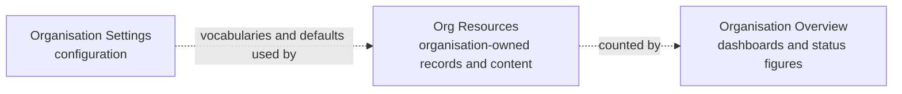
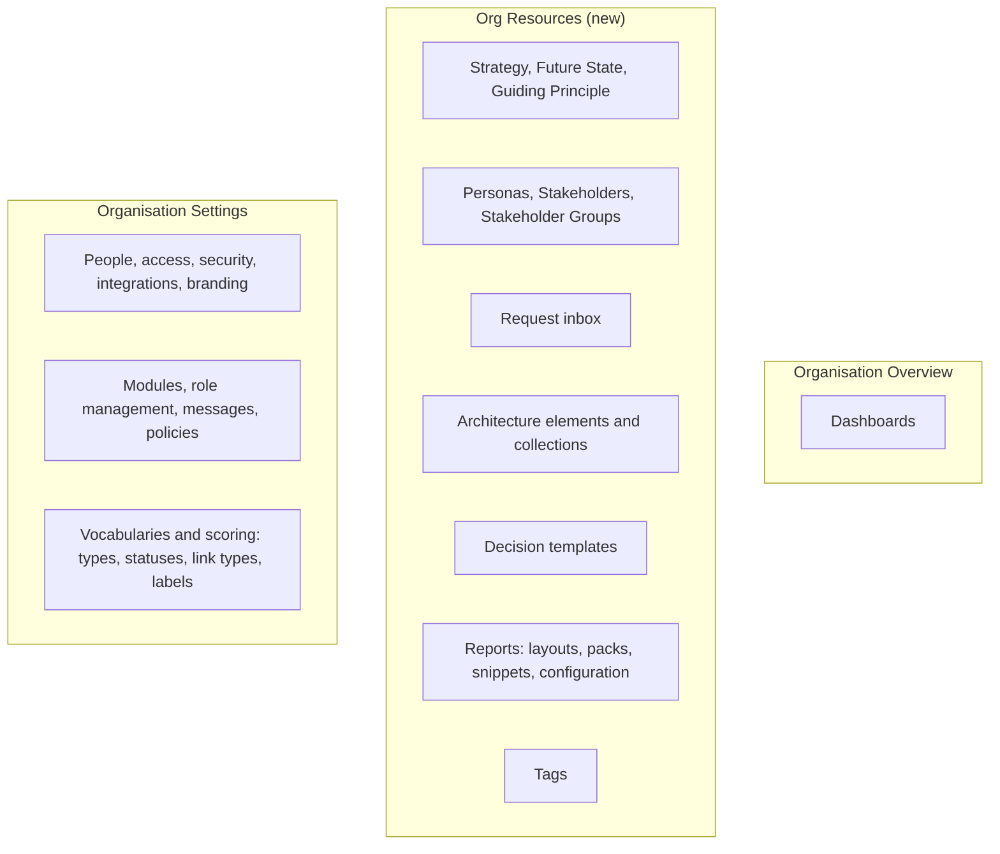

# Org Resources register (phase 7)

Part of [the platform review plan](platform-review-2026-11-19-plan.md). Every Organisation Settings group and every Organisation Overview section, with its proposed home. **Status:** signed off by the user, 2026-11-19 (**Decided by: User**).

## Classification rule

| Home | Meaning | Test |
|------|---------|------|
| **Settings** | Configuration: changes how the organisation, its people, access, security, integrations, vocabularies or defaults behave | An administrator sets it up occasionally; people do not work *in* it |
| **Resources** | What the organisation owns and shares with its projects: records, authored content and shared vocabularies of records (**Decided by: User**: "things that are shared with projects, not org settings") | People open it to do their work, or projects reuse it |
| **Overview** | Figures and status computed from other data (dashboards, status tables) | Nothing is authored there |

## Organisation Settings groups (16 core)

Access is the rule the endpoint already enforces; this phase changes none. "Admin" = organisation administrator.

| Group | Contents | Access | Home |
|-------|----------|--------|---------------|
| Overview | Usage table, rename, export, import and merge | Admin (usage and export: members) | Settings |
| Organisation details | Logo, name, company details for email footers | Admin | Settings |
| Users | Users, invitations, access review, imported people | Admin | Settings |
| Groups | Organisation groups, nesting, identity-provider sync | Admin | Settings |
| Projects | Project code policy, organisation code, default overview, project statuses | Admin | Settings |
| Workflow | Stage workflows, link types, navigation labels | Admin | Settings (vocabularies and process configuration) |
| Branding defaults | Logo, colours, login background, footer | Admin | Settings |
| Reports (whole group moves) | Report layouts, report packs, text snippets; file-name rule, output retention, footer text, cover page, chapters per component | Per section: `manage_org_report_layouts` permission for layouts, packs and snippets (a custom role can grant it to a user or group); admin for the configuration fields | **Resources** |
| SSO and SCIM | OIDC, provisioning | Admin | Settings |
| Email | SMTP | Admin | Settings |
| Security | Two-factor, self-signup, external users, personal access tokens, personal data policy | Admin | Settings |
| Modules | Module enablement and sub-components | Admin | Settings |
| Tags | Organisation tag vocabulary | Admin | **Resources** |
| Messages | Announcements | Admin | Settings |
| Policies | Organisation policies (versions, audiences, acknowledgement) | Admin to author; members read | Settings |
| Role management | Custom roles and grants | Admin (definition); `grant_roles` (assignment) | Settings |

## Module sections already in Organisation Settings (`orgAdminSections`)

| Module | Section | Contents | Home |
|--------|---------|----------|---------------|
| Context and Strategy | Pain Point Types, Submission, Scoring | Vocabulary and scoring configuration | Settings |
| Stakeholders | Persona Types, Stakeholder Types, Scoring | Vocabulary and scoring configuration | Settings |
| Risk Management | Risk Types, Risk Scoring | Vocabulary and scoring configuration | Settings |
| Product Feedback | Request Scoring, External Systems | Scoring and vocabulary configuration | Settings |
| Architecture | Element Types, Connection Types, Domains, Symbols | Vocabularies and symbol library | Settings |
| Architecture | **Elements and Collections** | Organisation-owned architecture records | **Resources** (a record list in Settings today) |
| Decisions | **Decision Templates** | Authored templates new decisions start from | **Resources** (authored content) |

## Organisation Overview sections (`orgOverviewSections`)

The plan counted five modules; the code has four, with nine sections.

| Module | Section | Contents | Home |
|--------|---------|----------|---------------|
| Context and Strategy | Strategy, Future State, Guiding Principle | Organisation-owned records | Resources |
| Stakeholders | Personas, Stakeholders, Stakeholder Groups | Organisation-owned records | Resources |
| Product Feedback | Request inbox | Organisation-owned records | Resources |
| Compliance | By standard, Outstanding | Status tables computed from project assessments | Resources (**Decided by: User**, against the proposal to keep figures on the Overview); **moved on 2026-11-21 to tabs of the Standards page** ([compliance register](platform-review-2026-11-19-compliance-register.md)) |

Dashboards stay on the Overview, with Manage dashboards, Reports and the Files and Settings icon links.

## Result

## Needs of the planned organisation-level workflow modules

- **Workflows (15):** an organisation-owned `Workflow` (project id null, the `Persona` scope pattern), including the "publish to organisation" copy; approval default is a *setting*. Needs a Resources section per record list, as Personas has.
- **Workflow Capture (16):** the same; organisation-owned workflows and diagrams. A Resources section, no Settings change beyond the approval default.
- **Glossary (17):** organisation terms with an organisation-level approver; a Resources section.
- **Investigations (19):** project-owned only in version 1; nothing needed.
- All of these are record lists contributed through the one registry (`orgResourceSections`), so the page needs no per-module code. Naming note: the Files page already has a "Shared resources" tab (organisation-owned files); the new page is "Org Resources", and its menu does not repeat that tab.

## Behaviour to preserve in phases 8 and 9

- Every moved section keeps its endpoint permission; the page decides nothing about access.
- Old `/orgs/:id/overview/:section` and `/orgs/:id/admin/:group/:section` addresses redirected in the first build; the redirects were removed on 2026-11-21 (**Decided by: User**, see `docs/decisions.md`, phase 25).
- A person who cannot use a section is not offered it (module enablement and sub-component filtering as today).

## Sign-off

- **Decided by: User**, 2026-11-19: Tags move to Resources; Messages and Policies stay in Settings; the whole Reports group moves; Compliance's two sections move; the Workflow group, project statuses and every module vocabulary and scoring section stay in Settings (the user confirmed these stay after being asked whether "shared with projects" pulled them in).
- **Decided by: Agent** (consequence): the moved Reports group keeps a permission gate per section, so a person holding only `manage_org_report_layouts` sees the layouts, packs and snippets and not the configuration fields. Phase 9 keeps that check and the tests pin it.
- Phase 9 moves: Report layouts, packs, snippets and configuration; Tags; Architecture Elements and Collections; Decision Templates (all three are the proposal's items the user did not change); and the four modules' Overview sections.

