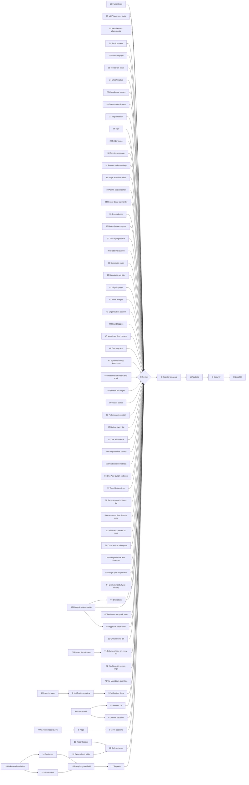

# Platform Review 19 November 2026 — Plan

**Status:** in progress (phases 1 to 70 done 2026-11-22 to 2026-11-24 and 71 to 73 planned 2026-11-24; phase 41 was added from a review of the running stack, phase 42 from a request during phase 37, and phases 43 to 49 from the review of 2026-11-22 that followed; phases 50 to 59 came from the review of 2026-11-23; 50 to 70 are done; phases 60 to 73 came from the review of 2026-11-24 (the user works them individually; 71 to 73 are planned, not started); R, D, W, S and C follow). **Decision tags:** every decision says `Decided by: User` or `Decided by: Agent`; an Agent decision can be revisited on its own judgement, a User decision needs the user's sign-off to change.

Source: seven review notes, then fifteen items from the user's review of the running stack on 2026-11-22 (phases 28 to 41; item 3 and 4 of that list share phase 30). Each was checked against the code before planning. Four have an objection or a correction recorded under "Findings and objections"; read that section first.

## Status / Resume Here

70 / 78 phases complete.

| # | Phase | Notes | Status |
|---|-------|-------|--------|
| 1 | Return to the page after signing in | Return path kept across the sign-in, 2FA, SSO and forced password change routes | [x] |
| 2 | Notification targets: review | [Register](platform-review-2026-11-19-notification-register.md) of every notification (type, record, current target, correct target); signed off 2026-11-19 | [x] |
| 3 | Notification targets: fixes | One address (`/notifications/:id`) and one browser resolver for the bell, the list, the email and the digest; test that no type lacks a target | [x] |
| 4 | Licence audit and dependency licence guard | Shipped-component inventory, generated notices, CI guard that keeps the commercial option open | [x] |
| 5 | Licences in the Policies area | Public read-only Licences group; separate from the policy tables | [x] |
| 6 | Licence model: decision and change | Options paper and the user's choice (a decision gate); then the licence files, contribution terms and website page; decided 2026-11-19: AGPLv3 + commercial, CLA | [x] |
| 7 | Org Resources: review | [Register](platform-review-2026-11-19-org-resources-register.md) classifying every Organisation Settings group and Overview section; signed off 2026-11-19: Resources holds what is shared with projects (Tags, Reports, Compliance and the module record lists) | [x] |
| 8 | Org Resources: page and extension point | `/orgs/:orgId/resources`, registry-driven sections, navigation entry | [x] |
| 9 | Org Resources: move sections | Move what the review approved; Organisation Settings keeps configuration only | [x] |
| 10 | Record codes: organisation and project prefixes | Prefix per record type, project override, nested fallback; applied inside `generate_unique_code` | [x] |
| 11 | External references: shared table | One core table keyed by record type; organisation systems; Product Feedback migrated onto it | [x] |
| 12 | External references: every surface | Record panel, list column and filter, export and import, search, report field, bundles, MCP, look-up by key | [x] |
| 13 | Markdown and Mermaid: shared foundation | `MarkdownView`, `MarkdownEditor` (Write and Preview), safe Mermaid, server limits | [x] |
| 14 | Decisions: Markdown and a long-form Document | Decision text fields use the foundation; new `document` field; locks, bundles, search, reports | [x] |
| 15 | Visual (WYSIWYG) Markdown editing | Spike with exit criteria, then the visual editor on `@tiptap/markdown`; shared toolbar with the policy editor | [x] |
| 16 | Markdown for every long-text field | Registry-declared fields, generated inventory, mathematics coexistence | [x] |
| 17 | Markdown and diagrams in reports and exports | Markdown to PDF, Word, OpenDocument and HTML; one shared browserless Mermaid renderer in the converter container, same engine version and font as the screen, confirmed by a spike | [x] |
| 18 | Faster test suites and git hooks | Measure first, then shorten the backend, Playwright and Storybook runs, the pipeline around them and the pre-commit hook without removing or weakening a test or a check; targets agreed with the user from the measured baseline; may be built at any point, sooner is better | [x] |
| 19 | MCP tools: components and categories | List, add, edit, reorder and delete (only when empty) a project's components and categories through MCP, so a new project can be structured by an agent; skill and generated reference updated | [x] |
| 20 | Requirements in several components | A requirement can sit in more than one component and category, with an alias code in each and a Make independent action; decision gate first | [x] |
| 21 | Service users with administrator-issued tokens | An organisation administrator creates a service user with no password and no sign-in, then issues and revokes its personal access tokens on its behalf; decision gate first | [x] |
| 22 | Components and categories: prefix suggestion and a folder-tree page | Prefix suggested from the name and editable; the Structure page rebuilt as a collapsible tree like the report folders; the requirement component and category choice through the shared tree selector; UI review first | [x] |
| 23 | Formatting toolbar only while a field is active | The Markdown and visual editors (and the policy editor) show their formatting buttons only while the field has focus | [x] |
| 24 | Watching: compact, as a tab beside Activity, for users and groups | The panel leaves the top of the requirement and change request pages; empty by default with a `[+]` to add; sits in the Links and Activity card; a user can be a watcher too (raised during the phase) | [x] |
| 25 | Compliance: one home per view | Review of Compliance across Org Resources, its own Standards page and the Organisation Overview; signed off 2026-11-21: By standard and Outstanding become tabs of the Standards page (Organisation filter), not Resources sections or Overview widgets | [x] |
| 26 | Stakeholder Groups page: alignment | UI review of the Org Resources page against the aligned-rows pattern, then the fixes; signed off 2026-11-21: the shared `FolderTreeList` grid, members below it, a row actions menu | [x] |
| 27 | Tags page: creation on demand, and a style guide rule | The new-tag controls open on request; "Pattern: creation controls on demand" added to the style guide and applied to the other always-visible create forms the review finds | [x] |
| 28 | Tags: usage in a dialog | The "Where tags are used" section becomes a dialog opened from the record count in the Used on column | [x] |
| 29 | Folder icons: review and fix | Every folder-tree list shows an icon of what its rows are (a stakeholder group, not a folder); icon chosen by the consuming list, not a core map | [x] |
| 30 | Architecture elements and collections: UI review and an actions-menu rule | One actions menu instead of three buttons; what the Folders box is and whether it stays; the rule added to `CLAUDE.md` and the style guide | [x] |
| 31 | Record codes settings: sections by module | Organisation and project pages: remove the wasted space and group the long list under Core and each module | [x] |
| 32 | Stage workflow editor: one line per stage | The edit dialog rebuilt as a compact aligned list, one line per stage, with inline controls | [x] |
| 33 | Administration section list scrolls separately | The section selector of the administration pages scrolls on its own, and a chosen section opens at its top | [x] |
| 34 | Record detail card order: a rule and the fixes | Components and codes sits above discussion; a sane default card order stated as a rule in `CLAUDE.md` and the style guide, and applied to every detail page | [x] |
| 35 | Tree selector: chevron styling and placement | The expand chevron loses its button styling; placement of chevron and checkbox reviewed | [x] |
| 36 | Requirements: Make change request in the actions menu | The action moves from the page into the record's action menu | [x] |
| 37 | Text styling toolbar: compact, and a mathematics button | Small grouped toolbar buttons; Inline equation and Equation block buttons with a live preview panel; equations drawn in the Visual view; mathematics on Decisions, Product Feedback, Open Questions, Pain Points and change requests; decided 2026-11-22 | [x] |
| 38 | Global navigation: collapsible groups | A chevron beside each group label (Project, Global, Standards and the like) folds its entries, so less scrolling reaches the others | [x] |
| 39 | Compliance standards: cards styled as project cards | Standard titles read as links and the cards share the project card's look, through one shared card | [x] |
| 40 | Compliance standards: organisation filter | The organisation selector moves into the filter panel, defaults to every organisation, and each standard shows its organisation | [x] |
| 41 | Sign-in page: no redirect notice | The page says nothing extra when it will return the person to a page | [x] |
| 42 | Inline images in Markdown fields | Pictures inside the text of a record, drawn on screen, in the editors and in reports; a decision gate first | [x] |
| 43 | Compliance status tables: organisation column | The organisation of a standard or row is its own column, aligned down the table, not text inside the expand button | [x] |
| 44 | Round collapse toggles | The navigation and filter-panel collapse buttons are circles again | [x] |
| 45 | Markdown field chrome: tabs, empty height, controls | The Visual, Write and Preview tabs are caption-sized, an empty field is the most compact box and the same height in every view, and the view switch and toolbar take no room while the field is not in use; a decision gate first | [x] |
| 46 | Grids and tables: long text never breaks the layout | Fix the Connection Types grid, audit every grid and table-like view for the same defect, and add a shared cell component, a stress test and agent rules that stop it recurring | [x] |
| 47 | Architecture symbols: Org Resources, filter panel, folders | The organisation's symbol library moves to Org Resources as a filtered list; a decision gate first on folders and on how a project sees them | [x] |
| 48 | Tree selector: indent and scroll edges | Smaller indent between levels, a fixed search header, and a shared scroll region with themed edges for every capped list | [x] |
| 49 | Section list fits the viewport from the first view | The section list is sized to the space left below its starting position, so a page that fits the window never needs a page scroll to reach the end of the list (follow-up to phase 33) | [x] |
| 50 | Tree selector: no stray tooltip | The picker shows no tooltip over its trigger or rows unless it says something the person cannot already see | [x] |
| 51 | Tree selector: the panel opens at its field | The panel of a picker (Additional components, Component and category) opens under the field's left edge, never at the far end of a full-width field | [x] |
| 52 | Sort on every record list | A Sort by and Order control in each record list's filter panel (code, title, created, modified, ascending or descending), one shared mechanism for every registered type; a decision gate first | [x] |
| 53 | Record header: one add control for tags, components and references | The three separate (+) buttons become one (+) with a menu naming what it adds, in one row with the chips | [x] |
| 54 | Clear control: a compact X | The control that empties an owner or similar field is one compact icon button after the value, not a text button; one shared component and a style guide pattern | [x] |
| 55 | Dead session: redirect to sign-in | A request refused for an invalid or expired token ends the session and returns the person to the sign-in page instead of leaving a spinner | [x] |
| 56 | Architecture types: one Add button, at the top | The two add buttons on Element Types and Connection Types become one at the top that opens the full form | [x] |
| 57 | Files pages: no background behind a type icon | A file-type icon is drawn bare; only a picture keeps its backdrop | [x] |
| 58 | Service users in the one Users list | Add user offers New service user; service users are managed from the Users list, not a separate section | [x] |
| 59 | Comments describe the code, not the conversation | Every comment and docstring states what the code does now; chat references, change history and excess commentary are removed, and a check keeps them out | [x] |
| 60 | Record header: the add menu names only what it offers | The (+) tooltip and accessible name list the rows the menu really has (a requirement offers no component row) | [x] |
| 61 | Record header: the code beside a long title | The record code keeps a place that follows the title, not a spot beside the action buttons; a long-title story guards it; a decision gate first; decided 2026-11-24: inline after the title's last word | [x] |
| 62 | Lifecycle track and Promote button | A chevron-style track of a record's states (current in the primary colour, earlier steps tinted, later steps plain) and one Promote action, replacing the transition buttons and the Locked notice badge; a Storybook mock with three interaction variants, a state inventory and a decision gate first; decided 2026-11-24: every type, Promote on the next step and in the actions menu, full-width track, padlock on the next step without permission | [x] |
| 63 | Files: click a picture for a larger preview | A picture's thumbnail opens a larger preview dialog on the Files pages | [x] |
| 64 | Project overview activity: styled as the project history | The Project activity widget uses the History page's columns and row wording through one shared component | [x] |
| 65 | Lifecycle states: project configuration, organisation enforcement | A project administrator turns off the optional states of a record type (a solo project skips triage or review); an organisation can mark states required so no project can turn them off (certification); one shared server rule, Promote goes to the next enabled state; a decision gate first | [x] |
| 66 | Lifecycle: skip steps on one record | A project manager moves one record straight to a later step with a reason, never past a gated step and never past a state the organisation requires; builds on phase 65's resolver | [x] |
| 67 | Decisions: remove the quick-view side panel | A row opens the Decision page like every other record list; the panel, its stories and its specs go | [x] |
| 68 | Approval separation: project setting, organisation enforcement | Whether the person who submits a record may also approve it becomes a setting per gated type (change requests first): enforced by default, a project may allow self-approval only where the organisation permits it, and a self-approved record is marked; a decision gate first, and a SOC 2 control change | [x] |
| 69 | Group owners: no kind and member-count pill | A group shown as an owner, facilitator or any other person-valued field loses the large "Organisation group · 2 members" pill; the icon shows it is a group and the kind and member count move to a tooltip and the accessible name; one shared component, every use | [x] |
| 70 | Record lists: names keep their width, optional columns | The People list (and every list on the shared record list view) stops squashing the Name column: Scope leaves the default columns and the optional columns are chosen with the existing shared column chooser, remembered per person; a decision gate first; decided 2026-11-24: Scope off, Kind, Details and Type optional and on, every `RecordListView` list | [x] |
| 71 | Column choice on every list | Most lists get the column chooser (a register of each list's columns and defaults signed off first, a rule and a check script after), so a list shows the columns a person needs and a rarely needed one such as the Diagrams Switches count is off by default; builds on the mechanism of phase 70 | [ ] |
| 72 | Engagement page: a kind icon on every person chip | Participants, Personas covered and Audience groups draw the icon of their kind beside the name, as Facilitators already do; one shared label, and the same check on every other place these records are named | [ ] |
| 73 | Tile cards: Markdown text shown as plain text, equations drawn | The Specs tiles show a requirement's reasoning with its Markdown marks, cut by hand at 140 characters; they show plain text with equations drawn, through one shared summary component and the shared clamp, and every other place that shows a Markdown field raw is found and fixed | [ ] |
| R | Review checkpoint: all changes together | The user reviews phases 1 to 73 as one result; every item raised becomes a numbered phase or is fixed in place; gates W | [ ] |
| D | Register clean-up | Reconcile each phase register (`platform-review-2026-11-19-*-register.md`) with the reviewed result, move what is durable into the permanent docs, mark each closed, and fix every reference; gates W | [ ] |
| W | Website content | Update `docs/website/` for every user-visible change above, after the review | [ ] |
| S | Security review | Dependabot, CodeQL, `pip-audit`, `npm audit`, Bandit, Semgrep, Gitleaks, image scan; identify → verify → remediate on touched areas | [ ] |
| C | Local CI test review | Every job in `.github/workflows/` run locally before the pull request exists | [ ] |



Phases 1 to 3, 4 to 6, 7 to 9, 10 to 12, 13 to 17, 18, 19, 20, 21, 22, 23, 24, 25, 26 and 27 are fifteen independent tracks, and phases 28 to 59 thirty-two more (phase 18 touches only test and pipeline tooling, so it can run first to shorten every later phase's test runs); phase 22 follows phase 19 where both touch the prefix rule (one function, below) and may be built in any order; phase 23 touches the editors of phases 13 to 16 and phase 25 the Org Resources sections of phases 7 to 9, so both sit after them (already done); phase 27's style guide rule is read by phases 25 and 26 when they review a create control; phase 3 builds on phase 1 (an email link must survive sign-in). D follows R because the registers must describe the reviewed result, not the first build. W, S and C follow R because the website, the scans and the pipeline must describe and test the reviewed result, and CLAUDE.md makes the security review and the local CI review the last two phases of every plan.

## Findings and objections

1. **Relicensing does not, by itself, return money from hosts.** The goal stated is that someone who hosts the product and sells access should send profit back. AGPLv3 (the usual dual-licence base) forces a host who modifies the code to publish those modifications; an **unmodified** host owes nothing under it, and no copyleft licence requires payment. Licences that do restrict selling the product as a hosted service are source-available, not open source: the Business Source License and the Functional Source License (both convert to an open licence after a fixed period) and the Elastic License 2.0. They carry real costs: some organisations' procurement accepts only OSI-approved licences, and the WordPress, Elastic and HashiCorp histories show community forks follow such changes. Two further facts limit any choice: the repository is public under GPLv3 (`gh repo view`), so every release already published stays GPLv3 for anyone to host indefinitely, and a trademark policy on the name is the lever WordPress itself used. This is a legal and commercial decision; the plan produces the audit and the options (phases 4 and 6) and does not draft licence terms (**Decided by: Agent**; counsel should review).
2. **Facts that make any option possible.** One person holds the copyright (all 75 commits are under one person's two identities, no contributor agreement exists, no external pull request is recorded), and the shipped application links no GPL or AGPL library: every installed frontend package, development tools included, is MIT, ISC, Apache-2.0, BSD or similar (three are MPL-2.0, which is file-level), and in the backend the only copyleft licences are LGPL `svglib` and `psycopg2` (used unmodified and replaceable) and MPL-2.0 `certifi`; one package, `resvg_py`, has metadata reading "UNKNOWN" (verify upstream). Ghostscript (AGPL) and poppler (GPL) run in the separate converter container and are not linked. A contribution policy must exist **before** an outside contribution is accepted, or this position is lost.
3. **A hidden "dummy project" for organisation content is rejected** (**Decided by: Agent**). Every project-scoped feature assumes a real project: role grants, counters, nesting, module state per project, counts, templates, the project list. A fake one would appear in lists, counts, exports, entitlements and access reviews, and every one of those needs an exemption. The product already has the right mechanism: organisation-owned record types (Strategy, Future State, Guiding Principle, Persona, Stakeholder, Compliance standard, Architecture element, Product Feedback inbox) with their own counters and `organization_owned` providers; five modules surface theirs today through `orgOverviewSections` inside the Organisation Overview. Phase 8 gives them their own page ("Org Resources") through the same registry, which is also where the planned organisation-level workflows will land. The idea behind the note (one place for everything at organisation level) is kept in full.
4. **The policy editor cannot hold a Decision, but its library can.** The policy body is validated ProseMirror JSON limited to headings, lists, quotations, bold, italic and links; no code, table, image or diagram, and JSON does not export as CSV, search as text or suit an AI agent writing through MCP. A Decision needs Mermaid, code and tables. So: **Markdown is the stored format**; TipTap (already a dependency, with an official `@tiptap/markdown` extension, MIT) is reused for the visual editor in phase 15, and the toolbar is extracted into a shared component that the policy editor adopts too, rather than copied. The policy model itself is unchanged.
5. **Mermaid is drawn on the server without a browser** (an earlier draft wrongly said it could not). **Decided by: User**, 2026-11-19: no Chromium; every diagram type; the converter container; one shared renderer for every export that embeds a diagram; "identical to the screen" means the same engine version and the same font on both sides, not exact pixels (a browser's own output varies with the operating system and its fonts, so exact pixels was never attainable). The candidate is `mermaidx` (MIT): it runs the real, unmodified Mermaid 12 library in an embedded JavaScript engine (QuickJS-ng, or V8 in a child process) against a minimal fake DOM, with no browser or Node.js; it lists every diagram type Mermaid itself supports. Its documented limit is that text is measured with one bundled font (DejaVu Sans), so widths can differ from a browser's by a fraction of a pixel. The plan removes that difference by drawing diagrams on screen in the same DejaVu Sans, from a local font file, with the exact Mermaid version the server uses. Unverified, and the spike's job: whether a font or metrics can be supplied, Linux amd64 and arm64 wheels for the converter's Python version, maintenance (a project of about 92 stars; the last release date was not found), and fake-DOM failures for particular diagram types. Native reimplementations (`mmdr`, `merman`, `ferrigura`, `merm`) are the baseline for comparison only, since they do not cover every type. The result goes through the existing sanitising SVG path. On screen, Mermaid is the first diagram renderer in the frontend; it runs in strict mode, loads on first use only, and its output is shown as an image so it cannot run script.
6. **"Every long-text field now" changes how existing text reads.** A `*`, `#`, `-` line or `1.` in today's plain text will start to format. Plain prose is unaffected, and the visible edit field still shows what was stored. The requirement description already uses KaTeX mathematics, which the report engine also reads; Markdown and mathematics must coexist (phase 16 spike). The scope is large, so it is staged: foundation, Decisions, visual editor, then the rest through one registry declaration and a generated inventory (**Decided by: User** for the scope; **Decided by: Agent** for the staging).
7. **Per-project code overrides cannot rename existing records.** A stored code never changes (`services.codes`; links, reports and audit evidence cite it), so changing a prefix affects records created afterwards: `DEC-001` to `DEC-005`, then `ADR-006`. The counter continues and is never reused. Requirements already take their prefix from component and category, so they are outside this mechanism.
8. **The notification defect is wider than the one reported.** The "phase overdue" notification links to the project admin page because `notificationLink` sends every `project_stage` record there, although the Delivery status page (`/projects/:id/stage-phases`) exists. In addition, the email button always opens the project root or `/notifications`, never the record; and notifications without a project (organisation storage, server storage, password changed, announcements) have no link at all. The fix is one resolver, not one more special case.

## Decisions

- **Licence: AGPLv3 + commercial licence, a contributor licence agreement with a CI sign-off check, no trademark policy** (**Decided by: User**, 2026-11-19; recorded in [docs/licensing-options.md](../licensing-options.md)). The stated goal is met only partly (finding 1); the user chose this over the recommended Business Source License.
- **Code overrides at project level as well as organisation level** (**Decided by: User**, 2026-11-19). Resolution per record type: the project, then its nearest ancestor project that sets one, then the organisation, then the built-in default (**Decided by: Agent**: the nested-project rule applies to a sparse override map as it does to a definition table, so a child project inherits instead of silently reverting).
- **External references as one generic shared table** (**Decided by: User**, 2026-11-19): organisation-defined systems (name, optional URL template), several references per record (system, key, optional URL), keyed by registered type string like tags and placements, so a new type needs no code. Product Feedback's own table migrates onto it (**Decided by: Agent**: leaving both is the duplicated-mechanism failure this project's rules exist to stop).
- **Markdown for Decisions and every long-text field** (**Decided by: User**, 2026-11-19), staged as in finding 6. Stored format is Markdown source (**Decided by: Agent**).
- **Org Resources is a page, not a project** (**Decided by: Agent**; finding 3). The first build redirected the old Overview section addresses; removed 2026-11-21 (**Decided by: User**).
- **Licences live in the Policies area but not in the policy tables** (**Decided by: Agent**): they are static, build-generated and have no author, version, audience or acknowledgement; the Policies page gains a built-in read-only "Licences" group. A consequence: the Policies page then always exists, where it today redirects away when nothing is published.
- **One notification target resolver** (**Decided by: Agent**): the email button opens `/notifications/:id`, which resolves the target in the browser with the same function the bell uses (including module `artefactPaths`) and passes through sign-in (phase 1). The alternative, duplicating every module's route templates on the server, would drift.
- **Return path rules** (**Decided by: Agent**): same-origin relative paths only, never an authentication route, kept in the router state and `sessionStorage` (so it survives a reload, the SSO redirect and the 2FA hand-off), used once, and it takes precedence over the landing preference.

## Phase specs

Every phase: stories for new UI, a Playwright test for new UI behaviour, backend tests that pin the behaviour, both seed scripts checked, a `docs/decisions.md` entry with a **Decided by** tag, and the website question answered in phase W.

### Phase 1 — Return to the page after signing in

**Why:** a lapsed session (the 401 handler clears the user and `ProtectedRoutes` redirects to `/login` with no memory of where the person was) and a followed email link both end at the landing page after sign-in, so the person must find the page again. **Risk addressed:** lost context, and an open redirect if the stored path were trusted. **Outcome:** after sign-in the person arrives at the page they were on, including the query and hash.

- `ProtectedRoutes` navigates to `/login` with the current path as state and writes it to `sessionStorage`; one helper (`utils/returnTo.ts`) validates (relative, one leading slash, not `//`, not `/login`, `/signup`, `/reset-password`, `/confirm-email`, `/oidc-complete`), reads and clears it. As built: `sessionStorage` only (with an in-memory copy), no router state; see `docs/decisions.md`.
- Honoured by `LoginPage` (password and 2FA step), the 2FA hand-off from `OrgLoginPage`, `OrgLoginPage` itself, `OidcCompletePage` (today fixed to `/projects`), and after `ForcedPasswordChangePage`.
- Unsaved form content is not preserved; the sign-in page does not say so (phase 41).
- Tests: unit tests of the validator (open-redirect cases, encoded slashes, other schemes); Playwright for password sign-in after expiry, a followed deep link, and a 2FA user; story for each changed page.

### Phase 2 — Notification targets: review

**Why:** the reported notification is one instance of a class. **Risk addressed:** more notifications that open an unrelated page or none. **Outcome:** a register the user signs off.

- As built: [the register](platform-review-2026-11-19-notification-register.md) lists all 43 types (40 core, 3 Risk) with the entity each is created with (about 50 creation sites, not the 90 first estimated), the page the bell and the email open today, and the signed-off target kind. Findings: eight stage types open project administration; seven types open nothing in at least one case; four Compliance types open only the project root; three creation sites lack an organisation or standard id.
- Signed off by the user, 2026-11-19: stages open Delivery status; access changes open the affected organisation, project or standard; a message with no page opens the notification detail; Compliance assignments, target dates, reviews and a new standard version open the project's Compliance page. Recorded in `docs/decisions.md`.
- Tests: none (analysis).

### Phase 3 — Notification targets: fixes

**Why:** see finding 8. **Risk addressed:** a notification that cannot take the person to its subject, and a new type shipped without a target. **Outcome:** every notification, in the bell, the list, the email and the digest, opens its subject.

- Implement the [signed-off register](platform-review-2026-11-19-notification-register.md): extend `getNotificationLink` with its target kinds; add the `/notifications/:id` route that resolves, marks the notification read and navigates, or shows the full notification when no page applies or the subject is no longer reachable; email and each digest item link to it.
- Add the organisation id (access grants, invites) and the standard id (standard access grants, standard-level reviews) as the entity where the register marks data (D); a stored notification without them falls back to the detail page.
- Delivery status gains a settings (gear) link to project administration, Stages and phases, shown only to a person who may change them (**Decided by: User**, 2026-11-19; placement per the Organisation Overview settings link).
- A declared target kind per `NotificationType` and per module kind (`ModuleDefinition.notification_types` extended generically, no per-module code in core). A backend test fails for a type with none; a frontend test fails for a kind with no route, using the route table so a renamed page cannot leave a dead link.
- Seeds: the demo and e2e datasets contain one notification of each kind.
- Tests: the two guards above; Playwright opens one notification of each target class from the bell and from an email link while signed out (uses phase 1).
- As built: an ordered list of target kinds per type (the data decides among several), `GET /notifications/{id}` with `subject_available`, Compliance's kinds declared by the module, one sample notification per kind for a dedicated persona in each seed (`scripts/seed_notification_samples.py`; the e2e dataset has no policy or report run, so those two kinds are skipped there), and the Playwright spec covers five bell targets, a message in full, the list, a signed-out email link and the gear link. See `docs/decisions.md`.

### Phase 4 — Licence audit and dependency licence guard

**Why:** distributing the Docker images requires the licence notices of every shipped component (MIT, BSD and Apache-2.0 require attribution; LGPL and MPL need their notices and the replaceability or source terms), and the commercial option depends on the shipped application never linking a GPL or AGPL library. **Risk addressed:** a missing attribution, and a later dependency silently closing off the commercial option. **Outcome:** a generated inventory and a pipeline check.

- `scripts/generate_third_party_notices.py` reads the lockfiles (backend, frontend, mcp-server, docs site) and the image components (Ghostscript, poppler, nginx, PostgreSQL client libraries, the bundled fonts: Liberation and DejaVu), excludes development-only packages, and writes `THIRD_PARTY_NOTICES.json` plus licence texts (committed, with a drift check like the lockfile check).
- `scripts/check_licences.py`: an allow-list of permissive and weak-copyleft licences for shipped application dependencies; GPL, AGPL, SSPL and unknown fail; the exceptions (the converter container's Ghostscript and poppler, run as separate programs; `resvg_py` pending verification) are named with reasons. Wired into `ci.yml`, `.githooks/pre-commit` and the SOC 2 vendor-management policy's control matrix.
- The converter image gains the embedded Mermaid engine and its font in phase 17; the inventory and the guard are extended then.
- Separately licensed optional services (Grafana, Loki, Tempo, Alloy are AGPL; cAdvisor and Prometheus Apache-2.0) are pulled from upstream, not redistributed; documented as such.
- Tests: the guard fails on a fixture dependency with a disallowed licence; the generator is deterministic.
- As built: `scripts/licence_policy.json` (the policy), `licence_inventory.py` (collection and judging), `generate_third_party_notices.py` (writes `frontend/public/licences/third-party-notices.json` and `third-party-texts.json`, so phase 5 serves them as static assets) and `check_licences.py` (offline in the pre-commit hook; `--live` in the new `licences` CI job, which also resolves the Python requirements afresh). `resvg_py` is MIT (its packaged `LICENSE`); the `UNKNOWN` item is closed. The converter image distributes GPL and AGPL programs, so a source offer is an obligation of that image; recorded for phase 6. See `docs/decisions.md`.

### Phase 5 — Licences in the Policies area

**Why:** a person, an auditor or a prospective buyer should see what the product contains and the terms it is offered under, and a source-offer link is the usual compliance step if the licence has one. The Policies page is already public and is where people look for terms. **Risk addressed:** hiding obligations in a file nobody opens; forcing static, authorless data through the versioned, audience-scoped policy model. **Outcome:** a built-in "Licences" group, readable without signing in.

- `ResourceMenu` group on `PoliciesPage` with: "Product licence" (text per phase 6, with the source link), "Third-party components" (searchable table: name, version, licence, link; expandable full text) and "Fonts". Data is the phase 4 file, loaded as a static asset on first open.
- `PoliciesPage` no longer redirects when no policy is published (the group always exists); the footer link follows.
- Strings use formal wording; the glossary entry is added.
- Tests: story, Playwright signed in and signed out (public route).
- As built: `LicencesPanel` (three sections, library table with search, sort and "Show more", detail dialog, texts read on demand), addresses `/policies/licences/{product|components|fonts}` read from the location (`utils/policiesPath.ts`), `ResourceMenu` keeps its menu for a single group with sub-pages, footer link permanent, and the product licence is one constant (GPL-3.0-only today) for phase 6 to change. The signed-out page now resolves a policy address (it ignored it before). See `docs/decisions.md`.

### Phase 6 — Licence model: decision and change

**Why:** see findings 1 and 2. **Risk addressed:** a licence change made without the owner's informed choice or counsel's review, and a lost ability to relicense. **Outcome:** a decision, then only the changes that decision needs.

- Gate: a new licensing options paper in `docs/` (written in this phase; options: AGPLv3 + commercial; GPLv3 + commercial; Business Source License or Functional Source License with a hosted-service restriction and an additional grant for internal use; Elastic License 2.0; open core), each against the stated goal, the existing GPLv3 releases, community effect and procurement effect, plus a trademark policy outline. **The user decides; no file changes before.**
- If a change is chosen: `LICENSE` and a commercial-licence summary (terms to be written with counsel), `CONTRIBUTING.md` with a contributor licence agreement and its enforcement (bot or required sign-off) added **first**, package metadata (`pyproject.toml`, `package.json`, the website's schema.org field), README, the phase 5 text, `docs/soc2/policies/vendor-and-subprocessor-management-policy.md`, and the website licensing page. Per-file headers are not added (churn without benefit; `LICENSE` and package metadata state it).
- Tests: the documentation link check; a test that the metadata of each package agrees with `LICENSE`.
- As built: [the options paper](../licensing-options.md) with the user's decision; `LICENSE` is the AGPLv3 text; `COMMERCIAL-LICENSE.md` (summary, enquiries by GitHub issue until an email address exists), `CLA.md` (version 1.0), `CONTRIBUTING.md`, `.github/cla-signatories.json` and `scripts/check_cla.py` with the `cla` CI job (maintainers read from the base branch so a pull request cannot exempt itself); `license` in `frontend` and `docs/website` `package.json` and lockfiles (the Python projects declare no package metadata); the Licences page constant and a Commercial licence link; README, website Licensing page, contributing page and glossary; vendor policy point 12 and change-management policy point 8; `backend/tests/test_cla_check.py`. Open for the user: add `CLA` to the ruleset's required checks, and counsel's review of the commercial terms, the CLA and the question of copyright in AI-assisted code. See `docs/decisions.md`.

### Phase 7 — Org Resources: review

**Why:** Organisation Settings is a 3,677-line page with sixteen groups that mixes configuration (users, SSO, security, email) with content people work in (workflows, tags, report templates, messages, policies), while organisation-level records sit in the Organisation Overview next to the dashboards. **Risk addressed:** moving the wrong things, and breaking bookmarks. **Outcome:** a signed-off classification.

- Register: each Organisation Settings group (overview, details, users, groups, projects, workflow, branding defaults, reports, SSO, email, security, modules, tags, messages, policies, role management) and each `orgOverviewSections` entry (five modules today), proposed home (Settings, Resources or Overview), and the access rule that applies.
- Check the planned organisation-level workflow modules for what they need from the page.
- Tests: none (analysis). Sign-off recorded.
- As built: [the register](platform-review-2026-11-19-org-resources-register.md). The code has four modules with Overview sections (nine sections), not five. Signed off by the user, 2026-11-19: Org Resources is what the organisation shares with its projects. Moves: the four modules' Overview sections including Compliance's two status tables, the whole Reports group (each section keeps its own permission gate), Tags, and (agent proposal, unchallenged) Architecture Elements and Collections and Decision Templates. Stays in Settings: Messages, Policies, Workflow group, project statuses and every module vocabulary and scoring section. Recorded in `docs/decisions.md`.

### Phase 8 — Org Resources: page and extension point

**Why:** see finding 3. **Risk addressed:** a one-off page importing modules (the boundary rule). **Outcome:** an empty-but-working page whose sections come from the registry.

- Route `/orgs/:orgId/resources/:group?/:section?`, `ListPageLayout`-style `ResourceMenu`, navigation-rail entry beside Organisation Overview; sections from a new generic `TierAModuleDefinition.orgResourceSections` (`orgOverviewSections` is renamed, not kept beside it) filtered by module state exactly as `orgAdminSections` is; a collision check as in `OrgAdminPage`.
- `/orgs/:orgId/overview/:section` addresses redirect to the new page; notification targets and search results that point at organisation sections are updated.
- Tests: redirect, module gating, access, a stories-and-Playwright pass; the route table guard from phase 3 includes it.
- As built: `OrgResourcesPage`, `modules/orgResources.ts` (collection, collision rule, address helpers), the rename to `orgResourceSections` (so the nine existing sections move here now; phase 9 moves the core groups and the two `orgAdminSections` record lists), `/org-resources` and a navigation-rail entry, redirects from the old Overview addresses keeping the query string, and the back links and Compliance widget links of the organisation record pages. The phase 3 route guard needed no change (no notification kind opens a section). The redirects from the earlier Overview addresses were removed on 2026-11-21 (phase 25). Stories for the page and helpers, Playwright `org-resources.spec.ts` plus the updated `org-overview.spec.ts` (module gating, redirect, empty state). See `docs/decisions.md`.

### Phase 9 — Org Resources: move sections

**Why:** finish what phase 7 approved. **Risk addressed:** half-moved content. **Outcome:** Organisation Overview holds dashboards, Org Resources holds organisation records, Organisation Settings holds configuration.

- Move the five modules' sections, then the core groups the user approved; each keeps its permission rule; `OrgAdminPage` shrinks accordingly (extract rather than leave dead code).
- Redirect every old settings address; update help and the nav-label registry keys; seeds.
- Tests: each moved section reachable at its new address, old address redirects, role gating unchanged (a guard in `test_*` comparing permissions before and after).
- As built: Reports (`OrgReportsResources`, with its own configuration form) and Tags are core sections of the page (`CORE_ORG_RESOURCE_GROUP_KEYS`); Architecture Elements and Collections and Decision Templates became `orgResourceSections`; `OrgAdminPage` dropped the two groups and the report-configuration state. The earlier Settings addresses redirected in the first build; the redirects were removed on 2026-11-21 (phase 25). A defect from phase 8 was fixed on the way: the page read the administrator-only module list, so a member would have been left on the spinner; the new member-readable `GET /orgs/{id}/enabled-modules` (keys only) replaces it and also hides a section whose sub-component is off. The empty state is gone (core always contributes). The permission guard is a pair of stories (configuration hidden without administrator access, exact five-field save) and a backend test of the new endpoint, because the page decides no access and no endpoint changed. See `docs/decisions.md`.

### Phase 10 — Record codes: organisation and project prefixes

**Why:** organisations name things their own way (`ADR` for decisions); **Risk addressed:** hard-coded prefixes in about thirty call sites and two code-shape regular expressions, an ambiguous qualified-code lookup if two types shared a prefix, and a per-create cost. **Outcome:** a prefix per record type, per organisation with a per-project override, applied to new records.

- Tables for organisation and project overrides (`artefact_type`, `prefix`); `generate_unique_code` resolves the effective prefix itself (the argument stays the default), so no call site changes; one memoised read per request; the scaling probe stays flat.
- Rules: 2 to 5 upper-case letters (every built-in prefix fits; two parsers split a summary label with exactly that shape, `services/codes.py` and `components/artefactCode.ts`, and are replaced by one shared rule in this phase that also accepts more than four digits), so no hyphen or digit (the qualified code splits on its first hyphen), not equal to the project or organisation code, effective prefixes unique across types within a project (validated on write against every registered type's default and override); requirement codes excluded (component and category prefixes) with the reason recorded.
- Existing codes never change; the counter continues; the settings panel says so. A project import numbers afresh with the destination's effective prefix.
- UI: a "Record codes" panel in organisation settings (beside the existing project-code policy) and an override panel in project settings using the platform-default override pattern; effective prefix shown with where it came from.
- Bundles (organisation and project), template classification (configuration), the CSV `code` column unaffected; nested-project fallback decision recorded in `docs/decisions.md`; audit event per change; access-control and audit policies consulted.
- Tests: resolution order including ancestors; collisions rejected; counter continuity across a prefix change; round trips; probe flatness; qualified-code lookup after a change; every record type creates with an override.
- As built: `models/code_prefix.py` and migration 0202; `services/code_prefixes.py` (resolution memoised on the session, validation, bundle and template helpers); `ModuleDefinition.default_code_prefixes` and `no_code_prefix` (every module declares its types; a test fails for a type with neither); `routers/code_prefixes.py` (organisation and project, list, set, clear, each row with the tier and what clearing returns to); the Actions generator follows an override too; `RecordCodePrefixPanel` in Organisation Settings (Projects group) and the Project Admin overview. One code reading replaces the two regular expressions (`code_rules.split_record_label`, frontend twin held to it by shared vectors); the phase's "more than four digits" would have split a standard named `ISO-27001`, so a compliance clause label is never split. Found and fixed on the way: the Architecture connection-end import cell assumed `-ELM-`; the action bundle assumed `ACT-n`; the organisation bundle dropped the project code policy. Probe flatness needed no new test: creation adds one memoised read per owner and no list, detail or export path changed. See `docs/decisions.md`.

### Phase 11 — External references: shared table

**Why:** a record often has an id in another tool (Jira, DOORS, a customer's register) and people need to find it from either side. **Risk addressed:** one single-system column per type, and a second mechanism beside Product Feedback's. **Outcome:** one table and service every registered type uses.

- Core tables: `external_systems` (organisation-owned, name, optional URL template with `{key}`, ordered) with the project hide and restore behaviour (`ProjectDefinitionSuppression`) and project additions, and `external_references` (`artefact_type`, `artefact_id`, `system_id`, `key`, optional `url`, optional note), both validated against the registered types; no foreign key on the record id, cleaned on delete like tags.
- Migrate `EnhancementRequestExternalRef` and its systems (data migration with a reversible test); the module then calls the core service; its old fields stay accepted by the API.
- Security: URLs http or https only; keys are text, never HTML; the URL template is substituted with the key URL-encoded.
- Tests: service and endpoint behaviour, access (record edit permission), cross-organisation rejection, migration of existing Product Feedback data, bundle round trip.

- As built: `models/external_reference.py` (the systems models moved from Product Feedback and gained `url_template`; the new `ExternalReference` with an optional `role`, `note`, owner columns and no record foreign key), migrations 0203 (core) and 0204 (Product Feedback's data, reversible), `services/external_references.py` (vocabulary, validation, `link_for`, add/update/remove, conversion, bundle halves, `references_enabled`), `routers/external_references.py` and `routers/external_systems.py` (built on `services/vocabulary_endpoints.py`, `TypeVocabulary` extra columns), core bundle sections and template copy for the systems, `ExternalSystemsPanels` in Organisation Settings and Project Admin, core MCP tools `list_external_systems` and `list_organization_external_systems`. Decided with the user: generic optional role, one route set under organisation administrator and project settings authority, the panel in this phase. See `docs/decisions.md`.

### Phase 12 — External references: every surface

**Why:** a reference nobody can see, filter, export or look up is not usable. **Risk addressed:** the project's checklist for a shared mechanism (tags, placements) being skipped. **Outcome:** the mechanism present on every list and record.

- Record panel beside `RecordTags` through `RecordHeader`; create forms through the shared field (`QuickLinkField` pattern); list column and filter with `TagFilterField`'s companion; `external_refs` column in the shared export and import (`SYSTEM:KEY; SYSTEM:KEY`); search by key; a report field; project and organisation bundles with the `record_tags` pattern; look-up endpoint `GET …/records/by-external-reference?system=&key=` for integrations and MCP.
- Core MCP tools (read, set, remove, look up) with the agent skill and its generated reference updated in the same change.
- Tests: the existing per-type guards extended (a type with a bundle must carry references, as for tags and places), export and import round trip, search, perf probe and generator populate references.

- As built: `services/external_reference_surfaces.py` (the filter as one SQL `EXISTS` on an alias, `ReferenceCells` and `reference_column` for the shared `external_refs` column on both tiers, `apply_imported_references`, `reference_texts`, `page_references`, `find_records_by_reference`); `TagFilter` and the requirement list take `external_system` and `external_key`; search field `external_refs` (opt-in) and a report field of the same key; `record_references` / `prime_record_references` / `restore_record_references` beside every tags and placements bundle site (requirements too), with the project's systems now imported before any record; routes `GET /projects/{id}/external-references/{type}` and `GET /projects/{id}/records/by-external-reference`; core MCP tools `get_`, `add_`, `update_`, `remove_artefact_external_reference` and `find_artefacts_by_external_reference`, with the skill and reference regenerated; perf generator `ratios.references_per_record` (profile version 15). Frontend: `RecordReferences` inside `RecordTags`, `ReferenceField` inside `TagField` and `useCommitTags`, `ReferenceFilterField` inside `TagFilterField` and `useTagFilter`, a column on every list through `DirectoryTable`'s `placements` prop, `usePageReferences` and `ReferencesCell` for the hand-written tables. Product Feedback keeps its own references panel (`references={false}`). See `docs/decisions.md`.

### Phase 13 — Markdown and Mermaid: shared foundation

**Why:** see findings 4 to 6. **Risk addressed:** script injection through user text, a heavy diagram library loaded for everyone, and a second renderer drifting from the server's. **Outcome:** the components every later phase uses.

- `MarkdownView`: markdown-it with HTML disabled and links limited to https, http and mailto, rendered as React elements (no HTML insertion, as `PolicyBodyView` does); tables, code, lists, emphasis, headings, links; a `Mermaid` fenced block rendered lazily.
- Mermaid: dynamic import, `securityLevel: "strict"`, a source size cap, an element cap, a render timeout, the exact Mermaid version pinned to the one the server renderer uses (one constant, with a test that the two agree), the same font (DejaVu Sans, served as a local file, allowed by the existing `font-src 'self'`) and theme variables the server renderer is given, output shown as an image (the `safeSvgImage` precedent) so it cannot run script, light and dark theme, a text alternative, and on error the source with the message. The CSP allows this already (images from `data:`, inline styles); verified.
- `MarkdownEditor`: Write (source with a formatting toolbar) and Preview; grows with content (`AutoGrowTextarea`); `TextAreaField` gains a `markdown` prop; help text per the field-help rule.
- Server: `services/markdown_text.py` (markdown-it-py is already a dependency) for validation limits, plain-text extraction (list cells, search snippets, notifications) and the report walker.
- Pin exact versions at least two weeks old; extend `check_licences.py` (phase 4) for the new packages.
- Tests: hostile inputs (script tags, `javascript:` links, event handlers, oversized and deeply nested Mermaid), story and Playwright; bundle size check that Mermaid is not in the main chunk.
- As built: `utils/markdownIt.ts` (markdown-it 15.0.3, pinned exactly) and `MarkdownView` (tokens to React elements; `#` is an `h3`; a refused link or an image stays as the text typed); `MermaidDiagram` and `utils/mermaidRender.ts` (Mermaid 12.3.0, pinned exactly; lazy, strict, SVG text labels, drawn one at a time, cached, image of a data URI through `safeSvgImage` with the font embedded as trusted CSS); `utils/mermaidRenderConfig.json` (version, font and limits, the contract the report renderer will share; a story checks the version against the pin and `test_markdown_text.py` checks the limit); the font is a 25 KB Latin subset of DejaVu Sans in `frontend/src/assets/fonts/` (licence policy updated); `MarkdownEditor` (Write with toolbar, Preview; `ToolbarButton` extracted from the policy editor, which now uses it) and `TextAreaField markdown`; `help.markdown`; `services/markdown_text.py` (`validate_markdown`, `markdown_limit`, `plain_text`, `mermaid_sources`; nesting limit 50 because the reader silently drops everything past 100); `scripts/check_mermaid_lazy.py` in the CI frontend job (the bundle check). The first consumer is the overview text widget, which dropped its own subset renderer (`safeMarkdown`). Not done here, by design: the report walker (the reports phase replaces `report_model`'s narrower inline reader with it) and any schema using `markdown_limit` (Decisions, next). See `docs/decisions.md`.

### Phase 14 — Decisions: Markdown and a long-form Document

**Why:** a decision often needs a diagram, a table and a long argument. **Risk addressed:** a new field missing from the surfaces the project requires for every column. **Outcome:** Decisions render Markdown and Mermaid and can be a full document in the application.

- `decision_statement`, `context`, `options_considered`, `chosen_option`, `rationale`, `consequences`, `assumptions`, `constraints` use the foundation; new `document` column (long-form Markdown) in `TEXT_FIELDS`, so the approved and superseded content lock covers it; the existing file attachments remain for documents made elsewhere.
- Detail page, quick view, create and edit through the one field group; CSV column; bundle; template classification; search field; report field; MCP schema and `mcp_guidance.md`; probe, generator and both seeds (the demo project's decisions gain a diagram and a document).
- Tests: lock, round trip, search finds document text, export carries source, detail renders a diagram.
- As built: limits (50,000 per section, 200,000 the document) are checked in one place, `edits.check_markdown_limits`, so the import and record-table paths are covered with the endpoints; `RecordField` gained `markdown`; `SearchField` gained a generic `markdown` flag so a snippet shows plain text; the built-in Decision reports cut cells with `plain_text`; the CSV reader's per-cell limit was raised to the upload cap (a defect found on the way). Not done here, by design: the other types' fields (phase 16), the report engine's Markdown rendering (phase 17), the website pages (phase W). See `docs/decisions.md`.

### Phase 15 — Visual (WYSIWYG) Markdown editing

**Why:** many authors will not write Markdown. **Risk addressed:** an editor that silently changes content on save. **Outcome:** a visual mode, or a recorded decision not to ship one.

- Spike with exit criteria: markdown to document to markdown is stable for the supported vocabulary (headings, lists, emphasis, links, code, tables, Mermaid as a node with source editing and live preview); a field with unsupported constructs opens in Write mode with a stated reason.
- If it passes: `VisualMarkdownEditor` on `@tiptap/markdown`; a Write/Visual switch remembered per person; the toolbar extracted to a shared component and `PolicyBodyEditor` updated to use it.
- If it fails: ship Write and Preview only; record why in `docs/decisions.md`.
- Tests: round-trip suite over a corpus (including every seeded Decision), story, Playwright.
- As built: the spike passed (109-text corpus, `utils/markdownRoundTripCases.json`, compared by what the reader makes of the text); three writer defects were corrected in `utils/visualMarkdown.ts`; a guard (`findVisualBlocker`) runs on every open and keeps a text the editor cannot hold (HTML, image, footnote, task list, mathematics) in Write with the reason stated. `VisualMarkdownEditor` (loaded on first use; `mermaid` block as editable source with a live diagram; tables) sits in `MarkdownEditor` as a Visual tab, the default, the last explicit choice remembered per browser (**Decided by: User**). `RichTextToolbar` is shared with `PolicyBodyEditor`. Also requested during the phase (**Decided by: User**): pasted plain text that looks like Markdown shows a notice with Convert to formatting and Keep as typed. Not done here, by design: mathematics coexistence and the other types' fields (phase 16), the website pages (phase W). See `docs/decisions.md`.

### Phase 16 — Markdown for every long-text field

**Why:** the user's scope (finding 6). **Risk addressed:** an inconsistent product (some long fields formatted, others not), changed rendering of existing text, and a field added later missing it. **Outcome:** every free-text field of every registered type is Markdown or exempt with a reason.

- A generated inventory of long free-text columns; one declaration per field through the existing record-table and search providers (`markdown=True`), read by the frontend through the registry, with a test that fails for a long-text field that is neither declared nor exempt (as `test_search.py` does for searchability).
- Mathematics: the requirement description, reasoning and clarification keep KaTeX; `MarkdownView` splits mathematics first (`splitMath`) and formats the rest; the report engine's rule is unchanged.
- Lists and notifications show plain text through the server's extraction, never raw Markdown.
- Comments (every comment table) are included or exempted with a reason in the inventory.
- Tests: per-type render and edit stories, the declaration guard, a regression suite of legacy plain text (underscores, asterisks, numbered lines) rendering sensibly.
- As built: 159 long-text columns inventoried (a script prints the table): 129 Markdown, 30 plain with reasons. The declaration is `MarkdownField(Model.column, limit, math)` on `ModuleDefinition.markdown_fields` (`markdown_columns`; core in `services/long_text_core.py`, each module's in `long_text.py`) or a reason in `plain_text_fields`, not the record-table and search providers themselves (a provider's column is not a table column; search is opt-in), which keep only a `markdown` flag a test ties to the declaration. The declaration is also the write limit through a session `before_flush` hook (`services/markdown_fields.py`). Mathematics coexist through a markdown-it rule (`utils/markdownMath`) rather than splitting the text first; an equation field is edited in Write and Preview. Comments are Markdown with the simple editor and a version change note stays plain (**Decided by: User**). Frontend: `TextAreaField markdown | "simple" | "math"` or `plainText="<reason>"` (`scripts/check_markdown_fields.py`), `RecordField math`, six per-page `Field` copies replaced by `RecordField`, `markdownPlainText` for one-line places, the comment boxes on `MarkdownEditor simple`. Server plain text in the compliance and announcement notifications and the record-list report cell. See `docs/decisions.md`.

### Phase 17 — Markdown in reports and exports

**Why:** a document that shows source characters or an unrendered diagram in a PDF is worse than plain text, and the user requires a diagram to look the same in a report as on screen. **Risk addressed:** three output formats diverging, a server diagram that differs from the approved one, and untrusted diagram text running in a privileged process. **Outcome:** formatted output and rendered diagrams in every report format, from one renderer.

- One server walker (the existing markdown-it-py token walk) feeds PDF, Word, OpenDocument and HTML: headings, lists, emphasis, links, code, tables; a Mermaid block is the rendered diagram (SVG into the existing report SVG path, rasterised where a format needs it); CSV and the shared export keep the source text.
- Spike first (exit criteria recorded in `docs/decisions.md`): render a corpus covering every Mermaid diagram type and the Decisions seeds with `mermaidx` on its QuickJS and V8 backends, and compare each with the browser's output (the frontend, in DejaVu Sans, with the same pinned version) for structure (nodes, edges, labels present) and geometry (size within a stated tolerance, text not clipped); a diagram type that fails is a finding. Also verify: wheels exist for the converter's Python version on amd64 and arm64, whether a font or metrics can be supplied, its behaviour on hostile and oversized input, render time and memory, and its maintenance and release history. The baseline for comparison is one native reimplementation.
- Build: a `/diagram` endpoint on the converter service (internal network only, no secrets, read-only filesystem, no capabilities, as the picture conversion), taking Mermaid text and a theme, with a size cap, an element cap, a timeout and a concurrency limit, returning SVG; the engine and Mermaid are loaded from files in the image, never the network. The V8 backend already runs in a child process; the QuickJS one runs in-process, so the converter's own process boundary is the isolation. If the engine cost is too large for the existing converter, the renderer becomes its own container with the same constraints (**Decided by: Agent**, to be confirmed with the user then).
- Fallback if the spike rejects the renderer (**Decided by: User**, 2026-11-19): the author's browser renders the diagram to SVG when the text is saved and the server stores the sanitised SVG beside the text, keyed by the hash of source, theme, version and font. Its stated limits, to be shown to the user before it is built: text written through MCP or an import has no stored diagram until a person opens and saves it, so such a diagram shows as a labelled source block meanwhile; a Mermaid or font change leaves stored diagrams stale until re-saved; client-supplied SVG needs the sanitising path and a size cap; and it needs one generic table keyed by record type (as tags are), not per-type code.
- The backend asks for a render at report time and caches by the hash of (source, theme, Mermaid version) so a repeated report does not re-render; a failed or timed-out render for one diagram falls back to a labelled source block and a warning in the run, never a failed report. The SVG is sanitised and embedded through `report_svg.py`. The Architecture module's diagram export can reuse the endpoint later.
- Update `docker-compose.yml` (converter limits, health check), the image scan, the licence inventory (phase 4: the embedded engine, its font and Mermaid), `docs/solution-architecture.md` and the sizing documentation for the new memory and image size.
- Report fields for the new `document` field; layouts that name a long-text field render it formatted.
- Tests: one fixture document through all four formats (structure asserted from the output files), a report with one diagram of every type, the same diagram rendered by the browser and by the service (structure and size agree), hostile diagram text (oversized, deeply nested, script in labels, runaway layout) rejected within the limits, the fallback path, the Mermaid version agreement test, and a performance probe of a report with long text and diagrams.
- As built: the spike passed (the QuickJS backend of `mermaidx` draws all 38 corpus diagrams, the printed words equal the browser's and 35 of 38 sizes are within 1.5%; V8 not adopted), so the engine joined the existing converter container (`POST /diagram`, one killed-at-30-s process per drawing, 228 MB to 255 MB image). `services/report_diagram.py` (client, cache, run budget), `services/svg_styles.py` (the drawing's style sheet applied as attributes, because the sanitiser removes style elements and a sanitised Mermaid drawing lost its colours), `services/report_markdown.py` (one walk, an author reader and a record reader) and the new blocks `CodeBlock`, `Quote` and nested lists (`levels` and `ordered`), tables as the existing `Grid`, drawn in PDF, Word, OpenDocument and HTML. PDF, Word and OpenDocument print a diagram as a 300 dpi picture (`Image.raster`: `svglib` mis-places a diagram's text and markers), HTML keeps the vector. A Markdown field prints formatted where a text-block paragraph is only its placeholder (`ReportField.markdown`, from the search declaration); elsewhere it shows its words. Changed behaviour in existing text, both flagged in `docs/decisions.md`: PDF keeps single line breaks as the other formats do, and a layout's own text reads tables, quotations, fences and indented code. A found defect fixed on the way: `resvg` dropped labels written `font-family="sans-serif"`. The reference file (`converter/tests/diagram_reference.json`) holds both renderers to the browser's output; the shared corpus and reference are regenerated by `frontend/scripts/generate-diagram-reference.mjs`. The converter stays opt-in (**Decided by: User**), and at the user's request CI no longer publishes a new `converter`, `mcp-server` or `docs` image when its sources did not change (`src-<tree>` tag, release tags put on the existing image). See `docs/decisions.md`.

### Phase 18 — Faster test suites and git hooks

**Why:** raised 2026-11-20: the three suites take long enough to slow development, and (added the same day, **Decided by: User**) the git hooks are slow enough to be felt on every commit. `docs/development.md` puts the backend suite at 15 to 25 minutes on four workers (about 95 serial), `ci.yml` records the Playwright suite (about 510 tests on 2 workers) at about 30 minutes after about 9 minutes of stack set-up, and the Storybook job (616 stories, each run in both themes) sits under a 35-minute ceiling that has been outgrown before. Every phase of this plan, and phase C, pays that cost. **Risk addressed:** a slow loop means fewer test runs, larger unverified changes and a pipeline whose ceilings keep being raised; the opposite failure, a suite made fast by dropping coverage, ordering assumptions or retries, is what the guardrails below forbid. **Outcome:** a measured baseline, a measured result for each suite and for the pipeline's wall-clock time, and a shorter inner loop, with the same tests running and the same isolation guarantees.

- **Measure before changing anything** (gate): record where the time goes, per suite, in a findings table in `docs/decisions.md` (**Decided by: Agent**: one place, with the command that produced each number). Backend: `pytest --durations=50`, per-file totals, worker start-up (migrations or schema build per worker, app and module-registry import), per-test set-up and clean-up, and idle workers at the end of a run (load imbalance). Playwright: the JSON reporter's per-spec and per-test durations, time spent in sign-in and seeding steps, fixed waits (`waitForTimeout`, `sleep`), and the serial `global-state-mutators` project's share. Storybook: per-story time, browser start-up, the cost of the coverage run and of the second theme. Pipeline: each job's wall-clock, the critical path through `needs`, image build time and cache hits. Git hooks: wall-clock of each check and of the whole hook for each commit shape, three runs each, on a quiet machine. The baseline and a proposed target for each are shown to the user for sign-off before any change (**Decided by: User** to be recorded); starting proposal: halve each suite's wall-clock time.
- **Candidate levers, each kept only if the measurement shows a gain** (a lever that gains nothing is not built):
  - Backend: worker count matched to the cores measured rather than a fixed `-n 4`; `--dist` mode and slowest-first ordering to remove tail imbalance; build the migrated schema once and give each worker its database with `CREATE DATABASE ... TEMPLATE` instead of running the migrations per worker; cheaper shared set-up (organisation, user and project factories that skip repeated password hashing and registry work); remove fixed sleeps and per-test work that only one test needs (promote to a module or session fixture where the test does not mutate it); mark the slowest tests (the converter's real renderer, the repository demo load) so the default local run is the fast set while CI still runs all of them; split a file that holds one slow test and many fast ones only if the distribution is the cause.
  - Playwright: workers raised to what the host and the CI runner measure well (the local host already runs 8); sign-in once per persona through a saved storage state in `global-setup` instead of through the form in each test; create fixtures through the API instead of through the UI where the UI path is not the thing under test; replace fixed waits with the condition waited for; move the shared-state mutations out of the serial project into disposable organisations so more of the suite runs in parallel; shard the suite across CI jobs, as the `ci.yml` comment already says to do rather than raise the ceiling.
  - Storybook: shard with `vitest --shard` across jobs; run the coverage report only where it is published; reduce per-story cost where one story dominates (Mermaid, the visual editor); keep both themes (the style guide requires them) unless the measurement shows the second theme can share a render without losing the check.
  - Pipeline: Docker layer and package caches for the image builds, so set-up does not rebuild unchanged layers; jobs that need no stack started earlier; a change that touches only `docs/website/` or other files no suite reads does not run the suites (the pipeline's required-check rules checked first, so a skipped job still reports success).
  - Git hooks (`.githooks/pre-commit`, the only hook): measured per check on a typical commit (a documentation-only, a source-only and a lockfile commit) and ranked by cost. Candidates, each kept only if the measurement shows a gain: run only the checks whose staged paths match (already done for most, so check that every trigger pattern is as narrow as its check needs, for example `check_doc_links.py` runs on any `.py`, `.ts`, `.md` or `.yml` change); make the heavy checks (`check_doc_links.py`, `check_licences.py`) read only the staged and changed files or cache their repository walk keyed by the tree hash; run the independent checks in parallel; avoid a second `git diff --cached` per check by reading the staged list once; skip `npm ci --dry-run` unless the dependency lines of a `package.json` changed, not any edit to it. Guardrails: every check the hook runs today still runs, on every commit that could break it, and CI still runs the full versions (the hook is a fast early warning, never the only gate); the hook never auto-fixes or re-stages; a faster check must return the same verdict as the full one on the same input, shown by running both over the repository's history of commits (or a sample) and comparing.
  - Inner loop: a documented fast path for a change in progress (the affected test files, or the tests selected by the changed paths) that never replaces the full run before the pull request; the full run stays what phase C and CI execute.
- **Guardrails** (**Decided by: Agent**, from CLAUDE.md): no test is deleted, skipped or weakened to save time; the coverage floor in `ci.yml` and every `scripts/check_*.py` guard stay as they are; no timeout is raised and no retry is added as the fix, and a flake found on the way is diagnosed to its root cause in this phase; the rule that a test passes alone, first, last and repeated against the same database holds after any change to parallelism, sharding or shared fixtures, and is verified (below); the shared test database rules still hold (one backend `pytest` invocation at a time on a host; per-worker databases under `-n`); the perf tooling's own tests (`test_perf_dataset.py`, `test_scaling_shapes.py`, `test_perf_runner.py`) keep passing, and its safety rules (`PERF_STACK=1`, no target URL) are not touched.
- Docs: `docs/development.md` (suite times, the worker and shard options, the fast path, what the pre-commit hook checks and how long it takes), the timeout comments in `ci.yml` (updated to the measured times, with the shard counts), and `docs/decisions.md` with the baseline, the levers kept and the levers rejected with their measurements. No user-visible surface, so no website page; phase W records that answer.
- Seeds: `seed_e2e_dataset.py` stays in step if a saved storage state or an API fixture needs a persona it does not yet hold; the demo seed is unaffected.
- Tests: a check that a sharded or filtered run executes every test exactly once (the union of the shards' collected test identifiers equals the unsharded collection, for the backend, Storybook and Playwright); a shuffled-order and a repeated-run pass of the backend suite and of the Playwright suite after the change, with every failure treated as a real isolation defect and fixed; a test that every check in `.githooks/pre-commit` fires for a staged file of each kind it guards and for no other kind (so a narrowed trigger cannot silently stop a check), and that each check's fast form agrees with its full form; the new timing report (per-suite durations in the job summary) so a regression in wall-clock time is visible on the next run, and its budget in the findings table; the measured result against the signed-off target, recorded with the same commands as the baseline.

- As built: baseline, targets and results are in `docs/decisions.md` ("Phase 18"). Targets signed off by the user (halve each) and the route (cut per-test cost, no backend sharding; Playwright: fix load failures first, then shard). **Met:** the pre-commit hook (20 to 35 s down to about 1 s on a typical commit). **Not met locally:** the backend suite (38 min 20 s down to 31 min 23 s, against 20), and the local Playwright and Storybook runs are as long as before (their shortening is in CI, by sharding, not measured on GitHub from here). Kept: the `client` fixture restores the bootstrap's rows from a per-worker copy instead of running it (set-up work 1,216 down to 528 worker-seconds); the 235 s type-by-person test split into eight shares; the 114 slowest tests marked `slow`; `--shuffle-seed`; hook triggers read once, `check_doc_links.py --staged`, `check_health_probes.py` and `check_licences.py` reading git's file list; E2E in three shards (shard 1 also runs the serial project once) behind an `e2e-suite` aggregator that keeps the required check name, and Storybook in three shards merged by `frontend` (same name), each with a timing summary; the backend job runs one API process. Fixed on the way: five tests that needed repository files outside the backend container, load-sensitive stories (six form stories typed 200 characters one key at a time; the state machine snap story and the Mermaid reference story each did too much for one test), three Playwright specs that no longer matched the interface or raced a save. Rejected with measurements: a template database per worker, an API sign-in in place of the form (0.85 s against 0.9 s), a faster database setting, caching the starter-layout validation, skipping suites for documentation-only changes, more workers than four on an 8 GB VM. See the decisions entry for each figure.

### Phase 19 — MCP tools: components and categories

**Why:** found 2026-11-19 on a new project: an agent connected through MCP could not create components or categories, although a requirement cannot be created without a `component_id` and a `category_id` (`create_requirement`). The REST endpoints exist (`routers/projects/taxonomy.py`) and the UI uses them; `mcp-server/server.py` exposes neither, so a new project cannot be structured by an agent and the person must switch to the browser first. **Risk addressed:** an MCP workflow that dead-ends at the first step, and a tool surface that drifts from what the API offers. **Outcome:** an agent can list, add, edit, reorder and delete an empty component or category in a project it may manage.

- Core tools in `mcp-server/server.py`, each a thin call to the existing endpoint (no new backend route, so the project-manage permission, the duplicate-prefix checks, the audit events and the category-implies-component rule apply unchanged): `list_components`, `create_component` (name, prefix; prefix optional once phase 22's suggestion exists), `update_component` (name, prefix), `move_component` (up or down), `list_categories` (optionally by component), `create_category` (name, prefix, component), `update_category` (name, prefix), `move_category` (up or down), `delete_component` and `delete_category`. A category is nested under one component and cannot change component here, as in the UI.
- Delete only when nothing is attached (**Decided by: User**, 2026-11-19). `delete_component` calls the existing endpoint, which already refuses while the component has categories or placed records. `delete_category` cannot: the endpoint requires `reassign_to` and moves the category's requirements and placements there, and it refuses a project's only category even when that category is empty. So `reassign_to` becomes optional (**Decided by: Agent**): omitted, the delete succeeds only when the category has no requirements and no placed records, otherwise 409 naming the count; supplied, the records move as today. The UI follows the plain-delete-first contract Action Types already use (`deleteActionType` in `ProjectAdminPage.tsx`): an empty category is removed in one confirmation with no target to pick, and a 409 opens the existing reassignment dialog. The check runs on the server inside the delete, never as a read-then-delete in the MCP tool, so a record added in between cannot be lost. The MCP tool does not expose `reassign_to`; an agent that wants to move records uses the existing requirement and placement tools first, so an agent cannot reassign a whole category by one call.
- Tool descriptions say what a prefix is for (requirement codes take the component and category prefixes), that renaming a prefix affects records created afterwards, and point `create_requirement` and `list_requirements` at the new list tools for the ids they take.
- Check the other tools that need an id the agent could not previously obtain (`list_requirements` filters, `create_requirement`, the placement and tag tools) for the same dead end, and fix any found in this phase.
- Agent skill: `mcp-server/skill/reqtrack-mcp/SKILL.md` gains the set-up-a-new-project workflow (create components, then categories, then requirements); run `python scripts/generate_skill_reference.py` in `mcp-server/`. `docs/mcp-server.md` tool table updated.
- Backend tests for the optional `reassign_to` (empty category deleted with none, including a project's only category; refused with a requirement; refused with a placed record; supplied target unchanged), and the UI's category delete dialog and `docs/website/` page checked for wording that assumes a target is always required. Audit event unchanged.
- Tests: `mcp-server/tests` for each tool (request path, body and error pass-through, including a duplicate prefix and a category under a component of another project); `mcp-server/tests/test_skill.py` stays green; an end-to-end check against the running stack that a new project is structured and a requirement created using only MCP tools.
- As built: `list_components`, `list_categories` (optionally by component), `list_stages` and the eight write tools in `mcp-server/server.py`; `reassign_to` optional on `DELETE …/categories/{id}` (409 with the counts while anything is attached, a row lock before the counts); the category delete in `ProjectAdminPage` asks one confirmation and opens the reassignment dialog only on a 409; `list_stages` added because `target_stage_id` had no source of ids; skill, generated reference, `docs/mcp-server.md` and the two website pages updated; backend, MCP (unit and against the stack), Storybook and Playwright tests. Not done: an MCP way to list people and groups for `owner` (the description points at the groups lists). See `docs/decisions.md`.

### Phase 20 — Requirements in several components

**Why:** raised 2026-11-19: a requirement often concerns more than one component (an interface requirement touches both sides) and today it can sit in exactly one. Every other record type already can: `artefact_placements` holds any number of component/category pairs per record, and the requirement is the one type excluded (`COLUMN_PLACED_TYPES`, `docs/modules.md` §4l3) because its single `component_id`/`category_id` form its code prefix (C-G-07). No other live plan covers this (all non-completed plans checked 2026-11-19; the nearest is the shared-table decision in `docs/decisions.md`, "Component and category on every record", which left the requirement out as an **Agent** decision, so it may be revisited). **Risk addressed:** a duplicated requirement per component, losing traceability, or a second placement mechanism beside the shared one. **Outcome:** a requirement can be placed in further components and categories, with one primary pair and an **alias code** in each further pair (proposed by the user, 2026-11-19), and an alias can be made independent so it can then be changed on its own.

- Gate: answered 2026-11-21 (**Decided by: User**, each recommendation accepted: model, code resolution, traceability effect, alias lifecycle, reports and counts, and the setting's mechanism); recorded in `docs/decisions.md`, "Phase 20". As built: [the decision entry](../decisions.md).
  1. *Model.* Recommended: keep `component_id`/`category_id` as the **primary** pair (its code is the record's identity) and hold each further pair in the shared table, so no second placement mechanism exists and other types are untouched. Each further pair carries an **alias code** (`HW-IF-017`) built from that pair's own component and category prefixes (C-G-07), numbered from the project's one requirement counter (`services.requirements._next_sequence`, so never reused, C-G-06). The alias names the **same** record: one set of content, versions, approval, comments, links and attachments; an edit or approval shows under every code. Rejected: dropping the columns and taking the prefix from the first placement (changes every requirement's identity, bundles, reports and imports for no gain).
  2. *Resolving a code.* Recommended: any code, primary or alias, finds the one record (qualified-code look-up, link finder, search, imports, MCP); the record page and a list row show the primary code, with the code of the pair being viewed shown as the alias when it differs; a report or export names a requirement by the code of the pair it is listed under, so each component's section reads with that component's own identifiers; the CSV `code` column accepts an alias and updates the one record.
  3. *Make independent.* Recommended: an action on an alias (permission: edit the requirement, plus create in the alias's component) creates a **new requirement** from the current version's content, takes the alias code as its own code (so every place that cited the alias keeps pointing at what was written under that code), removes the alias from the original, and links the two. The new requirement starts as a draft in the scoping stage, never approved (an approval gate is not bypassed by a copy); its owner and creator are the person who acted, with the original author named in its first version note. The action is two-tier confirmed (it cannot be undone), audited on both records, and offered as a bulk action on the alias list.
     - **Decided by: User, 2026-11-19:** the copy takes the original's **links** (each made as a new link on the copy; the original keeps its own) and **comments**, and is linked to the original as **Related to**. Tags and attachments are copied as well (**Decided by: Agent**, the same reading: a copy that starts clean of metadata would have to be re-tagged by hand).
     - *Copied links and the link lock (**Decided by: Agent**).* A new link follows the same rules as one made in the UI: the approved-link lock and the organisation's change-request setting still apply to the other end, so a link the lock refuses is not forced through; the result lists every link not copied and why, never dropping one silently.
     - *Copied comments (**Decided by: Agent**).* Written as new comments with the original author and time shown and a marker "copied from REQ-001", never re-attributed to the person who made the copy, so the audit trail does not claim they wrote them.
     - *Related to, not Derives from (**Decided by: Agent**).* "Related to" is the default link type with no traceability flow (`LinkFlow.NONE`), so the pair never forms a chain, a rule gap or an orphan fix on its own; "Derives from" would make the copy downstream of the original. The link types belong to the organisation and can be renamed or removed, so the action looks the type up by the symmetric, no-flow type and, when the organisation has none, asks the person to choose one rather than failing.
     - *Traceability effect (flagged, needs your answer).* The copy inherits the original's links, so Module 7's coverage and rule checks see it as covered at once, including by **Verified by** and **Validates** links to tests written against the original's text, although the copy is a new draft that may now change. Two orphan-side effects follow: the original and the copy each count in coverage totals, and a "no links" filter will not show the copy. Recommended: copy the verification and validation links as the user asked, but mark each as carried over (a note on the link: "copied from REQ-001"), and have the Module 7 status show a record whose verification links are all carried over as "verification inherited" rather than verified, until a person confirms or replaces them. This is the same rule as an approved waiver never reading as real coverage; if you prefer a plain copy with no such state, say so and the note alone is built.
  4. *Alias lifecycle.* Recommended: removing an alias (taking the requirement out of that component) retires its code, which is never reused and still resolves to the record with a notice, so a citation does not break; promoting an alias to primary swaps the two (the old primary code stays as an alias) and no code is lost; archiving the record archives it under every code.
  5. *Reports and the requirements document (C-G-04, C-E-01, C-E-02).* Follows from 2: a requirement is listed under every pair it sits in, with that pair's code, and a "Same as REQ" cross-reference on the alias entry; totals count records once and say so. An option to list only primary pairs is available for a document that must not repeat text.
  6. *Aliasing can be switched off (**Decided by: User**, 2026-11-19: the capability; the mechanism below is **Decided by: Agent**, open for your confirmation).* A project that relies on traceability wants one record to have one code, since a record with several codes makes a matrix, a coverage figure and a citation ambiguous. Recommended: a setting **Requirement aliases: Allowed or Disabled** at organisation level (default Allowed, the flexible reading) and a project value that is *Inherit*, *Allowed* or *Disabled*, resolved project, then nearest ancestor project that sets one, then organisation (the nested-project rule for a sparse override, as for code prefixes). Not tied to a module: core must not read one module's state, and a project may want aliases off without Traceability, or on with it; the Traceability documentation and the setting's `(?)` help recommend Disabled, and a project that enables Traceability is shown a notice about the setting, through a generic extension point if one is needed, never a Traceability case in core.
     - *Disabled* stops **new** aliases (the form, import, MCP and API refuse with a clear message; **Make independent** is unaffected). Existing aliases are never removed or hidden by a setting change: they keep resolving, stay listed, and can be made independent one by one or in bulk. The settings panel shows how many aliases the project has, with the bulk action, so a project can move to one code per record on purpose.
     - Surfaced in organisation settings and project settings through the platform-default override pattern (effective value and where it came from). Travels in the organisation and project bundles and is classified as template configuration. Audited per change. Permission: project administration, and organisation administration for the default. Optional later: an organisation lock that forbids a project from enabling it (not built unless asked).
  7. *Lists and counts.* The component filter matches primary or alias pairs; a component's requirement count counts a requirement once per component it sits in, labelled as such.
- `docs/requirements.md` is not changed; the primary pair keeps C-G-07 true.
- Backend: an alias table (`requirement_aliases`: requirement, component, category, unique code per project, retired flag, project-scoped, cascading with the project; the nested-project question is answered "none", a pair is a reference to a row) or alias codes on the shared placement row, chosen in the gate by the one that keeps the placement uniqueness rules simplest; `services.placements` accepts additional pairs for a requirement (not equal to the primary pair; component required, category under it) and issues the alias code in the same transaction; `pairs_for_records` returns primary first, then aliases; `services.codes` / `find_record_by_qualified_code` resolve an alias code; the make-independent service and endpoint reuse `create_requirement`'s numbering and audit path; deleting a component or category treats additional pairs as it treats other placements; export and import gain an additional-placements column beside the requirement table's component and category columns (prefix form, `;`-separated); project and organisation bundles, template classification, search (`placements` field), report field and the requirement MCP tools (create, update, read) carry them, with the agent skill and its generated reference updated.
- Frontend: the requirement create and edit forms, through the one `RequirementFields` group, offer additional components through the shared `ComponentField`; the record page shows them through `RecordPlacements` with each alias code (through `<RecordCode>`, never a hand-formatted code) and a **Make independent** action on an alias; `ComponentFilterField` on the requirements list matches both (the page's own filter is reconciled, not duplicated).
- Setting: an organisation column and a project column with the resolver used by every alias entry point (form, import, MCP, API, bulk action); the project panel's alias count comes from one grouped query.
- Seeds: the demo and e2e datasets contain a requirement in two components, and one project with aliases disabled.
- Module 7 (not built yet): the carried-over note and the "verification inherited" status are a generic field on the link and a status input registered through the Traceability module's own extension point, never a Traceability edit in the core requirement code; its plan (`module-07-traceability-and-governance-plan.md`, status rules and Phase 15 coverage) gains a one-line cross-reference.
- Tests: primary and alias resolution, an alias code finding the one record from a link, search, import and MCP, duplicate and cross-project rejection, alias numbers never reused after removal, concurrent alias creation (the counter lock), the setting (resolution through ancestor and organisation, a disabled project refusing a new alias from the form, import, MCP and API, existing aliases still resolving and listed after disabling, bulk make independent, bundle round trip, template classification, audit), make independent (new code is the alias code, draft state, no approval carried, original loses the alias, links copied as new links with the lock respected and a skipped-link report, comments copied with original authors, Related to link made or a choice offered when the type is absent, tags and attachments copied, audit on both, permissions, double submit), code unchanged on promotion, filter and count, export and import round trip, bundle round trip (aliases travel by prefix and a code is information only), report layout (each pair's code, "Same as" cross-reference), probe and generator populate additional pairs and stay flat, Storybook and Playwright for the form, the record page and the list filter.

### Phase 21 — Service users with administrator-issued tokens

**Why:** raised 2026-11-19: an integration (an MCP agent, a build job) should not run as a named person, and a person's departure should not break it. Today a personal access token belongs to the user who creates it, through a session-only endpoint (`routers/pats.py`, `get_current_session_user`), so an integration needs a real account with a password, an email address and a human who signs in once to mint the token. **Risk addressed:** shared or orphaned human accounts used as integration identities, passwords that exist only to be pasted somewhere, and actions attributed to a person who did not take them. **Outcome:** an organisation administrator creates a **service user** (no password, no interactive sign-in) and issues, lists and revokes its tokens on its behalf; every action it takes is attributed to it, and everything else about it is an ordinary user.

- Gate: answered 2026-11-21 (**Decided by: User**: every recommendation accepted, responsible principal optional, administrator roles allowed); recorded in `docs/decisions.md`, "Phase 21". The points below are the questions as asked.
  1. *Model.* Recommended: a `User` row with `is_service_account` true, `password_hash` null and an `auth_backend` that matches no sign-in backend (the same sentinel idea as `invited`), so it is a principal everywhere a user already is: roles, groups, owners, assignees, reviewers, notification and audit actors (users and groups on parity needs no new mechanism). Rejected: a separate service-account table, which would need a second principal type in every picker, gate, filter, report and bundle. The `email` column is unique and required, so the creation form takes an **optional email address** (**Decided by: User**, 2026-11-19: a service user may receive email, for example automated notifications). Left blank, the account takes a generated, non-deliverable address on the reserved `.invalid` domain (`svc-<id>@service.invalid`) and receives no email; making `email` nullable would touch every login and invite path for no gain. A supplied address is used only to deliver notifications, never to sign in: it follows the same uniqueness rule as a person's, and `find_or_provision_user`'s existing-by-email match, self-sign-up and the password-recovery lookup must skip service accounts, or a person signing in with that address through SSO would adopt the service user and its roles (a test pins it). It can be changed by an organisation administrator and is not confirmed by a link (nobody can open one), so the form states that notifications, which can name records, go to whoever reads that mailbox.
  2. *Bound to one organisation.* Recommended: a service user belongs to the creating organisation only; it cannot be added to another organisation, and a token it holds is always scoped to that organisation (`allowed_organization_ids` is forced, not chosen). A person-style multi-organisation membership would make one credential reach several tenants without any human accountable for each.
  3. *Closed sign-in paths.* Recommended and not optional: no password login, no password reset or recovery email, no invitation, no SSO provisioning match, no two-factor set-up, and no session token is ever issued; a service user holds a personal access token only. Every such path refuses with the same generic message as an unknown account (no disclosure that the account exists). It can never be a server administrator or be granted the server administrator role.
  4. *Policy acknowledgement and forced password change.* Found 2026-11-19: `deps._require_policies_accepted` runs on the personal-access-token path and blocks every write while a required policy is unaccepted, and a service user can never accept one (nor change a password). Recommended: a service user is exempt from both gates, since there is no person to read and accept; the exemption is one explicit check in the gate, never an acknowledgement recorded on its behalf (which would be false evidence). The policy status view lists service users separately as not applicable, so the acceptance rate is not diluted.
  5. *Accountability.* Recommended: each service user names a **responsible principal** (a user or a group, parity) and a description of what it is for; a service user with no responsible principal is flagged in the access review. Reason: a credential with no accountable owner is the standing access-review finding in SOC 2 terms, and a group avoids the owner who leaves. Open: required or optional (the flexible reading says optional; the access-review reasoning says required).
  6. *Issuing a token on its behalf.* Recommended: new organisation-administrator endpoints (`POST/GET/DELETE /orgs/{org_id}/service-users/{id}/pats`), reusing the one token-creation service so the hash-only storage, scope, project restriction, effective-expiry ceiling and organisation lifetime cap apply unchanged. The secret is shown to the administrator once, never stored or logged, and the response says so. The token records who issued it (`created_by_user_id`) beside its owner, shown in the token list and the audit event, so an issued token is never attributable to the service user alone. The administrator needs organisation administrator rights in that organisation (404 for another organisation's service user, as for the existing per-token list); the same endpoints serve revoke, and the existing org-wide and platform-wide bulk revoke already cover these tokens.
  7. *Roles a service user may hold.* Recommended: any, including organisation administrator, since the roles are the existing RBAC ones and a restriction on the agent's own judgement is not a reason (prefer the flexible reading); the access review marks a service user holding administrator rights, and a token is still narrowed by scope and expiry. Open: whether to forbid administrator roles for safety instead.
  8. *Lifecycle.* Recommended: deactivate (existing: every token dies at once), reactivate, archive (attribution kept, hidden from lists), no hard delete. A token cannot outlive its cap; rotation is revoke-and-issue, and the list shows last used (already recorded) so an unused credential is visible.
- `docs/requirements.md` is not changed. The access-control policy (`docs/soc2/policies/access-control-policy.md`) and the control matrix gain the service-user rules; any gap found goes in its "Known Gaps / Exceptions".
- Backend: `is_service_account` and `created_by_user_id` columns with a migration (no backfill needed: existing rows are false and the owner); `services/service_users.py` (create, update, deactivate, archive; refuses duplicates by name within the organisation); `routers/orgs.py` or a sibling router for the endpoints, each audited (creation, change, token issue, revoke) with the issuing administrator as actor and no secret in the event; the closed sign-in paths in one place each (`auth_backend` lookup, reset, invite, SSO match, totp, session issue); the policy and password gates exempt as decided; organisation member lists, user pickers and access reviews return the flag so the UI can badge it; notifications and digests are emailed only when a real address was supplied, and never to a generated `.invalid` one (suppressed at the recipient resolver, not per type).
- Bundles: the organisation bundle carries a service user (name, description, responsible principal by portable key, flag) and **never** a token or a hash; a project bundle names it as any principal through `principal_to_bundle` / `UserResolver`, and an import resolves it by name within the organisation, creating a stand-in only as it does for people today (a stand-in is never a working service user). Classified as organisation configuration for templates.
- Frontend: the organisation People page gains **Service users** (create: name, description, responsible principal, `*` on the required fields; field help on each) through the shared field components and one create form that shares its field group with the edit form; each service user's page lists its tokens with **Issue token** (name, projects, expiry, shown once through the shared one-time secret display the token screen uses, extracted if it is not yet shared) and **Revoke** (two-tier confirmation), the badge "Service" wherever a principal is shown (`PrincipalLabel` and the pickers, through the one shared component, not a per-page tag). Wording: "Service user", "Responsible", "Issue token", never "robot", "bot" or "on their behalf" in the product.
- MCP and docs: `docs/mcp-server.md` and the MCP skill describe using a service user's token (no tool change); `docs/website/` pages for access tokens, organisation administration and the MCP setup gain the workflow with a Mermaid diagram.
- Seeds: the demo and e2e datasets contain one service user with a token-less state and one with a revoked token (the secret is never seeded).
- Perf: a service user is a user; the user and member list scaling probes stay flat with the new flag and the generator populates it (`perf_generators`, parity test).
- Tests: no password login, reset, invite, SSO adoption, 2FA or session issue for a service user (each returns the generic refusal); a service user cannot be made server administrator or added to a second organisation; the issued token authenticates and reaches only its organisation and its project restriction; the secret appears once and never in a log, audit event or list; a non-administrator and an administrator of another organisation are refused (403 and 404); lifetime cap and retroactive tightening apply; deactivation kills the token at once; the policy and forced-password gates do not block a service user while a human in the same organisation is still blocked; access review and policy status show it separately; email delivered to a supplied address and suppressed for a generated one, and an SSO login or sign-up with a service user's address not adopting it; bundle round trip (no token, no hash) and template classification; audit actor and `created_by` on every event; double-submit of the issue request makes two distinct tokens only when asked; Storybook for the new panels and a Playwright spec that creates a service user, issues a token, calls `GET /auth/me` with it, revokes it and sees the call fail.
- As built: `User.is_service_account` + `service_user_profiles` (migration 0207) + `personal_access_tokens.created_by_user_id`; `services/service_users.py`, `routers/orgs/service_users.py` (create, list, read, change, reactivate, issue, list and revoke tokens; deactivate and archive reuse the ordinary user endpoints); `services.pats.create_token` shared with the self-service route; every sign-in, SSO, SCIM and addition path refuses a service user; exempt from the policy gate and the organisation two-factor requirement (found during the phase); email suppressed at the recipient for generated addresses; organisation bundle carries configuration only; deleting the organisation deactivates and archives its service users. Frontend: a collapsed Service users section at the end of the Organisation Settings Users group (a separate menu link would have broken specs that find the Users link by name), one field group for create and edit, a detail dialog with tokens, Issue token and Revoke, the shared `OneTimeSecret` display (the personal token screen uses it too), the shared Service badge on principals, member lists, the org token list and Server Management, "Not applicable" for 2FA, and service users listed apart in the policy status. Deviation: a project bundle names a service user by address, not by name. See `docs/decisions.md`.

### Phase 22 — Components and categories: prefix suggestion and a folder-tree page

**Why:** raised 2026-11-19: a person adding a component or category must invent and type a prefix every time, and the Structure page is a flat stack of inline-edit rows (`ProjectAdminPage.tsx`, name and prefix inputs per component with a nested row per category) that grows long, cannot be collapsed, and looks nothing like the folder tree the reports use. The record forms then choose a component and category through two separate native selects (`RequirementCreateModal`, `RequirementDetailPage`), while every other record type already chooses through the shared tree selector (`PlacementPicker`, `TreeSelect`). **Risk addressed:** the same two-level choice built three ways (stack, selects, tree), a prefix that a person must work out and that a duplicate then rejects after the form is filled, and a page that does not scale to a project with dozens of components. **Outcome:** a prefix is suggested from the name (editable), the Structure page is a collapsible tree, and every component and category choice uses one shared selector.

- Gate: the review below is done first and its register is shown to the user for sign-off before any file changes (**Decided by: User** to be recorded), the same shape as the notification and Org Resources reviews. The review lists, for every place a component or category is created, edited, ordered, deleted or chosen: the screen, the control, its shared component or its one-off, and what it should become. Known places so far: the Structure section of the project administration page, the inline first-component and first-category form in `RequirementCreateModal`, the component and category selects there and in `RequirementDetailPage`, `ComponentFilterField`, `ComponentField`/`RecordPlacements` (already `PlacementPicker`), the component pages and tracks panels, the architecture `AddElementsDialog`, change request creation, the export and import prefix columns, and the MCP tools of phase 19.
- **Prefix suggestion** (recommended): one server function, `services.taxonomy.suggest_prefix(db, project, name, component=None)`, so the screen, the API, imports and MCP cannot disagree. It takes the initials of the name's words, or its first letters when there is one word, upper-cased and ASCII-only, within the existing length limit, and when the result is already used by a sibling (components in the project, categories in the component) appends a digit until it is free. It never runs through a hidden rule the person cannot see: the field shows the suggestion, and it keeps following the name until the person edits the prefix, after which it stops (a typed prefix is never overwritten). A suggestion endpoint (`GET .../components/suggest-prefix?name=`, debounced in the browser) feeds the form; a create with the prefix omitted (API, import, MCP from phase 19) uses the same function, so `create_component`'s prefix becomes optional there too. Rejected: computing it again in the browser, which would be a second copy of the rule. The existing duplicate check stays authoritative (a race returns the existing 400 with the message, and the form re-suggests). A name that yields nothing usable (no letters) leaves the field empty and required. Reminder shown with the field's help: requirement codes take the component and category prefixes, and a changed prefix affects records created afterwards (finding 7's rule applies to these too).
- **The Structure page as a tree** (recommended): reuse `FolderTreeList` (over `TreeView`'s controlled mode), the control the report setup list uses, extended only through its generic props: each component a collapsible row with its categories beneath it, a count of categories and of placed requirements, collapsed by default except the one just edited, expansion remembered per person in `ui_preferences` like the report folders, a search that opens every match (the report picker's rule), reorder with Move up and Move down as today and keyboard operation per the `treegrid` pattern. Editing opens in a `SidePanel` (name, prefix with its suggestion, `help` on each field) rather than inline input pairs; adding is **Add component** at the top and **Add category** on a component row, through the one shared form for create and edit (create and edit share one field group). Delete follows the plain-delete-first contract of phase 19 (an empty category in one confirmation; a refusal opens the reassignment dialog), a component only when empty. The page uses `ListPageLayout` only if it gains a filter panel; otherwise a section like its neighbours. Bulk actions are not built unless the review asks. Open for your answer: whether categories can also be dragged to another component (the UI and API forbid it today because a category belongs to one component; recommended: not built, the flexible reading does not apply since a move changes the codes of every requirement in it).
- **One selector for choosing a place** (recommended): the requirement forms replace the two native selects with the shared tree selector, a requirement holding exactly one primary component and category pair (a requirement's pair is its identity, `COLUMN_PLACED_TYPES`), so the selector is the same `TreeSelect` in single-choice mode with the component and category chosen as one pair, and the "a category of the previous component is never valid" rule disappears because the pair is picked together. Where phase 20 adds further pairs for a requirement, the same tree selector (`PlacementPicker`) serves them, so phases 20 and 22 share one control and one `placementTree` helper (`placementTree.ts`); whichever lands first builds the single-choice mode. `ComponentFilterField` already uses it. The inline first-component and first-category form in `RequirementCreateModal` uses the same prefix suggestion and the shared create form.
- Style guide: a new "Pattern: structure tree" states the page (tree, side panel, suggestion, selector) and what it replaces; `ProjectAdminPage.tsx`'s inline structure editor, the two selects and any per-page copy are removed in the same change (the shared-component rule), not left beside the new one. `docs/website/` structure pages checked in phase W.
- Seeds: the demo and e2e datasets keep a project with several components and categories, including one with a long name whose suggestion needed a digit, and one empty component.
- Tests: the suggestion (initials, one word, non-ASCII and punctuation stripped, length limit, collision numbering within components and within a component's categories, a name with no letters, stable for the same input, never overwriting a typed prefix, the omitted-prefix create path through the API, import and MCP, a concurrent duplicate returning the existing 400); the tree (collapsed default, search opens matches, remembered expansion, reorder, keyboard, empty states, the delete flow, field help and required markers); the requirement forms (one pair chosen as a unit, switching component clears the category, the first-component inline creation); Storybook for each new component and a Playwright spec that adds a component and a category with the suggested prefixes, edits one, reorders, and creates a requirement through the selector.

- As built: register signed off 2026-11-21 (`platform-review-2026-11-19-structure-register.md`), with two user answers: the Requirements list filter is the shared tree filter, and a category **can** be moved to another component. `services/taxonomy.py` (`suggest_prefix`, `clean_prefix`, `move_category`, `structure_counts`), schema validation of name and prefix (a blank or over-long prefix was stored or a 500), suggestion routes for components and categories, `POST …/categories/{id}/move-to`, `GET …/structure-counts`, a race on a duplicate prefix mapped to the existing 400, the requirement list and its export taking several `component_id` and `category_id` (union, as every other list). Frontend: `StructurePanel` over `FolderTreeList order="given"`, `StructureNodeForm`, `NameAndPrefixFields`, `InlineStructureForm`, `PrimaryPlaceField` in the requirement and change request forms, the shared `ComponentFilterField` on the Requirements list. Deviations: the register found no component or category select on `RequirementDetailPage` (its places are already `PlacementPicker` in `RequirementPlaces`), and the Reviews due page keeps its one-level `FilterSelect` (its endpoint has no category parameter). MCP: `prefix` optional, `move_category_to_component` added. Website structure pages are for phase W. See `docs/decisions.md` and the style guide's "Pattern: structure tree".

### Phase 23 — Formatting toolbar only while a field is active

**Why:** raised 2026-11-21: every long-text field carries a full row of formatting icons permanently (`MarkdownEditor`'s Write toolbar, `RichTextToolbar` over the visual editor and the policy editor), so a record page with several fields (description, rationale, comments) shows several rows of icons that are used rarely. **Risk addressed:** visual noise that grows with every long-text field phase 16 adds, and a toolbar that makes each read-mostly field look like a form. **Outcome:** a field shows its formatting buttons only while the person is working in it.

- Shown while **focus is anywhere inside the field's frame** (the text area or editor, the toolbar buttons, the link entry, the table and diagram controls, the Write/Preview switch), hidden otherwise. Not while the pointer hovers (no touch equivalent) and not only while the editor itself has focus: clicking a button moves focus to the button, so an editor-only rule would hide the toolbar as it is used and break every action. Keyboard: Tab into the field shows the toolbar and Tab reaches its buttons; the toolbar is removed from the tab order while hidden, so keyboard users do not tab through hidden buttons. Screen readers: the toolbar keeps `role="toolbar"` and its label while shown.
- One shared mechanism, not a per-editor copy (the shared-component rule): the frame wrapper that `MarkdownEditor`, `VisualMarkdownEditor` and the policy editor already share (or the one they should share, extracted if it does not exist) owns the focus tracking and the reveal; `RichTextToolbar` and `MarkdownEditor`'s button row stay pure. An `alwaysShowToolbar` escape is **not** added (**Decided by: Agent**: a setting for one more way to see the same buttons is the per-field inconsistency this phase removes; a field in a dialog gets the same behaviour).
- Layout: revealing a row must not push the field's content under the pointer on first focus. Recommended: the toolbar sits in the frame's header strip, which is always drawn and holds the Write and Preview switch (Markdown editor); for the visual editor the strip is reserved at one line of the frame's own height, so the field grows once at the beginning and never when focus moves. Confirm in the UI check with a screenshot at both states; the alternative (the toolbar floating over the top edge) is rejected, since it covers the text being edited.
- Style guide: a short addition to "Pattern: Markdown fields" (toolbar visible only while the field is active, and why). `docs/website/` editor page checked in phase W.
- Tests: Storybook for the shown and hidden states of each editor; Vitest for focus-within (focus a toolbar button keeps it shown; blur to outside hides it; Escape does not hide it mid-edit); Playwright: open a record, no formatting buttons visible, click a description, they appear, apply bold with a toolbar click, and tab out and they disappear; the existing specs that click a toolbar button first focus the field (fix those specs, never the rule).
- As built: `ActiveFieldFrame` and `ActiveFieldToolbar` (`components/ActiveFieldFrame.tsx`; the frame tracks focus and a context carries it, a nested frame tracks nothing) used by `MarkdownEditor`, `VisualMarkdownEditor` and `PolicyBodyEditor`; the hidden toolbar is rendered with `visibility: hidden`, which reserves its row and removes it from the tab order and the accessibility tree; a button press keeps focus in the text (`mousedown` default prevented) because Safari and Firefox on macOS do not focus a button on click. Write keeps its buttons in the header row beside the switch, so nothing is added there. Only the stories that used a button without focusing the field changed (`MarkdownEditor`, `PolicyBodyEditor`); the Playwright test is in `decision-markdown.spec.ts`. Focus-within is tested through Storybook, the project's only component test runner. See `docs/decisions.md`.

### Phase 24 — Watching: compact, as a tab beside Activity, for users and groups

**Why:** raised 2026-11-21: `WatchingGroupsPanel` is drawn as its own full-width block between the record header and the content on the requirement and change request pages, and for a record with no watching group it is still a large box with a picker. **Risk addressed:** a rarely used, mostly empty control that takes more space and attention than the record's own content, and a placement that differs from where other record metadata (links, activity) lives. **Outcome:** watching groups are a small, empty-by-default tab of the existing Links and Activity card, with a `[+]` to add.

- Objection recorded (**Decided by: Agent**): moving it into a tab hides who is watching, and that is information a person wants when they are about to comment (a comment notifies the group). Mitigation: the tab label carries the count ("Watching (2)") and is plain "Watching" when empty, so the state is visible without opening it. A person who only reads still sees the tab when a group is watching, as today ("renders nothing for a reader when no group is watching" is kept: an unwatched record shows no Watching tab to a reader, only to a manager, who needs the `[+]`).
- Placement (recommended, the user's own suggestion): a third tab of the aside card that holds Links and Activity, through the shared `Tabs` (the aside already has two tabs; a tab is added through the card's existing tab list, not a second card). The user's first suggestion (a small block just above Discussion) is the fallback if the aside is not on the page (a narrow layout): the same panel, compacted, at that position. One panel serves both placements.
- Compact panel: the chips of watching groups with a remove `x` each (the existing `PrincipalBadge`), and one `[+]` button (icon button with `aria-label` "Add watching group" and a tooltip with the same text) that opens the `PrincipalPicker` in a `Popover`; no permanently drawn picker, heading or explanatory text (the explanation, "everyone in a watching group who can view the project is notified of comments", goes in a `(?)` on the tab content's caption per the style guide, one line for the group case and one for the person case). Add and remove show a toast, as now.
- Every other page that shows the panel uses the same component (Change Request detail today; the audit in the phase lists any other record that gains watchers) so the change lands once; the component keeps its path and permission contract.
- Tests: Storybook (empty for a manager, empty for a reader which renders nothing, with groups, the popover open, narrow layout fallback); Playwright: a manager adds and removes a group from the tab on a requirement and a change request, a reader sees the tab only when a group is watching, and the count updates.
- Scope added by the user during the phase (**Decided by: User**, 2026-11-21): users can be set as watchers and are listed with the groups, so the tab, the API and the picker cover both (users and groups on parity).
- As built: `DetailLayout` `extraTabs` (`DetailAsideTab`); `components/WatchingPanel` (chips with a remove button, one (+) opening `PrincipalPicker` for users and both group kinds in a popover, a `(?)` caption explaining each kind); `hooks/useWatchers` and `hooks/useWatchingTab` (label "Watching (n)", no tab for a reader while nobody watches, reload when the record's subscribed flag changes). Backend: one watcher list (`engagement.watching_out`, `add_watching`, `remove_watching`), `principal` on the add payload (`group` still accepted), a user must be able to view the project, an add of an existing watcher is not audited again. The fallback placement above the discussion was not needed (the aside always exists). Demo seed adds a user watcher; the website notifications page and the style guide's detail-page pattern are updated. See `docs/decisions.md`.

### Phase 25 — Compliance: one home per view

**Why:** raised 2026-11-21: compliance standards appear both in Org Resources (`compliance-by-standard`, `OrgComplianceStandardsPanel`) and on the module's own Standards page (`/standards`, `StandardListPage`), and "Outstanding compliance items" (`compliance-outstanding`, `OrgComplianceOutstandingPanel`) is an Org Resources section although it is a status view, not something shared with projects. The Org Resources review (phase 7) classified Resources as "what is shared with projects"; a to-do list of outstanding items does not fit that rule. **Risk addressed:** two places for one list that drift, and a status view filed among shared resources. **Outcome:** each compliance view has exactly one home, chosen by the rule Resources holds what projects share and the Overview holds status.

- Review first (like phase 7): a short register of every compliance surface (Org Resources sections, the Standards page and its workspace, the global nav entry, the Overview widgets `summary` and `attention`, the Compliance settings page), what each shows, who uses it, and whether another surface already shows the same rows. Signed off with the user before any file changes (**Decided by: User** to be recorded). The two moves below are what the review is expected to confirm; they are not pre-decided.
- **Outstanding compliance items → Organisation Overview only** (**the user's statement; recommended to confirm against the existing `attention` widget**): if `OrgComplianceAttentionWidget` already lists the same items, the section is removed rather than moved, otherwise it becomes an Overview widget through the existing `orgOverviewWidgets` registration. Not left in Resources (**Decided by: User**, as stated). Old addresses of the section redirect, as phase 8 did for the moved sections.
- **Standards in two places:** decide between (a) the Standards page is the one home and Org Resources links to it or drops the section, or (b) Org Resources holds the per-standard cross-project view and the Standards page is the standard's workspace (versions, requirements). The two views are different in content (cross-project assessment by standard against the standard's own requirements and versions) so (b) may already be the intent; the review establishes whether the rows overlap. If they overlap, one is removed or turned into a link; the cross-project assessment stays wherever the Resources rule places it. The global nav entry is checked against this.
- Core files change only through the registry (`orgResourceSections`, `orgOverviewWidgets`, `globalNavItems`); no per-module import in core.
- Docs: `docs/modules.md` compliance section, the Org Resources register (updated, not duplicated), `docs/website/` checked in phase W.
- Tests: no section appears in both Resources and Standards for the same rows; the old Outstanding address redirects; Storybook for the Overview widget; Playwright that follows the old link and finds the item on the Overview; `orgResources.stories.tsx` and the section-key tests updated.

- As built: [the register](platform-review-2026-11-19-compliance-register.md); signed off with the user 2026-11-21, which changed the expected result: the user chose **tabs of the Standards page** for both views over the Overview, and an **Organisation filter** for the organisation. `ComplianceStatusPage` (`/standards/by-standard`, `/standards/outstanding`, `?org=`), `StandardsTabs` (`useStandardsTabs`), the two panels now draw their own `ListPageLayout` with every filter in the address, `nav-visibility` returns `status_organization_ids` so only readable organisations and a status reader get the tabs, no redirect from the earlier addresses (the user had the generic redirect field removed, then the phase 8 and 9 redirects too), and the summary widget's tiles link to the tabs. The Attention widget, the standard workspace's Projects section and the settings page stay. Website: the Compliance assessing-a-project page was updated in the change. See `docs/decisions.md`.

### Phase 26 — Stakeholder Groups page: alignment

**Why:** raised 2026-11-21: the Stakeholder Groups page in Org Resources (`stakeholders-org-groups`, rendered by `StakeholderGroupsPanel`) is visibly unaligned (controls, headings and rows do not line up). **Risk addressed:** an organisation-level page that looks unfinished, and a panel written without the aligned-rows pattern (which the style guide's "Pattern: aligned rows and foldable blocks in a settings panel" and the list-layout rules state). **Outcome:** the page's elements line up, and share their shape with the other Org Resources lists.

- Review first, with a screenshot of the live page and of a sibling (Personas, Stakeholders): list every misaligned element (title row, actions, filters, tree or list rows, add and edit controls, empty state), say which shared component it should be (`ListPageLayout`, `DirectoryTable`, `DefinitionList layout="grid"`, `FormActions`, the shared create form) and which one-off markup it replaces. The register is shown to the user before the fixes if it recommends more than alignment (for example a different component, or the project page `ProjectStakeholderGroupsPage` sharing the panel).
- Fix through the shared components, not by padding and fixed widths (the style guide forbids fixed `maxWidth` inputs that wrap); the Org and project pages share one panel so both are fixed together, and the other Org Resources panels are checked against the same list in case the cause is common.
- Tests: Storybook for the panel in its empty, populated, nested and narrow states; a Playwright check that the title, actions and first row share their left edges (bounding boxes) in the page, so the alignment is pinned and not only photographed.

- As built: [the register](platform-review-2026-11-19-stakeholder-groups-register.md); signed off with the user 2026-11-21 (**Decided by: User**): the shared `FolderTreeList` grid (Name, Code, Members, Scope in a project, Rule) with the selected group's members below it as a `DirectoryTable`, and one `ActionMenu` per row. `FolderTreeList` gained one generic behaviour (a folder that carries its `item` can be the selected row). Collapsed folders are remembered (`useOpenFolders`), every folder starts open. The sibling check found the Stakeholders list's Code wrapping over three lines; fixed in the shared record list. `stakeholder-groups.spec.ts` pins the column and title edges by bounding box. Website `stakeholder-groups.md` and the style guide's folder tree pattern updated. See `docs/decisions.md`.

### Phase 27 — Tags page: creation on demand, and a style guide rule

**Why:** raised 2026-11-21: the organisation Tags page (`/orgs/:orgId/resources/tags`, `TagAdminPanel`) always draws every control for making a new tag (name, colour picker, add button) above the table of existing tags, though a tag is created rarely and the table is what the page is for. The same shape (a permanent create form above a list) recurs; the user asked for a **general** style guide rule, not a tags-only fix. **Risk addressed:** pages that spend their top on a form used once a month, and each new list page choosing its own answer. **Outcome:** one rule, applied to the Tags page and to every other page the review finds.

- Style guide: new **"Pattern: creation controls on demand"** (**Decided by: User** for the rule; **Decided by: Agent** for its wording): a list or admin page shows an **Add** button (or the section's `[+]` for a small inline list) and opens the creation form only on request, in a `Modal` or `SidePanel` per the existing create-form rules (form header with Save, shared field group), never a permanent block of empty inputs above the list. Exceptions, each stated on the page: a list whose purpose is rapid repeated entry (a quick-add input for many items in a row, such as comments or a checklist) may keep one single-line input, and an empty state may show the form inline as its call to action. This extends, and does not replace, "Pattern: explain in help, not in the layout", "Pattern: form header" and "create-as-a-layer". `CLAUDE.md`'s Frontend UX rules gain one line pointing at it, and the change is recorded in `docs/decisions.md` (**Decided by: User**).
- Apply: the Tags page now (the Add control opens the shared create form: name, colour, `*` on the name, field help, Save and Cancel through `FormActions`; the new tag appears and is announced by a toast). The review step searches the frontend for the same shape (a permanent `<form>` of a name and an add button above a `DirectoryTable` or list: project tags, the type vocabularies, the action and decision type panels, definition panels) and lists each; each one found is converted in this phase (the fix-don't-defer rule), through one shared component if it is not yet extracted (the shared-component rule), or given a stated reason in the style guide's exceptions.
- A check script is considered, not assumed: `scripts/check_*.py` that flags a `<form>` with an add-style input rendered at the top level of a list panel would be fragile; the phase decides after seeing how many cases the search finds, and records the decision in `docs/decisions.md` (**Decided by: Agent**).
- Tests: Storybook for the closed and open states of every converted panel; Playwright: the Tags page shows no creation fields until Add is pressed, creates a tag, and shows it; the existing specs that fill the always-visible form press Add first.

- As built: the style guide's "Pattern: creation controls on demand" and one line in `CLAUDE.md` (**Decided by: User**). The review read every `+` and Add control and every inline add row: the Tags page, Project Administration's stage and custom field sections and the shared `DefinitionList` (twelve vocabularies) drew permanent fields. The user chose to convert `DefinitionList` too. `DefinitionAddModal` gives every vocabulary an Add button and a dialog with one field per column; `TagCreateModal`, `StageCreateModal` and `CustomFieldCreateModal` do the same for the other three. Stated exceptions: the change request task row (a checklist quick-add), `InlineStructureForm` inside the new requirement dialog (an empty state) and comment boxes. No check script (**Decided by: Agent**). Stories for every converted panel, a Tags Playwright spec, and about twenty specs moved to the dialog (`addDefinition` helper). See `docs/decisions.md`.

### Phases 28 to 41 — Items from the review of 2026-11-22

Raised by the user while reviewing the running stack after phase 27. Each item was checked against the code for the component it names, and each is an independent phase; **phases 32 onward are not started**, the user works through them individually. They share the standing checklist below and these defaults: shared components only (extract and update the existing call sites), field help and required markers where a form changes, formal wording, Storybook for every changed component, a Playwright test for changed behaviour, a `docs/decisions.md` entry with a **Decided by** tag, and the website question answered in phase W. Phases 29 and 30 both touch `FolderPanel`, 39 and 40 both touch the Compliance Standards page, and 30, 34 and 36 each add or use a rule in `CLAUDE.md` and the style guide, so within a pair they are built in order.

### Phase 28 — Tags: usage in a dialog

**Why:** raised 2026-11-22: on the organisation Tags page (`TagAdminPanel`, strings `usageHeading` "Where tags are used") the usage list is a permanent section, though it is read rarely. **Risk addressed:** a page that spends its space on a secondary answer, and the count in the Used on column being a dead number. **Outcome:** the record count in the Used on column is a button that opens a dialog listing where that tag is used.

- The count opens a `Modal` (shared dialog, header with a Close action) titled with the tag name and showing the existing usage content (record type, record code and title, linking to the record); the permanent section is removed. `TagAdminPanel` is shared by the organisation and project pages (`OrgTagsPanel`, `ProjectTagsPanel`), so both change together. A count of zero is plain text, not a button.
- The button has an accessible name ("Show where {tag} is used") and a tooltip with the same text, per the style guide's help-on-interactive-elements rule.
- Tests: Storybook for the panel and the dialog (populated, zero, many records); Playwright opens the dialog from the count and follows a record link; the existing spec that reads the section is updated.

- As built (**Decided by: User** for the request; **Decided by: Agent** for the rest): the user's screenshot showed the whole section moving into a dialog. `TagUsageModal` shows one tag's rows (kind of record, count, last used, sortable, Reclassify limited to that kind); the hide ticks, filter boxes and "Not used anywhere" chips went with the section. The plan's "record code and title, linking to the record" was not built: the section never listed records, and the organisation has no records-by-tag endpoint. `TagUsage.unused` stays in the API. Stories and the project and organisation Playwright specs updated; the website's Tags page updated. See `docs/decisions.md`.

### Phase 29 — Folder icons: review and fix

**Why:** raised 2026-11-22: after the Stakeholder Groups change (phase 26) a group row still shows a folder icon. **Risk addressed:** an icon that says "folder" for a thing that is a group, a collection or a standard, so rows of different kinds look the same. **Outcome:** each folder-tree list shows an icon of what its rows are, and a row that really is a folder keeps the folder icon.

- Review first: list every use of the folder icon and of `FolderTreeList` / `useOpenFolders` (report folders, the Structure page, Stakeholder Groups, Architecture folders and collections, document folders, the rest the search finds) and state for each what a row is and which icon should show. The list is shown to the user before the fixes if it recommends an icon the product does not yet have.
- The icon is chosen by the consuming list and passed to `FolderTreeList` (a generic prop, for example `rowIcon`); core never keeps a kind-to-icon map a module must add to (the module boundary rule). A module's own icon comes from its registration (`navIcons.ts` shows the mechanism).
- Tests: Storybook for each changed list; a unit test that no folder-tree consumer relies on the default folder icon without stating that its rows are folders.

- As built (**Decided by: User** for the Component icon, **Decided by: Agent** for the rest): the review found `FolderTreeList` is the only component that draws a folder icon, with four consumers. Report picker and report setup rows are real folders and keep it; Stakeholder Groups parents now show the group icon (`Users`); Structure's top level rows are Components and show `Boxes` (the user chose it from `Boxes`, `Blocks` and `Component`). `folderIcon` is a required prop (`(open) => icon`), so a list cannot rely on a default without saying its rows are folders; the type checker is the guard in place of a unit test, which would repeat it. `realFolderIcon` lives in `folderTreeIcons.tsx`. The Architecture folder panel, the report folder chooser and the project tree draw no folder icon (`TreeView`), and the "Link from shared resources" buttons keep `FolderOpen`, which opens a library of shared files. See `docs/decisions.md`.

### Phase 30 — Architecture elements and collections: UI review and an actions-menu rule

**Why:** raised 2026-11-22 for `/orgs/:orgId/resources/architecture-elements`: the page header carries three separate buttons where one actions menu would do, and the purpose of the "Folders" box is unclear. **Risk addressed:** a page whose controls cannot be understood, and each page choosing its own number of header buttons. **Outcome:** the page has one primary action, one actions menu for the rest, and a Folders area whose purpose is clear or which is gone; and a rule that stops the pattern recurring.

- UI review first, with a screenshot: say what the three buttons do, what the Folders box (`FolderPanel`) does and who uses it, whether collections and folders are one concept shown twice, and which shared component each element should be (`ListPageLayout`, `ActionMenuList`, the shared create form, the folder tree of phase 22 and 26). The register is shown to the user before the fixes if it recommends removing or merging a concept.
- Rule (**Decided by: User** for the rule; **Decided by: Agent** for the wording): a page or list shows at most one primary action as a button (the Add control of "creation controls on demand"); every further action on the page (import, export, folders, bulk actions, settings) is an item of one actions menu (`ActionMenu`, `ActionMenuList`, `.menu-item` rows), never a row of separate buttons. Exceptions stated on the page: a toggle that changes the view, and a button whose state the person must see (a running validation). Added to `docs/ux-style-guide.md` and as one line in `CLAUDE.md`; applies to the same shape found elsewhere in the review's search (`ListActions`, record headers, panel headers), each converted in this phase or given a stated reason.
- Tests: Storybook for the page's closed and open menu; Playwright for the menu actions and for the Folders area as decided; `scripts/check_menu_rows.py` stays green (a check script for the rule is considered after the search shows how many cases there are, and the decision is recorded).

- As built (**Decided by: User** for the rule and for placing Sharing, Interchange and the folder rows in the one menu; **Decided by: Agent** for the rest): [the register](platform-review-2026-11-19-architecture-register.md). The "three buttons" were New, Edit and Delete folder under the Folders box (the project page had four title-row controls and each element row three buttons). Folders stay (they organise; collections share). `ListPageLayout` takes `menuItems` and `ListMenuItems` joins the one `ListActionsMenu`; `FolderPanel` is the tree only, `useFolderActions` the rows and dialogs, `useInterchangeActions` replaced `InterchangeMenu`; element rows and collection cards have `ActionMenu`s; the organisation Elements tab gained Export and Import. The rule is in `CLAUDE.md` and the style guide's "Pattern: page actions menu"; no check script (one page had the shape). Four stale port-list stories from phase 27 were fixed. Website pages for interchange and sharing updated. See `docs/decisions.md`.

### Phase 31 — Record codes settings: sections by module

**Why:** raised 2026-11-22 for the Record codes panel on `/orgs/:orgId/admin/projects` (`RecordCodePrefixPanel`) and its project equivalent in Project Administration: it wastes space and is one long list. **Risk addressed:** a settings list that grows with every module and cannot be scanned. **Outcome:** a compact panel whose record types sit under a section for Core and one for each module.

- UI review first for the organisation and the project panel, which share the component: list the wasted space (widths, padding, rows that could share a line), then group the rows into foldable sections through the style guide's "aligned rows and foldable blocks in a settings panel" pattern. The groups come from the registry (each module's own label and its registered artefact types), never a hard-coded module list in a core file (the module boundary rule); Core types form the first section.
- The project panel keeps showing which values it overrides and which it inherits from the organisation or an ancestor project (phase 10), per section; a section with an override shows it when folded.
- Tests: Storybook for both pages with several modules and an override; Playwright sets, clears and inherits a prefix inside a section.

- As built (**Decided by: Agent**): the API rows carry `module_key` and `module_name` from the module registry and arrive ordered core, module, type; the panel draws one plain `CollapsibleSection` per group (Core open, modules folded, pill "N custom" with an accent border when this tier set prefixes there, else "N types") under one heading row, in a fixed-track grid; the "Inherited from" column is project-only; the row Save is no longer a primary button. See `docs/decisions.md`.

### Phase 32 — Stage workflow editor: one line per stage

**Why:** raised 2026-11-22: the edit workflow dialog (`StageWorkflowEditor`, `StageWorkflowsPanel`) is poorly laid out: controls do not line up, drop-downs run the full width though their options are short, and buttons are on their own lines. **Risk addressed:** a dialog that is hard to read and slow to edit, and a panel written without the aligned-rows pattern. **Outcome:** one line per stage with its controls inline, at widths that fit their content.

- UI review first with a screenshot: list each control per stage (name, type, transitions, order, actions), then rebuild as a grid with one row per stage (`DefinitionList layout="grid"` or the shared row pattern, `LabeledSelect`/`InlineSelect` sized to their options, a row actions menu per the style guide), inside the dialog with the form header (Save in the header).
- Tests: Storybook for few, many and empty stages and a narrow width; Playwright adds, reorders and removes a stage and saves, with a bounding-box check that the controls of a row share one line.

- As built (**Decided by: Agent**): the phases are one `.definition-grid` (Order, Phase, Kind with its `(?)`, row menu) with the kind select sized to its options; Move up, Move down and Remove are one row `ActionMenu` (Move up absent on the first row, Move down on the last, Remove unavailable on the only phase with a reason); Add phase sits in the caption row; Save was already in the dialog header. The style guide's aligned-rows pattern gained the ordered-list case. See `docs/decisions.md`.

### Phase 33 — Administration section list scrolls separately

**Why:** raised 2026-11-22: on the organisation administration pages the list of sections (Users, Groups, Pain point submission and the rest) scrolls with the page. Selecting a section near the bottom of a long list leaves the content scrolled past its start, so a short section looks empty until the person scrolls up. **Risk addressed:** content that cannot be seen after a selection. **Outcome:** the section list has its own scroll area, and a chosen section always opens at its top.

- The section list is a sticky column that fills the viewport height and scrolls on its own; the content column scrolls with the page. The same shell is used by Project Administration and server administration, so all share the fix through the one shared shell, not per page (`OrgAdminPage`, `ProjectAdminPage`; the admin menu in `modules/adminMenu.ts`).
- Changing section scrolls the content to its top (a defect on its own even with the separate scroll); the selected entry is scrolled into view in the list on a deep link.
- Tests: Storybook with a list longer than the viewport; Playwright selects the last section from a long list and asserts that the content heading is visible.

- As built (**Decided by: Agent**): the fix is in `ResourceMenu` itself, which every administration page and Org Resources, Policies, Preferences and Compliance settings share: a sticky, height-bounded, separately scrolling `.resource-menu-nav`; a section change scrolls the content pane to its top when the page is scrolled past it; the active entry is kept in view inside the list. The style guide's resource-menu addenda gained the behaviour. See `docs/decisions.md`.

### Phase 34 — Record detail card order: a rule and the fixes

**Why:** raised 2026-11-22: "Components and codes" (`RequirementPlaces`, `RecordPlacements`) appears at the top of a record's detail page, above the details of the record itself, and new cards are placed wherever they were added. **Risk addressed:** a detail page whose most-used information is pushed down by whichever card was added last, and a comment thread that, being long, hides everything below it. **Outcome:** every detail page follows one default order, and the rule that states it is in the agent instructions.

- Rule (**Decided by: User** for the rule; **Decided by: Agent** for the wording): on a record's detail page, cards run from what the record is to what is least often needed: the record's own details first, then the information most relevant to the card's purpose, then supporting and organising information (components and codes, tags, external references), then links, watching and activity, and **comments or discussion last**, because a thread can grow long and must not need scrolling past to reach other information. A new card is placed by this order, never at the top by default; a deviation is stated on the page. Added to `docs/ux-style-guide.md` and as one line in `CLAUDE.md`.
- Apply: review every record detail page (core and module `DetailLayout` users) and list its card order against the rule; fix each one that deviates, starting with Components and codes above discussion. The order is expressed once, through `DetailLayout` slots or an order field on the shared cards, not by editing each page's markup, so a later card lands in a sane place.
- Tests: Storybook for a detail page with every card; a test that comments are the last card of every detail page that has them.

- As built (**Decided by: User** for the rule, **Decided by: Agent** for the rest): `components/detailCardOrder.ts` gives five ranks (`header`, `body`, `organising`, `supporting`, `discussion`); `DetailLayout` sorts its children by each card's `rank` prop or its component's static rank, so the order is written once. The wrapper `div` on 18 pages was removed, Versions and Attachments cards are `supporting`, comment cards `discussion`, `RequirementPlaces` `organising`. The request page, whose sections the person arranges, passes `orderCards={false}`. `scripts/check_detail_card_order.py` guards it (empty baseline). Five stale type-vocabulary stories were fixed on the way. See `docs/decisions.md` and the style guide's "Pattern: detail page card order".

### Phase 35 — Tree selector: chevron styling and placement

**Why:** raised 2026-11-22 for the tree dropdown used by Components and codes (`TreeSelect`, `TreeSelectField`): the expand chevron is drawn with button styling, and the user is unsure whether the chevron and the checkbox should sit side by side. **Risk addressed:** a control that looks like a button inside a row that is itself the choice, and an unclear target. **Outcome:** a plain chevron, and a stated placement.

- Remove the button styling (border, background, padding) from the chevron, keeping a keyboard-focusable control with an accessible name and a hit area large enough to touch.
- Placement (**Decided by: User**, 2026-11-22): the chevron stays on the left, indented by depth, beside the label; the checkbox moves to a **column on the right edge**, so every checkbox lines up whatever the depth or label length (a checkbox beside the indented chevron would step across the list with each level). The whole row stays the click target for the choice, a row highlight on hover and focus ties a distant checkbox to its label, and a single-choice tree has no checkbox column (the row itself is the choice). Review in Storybook that a narrow dropdown still keeps the label and the checkbox readable together, and that a parent row's checkbox means the same as a child's (the existing selection rule is unchanged).
- Check `FolderTreeList`, `TreeView` and `ProjectTree` for the same chevron styling and fix them through the one shared chevron if they differ.
- Tests: Storybook for single and multiple selection with several depths; Playwright expands, selects and navigates by keyboard.

- As built (**Decided by: User** for the placement, **Decided by: Agent** for the rest): `components/TreeToggle.tsx` (`TreeToggle`, `TreeChevron`, `TreeToggleGap`, `.tree-toggle` in `theme.css`) is the one chevron, used by `TreeView` (so `ProjectTree`, `TreeSelect`, the report pickers, the architecture outlines), `RequirementTree` and, as the glyph, `FolderTreeList`. `TreeSelect` draws each multiple-choice row as label then checkbox, the boxes in one column at the right edge, the row highlighting on hover and focus; a single-choice tree is unchanged. See `docs/decisions.md` and the style guide's "Choosing from a tree".

### Phase 36 — Requirements: Make change request in the actions menu

**Why:** raised 2026-11-22: "Make change request" (`strings.makeChangeRequest`) is a separate control on the requirement page, though the record has an action menu. **Risk addressed:** actions split between a menu and loose buttons, which phase 30's rule forbids. **Outcome:** the action is an item of the requirement's action menu.

- Move it into the `RecordHeader` object actions of the requirement page, with the same permission gate and disabled reasons as today; check the other record types that carry a make-change-request button (Compliance findings, the Links panel's creator) and move any that sit outside their menu in the same way.
- Tests: Storybook for the menu with and without permission; the Playwright specs that press the button open the menu first.

- As built (**Decided by: Agent**): the item sits in `RequirementDetailPage`'s `RecordHeader` actions after Subscribe, shown only while the requirement is locked (the gate the page always had; there is no further permission check, and the server enforces the rest). No other record page carried a loose make-change-request control. Stories and the three Playwright specs read the menu. See `docs/decisions.md`.

### Phase 37 — Text styling toolbar: compact, and a mathematics button

**Why:** raised 2026-11-22: the toolbar buttons of the Markdown and visual editors (`RichTextToolbar`, `ToolbarButton`) could be more compact, and a mathematics button might help. **Risk addressed:** a toolbar that takes a row of space, and mathematics that a person must know to type as `$…$`. **Outcome:** a compact toolbar, and a decided answer on a mathematics button.

- Compact: smaller buttons and spacing, buttons grouped with separators, the less common ones behind one overflow menu if the width requires it, all still with an accessible name and a tooltip. Applies to every editor sharing the toolbar (Markdown, visual, policy).
- **Decision gate (mathematics button), recommend yes:** the product already renders `$…$` and `$$…$$` as KaTeX in fields declared `markdown="math"` (the requirement description; phase 16). Options: (a) a button, shown only in a field declared for mathematics, that wraps the selection in `$…$` (or inserts `$$` blocks) and opens a small preview of the rendered formula; (b) no button, a help line naming the syntax. (a) costs one toolbar item and a preview popover and makes a feature discoverable; the toolbar must hide it in fields where mathematics is not rendered, so a person is never offered something that will print as raw marks. **Decided by:** User at the start of the phase.
- Tests: Storybook for the compact toolbar in each editor and for the mathematics insert; Playwright types a formula through the button where it is available and asserts it renders.

- As built (**Decided by: User** for the mathematics button and its scope, **Decided by: Agent** for the rest): the decision gate was answered on 2026-11-22 as Inline equation and Equation block buttons **with a live preview panel**, and mathematics for Decisions, Product Feedback, Open Questions, Pain Points and change requests. Correction to the spec: equations are written `\( x \)` (inline) and `$$ x $$` (display), not `$…$`, and a mathematics field had no Visual view because the visual writer escaped the characters an equation needs. The user asked why Visual refuses mathematics and whether equations could be drawn there, so the Visual view now holds an equation as an indivisible node (`utils/visualMathNode.ts`, stored as the raw delimited TeX), drawn as an equation and changed in the same panel; every mathematics field (the requirement's included) offers Visual, Write and Preview. `components/MathEditPopover.tsx` (`MathEditPopover`, `MathToolbarButton`) is the one panel (TeX field, live drawing, the reason a formula is refused, Insert or Apply). Toolbar buttons are the small size (`btn-sm btn-icon`) in groups with separators; no overflow menu, because the row wraps in a narrow field and hiding a button behind a menu costs a click for no saving. Scope: every descriptive field of the five record types is `math=True` (inventory, report `math_fields`, `TextAreaField markdown="math"`, `MarkdownView math`); comments, one-line notes and text entered through a shared dialog or checklist (decline reason, a vote's comment, a task, the decision note) and the Decision template prompts stay without. A focus defect found on the way: the panel opened with focus on the field's help button, because its field cannot take focus while the panel is hidden for measuring; it now focuses the TeX field once placed. Phase 42 (inline images) was added at the user's request. See `docs/decisions.md`.

### Phase 38 — Global navigation: collapsible groups

**Why:** raised 2026-11-22: the global navigation (`Layout.tsx`, `NavRailLink`) lists every entry under group labels (Project, Global, Standards and the like), so reaching a lower group needs a long scroll. **Risk addressed:** a navigation that grows with every module and hides its lower groups. **Outcome:** each group label has a chevron that folds and unfolds its entries.

- Groups are generic (built from the registry's nav entries, never a per-module case in `Layout.tsx`); the chevron is a plain disclosure control (`aria-expanded`, keyboard operable) beside the label; the group holding the current page is open on arrival and cannot hide the active entry; the open or folded state is remembered per person (`localStorage`, wrapped in try/catch and rendering correctly without it, as browser storage is only a convenience); a collapsed rail (icons only) shows no chevrons.
- Open question for the review: whether a group folded by the person stays folded when a notification or a link opens a page inside it (recommend: it opens, since the active entry must be visible).
- Tests: Storybook for open, folded and active-in-folded states; Playwright folds a group, reloads, and checks that the state is kept and that the active entry's group is open.

- As built (**Decided by: Agent**): `components/NavGroup.tsx` is the one foldable group (label as a disclosure button, `TreeChevron`), used for Project (`ProjectNavSection`), Global and Administration (`Layout.tsx`) and the Standard group (`StandardNavSection`, in its own module). The open question is answered as recommended: arriving at a page inside a folded group unfolds it, once per page; folding a group that holds the current page leaves only the active entry (`.nav-group-body-peek`), so the chevron always works. `NavRailLink` reports active through `hooks/useNavGroupActive`; a non-`NavRailLink` entry passes `containsActive`. The state is a `ui_preferences` key (`nav_group_folded:<groupKey>`), not `localStorage`: it is the per-person store the rail's collapse already uses and follows the person across devices. See `docs/decisions.md` and the style guide's "Pattern: foldable nav-rail groups".

### Phase 39 — Compliance standards: cards styled as project cards

**Why:** raised 2026-11-22: on the Compliance Standards page the standard titles do not read as links and the cards look worse than the project cards on the Projects page. **Risk addressed:** two card styles for the same kind of object, and a title that does not look clickable. **Outcome:** a standard card has the project card's look, through one shared card.

- Review the project card (title as a link, secondary text, status, actions menu) and the standard card; extract the shared card component if it is not yet shared and move the Projects page onto it too (the shared-component rule), then use it for standards, passing the module-specific content as children or slots. The title is the link, styled as the product styles links elsewhere; the whole card does not become a link where it holds actions.
- Tests: Storybook for both cards side by side in light and dark themes; Playwright opens a standard from its title.

- As built (**Decided by: Agent**): `components/TileCard.tsx` (`TileGrid`, `TileCard`) is the one tile card: the title is the link (link colour, ellipsis, tooltip), with `titleBadges`, `actions`, `eyebrow`, `accentColor` and `muted` slots. Projects (both card kinds), Favourites, Standards, Requirements and Change Requests all use it, so no page keeps its own copy. See `docs/decisions.md` and the style guide's "Pattern: tile cards".

### Phase 40 — Compliance standards: organisation filter

**Why:** raised 2026-11-22: on the Compliance Standards page (phase 25 gave it an Organisation filter) the organisation selector does not show every organisation by default, the organisation is not shown on the standard, and the selector is not in the filter panel. **Risk addressed:** a person seeing only one organisation's standards without being told, and a filter outside the filter panel the style guide requires. **Outcome:** every organisation's standards show by default, each standard states its organisation, and the selector is a filter in the panel.

- The selector becomes a `FilterSelect` (or the multi-choice equivalent) in the page's `ListPageLayout` filter panel, defaulting to all organisations the person can see; its state is in the URL (`useUrlChoice`/`useUrlList`) so it survives the list-position rule. Each card and list row shows the organisation (the shared card of phase 39), through the organisation code convention.
- Review first: say which page the user meant by "settings" if it differs (the Standards page, Organisation Settings or the project's Compliance page), and apply the same filter placement to any other Compliance page with a free-standing organisation selector.
- Tests: Storybook for the filter panel; Playwright with two organisations confirms both appear by default, the filter narrows them, and the organisation is visible on each standard.

- As built: answered with the user (**Decided by: User**, 2026-11-22): the Standards list and both status tabs, organisation shown only for more than one. The list gains the filter; By standard and Outstanding default to every organisation they may read (`collectAcrossOrgs`, `OrganisationNote`), so Export (a per-organisation report) appears once one is chosen (**Decided by: Agent**). The "Compliance settings" link-buttons became rows of the page's actions menu. See `docs/decisions.md`.

### Phase 41 — Sign-in page: no redirect notice

**Why:** raised 2026-11-22: when the sign-in will return the person to a page, the sign-in page adds text saying so (`strings.login.returnToPage`, added by phase 1), which is not needed. **Risk addressed:** noise on the page people see most. **Outcome:** the sign-in page shows no such message.

- Remove the message from `LoginPage` and `OrgLoginPage`; keep the explicit message a redirect carries for its own reason (for example a lapsed session reaches the page with its own text in the router state) unless the user also wants that removed (confirm in the phase). **Decided by: User**, 2026-11-22: no replacement text anywhere. A person who has to sign in again expects unsaved content to be gone, and the message never changed what happened to it; phase 1's note that unsaved content is not preserved is dropped with it.
- Tests: the Phase 1 Playwright specs assert the message is absent while the return still works; story updated.

- As built (**Decided by: Agent**; the removal and the absence of replacement text are **Decided by: User**): `LoginPage` shows only the message a redirect carries in its router state (`strings.login.reauthRequired`, from a password change ending the session); `strings.login.returnToPage` is deleted. `OrgLoginPage` never showed the notice. The first Phase 1 spec and the `LoginPage` story assert the text is absent while the return still works. See `docs/decisions.md`.

### Phase 42 — Inline images in Markdown fields

**Why:** raised 2026-11-22 during phase 37: a Decision, requirement or finding often needs a picture beside the words (a sketch, a screenshot, a measured plot). Today an image in Markdown is shown as the text typed, and the Visual editor refuses a text that contains one. **Risk addressed:** a picture pasted from an outside address (a tracking request when the page opens, a link that dies, an image a report cannot fetch), a picture that bypasses the confidential mark, and a text that the editor would change. **Outcome:** a picture sits inside the text of a record, is drawn wherever the text is drawn, and is an attachment of that record.

- **Decision gate** (**Decided by:** User, at the start of the phase). Recommend: an inline image is always an **attachment of the same record** (chosen from its attachments, or pasted or dropped into the editor, which uploads it), never an outside address. Reasons: opening a record must not make requests to another site; the confidential mark and the record's access rules must still decide who sees the picture; the report engine and bundles already carry attachments. Options for the user: (a) attachments only (recommended), (b) attachments and outside https addresses, with a per-organisation switch and no fetching by the server, (c) attachments in the Markdown field of types that have an attachment list only. The question also covers whether alternative text is required (recommend: required for an inserted picture, so a screen reader and a plain-text list have words).
- Stored form: standard Markdown `` whose address names the attachment by its file identifier, resolved at display time against the viewer's access; a picture the viewer may not see, or that is confidential in a report, shows its alternative text. The reader (`utils/markdownIt`, `services/markdown_text`) gains an image token; plain-text surfaces (lists, search snippets, notifications) show the alternative text.
- Screen: `MarkdownView` draws the picture from the authenticated file endpoint (never a raw outside address), with a size cap and lazy loading; vector pictures go through the existing sanitising path (`docs/decisions.md`, report SVG support); the Visual editor gains an image node (like `visualMathNode`) so a text with pictures opens visually, an Image toolbar button (shared `RichTextToolbar` and Write toolbar), paste and drop upload, and a panel for the alternative text and a caption.
- Reports and exports: the report engine embeds the picture through its existing picture pipeline (PDF, Word, OpenDocument, HTML), honouring the confidential mark; the CSV keeps the Markdown source; the project and organisation bundles carry the reference by portable file key through the bundle file mechanism, and an import remaps it.
- Limits: a count and size per field in `services/markdown_fields`, declared with the other Markdown limits; a record cannot reference another record's attachment.
- Registry: which fields accept pictures is a declaration beside `math` on the field (`MarkdownField`), so a comment can stay text-only; every module declares through `ModuleDefinition`, no core edit per module.
- Tests: reader and writer round trip vectors (`markdownRoundTripCases.json`), a Storybook story per surface, a Playwright spec that attaches a picture, inserts it into a Decision, sees it on the page and in a report, and checks a viewer without access sees the alternative text; backend tests for the limits, access, bundle round trip and report embedding.

- As built (**Decided by: User** for the source (attachments only, with an upload during the insert, as the symbol picker does) and for optional alternative text; the rest **Decided by: Agent**): the stored form is ``. `MarkdownField.images = MarkdownImages(artefact_type, record_id | resolve)` is the declaration, set on the descriptive fields of the requirement, requirement action, Decision, pain point, strategy, future state, guiding principle, open question, product feedback request and compliance evidence, and on a change request's proposed text (it resolves to the requirement it changes). `services/markdown_images.py` and the Markdown write hook refuse a picture in a field without the declaration, over 20 per field, with a bad id or a caption over 200 characters, and one that is not an attachment of the record (a new reference only). Screen: `MarkdownPicture`, `DetailLayout`'s `pictures` prop (the page's attachments and upload), `PicturePicker` (choose, or upload and choose, then alternative text and caption), `PictureToolbarButton` in both toolbars, `utils/visualImageNode` for Visual with paste and drop. Reports: `record_markdown_blocks(pictures=)` through the run's own record-attachment rules. Bundles: `importing_images` rewrites references by name and bytes after the attachments exist. A create form has no Picture button (no attachments yet); risk, the stakeholder types and architecture elements are not wired (no declaration, so no picture). One earlier failure found and fixed: math-capable fields printed raw Markdown marks in a sentence or cell of a report. See `docs/decisions.md`.

### Phase 43 — Compliance status tables: organisation column

**Why:** raised 2026-11-22 from a screenshot of `/standards/by-standard`: the organisation shown beside each standard (phase 40) does not line up from row to row. **Risk addressed:** a value that must be compared across rows (the organisation) placed in running text, so its position depends on the length and wrapping of the title. **Outcome:** the organisation is a column of its own, left-aligned at the same place in every row.

- Cause (checked in code): `OrganisationNote` renders a `<span>` inside `.disclosure-toggle`, which is `display: flex`, so the standard's name and the note are two flex items; a name that wraps over two or three lines pushes the note to wherever the free space falls (it also wraps in the middle of the organisation's name).
- Fix: when more than one organisation is read (`ComplianceStatusFrame.showOrg`), `OrgComplianceStandardsPanel` draws an **Organisation** column after the group name and keeps the disclosure button to the name alone; the column is absent for a single organisation, as the note is today, and the expanded row's `colSpan` follows the column count. Check the same defect in the **Outstanding** tab, where the note sits inside a sentence (`<ProjectLink/> (<org>) — <standard> — …`); there the organisation is not a column, so decide whether it moves to a leading muted label of fixed role or stays, and state which in the phase (an item for the user if it is not obvious). Group-by Project and Group-by Standard version also use this table; confirm all three groupings.
- The column header and the cell use the organisation code convention of phase 40 and the shared table classes; the organisation name does not wrap mid-word and has a tooltip when truncated. Sortable per the style guide if the table sorts (check; this table's sort is by group order today).
- Tests: Storybook with two organisations and a long standard name that wraps (the aligned column is asserted by comparing the cells' left edges); Playwright on `/standards/by-standard` with two organisations asserts one Organisation column, a single organisation shows none, and expanding still works.

- As built (**Decided by: Agent**): `OrganisationHeader`/`OrganisationCell` (By standard) and `OrganisationLabel` (Outstanding) in `modules/compliance/OrganisationCell.tsx`, replacing `OrganisationNote`; `.org-cell` in `theme.css`. Outstanding has a fixed-width leading label, not a column (its sections are sentence lists); the name is kept (not a code), cut with an ellipsis and shown in full in a tooltip; the table has no sort today, so the column is not sortable. See `docs/decisions.md`.

### Phase 44 — Round collapse toggles

**Why:** raised 2026-11-22 from the same screenshot: the navigation collapse button and the filter-panel collapse button are tall ovals, not circles. **Risk addressed:** a shared control drifting from its specified shape after a change to the base button. **Outcome:** both are 28px circles in every theme and at every width.

- Cause (checked in code): `.nav-rail-toggle, .filter-panel-toggle` (`styles/theme.css`) set `width`/`height: 28px` and `border-radius: 50%`, but the base `.btn` rule has `min-height: 2.25rem` (36px, added with the two-size button rule), which wins over `height`, so the box is 28px wide by 36px tall and `50%` draws an ellipse.
- Fix: build the round toggle on the shared icon-button classes instead of a second sizing rule (`btn btn-icon btn-sm` is the 28px square; a `btn-round` modifier gives it `border-radius: 50%`), used by `Layout` and `FilterPanel` and any other round toggle found by searching for `nav-rail-toggle` and `filter-panel-toggle`; delete the duplicate sizing from the two selectors. Do not raise the specificity or add `!important`.
- Review the other uses of the shape (the "Filters" button that brings a hidden panel back in `ListPageLayout`, side panels with a close button) so one class draws every round icon button, and say in the phase which were changed.
- Tests: Storybook for both toggles asserting equal width and height in the rendered box and a `border-radius` of 50%, in both themes; a Playwright check on the Standards page reads both boxes (width equals height) so a base-button change cannot make them oval again. Style guide "Pattern: button sizes" gains the round variant.

- As built (**Decided by: Agent**): `btn btn-icon btn-sm btn-round` on both toggles, the two bespoke selectors deleted, `testing/roundButtons.ts` as the shared measurement; the other round shapes (the "Filters" text button, the close button, avatars and swatches) were reviewed and left. See `docs/decisions.md`.

### Phase 45 — Markdown field chrome: tabs, empty height, controls

**Why:** raised 2026-11-22 from the new requirement form: the Visual, Write and Preview tabs are larger than the field's caption, an empty field is taller than it needs to be, and the toolbar's reserved space shows as a blank band while the field is not in use, and the tabs show when they are not needed. **Risk addressed:** a form of several Markdown fields (a requirement has three) that is mostly editor chrome and whitespace, and a switch that outweighs the field's own label and shows when it is not needed. **Outcome:** the switch reads as part of the field, an empty field is the most compact box, the same height in every view, and the switch and the toolbar take no room while the field is not in use.

- **Tabs** (checked in code): `Tabs` draws `.tabs-tab` at the body font size with `var(--space-3)` vertical padding and a 1.25rem gap, which suits a page's tab strip but is larger than `.field-caption`. Add a compact size to the shared `Tabs` (a `size="sm"` prop and modifier class: caption font size, tighter padding and gap), used by `MarkdownEditor`; do not give the editor a second tab implementation. Any other in-field switch of the same shape (search for `Tabs` inside a field or card header) takes the same size, and the style guide's "Pattern: Tabs" gains the rule.
- **Empty height, one height in all three views** (raised again 2026-11-22: an empty field is a different height in Visual, Write and Preview). Cause (checked in code): each view sets its own minimum by its own rule. Write is a textarea of `rows` lines (`AutoGrowTextarea`) plus its padding and border; Visual is `min-height: max(rows, 3) × 1.6em` on the content, with the editor's own padding and line height; Preview is a `.card` (`var(--space-5)` padding) with `min-height: 3rem`. `MarkdownEditor` also defaults to `rows = 4`, and the requirement fields pass 3, 2 and 2 (Visual raises each to three). Fix: one rule for the field's minimum, defined once on the editor frame (a CSS variable or a shared class taking `rows`, in `em` of the editor's own line height, border and padding included), and all three views are drawn to that box, so the outer boxes are equal and switching views never moves the page. An empty field is drawn at the most compact box the three views can share, not at a fixed number of lines (**Decided by: User**, 2026-11-22, superseding the earlier three lines): the smallest of today's three empty heights is the starting point, and the box is no smaller than one line of content plus its padding, so the placeholder and the caret fit in every view; it is the same height as a single-line input beside it. The default `rows` for `MarkdownEditor`, `TextAreaField` and the Visual editor becomes that minimum (one line); every view keeps growing with its content; the Preview of an empty field shows its empty text inside the same box. A caller passing a larger `rows` for a usually long field keeps it, and one that only repeats the default is simplified. Check the same agreement in the compact (`simple`) and `math` variants and at the narrow width.
- **Field controls (the view switch and the toolbar) shown only while the field is in use — decision gate** (**Decided by:** User, at the start of the phase). The user asked first for the toolbar's blank space to collapse when the field is not selected, then asked whether the Visual, Write and Preview tabs should also appear only during use ("messy having them there when not needed"). Both are one question, because they share the row and the focus rule (`ActiveFieldFrame`). This reverses a design decision of phase 23 (the slot keeps its place while hidden, so the field never moves when focus enters or leaves), and hiding is not free:
  - **Layout shift:** in the Visual view the toolbar is its own row above the editor and the tabs are a row above that, so removing them moves the text about 36px down under the pointer at the click, which breaks a drag or double-click that started the selection, and moves every field below.
  - **Preview has no focus target:** a field left in Preview shows a rendered panel that cannot take focus, so with the tabs hidden nothing would bring them back; a click on the panel must activate the field.
  - **Discoverability:** a person who has never seen the switch cannot know Visual and Preview exist; it appears on focus, so the cost is small, but the field's resting state stops saying which view it is in (the resting state should look the same in all three views).
  - Options: (a) **one controls strip in the field's caption line**, right-aligned on the same line as the label and its `(?)`, shown only while the field is active: the line exists anyway, so no row is added, reserved or removed and nothing moves in any view; it needs a slot on the caption (`FieldCaption` takes an `actions` slot that `TextAreaField` passes through to the editor, no per-page code), and falls to a second line only when the toolbar does not fit beside the label at a narrow width (recommended); (b) hide and keep the row (visibility): nothing moves, but the blank band the user dislikes stays; (c) collapse the rows and accept the shift (the literal request); (d) the tabs stay always visible and only the toolbar is hidden, in the tab row (the smaller change, with the compact tabs of this phase).
  - Whichever is chosen: a click on a Preview panel or on a resting field's box activates it (to the last edit view, Visual or Write, if it was in Preview); the controls stay out of the tab order and the accessibility tree while hidden and a keyboard user reaches them by tabbing into the field; `ActiveFieldFrame`'s documented decisions are rewritten to the latest state (not the history); the compact tabs are still used wherever tabs show.
- Tests: Storybook for the empty field in all three views at the compact height (the three outer boxes have the same measured height, in `simple` and `math` too, and the height stays equal after typing and clearing), the compact tabs beside a caption (the tab text size does not exceed the caption's), focus entering and leaving without the field's top edge moving (for the chosen option), the resting field showing no tabs or toolbar, and a click on a Preview panel bringing them back; a Playwright spec on the new requirement form switches each field between Visual, Write and Preview empty and asserts one box height, focuses each field and asserts the fields below do not move (the heights of the form's other controls before and after) and that the tab text is no larger than the caption's.

- As built (**Decided by: User** at the gate: the Visual, Write and Preview tabs become three toolbar-style buttons in the caption line, hidden while the field is not in use with the place kept; the toolbar row collapses; an empty field is two lines; the rest **Decided by: Agent**): `ViewSwitch` (icon buttons, `aria-pressed`) through `FieldCaption` `actions` and `MarkdownEditor renderCaption`; `ActiveFieldToolbar reserveSpace` for the switch and a collapsing toolbar row; the frame draws the row on pointer release and settles blur and removed-focus cases; `.md-box` is one box for the three views with `rows` (default 2) as its minimum; the compact `Tabs` size was not needed. See `docs/decisions.md`.

### Phase 46 — Grids and tables: long text never breaks the layout

**Why:** raised 2026-11-22 from Organisation Settings, Connection Types: when several rows hold long text, the grid breaks (a row's description wraps over two lines and drops its colour dots and Edit button to a line of their own, the Name column is squeezed to its minimum, and the right-hand text is no longer aligned). The user says this keeps happening across grid and table views. **Risk addressed:** a layout whose shape depends on the length of user-entered text, found one screen at a time by the user. **Outcome:** the Connection Types grid is fixed, every grid and table-like view is audited for the same defect, long text is handled by one shared component, a stress test fails any grid that lets text move its neighbours, and the agent rules stop a new one being built.

- **Cause** (checked in code): `DefinitionList layout="grid"` gives the per-row `renderExtra` its own column with the track `minmax(0, max-content)`. A column sized by `max-content` takes the width of the longest row's text (here the summary "Software · Solid, one-way, default protocol HTTPS, JSON · Under Software interface"), which squeezes the Name column to its minimum; when the grid is then narrower than that, `minmax(0, …)` lets the column shrink and only some rows wrap, and the extra cell's flex row (`.row`, which wraps) puts the dots and the Edit button on a second line in those rows. So one row's text decides the shape of every row. The Name column's `1fr` takes what remains, not the share the author meant.
- **Fix the grid:** the extra column gets a bounded track (a share of the grid, for example `minmax(12rem, 2fr)`, never `max-content`); the summary is one line with an ellipsis and a tooltip with the full text (the shared cell component below), the dots and the Edit button are `flex: none` and sit after it in every row, and a row's height is the same whatever its text. `DefinitionList`'s own rule changes, not the one panel, so every list that passes `renderExtra` is fixed with it (`TypeVocabularyPanels`, `LinkTypesPanel`, `MappingTypesPanel`, `SymbolLibraryPanel`, `PortList`).
- **Audit every grid and table-like view** (list the result in the phase's As built): `DefinitionList` (grid and stack), every use of `.definition-grid` and plain `table`/`<td>` markup, `DirectoryTable` and its cells, `FolderTreeList`, the Compliance status tables, `ScoringAxisLevels`, the record bundle and report tables, the Members, Access Review and Org Users tables, the stage workflow editor, `TileGrid`/`TileCard` (a long title or subtitle), the Links panel and the settings rows (`.module-settings-row`). For each: render with long and unbroken text (a 200-character name, a 60-character word with no space, a long code) in several cells of several rows, and fix what moves a neighbour: a track sized by `max-content` or `auto` from user text, a flex row that wraps its controls, a cell without `min-width: 0`, a control that can shrink, a column whose width differs between rows.
- **One shared cell component:** `CellText` (in `components/`), one line with an ellipsis and a `Tooltip` carrying the full text only when it is clipped, with `lines` for a clamp of two or three where a description should stay readable, and `overflow-wrap: anywhere` so an unbroken word cannot widen a column; it never wraps controls. Cells and `renderExtra` content that show user text use it, and the existing call sites are moved onto it (the shared-component rule), not left with their own ellipsis. Style guide: a new "Pattern: long text in a grid or table" stating the rules (a column track is a fixed width, a `fr` share or a clamped `minmax`; never `max-content` or `auto` fed by user text; controls are `flex: none` and stay in their cell; text is clipped or clamped inside its own cell, with the full text on demand; a row's height must not depend on one cell's text unless the whole table is designed to wrap).
- **Stress test** (the guard that makes the defect fail instead of reaching the user): a shared helper in `frontend/src/testing/` (for example `expectStableGrid(container)`) that, for every element matching a grid or table (`.definition-grid`, `table`, `[role=grid]`, `.directory-table`, `.tile-grid`), checks that (1) the cells of one column share a left edge in every row, (2) the interactive controls of a row (`button`, `a`, `input`, `select`) share one top edge and none is on a second line, (3) no cell is wider than its column and nothing overflows the container horizontally, (4) the column widths are the same with short text and with long text. Every story of a grid or table view gets a `LongText` variant with the fixture above and calls the helper; a Storybook test that walks all stories with a grid applies it automatically, so a new view is covered without remembering to. One Playwright spec renders the Connection Types grid with long summaries in several rows and asserts the same.
- **Agent rules** (added to `CLAUDE.md` in this phase, in the imperative; **Decided by: User**, 2026-11-22: "make agent rules that a) check for this behaviour on all grid/table-like views, and b) don't let it occur"): (a) every new or changed grid, table, list-row or card layout is checked with long and unbroken text in several cells at once, through the `LongText` story and `expectStableGrid`, before the change is finished, and a view found with the defect is fixed in the same change (the fix-don't-defer rule); (b) a layout never takes its shape from user text: no `max-content` or `auto` track fed by user text, controls are `flex: none` and never wrap away from their row, user text goes through `CellText` or a clamped cell, every grid item that holds text has `min-width: 0`. A script (`scripts/check_grid_long_text.py`, empty baseline) fails the cases a script can see (a `grid-template-columns` or track string containing `max-content` or `auto` for a column of user text, a `<td>` or grid cell with free text from a record field and no `CellText`, a `renderExtra` result that is a bare text element), and the memory index gains a feedback entry. The script is deliberately narrower than the stress test; the stress test is the guard for what a script cannot judge.
- Tests: the stress helper's own unit tests (a deliberately broken grid fails each of the four checks), the `LongText` stories, the Playwright spec, `check_grid_long_text.py` run over the repository with an empty baseline.

- As built (**Decided by: User** for the audit and the agent rules; the rest **Decided by: Agent**): `DefinitionList` declares `extraContent` (`"text"`, the default, a bounded `minmax(14rem, 1.5fr)` track with a `CellText` and controls that end every row at one place; `"controls"` for fixed-size controls); `CellText` (one line or a clamp, tooltip only while clipped, `maxWidth`; `Tooltip` gained `disabled`); `TileCard`, `OrganisationCell` and the Add button (`btn--fit`) moved onto it; real defects fixed in `TileCard`, `FolderTreeList`, plain `.definition-grid` cells and the Add button; `testing/gridStability.ts` + `TextStress` with `LongText` stories for `DefinitionList`, `DirectoryTable`, `TileCard`, `FolderTreeList`, `AlignedRows`, `ItemRowList`, `ModuleSettingsList`, `ScoringAxisLevels` and `OrganisationCell`, and a story that proves the helper fails each rule; `grid-long-text.spec.ts` (Connection Types and a walk of fourteen pages with long records); two `CLAUDE.md` rules, the style guide's "Pattern: long text in a grid or table", `scripts/check_grid_long_text.py` (empty baseline, sixteen reasoned `grid-text-ok` lines) and its backend test. The audit is the stories and the page walk, not an exhaustive claim (views not listed are checked when next changed); tables keep wrapping by design and a table cell of user text uses `CellText` with `lines` of two or more. See `docs/decisions.md`.

### Phase 47 — Architecture symbols: Org Resources, filter panel, folders

**Why:** raised 2026-11-22: the organisation's symbol library (System Architecture, Symbols, in Organisation Settings) is a list that can grow long, and it is shared with every project. **Risk addressed:** a library of uploaded assets kept among configuration vocabularies, an unfiltered flat list that cannot be searched or narrowed, and no way to organise it. **Outcome:** the organisation's symbols are an Org Resources section with a filter panel, and, if the user chooses so at the gate, folders.

- **Review first, and a correction to the earlier classification** (**Decided by:** User, at the start of the phase). The Org Resources register (signed off 2026-11-19) and `docs/modules.md` §Org Resources put architecture's Symbols in Settings, with the rule that a module's vocabularies, scoring and defaults stay there. The code backs that reading: `SymbolLibrary` is a third `ArchitectureVocabulary` with the two tiers, hide and restore (`ProjectDefinitionSuppression`) and the nested-project fallback of the types. The user's reason for moving it is a better one than the rule: a symbol is an uploaded asset in a library that grows (hundreds from an icon set), not a small vocabulary. State the rule in its new form in `docs/modules.md`: **Resources holds what the organisation owns and shares, including libraries that grow (record lists, templates, symbols); Settings holds small vocabularies, scoring and defaults.** Element Types, Connection Types and Domains stay in Settings, which leaves a person choosing a symbol for an element type in one place and managing symbols in another; the element type's symbol picker therefore links to the library. Say so to the user and confirm that split.
- **The project side:** Org Resources is organisation-only. A project keeps its own library (its uploads, the organisation's symbols read-only with hide and restore) in Project Settings. Both homes render the one `SymbolLibraryPanel`, so a project gets the filter panel and folders too; there is no second implementation. The organisation's Settings entry is removed outright (no redirect, per the standing rule on moved sections) and every link, nav label, test and doc that named it is updated.
- **Move:** `orgResourceSections` entry on the architecture module (`subComponent` gate as the other architecture entries); `orgAdminSections` loses Symbols. No core file names the module.
- **Filter panel:** the library becomes a `ListPageLayout` page with `FilterPanel`: text search (name), **Source** (Built-in, Uploaded), **Folder** (when folders exist), **Used** (used by an element type or element, not used; this reads the existing `symbol_id` references in one grouped query, never per row), **File type** (SVG, and EPS or PDF where the converter is configured). State in the URL (`useUrlFilter`), list position kept, sortable Name and Source columns with the sort on the server (`useUrlSort`; the list pages when long), one primary button (Upload) and the rest in the actions menu (Add organisation defaults is project-only). Each filter has `help`. The preview column and long names follow phase 46's `CellText`. Whether the list stays a grid with a preview or becomes a tile gallery is for the user to choose at the gate; recommend the grid (consistent with every other list, sortable, and a long list scans faster in a column than in tiles).
- **Folders — decision gate** (**Decided by:** User). The architecture module already has folders (`modules/architecture/folders.py`: a tree per kind, `elements`, `connections`, `diagrams`, navigation only, no code, no link, no meaning to a report, a record in one folder or none, deleting a folder moves its contents up). A fourth kind `symbols` fits the same mechanism and the shared `FolderTreeList` and `useFolderActions` with no core edit. Recommend yes, because a library of any size needs one, and the cost is low. Questions to settle: (a) a **project's view of the organisation's symbols**: an inherited symbol appears under its organisation folder path in a read-only "Organisation" branch of the tree, beside the project's own folders (recommended), or flat at the top level; (b) a folder is per-owner content, not a vocabulary, so a child project does not inherit an ancestor's folders (the rule the module already states), while the symbols it falls back to appear in the same read-only branch; (c) whether a folder can hold a built-in symbol (the ten built-ins stay at the top level and are never moved, recommended, because they are seeded and shared); (d) **upload to a folder and multiple files at once**: an upload takes several files (each through the same sanitiser, a refusal listed per file) and goes into the open folder, the smallest step that makes a long library practical; a ZIP of an icon pack is not in scope.
- **Bundles and exports:** a symbol's folder travels in the project and organisation bundles as a portable path (as the architecture records' `paths_for` and `resolve_path` already do for elements), with a round-trip test; the new kind is declared with the others, not hard-coded in a core export. A symbol has no code, link, search or placement; the folders add none (they are navigation only, and the library stays exempt from the record rules by the existing reason).
- **Seeds and probes:** `seed_demo_data.py` and `seed_e2e_dataset.py` give the organisation enough symbols across folders to show the filters and the tree; a symbol is not a registered artefact type, so no probe or generator is added, and the decision log says so.
- **Security:** folder names and symbol names are user text (escaped, no `/` in a folder name, depth capped as today), a folder belongs to its owner and a symbol may be placed only in a folder of the same owner (`usable_folder`), cross-organisation moves are rejected, and each change writes one audit event with ids and counts. Reading a symbol keeps `visible_symbol_ids` unchanged.
- Tests: backend for the folder kind (create, rename, move, delete, cycle and depth, same-owner check, bulk move, bundle round trip, filters including Used with a flat statement count), Storybook for the library page (filters, folders, a long name, empty library and an empty filter result, in light and dark), Playwright: upload several symbols into a folder, filter by folder and source, open the library from Org Resources, confirm Settings no longer lists it, and a project sees the organisation's symbols in the read-only branch.

- As built (**Decided by: User** at the gate: symbols move and the three vocabularies stay in Settings; the list is a table or tiles; folders with the stated defaults (b, c, d); a project's read-only Organisation branch; "Used by" short with a dialog; the rest **Decided by: Agent**): `FolderKind.SYMBOL` on the existing folder table (organisation and project owned), `ArchitectureSymbol.folder_id`, migration `0208` (also the file foreign key now cascades, which fixed an organisation delete that failed while an uploaded symbol existed); `symbol_library.py` and `GET .../symbols/library` and `.../symbols/{id}/usage` (server filter, sort and page; owners named only where the reader may open the project; element names never listed); upload takes `folder_id`, several files go one request each from `SymbolUploadDialog`; `SymbolLibraryPanel` is a `ListPageLayout` page rendered by Org Resources (`architecture-symbols`, "Architecture Symbols") and Project Settings, with `SymbolLibraryTable` and `SymbolLibraryTiles`, `FolderPanel organization` for the read-only branch, `RestoreOrgDefaultsDialog` in the actions menu and a "Manage symbols" link in the picker; bundles carry a symbol's folder path; seeds updated. The Org Resources rule is restated in `docs/modules.md`. See `docs/decisions.md`. A local database that ran the first form of `0208` needs its `architecture_symbols.file_asset_id` foreign key changed to `ON DELETE CASCADE` (or a reset).

### Phase 48 — Tree selector: indent and scroll edges

**Why:** raised 2026-11-22 from the Component and category picker (the one-choice `TreeSelectField`, also the Additional components and every tree selector): the indent between levels is too large, and the scrolling list does not have its top and bottom edges drawn properly. **Risk addressed:** a picker that spends its width on indentation (a path such as "Propulsion / Performance" wraps at the popover's width), and a scroll region whose clipped edge reads as a rendering fault. **Outcome:** a compact indent, a search box that stays put, and one scroll region style that every capped list in the product uses.

- **Indent** (checked in code): `TreeView` indents each level by `depth × 1.5rem` and then draws a 1.75rem chevron or gap, so a child's label sits 1.5rem right of its parent's, and in a one-choice picker the child row also repeats the whole path ("Airframe / Functional" directly under the "Airframe" heading), which doubles the visual offset. Fix in the shared `TreeView` (one tree shell, so every tree gets it): a single indent token (`--tree-indent`, 1rem; a child's chevron column sits under its parent's label start where there is a chevron) and no per-caller constant. In a one-choice picker the row shows the node's own name under its parent heading and keeps the full path as the accessible name and in the trigger's summary (the path is still what the form shows once chosen). Check `FolderTreeList`, `ProjectTree` and `LinkTraceTree` for their own indent constants and move any onto the token (the shared-component rule), and say in the phase which changed.
- **Scroll edges** (checked in code): the picker's scroll container is the inner `div` (`maxHeight: 20rem; overflowY: auto`) inside the popover's own padding, so the native scrollbar floats inside the panel with a gap above and below it, the last visible row is cut at the panel's edge mid-text with no padding, and the search box and the clear row scroll away with the list. Fix: the search box and the clear row are a fixed header above the scrolling list (not inside it), the list is the only scrolling element and is flush with the panel's edges (the popover padding moves to the list's content, so the scrollbar and the clipped edge meet the panel's border and its rounded corners), the scrollbar is the product's thin themed one (the nav rail's `scrollbar-width: thin` and track colours become a shared rule), and an edge indicator shows on a side only while content continues beyond it (a one-pixel rule or a short fade at the top once scrolled and at the bottom until the end), through `scroll-shadow` CSS with no scroll listener where the browser supports it.
- **One shared scroll region:** a `ScrollRegion` component (or the shared class, if no behaviour is needed) in `components/`, with `maxHeight`, the themed scrollbar, the edge indicators, `overscroll-behavior: contain` and a focus-visible ring that is not clipped. Audit every capped or scrolling list and move it onto it: `TreeSelect`, `Popover` menus (`.popover-menu`, `.menu-list`, `ActionMenu`), `ResourceMenu`'s navigation, `.nav-rail-scroll`, `.dialog-body`, the picture and report image grids (`.picture-picker__grid`, `.report-image-grid`), and any other `overflow-y: auto` found by search; list the result in the phase's As built. A scrolling list with its own bespoke scrollbar rule is a finding to fix in this phase (fix-don't-defer).
- Style guide: "Pattern: tree" gains the indent token and the one-choice row; a "Pattern: scroll region" states the header outside the scroll, the flush edges and the indicators.
- Tests: Storybook for the picker with a long list in light and dark themes (the search stays fixed on scroll, the top indicator appears after scrolling and the bottom one disappears at the end, no row is cut at the panel edge when scrolled to the end), the indent measured as one token step at every depth in `TreeView`, and the path wrapping case ("Propulsion / Performance") fitting on one line at the default popover width; Playwright on a requirement's Component and category: open, scroll to the end, search, choose.
- As built (**Decided by: Agent**; the outcome was the User's): `--tree-indent` (`1rem`) is the one indent (`TreeView`, `FolderTreeList`, the link trace); `TreeSelect single` rows show their own name with the path as the accessible name; `Popover flush` holds a fixed header and one `ScrollRegion`; `.scroll-region` draws edge shadows with no listener; every hand-written `overflow-y: auto` found was moved onto it or onto the shared themed bar (the list is in `docs/decisions.md`); an unrelated mis-scoped `.grid-editor__toolbar` selector was fixed. Style guide: "Pattern: tree" and "Pattern: scroll region". See `docs/decisions.md`.

### Phase 49 — Section list fits the viewport from the first view

**Why:** raised 2026-11-22 while reviewing phase 33, on the organisation administration page: when the page content is short enough to fit the window, the person still has to scroll the whole page to reach the bottom of the section list, instead of the list scrolling by itself. **Risk addressed:** phase 33's outcome ("the section list has its own scroll area") is true only after the page has been scrolled, which is the case the story and the Playwright spec exercised. **Outcome:** the list never extends below the window: it is sized to the space left under its own starting position, and it scrolls internally from the first view.

- **Cause** (checked in code): `.resource-menu-nav` is `position: sticky` with `max-height: calc(100vh - header - announcement - 2 × var(--space-3))`, the height it may have once it is stuck to the top of the window. Unscrolled, it starts lower (below the page title, subtitle and the content padding, about 215px on the administration pages), so its bottom is that far below the window's bottom edge and the page grows a scrollbar for it. Once the page is scrolled until the list sticks, the same height fits, which is why it worked in the earlier check.
- **Reproduced** (2026-11-22, the running stack, organisation administration page, window 903px high, banner showing): the list's top is 203px and its height 779px, so its bottom is at 982px, 79px below the window's bottom edge; the document is 1019px high, so the page scrolls. Its `max-height` is 790px (`100vh` less the header, the banner and `2 × space-3`) and its content is 777px, so the cap is not reached and the list never scrolls by itself. The cap is computed for a list already stuck at `top: 105px`, but unscrolled it starts at 203px. Keep this measurement as the failing test (the list's bottom edge within the window, unscrolled) before changing the rule; the built `frontend/storybook-static` predates phase 33 and cannot be used for it.
- **Fix:** the list's height follows its current top: `max-height: calc(100vh - var(--resource-menu-top) - var(--space-3))`, where `--resource-menu-top` is the list's distance from the top of the window, never less than the sticky offset, set on the container by `ResourceMenu` from a scroll and resize observer (a passive listener on the scroll container, coalesced in `requestAnimationFrame`; nothing is measured per render). As the page scrolls up the list grows to full height, and when it is stuck it has the earlier height. No page-level scroll is added or required for the list. Prefer a CSS-only form if one exists without a fixed offset (a `100dvh` layout where the page shell is a bounded flex column and the menu and the content scroll in their own panes), and record in the phase why the observer was or was not needed; do not hard-code the title's height.
- **Same shell, one fix:** `ResourceMenu` is shared by every administration page, Org Resources, Policies, Preferences and the Compliance settings, so each is checked: a page with a banner or announcement above, a page with tabs under the title, a narrow viewport (the list collapses to one column below the breakpoint and has no cap), a very short window, and the browser's zoom at 150%.
- **Short lists:** a list that fits does not scroll and shows no scrollbar or edge indicator (the shared scroll region of phase 48 draws the indicators only when content continues beyond an edge).
- Tests: Storybook and Playwright measure the list unscrolled: its bottom edge is at or above the window's bottom edge (`getBoundingClientRect().bottom <= innerHeight`), the document is not taller than the window when the content is short, the list scrolls to its last entry by its own scrollbar, and after scrolling the page the list is still within the window; run at 800px and 1100px window heights and at 150% zoom. The phase 33 spec is extended, not replaced.

- As built (**Decided by: Agent**; the outcome was the User's): `useStickyViewportTop` (`hooks/`) writes `--sticky-viewport-top` on the `ResourceMenu` container from a passive scroll listener and a body resize observer, coalesced in `requestAnimationFrame`, with no React state; `.resource-menu-nav` caps its height at `100vh` less that value and one gap, the stuck offset being the fallback. CSS-only was not possible without a new page shell (recorded). Stories and the extended phase 33 spec measure it unscrolled at 800 and 1100px. Fixed on the way: `project-hierarchy.spec.ts` selected tiles by a `title` attribute that phase 46 removed. See `docs/decisions.md`.

### Phase 50 — Tree selector: no stray tooltip

**Why:** raised 2026-11-23: using the tree selector, a tooltip for the drop-down appears when hovering some of its elements, and it should not. **Risk addressed:** a tooltip that covers the list the person is choosing from, and a native `title`, which the project's tooltip rule forbids (slow, never shown on touch or keyboard focus, not styled). **Outcome:** the picker shows a tooltip only where it tells the person something they cannot already see, through the shared `Tooltip`.
- **Cause, confirmed by the user's test and the code** (2026-11-23: in the Component and category list the tooltip appeared on the rows that have chevrons): `TreeToggle`, the shared chevron button of every tree, sets `title="Collapse <name>"` or `title="Expand <name>"`, a native tooltip, so hovering a branch's chevron in the picker shows it over the open list. It is also on every other tree (`TreeView`, `FolderTreeList`, `RequirementTree`). Still to check while reproducing: the trigger's own `title={summary}` and the row `Tooltip`, which may show on other rows.
- **Fix:** `TreeToggle` loses the native `title` (its accessible name stays, `aria-label`). The project rule is that an icon-only button has a tooltip with the same text, so the choice is made in the phase and stated in `docs/decisions.md` (**Decided by:** User for the picker, Agent for the rest): in a picker (`TreeSelect`, a transient list whose row name is beside the chevron) the chevron has no tooltip, through a `TreeView`/`TreeToggle` option the picker sets (`toggleTooltip={false}`); in a persistent tree (the folder lists, the requirement tree) it keeps one, drawn by the shared `Tooltip` and not a native `title`. Also remove the native `title` from the trigger; show the full summary in a shared `Tooltip` only when the summary is clipped (the ellipsis is active), and never while the panel is open; a row tooltip only for a disabled node, with the reason; the row's text is not repeated in a tooltip. Search for the same pattern (`title={` on a select-like trigger) in `FilterSelect`, `LabeledSelect`, `InlineSelect` and `MultiSelect`-style controls and fix them in this phase; `scripts/check_*.py` gains a rule if one can see a native `title=` on an interactive control (empty baseline), the project's rule being "never a native `title` for explanation".
- Tests: Storybook hovering each part of an open picker, chevrons included, asserts that no tooltip and no `title` attribute is in the document, and that a clipped summary shows one on the closed trigger, and that a disabled row shows its reason; Playwright on the requirement create form.

- As built (**Decided by: User** for the outcome, **Decided by: Agent** for the rest): the cause was `TreeToggle`'s native `title`. It now draws the shared `Tooltip` (`tooltip` prop, `TreeView toggleTooltip`, off in `TreeSelect`); the picker triggers (`TreeSelect`, `MultiSelectDropdown`) show their summary in a `Tooltip` only while it is clipped (`useIsClipped`, shared with `CellText`) or collapsed, never while open; disabled rows give their reason in `Tooltip` (the Component and category headings, which showed one over every chevron row, give none); every `aria-haspopup` button with a native `title` moved to `Tooltip`. `scripts/check_native_title.py` guards popup triggers, tree chevrons, checkboxes and radios (empty baseline). About 80 plain icon buttons still carry a native `title`; the User chose not to widen the rule to them (recorded as a known gap). See `docs/decisions.md` and the style guide's "Pattern: help on interactive elements".

### Phase 51 — Tree selector: the panel opens at its field

**Why:** raised 2026-11-23: pressing Additional components in the new requirement form opens the drop-down nowhere near the field. **Risk addressed:** a panel detached from the control that opened it, which looks like a fault and hides what was pressed. **Outcome:** the panel of every tree picker opens directly under its field, aligned to the field's left edge, at least as wide as the field up to a cap.
- **Cause** (from the code; reproduce first): `TreeSelect` opens `Popover` without `matchAnchor`, so the panel is placed by its default rule, its right edge level with the trigger's right edge (`left = anchor.right − panel width`). That suits a small icon button, not a field. The Additional components field is full width in a dialog, so the panel opens at the far right end of a very wide control, away from where the person pressed; the Component and category picker did the same, hidden only because its field is narrower. The `matchAnchor` option (left edge on the anchor, the anchor's width, opens below whenever there is usable room) is the field behaviour the selects already use.
- **Fix:** pass `matchAnchor` from `TreeSelect` (one place, so every picker built on it is fixed); cap the width for a very wide field (the panel needs about 28rem, not the whole row) while keeping its left edge on the field's; confirm that it still opens above when there is no room below, scrolls inside the room it has, and follows the field when the dialog body scrolls. Review the other `Popover` users that open from a form field (not a small button) for the same default.
- Tests: Storybook placing the picker in a wide and a narrow field and in a dialog that is scrolled (the panel's left edge equals the field's, its top is within a few pixels of the field's bottom), a short window where it opens above; Playwright on the requirement create form opens Additional components and asserts the panel is within the field's horizontal span.

- As built (**Decided by: User** for the outcome, **Decided by: Agent** for the rest): `TreeSelect` passes `matchAnchor` and a new `Popover` `maxWidth` (28rem) so the panel's left edge is on the field's, as wide as the field within 280px to 28rem, below it while there is usable room and above otherwise; `ReportFolderField`, the only other popover opening from a full-width form field, got the same. Storybook (wide, narrow, scrolled container, no room below; the four fail on the old placement) and a Playwright spec on the requirement create form. See `docs/decisions.md` and the style guide's popover rule.

### Phase 52 — Sort on every record list

**Why:** raised 2026-11-23: a requirement had just been created and the person could not tell where it went in the list. Every list of records should offer a sort the person sets, reachable from the filter panel, at least by creation time, modification time, title and code, each ascending or descending. (The report says "title views"; read as list views of records. Say so if another meaning was intended.) **Risk addressed:** a list in an order the person cannot see or change, so a new or edited record is lost in it; and per-list sort code, which exists today only on a few lists (the requirements and change requests endpoints take `sort` and `order`; most record lists do not, and the column-header sort is only on a `DirectoryTable`, so a list drawn as cards has no sort at all). **Outcome:** one shared sort mechanism for every registered artefact type, the same four keys everywhere, the control in the filter panel, the column headers on the same state.
- **Design.** Server side: a shared `ListSort` dependency (the shape of `TagFilter` and `ProjectScope`) that every record list endpoint takes, and a registry declaration on the type, `RecordTableProvider.sort_keys`, giving the common four (`code`, `title`, `created`, `modified`) with the column each maps to and any extra keys (status, owner, due date) that the list already offers; a type declares only what differs, and a module adds none to a core file. Sorting is applied in the database with a stable tie-break on the record id, so paging does not repeat or skip rows. Client side: a shared `SortField` (a `FilterSelect` for Sort by and one for Order, with `help` listing each key) in `FilterPanel`, and `useUrlSort` as the one state (`sort`, `order` in the URL, list position kept), which the `DirectoryTable` header clicks read and write too, so the two can never disagree; a list drawn as cards uses the filter panel only.
- **Check each type has the data:** `created` and `modified` need a creation and last-change time on every registered type. Versioned types (requirements) say which instant "modified" means (the record's own last change or its latest version); a type with no such column is listed with the reason or given one in this phase. `code` sorts by the numeric part within a prefix, so REQ-2 comes before REQ-10 (the code is text; compare the prefix, then the number).
- **Decision gate** (**Decided by:** User, at the start of the phase): (a) **the default order** of each list when nothing is chosen (today it varies; recommend newest first by created time for a list people add to, by code for a catalogue), stated per list in one place; (b) **whether the choice is remembered** per person per list (recommend yes: the URL wins, otherwise the person's last choice for that list through the existing UI preference store, with a visible reset to the default) or lives in the URL only; (c) **the extra help for the confusion that prompted this**: after a create, the confirmation names the record by its code and links to it, and a record that is not on the visible page because of the sort or a filter is said so (recommend both, since the order alone cannot answer "where did it go").
- **Manual order, and reports never follow the list's order** (added 2026-11-23: "ordering in the list should also be possible; order in reports should always be by code or title ascending; the report format can define"). Read as: a list may also be put in an order the person arranges, and a report's order is fixed by the report, not by whatever the list on screen was sorted to. Neither is a given, so both are for the gate: (d) **Manual** as a fifth Sort by key, for the types that already carry a user-arranged order (requirements, `sort_order`, and the vocabularies and stages that already reorder with Move up and Move down); a new key needs a stored position per record, a rule for who may rearrange it (the type's own edit permission, with the audit event and the version check of any edit), what a rearrangement means in a filtered or paged view (recommend: Manual is offered only with no filter and moves a record relative to its visible neighbours, otherwise the control says why it is unavailable), and the bundle carrying the position. Recommend limiting Manual to the types that already have the column, and not adding a position column to every type; the user may want it on others, which is a per-type decision then. (e) **Report order** (**Decided by:** User for the rule: always by code or title ascending): a report's records are ordered by code ascending or title ascending, never by the list's sort and never by creation time; the **report format** (the layout, or the report definition's own setting) declares which (`record_order`: `code` or `title`, default `code`), through the shared report collector context (`ReportContext` orders every record collector in one place, so a collector does not carry its own `order_by`); the numeric-aware code order of the list sort is the same function. A test fails for a report collector that orders by anything else, and the existing reports are reviewed once and moved onto the shared order; the PDF, Word, OpenDocument, HTML and CSV outputs agree because they share the collected rows. Where a report is a grouped or hierarchical one (by component, by category), the rule orders the records within each group; the group order is the report's own and is stated in its definition.
- **Scale and performance:** sorting by created or modified on a large table must not become a full scan and sort: check an index exists for each key per type (a migration if one is missing, on large tables with the standing rules for migrations), keep the sort inside the existing paging, and leave the scaling probes flat; `perf/` scenarios that list a type are re-run once at the larger size (`perf/README.md`, "Re-measure when") and the finding recorded.
- **Surface:** every list of a registered type through `ListPageLayout`, the shared project-scope lists and the organisation-owned lists, the Export (which respects the sort, like the filters), and the MCP list tools if they take a sort; the MCP skill and its generated reference are updated in the same change if a tool gains a parameter.
- Tests: backend for each type's four keys both ways (order, the stable tie-break across a page boundary, code numeric order, an unknown key is ignored and not an error), the report-order test and a report in each output format ordered by code and by title under a format that sets it, the registry test that fails for a type with no sort declaration, Storybook for the control in the filter panel and the header sync, Playwright: create a requirement, sort by Created newest first, see it at the top, sort by Code descending, reload and keep the choice.

- As built (**Decided by: User** for the gate's answers, **Decided by: Agent** for the rest): the gate answered (a) Code ascending everywhere, (b) the address then the person's last choice with a reset, (c) a confirmation naming the record by its code with an Open link and nothing on the list, (d) no Manual order, (e) reports ordered by code or title as the definition says with rankings kept. One state (`useListSort`) behind the headers and `SortField` on every list of a registered type (22 list screens), `TIME_SORT_KEYS` and `TIME_SORT_VALUES` for Created and Modified, `addSortParams` on every Export, and the server order in `services/list_sort.py` for the two paged lists, the export, the grid, the record-list report and the organisation tier. Deviations, all in `docs/decisions.md`: the unpaged lists keep ordering in the browser and the server takes the sort only where it must order (no second order no screen calls); the Requirements list keeps its component and category order as its default because requirement C-G-04 is authoritative; Modified needed a fix (a new version now moves the record's `updated_at`); the paged endpoints keep their 422 for an unknown key. Reports order through `ReportDefinition.record_order` and `ReportContext.order_records`, with `# ranked:` for deliberate rankings and a scan test. Also: Pain Points gained sortable columns, change requests a sortable Code, `useCreatedToast` on 17 project-level creates, `scripts/check_list_sort.py`. Not done: the performance scenarios were not re-run (an `ORDER BY` measured on 50,000 codes instead), and the organisation-level creates keep their short toast. See the style guide's "Pattern: list sort".

### Phase 53 — Record header: one add control for tags, components and references

**Why:** raised 2026-11-23 from a requirement's page: under the title there are two (+) buttons for adding a tag and an external reference; they are not aligned, they are different colours, and nothing says what each adds. The user suggests one (+) that opens a menu of what to add. **Risk addressed:** three editors for one idea (labelling a record) drawn three ways, with unnamed icon buttons, so a person cannot tell what a (+) does. **Outcome:** one row under the title holds the chips and a single (+) whose menu names each addition.
- **Cause** (checked in code): the page passes `<RecordTags>` to `RecordHeader`, which draws three unrelated components one under another: `RecordTagList` (a `TagInput`, which carries its own grey add control), `RecordPlacements` (components and categories, its own row), and `RecordReferences` (a bare `(?)` help button, the chips and a `btn btn-sm btn-icon` (+) with a tooltip). Each is its own block-level row with its own wrapper, so their controls start at different places (the second row begins with the `(?)`, pushing its (+) right), and the tag control is not a `.btn`, hence the other colour. The compact form (`tagsInline`: chips and one Tags button that opens a dialog holding all three editors) exists too, so there are two mechanisms for the same thing.
- **Design (recommended):** one row, one shared component (`RecordTags`, so every record page gets it, no per-page code): the record's chips in the order tags, components, references, then one (+) icon button (`btn btn-sm btn-icon`, the product's one add control) with a tooltip "Add tag, component or reference" and an actions menu (`ActionMenu`, the shared text rows): **Add tag**, **Add component or category**, **Add external reference**. A row appears only when the person may do it (tags and places need the record's edit right; references need a system to exist) and is absent, never disabled, when not; the (+) is absent when no row would show. Each row opens the editor that exists today (the tag input, the placement picker, the reference form dialog), so no editor is rewritten, and the editors are not drawn inline in the header. The bare `(?)` beside the references goes: what each row does is in its menu row's tooltip (`help`), and each chip kind says what it is (a small leading icon for components and references, and the tooltip on the chip, since a tag is already coloured). Removing or editing a chip stays on the chip, as for a reference today.
- **Alternatives to put to the user at the start** (**Decided by:** User): (a) the menu above (recommended); (b) keep the compact form's single Tags button that opens one dialog with all three editors, applied to every page and the menu dropped (fewer clicks to edit several things, but it hides the chips' kinds and needs a dialog for adding one tag); (c) three labelled text buttons ("+ Tag", "+ Component", "+ Reference"; the clearest, the widest, and against the one-primary-and-a-menu rule for actions beside a title).
- **One mechanism:** whichever is chosen, `tagsInline` and the non-inline stack become one form (no flag), the call sites and stories are updated (the style guide's "Pattern: tags" is rewritten to the one form), the shared-component rule is met by one chip row component for the three kinds, and the create forms are untouched (they already use `TagField`, `ComponentField` and `QuickLinkField` for the same three).
- Tests: Storybook for the header row with each combination of chips and each permission (no edit right: chips only and no (+); no systems: no reference row), in light and dark, the (+) and the chips on one baseline at any number of chips (wrapping to a second line keeps the (+) after the last chip); Playwright on a requirement: open the menu, add a tag, a component and an external reference from it, see the three chips, and see that a viewer without edit rights has no (+).

- As built (**Decided by: User** for the menu, **Decided by: Agent** for the rest): `RecordTags` is one component and one row (`hooks/useRecordLabels.ts` reads and saves each set): chips for tags, components and categories, external references, then one (+) whose menu rows are **Add tag**, **Add component or category** and **Add external reference**, each present only when the person may do it. The editors are the existing ones (`TagAddBox` extracted from `TagInput`, `PlacementPicker` in a dialog, `ReferenceFormModal`). `RecordPlacements`, `RecordReferences`, the compact `inline` form and `RecordHeader`'s `tagsInline` are gone; the row sits after the badges and the version on the one line under the title (a line of its own pushed the diagram editor's canvas below the fold, which its Playwright check caught). The diagram Selection card uses the same row. The bare `(?)` beside the references moved into the reference dialog's caption; menu rows carry no tooltip (a native `title` on a menu row is not allowed). Also fixed: the Actions and Engagements pages read their list before the new record's places were applied, so the Components column could be missing (the cause of an intermittent `record-components` failure). See `docs/decisions.md` and the style guide's "Pattern: tags".

### Phase 54 — Clear control: a compact X

**Why:** raised 2026-11-23: the button that clears an owner (and similar fields) is a large text button; it must be a compact X. The user also asked for the rule in the UX style guide. **Risk addressed:** a control that empties a value drawn at the weight of a primary action, widening the row and competing with the field, and drawn two ways by the same component. **Outcome:** every clearing control is one compact X after the value, from one shared component, and the style guide says so.
- **Cause** (checked in code): `PrincipalPicker` draws the clear control two ways. Its `compact` form uses an icon-only X (`removable-item__remove`, with a native `title`); its default form, used by every owner, reviewer and assignee field (the requirement form's Owner and Reviewer, risks, decisions, product feedback requests, architecture elements and collections, the phase and component-track owners, service users, the group-in-use dialog), draws `<button className="btn">Clear</button>` (or "Unassign", or "Remove" by the caller's `clearLabel`), a full-size button before the search box.
- **Fix:** a shared `ClearButton` (in `components/`): an icon-only button with the X glyph at the chip remove size (14px glyph, a small hit area that is still at least the touch target through padding), the `removable-item__remove` look (muted, danger colour on hover and focus), an `aria-label` from the field (`Clear: Owner`), and the shared `Tooltip` with the same text, not a native `title`. It sits directly after the value it empties, in the same row, and is absent when the field is empty. `PrincipalPicker` uses it in both forms, and the `clearLabel` prop remains only as the accessible and tooltip text (the visible text goes). The `compact` form's own copy is deleted, so there is one.
- **Also in the screenshot** (the requirement form's Assigned reviewer and Owner, 2026-11-23): (a) with a value set, the full-size button pushes the search box onto a second line (`flexWrap: wrap`), so the Owner field is two rows tall and its neighbour is one, and the form's rows no longer line up; with the compact X the badge, the X and the search box sit on one line (the search takes the remaining width, `min-width: 0`) in both the set and the empty state, and the field's height is the same either way. (b) The search box's placeholder reads "Unassigned" because `PrincipalPicker` passes the caller's one `placeholder` to both the value badge (what an empty value is called) and the search input; the search box then says a state instead of an action, and "Unassigned" shows twice when empty. Give the input its own prompt (the existing "Search users and groups…", from the kinds the field allows) and keep `placeholder` for the badge only; check each caller. (c) Report any other mismatch seen between the two pickers' rows as the same row shape.
- **Audit the similar fields** (list the result in the phase's As built): every control that empties a single value: pickers (`PrincipalPicker` callers, the one-choice `TreeSelect` clear row, which is a row in an open list and stays a row), date and time fields, colour choice ("no colour"), file and image fields, filter fields, the report layout block fields, and any `className="btn"` whose text is Clear, Unassign, None or Remove beside a field. A bulk action over a selection ("Clear marks") is not this control and stays a button. Move each onto `ClearButton`.
- **Style guide:** a "Pattern: clear control" next to the removable chip rules: a control that empties one field is a compact icon X after the value, never a text button; it has an accessible name that includes the field and a tooltip; it is absent while the field is empty; removing one item from a list is the chip's own X; clearing many things at once is a button or a menu row. The "Not buttons" rule on removable chips is updated to point to it.
- Tests: Storybook for the picker with and without a value in both forms (the X is 14px, the row is one line and the same height when a value is set or cleared, the search box says the search prompt and not "Unassigned", the tooltip shows on hover and focus), and two pickers side by side in a two-column form with their boxes level, a story of every audited field, the accessible name; Playwright on a requirement's Owner: set it, clear it with the X, reload.

- As built (**Decided by: User** for the compact X and the style guide rule, **Decided by: Agent** for the rest): `ClearButton` (`components/ClearButton.tsx`, `.clear-button`) is the one control, used by `PrincipalPicker` in both forms (the `compact` copy is gone), `RemovableItemList`, the watcher chips, `ColorField` (`onClear`, for the Logo band colours), `BrandingImageField` and the Overview widget filter. `PrincipalPicker`'s default form is badge, X and search on one line; `PrincipalBadge` shows its label with `CellText` so a long name cannot wrap and squeeze the search box (the new story found it). Deviation from the plan's cause (b): the badge never received the caller's `placeholder`; the search box did, so `placeholder` is replaced by `emptyLabel` (the badge's empty text) and a prompt derived from the kinds, and every caller was changed; the default clear name is `Clear: <field>` (was `Unassign:`). The audit list and the boundary (row actions in repeating input rows, chip-owned X, record deletions and bulk actions stay as they are) are in `docs/decisions.md` and the style guide's "Pattern: clear control". Not moved: the repeating-row remove buttons, with the reason recorded.

### Phase 55 — Dead session: redirect to sign-in

**Why:** raised 2026-11-23: when the sign-in token has been invalidated, the interface shows a spinner as if a response were coming; refreshing the page is the only way out, and it lands on the sign-in page. The person expects the interface to notice and go there itself. **Risk addressed:** a session that is over but looks alive (the person waits, or retries, or loses what they were about to do), and a control the code already intends (the 401 handler) that does not run in the way the stack is served. **Outcome:** the first request refused for a dead token ends the session at once and returns the person to the sign-in page, then back to the page they were on.
- **Cause, measured** (2026-11-23, against the running stack): the client already has the mechanism (`api/client.ts` dispatches `AUTH_UNAUTHORIZED_EVENT` and `AuthContext` clears the session, so the router redirects), but it fires only for a 401 that carries `WWW-Authenticate`, read in the browser with `response.headers.get("www-authenticate")`. The API replies to a bad token with `401` and `www-authenticate: Bearer`, but its `access-control-expose-headers` lists only `X-Total-Count`, `X-Total-Unfiltered-Count`, `X-Can-Include-Unjoined` and `Content-Disposition`. The interface (port 3000) and the API (port 8000, `VITE_API_BASE_URL`) are different origins, so the browser hides every header that is not exposed: `get("www-authenticate")` returns `null`, the request is judged an ordinary business 401 (a wrong current password or two-factor code, which must not end a session) and nothing signs the person out. It is the same defect class the CORS block's own comment records for an earlier header, and why neither curl nor pytest's `TestClient` (which bypass CORS) could catch it. Behind a same-origin reverse proxy the header is readable, so the fault would show only where the interface and the API are on separate origins, as in the Compose stack's defaults. After a reload the mount-time check handles the 401, which is why the refresh works.
- **Fix:** (1) add `WWW-Authenticate` to the CORS `expose_headers` (one place, `main.py`); (2) do not rely on a header the browser may hide for a decision this important: the dead-token 401 also carries a machine-readable marker in its body (`detail` stays the human text, with a stable `code`, `invalid_token`, that the shared `deps` exception sets) and the client treats either signal as a dead session, so a proxy that strips headers cannot reintroduce the fault; business 401s (wrong password, bad code) carry neither and keep not signing the person out. Check every route that raises its own 401 (`deps.py` has one shared exception; search for others, and for 403 used for a dead or deactivated account) so every dead-token path carries the marker.
- **Other ways to a stuck spinner after a dead session** (audit, fix what is found): requests made outside the shared client (`fetch` in `utils/mermaidRender.ts` and `useThirdPartyNotices.ts` are not API calls; confirm no API call, upload or download bypasses `rawRequest`, including report and file downloads and the media token renewal, which swallows its own failure and leaves file URLs 401ing); a page that catches a failure and leaves its `loading` state set so a refused request still shows a spinner (search for `.catch(() => {})` and `finally`-less loaders; a failed load shows an error with Retry, per the not-found rule for records); and the lack of any timeout on a request that never answers (the client's own comment: a slow or lost response is a spinner that never ends): decide whether an ordinary read gets a generous default ceiling that shows "The server is taking longer than expected" with Retry, keeping uploads, exports and the sign-in's own longer limits explicit (**Decided by:** User, at the start of the phase; recommend yes for reads only).
- **After the redirect:** the sign-in page returns the person to the page they were on (phase 1's return path stays; no extra message on the sign-in page, phase 41); in-flight requests from the dead session are abandoned, not retried; the media token timer is cleared; several requests failing at once cause one sign-out, not several. A session ended on purpose (sign out, a password change) keeps its own behaviour.
- **Policy:** this touches session handling, so read `docs/soc2/policies/access-control-policy.md` and the control matrix, keep the rule that a dead token ends the session, and record the outcome in `docs/decisions.md` with the identify, verify, remediate review the change-management policy asks for (the marker must reveal nothing new to an unauthenticated caller: the same 401 text, no account or token detail, no difference between an expired, a revoked and a malformed token).
- Tests: a backend test that the CORS `expose_headers` include `WWW-Authenticate` and that every dead-token response carries the marker and no other 401 does (a wrong current password and a bad two-factor code do not); a client unit test for each signal alone (header only, marker only, neither) and for several concurrent 401s signing out once; a Playwright spec in the cross-origin Compose stack (the only kind that can catch this): sign in, invalidate the token on the server (a password change from another session, bumping `token_version`), trigger any request from a list page and assert the redirect to sign-in without a reload, then sign in and land back on the same page.

- As built (**Decided by: User** for the 120-second ceiling on reads, **Decided by: Agent** for the rest): the CORS `expose_headers` list now includes `WWW-Authenticate` (and `X-Projects-Truncated`, hidden by the same omission), and every dead-token 401 carries `code: invalid_token` in its body (`deps.InvalidTokenError`, one handler in `main.py`; the 401s raised elsewhere are not dead-token cases and a test lists them). `api/client.ts` ends the session on either signal, once, and only while the refused request's token is still the session's (`isDeadSessionResponse`, `endedSessionToken`); the media-token renewal discards a result for a session that changed. A plain GET and the paged filtered read end after 120 s with "The server is taking longer than expected to respond."; an unreachable server now fails with its own message. Stuck spinners: `LoadFailed` (message and Retry) on the organisation list, My reviews due, a project's reviews due, the organisation overview, the compliance status tabs, the project Files and Change requests lists, and `useUnhandledRequestFailures` (mounted in `App`) shows any failure nothing handled as one error toast with Reload; the other roughly 150 `Spinner` pages were not converted one by one (stated in `docs/decisions.md`, with the rule in the style guide). Two specs broken by earlier phases were fixed (`golden-path`, `org-security-controls`). Not done: the cross-origin spec was not run against the old build to watch it fail (the cause was measured in the plan instead). See `docs/decisions.md`, the access control policy (item 5), the website's REST API overview and Authenticating pages.

### Phase 56 — Architecture types: one Add button, at the top

**Why:** raised 2026-11-23: on Organisation Settings, Connection Types, there is an "Add connection type" button at the top and a "New connection type with details" button at the bottom; the user does not see why they differ and wants them combined at the top. **Risk addressed:** two ways to create one record, one of them a reduced form, which breaks the create-and-edit-share-one-form rule and leaves a person guessing which to use. **Outcome:** one Add button at the top opens the full form.
- **Cause** (checked in code): `ArchitectureTypesPanel` renders the shared `DefinitionList`, whose own Add button opens `DefinitionAddModal` (a name only, the rest defaulted: no domains, solid line, directional, no protocol, no colours, no parent types), and then adds a second button below the list that opens `TypeFormModal` (every field, the same dialog Edit uses). Neither is wrong alone; together they are two creates, and the second sits under a possibly long list. Domains have no further fields, so their name-only dialog is the whole form.
- **Fix:** for Element Types and Connection Types the one Add button above the list ("Add connection type", the product's primary add control) opens `TypeFormModal` empty, the same field group the Edit dialog uses, so a field added later reaches both. `DefinitionList` gains a generic way to replace its add dialog (an `onAdd` that opens the caller's own dialog, or an `addDialog` render prop), used here and by any other list that has the same split; Domains keep the name-only dialog. The second button and its row are deleted. The Restore organisation defaults button (project scope only), which shares that bottom row, moves to the list's actions menu at the top as a row, present only when a default is hidden (the page-actions rule: one primary, the rest in the one menu). Check the dialog's header carries Save and Cancel (form header rule) and the name field is focused.
- **Audit the same split** (list the result in the phase's As built): the other `DefinitionList` panels (`TypeVocabularyPanels`, `LinkTypesPanel`, `MappingTypesPanel`, `SymbolLibraryPanel`, risk, decision, persona, stakeholder and pain point types, custom fields) for a name-only add beside a fuller edit dialog or a second "with details" button; where the edit dialog has fields the create dialog lacks, either the create uses the full group or the omission is recorded in `docs/decisions.md` with its reason (the rule's own exception). Search the strings for "with details", "advanced" and "more options" next to an add.
- Tests: Storybook for both types' panels (one Add button, above the list, opening the form with every field; Domains opening the name dialog; the actions menu with Restore in a project that hid a default), and a story for `DefinitionList` with a custom add dialog; the existing Playwright specs for adding a type are changed to the one path and cover creating a connection type with a line style, direction and domain in one step.

- As built (**Decided by: User** for the one button at the top, **Decided by: Agent** for the rest): `DefinitionList` takes either `onAdd` (its name dialog) or `onAddRequest` (the caller opens its own form; a union, so exactly one) and a `menuItems` list drawn as one "List actions" menu beside the Add button. `ArchitectureTypesPanel` answers Add for Element Types and Connection Types by opening `TypeFormModal` empty (title "Add element type", name focused); Domains keep the name dialog; the second button and its row are gone; Restore is a row of the menu, present only while a default is hidden. Audit: no other list has a second "with details" button; the other `DefinitionList` panels create with a name (and the one text field) and edit the remaining attributes inline in the row, recorded as an exemption with its reason in `docs/decisions.md` and in the style guide's "Pattern: creation controls on demand". Not moved: `ProjectTypeVocabularyPanel` and `StageWorkflowsPanel` still show `RestoreOrgDefaultsButton` under the list (no second button beside it). Specs: new `type-add-one-form.spec.ts`; five existing architecture specs changed to the one path. See `docs/decisions.md`.

### Phase 57 — Files pages: no background behind a type icon

**Why:** raised 2026-11-23 on the organisation Files page (and the other Files pages): the file-type icon sits on a filled square, which is only useful behind a picture. **Risk addressed:** visual weight on every row of a long list for a glyph that needs none. **Outcome:** a type icon is drawn bare, a picture keeps its backdrop.
- **Cause** (checked in code): `FileThumbnail` draws a non-picture file as `<span class="file-thumb file-thumb--icon">`, and `.file-thumb--icon` sets `background: var(--color-surface-alt)` (with `border-radius` from `.file-thumb`), a tile the same size as a picture's thumbnail. A picture is drawn by `PictureImage` on the person's chosen backdrop, which is the part that needs one (transparent pictures). Every file list uses this one component: `FilesTable` (organisation, project and platform Files pages) and `OrgResourcesTable`.
- **Fix:** remove the background from `.file-thumb--icon` and keep the box size, so names still line up with and without a picture; the icon keeps the muted colour. The fallback for a picture that fails to load (the image glyph) is also a type icon and is drawn bare. The picture's backdrop is untouched. Check dark theme contrast of the bare icon against the row, and the row's selected and hover states.
- **Other file lists** (list the result in the phase's As built): confirm no other list draws its own tile behind a file icon: the record attachment lists (`FileAttachmentList`, the comment attachments), the Report images and Picture picker grids, and the Compliance evidence list; each is moved onto `FileThumbnail` if it has its own copy (the shared-component rule), and the same rule applies.
- Optional, for the user: the type icon is the same for every non-picture file; distinct glyphs by kind (document, spreadsheet, archive, drawing) would make a bare icon more useful; not part of the request, so only if the user says so.
- Tests: Storybook for `FileThumbnail` (a picture on each backdrop, a PDF, a failed picture) asserting the type icon has a transparent background and the picture does not, in light and dark; the Files page stories; one Playwright check that a Files row's icon has no background colour.

- As built (**Decided by: User** for the bare icon, **Decided by: Agent** for the rest): `.file-thumb--icon` lost its `background`; the box keeps its 2.5rem square and muted colour, so rows still line up, and the unreadable-picture fallback is the same bare icon. The picture backdrop is untouched. Audit: `FileThumbnail` is the only component drawing a file's type icon (`FilesTable`, `OrgResourcesTable`); record and comment attachments and the evidence form use an inline `Paperclip` with no tile, and the picture grids use `PictureImage`; nothing needed moving. The optional distinct glyphs by kind were not built (for the user to say). Specs: three new `FileThumbnail` stories (bare icon in light and dark, a picture keeping its backdrop; shown failing on the old rule) and `file-type-icon-bare.spec.ts`. See `docs/decisions.md`.

### Phase 58 — Service users: one Users list, created from the Add user menu

**Why:** raised 2026-11-23 while trying Phase 21: in organisation settings, People, **Add user** then **New user** asks for an email, name and a password and offers no way to make a service user; the service user feature is a separate section below the list. The user's direction: it belongs in the same list as users, not separated (**Decided by: User**). **Risk addressed:** a shipped capability nobody finds, so people keep creating human accounts with a pasted password for integrations, the practice Phase 21 exists to end. **Outcome:** service users are created, listed and managed where every other account is.
- **Cause** (checked in code): `ServiceUsersPanel` and `ServiceUserFormModal` are mounted only as a `CollapsibleSection` (`orgAdmin.serviceUsers`, `defaultCollapsed`) at the bottom of the Users group in `OrgAdminPage`. `AddUserMenu` (Invite user, New user) does not know them, and the Users table already lists service users (the **Service** label, an `is_service_account` filter), so the same accounts appear in two lists with different actions. A service user is not a `New user` variant (no password, no sign-in, one organisation), so the person form cannot grow a checkbox; it is a third way to add an account.
- **Fix:** `AddUserMenu` gains a third row, **New service user** (an optional `onNewServiceUser`; the Server Management Users page omits it because a service user belongs to one organisation), opening the existing `ServiceUserFormModal`. The Users table is the one list: a service user's row opens `ServiceUserDetailModal` (edit, issue and revoke tokens, deactivate, reactivate, archive) instead of the person's panel, and the separate section and its own table, filter and New button are removed. The create and detail logic moves out of `ServiceUsersPanel` into a hook/controller the page uses, with `includeArchived` joining the Users filters (an archived service user is hidden by default, as now). A created service user shows the shared created toast (`useCreatedToast`).
- **Wording:** the menu row's tooltip states what differs from a person (no password, no sign-in, tokens issued by an administrator); the New user dialog's password help says a person's account needs one and points to the service user row for an integration. A service user's row hides person-only actions it already hides (reset password, 2FA).
- **Check while there:** the row-level sort, export and import (the user record table) treat a service user consistently (no password column, no import creating one), the empty `.invalid` address is never shown, the access review's link to service users opens the Users list filtered to them, and the policy status view still lists them as not applicable.
- Tests: Storybook for `AddUserMenu` (two and three rows) and `OrgAdminPage` (New service user opens the service user form; a service user row opens its detail, a person's row the person panel); a Playwright spec creating a service user from the Add user menu, seeing it in the Users list and issuing it a token; `docs/website/docs/core-features/personal-access-tokens.md` and `workflows/administering-an-organisation.md` updated to the menu row and the single list.

- As built (**Decided by: User** for the one list, **Decided by: Agent** for the rest): `AddUserMenu` takes an optional `onNewServiceUser` and draws **New service user** (Server Management omits it); the Users table is the only list, a service user's name (`OrgUserNameCell`, the name as `CellText`) opens `ServiceUserDetailModal`, and `ServiceUsersPanel` with its section, table, filter and button is deleted. Its dialogs moved to `hooks/useServiceUserDialogs` (create, edit, detail; projects read on first use). The list endpoint gained `include_archived` (organisation administrators only) with an **Include archived** filter, `has_deliverable_email` (the generated address is never shown) and `service_flags` (the review flags, administrators only, so the review the separate table offered stays visible beside the Service label); Last login reads Not applicable for a service user. Deviation: the created confirmation is not `useCreatedToast` (it needs a record code and page, which a service user lacks); the Toast offers **Open <name>** for its dialog instead. Check while there: the Users list has no record table (no export or import to align), there is no access-review link to the former section (the **Service users only** filter is the route), and the policy status view still lists them as not applicable. Wording: the Add user tooltip lists each row and the New user password help points to New service user. Specs: backend list test, stories for `AddUserMenu`, `ServiceUserDetailModal` (token and lifecycle stories moved from the panel), `OrgUserNameCell` (with a `LongText` stress) and `OrgAdminPage`, and `service-users.spec.ts` changed to the menu path with Include archived; both website pages updated. See `docs/decisions.md`.

### Phase 59 — Comments describe the code, not the conversation

**Why:** raised 2026-11-23: comments in the repository narrate how the code got here (a request, a review finding, "previously", "now fixed") and repeat what the next line says. **Risk addressed:** comments that read as a story go stale the moment the story ends, mislead the next reader about what the code does today, and cost tokens on every read; a reference to a chat or a review means nothing to someone who was not in it. **Outcome:** every comment and docstring states what the code implements and why it is written that way, in the present tense, and nothing else.
- **Rule** (also added to `CLAUDE.md`, **Decided by: User**): a comment describes the state the code implements. It never refers to a conversation, a request, a review, a bug report, a date it was raised or a person who asked; never narrates history (`previously`, `used to`, `no longer`, `now`, `was changed from`, `the fix for`, `after`, `originally`); and does not restate what the code already says. History belongs in `docs/decisions.md` and git. The file-level and function documentation CLAUDE.md requires stays: it is shortened to purpose, responsibilities, design decisions, dependencies, parameters, returns and raised errors, not removed.
- **Scope:** every comment and docstring in `backend/`, `frontend/src/`, `mcp-server/`, `converter/`, `perf/`, `scripts/`, `tests/` (Playwright and pytest), stories, migrations, Compose files, workflows and config, except vendored, generated and third-party files and the demo data text in `backend/scripts/data/`.
- **Decision gate** (**Decided by:** User, at the start of the phase): what counts as excessive. Recommended: a comment block over five lines needs a stated reason it cannot be shorter; a one-line why-comment is kept; a comment that paraphrases the next statement is removed; a docstring longer than the function it documents is reduced to the contract.
- **Method:** (1) a detection script lists candidates by pattern: conversational and review wording (`the user`, `as discussed`, `per review`, `raised`, `asked`, `reported`, `you`, `we decided`), a date in a comment, history words, a comment block over the agreed length, and a comment whose words repeat the next line's identifiers; (2) each area is reviewed by reading, not by pattern alone, because the script finds candidates and cannot judge meaning; (3) rewrite to the present tense or remove; keep every non-obvious why (a workaround, an ordering requirement, a security reason, a measured number the code depends on); (4) do the areas in turn (backend core, each module, frontend components, pages, tests, scripts, Compose and workflows) and run each area's tests, type check and lint after it, since a comment edit beside code can break a line.
- **Guard:** `scripts/check_comment_style.py` (CI `docs` job and `.githooks/pre-commit`, with `backend/tests/test_comment_style.py`) fails on the patterns a script can see (conversational and review wording, a dated comment, a plan or phase reference as `check_doc_links.py` already does) in source files; its baseline is empty when the phase closes. Length and redundancy are judged in review, not by the script.
- Found while reading: a comment that records a defect still present is fixed or turned into a tracked finding in `docs/decisions.md`, per the fix-don't-defer rule, never left as a comment.
- Tests: the script's own tests (a fixture file with each pattern, a clean file, a file with a comment the script must not flag), the full backend, frontend, Storybook and Playwright type checks and lint after each area, and no change in any behaviour test.

- As built (**Decided by: User** for the rule and the stricter standard, **Decided by: Agent** for the rest): `scripts/check_comment_style.py` (tokenizer-based; conversational and review wording, dates, history phrases, plan and phase references; `comment-style-ok: <reason>` exemption, none used; `--candidates` lists blocks over three lines and module docstrings over ten) runs in the pre-commit hook, the CI `docs` job and `backend/tests/test_comment_style.py`, baseline empty. About 1,700 files were rewritten in 18 chunks and checked with a code-unchanged verifier plus `mypy`, `ruff`, `tsc -b`, `eslint` and the `check_*.py` scripts. Length is only partly met: the script does not fail on it, and 701 module docstrings, about 3,300 comment blocks and about 850 docstrings remain over the stricter limits where they hold a design decision or a required contract; the `mcp-server/server.py` tool descriptions are runtime text and were left. `CLAUDE.md` gained the rule that agent prompts repeat the comment rule and the four-agent cap. Four limitations recorded in comments are tracked in `docs/decisions.md`. See `docs/decisions.md`.

### Phases 60 to 73 — Items from the review of 2026-11-24

Five items from the user's review, each checked against the code (findings in each phase's **Cause**). The user works the phases individually, so none is started when it is added. Phase 60 corrects a phase 53 result, phase 63 extends phase 57's file preview, and phase 64 aligns a widget with the History page.

### Phase 60 — Record header: the add menu names only what it offers

**Why:** raised 2026-11-24: phase 53's (+) mentions components, but a requirement offers no way to add one there. **Risk addressed:** a control whose label promises an action the menu does not contain, so a person looks for it and concludes the product is broken. **Outcome:** the (+) tooltip and accessible name state exactly the rows its menu holds, on every record page.
- **Cause** (checked in code): `RecordTags` builds the menu from the rows the person may use (`canTag`, `canPlace`, `canReference`), but the tooltip and accessible name come from the fixed string `strings.tags.addMenuLabel` ("Add tag, component or reference"). A requirement keeps its components on its own Components card (`RequirementPlaces`, phase 20), so `useRecordPlaceSet` returns `managed_on_record` and `canPlace` is false: the menu has Add tag and Add external reference only. The same mismatch occurs for any record when the project has no components, the person cannot edit, or no external reference system exists.
- **Fix:** derive the label from the rows present, in one formal phrase ("Add tag", "Add tag or external reference", "Add tag, component or external reference"), through one helper beside the menu rows so the two cannot differ; when the menu has a single row the (+) names it. The wording uses the organisation's component and category terms as today (`{component}`, `{category}`). Check the style guide's "Pattern: tags" and the website pages for the same fixed phrase, and the `RecordTags` story names.
- **Check while there:** the other places that say a record's components can be added from the header (the create forms' `TagField`/`ComponentField` captions and help, the website's tags page) match what a requirement offers; a requirement's components are added on its Components card, and its help says so.
- Tests: Storybook for each combination of rows (tag only, tag and reference, all three, a single row) asserting the tooltip and the accessible name equal the menu's rows; Playwright on a requirement: the (+) name has no component and its menu has no component row, and on a risk with components in the project it does.
- As built (**Decided by: Agent**): `strings.tags.addMenuLabel(rows)` takes the rows `RecordTags` passes to its menu (one list, so the name and the rows cannot differ): one row names itself, several name their nouns in menu order. Storybook covers every row combination; Playwright covers a requirement (no component) and a persona (all three). The style guide and the website Tags page say so. A placement-save race in `record-components.spec.ts` was fixed. See `docs/decisions.md`.

### Phase 61 — Record header: the code beside a long title

**Why:** raised 2026-11-24: on a requirement with a long title, the code sits above the action buttons but not directly above them, a little to the left, so it reads as detached. **Risk addressed:** an identifier placed by layout accident, in a different place for every title length, so the one thing a person quotes in conversation is hard to find. **Outcome:** the code has one deliberate place relative to the title that does not move with the title's length.
- **Cause** (to be confirmed by reproducing first with a long title and an unbroken one): `RecordHeader` draws the title and the code as flex siblings (`alignItems: baseline`, `flexWrap: nowrap`) in the `ItemRow` content column, with the actions in the other column. A title longer than the row wraps inside its flex item, and the code, `flex: none`, stays at the right end of that item on the first line's baseline, so it lands near, but not over, the action column, and its horizontal position changes with how the title wraps.
- **Decision gate** (**Decided by:** User, at the start of the phase): (a) the code follows the last word of the title, inline in the same flowing text (recommended; it wraps with the title and is never detached); (b) the code is an eyebrow line above the title, always at the left edge; (c) the code moves to the line under the title with the badges and the version. (a) keeps the style guide's "small muted suffix"; (b) and (c) change it and need the style guide and `RecordCode` placement rules updated.
- **Fix:** whichever is chosen, `RecordHeader` is the one place that draws it (no page change), `titleAddon` stays after it, and `RecordCode` is unchanged.
- Tests: Storybook `LongTitle` variants for `RecordHeader` (a long sentence, a long unbroken string, with and without actions, a long code from a project code prefix) built with the long-text rules (`TextStress`, `expectStressStable`), in light and dark and at narrow width; Playwright on a requirement with a long title: the code is in the agreed place, and a visual check that it is not detached.
- As built (**Decided by: User** for option (a), **Decided by: Agent** for the rest): the title, code and `titleAddon` are one inline run in `RecordHeader` (`.record-header__title`, the heading `display: inline`, the code `nowrap`); no page changed and `RecordCode` is unchanged. Stories assert the code follows the title's last line using the title's per-line boxes (they fail against the old layout); Playwright `record-header-code.spec.ts` covers 1280 and 420 pixels. The style guide's record header pattern states the rule. See `docs/decisions.md`.

### Phase 62 — Lifecycle track and Promote button

**Why:** raised 2026-11-24: the buttons that move a record along its states (Approve, Mark completed, Mark reviewed and the like) differ by record type and read as a row of unrelated actions, and a notice badge ("Locked (approved) — use a change request to modify") explains a state in words. The user's direction: a graphical timeline, the current state highlighted and the others grey, with a promote button. **Risk addressed:** a person cannot see where a record is in its life, what comes next or why it is locked, and each type invents its own buttons. **Outcome:** one shared lifecycle track on every record page that has states; one primary **Promote** action for the next step; the locked notice badge removed.
- **Cause and inventory** (checked in code, to be completed as the first step): the state controls are drawn by each page: `RequirementDetailPage` (`transitions`: Approve, Mark completed, Revert completion; the `Badge` `strings.requirements.locked` with `lockedNotice`), `RecordLifecycleControls` (Activate and Retire for Persona, Stakeholder and Stakeholder Need), and the `stateMenu` and `transitions` of about seventeen other pages (change requests, actions, risks, decisions, strategies and the other Context & Strategy types, Compliance evidence and so on). The first step lists each type's states, its allowed moves, which move needs an approver or a comment, and which states lock the record, in a register beside this plan; it is the checklist for the sweep.
- **Design (recommended):** a shared `LifecycleTrack` component in `RecordHeader`'s own slot (the `transitions` area), taking an ordered list of steps from the page (each step: key, formal label, and for the current one an optional note). Core pages pass their own steps and a module's pages pass theirs, so core files hold no per-module state list (the module boundary rule). The current step is highlighted, earlier steps are tinted and later steps are plain, with text labels and `aria-current="step"` so colour is never the only signal. One **Promote** button (primary, labelled with the next step: "Promote to Approved") performs the next forward move through the type's existing confirmation (an approval or comment dialog stays; Promote never skips an approval gate or a second person's approval). A move that is not "next" (Revert completion, Retire, Reopen, Archive) is a row of the record's actions menu, not a button. A lock is shown as a padlock beside the label of each locked step, with the reason in its tooltip ("use a change request to modify"); the badge goes.
- **Mock design first** (**Decided by:** User, 2026-11-24: start from a mock and improve it together): before any page is wired, build the track as a Storybook-only mock (`LifecycleTrack` with fixed example steps, no page, no API) and iterate on its look with the user. Reference: a row of chevron-shaped segments (a flat left end, an arrow point on the right except on the last segment, each segment overlapping the next by the point), one per step, label centred. Look: the **current** step is filled in the primary colour with the contrast text; **done** steps carry a light tint (**Decided by:** User: a tint, not a check mark; the colour is the theme's, not dictated here) and **later** steps have no colour of its own (the page's surface, a border in the theme's border colour, muted text). The tint is a theme token (a low-strength mix of the primary colour into the surface, or an existing tint token if the theme has one), defined once for light and dark mode, never a hard-coded value; the mock tries the candidate tokens so the choice is made on seeing them. A tint alone does not separate done from later for a person who cannot tell the two apart, so the mock also checks the contrast of each state against the surface and the step's text label and `aria-current` carry the state; a step in which the record is locked shows a padlock icon beside its label (**Decided by:** User), its tooltip giving the reason ("use a change request to modify"), whichever of the three looks the step has. The **last** step has a flat right end, no chevron point (**Decided by:** User), since nothing follows it; the first step has a flat left end. Shape by `clip-path` on a segment, in theme tokens (never a hard-coded blue), legible in light and dark, and the same height as a medium button so it sits in the header row beside the title's actions.

  ```text
  [ Draft ]>[ In review ]>[ Approved 🔒 ]>[ Completed ]        Promote to Completed
  (tint)      (tint)      PRIMARY            plain
  ```

- **Interaction variants in the mock** (the user's open question; the mock shows all three, switched by a story control, and the choice is made on seeing them): (a) a visible **Promote to <next step>** button beside the track, with a tooltip on every segment saying what the state means (recommended); (b) the next segment is itself the control: hover or focus reveals a Promote button on it, a click opens the confirmation; (c) no button on the page: Promote is the first row of the record's actions menu and the track only carries tooltips. Agent view for the choice, to be tested against the mock: (b) is not reachable by touch (no hover) and hides the only forward action until a pointer arrives, and a click on a segment is ambiguous (a past segment reads as "go back"), so a hover-only reveal needs a keyboard and touch equivalent that makes it (a) in practice; (c) is the quietest but hides the primary forward action behind a menu, against the one-primary-action rule's intent that the main next step is visible. (a) keeps the next step visible, keyboard and touch work, and the track stays a read-only display with one named control.
- **Branches:** some lifecycles are not one line (a rejected or withdrawn change request, a retired record that can be reactivated). The track draws the main path and shows an off-path state as one extra end node, highlighted when current; it does not pretend a branching lifecycle is linear. The inventory decides each type's main path (**Decided by:** User for any type where it is not obvious).
- **Decision gate** (**Decided by:** User, at the start of the phase): scope (every type at once, recommended once the component exists, or the requirement and change request first); whether the Locked badge in lists (`RequirementsPage`) stays (recommended: it stays, since a list has no track); whether a style guide pattern and a `CLAUDE.md` rule ("a record with states shows `LifecycleTrack`, never a hand-drawn row of transition buttons") are added, with a check script like the other patterns.
- **Narrow widths:** the track collapses to the current step with a position ("Step 2 of 4") and the full track opens in a popover; long step labels use `CellText`.
- Tests: the mock's story (the three interaction variants and the look in light and dark) is reviewed by the user before wiring; then Storybook for each lifecycle shape (linear, branching, locked, the user without a right to promote: track and no button) in light and dark, keyboard and narrow width, with a `LongText` variant; Playwright on a requirement (draft, approval dialog, approved, locked, Mark completed), a change request and a persona; the permission check stays on the server (the existing endpoints), so no new endpoint, and a viewer sees the track without Promote.
- Also: the website pages that describe approving and completing records, the style guide pattern and the MCP skill need no change unless a tool changes; the seeds already hold records in several states.

- As built (**Decided by: User** for the gate answers, the full-width track, Promote in both the next step and the actions menu, the padlock on the next step for a person without permission and removing the Locked badge from lists, **Decided by: Agent** for the rest): `components/LifecycleTrack.tsx` (chevrons by `clip-path`, tint a `color-mix` of the primary colour, later steps a mix of surface and page background, collapses to "Step n of m" with a popover), `lifecycleSteps.ts`, `RecordHeader`'s `lifecycle` prop (its `transitions` and `stateMenu` props are removed), `useLifecycleTransition` for the personas, stakeholders and needs, `architectureLifecycle.ts` and `RiskTransitionDialog`. All 17 record pages with states are converted (register: [platform-review-2026-11-19-lifecycle-register.md](platform-review-2026-11-19-lifecycle-register.md)); the Locked badge is gone from the requirement page and list; `scripts/check_lifecycle_track.py`, the style guide pattern and a `CLAUDE.md` rule guard it. The Action outcome stays a select (no path). Storybook for the track and every page, Playwright `lifecycle-track.spec.ts` plus the updated approval, change request and module lifecycle specs. See `docs/decisions.md`.

### Phase 63 — Files: click a picture for a larger preview

**Why:** raised 2026-11-24 from the Falcon-3 Inspection Drone project's files: the logo's thumbnail is too small to tell what the picture is. **Risk addressed:** a file list that shows a picture too small to identify, so a person downloads it to look. **Outcome:** a picture's thumbnail is a button that opens a larger preview, on every Files list.
- **Cause** (checked in code): `FileThumbnail` draws a small `` (an SVG is drawn by ``, never inline) with no action; `FilesTable` and `OrgResourcesTable` both use it, and no component shows a picture larger.
- **Fix:** a picture's `FileThumbnail` becomes a button named "Preview <file name>" that opens a shared `ImagePreviewDialog` in the shared `Modal`: the picture fitted to the window (`object-fit: contain`, never upscaled past its natural size for a raster, an SVG scaled to fit), the file name, a Download link and a close control, Escape closes and focus returns to the thumbnail. The picture keeps the `.picture-backdrop` so a transparent or dark logo stays visible in both themes. A file that is not a picture keeps its bare icon and is not a button. A picture that fails to load falls back to the icon and no button. The preview requests the same `fileUrl`, so the server's read check still decides who sees it; an SVG is still drawn by ``, never inline, in the dialog as in the list.
- **Deliberately not included** (**Decided by:** Agent, revisit on request): stepping to the next or previous picture, zoom, and PDF preview.
- **Check while there:** every other place that draws a file's picture beside its name (comment attachments, the record Attachments card, report images) uses `FileThumbnail`, so the preview applies to all; list any that draw their own and move them onto it (shared-component rule).
- Tests: Storybook for the thumbnail and dialog (a PNG, an SVG with a transparent background in light and dark, a very wide, a very tall and a tiny picture, a failed load, a non-picture), and a `LongText` file name; Playwright on the Files page of a project: click the logo's thumbnail, see the larger picture, close with Escape and with the control, focus returns, and a non-picture shows no button.

- As built (**Decided by: Agent**): `FileThumbnail` draws a picture as a button "Preview <file name>" (with a `Tooltip`, `aria-haspopup="dialog"`, the image inside has empty alt) that opens `components/ImagePreviewDialog.tsx` in the shared `Modal` (`size="lg"`): the `PictureImage` on the person's backdrop (`max-height: 65vh`, raster never upscaled, SVG filling the width at a fixed height), the file name as title, a Download link, Escape and the close control (focus returns through `Modal`), and an "unreadable" message if the picture fails inside the dialog. A non-picture or an unreadable thumbnail keeps the bare icon with no button. `FilesTable` and `OrgResourcesTable` already shared `FileThumbnail`, so both Files pages and Shared resources are covered; no other file list draws its own picture. Story fixture `testing/pictureFiles.tsx` (`withPictureFiles`, ids `pic-*`) makes stories load real pictures. Specs: Storybook for thumbnail, dialog, the project Files page and Shared resources; Playwright `file-picture-preview.spec.ts`. Website file attachments page and the style guide updated. See `docs/decisions.md`.

### Phase 64 — Project overview activity: styled as the project history

**Why:** raised 2026-11-24: the Project activity widget on a project's overview looks different from the project History page. **Risk addressed:** two renderings of the same events that drift (the widget already lacks the History page's person column, link-event wording and record links for link changes), so the same event reads differently in two places. **Outcome:** both show the same row, from one shared component.
- **Cause** (checked in code): `ProjectHistoryPage` draws a `DirectoryTable` with Time, Type, Event, Record and Person columns (`describeActivityAction`, `describeLinkEventAction`, `ActivityLinkEnds`, `ActivityNote`), while `ActivityWidget` in `components/overview/OverviewWidgetGrid.tsx` hand-draws its own rows (a badge, the sentence, a link, a right-aligned local time) from `describeActivityEntry`.
- **Fix:** extract the History page's row content into one shared component (the cell renderers for the time, type, event, record and person, link events included) used by the History table and by the widget; the widget shows the same columns in the same order at its width, falling back to a stacked row on a narrow widget (the widget's container, not the window), capped at its `limit`, with a **View all history** link to the History page. The widget keeps its own fetch (a feed, not a figure). No column the History page has is dropped without a stated reason; the widget omits sorting and filters (the History page has them) and says so in the code's docstring.
- Tests: Storybook for the widget and the shared rows with each event kind (record change, link event, comment, a long record name, a person who was removed) beside the History page's story so the two are compared, at wide and narrow widget size, light and dark, with a `LongText` variant; Playwright: on a project with activity the widget's first row text equals the History page's first row (same wording, person and link), and View all history opens the History page.

- As built (**Decided by: Agent**): `components/ProjectActivityTable.tsx` (the columns and cells, `DirectoryTable` inside, `stacks` for a container-width stacked form) is drawn by `ProjectHistoryPage` and by `ActivityWidget`; `utils/activityRows.ts` holds the row model. The widget has no sorting or filters, is capped at `limit` and ends with a **View all history** link (`strings.history.viewAll`). Event, record and person use `CellText`. Storybook `ProjectActivityTable.stories.tsx` and the updated widget and overview stories; Playwright `overview-activity-widget.spec.ts`. Website project overview page and the style guide updated. See `docs/decisions.md`.

### Phase 65 — Lifecycle states: project configuration, organisation enforcement

**Why:** raised 2026-11-24 after the lifecycle track (phase 62) made the steps visible: a project where one person does most of the work submits a Pain Point and wants to accept it at once, or drafts a Decision and approves it at once, and the intermediate states (Triaged; Proposed and Under review) are ceremony. The user's direction: the states are a **project configuration**, and an **organisation can enforce** that they stay (an organisation certified to ISO/IEC 27001 may need the review steps as evidence). **Risk addressed:** a fixed lifecycle forces every team into the largest team's process, and a project that works around it by leaving records in Draft loses the status data; at the other end, a project that can switch states off silently removes a control the organisation is audited on. **Outcome:** a project administrator chooses which optional states of a record type are used; an organisation administrator marks states required for all its projects; the server, the track and Promote follow the result; every change is audited.
- **Cause** (checked in code): each type hard-codes its legal moves server-side (`_PP_ALLOWED_TRANSITIONS` and `_ALLOWED_TRANSITIONS` in the Context & Strategy and Decisions services, `RISK_ALLOWED_TRANSITIONS`, and the change request, requirement, Product Feedback, persona and architecture tables), and the track's steps come from the page (`lifecycleSteps.ts`, the register of phase 62). There is no shared definition of a type's path and no per-project or per-organisation input to it.
- **Design (recommended):** a generic extension point, never a per-module edit of a core file (module boundary): `ModuleDefinition.lifecycles[type] = LifecycleDefinition(path, optional, gated)` (core types in a `services/lifecycles_core.py`, like `record_tables_core`), where `path` is the main path in order, `optional` the states a project may turn off (**default: none**, so a type opts in) and `gated` the states with a control of their own. One resolver, `effective_next_states(db, project, type, current)`, returns the legal next states with the disabled ones stepped over; every type's transition function and endpoint calls it, so the rule is enforced on the server for the UI, the API and MCP alike. A frontend counterpart (a `TierAModuleDefinition` field, not an import from a module) gives the track and Promote the effective path from one project-level read, not a call per row.
- **Rules, each with its safety reason** (**Decided by: Agent**, recommendation for the gate): (1) the first and last state of the path and every off-path state (Reject, Withdraw, Retire) are never optional: they are the ends and the exits; (2) a state with a control of its own is never optional: the move into it needs a permission or a second person's decision (Approved on a requirement, change request, strategy, future state, guiding principle and decision keeps its permission, comment and separation of duties, so turning off Proposed and Under review leaves **Draft to Approved** still behind the approver's permission and comment); (3) a state is turned off for the project, never deleted: the status value stays valid in the data, lists, filters, reports, exports and bundles, so a record parked in a state that is later turned off can still be opened, edited and moved on, and turning the state back on restores the path; (4) the change request's rule that the submitter cannot approve their own request is not touched by this phase; phase 68 makes it a project setting under organisation enforcement.
- **Organisation enforcement** (**Decided by: User**, 2026-11-24): an organisation administrator marks any optional state **Required** for a type; no project in the organisation can turn it off, and a project that already had it off has it on again from that moment (its records are untouched). The precedent is `Organization.enforce_code_everywhere` (an organisation switch a project setting cannot override). The project settings panel shows a required state as locked with "Required by the organisation" (the style guide's platform-default visibility principle), never as an editable toggle that fails on save. Effective path = the project's choice with the organisation's required states added back. Enforcement changes are audited (who, type, state, required or not; keys and counts only). The gate decides whether an organisation **default** tier (states off for new projects, which a project may then turn on) is built now or recorded as a follow-up, and says why.
- **Where it is set:** the organisation side in Organisation Settings (configuration, per the Org Resources rule: Resources holds what projects share, Settings holds configuration), a **Lifecycles** group with one row per type that has optional states and a Required toggle per state; the project side in Project Settings, a **Lifecycles** group of the same shape with a toggle per optional state and a read-only `LifecycleTrack` preview of the resulting path. Only the types of modules the organisation or project has enabled are listed (module availability rule). Both follow the style guide's settings, form-header, field-help (every option explained in the `(?)` tooltip, none in the layout) and formal-wording rules, with shared components only. Permissions: project administrator for the project and organisation administrator for the organisation, through the existing fine-grained permission mechanism; one project resource and one organisation resource.
- **New project- and organisation-scoped storage, so the standing checklists apply:** nested projects (**decision at the gate**, recommended: a child with no setting of its own uses its nearest ancestor's, the `resolve_effective_action_types` shape, and an organisation's required states apply to every project including children); organisation defaults hide and restore (not applicable unless the gate adds the default tier: say so); project and organisation bundle hooks with a round-trip test, and template classification (a configuration key, so a template project passes its choices on); a bundle import is clamped to the effective path and never turns off a state the organisation requires; both seeds updated (a demo project with Triaged turned off, an organisation with a required state); the scaling probe stays flat (the resolver is read once per request; list responses add no per-row lookup).
- **Surfaces that name states:** the MCP tools (a refused move names the allowed next states), the MCP skill and generated reference, the website pages on Pain Points, Decisions and the other lifecycles, the user guide, `docs/modules.md` (the extension point), `docs/solution-architecture.md`, the style guide's lifecycle pattern, the lifecycle register, and the SOC 2 policies (a configurable control with an organisation-level lock).
- **Decision gate** (**Decided by: User**, at the start of the phase): which states of which types are optional (recommended: Pain Point Triaged; Decision, Strategy, Future State and Guiding Principle Proposed and Under review; Open Question Investigating; Product Feedback Under review; the Risk intermediate states; none on requirement or change request); whether the organisation default tier is built now; the nested-project rule; and who configures (recommended: project administrator, since the setting changes the process for everyone on the project; the user's phrase "project managers" may mean the project manager role, which the gate settles).
- Tests: backend transition matrix per type with every optional state on and off (including a record sitting in a state later turned off); a gated or end state refused with a clear error; an organisation-required state refused at project level, and a state a project had off effective again when the organisation requires it; cross-organisation reach refused; audit events carry type, state and counts only; the nested fallback; bundle round trip with the import clamped; template content; `test_scaling_shapes.py` flat; MCP skill tests. Storybook: both settings groups (editable, a locked required row, a type with no optional states, a `LongText` variant) and the track and Promote with a disabled state. Playwright: a project administrator turns Triaged off and a Pain Point goes Submitted to Accepted in one Promote; a Decision goes Draft to Approved by the approver; the organisation requires a state and the project row is locked; an existing record in a state that is turned off still moves on.
- As built (**Decided by: User** for the gate answers, **Decided by: Agent** for the rest): the extension point is `ModuleDefinition.lifecycles[type] = LifecycleDefinition(...)` (`app/modules/registry.py`), declared by Context & Strategy, Decisions, Risk Management and Product Feedback from the table each transition function already enforces; core requirement and change request declare none (no optional state), so there is no `lifecycles_core.py`. `services/lifecycles.py` holds the one rule (`check_move`, `effective_moves`, `resolve_project_lifecycles`) and the writes; `routers/lifecycles.py` the API; tables `project_lifecycle_settings`, `organization_lifecycle_requirements` and `organization_lifecycle_exemptions` (migration 0209). Gate: the recommended optional set (Risk narrowed to Treatment planned and Treatment in progress, with the checks of a passed-over state still run), no organisation default tier, nested projects inherit, project administrator configures (`manage_project_lifecycles`; `manage_org_lifecycles` for the organisation), and the user's addition of **exempt projects** with an **Include nested projects** option in the dialog. Frontend: `useProjectLifecycle` on eight record pages, `ProjectLifecyclesPanel` and `OrgLifecyclesPanel` in a Lifecycles group of each administration page. Organisation-owned records keep the full path. Specs: `backend/tests/test_lifecycles.py`, Storybook for both panels and two pages, Playwright `lifecycle-states.spec.ts`. Both seeds, the MCP guidance and reference, the website, `docs/modules.md`, the architecture document, the style guide, SOC 2 access control item 11 and the lifecycle register are updated. See `docs/decisions.md`.

### Phase 66 — Lifecycle: skip steps on one record

**Why:** raised 2026-11-24 with phase 65: a project manager sometimes needs to move one record past steps that the project keeps on, without changing the project's configuration. **Risk addressed:** a one-off need forcing a permanent setting change, or a person working round the lifecycle; the opposite risk is a skip that hides a missing review. **Outcome:** a project manager moves a record straight to a later step on its path with a stated reason; the audit event and the record's history name the steps passed over; no gated step and no organisation-required step can be passed over.
- **Agent view to challenge** (**Decided by: Agent**, revisit on the user's correction): phase 65 already covers the stated cases (a solo project, a Decision approved at once) and is the safer tool, because the path is a visible, audited project setting. A per-record skip is a second route to the same result, with the control spread over individual moves. It earns its place only for an occasional exception in a project that keeps the steps on. The recommendation is to build 65, use it, and keep this phase only if the exception is real. The user asked for both, so it stays planned.
- **Design (recommended):** a row **Skip to…** in the record's actions menu (the track's one primary move stays **Promote**), listing the later steps of the effective path the person may reach; a reason is required and recorded; one server function through phase 65's resolver (an `allow_skip` option on `effective_next_states`), so there is no second transition table. The move still goes through the target's own dialog, permission, comment and separation of duties, then records `skipped: [states]` (keys only) on the audit event, so a skip saves clicks and never an approval.
- **Limits, each with its safety reason:** (1) never past a gated state (the target may be the first gated state at most), because a gate is the control a skip must not remove; (2) never past a state the organisation requires (phase 65), because enforcement a skip can bypass is not enforcement; (3) an organisation can switch the skip off for all its projects (**decision at the gate**, recommended yes, as one organisation setting beside Required states, since a certified organisation may need every record to pass every step); (4) permission: project manager by default, through one generic fine-grained permission on the project, not one per type (**decision at the gate**).
- **Surfaces:** the actions menu row and a dialog with a reason field (`FormActions` in its header), the History and Activity wording (`describeActivityAction`), MCP (a parameter or a refusal that lists the reachable steps; skill and reference), the lifecycle pattern in the style guide, the register, the website and a `docs/decisions.md` entry.
- Tests: backend, a skip over one and over several steps, over a gated step (refused), over a required step (refused), with the organisation setting off (refused), by a person without the permission (refused), the audit detail and a double submit; Storybook for the menu row and dialog (`LongText` reason); Playwright: a manager skips Under review on a Decision that keeps it on and both skipped steps show in History.

- As built (**Decided by: User** for the gate answers, **Decided by: Agent** for the rest): the gate settled one organisation switch with exempt projects (as phase 65), no new permission (a person skips only where they could make the target move and every move into the steps passed over) with a **project setting that defaults to off**, and any step that is neither gated nor required as passable. The move is one more legal route through `services.lifecycles.check_move(..., record_id=)` (`skip_moves`, `resolve_skip_policy`); each type's own move endpoint runs unchanged and a request header `X-Lifecycle-Skip-Reason`, read by `deps.capture_lifecycle_skip` (mounted generically on every module router in `main.py`), carries the reason. `LifecycleDefinition.entry_guard` checks the person against each step passed over (the endpoints' own helpers; every registered type declares one). One `steps_skipped` audit event names the steps and the reason. Tables `project_lifecycle_skip_settings`, `organization_lifecycle_skip_policies`, `organization_lifecycle_skip_exemptions` (added to the unreleased migration 0209; a local database needs those three tables, or a reset). API `PUT /projects/{id}/lifecycles/skip`, `GET`/`PUT /orgs/{id}/lifecycles/skip` and its exemption routes. Frontend: **Skip steps…** row and `SkipStepsDialog` through `useSkipSteps` on the eight record pages, `withLifecycleSkip` in `api/client.ts`, an **Allow skipping steps** switch in `ProjectLifecyclesPanel` and a **Do not allow skipping steps** switch with exempt projects in `OrgLifecyclesPanel` (the exempt list and dialog are now one component), History wording "skipped the steps …" with the reason. Not done by design: an MCP tool never skips (recorded in each module's MCP guidance). Specs: `backend/tests/test_lifecycle_skip.py` (30), Storybook for the dialog, both panels, Pain Point and Decision pages, Playwright `lifecycle-skip.spec.ts`. Demo seed allows skipping in one project; bundles, template copy, MCP guidance and reference, website, `docs/modules.md`, architecture, style guide, SOC 2 item 11 and the lifecycle register are updated. See `docs/decisions.md`.

### Phase 67 — Decisions: remove the quick-view side panel

**Why:** raised 2026-11-24: the Decisions list opens a side panel peek when a row is clicked, which no other record list does. **Risk addressed:** two ways to open one record (a peek and a page), an extra click to reach the page, and one list that behaves unlike the others. **Outcome:** a Decision row opens the Decision page, as Pain Points and Strategies do.
- **Cause** (checked in code): `ProjectDecisionsPage` keeps `selected` state and opens `DecisionQuickViewPanel` (a read-only `SidePanel` whose one link is "View full details"); the other lists call `navigate(... rowProjectId(row, projectId) ...)` from `onRowClick`. The style guide's "Pattern: entity detail panel" and `docs/solution-architecture.md` name this panel as the precedent.
- **Fix:** `onRowClick` navigates to the Decision page using `rowProjectId`, so a row from a nested project opens in its own project and the list position is kept on the way back. Delete `DecisionQuickViewPanel.tsx` and its story, remove the `selected` state and the import, and remove every mention in `module.ts` and the docstrings of `DecisionDetailPage.tsx` and `ProjectDecisionsPage.tsx`. The code, status and decision statement the panel showed are on the page already, so nothing is lost. Check that no other list uses a read-only peek (none was found); if one is, it is raised, not changed here.
- **Docs:** the style guide's entity detail panel pattern keeps its rule (a quick view only when it earns its keep) and stops citing Decisions as the example; `docs/solution-architecture.md` states the current result only (a page, no panel); the website pages that describe the peek; a `docs/decisions.md` entry (**Decided by: User**).
- Tests: Storybook: the `ProjectDecisionsPage` stories keep rendering and the quick-view stories are removed. Playwright: the four specs that go through the panel (`decision-lifecycle`, `decision-markdown`, `decision-equations`, `decision-group-owners`) open the page from the row instead; one assertion that a row click lands on the page and Back returns to the same list position; a nested-project row opens in its own project.

- As built (**Decided by: User**): rows use the shared `rowHref` (a link) rather than `onRowClick` plus `navigate`, in the row's own project. The panel and its stories are deleted, the module and page docstrings and the Strategy and Guiding Principle docstrings no longer mention it, the style guide and architecture document state the page only, and the four specs open the page from the row. Added: story `RowsLinkToTheDecisionPage`, Playwright `decision-nested-row.spec.ts`, and a Back check in `decision-lifecycle`. The website never described the peek. See `docs/decisions.md`.

### Phase 68 — Approval separation: project setting, organisation enforcement

**Why:** raised 2026-11-24 while planning phase 65: a change request's submitter cannot approve their own request (`routers/change_requests/workflow.py`, `change-request-approval-separation.spec.ts`), so a one-person project can never approve a change request at all. The user's direction: make it a project configuration, with organisation enforcement like the lifecycle states. **Risk addressed:** a fixed rule that blocks a legitimate team of one; the opposite risk is that a project can switch off segregation of duties, an adopted SOC 2 control (`docs/soc2/policies/risk-assessment-policy.md`) and often an audit requirement, without anyone noticing. **Outcome:** the rule is a setting with a safe default; relaxing it needs the organisation's permission and leaves a visible, audited trace on every record approved that way.
- **This changes a documented control, so it is flagged, not slipped in** (project instructions, SOC 2 section): the work records an identify, verify, remediate review in `docs/decisions.md`, updates the access control and risk assessment policies and the control matrix, and changes the control's description from "cannot" to "cannot unless the organisation allows it for the project".
- **Design (recommended):** one setting per **gated type** (`ModuleDefinition.lifecycles[type].gated` from phase 65), not a change request special case: **Separate approver required** (today's behaviour for change requests) or **Submitter may approve**. It sits in the same Lifecycles group and the same storage as phase 65. Organisation side, two choices per type: **Required for every project** (enforced; projects cannot relax it) and **Project decides**. The recommended default is **Required**, so an upgrade changes nothing and a solo project asks its organisation administrator once (in a single-organisation deployment that is the same person, which is acceptable: the decision is deliberate and audited).
- **Safeguards on a relaxed project** (**Decided by: Agent**, recommendation): the approval still needs the type's approval permission, comment and gate; a self-approved record shows a **Self-approved** marker on its page, in History and in Activity, and the audit event carries `self_approved: true` (key only); a report can list them; the setting change itself is audited (who, type, from, to). Turning the setting back to Required does not undo past approvals and does not block records already approved.
- **Other types** (the same check, never a silent change): Decisions and requirements have no separation rule today (a recorded design gap in `docs/decisions.md`, left unchanged then). With the setting generic, an organisation can now **require** a separate approver for them; their default stays "Submitter may approve" so no behaviour changes on upgrade. The gate decides which types appear in the setting (recommended: every type with a gated state) and whether their defaults stay as today.
- **Parity:** the check compares the acting person with the submitter; where the submitter is a group or the approver acts through a group, effective membership applies (the members of the submitter's group are not separate approvers). The gate confirms the reading and a test covers it.
- Storage and surfaces follow phase 65's checklist: nested-project rule, bundle hooks and import clamped to the organisation's value, template classification, seeds, MCP (a refusal names the rule; skill and reference), website, user guide, `docs/modules.md`, style guide and the lifecycle register.
- **Decision gate** (**Decided by: User**, at the start): the default (recommended Required), the types covered, who may relax (recommended: project administrator, only where the organisation chose Project decides) and whether a self-approval needs a comment (recommended yes).
- Tests: backend: a submitter approving their own change request refused when Required and allowed when relaxed; the organisation's Required beats a project's relaxation; a relaxation attempt under enforcement refused; the self-approved marker and audit detail; group submitters; approval permission and comment still required; the existing `change-request-approval-separation` spec still passes unchanged on the default and a new spec covers the relaxed project; bundle and template round trip; scaling probe flat. Storybook: the setting row (editable, locked) and the Self-approved marker. Playwright: a solo project whose organisation allows it, the submitter approves their own change request and the marker shows; an enforced organisation shows the row locked.

- As built (**Decided by: User**, two questions at the start): the plan's premise was wrong. No check compared the submitter with the approver on any type (the change request spec passed because its submitter was a stakeholder), so the default could not be "Required" without changing every solo project; the default is **Submitter may approve** and the setting is the new capability. It covers every type with an approval step (requirement, change request, Decision, Risk acceptance, Strategy, Future State, Guiding Principle), and a self-approval needs a comment only where the permission was set on purpose (a project choice, an inherited choice or an exemption), so an upgrade changes nothing. Built: `services/approval_separation.py` with four tables (project choice, organisation requirement, exemptions, the Self-approved mark) in the unreleased lifecycle migration, `routers/approval_separation.py`, `LifecycleDefinition.record_model`, the check at every approval (including the requirement edit endpoint and the stage baseline), the **Approval** section in both Lifecycles panels with the exemption list and dialog extracted to `LifecycleExemptions`, the Self-approved badge and a locked Promote with the reason on the seven record pages, a `self_approved` history event, bundles and template copy, the demo seed, the MCP skill, the website, user guide, SOC 2 policies (the overstated change request claim corrected) and `docs/decisions.md`. Gaps recorded there: compliance assessment approval and Pain Point acceptance are not covered; the creator is compared, not a person who proposed another's record. A local database that already ran the unreleased migration needs its four new tables (run the migration's `upgrade()`, which is idempotent).

### Phase 69 — Group owners: no kind and member-count pill

**Why:** raised 2026-11-24 from the Decisions list (Owner "Architecture Board") and an Engagement (Facilitators): a group used as an owner, facilitator or any other person-valued field is drawn with a second, large pill ("Organisation group · 2 members") that stretches the row, wraps onto two lines and pushes the layout. The user's direction: remove it in every use; the icon already says it is a group. **Risk addressed:** a label that repeats what the icon says, costs a second line in every list row and detail card, and breaks the grid shape the long-text rules protect. **Outcome:** a group reads as its icon and its name, exactly as wide as a user; nothing the pill carried is lost for a person who needs it.
- **Cause** (checked in code): `components/PrincipalBadge.tsx` is the one rendering of a principal (30 files use it) and always adds `<Badge tone="muted">` with the kind and, from `member_count`, the number of members for a group; it also sets a native `title`. The pill is not a layout choice of any page, so one change reaches every use.
- **Fix:** remove the pill from `PrincipalBadge`. The icon stays (`Users` for an organisation group, `FolderKanban` for a project group, `User` for a person), the row stays one line (`CellText`), and the kind and member count move to the shared `Tooltip` on the badge (replacing the native `title`, per the style guide's help-on-interactive-elements pattern), with the same words as the screen reader's accessible name (a visually hidden "Organisation group, 2 members" before the name), because an icon alone is not an accessible signal. **Kept on purpose** (**Decided by: Agent**, revisit on request): the **Deleted** marker for a group that no longer exists, since a deleted group drawn like a live one misleads; the Imported and Service badges, which carry different information.
- **Sweep ("every use"):** every place that draws a group's kind or member count beside its name, not only `PrincipalBadge` (the Compliance standard members rows and the stakeholder people rows write their own member text; list columns whose purpose is the member count, such as the group tables, stay). A hand-drawn copy is moved onto `PrincipalBadge`, per the shared-component rule. The `PrincipalPicker` option list shows the icon and name (the two group kinds have different icons); a tooltip inside an open picker is not allowed by the style guide, so the kind is not added there unless a same-named organisation group and project group make the choice ambiguous, which the sweep checks.
- **Clickable:** not in this phase; the badge is a read-only label today, and a link to the group would be a separate request (it needs a target page that every group kind has).
- **Docs:** the style guide's principal badge description (the latest form only), the website pages whose screenshots or text show the pill, and a `docs/decisions.md` entry (**Decided by: User**).
- Tests: Storybook for `PrincipalBadge` (user, organisation group, project group, deleted group, a long name, a long name with the Imported badge) and a `LongText` variant of a list row and a detail card with a group owner using `TextStress` and `expectStressStable` (the group row is as wide as the user row); an assertion that the tooltip and the accessible name carry the kind and the count; Playwright: the specs that read the pill text (`group-owners` in Context & Strategy, Compliance and Risk, `core-group-people`, `org-group-nesting`, `project-admin-groups-and-fields`, `staged-add-members`, `compliance-standard-scoped-rbac`) assert the name and the accessible name instead; the Decisions list and an Engagement page with a group owner show no second line.
- As built (**Decided by: User** for the change, **Decided by: Agent** for the rest): `PrincipalBadge` drops the pill; the icon and name stay on one line (`CellText`, which gained a `detail` line its tooltip always shows), the kind and member count are in a `Tooltip` on the icon and name and in visually hidden text before the name (`strings.principalBadge`), the native `title` is gone, and the visible **Deleted** marker, Imported and Service badges stay. The sweep found one hand-drawn copy, the Compliance standard members table, now on `PrincipalBadge` (its Email cell is empty for a group). The `UserAutocomplete` option rows keep their kind badges: an organisation group and a project group can share a name and an open picker may not carry a tooltip. `testing/sortHelpers` ignores `.sr-only` text. Storybook: `PrincipalBadge` (accessible name, tooltip, no badge, `LongText` with equal row heights) and 19 story files that read the pill; Playwright `decision-group-owners` and `compliance-standard-scoped-rbac`. Docs: the style guide, seven website pages and `docs/decisions.md`.

### Phase 70 — Record lists: names keep their width, optional columns

**Why:** raised 2026-11-24 from a project's People page: with Name, Code, Kind, Details, Type, Scope and Status all drawn, the names wrap to two or three lines (Launch-site customers, Compliance Auditor) and the rows grow tall. The user's direction: Scope should not be a column, and a column selector may be the answer. **Risk addressed:** a list that gives every column the same standing, so a long Kind pill and a Scope word take the room the name needs; the same shape is on every list built on the shared record list view. **Outcome:** a name keeps a readable width at the page's normal widths, Scope is not drawn unless a person chooses it, and the choice follows the person.
- **Cause** (checked in code): `modules/stakeholders/RecordListView.tsx` draws a fixed set of columns (Name, Code, the kind's own columns, Type, **Scope** when `showScope`, Status), with no width given to Name and nothing to drop when the table is narrow. The Kind column is a pill of the kind's full label ("Stakeholder Group"), and Details is free text. The People list (`PeopleListView`, `PersonaListView`, `StakeholderListView`) turns `showScope` on; the Needs, Engagements and organisation-level lists already do not.
- **The parts already exist:** the shared `ColumnChooser` and `useColumnChoice` (`components/ColumnChooser.tsx`, `hooks/useColumnChoice.ts`; style guide "Pattern: column chooser") remember a per-person choice in `ui_preferences` and are used by the report setup list and the Product Feedback list, each wiring them by hand. This phase builds no second chooser; it makes the wiring one shared step so phase 71 can apply it to every list: `DirectoryColumn` gains `optional` and `defaultHidden`, a hook `useOptionalColumns(key, columns)` returns the columns to draw and the chooser, and `ListPageLayout` takes the chooser (`columnChooser`) and places it in the list's actions row. `RecordListView` is the first use, so the People lists need no hook of their own. The pattern's own default rule applies: a value already shown by an icon or by nesting is off by default.
- **Fix:** (1) Scope is not a default column: it is an optional column in the chooser, off by default (**Decided by: User**). It stays available as a filter, and an organisation record is still told apart by its code prefix (`SR-PER-001` against `F3ID-PER-001`), so no information is lost to a person who needs it. (2) Name gets a floor width (the 12rem the pattern already states for a grid's Name cell) and wraps beyond it, held at the left edge; the other columns give way first. (3) Below a narrow width the lower-priority columns drop (`hideBelow`, the DirectoryTable mechanism the pattern describes), so the table does not squeeze the name at a phone or half-screen width. (4) The chooser button sits in the list's actions row, beside the page's one primary button and menu as the page-actions rule allows for a view control (a toggle or chooser, stated on the page), not as a second primary.
- **Challenge to answer at the gate:** removing Scope alone may not be enough. In the screenshot the Kind pill and the Details text take as much room as Scope. Kind repeats what the icon beside the name and the kind chips above the list already say; by the pattern's own rule it would be off by default, but the combined list mixes three kinds and the kind text is what a screen reader reads. The gate settles which of Kind, Details and Type are optional and their defaults (recommended: Scope off; Kind and Type optional and on; Details optional and on; Name, Code and Status always on), after the first measurement at the widths below. The recommendation is to measure before removing more than the user asked for.
- **Which lists** (**decision at the gate**, recommended: every list on `RecordListView`, since it is one component and the same squash applies; each list keyed separately so it remembers its own choice, the chooser shown only on a list with two or more optional columns). Every other list is phase 71.
- **Not changed** (**Decided by: Agent**, revisit on request): Export keeps every column of the type's record table whatever is shown (the chooser changes the screen, not the file, so an export is complete and repeatable); **Sort by** keeps offering a hidden column (its options come from the full column set, not the drawn one), so a person can sort by Scope without showing it.
- **Docs:** the style guide's column chooser pattern (add the People lists as a use and state the Name floor), the website People pages, and a `docs/decisions.md` entry.
- **Done 2026-11-24** (gate answers and the corrections to this spec are in `docs/decisions.md`, "Phase 70"): `hideBelow` and the Name floor did not exist on `DirectoryTable` and were built there; the narrow drop measures the table's own container (under 40rem, not on the stacked layout below 720px) instead of the window; the chooser also shows for a lone optional column that starts off.
- Tests: Storybook `RecordListView` with a `LongText` variant at three widths (wide, a half screen, narrow), `expectStressStable`, asserting the Name cell keeps at least its floor, no Name wraps beyond the floor while another column is shown, and Scope is absent by default; the chooser story (tick Scope, reset); a hidden-by-width story. Playwright on a project's People page: Scope is not a column, the chooser adds it, a reload keeps it (`ui_preferences`), reset restores the defaults, Sort by still lists Scope, and Export still carries it; update any spec that reads the Scope column to choose it first.

### Phase 71 — Column choice on every list

**Why:** raised 2026-11-24 with phase 70: most lists, not only People, should let a person choose their columns; the example is the Diagrams list, whose Switches (toggle count) column is rarely needed. **Risk addressed:** every list draws every column to every person all the time, so a detail only some people want (a count, a technical value, a date) costs the room of the columns everyone needs, the squash phase 70 found on People. **Outcome:** each list shows the columns most visits need, a person can add or remove the others, the choice follows them between browsers, and a new list cannot skip the decision unnoticed.
- **Cause** (checked in code): 47 files draw a `DirectoryTable` and only two lists (report setup, Product Feedback) offer a chooser; `ProjectDiagramsPage` draws `Switches` (`toggles`, a count that exists only for block diagrams and is a dash for the rest) beside Name, Kind, Status and the others with no way to hide it.
- **Mechanism:** phase 70's `DirectoryColumn.optional` and `defaultHidden`, `useOptionalColumns` and `ListPageLayout`'s `columnChooser`; this phase adds no mechanism and applies it. A list opts in with one hook call and the chooser prop; its key names it (`ui_preferences`, `column_choice_<key>`). Check the server's limit on the number and size of `ui_preferences` entries before the sweep, since each list stores one.
- **Register first** (**Decided by: User** signs it off, as for the earlier registers): `platform-review-2026-11-19-columns-register.md` lists each `DirectoryTable` list, its columns, which are always on, which are optional, and the default for each, with a reason for any list that offers none (a two- or three-column table, a list where every column is the point). Defaults follow the style guide's rule: a value already shown by an icon or by nesting, a count, a technical identifier and a rarely read date are off; a name, the code and the status are always on. The register is the checklist for the sweep.
- **Rules, each with its reason** (**Decided by: Agent**, recommendation for the gate): (1) identity is never hidden: the Name or title and the Code; the row's actions menu is never a choosable column; (2) hiding a column changes the screen only, never an Export, an import file, a report or a sort: **Sort by** keeps offering a hidden column and a list already sorted by one keeps that sort; (3) a column a filter acts on (the tag filter, a scope filter) may be hidden; the filter still works; (4) a stored choice that names a column since removed is ignored (already so in `useColumnChoice`); a column added later appears only where the defaults show it; (5) a module's own list follows the same rule through the same hook, with no per-module edit of a core file (module boundary).
- **Guard:** `scripts/check_optional_columns.py` fails a `DirectoryTable` page with more than five columns that declares no optional column and no stated reason for none, the way `check_sortable_columns.py` guards sorting; the baseline is empty because the sweep converts every list in this phase. **Decision gate** (**Decided by: User**, at the start): the register, the threshold of five columns, whether a `CLAUDE.md` rule and a style guide rule state it ("a list with more than five columns offers a column chooser"), and which lists are exempt.
- **Execution:** the sweep is mechanical per list, so it is done in waves of at most four agents, each over its own files and given the comment rules of `CLAUDE.md` and the long-text rules (a `LongText` story per converted table with `expectStressStable` stays green).
- **Docs:** the style guide's column chooser pattern changes from a first use to the rule with its defaults; the user guide and website say once how to choose columns; the lists' help where a column's meaning needs it stays in the column header's tooltip; a `docs/decisions.md` entry.
- Tests: Storybook for the hook and the chooser on a list with a hidden-by-default column (the Diagrams list: Switches absent by default, present when chosen); each converted list's story asserts its default columns; a unit test of the hook's rules (a removed id ignored, a new column off unless default); Playwright on a sample that covers each shape (Diagrams, Elements, Requirements, a module list): the default columns, choosing one, a reload keeps it, reset restores the defaults, Sort by and Export unchanged. The register guard runs in the docs job.

### Phase 72 — Engagement page: a kind icon on every person chip

**Why:** raised 2026-11-24 from an Engagement page: Facilitators are drawn with an icon (a person, or a group) and the Participants, Personas covered and Audience groups chips beside them have none, so the page mixes two looks for the same kind of chip. The user finds the icons useful and wants them everywhere. **Risk addressed:** an icon on one chip group and not its neighbours reads as a different kind of thing, and a person scanning the page cannot tell a Stakeholder from an anonymous participant at a glance. **Outcome:** every chip that names a person-kind record carries the icon of its kind.
- **Cause** (checked in code): Facilitators use `PrincipalBadge`, which draws the user, organisation group and project group icons. `EngagementParticipantsPanel` draws a Stakeholder as a bare `Link` and an anonymous participant as `AnonymousParticipantChip`; `RepresentationPanel` (Personas covered) and `EngagementAudiencePanel` (Audience groups) draw a name or link with no icon. The kind icons already exist: `PEOPLE_KIND_ICON` and `PeopleKindIcon` (`peopleRows.ts`, `PeopleKindIcon.tsx`) mark Persona, Stakeholder and Stakeholder group on the People page.
- **Fix:** Participants: a Stakeholder gets the Stakeholder icon and an anonymous participant gets its own icon (**decision at the gate**: a person icon that reads as "unnamed", distinct from the user icon of a facilitator; the Persona it represents is not drawn here, per the panel's rule). Personas covered gets the Persona icon and Audience groups the Stakeholder group icon, all through one shared label, `PeopleKindIcon` with the name or link, extracted into a shared component and not copied into three panels; the existing call sites move onto it, per the shared-component rule. The icon has the kind as its tooltip and accessible name (`PeopleKindIcon` already does this), so the kind is never the icon alone, and it never moves the chip's layout (`flex: none` beside a `CellText` name).
- **Check while there:** the Stakeholder group icon (`UsersRound`) and the organisation group icon (`Users`) of a facilitator group look alike on the same page. The gate checks whether the tooltips tell them apart well enough or one icon changes.
- **Sweep ("everywhere"):** every other place that names a Persona, a Stakeholder or a Stakeholder group as a chip, link or table cell with no icon (a Need's stakeholder, a Pain Point's raised-by and the like) gets the shared label, or is listed with its reason. The Links panel rows, search results and report fields are different surfaces and stay as they are unless they draw such a chip. The result goes in `docs/decisions.md`.
- **Docs:** the style guide's note on the People kind icon states where it is used; a `docs/decisions.md` entry.
- Tests: Storybook for the shared label (each kind, a long name with `LongText` and `expectStressStable`, with and without a link) and the Engagement page story showing an icon on every chip group; Playwright on an Engagement with a Stakeholder, an anonymous participant, a Persona covered and an Audience group: each chip has an icon with its kind as accessible name, and the removal controls still work.

### Phase 73 — Tile cards: Markdown text shown as plain text, equations drawn

**Why:** raised 2026-11-24 from the Specs tiles: the text under "The drone must not use fossil fuels" reads `We as a company have signed up to ***Paris Agreement*** and we must aim to be *green*.` with the marks showing. **Risk addressed:** a Markdown field drawn raw in a card, which the Markdown rules forbid (a list cell, card, subtitle, notification or search snippet shows plain text), so a formatted record reads as broken in the one view people scan most. **Outcome:** a tile shows the text a person wrote without its marks, with its equations drawn, cut to the same length on every tile.
- **Cause** (checked in code): `pages/RequirementsPage.tsx` draws `r.reasoning` in the tile body as `r.reasoning.length > 140 ? r.reasoning.slice(0, 140) + "…" : r.reasoning`. The field is declared Markdown with mathematics (`services/long_text_core.py`, `RequirementVersion.reasoning`), the detail page shows it with `MarkdownView`, and the tile shows the source. The hand-written slice also cuts a mark in half and breaks the rule that text a person typed is clamped by `CellText`, never by a hand-written ellipsis. The other four tile views (Projects, Favourites, Standards, Change Requests) and the Symbol library tiles were read: none shows a Markdown field, so this is the one tile affected.
- **Fix** (**Decided by: User**, 2026-11-24: plain text, but equations drawn): a new shared component, `MarkdownSummary` (`components/`), shows a Markdown text as its plain words with each equation drawn by `MathEquation` (KaTeX) inline in the flow. It reads the same tokens as `markdownPlainText` (a new `markdownSummaryParts` in `utils/markdownPlain.ts` returns words and equations in order, so the two cannot disagree about what is text), so bold, italic, headings, lists, links and pictures lose their marks, a diagram is `[Diagram]`, and only an equation is drawn. A display equation (`$$ x $$`) is drawn at inline size so it cannot change the shape of a card (a tall fraction in a clamped tile would); an equation KaTeX refuses is shown as written, as `MathText` does. It clamps through the shared `CellText` (extended to take drawn children with the plain text as its tooltip, so the tooltip never holds markup) at three lines, replacing the hand slice. The Specs tile uses `MarkdownSummary` for `r.reasoning`. The tile keeps showing the **reasoning**; the user called it the description, and the Spec also has a Description field, so the gate confirms which of the two the tile is meant to show (**decision at the gate**, recommended: the field shown now, unchanged).
- **Why plain text and not full Markdown in a card** (**Decided by: User**): headings, lists, tables and pictures in a clamped card change its shape (the long-text rules), and a half-rendered subset would still differ from the detail page; an equation is the one element a reader cannot take from its plain words, so it is drawn.
- **Not drawn, on purpose:** the surfaces that cannot hold markup stay plain strings with the equation as its TeX (`markdownPlainText`): a native tooltip, a toast, a notification and its email, a search snippet, an Export. The component is for on-screen cells and cards only.
- **Sweep (the same defect elsewhere):** list every Markdown column from the long-text inventory (`PYTHONPATH=. python scripts/generate_long_text_inventory.py` in `backend/`) and search the frontend for where each is rendered in a list cell, tile, chip or subtitle without `markdownPlainText`, `MarkdownSummary` or `MarkdownView`, including hand slices of text. A cell or card that shows a **math-capable** column (the inventory's `math` flag: requirements, change requests, Decisions, Product Feedback, Open Questions, Pain Points) through `markdownPlainText` today shows the equation as its TeX source; each such place moves onto `MarkdownSummary`. Each hit is fixed in this phase (fix-don't-defer); the findings go in `docs/decisions.md`. A script guard (`scripts/check_*.py`) is added only if the sweep finds more than this one, because a name-based check would be noisy.
- Tests: Storybook for `MarkdownSummary` and the Specs tiles with a reasoning that has bold, italic, a link, a list, an inline equation, a display equation, a tall fraction, an equation KaTeX refuses and a very long unbroken string (`LongText`, `expectStressStable`), asserting no `*`, `#` or `$` shows, an equation is drawn (a `.katex` element, not its TeX), the tile height stays at three lines and the tooltip is plain text; unit tests of `markdownSummaryParts` against `markdownPlainText` for the same inputs (the words agree); Playwright on a Spec whose reasoning has marks and an equation: the tile and the detail page show the same words, the tile has no marks and draws the equation.

### Phase R — Review checkpoint: all changes together

**Why:** seventy-three phases across thirty-nine tracks interact (a notification opens a moved page; a Decision shows a code and a reference). **Risk addressed:** features that pass alone and fail together. **Outcome:** the user's sign-off on the combined result.

- The user reviews the running stack with every phase in place; each item raised becomes a numbered phase or is fixed in place; W starts only after the sign-off is recorded (**Decided by: User**).

### Phase D — Register clean-up

**Why:** phases 2, 7 and 22 each left a working-paper register in `docs/plans/` (notifications, Org Resources, structure), and phases 25 and 26 may add more; each was written before its phase was built and before the review changed anything. **Risk addressed:** a register that reads as the current design while the code and the review have moved on (the stale-plan failure the plan lifecycle exists to stop), durable facts that live only in a working paper, and dangling references when the plan is archived. **Outcome:** every register states the final result or is reduced to a record of the review, nothing durable lives only in one, and the links resolve.

- Inventory: list every `platform-review-2026-11-19-*-register.md` present when the phase starts (the three above, plus any phases 23 to 27 or the review added) and every file that links to one (`docs/decisions.md`, `module-07-traceability-and-governance-plan.md`, `gitea-integration-plan.md`).
- Reconcile each register with the reviewed code: correct a row whose target, home or rule changed (a notification kind, a section moved after review, a deviation recorded in the phase's "As built"), remove proposals that were rejected, and give each a one-line **Status: closed** with the date and the outcome. State the latest result only, not the history of how it changed.
- Move what is durable out: any rule a later contributor needs to follow (the notification target kinds and the "no type lacks a target" guard, the Org Resources classification rule and `orgResourceSections`, the prefix rule and structure tree) is in `docs/modules.md`, `docs/ux-style-guide.md` or `docs/solution-architecture.md` as its owner, or is added there; the register then keeps only the per-row classification, with a link to that owner. Do not copy tables that the code already declares (a registry, a test inventory).
- Overlap: where two registers or a register and the Org Resources "Behaviour to preserve" list describe the same rows (Compliance after phase 25), keep one and link to it.
- References: rewrite any link whose wording or anchor changed; `docs/decisions.md` cites a register by its topic. Source files and `docs/soc2/` never cite a register or a phase (checked by `scripts/check_doc_links.py`).
- Archive: the registers move with the plan. When the Status table reads 78/78, `git mv` the plan and every register to `docs/plans/completed/` together, rewrite each path (including the module 07 and Gitea plans and `docs/decisions.md`), run `python scripts/check_doc_links.py` to a pass, and update the memory index. This step runs once phases W, S and C are done, not inside this phase.
- Tests: `python scripts/check_doc_links.py` and `backend/tests/test_doc_links.py`; every Mermaid diagram touched renders.
- Decided by: Agent (the scope of "clean-up"); revisit on the user's correction.

### Phase W — Website content

**Why:** the docs website is a separate published artefact. **Risk addressed:** pages that describe the old Overview, old settings addresses, plain-text Decisions or a single licence. **Outcome:** every user-visible change documented once, after the review fixed what it would otherwise describe.

- Review `docs/website/docs/` and update, with Mermaid diagrams where they clarify: signing in and return, notifications (what each opens), the Policies and Licences area and the licensing page, Org Resources versus Organisation Settings, record codes and per-project overrides, requirements in several components, external references and systems, writing with Markdown and Mermaid, Decisions documents, the glossary, and the Decisions and settings reference. Check `docs/user-guide.md`, `docs/modules.md`, `docs/mcp-server.md`, `docs/solution-architecture.md`, README and the performance pages if a measured number moved (a new core table and a lookup on every create).
- Tests: the docs build and link check.

### Phase S — Security review

**Why:** with automatic update pull requests off, nothing else moves a vulnerable dependency. **Risk addressed:** known-vulnerable dependencies; new attack surface from Markdown and Mermaid rendering, the return path, external reference URLs and the public licence data. **Outcome:** open alerts at zero or recorded.

- Open Dependabot and CodeQL alerts; `pip-audit`, `npm audit`, Bandit, Semgrep, Gitleaks, the image scan; each vulnerable dependency upgraded to a supported version (never pinned back), each finding fixed in code.
- Identify → verify → remediate for: the return path (open redirect), Markdown and Mermaid (XSS, resource exhaustion), external reference URLs (scheme, injection), the notification route (record existence and access), the migration of Product Feedback data (tenant isolation), code overrides (collision and cross-tenant), service users (a token issued for another account, sign-in and recovery paths that must stay closed, cross-organisation reach). Outcome in `docs/decisions.md`; SOC 2 control matrix updated where a control changed.

### Phase C — Local CI test review

**Why:** a plan closed without the whole pipeline has repeatedly left CI red. **Risk addressed:** red CI on the first run. **Outcome:** every runnable check passes before the pull request exists.

- Run every job in `.github/workflows/` locally (backend, frontend, Storybook, Playwright, lint, type check, docs, security scans, the new licence check) with `act` where it works, otherwise the same commands directly (`pytest` one at a time, `vitest`, Playwright, `scripts/check_*.py`, `mypy` through `scripts/check_mypy.py`, the scanners). List each skipped job with its reason. Fix every failure in this phase; diagnose a flake to its root cause; no timeout bump or re-run as the fix.

## Standing checklist per phase

- Module boundary: no core file imports from a module directory; any need becomes a generic registry field (`orgResourceSections`, notification target kind, markdown declaration). Check explicitly whether a core table, enum or `Record` needs a per-module value.
- New project-scoped tables: nested-project fallback decision, organisation-default hide and restore, project and organisation bundle hooks with a round-trip test, template classification.
- Every new registered behaviour on record types: scaling probe, generator, `count` hooks; the existing guards stay green.
- UI: shared components only (extract and update existing call sites), field help, required markers, formal wording, Storybook, Playwright.
- Time and dates: none of these phases stores a time; the notification target and return path add none.
- Users and groups parity: no new person-valued field is added; external references and codes do not refer to people.
- Seeds (`seed_demo_data.py`, `seed_e2e_dataset.py`) kept in step; MCP skill updated for changed tools.
- A bug found on the way is fixed in the same phase.

## Risks

- **Licence timing:** every release published under GPLv3 stays available under it; a change protects future versions only, and a contributor accepted before the agreement exists weakens the owner's position.
- **Scope of phases 13 to 17:** the largest track; phase 15's spike may remove the visual editor, and phase 16 depends on the inventory's size, which is unknown until generated.
- **Mermaid library weight and security history:** mitigated on screen by lazy loading, strict mode and image output; to be re-assessed in phase S.
- **Server renderer dependence (phase 17):** the renderer is a small third-party project running in the converter container; mitigated by pinning exact versions with hashes, the container's isolation, the spike's maintenance check, `pip-audit` in phase S, and the fallback decided above. Text widths can differ from a browser's by a fraction of a pixel unless the same font is used on both sides.
- **Same engine and font on both sides:** a Mermaid upgrade, a font change or a theme change must move the frontend and the server together; the agreement test is what keeps it true.
- **Product Feedback migration:** moves live data between tables; needs a tested, reversible migration and a backup note in the upgrade documentation.
- **Moved sections:** old bookmarks to organisation sections no longer redirect (removed 2026-11-21 on the user's instruction); notification links and search results use the new addresses.
- **Phase 18 changes how every test runs:** a shared fixture, a template database or a shard boundary can hide an ordering assumption that a serial run never exposed; mitigated by the guardrails and the shuffled and repeated passes. It is also the one phase whose benefit comes from landing early, while the others only need it before R.
- **No performance run is planned in the phases;** phase W reviews whether a new lookup on every create and a long-text render moved a measured number, and phase C does not run load scenarios (the project decided against performance tests in CI).

When the table reads 78/78: move this file to `docs/plans/completed/` and run `scripts/check_doc_links.py` (see CLAUDE.md "Plan Lifecycle").
