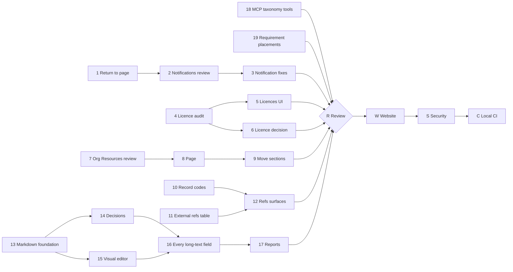

# Platform Review 19 November 2026 — Plan

**Status:** in progress (phases 1 to 7 done 2026-11-19). **Decision tags:** every decision says `Decided by: User` or `Decided by: Agent`; an Agent decision can be revisited on its own judgement, a User decision needs the user's sign-off to change.

Source: seven review notes. Each was checked against the code before planning. Four have an objection or a correction recorded under "Findings and objections"; read that section first.

## Status / Resume Here

6 / 23 phases complete.

| # | Phase | Notes | Status |
|---|-------|-------|--------|
| 1 | Return to the page after signing in | Return path kept across the sign-in, 2FA, SSO and forced password change routes | [x] |
| 2 | Notification targets: review | [Register](platform-review-2026-11-19-notification-register.md) of every notification (type, record, current target, correct target); signed off 2026-11-19 | [x] |
| 3 | Notification targets: fixes | One address (`/notifications/:id`) and one browser resolver for the bell, the list, the email and the digest; test that no type lacks a target | [x] |
| 4 | Licence audit and dependency licence guard | Shipped-component inventory, generated notices, CI guard that keeps the commercial option open | [x] |
| 5 | Licences in the Policies area | Public read-only Licences group; separate from the policy tables | [x] |
| 6 | Licence model: decision and change | Options paper and the user's choice (a decision gate); then the licence files, contribution terms and website page; decided 2026-11-19: AGPLv3 + commercial, CLA | [x] |
| 7 | Org Resources: review | [Register](platform-review-2026-11-19-org-resources-register.md) classifying every Organisation Settings group and Overview section; signed off 2026-11-19: Resources holds what is shared with projects (Tags, Reports, Compliance and the module record lists) | [x] |
| 8 | Org Resources: page and extension point | `/orgs/:orgId/resources`, registry-driven sections, redirects, navigation entry | [ ] |
| 9 | Org Resources: move sections | Move what the review approved; Organisation Settings keeps configuration only | [ ] |
| 10 | Record codes: organisation and project prefixes | Prefix per record type, project override, nested fallback; applied inside `generate_unique_code` | [ ] |
| 11 | External references: shared table | One core table keyed by record type; organisation systems; Product Feedback migrated onto it | [ ] |
| 12 | External references: every surface | Record panel, list column and filter, export and import, search, report field, bundles, MCP, look-up by key | [ ] |
| 13 | Markdown and Mermaid: shared foundation | `MarkdownView`, `MarkdownEditor` (Write and Preview), safe Mermaid, server limits | [ ] |
| 14 | Decisions: Markdown and a long-form Document | Decision text fields use the foundation; new `document` field; locks, bundles, search, reports | [ ] |
| 15 | Visual (WYSIWYG) Markdown editing | Spike with exit criteria, then the visual editor on `@tiptap/markdown`; shared toolbar with the policy editor | [ ] |
| 16 | Markdown for every long-text field | Registry-declared fields, generated inventory, mathematics coexistence | [ ] |
| 17 | Markdown and diagrams in reports and exports | Markdown to PDF, Word, OpenDocument and HTML; one shared browserless Mermaid renderer in the converter container, same engine version and font as the screen, confirmed by a spike | [ ] |
| 18 | MCP tools: components and categories | List, add, edit, reorder and delete (only when empty) a project's components and categories through MCP, so a new project can be structured by an agent; skill and generated reference updated | [ ] |
| 19 | Requirements in several components | A requirement can sit in more than one component and category; one primary pair keeps the code prefix; decision gate first | [ ] |
| R | Review checkpoint: all changes together | The user reviews phases 1 to 19 as one result; every item raised becomes a numbered phase or is fixed in place; gates W | [ ] |
| W | Website content | Update `docs/website/` for every user-visible change above, after the review | [ ] |
| S | Security review | Dependabot, CodeQL, `pip-audit`, `npm audit`, Bandit, Semgrep, Gitleaks, image scan; identify → verify → remediate on touched areas | [ ] |
| C | Local CI test review | Every job in `.github/workflows/` run locally before the pull request exists | [ ] |

Phases 1 to 3, 4 to 6, 7 to 9, 10 to 12, 13 to 17, 18 and 19 are seven independent tracks and may be built in any order; phase 3 builds on phase 1 (an email link must survive sign-in). W, S and C follow R because the website, the scans and the pipeline must describe and test the reviewed result, and CLAUDE.md makes the security review and the local CI review the last two phases of every plan.

## Findings and objections

1. **Relicensing does not, by itself, return money from hosts.** The goal stated is that someone who hosts the product and sells access should send profit back. AGPLv3 (the usual dual-licence base) forces a host who modifies the code to publish those modifications; an **unmodified** host owes nothing under it, and no copyleft licence requires payment. Licences that do restrict selling the product as a hosted service are source-available, not open source: the Business Source License and the Functional Source License (both convert to an open licence after a fixed period) and the Elastic License 2.0. They carry real costs: some organisations' procurement accepts only OSI-approved licences, and the WordPress, Elastic and HashiCorp histories show community forks follow such changes. Two further facts limit any choice: the repository is public under GPLv3 (`gh repo view`), so every release already published stays GPLv3 for anyone to host indefinitely, and a trademark policy on the name is the lever WordPress itself used. This is a legal and commercial decision; the plan produces the audit and the options (phases 4 and 6) and does not draft licence terms (**Decided by: Agent**; counsel should review).
2. **Facts that make any option possible.** One person holds the copyright (all 75 commits are under one person's two identities, no contributor agreement exists, no external pull request is recorded), and the shipped application links no GPL or AGPL library: every installed frontend package, development tools included, is MIT, ISC, Apache-2.0, BSD or similar (three are MPL-2.0, which is file-level), and in the backend the only copyleft licences are LGPL `svglib` and `psycopg2` (used unmodified and replaceable) and MPL-2.0 `certifi`; one package, `resvg_py`, has metadata reading "UNKNOWN" (verify upstream). Ghostscript (AGPL) and poppler (GPL) run in the separate converter container and are not linked. A contribution policy must exist **before** an outside contribution is accepted, or this position is lost.
3. **A hidden "dummy project" for organisation content is rejected** (**Decided by: Agent**). Every project-scoped feature assumes a real project: role grants, counters, nesting, module state per project, counts, templates, the project list. A fake one would appear in lists, counts, exports, entitlements and access reviews, and every one of those needs an exemption. The product already has the right mechanism: organisation-owned record types (Strategy, Future State, Guiding Principle, Persona, Stakeholder, Compliance standard, Architecture element, Product Feedback inbox) with their own counters and `organization_owned` providers; five modules surface theirs today through `orgOverviewSections` inside the Organisation Overview. Phase 8 gives them their own page ("Org Resources") through the same registry, which is also where the planned organisation-level workflows will land. The idea behind the note (one place for everything at organisation level) is kept in full.
4. **The policy editor cannot hold a Decision, but its library can.** The policy body is validated ProseMirror JSON limited to headings, lists, quotations, bold, italic and links; no code, table, image or diagram, and JSON does not export as CSV, search as text or suit an AI agent writing through MCP. A Decision needs Mermaid, code and tables. So: **Markdown is the stored format**; TipTap (already a dependency, with an official `@tiptap/markdown` extension, MIT) is reused for the visual editor in phase 15, and the toolbar is extracted into a shared component that the policy editor adopts too, rather than copied. The policy model itself is unchanged.
5. **Mermaid is drawn on the server without a browser** (an earlier draft wrongly said it could not). **Decided by: User**, 2026-11-19: no Chromium; every diagram type; the converter container; one shared renderer for every export that embeds a diagram; "identical to the screen" means the same engine version and the same font on both sides, not exact pixels (a browser's own output varies with the operating system and its fonts, so exact pixels was never attainable). The candidate is `mermaidx` (MIT): it runs the real, unmodified Mermaid 12 library in an embedded JavaScript engine (QuickJS-ng, or V8 in a child process) against a minimal fake DOM, with no browser or Node.js; it lists every diagram type Mermaid itself supports. Its documented limit is that text is measured with one bundled font (DejaVu Sans), so widths can differ from a browser's by a fraction of a pixel. The plan removes that difference by drawing diagrams on screen in the same DejaVu Sans, from a local font file, with the exact Mermaid version the server uses. Unverified, and the spike's job: whether a font or metrics can be supplied, Linux amd64 and arm64 wheels for the converter's Python version, maintenance (a project of about 92 stars; the last release date was not found), and fake-DOM failures for particular diagram types. Native reimplementations (`mmdr`, `merman`, `ferrigura`, `merm`) are the baseline for comparison only, since they do not cover every type. The result goes through the existing sanitising SVG path. On screen, Mermaid is the first diagram renderer in the frontend; it runs in strict mode, loads on first use only, and its output is shown as an image so it cannot run script.
6. **"Every long-text field now" changes how existing text reads.** A `*`, `#`, `-` line or `1.` in today's plain text will start to format. Plain prose is unaffected, and the visible edit field still shows what was stored. The requirement description already uses KaTeX mathematics, which the report engine also reads; Markdown and mathematics must coexist (phase 16 spike). The scope is large, so it is staged: foundation, Decisions, visual editor, then the rest through one registry declaration and a generated inventory (**Decided by: User** for the scope; **Decided by: Agent** for the staging).
7. **Per-project code overrides cannot rename existing records.** A stored code never changes (`services.codes`; links, reports and audit evidence cite it), so changing a prefix affects records created afterwards: `DEC-001` to `DEC-005`, then `ADR-006`. The counter continues and is never reused. Requirements already take their prefix from component and category, so they are outside this mechanism.
8. **The notification defect is wider than the one reported.** The "phase overdue" notification links to the project admin page because `notificationLink` sends every `project_stage` record there, although the Delivery status page (`/projects/:id/stage-phases`) exists. In addition, the email button always opens the project root or `/notifications`, never the record; and notifications without a project (organisation storage, server storage, password changed, announcements) have no link at all. The fix is one resolver, not one more special case.

## Decisions

- **Licence: AGPLv3 + commercial licence, a contributor licence agreement with a CI sign-off check, no trademark policy** (**Decided by: User**, 2026-11-19; recorded in [docs/licensing-options.md](../licensing-options.md)). The stated goal is met only partly (finding 1); the user chose this over the recommended Business Source License.
- **Code overrides at project level as well as organisation level** (**Decided by: User**, 2026-11-19). Resolution per record type: the project, then its nearest ancestor project that sets one, then the organisation, then the built-in default (**Decided by: Agent**: the nested-project rule applies to a sparse override map as it does to a definition table, so a child project inherits instead of silently reverting).
- **External references as one generic shared table** (**Decided by: User**, 2026-11-19): organisation-defined systems (name, optional URL template), several references per record (system, key, optional URL), keyed by registered type string like tags and placements, so a new type needs no code. Product Feedback's own table migrates onto it (**Decided by: Agent**: leaving both is the duplicated-mechanism failure this project's rules exist to stop).
- **Markdown for Decisions and every long-text field** (**Decided by: User**, 2026-11-19), staged as in finding 6. Stored format is Markdown source (**Decided by: Agent**).
- **Org Resources is a page, not a project** (**Decided by: Agent**; finding 3). Old Overview section addresses redirect.
- **Licences live in the Policies area but not in the policy tables** (**Decided by: Agent**): they are static, build-generated and have no author, version, audience or acknowledgement; the Policies page gains a built-in read-only "Licences" group. A consequence: the Policies page then always exists, where it today redirects away when nothing is published.
- **One notification target resolver** (**Decided by: Agent**): the email button opens `/notifications/:id`, which resolves the target in the browser with the same function the bell uses (including module `artefactPaths`) and passes through sign-in (phase 1). The alternative, duplicating every module's route templates on the server, would drift.
- **Return path rules** (**Decided by: Agent**): same-origin relative paths only, never an authentication route, kept in the router state and `sessionStorage` (so it survives a reload, the SSO redirect and the 2FA hand-off), used once, and it takes precedence over the landing preference.

## Phase specs

Every phase: stories for new UI, a Playwright test for new UI behaviour, backend tests that pin the behaviour, both seed scripts checked, a `docs/decisions.md` entry with a **Decided by** tag, and the website question answered in phase W.

### Phase 1 — Return to the page after signing in

**Why:** a lapsed session (the 401 handler clears the user and `ProtectedRoutes` redirects to `/login` with no memory of where the person was) and a followed email link both end at the landing page after sign-in, so the person must find the page again. **Risk addressed:** lost context, and an open redirect if the stored path were trusted. **Outcome:** after sign-in the person arrives at the page they were on, including the query and hash.

- `ProtectedRoutes` navigates to `/login` with the current path as state and writes it to `sessionStorage`; one helper (`utils/returnTo.ts`) validates (relative, one leading slash, not `//`, not `/login`, `/signup`, `/reset-password`, `/confirm-email`, `/oidc-complete`), reads and clears it. As built: `sessionStorage` only (with an in-memory copy), no router state; see `docs/decisions.md`.
- Honoured by `LoginPage` (password and 2FA step), the 2FA hand-off from `OrgLoginPage`, `OrgLoginPage` itself, `OidcCompletePage` (today fixed to `/projects`), and after `ForcedPasswordChangePage`.
- Unsaved form content is not preserved; this is stated in the help for the lapsed-session message rather than promised.
- Tests: unit tests of the validator (open-redirect cases, encoded slashes, other schemes); Playwright for password sign-in after expiry, a followed deep link, and a 2FA user; story for each changed page.

### Phase 2 — Notification targets: review

**Why:** the reported notification is one instance of a class. **Risk addressed:** more notifications that open an unrelated page or none. **Outcome:** a register the user signs off.

- As built: [the register](platform-review-2026-11-19-notification-register.md) lists all 43 types (40 core, 3 Risk) with the entity each is created with (about 50 creation sites, not the 90 first estimated), the page the bell and the email open today, and the signed-off target kind. Findings: eight stage types open project administration; seven types open nothing in at least one case; four Compliance types open only the project root; three creation sites lack an organisation or standard id.
- Signed off by the user, 2026-11-19: stages open Delivery status; access changes open the affected organisation, project or standard; a message with no page opens the notification detail; Compliance assignments, target dates, reviews and a new standard version open the project's Compliance page. Recorded in `docs/decisions.md`.
- Tests: none (analysis).

### Phase 3 — Notification targets: fixes

**Why:** see finding 8. **Risk addressed:** a notification that cannot take the person to its subject, and a new type shipped without a target. **Outcome:** every notification, in the bell, the list, the email and the digest, opens its subject.

- Implement the [signed-off register](platform-review-2026-11-19-notification-register.md): extend `getNotificationLink` with its target kinds; add the `/notifications/:id` route that resolves, marks the notification read and navigates, or shows the full notification when no page applies or the subject is no longer reachable; email and each digest item link to it.
- Add the organisation id (access grants, invites) and the standard id (standard access grants, standard-level reviews) as the entity where the register marks data (D); a stored notification without them falls back to the detail page.
- Delivery status gains a settings (gear) link to project administration, Stages and phases, shown only to a person who may change them (**Decided by: User**, 2026-11-19; placement per the Organisation Overview settings link).
- A declared target kind per `NotificationType` and per module kind (`ModuleDefinition.notification_types` extended generically, no per-module code in core). A backend test fails for a type with none; a frontend test fails for a kind with no route, using the route table so a renamed page cannot leave a dead link.
- Seeds: the demo and e2e datasets contain one notification of each kind.
- Tests: the two guards above; Playwright opens one notification of each target class from the bell and from an email link while signed out (uses phase 1).
- As built: an ordered list of target kinds per type (the data decides among several), `GET /notifications/{id}` with `subject_available`, Compliance's kinds declared by the module, one sample notification per kind for a dedicated persona in each seed (`scripts/seed_notification_samples.py`; the e2e dataset has no policy or report run, so those two kinds are skipped there), and the Playwright spec covers five bell targets, a message in full, the list, a signed-out email link and the gear link. See `docs/decisions.md`.

### Phase 4 — Licence audit and dependency licence guard

**Why:** distributing the Docker images requires the licence notices of every shipped component (MIT, BSD and Apache-2.0 require attribution; LGPL and MPL need their notices and the replaceability or source terms), and the commercial option depends on the shipped application never linking a GPL or AGPL library. **Risk addressed:** a missing attribution, and a later dependency silently closing off the commercial option. **Outcome:** a generated inventory and a pipeline check.

- `scripts/generate_third_party_notices.py` reads the lockfiles (backend, frontend, mcp-server, docs site) and the image components (Ghostscript, poppler, nginx, PostgreSQL client libraries, the bundled fonts: Liberation and DejaVu), excludes development-only packages, and writes `THIRD_PARTY_NOTICES.json` plus licence texts (committed, with a drift check like the lockfile check).
- `scripts/check_licences.py`: an allow-list of permissive and weak-copyleft licences for shipped application dependencies; GPL, AGPL, SSPL and unknown fail; the exceptions (the converter container's Ghostscript and poppler, run as separate programs; `resvg_py` pending verification) are named with reasons. Wired into `ci.yml`, `.githooks/pre-commit` and the SOC 2 vendor-management policy's control matrix.
- The converter image gains the embedded Mermaid engine and its font in phase 17; the inventory and the guard are extended then.
- Separately licensed optional services (Grafana, Loki, Tempo, Alloy are AGPL; cAdvisor and Prometheus Apache-2.0) are pulled from upstream, not redistributed; documented as such.
- Tests: the guard fails on a fixture dependency with a disallowed licence; the generator is deterministic.
- As built: `scripts/licence_policy.json` (the policy), `licence_inventory.py` (collection and judging), `generate_third_party_notices.py` (writes `frontend/public/licences/third-party-notices.json` and `third-party-texts.json`, so phase 5 serves them as static assets) and `check_licences.py` (offline in the pre-commit hook; `--live` in the new `licences` CI job, which also resolves the Python requirements afresh). `resvg_py` is MIT (its packaged `LICENSE`); the `UNKNOWN` item is closed. The converter image distributes GPL and AGPL programs, so a source offer is an obligation of that image; recorded for phase 6. See `docs/decisions.md`.

### Phase 5 — Licences in the Policies area

**Why:** a person, an auditor or a prospective buyer should see what the product contains and the terms it is offered under, and a source-offer link is the usual compliance step if the licence has one. The Policies page is already public and is where people look for terms. **Risk addressed:** hiding obligations in a file nobody opens; forcing static, authorless data through the versioned, audience-scoped policy model. **Outcome:** a built-in "Licences" group, readable without signing in.

- `ResourceMenu` group on `PoliciesPage` with: "Product licence" (text per phase 6, with the source link), "Third-party components" (searchable table: name, version, licence, link; expandable full text) and "Fonts". Data is the phase 4 file, loaded as a static asset on first open.
- `PoliciesPage` no longer redirects when no policy is published (the group always exists); the footer link follows.
- Strings use formal wording; the glossary entry is added.
- Tests: story, Playwright signed in and signed out (public route).
- As built: `LicencesPanel` (three sections, library table with search, sort and "Show more", detail dialog, texts read on demand), addresses `/policies/licences/{product|components|fonts}` read from the location (`utils/policiesPath.ts`), `ResourceMenu` keeps its menu for a single group with sub-pages, footer link permanent, and the product licence is one constant (GPL-3.0-only today) for phase 6 to change. The signed-out page now resolves a policy address (it ignored it before). See `docs/decisions.md`.

### Phase 6 — Licence model: decision and change

**Why:** see findings 1 and 2. **Risk addressed:** a licence change made without the owner's informed choice or counsel's review, and a lost ability to relicense. **Outcome:** a decision, then only the changes that decision needs.

- Gate: a new licensing options paper in `docs/` (written in this phase; options: AGPLv3 + commercial; GPLv3 + commercial; Business Source License or Functional Source License with a hosted-service restriction and an additional grant for internal use; Elastic License 2.0; open core), each against the stated goal, the existing GPLv3 releases, community effect and procurement effect, plus a trademark policy outline. **The user decides; no file changes before.**
- If a change is chosen: `LICENSE` and a commercial-licence summary (terms to be written with counsel), `CONTRIBUTING.md` with a contributor licence agreement and its enforcement (bot or required sign-off) added **first**, package metadata (`pyproject.toml`, `package.json`, the website's schema.org field), README, the phase 5 text, `docs/soc2/policies/vendor-and-subprocessor-management-policy.md`, and the website licensing page. Per-file headers are not added (churn without benefit; `LICENSE` and package metadata state it).
- Tests: the documentation link check; a test that the metadata of each package agrees with `LICENSE`.
- As built: [the options paper](../licensing-options.md) with the user's decision; `LICENSE` is the AGPLv3 text; `COMMERCIAL-LICENSE.md` (summary, enquiries by GitHub issue until an email address exists), `CLA.md` (version 1.0), `CONTRIBUTING.md`, `.github/cla-signatories.json` and `scripts/check_cla.py` with the `cla` CI job (maintainers read from the base branch so a pull request cannot exempt itself); `license` in `frontend` and `docs/website` `package.json` and lockfiles (the Python projects declare no package metadata); the Licences page constant and a Commercial licence link; README, website Licensing page, contributing page and glossary; vendor policy point 12 and change-management policy point 8; `backend/tests/test_cla_check.py`. Open for the user: add `CLA` to the ruleset's required checks, and counsel's review of the commercial terms, the CLA and the question of copyright in AI-assisted code. See `docs/decisions.md`.

### Phase 7 — Org Resources: review

**Why:** Organisation Settings is a 3,677-line page with sixteen groups that mixes configuration (users, SSO, security, email) with content people work in (workflows, tags, report templates, messages, policies), while organisation-level records sit in the Organisation Overview next to the dashboards. **Risk addressed:** moving the wrong things, and breaking bookmarks. **Outcome:** a signed-off classification.

- Register: each Organisation Settings group (overview, details, users, groups, projects, workflow, branding defaults, reports, SSO, email, security, modules, tags, messages, policies, role management) and each `orgOverviewSections` entry (five modules today), proposed home (Settings, Resources or Overview), and the access rule that applies.
- Check the planned organisation-level workflow modules for what they need from the page.
- Tests: none (analysis). Sign-off recorded.
- As built: [the register](platform-review-2026-11-19-org-resources-register.md). The code has four modules with Overview sections (nine sections), not five. Signed off by the user, 2026-11-19: Org Resources is what the organisation shares with its projects. Moves: the four modules' Overview sections including Compliance's two status tables, the whole Reports group (each section keeps its own permission gate), Tags, and (agent proposal, unchallenged) Architecture Elements and Collections and Decision Templates. Stays in Settings: Messages, Policies, Workflow group, project statuses and every module vocabulary and scoring section. Recorded in `docs/decisions.md`.

### Phase 8 — Org Resources: page and extension point

**Why:** see finding 3. **Risk addressed:** a one-off page importing modules (the boundary rule). **Outcome:** an empty-but-working page whose sections come from the registry.

- Route `/orgs/:orgId/resources/:group?/:section?`, `ListPageLayout`-style `ResourceMenu`, navigation-rail entry beside Organisation Overview; sections from a new generic `TierAModuleDefinition.orgResourceSections` (`orgOverviewSections` is renamed, not kept beside it) filtered by module state exactly as `orgAdminSections` is; a collision check as in `OrgAdminPage`.
- `/orgs/:orgId/overview/:section` addresses redirect to the new page; notification targets and search results that point at organisation sections are updated.
- Tests: redirect, module gating, access, a stories-and-Playwright pass; the route table guard from phase 3 includes it.

### Phase 9 — Org Resources: move sections

**Why:** finish what phase 7 approved. **Risk addressed:** half-moved content. **Outcome:** Organisation Overview holds dashboards, Org Resources holds organisation records, Organisation Settings holds configuration.

- Move the five modules' sections, then the core groups the user approved; each keeps its permission rule; `OrgAdminPage` shrinks accordingly (extract rather than leave dead code).
- Redirect every old settings address; update help and the nav-label registry keys; seeds.
- Tests: each moved section reachable at its new address, old address redirects, role gating unchanged (a guard in `test_*` comparing permissions before and after).

### Phase 10 — Record codes: organisation and project prefixes

**Why:** organisations name things their own way (`ADR` for decisions); **Risk addressed:** hard-coded prefixes in about thirty call sites and two code-shape regular expressions, an ambiguous qualified-code lookup if two types shared a prefix, and a per-create cost. **Outcome:** a prefix per record type, per organisation with a per-project override, applied to new records.

- Tables for organisation and project overrides (`artefact_type`, `prefix`); `generate_unique_code` resolves the effective prefix itself (the argument stays the default), so no call site changes; one memoised read per request; the scaling probe stays flat.
- Rules: 2 to 5 upper-case letters (every built-in prefix fits; two parsers split a summary label with exactly that shape, `services/codes.py` and `components/artefactCode.ts`, and are replaced by one shared rule in this phase that also accepts more than four digits), so no hyphen or digit (the qualified code splits on its first hyphen), not equal to the project or organisation code, effective prefixes unique across types within a project (validated on write against every registered type's default and override); requirement codes excluded (component and category prefixes) with the reason recorded.
- Existing codes never change; the counter continues; the settings panel says so. A project import numbers afresh with the destination's effective prefix.
- UI: a "Record codes" panel in organisation settings (beside the existing project-code policy) and an override panel in project settings using the platform-default override pattern; effective prefix shown with where it came from.
- Bundles (organisation and project), template classification (configuration), the CSV `code` column unaffected; nested-project fallback decision recorded in `docs/decisions.md`; audit event per change; access-control and audit policies consulted.
- Tests: resolution order including ancestors; collisions rejected; counter continuity across a prefix change; round trips; probe flatness; qualified-code lookup after a change; every record type creates with an override.

### Phase 11 — External references: shared table

**Why:** a record often has an id in another tool (Jira, DOORS, a customer's register) and people need to find it from either side. **Risk addressed:** one single-system column per type, and a second mechanism beside Product Feedback's. **Outcome:** one table and service every registered type uses.

- Core tables: `external_systems` (organisation-owned, name, optional URL template with `{key}`, ordered) with the project hide and restore behaviour (`ProjectDefinitionSuppression`) and project additions, and `external_references` (`artefact_type`, `artefact_id`, `system_id`, `key`, optional `url`, optional note), both validated against the registered types; no foreign key on the record id, cleaned on delete like tags.
- Migrate `EnhancementRequestExternalRef` and its systems (data migration with a reversible test); the module then calls the core service; its old fields stay accepted by the API.
- Security: URLs http or https only; keys are text, never HTML; the URL template is substituted with the key URL-encoded.
- Tests: service and endpoint behaviour, access (record edit permission), cross-organisation rejection, migration of existing Product Feedback data, bundle round trip.

### Phase 12 — External references: every surface

**Why:** a reference nobody can see, filter, export or look up is not usable. **Risk addressed:** the project's checklist for a shared mechanism (tags, placements) being skipped. **Outcome:** the mechanism present on every list and record.

- Record panel beside `RecordTags` through `RecordHeader`; create forms through the shared field (`QuickLinkField` pattern); list column and filter with `TagFilterField`'s companion; `external_refs` column in the shared export and import (`SYSTEM:KEY; SYSTEM:KEY`); search by key; a report field; project and organisation bundles with the `record_tags` pattern; look-up endpoint `GET …/records/by-external-reference?system=&key=` for integrations and MCP.
- Core MCP tools (read, set, remove, look up) with the agent skill and its generated reference updated in the same change.
- Tests: the existing per-type guards extended (a type with a bundle must carry references, as for tags and places), export and import round trip, search, perf probe and generator populate references.

### Phase 13 — Markdown and Mermaid: shared foundation

**Why:** see findings 4 to 6. **Risk addressed:** script injection through user text, a heavy diagram library loaded for everyone, and a second renderer drifting from the server's. **Outcome:** the components every later phase uses.

- `MarkdownView`: markdown-it with HTML disabled and links limited to https, http and mailto, rendered as React elements (no HTML insertion, as `PolicyBodyView` does); tables, code, lists, emphasis, headings, links; a `Mermaid` fenced block rendered lazily.
- Mermaid: dynamic import, `securityLevel: "strict"`, a source size cap, an element cap, a render timeout, the exact Mermaid version pinned to the one the server renderer uses (one constant, with a test that the two agree), the same font (DejaVu Sans, served as a local file, allowed by the existing `font-src 'self'`) and theme variables the server renderer is given, output shown as an image (the `safeSvgImage` precedent) so it cannot run script, light and dark theme, a text alternative, and on error the source with the message. The CSP allows this already (images from `data:`, inline styles); verified.
- `MarkdownEditor`: Write (source with a formatting toolbar) and Preview; grows with content (`AutoGrowTextarea`); `TextAreaField` gains a `markdown` prop; help text per the field-help rule.
- Server: `services/markdown_text.py` (markdown-it-py is already a dependency) for validation limits, plain-text extraction (list cells, search snippets, notifications) and the report walker.
- Pin exact versions at least two weeks old; extend `check_licences.py` (phase 4) for the new packages.
- Tests: hostile inputs (script tags, `javascript:` links, event handlers, oversized and deeply nested Mermaid), story and Playwright; bundle size check that Mermaid is not in the main chunk.

### Phase 14 — Decisions: Markdown and a long-form Document

**Why:** a decision often needs a diagram, a table and a long argument. **Risk addressed:** a new field missing from the surfaces the project requires for every column. **Outcome:** Decisions render Markdown and Mermaid and can be a full document in the application.

- `decision_statement`, `context`, `options_considered`, `chosen_option`, `rationale`, `consequences`, `assumptions`, `constraints` use the foundation; new `document` column (long-form Markdown) in `TEXT_FIELDS`, so the approved and superseded content lock covers it; the existing file attachments remain for documents made elsewhere.
- Detail page, quick view, create and edit through the one field group; CSV column; bundle; template classification; search field; report field; MCP schema and `mcp_guidance.md`; probe, generator and both seeds (the demo project's decisions gain a diagram and a document).
- Tests: lock, round trip, search finds document text, export carries source, detail renders a diagram.

### Phase 15 — Visual (WYSIWYG) Markdown editing

**Why:** many authors will not write Markdown. **Risk addressed:** an editor that silently changes content on save. **Outcome:** a visual mode, or a recorded decision not to ship one.

- Spike with exit criteria: markdown to document to markdown is stable for the supported vocabulary (headings, lists, emphasis, links, code, tables, Mermaid as a node with source editing and live preview); a field with unsupported constructs opens in Write mode with a stated reason.
- If it passes: `VisualMarkdownEditor` on `@tiptap/markdown`; a Write/Visual switch remembered per person; the toolbar extracted to a shared component and `PolicyBodyEditor` updated to use it.
- If it fails: ship Write and Preview only; record why in `docs/decisions.md`.
- Tests: round-trip suite over a corpus (including every seeded Decision), story, Playwright.

### Phase 16 — Markdown for every long-text field

**Why:** the user's scope (finding 6). **Risk addressed:** an inconsistent product (some long fields formatted, others not), changed rendering of existing text, and a field added later missing it. **Outcome:** every free-text field of every registered type is Markdown or exempt with a reason.

- A generated inventory of long free-text columns; one declaration per field through the existing record-table and search providers (`markdown=True`), read by the frontend through the registry, with a test that fails for a long-text field that is neither declared nor exempt (as `test_search.py` does for searchability).
- Mathematics: the requirement description, reasoning and clarification keep KaTeX; `MarkdownView` splits mathematics first (`splitMath`) and formats the rest; the report engine's rule is unchanged.
- Lists and notifications show plain text through the server's extraction, never raw Markdown.
- Comments (every comment table) are included or exempted with a reason in the inventory.
- Tests: per-type render and edit stories, the declaration guard, a regression suite of legacy plain text (underscores, asterisks, numbered lines) rendering sensibly.

### Phase 17 — Markdown in reports and exports

**Why:** a document that shows source characters or an unrendered diagram in a PDF is worse than plain text, and the user requires a diagram to look the same in a report as on screen. **Risk addressed:** three output formats diverging, a server diagram that differs from the approved one, and untrusted diagram text running in a privileged process. **Outcome:** formatted output and rendered diagrams in every report format, from one renderer.

- One server walker (the existing markdown-it-py token walk) feeds PDF, Word, OpenDocument and HTML: headings, lists, emphasis, links, code, tables; a Mermaid block is the rendered diagram (SVG into the existing report SVG path, rasterised where a format needs it); CSV and the shared export keep the source text.
- Spike first (exit criteria recorded in `docs/decisions.md`): render a corpus covering every Mermaid diagram type and the Decisions seeds with `mermaidx` on its QuickJS and V8 backends, and compare each with the browser's output (the frontend, in DejaVu Sans, with the same pinned version) for structure (nodes, edges, labels present) and geometry (size within a stated tolerance, text not clipped); a diagram type that fails is a finding. Also verify: wheels exist for the converter's Python version on amd64 and arm64, whether a font or metrics can be supplied, its behaviour on hostile and oversized input, render time and memory, and its maintenance and release history. The baseline for comparison is one native reimplementation.
- Build: a `/diagram` endpoint on the converter service (internal network only, no secrets, read-only filesystem, no capabilities, as the picture conversion), taking Mermaid text and a theme, with a size cap, an element cap, a timeout and a concurrency limit, returning SVG; the engine and Mermaid are loaded from files in the image, never the network. The V8 backend already runs in a child process; the QuickJS one runs in-process, so the converter's own process boundary is the isolation. If the engine cost is too large for the existing converter, the renderer becomes its own container with the same constraints (**Decided by: Agent**, to be confirmed with the user then).
- Fallback if the spike rejects the renderer (**Decided by: User**, 2026-11-19): the author's browser renders the diagram to SVG when the text is saved and the server stores the sanitised SVG beside the text, keyed by the hash of source, theme, version and font. Its stated limits, to be shown to the user before it is built: text written through MCP or an import has no stored diagram until a person opens and saves it, so such a diagram shows as a labelled source block meanwhile; a Mermaid or font change leaves stored diagrams stale until re-saved; client-supplied SVG needs the sanitising path and a size cap; and it needs one generic table keyed by record type (as tags are), not per-type code.
- The backend asks for a render at report time and caches by the hash of (source, theme, Mermaid version) so a repeated report does not re-render; a failed or timed-out render for one diagram falls back to a labelled source block and a warning in the run, never a failed report. The SVG is sanitised and embedded through `report_svg.py`. The Architecture module's diagram export can reuse the endpoint later.
- Update `docker-compose.yml` (converter limits, health check), the image scan, the licence inventory (phase 4: the embedded engine, its font and Mermaid), `docs/solution-architecture.md` and the sizing documentation for the new memory and image size.
- Report fields for the new `document` field; layouts that name a long-text field render it formatted.
- Tests: one fixture document through all four formats (structure asserted from the output files), a report with one diagram of every type, the same diagram rendered by the browser and by the service (structure and size agree), hostile diagram text (oversized, deeply nested, script in labels, runaway layout) rejected within the limits, the fallback path, the Mermaid version agreement test, and a performance probe of a report with long text and diagrams.

### Phase 18 — MCP tools: components and categories

**Why:** found 2026-11-19 on a new project: an agent connected through MCP could not create components or categories, although a requirement cannot be created without a `component_id` and a `category_id` (`create_requirement`). The REST endpoints exist (`routers/projects/taxonomy.py`) and the UI uses them; `mcp-server/server.py` exposes neither, so a new project cannot be structured by an agent and the person must switch to the browser first. **Risk addressed:** an MCP workflow that dead-ends at the first step, and a tool surface that drifts from what the API offers. **Outcome:** an agent can list, add, edit, reorder and delete an empty component or category in a project it may manage.

- Core tools in `mcp-server/server.py`, each a thin call to the existing endpoint (no new backend route, so the project-manage permission, the duplicate-prefix checks, the audit events and the category-implies-component rule apply unchanged): `list_components`, `create_component` (name, prefix), `update_component` (name, prefix), `move_component` (up or down), `list_categories` (optionally by component), `create_category` (name, prefix, component), `update_category` (name, prefix), `move_category` (up or down), `delete_component` and `delete_category`. A category is nested under one component and cannot change component here, as in the UI.
- Delete only when nothing is attached (**Decided by: User**, 2026-11-19). `delete_component` calls the existing endpoint, which already refuses while the component has categories or placed records. `delete_category` cannot: the endpoint requires `reassign_to` and moves the category's requirements and placements there, and it refuses a project's only category even when that category is empty. So `reassign_to` becomes optional (**Decided by: Agent**): omitted, the delete succeeds only when the category has no requirements and no placed records, otherwise 409 naming the count; supplied, the records move as today. The UI follows the plain-delete-first contract Action Types already use (`deleteActionType` in `ProjectAdminPage.tsx`): an empty category is removed in one confirmation with no target to pick, and a 409 opens the existing reassignment dialog. The check runs on the server inside the delete, never as a read-then-delete in the MCP tool, so a record added in between cannot be lost. The MCP tool does not expose `reassign_to`; an agent that wants to move records uses the existing requirement and placement tools first, so an agent cannot reassign a whole category by one call.
- Tool descriptions say what a prefix is for (requirement codes take the component and category prefixes), that renaming a prefix affects records created afterwards, and point `create_requirement` and `list_requirements` at the new list tools for the ids they take.
- Check the other tools that need an id the agent could not previously obtain (`list_requirements` filters, `create_requirement`, the placement and tag tools) for the same dead end, and fix any found in this phase.
- Agent skill: `mcp-server/skill/reqtrack-mcp/SKILL.md` gains the set-up-a-new-project workflow (create components, then categories, then requirements); run `python scripts/generate_skill_reference.py` in `mcp-server/`. `docs/mcp-server.md` tool table updated.
- Backend tests for the optional `reassign_to` (empty category deleted with none, including a project's only category; refused with a requirement; refused with a placed record; supplied target unchanged), and the UI's category delete dialog and `docs/website/` page checked for wording that assumes a target is always required. Audit event unchanged.
- Tests: `mcp-server/tests` for each tool (request path, body and error pass-through, including a duplicate prefix and a category under a component of another project); `mcp-server/tests/test_skill.py` stays green; an end-to-end check against the running stack that a new project is structured and a requirement created using only MCP tools.

### Phase 19 — Requirements in several components

**Why:** raised 2026-11-19: a requirement often concerns more than one component (an interface requirement touches both sides) and today it can sit in exactly one. Every other record type already can: `artefact_placements` holds any number of component/category pairs per record, and the requirement is the one type excluded (`COLUMN_PLACED_TYPES`, `docs/modules.md` §4l3) because its single `component_id`/`category_id` form its code prefix (C-G-07). No other live plan covers this (all non-completed plans checked 2026-11-19; the nearest is the shared-table decision in `docs/decisions.md`, "Component and category on every record", which left the requirement out as an **Agent** decision, so it may be revisited). **Risk addressed:** a duplicated requirement per component, losing traceability, or a second placement mechanism beside the shared one. **Outcome:** a requirement can be placed in further components and categories, with one primary pair that still supplies its code.

- Gate: the user chooses the open questions below before any file changes (**Decided by: User** to be recorded). Recommended answers are given; none is decided yet.
  1. *Model.* Recommended: keep `component_id`/`category_id` as the **primary** pair (code prefix, ordering) and allow **additional** pairs for a requirement in the shared table, so the type needs no second mechanism and the other record types are untouched. Rejected: dropping the columns and taking the prefix from the first placement (changes the identity of every requirement and its bundles, reports and imports for no gain).
  2. *Code on change of primary.* A stored code never changes (finding 7); recommended: moving a requirement's primary pair, or promoting an additional one, leaves its code as it is, as the primary component edit does today (verify against the code first).
  3. *Reports and the requirements document (C-G-04, C-E-01, C-E-02).* Recommended: a requirement is listed under its primary pair, and its additional pairs appear as a "Also in" line, so a document does not repeat the same requirement and counts stay correct; a report option may list it under every pair.
  4. *Lists and counts.* Component filter matches primary or additional pair; a component's requirement count counts a requirement once per component it sits in, labelled as such.
- `docs/requirements.md` is not changed; the primary pair keeps C-G-07 true.
- Backend: `services.placements` accepts additional pairs for a requirement (not equal to the primary pair; component required, category under it); `pairs_for_records` returns primary first, then additional; deleting a component or category treats additional pairs as it treats other placements; export and import gain an additional-placements column beside the requirement table's component and category columns (prefix form, `;`-separated); project and organisation bundles, template classification, search (`placements` field), report field and the requirement MCP tools (create, update, read) carry them, with the agent skill and its generated reference updated.
- Frontend: the requirement create and edit forms, through the one `RequirementFields` group, offer additional components through the shared `ComponentField`; the record page shows them through `RecordPlacements`; `ComponentFilterField` on the requirements list matches both (the page's own filter is reconciled, not duplicated).
- Seeds: the demo and e2e datasets contain a requirement in two components.
- Tests: primary and additional resolution, duplicate and cross-project rejection, code unchanged on promotion, filter and count, export and import round trip, bundle round trip, report layout ("Also in"), probe and generator populate additional pairs and stay flat, Storybook and Playwright for the form, the record page and the list filter.

### Phase R — Review checkpoint: all changes together

**Why:** nineteen phases across seven tracks interact (a notification opens a moved page; a Decision shows a code and a reference). **Risk addressed:** features that pass alone and fail together. **Outcome:** the user's sign-off on the combined result.

- The user reviews the running stack with every phase in place; each item raised becomes a numbered phase or is fixed in place; W starts only after the sign-off is recorded (**Decided by: User**).

### Phase W — Website content

**Why:** the docs website is a separate published artefact. **Risk addressed:** pages that describe the old Overview, old settings addresses, plain-text Decisions or a single licence. **Outcome:** every user-visible change documented once, after the review fixed what it would otherwise describe.

- Review `docs/website/docs/` and update, with Mermaid diagrams where they clarify: signing in and return, notifications (what each opens), the Policies and Licences area and the licensing page, Org Resources versus Organisation Settings, record codes and per-project overrides, requirements in several components, external references and systems, writing with Markdown and Mermaid, Decisions documents, the glossary, and the Decisions and settings reference. Check `docs/user-guide.md`, `docs/modules.md`, `docs/mcp-server.md`, `docs/solution-architecture.md`, README and the performance pages if a measured number moved (a new core table and a lookup on every create).
- Tests: the docs build and link check.

### Phase S — Security review

**Why:** with automatic update pull requests off, nothing else moves a vulnerable dependency. **Risk addressed:** known-vulnerable dependencies; new attack surface from Markdown and Mermaid rendering, the return path, external reference URLs and the public licence data. **Outcome:** open alerts at zero or recorded.

- Open Dependabot and CodeQL alerts; `pip-audit`, `npm audit`, Bandit, Semgrep, Gitleaks, the image scan; each vulnerable dependency upgraded to a supported version (never pinned back), each finding fixed in code.
- Identify → verify → remediate for: the return path (open redirect), Markdown and Mermaid (XSS, resource exhaustion), external reference URLs (scheme, injection), the notification route (record existence and access), the migration of Product Feedback data (tenant isolation), code overrides (collision and cross-tenant). Outcome in `docs/decisions.md`; SOC 2 control matrix updated where a control changed.

### Phase C — Local CI test review

**Why:** a plan closed without the whole pipeline has repeatedly left CI red. **Risk addressed:** red CI on the first run. **Outcome:** every runnable check passes before the pull request exists.

- Run every job in `.github/workflows/` locally (backend, frontend, Storybook, Playwright, lint, type check, docs, security scans, the new licence check) with `act` where it works, otherwise the same commands directly (`pytest` one at a time, `vitest`, Playwright, `scripts/check_*.py`, `mypy` through `scripts/check_mypy.py`, the scanners). List each skipped job with its reason. Fix every failure in this phase; diagnose a flake to its root cause; no timeout bump or re-run as the fix.

## Standing checklist per phase

- Module boundary: no core file imports from a module directory; any need becomes a generic registry field (`orgResourceSections`, notification target kind, markdown declaration). Check explicitly whether a core table, enum or `Record` needs a per-module value.
- New project-scoped tables: nested-project fallback decision, organisation-default hide and restore, project and organisation bundle hooks with a round-trip test, template classification.
- Every new registered behaviour on record types: scaling probe, generator, `count` hooks; the existing guards stay green.
- UI: shared components only (extract and update existing call sites), field help, required markers, formal wording, Storybook, Playwright.
- Time and dates: none of these phases stores a time; the notification target and return path add none.
- Users and groups parity: no new person-valued field is added; external references and codes do not refer to people.
- Seeds (`seed_demo_data.py`, `seed_e2e_dataset.py`) kept in step; MCP skill updated for changed tools.
- A bug found on the way is fixed in the same phase.

## Risks

- **Licence timing:** every release published under GPLv3 stays available under it; a change protects future versions only, and a contributor accepted before the agreement exists weakens the owner's position.
- **Scope of phases 13 to 17:** the largest track; phase 15's spike may remove the visual editor, and phase 16 depends on the inventory's size, which is unknown until generated.
- **Mermaid library weight and security history:** mitigated on screen by lazy loading, strict mode and image output; to be re-assessed in phase S.
- **Server renderer dependence (phase 17):** the renderer is a small third-party project running in the converter container; mitigated by pinning exact versions with hashes, the container's isolation, the spike's maintenance check, `pip-audit` in phase S, and the fallback decided above. Text widths can differ from a browser's by a fraction of a pixel unless the same font is used on both sides.
- **Same engine and font on both sides:** a Mermaid upgrade, a font change or a theme change must move the frontend and the server together; the agreement test is what keeps it true.
- **Product Feedback migration:** moves live data between tables; needs a tested, reversible migration and a backup note in the upgrade documentation.
- **Reordering sections:** old bookmarks, saved reports and notification links to organisation sections must keep working through redirects.
- **No performance run is planned in the phases;** phase W reviews whether a new lookup on every create and a long-text render moved a measured number, and phase C does not run load scenarios (the project decided against performance tests in CI).

When the table reads 23/23: move this file to `docs/plans/completed/` and run `scripts/check_doc_links.py` (see CLAUDE.md "Plan Lifecycle").
