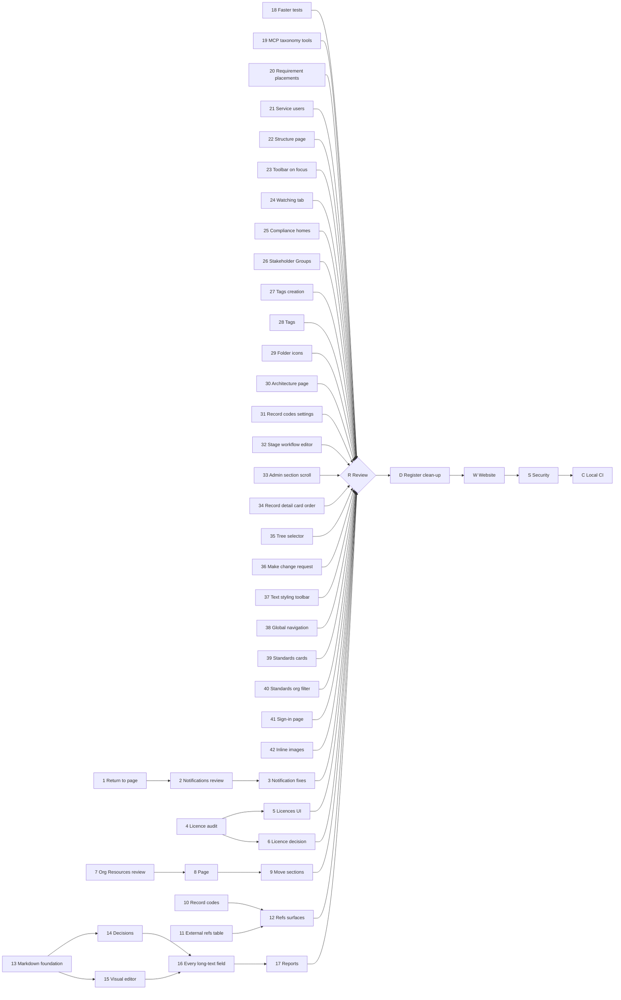

# Platform Review 19 November 2026 — Plan

**Status:** in progress (phases 1 to 38 done 2026-11-22; phases 39 to 41 added 2026-11-22 from a review of the running stack, and phase 42 from a request during phase 37, not started). **Decision tags:** every decision says `Decided by: User` or `Decided by: Agent`; an Agent decision can be revisited on its own judgement, a User decision needs the user's sign-off to change.

Source: seven review notes, then fifteen items from the user's review of the running stack on 2026-11-22 (phases 28 to 41; item 3 and 4 of that list share phase 30). Each was checked against the code before planning. Four have an objection or a correction recorded under "Findings and objections"; read that section first.

## Status / Resume Here

37 / 47 phases complete.

| # | Phase | Notes | Status |
|---|-------|-------|--------|
| 1 | Return to the page after signing in | Return path kept across the sign-in, 2FA, SSO and forced password change routes | [x] |
| 2 | Notification targets: review | [Register](platform-review-2026-11-19-notification-register.md) of every notification (type, record, current target, correct target); signed off 2026-11-19 | [x] |
| 3 | Notification targets: fixes | One address (`/notifications/:id`) and one browser resolver for the bell, the list, the email and the digest; test that no type lacks a target | [x] |
| 4 | Licence audit and dependency licence guard | Shipped-component inventory, generated notices, CI guard that keeps the commercial option open | [x] |
| 5 | Licences in the Policies area | Public read-only Licences group; separate from the policy tables | [x] |
| 6 | Licence model: decision and change | Options paper and the user's choice (a decision gate); then the licence files, contribution terms and website page; decided 2026-11-19: AGPLv3 + commercial, CLA | [x] |
| 7 | Org Resources: review | [Register](platform-review-2026-11-19-org-resources-register.md) classifying every Organisation Settings group and Overview section; signed off 2026-11-19: Resources holds what is shared with projects (Tags, Reports, Compliance and the module record lists) | [x] |
| 8 | Org Resources: page and extension point | `/orgs/:orgId/resources`, registry-driven sections, navigation entry | [x] |
| 9 | Org Resources: move sections | Move what the review approved; Organisation Settings keeps configuration only | [x] |
| 10 | Record codes: organisation and project prefixes | Prefix per record type, project override, nested fallback; applied inside `generate_unique_code` | [x] |
| 11 | External references: shared table | One core table keyed by record type; organisation systems; Product Feedback migrated onto it | [x] |
| 12 | External references: every surface | Record panel, list column and filter, export and import, search, report field, bundles, MCP, look-up by key | [x] |
| 13 | Markdown and Mermaid: shared foundation | `MarkdownView`, `MarkdownEditor` (Write and Preview), safe Mermaid, server limits | [x] |
| 14 | Decisions: Markdown and a long-form Document | Decision text fields use the foundation; new `document` field; locks, bundles, search, reports | [x] |
| 15 | Visual (WYSIWYG) Markdown editing | Spike with exit criteria, then the visual editor on `@tiptap/markdown`; shared toolbar with the policy editor | [x] |
| 16 | Markdown for every long-text field | Registry-declared fields, generated inventory, mathematics coexistence | [x] |
| 17 | Markdown and diagrams in reports and exports | Markdown to PDF, Word, OpenDocument and HTML; one shared browserless Mermaid renderer in the converter container, same engine version and font as the screen, confirmed by a spike | [x] |
| 18 | Faster test suites and git hooks | Measure first, then shorten the backend, Playwright and Storybook runs, the pipeline around them and the pre-commit hook without removing or weakening a test or a check; targets agreed with the user from the measured baseline; may be built at any point, sooner is better | [x] |
| 19 | MCP tools: components and categories | List, add, edit, reorder and delete (only when empty) a project's components and categories through MCP, so a new project can be structured by an agent; skill and generated reference updated | [x] |
| 20 | Requirements in several components | A requirement can sit in more than one component and category, with an alias code in each and a Make independent action; decision gate first | [x] |
| 21 | Service users with administrator-issued tokens | An organisation administrator creates a service user with no password and no sign-in, then issues and revokes its personal access tokens on its behalf; decision gate first | [x] |
| 22 | Components and categories: prefix suggestion and a folder-tree page | Prefix suggested from the name and editable; the Structure page rebuilt as a collapsible tree like the report folders; the requirement component and category choice through the shared tree selector; UI review first | [x] |
| 23 | Formatting toolbar only while a field is active | The Markdown and visual editors (and the policy editor) show their formatting buttons only while the field has focus | [x] |
| 24 | Watching: compact, as a tab beside Activity, for users and groups | The panel leaves the top of the requirement and change request pages; empty by default with a `[+]` to add; sits in the Links and Activity card; a user can be a watcher too (raised during the phase) | [x] |
| 25 | Compliance: one home per view | Review of Compliance across Org Resources, its own Standards page and the Organisation Overview; signed off 2026-11-21: By standard and Outstanding become tabs of the Standards page (Organisation filter), not Resources sections or Overview widgets | [x] |
| 26 | Stakeholder Groups page: alignment | UI review of the Org Resources page against the aligned-rows pattern, then the fixes; signed off 2026-11-21: the shared `FolderTreeList` grid, members below it, a row actions menu | [x] |
| 27 | Tags page: creation on demand, and a style guide rule | The new-tag controls open on request; "Pattern: creation controls on demand" added to the style guide and applied to the other always-visible create forms the review finds | [x] |
| 28 | Tags: usage in a dialog | The "Where tags are used" section becomes a dialog opened from the record count in the Used on column | [x] |
| 29 | Folder icons: review and fix | Every folder-tree list shows an icon of what its rows are (a stakeholder group, not a folder); icon chosen by the consuming list, not a core map | [x] |
| 30 | Architecture elements and collections: UI review and an actions-menu rule | One actions menu instead of three buttons; what the Folders box is and whether it stays; the rule added to `CLAUDE.md` and the style guide | [x] |
| 31 | Record codes settings: sections by module | Organisation and project pages: remove the wasted space and group the long list under Core and each module | [x] |
| 32 | Stage workflow editor: one line per stage | The edit dialog rebuilt as a compact aligned list, one line per stage, with inline controls | [x] |
| 33 | Administration section list scrolls separately | The section selector of the administration pages scrolls on its own, and a chosen section opens at its top | [x] |
| 34 | Record detail card order: a rule and the fixes | Components and codes sits above discussion; a sane default card order stated as a rule in `CLAUDE.md` and the style guide, and applied to every detail page | [x] |
| 35 | Tree selector: chevron styling and placement | The expand chevron loses its button styling; placement of chevron and checkbox reviewed | [x] |
| 36 | Requirements: Make change request in the actions menu | The action moves from the page into the record's action menu | [x] |
| 37 | Text styling toolbar: compact, and a mathematics button | Small grouped toolbar buttons; Inline equation and Equation block buttons with a live preview panel; equations drawn in the Visual view; mathematics on Decisions, Product Feedback, Open Questions, Pain Points and change requests; decided 2026-11-22 | [x] |
| 38 | Global navigation: collapsible groups | A chevron beside each group label (Project, Global, Standards and the like) folds its entries, so less scrolling reaches the others | [x] |
| 39 | Compliance standards: cards styled as project cards | Standard titles read as links and the cards share the project card's look, through one shared card | [ ] |
| 40 | Compliance standards: organisation filter | The organisation selector moves into the filter panel, defaults to every organisation, and each standard shows its organisation | [ ] |
| 41 | Sign-in page: no redirect notice | The page says nothing extra when it will return the person to a page | [ ] |
| 42 | Inline images in Markdown fields | Pictures inside the text of a record, drawn on screen, in the editors and in reports; a decision gate first | [ ] |
| R | Review checkpoint: all changes together | The user reviews phases 1 to 42 as one result; every item raised becomes a numbered phase or is fixed in place; gates W | [ ] |
| D | Register clean-up | Reconcile each phase register (`platform-review-2026-11-19-*-register.md`) with the reviewed result, move what is durable into the permanent docs, mark each closed, and fix every reference; gates W | [ ] |
| W | Website content | Update `docs/website/` for every user-visible change above, after the review | [ ] |
| S | Security review | Dependabot, CodeQL, `pip-audit`, `npm audit`, Bandit, Semgrep, Gitleaks, image scan; identify → verify → remediate on touched areas | [ ] |
| C | Local CI test review | Every job in `.github/workflows/` run locally before the pull request exists | [ ] |

Phases 1 to 3, 4 to 6, 7 to 9, 10 to 12, 13 to 17, 18, 19, 20, 21, 22, 23, 24, 25, 26 and 27 are fifteen independent tracks, and phases 28 to 42 fifteen more (phase 18 touches only test and pipeline tooling, so it can run first to shorten every later phase's test runs); phase 22 follows phase 19 where both touch the prefix rule (one function, below) and may be built in any order; phase 23 touches the editors of phases 13 to 16 and phase 25 the Org Resources sections of phases 7 to 9, so both sit after them (already done); phase 27's style guide rule is read by phases 25 and 26 when they review a create control; phase 3 builds on phase 1 (an email link must survive sign-in). D follows R because the registers must describe the reviewed result, not the first build. W, S and C follow R because the website, the scans and the pipeline must describe and test the reviewed result, and CLAUDE.md makes the security review and the local CI review the last two phases of every plan.

## Findings and objections

1. **Relicensing does not, by itself, return money from hosts.** The goal stated is that someone who hosts the product and sells access should send profit back. AGPLv3 (the usual dual-licence base) forces a host who modifies the code to publish those modifications; an **unmodified** host owes nothing under it, and no copyleft licence requires payment. Licences that do restrict selling the product as a hosted service are source-available, not open source: the Business Source License and the Functional Source License (both convert to an open licence after a fixed period) and the Elastic License 2.0. They carry real costs: some organisations' procurement accepts only OSI-approved licences, and the WordPress, Elastic and HashiCorp histories show community forks follow such changes. Two further facts limit any choice: the repository is public under GPLv3 (`gh repo view`), so every release already published stays GPLv3 for anyone to host indefinitely, and a trademark policy on the name is the lever WordPress itself used. This is a legal and commercial decision; the plan produces the audit and the options (phases 4 and 6) and does not draft licence terms (**Decided by: Agent**; counsel should review).
2. **Facts that make any option possible.** One person holds the copyright (all 75 commits are under one person's two identities, no contributor agreement exists, no external pull request is recorded), and the shipped application links no GPL or AGPL library: every installed frontend package, development tools included, is MIT, ISC, Apache-2.0, BSD or similar (three are MPL-2.0, which is file-level), and in the backend the only copyleft licences are LGPL `svglib` and `psycopg2` (used unmodified and replaceable) and MPL-2.0 `certifi`; one package, `resvg_py`, has metadata reading "UNKNOWN" (verify upstream). Ghostscript (AGPL) and poppler (GPL) run in the separate converter container and are not linked. A contribution policy must exist **before** an outside contribution is accepted, or this position is lost.
3. **A hidden "dummy project" for organisation content is rejected** (**Decided by: Agent**). Every project-scoped feature assumes a real project: role grants, counters, nesting, module state per project, counts, templates, the project list. A fake one would appear in lists, counts, exports, entitlements and access reviews, and every one of those needs an exemption. The product already has the right mechanism: organisation-owned record types (Strategy, Future State, Guiding Principle, Persona, Stakeholder, Compliance standard, Architecture element, Product Feedback inbox) with their own counters and `organization_owned` providers; five modules surface theirs today through `orgOverviewSections` inside the Organisation Overview. Phase 8 gives them their own page ("Org Resources") through the same registry, which is also where the planned organisation-level workflows will land. The idea behind the note (one place for everything at organisation level) is kept in full.
4. **The policy editor cannot hold a Decision, but its library can.** The policy body is validated ProseMirror JSON limited to headings, lists, quotations, bold, italic and links; no code, table, image or diagram, and JSON does not export as CSV, search as text or suit an AI agent writing through MCP. A Decision needs Mermaid, code and tables. So: **Markdown is the stored format**; TipTap (already a dependency, with an official `@tiptap/markdown` extension, MIT) is reused for the visual editor in phase 15, and the toolbar is extracted into a shared component that the policy editor adopts too, rather than copied. The policy model itself is unchanged.
5. **Mermaid is drawn on the server without a browser** (an earlier draft wrongly said it could not). **Decided by: User**, 2026-11-19: no Chromium; every diagram type; the converter container; one shared renderer for every export that embeds a diagram; "identical to the screen" means the same engine version and the same font on both sides, not exact pixels (a browser's own output varies with the operating system and its fonts, so exact pixels was never attainable). The candidate is `mermaidx` (MIT): it runs the real, unmodified Mermaid 12 library in an embedded JavaScript engine (QuickJS-ng, or V8 in a child process) against a minimal fake DOM, with no browser or Node.js; it lists every diagram type Mermaid itself supports. Its documented limit is that text is measured with one bundled font (DejaVu Sans), so widths can differ from a browser's by a fraction of a pixel. The plan removes that difference by drawing diagrams on screen in the same DejaVu Sans, from a local font file, with the exact Mermaid version the server uses. Unverified, and the spike's job: whether a font or metrics can be supplied, Linux amd64 and arm64 wheels for the converter's Python version, maintenance (a project of about 92 stars; the last release date was not found), and fake-DOM failures for particular diagram types. Native reimplementations (`mmdr`, `merman`, `ferrigura`, `merm`) are the baseline for comparison only, since they do not cover every type. The result goes through the existing sanitising SVG path. On screen, Mermaid is the first diagram renderer in the frontend; it runs in strict mode, loads on first use only, and its output is shown as an image so it cannot run script.
6. **"Every long-text field now" changes how existing text reads.** A `*`, `#`, `-` line or `1.` in today's plain text will start to format. Plain prose is unaffected, and the visible edit field still shows what was stored. The requirement description already uses KaTeX mathematics, which the report engine also reads; Markdown and mathematics must coexist (phase 16 spike). The scope is large, so it is staged: foundation, Decisions, visual editor, then the rest through one registry declaration and a generated inventory (**Decided by: User** for the scope; **Decided by: Agent** for the staging).
7. **Per-project code overrides cannot rename existing records.** A stored code never changes (`services.codes`; links, reports and audit evidence cite it), so changing a prefix affects records created afterwards: `DEC-001` to `DEC-005`, then `ADR-006`. The counter continues and is never reused. Requirements already take their prefix from component and category, so they are outside this mechanism.
8. **The notification defect is wider than the one reported.** The "phase overdue" notification links to the project admin page because `notificationLink` sends every `project_stage` record there, although the Delivery status page (`/projects/:id/stage-phases`) exists. In addition, the email button always opens the project root or `/notifications`, never the record; and notifications without a project (organisation storage, server storage, password changed, announcements) have no link at all. The fix is one resolver, not one more special case.

## Decisions

- **Licence: AGPLv3 + commercial licence, a contributor licence agreement with a CI sign-off check, no trademark policy** (**Decided by: User**, 2026-11-19; recorded in [docs/licensing-options.md](../licensing-options.md)). The stated goal is met only partly (finding 1); the user chose this over the recommended Business Source License.
- **Code overrides at project level as well as organisation level** (**Decided by: User**, 2026-11-19). Resolution per record type: the project, then its nearest ancestor project that sets one, then the organisation, then the built-in default (**Decided by: Agent**: the nested-project rule applies to a sparse override map as it does to a definition table, so a child project inherits instead of silently reverting).
- **External references as one generic shared table** (**Decided by: User**, 2026-11-19): organisation-defined systems (name, optional URL template), several references per record (system, key, optional URL), keyed by registered type string like tags and placements, so a new type needs no code. Product Feedback's own table migrates onto it (**Decided by: Agent**: leaving both is the duplicated-mechanism failure this project's rules exist to stop).
- **Markdown for Decisions and every long-text field** (**Decided by: User**, 2026-11-19), staged as in finding 6. Stored format is Markdown source (**Decided by: Agent**).
- **Org Resources is a page, not a project** (**Decided by: Agent**; finding 3). The first build redirected the old Overview section addresses; removed 2026-11-21 (**Decided by: User**).
- **Licences live in the Policies area but not in the policy tables** (**Decided by: Agent**): they are static, build-generated and have no author, version, audience or acknowledgement; the Policies page gains a built-in read-only "Licences" group. A consequence: the Policies page then always exists, where it today redirects away when nothing is published.
- **One notification target resolver** (**Decided by: Agent**): the email button opens `/notifications/:id`, which resolves the target in the browser with the same function the bell uses (including module `artefactPaths`) and passes through sign-in (phase 1). The alternative, duplicating every module's route templates on the server, would drift.
- **Return path rules** (**Decided by: Agent**): same-origin relative paths only, never an authentication route, kept in the router state and `sessionStorage` (so it survives a reload, the SSO redirect and the 2FA hand-off), used once, and it takes precedence over the landing preference.

## Phase specs

Every phase: stories for new UI, a Playwright test for new UI behaviour, backend tests that pin the behaviour, both seed scripts checked, a `docs/decisions.md` entry with a **Decided by** tag, and the website question answered in phase W.

### Phase 1 — Return to the page after signing in

**Why:** a lapsed session (the 401 handler clears the user and `ProtectedRoutes` redirects to `/login` with no memory of where the person was) and a followed email link both end at the landing page after sign-in, so the person must find the page again. **Risk addressed:** lost context, and an open redirect if the stored path were trusted. **Outcome:** after sign-in the person arrives at the page they were on, including the query and hash.

- `ProtectedRoutes` navigates to `/login` with the current path as state and writes it to `sessionStorage`; one helper (`utils/returnTo.ts`) validates (relative, one leading slash, not `//`, not `/login`, `/signup`, `/reset-password`, `/confirm-email`, `/oidc-complete`), reads and clears it. As built: `sessionStorage` only (with an in-memory copy), no router state; see `docs/decisions.md`.
- Honoured by `LoginPage` (password and 2FA step), the 2FA hand-off from `OrgLoginPage`, `OrgLoginPage` itself, `OidcCompletePage` (today fixed to `/projects`), and after `ForcedPasswordChangePage`.
- Unsaved form content is not preserved; this is stated in the help for the lapsed-session message rather than promised.
- Tests: unit tests of the validator (open-redirect cases, encoded slashes, other schemes); Playwright for password sign-in after expiry, a followed deep link, and a 2FA user; story for each changed page.

### Phase 2 — Notification targets: review

**Why:** the reported notification is one instance of a class. **Risk addressed:** more notifications that open an unrelated page or none. **Outcome:** a register the user signs off.

- As built: [the register](platform-review-2026-11-19-notification-register.md) lists all 43 types (40 core, 3 Risk) with the entity each is created with (about 50 creation sites, not the 90 first estimated), the page the bell and the email open today, and the signed-off target kind. Findings: eight stage types open project administration; seven types open nothing in at least one case; four Compliance types open only the project root; three creation sites lack an organisation or standard id.
- Signed off by the user, 2026-11-19: stages open Delivery status; access changes open the affected organisation, project or standard; a message with no page opens the notification detail; Compliance assignments, target dates, reviews and a new standard version open the project's Compliance page. Recorded in `docs/decisions.md`.
- Tests: none (analysis).

### Phase 3 — Notification targets: fixes

**Why:** see finding 8. **Risk addressed:** a notification that cannot take the person to its subject, and a new type shipped without a target. **Outcome:** every notification, in the bell, the list, the email and the digest, opens its subject.

- Implement the [signed-off register](platform-review-2026-11-19-notification-register.md): extend `getNotificationLink` with its target kinds; add the `/notifications/:id` route that resolves, marks the notification read and navigates, or shows the full notification when no page applies or the subject is no longer reachable; email and each digest item link to it.
- Add the organisation id (access grants, invites) and the standard id (standard access grants, standard-level reviews) as the entity where the register marks data (D); a stored notification without them falls back to the detail page.
- Delivery status gains a settings (gear) link to project administration, Stages and phases, shown only to a person who may change them (**Decided by: User**, 2026-11-19; placement per the Organisation Overview settings link).
- A declared target kind per `NotificationType` and per module kind (`ModuleDefinition.notification_types` extended generically, no per-module code in core). A backend test fails for a type with none; a frontend test fails for a kind with no route, using the route table so a renamed page cannot leave a dead link.
- Seeds: the demo and e2e datasets contain one notification of each kind.
- Tests: the two guards above; Playwright opens one notification of each target class from the bell and from an email link while signed out (uses phase 1).
- As built: an ordered list of target kinds per type (the data decides among several), `GET /notifications/{id}` with `subject_available`, Compliance's kinds declared by the module, one sample notification per kind for a dedicated persona in each seed (`scripts/seed_notification_samples.py`; the e2e dataset has no policy or report run, so those two kinds are skipped there), and the Playwright spec covers five bell targets, a message in full, the list, a signed-out email link and the gear link. See `docs/decisions.md`.

### Phase 4 — Licence audit and dependency licence guard

**Why:** distributing the Docker images requires the licence notices of every shipped component (MIT, BSD and Apache-2.0 require attribution; LGPL and MPL need their notices and the replaceability or source terms), and the commercial option depends on the shipped application never linking a GPL or AGPL library. **Risk addressed:** a missing attribution, and a later dependency silently closing off the commercial option. **Outcome:** a generated inventory and a pipeline check.

- `scripts/generate_third_party_notices.py` reads the lockfiles (backend, frontend, mcp-server, docs site) and the image components (Ghostscript, poppler, nginx, PostgreSQL client libraries, the bundled fonts: Liberation and DejaVu), excludes development-only packages, and writes `THIRD_PARTY_NOTICES.json` plus licence texts (committed, with a drift check like the lockfile check).
- `scripts/check_licences.py`: an allow-list of permissive and weak-copyleft licences for shipped application dependencies; GPL, AGPL, SSPL and unknown fail; the exceptions (the converter container's Ghostscript and poppler, run as separate programs; `resvg_py` pending verification) are named with reasons. Wired into `ci.yml`, `.githooks/pre-commit` and the SOC 2 vendor-management policy's control matrix.
- The converter image gains the embedded Mermaid engine and its font in phase 17; the inventory and the guard are extended then.
- Separately licensed optional services (Grafana, Loki, Tempo, Alloy are AGPL; cAdvisor and Prometheus Apache-2.0) are pulled from upstream, not redistributed; documented as such.
- Tests: the guard fails on a fixture dependency with a disallowed licence; the generator is deterministic.
- As built: `scripts/licence_policy.json` (the policy), `licence_inventory.py` (collection and judging), `generate_third_party_notices.py` (writes `frontend/public/licences/third-party-notices.json` and `third-party-texts.json`, so phase 5 serves them as static assets) and `check_licences.py` (offline in the pre-commit hook; `--live` in the new `licences` CI job, which also resolves the Python requirements afresh). `resvg_py` is MIT (its packaged `LICENSE`); the `UNKNOWN` item is closed. The converter image distributes GPL and AGPL programs, so a source offer is an obligation of that image; recorded for phase 6. See `docs/decisions.md`.

### Phase 5 — Licences in the Policies area

**Why:** a person, an auditor or a prospective buyer should see what the product contains and the terms it is offered under, and a source-offer link is the usual compliance step if the licence has one. The Policies page is already public and is where people look for terms. **Risk addressed:** hiding obligations in a file nobody opens; forcing static, authorless data through the versioned, audience-scoped policy model. **Outcome:** a built-in "Licences" group, readable without signing in.

- `ResourceMenu` group on `PoliciesPage` with: "Product licence" (text per phase 6, with the source link), "Third-party components" (searchable table: name, version, licence, link; expandable full text) and "Fonts". Data is the phase 4 file, loaded as a static asset on first open.
- `PoliciesPage` no longer redirects when no policy is published (the group always exists); the footer link follows.
- Strings use formal wording; the glossary entry is added.
- Tests: story, Playwright signed in and signed out (public route).
- As built: `LicencesPanel` (three sections, library table with search, sort and "Show more", detail dialog, texts read on demand), addresses `/policies/licences/{product|components|fonts}` read from the location (`utils/policiesPath.ts`), `ResourceMenu` keeps its menu for a single group with sub-pages, footer link permanent, and the product licence is one constant (GPL-3.0-only today) for phase 6 to change. The signed-out page now resolves a policy address (it ignored it before). See `docs/decisions.md`.

### Phase 6 — Licence model: decision and change

**Why:** see findings 1 and 2. **Risk addressed:** a licence change made without the owner's informed choice or counsel's review, and a lost ability to relicense. **Outcome:** a decision, then only the changes that decision needs.

- Gate: a new licensing options paper in `docs/` (written in this phase; options: AGPLv3 + commercial; GPLv3 + commercial; Business Source License or Functional Source License with a hosted-service restriction and an additional grant for internal use; Elastic License 2.0; open core), each against the stated goal, the existing GPLv3 releases, community effect and procurement effect, plus a trademark policy outline. **The user decides; no file changes before.**
- If a change is chosen: `LICENSE` and a commercial-licence summary (terms to be written with counsel), `CONTRIBUTING.md` with a contributor licence agreement and its enforcement (bot or required sign-off) added **first**, package metadata (`pyproject.toml`, `package.json`, the website's schema.org field), README, the phase 5 text, `docs/soc2/policies/vendor-and-subprocessor-management-policy.md`, and the website licensing page. Per-file headers are not added (churn without benefit; `LICENSE` and package metadata state it).
- Tests: the documentation link check; a test that the metadata of each package agrees with `LICENSE`.
- As built: [the options paper](../licensing-options.md) with the user's decision; `LICENSE` is the AGPLv3 text; `COMMERCIAL-LICENSE.md` (summary, enquiries by GitHub issue until an email address exists), `CLA.md` (version 1.0), `CONTRIBUTING.md`, `.github/cla-signatories.json` and `scripts/check_cla.py` with the `cla` CI job (maintainers read from the base branch so a pull request cannot exempt itself); `license` in `frontend` and `docs/website` `package.json` and lockfiles (the Python projects declare no package metadata); the Licences page constant and a Commercial licence link; README, website Licensing page, contributing page and glossary; vendor policy point 12 and change-management policy point 8; `backend/tests/test_cla_check.py`. Open for the user: add `CLA` to the ruleset's required checks, and counsel's review of the commercial terms, the CLA and the question of copyright in AI-assisted code. See `docs/decisions.md`.

### Phase 7 — Org Resources: review

**Why:** Organisation Settings is a 3,677-line page with sixteen groups that mixes configuration (users, SSO, security, email) with content people work in (workflows, tags, report templates, messages, policies), while organisation-level records sit in the Organisation Overview next to the dashboards. **Risk addressed:** moving the wrong things, and breaking bookmarks. **Outcome:** a signed-off classification.

- Register: each Organisation Settings group (overview, details, users, groups, projects, workflow, branding defaults, reports, SSO, email, security, modules, tags, messages, policies, role management) and each `orgOverviewSections` entry (five modules today), proposed home (Settings, Resources or Overview), and the access rule that applies.
- Check the planned organisation-level workflow modules for what they need from the page.
- Tests: none (analysis). Sign-off recorded.
- As built: [the register](platform-review-2026-11-19-org-resources-register.md). The code has four modules with Overview sections (nine sections), not five. Signed off by the user, 2026-11-19: Org Resources is what the organisation shares with its projects. Moves: the four modules' Overview sections including Compliance's two status tables, the whole Reports group (each section keeps its own permission gate), Tags, and (agent proposal, unchallenged) Architecture Elements and Collections and Decision Templates. Stays in Settings: Messages, Policies, Workflow group, project statuses and every module vocabulary and scoring section. Recorded in `docs/decisions.md`.

### Phase 8 — Org Resources: page and extension point

**Why:** see finding 3. **Risk addressed:** a one-off page importing modules (the boundary rule). **Outcome:** an empty-but-working page whose sections come from the registry.

- Route `/orgs/:orgId/resources/:group?/:section?`, `ListPageLayout`-style `ResourceMenu`, navigation-rail entry beside Organisation Overview; sections from a new generic `TierAModuleDefinition.orgResourceSections` (`orgOverviewSections` is renamed, not kept beside it) filtered by module state exactly as `orgAdminSections` is; a collision check as in `OrgAdminPage`.
- `/orgs/:orgId/overview/:section` addresses redirect to the new page; notification targets and search results that point at organisation sections are updated.
- Tests: redirect, module gating, access, a stories-and-Playwright pass; the route table guard from phase 3 includes it.
- As built: `OrgResourcesPage`, `modules/orgResources.ts` (collection, collision rule, address helpers), the rename to `orgResourceSections` (so the nine existing sections move here now; phase 9 moves the core groups and the two `orgAdminSections` record lists), `/org-resources` and a navigation-rail entry, redirects from the old Overview addresses keeping the query string, and the back links and Compliance widget links of the organisation record pages. The phase 3 route guard needed no change (no notification kind opens a section). The redirects from the earlier Overview addresses were removed on 2026-11-21 (phase 25). Stories for the page and helpers, Playwright `org-resources.spec.ts` plus the updated `org-overview.spec.ts` (module gating, redirect, empty state). See `docs/decisions.md`.

### Phase 9 — Org Resources: move sections

**Why:** finish what phase 7 approved. **Risk addressed:** half-moved content. **Outcome:** Organisation Overview holds dashboards, Org Resources holds organisation records, Organisation Settings holds configuration.

- Move the five modules' sections, then the core groups the user approved; each keeps its permission rule; `OrgAdminPage` shrinks accordingly (extract rather than leave dead code).
- Redirect every old settings address; update help and the nav-label registry keys; seeds.
- Tests: each moved section reachable at its new address, old address redirects, role gating unchanged (a guard in `test_*` comparing permissions before and after).
- As built: Reports (`OrgReportsResources`, with its own configuration form) and Tags are core sections of the page (`CORE_ORG_RESOURCE_GROUP_KEYS`); Architecture Elements and Collections and Decision Templates became `orgResourceSections`; `OrgAdminPage` dropped the two groups and the report-configuration state. The earlier Settings addresses redirected in the first build; the redirects were removed on 2026-11-21 (phase 25). A defect from phase 8 was fixed on the way: the page read the administrator-only module list, so a member would have been left on the spinner; the new member-readable `GET /orgs/{id}/enabled-modules` (keys only) replaces it and also hides a section whose sub-component is off. The empty state is gone (core always contributes). The permission guard is a pair of stories (configuration hidden without administrator access, exact five-field save) and a backend test of the new endpoint, because the page decides no access and no endpoint changed. See `docs/decisions.md`.

### Phase 10 — Record codes: organisation and project prefixes

**Why:** organisations name things their own way (`ADR` for decisions); **Risk addressed:** hard-coded prefixes in about thirty call sites and two code-shape regular expressions, an ambiguous qualified-code lookup if two types shared a prefix, and a per-create cost. **Outcome:** a prefix per record type, per organisation with a per-project override, applied to new records.

- Tables for organisation and project overrides (`artefact_type`, `prefix`); `generate_unique_code` resolves the effective prefix itself (the argument stays the default), so no call site changes; one memoised read per request; the scaling probe stays flat.
- Rules: 2 to 5 upper-case letters (every built-in prefix fits; two parsers split a summary label with exactly that shape, `services/codes.py` and `components/artefactCode.ts`, and are replaced by one shared rule in this phase that also accepts more than four digits), so no hyphen or digit (the qualified code splits on its first hyphen), not equal to the project or organisation code, effective prefixes unique across types within a project (validated on write against every registered type's default and override); requirement codes excluded (component and category prefixes) with the reason recorded.
- Existing codes never change; the counter continues; the settings panel says so. A project import numbers afresh with the destination's effective prefix.
- UI: a "Record codes" panel in organisation settings (beside the existing project-code policy) and an override panel in project settings using the platform-default override pattern; effective prefix shown with where it came from.
- Bundles (organisation and project), template classification (configuration), the CSV `code` column unaffected; nested-project fallback decision recorded in `docs/decisions.md`; audit event per change; access-control and audit policies consulted.
- Tests: resolution order including ancestors; collisions rejected; counter continuity across a prefix change; round trips; probe flatness; qualified-code lookup after a change; every record type creates with an override.
- As built: `models/code_prefix.py` and migration 0202; `services/code_prefixes.py` (resolution memoised on the session, validation, bundle and template helpers); `ModuleDefinition.default_code_prefixes` and `no_code_prefix` (every module declares its types; a test fails for a type with neither); `routers/code_prefixes.py` (organisation and project, list, set, clear, each row with the tier and what clearing returns to); the Actions generator follows an override too; `RecordCodePrefixPanel` in Organisation Settings (Projects group) and the Project Admin overview. One code reading replaces the two regular expressions (`code_rules.split_record_label`, frontend twin held to it by shared vectors); the phase's "more than four digits" would have split a standard named `ISO-27001`, so a compliance clause label is never split. Found and fixed on the way: the Architecture connection-end import cell assumed `-ELM-`; the action bundle assumed `ACT-n`; the organisation bundle dropped the project code policy. Probe flatness needed no new test: creation adds one memoised read per owner and no list, detail or export path changed. See `docs/decisions.md`.

### Phase 11 — External references: shared table

**Why:** a record often has an id in another tool (Jira, DOORS, a customer's register) and people need to find it from either side. **Risk addressed:** one single-system column per type, and a second mechanism beside Product Feedback's. **Outcome:** one table and service every registered type uses.

- Core tables: `external_systems` (organisation-owned, name, optional URL template with `{key}`, ordered) with the project hide and restore behaviour (`ProjectDefinitionSuppression`) and project additions, and `external_references` (`artefact_type`, `artefact_id`, `system_id`, `key`, optional `url`, optional note), both validated against the registered types; no foreign key on the record id, cleaned on delete like tags.
- Migrate `EnhancementRequestExternalRef` and its systems (data migration with a reversible test); the module then calls the core service; its old fields stay accepted by the API.
- Security: URLs http or https only; keys are text, never HTML; the URL template is substituted with the key URL-encoded.
- Tests: service and endpoint behaviour, access (record edit permission), cross-organisation rejection, migration of existing Product Feedback data, bundle round trip.

- As built: `models/external_reference.py` (the systems models moved from Product Feedback and gained `url_template`; the new `ExternalReference` with an optional `role`, `note`, owner columns and no record foreign key), migrations 0203 (core) and 0204 (Product Feedback's data, reversible), `services/external_references.py` (vocabulary, validation, `link_for`, add/update/remove, conversion, bundle halves, `references_enabled`), `routers/external_references.py` and `routers/external_systems.py` (built on `services/vocabulary_endpoints.py`, `TypeVocabulary` extra columns), core bundle sections and template copy for the systems, `ExternalSystemsPanels` in Organisation Settings and Project Admin, core MCP tools `list_external_systems` and `list_organization_external_systems`. Decided with the user: generic optional role, one route set under organisation administrator and project settings authority, the panel in this phase. See `docs/decisions.md`.

### Phase 12 — External references: every surface

**Why:** a reference nobody can see, filter, export or look up is not usable. **Risk addressed:** the project's checklist for a shared mechanism (tags, placements) being skipped. **Outcome:** the mechanism present on every list and record.

- Record panel beside `RecordTags` through `RecordHeader`; create forms through the shared field (`QuickLinkField` pattern); list column and filter with `TagFilterField`'s companion; `external_refs` column in the shared export and import (`SYSTEM:KEY; SYSTEM:KEY`); search by key; a report field; project and organisation bundles with the `record_tags` pattern; look-up endpoint `GET …/records/by-external-reference?system=&key=` for integrations and MCP.
- Core MCP tools (read, set, remove, look up) with the agent skill and its generated reference updated in the same change.
- Tests: the existing per-type guards extended (a type with a bundle must carry references, as for tags and places), export and import round trip, search, perf probe and generator populate references.

- As built: `services/external_reference_surfaces.py` (the filter as one SQL `EXISTS` on an alias, `ReferenceCells` and `reference_column` for the shared `external_refs` column on both tiers, `apply_imported_references`, `reference_texts`, `page_references`, `find_records_by_reference`); `TagFilter` and the requirement list take `external_system` and `external_key`; search field `external_refs` (opt-in) and a report field of the same key; `record_references` / `prime_record_references` / `restore_record_references` beside every tags and placements bundle site (requirements too), with the project's systems now imported before any record; routes `GET /projects/{id}/external-references/{type}` and `GET /projects/{id}/records/by-external-reference`; core MCP tools `get_`, `add_`, `update_`, `remove_artefact_external_reference` and `find_artefacts_by_external_reference`, with the skill and reference regenerated; perf generator `ratios.references_per_record` (profile version 15). Frontend: `RecordReferences` inside `RecordTags`, `ReferenceField` inside `TagField` and `useCommitTags`, `ReferenceFilterField` inside `TagFilterField` and `useTagFilter`, a column on every list through `DirectoryTable`'s `placements` prop, `usePageReferences` and `ReferencesCell` for the hand-written tables. Product Feedback keeps its own references panel (`references={false}`). See `docs/decisions.md`.

### Phase 13 — Markdown and Mermaid: shared foundation

**Why:** see findings 4 to 6. **Risk addressed:** script injection through user text, a heavy diagram library loaded for everyone, and a second renderer drifting from the server's. **Outcome:** the components every later phase uses.

- `MarkdownView`: markdown-it with HTML disabled and links limited to https, http and mailto, rendered as React elements (no HTML insertion, as `PolicyBodyView` does); tables, code, lists, emphasis, headings, links; a `Mermaid` fenced block rendered lazily.
- Mermaid: dynamic import, `securityLevel: "strict"`, a source size cap, an element cap, a render timeout, the exact Mermaid version pinned to the one the server renderer uses (one constant, with a test that the two agree), the same font (DejaVu Sans, served as a local file, allowed by the existing `font-src 'self'`) and theme variables the server renderer is given, output shown as an image (the `safeSvgImage` precedent) so it cannot run script, light and dark theme, a text alternative, and on error the source with the message. The CSP allows this already (images from `data:`, inline styles); verified.
- `MarkdownEditor`: Write (source with a formatting toolbar) and Preview; grows with content (`AutoGrowTextarea`); `TextAreaField` gains a `markdown` prop; help text per the field-help rule.
- Server: `services/markdown_text.py` (markdown-it-py is already a dependency) for validation limits, plain-text extraction (list cells, search snippets, notifications) and the report walker.
- Pin exact versions at least two weeks old; extend `check_licences.py` (phase 4) for the new packages.
- Tests: hostile inputs (script tags, `javascript:` links, event handlers, oversized and deeply nested Mermaid), story and Playwright; bundle size check that Mermaid is not in the main chunk.
- As built: `utils/markdownIt.ts` (markdown-it 15.0.3, pinned exactly) and `MarkdownView` (tokens to React elements; `#` is an `h3`; a refused link or an image stays as the text typed); `MermaidDiagram` and `utils/mermaidRender.ts` (Mermaid 12.3.0, pinned exactly; lazy, strict, SVG text labels, drawn one at a time, cached, image of a data URI through `safeSvgImage` with the font embedded as trusted CSS); `utils/mermaidRenderConfig.json` (version, font and limits, the contract the report renderer will share; a story checks the version against the pin and `test_markdown_text.py` checks the limit); the font is a 25 KB Latin subset of DejaVu Sans in `frontend/src/assets/fonts/` (licence policy updated); `MarkdownEditor` (Write with toolbar, Preview; `ToolbarButton` extracted from the policy editor, which now uses it) and `TextAreaField markdown`; `help.markdown`; `services/markdown_text.py` (`validate_markdown`, `markdown_limit`, `plain_text`, `mermaid_sources`; nesting limit 50 because the reader silently drops everything past 100); `scripts/check_mermaid_lazy.py` in the CI frontend job (the bundle check). The first consumer is the overview text widget, which dropped its own subset renderer (`safeMarkdown`). Not done here, by design: the report walker (the reports phase replaces `report_model`'s narrower inline reader with it) and any schema using `markdown_limit` (Decisions, next). See `docs/decisions.md`.

### Phase 14 — Decisions: Markdown and a long-form Document

**Why:** a decision often needs a diagram, a table and a long argument. **Risk addressed:** a new field missing from the surfaces the project requires for every column. **Outcome:** Decisions render Markdown and Mermaid and can be a full document in the application.

- `decision_statement`, `context`, `options_considered`, `chosen_option`, `rationale`, `consequences`, `assumptions`, `constraints` use the foundation; new `document` column (long-form Markdown) in `TEXT_FIELDS`, so the approved and superseded content lock covers it; the existing file attachments remain for documents made elsewhere.
- Detail page, quick view, create and edit through the one field group; CSV column; bundle; template classification; search field; report field; MCP schema and `mcp_guidance.md`; probe, generator and both seeds (the demo project's decisions gain a diagram and a document).
- Tests: lock, round trip, search finds document text, export carries source, detail renders a diagram.
- As built: limits (50,000 per section, 200,000 the document) are checked in one place, `edits.check_markdown_limits`, so the import and record-table paths are covered with the endpoints; `RecordField` gained `markdown`; `SearchField` gained a generic `markdown` flag so a snippet shows plain text; the built-in Decision reports cut cells with `plain_text`; the CSV reader's per-cell limit was raised to the upload cap (a defect found on the way). Not done here, by design: the other types' fields (phase 16), the report engine's Markdown rendering (phase 17), the website pages (phase W). See `docs/decisions.md`.

### Phase 15 — Visual (WYSIWYG) Markdown editing

**Why:** many authors will not write Markdown. **Risk addressed:** an editor that silently changes content on save. **Outcome:** a visual mode, or a recorded decision not to ship one.

- Spike with exit criteria: markdown to document to markdown is stable for the supported vocabulary (headings, lists, emphasis, links, code, tables, Mermaid as a node with source editing and live preview); a field with unsupported constructs opens in Write mode with a stated reason.
- If it passes: `VisualMarkdownEditor` on `@tiptap/markdown`; a Write/Visual switch remembered per person; the toolbar extracted to a shared component and `PolicyBodyEditor` updated to use it.
- If it fails: ship Write and Preview only; record why in `docs/decisions.md`.
- Tests: round-trip suite over a corpus (including every seeded Decision), story, Playwright.
- As built: the spike passed (109-text corpus, `utils/markdownRoundTripCases.json`, compared by what the reader makes of the text); three writer defects were corrected in `utils/visualMarkdown.ts`; a guard (`findVisualBlocker`) runs on every open and keeps a text the editor cannot hold (HTML, image, footnote, task list, mathematics) in Write with the reason stated. `VisualMarkdownEditor` (loaded on first use; `mermaid` block as editable source with a live diagram; tables) sits in `MarkdownEditor` as a Visual tab, the default, the last explicit choice remembered per browser (**Decided by: User**). `RichTextToolbar` is shared with `PolicyBodyEditor`. Also requested during the phase (**Decided by: User**): pasted plain text that looks like Markdown shows a notice with Convert to formatting and Keep as typed. Not done here, by design: mathematics coexistence and the other types' fields (phase 16), the website pages (phase W). See `docs/decisions.md`.

### Phase 16 — Markdown for every long-text field

**Why:** the user's scope (finding 6). **Risk addressed:** an inconsistent product (some long fields formatted, others not), changed rendering of existing text, and a field added later missing it. **Outcome:** every free-text field of every registered type is Markdown or exempt with a reason.

- A generated inventory of long free-text columns; one declaration per field through the existing record-table and search providers (`markdown=True`), read by the frontend through the registry, with a test that fails for a long-text field that is neither declared nor exempt (as `test_search.py` does for searchability).
- Mathematics: the requirement description, reasoning and clarification keep KaTeX; `MarkdownView` splits mathematics first (`splitMath`) and formats the rest; the report engine's rule is unchanged.
- Lists and notifications show plain text through the server's extraction, never raw Markdown.
- Comments (every comment table) are included or exempted with a reason in the inventory.
- Tests: per-type render and edit stories, the declaration guard, a regression suite of legacy plain text (underscores, asterisks, numbered lines) rendering sensibly.
- As built: 159 long-text columns inventoried (a script prints the table): 129 Markdown, 30 plain with reasons. The declaration is `MarkdownField(Model.column, limit, math)` on `ModuleDefinition.markdown_fields` (`markdown_columns`; core in `services/long_text_core.py`, each module's in `long_text.py`) or a reason in `plain_text_fields`, not the record-table and search providers themselves (a provider's column is not a table column; search is opt-in), which keep only a `markdown` flag a test ties to the declaration. The declaration is also the write limit through a session `before_flush` hook (`services/markdown_fields.py`). Mathematics coexist through a markdown-it rule (`utils/markdownMath`) rather than splitting the text first; an equation field is edited in Write and Preview. Comments are Markdown with the simple editor and a version change note stays plain (**Decided by: User**). Frontend: `TextAreaField markdown | "simple" | "math"` or `plainText="<reason>"` (`scripts/check_markdown_fields.py`), `RecordField math`, six per-page `Field` copies replaced by `RecordField`, `markdownPlainText` for one-line places, the comment boxes on `MarkdownEditor simple`. Server plain text in the compliance and announcement notifications and the record-list report cell. See `docs/decisions.md`.

### Phase 17 — Markdown in reports and exports

**Why:** a document that shows source characters or an unrendered diagram in a PDF is worse than plain text, and the user requires a diagram to look the same in a report as on screen. **Risk addressed:** three output formats diverging, a server diagram that differs from the approved one, and untrusted diagram text running in a privileged process. **Outcome:** formatted output and rendered diagrams in every report format, from one renderer.

- One server walker (the existing markdown-it-py token walk) feeds PDF, Word, OpenDocument and HTML: headings, lists, emphasis, links, code, tables; a Mermaid block is the rendered diagram (SVG into the existing report SVG path, rasterised where a format needs it); CSV and the shared export keep the source text.
- Spike first (exit criteria recorded in `docs/decisions.md`): render a corpus covering every Mermaid diagram type and the Decisions seeds with `mermaidx` on its QuickJS and V8 backends, and compare each with the browser's output (the frontend, in DejaVu Sans, with the same pinned version) for structure (nodes, edges, labels present) and geometry (size within a stated tolerance, text not clipped); a diagram type that fails is a finding. Also verify: wheels exist for the converter's Python version on amd64 and arm64, whether a font or metrics can be supplied, its behaviour on hostile and oversized input, render time and memory, and its maintenance and release history. The baseline for comparison is one native reimplementation.
- Build: a `/diagram` endpoint on the converter service (internal network only, no secrets, read-only filesystem, no capabilities, as the picture conversion), taking Mermaid text and a theme, with a size cap, an element cap, a timeout and a concurrency limit, returning SVG; the engine and Mermaid are loaded from files in the image, never the network. The V8 backend already runs in a child process; the QuickJS one runs in-process, so the converter's own process boundary is the isolation. If the engine cost is too large for the existing converter, the renderer becomes its own container with the same constraints (**Decided by: Agent**, to be confirmed with the user then).
- Fallback if the spike rejects the renderer (**Decided by: User**, 2026-11-19): the author's browser renders the diagram to SVG when the text is saved and the server stores the sanitised SVG beside the text, keyed by the hash of source, theme, version and font. Its stated limits, to be shown to the user before it is built: text written through MCP or an import has no stored diagram until a person opens and saves it, so such a diagram shows as a labelled source block meanwhile; a Mermaid or font change leaves stored diagrams stale until re-saved; client-supplied SVG needs the sanitising path and a size cap; and it needs one generic table keyed by record type (as tags are), not per-type code.
- The backend asks for a render at report time and caches by the hash of (source, theme, Mermaid version) so a repeated report does not re-render; a failed or timed-out render for one diagram falls back to a labelled source block and a warning in the run, never a failed report. The SVG is sanitised and embedded through `report_svg.py`. The Architecture module's diagram export can reuse the endpoint later.
- Update `docker-compose.yml` (converter limits, health check), the image scan, the licence inventory (phase 4: the embedded engine, its font and Mermaid), `docs/solution-architecture.md` and the sizing documentation for the new memory and image size.
- Report fields for the new `document` field; layouts that name a long-text field render it formatted.
- Tests: one fixture document through all four formats (structure asserted from the output files), a report with one diagram of every type, the same diagram rendered by the browser and by the service (structure and size agree), hostile diagram text (oversized, deeply nested, script in labels, runaway layout) rejected within the limits, the fallback path, the Mermaid version agreement test, and a performance probe of a report with long text and diagrams.
- As built: the spike passed (the QuickJS backend of `mermaidx` draws all 38 corpus diagrams, the printed words equal the browser's and 35 of 38 sizes are within 1.5%; V8 not adopted), so the engine joined the existing converter container (`POST /diagram`, one killed-at-30-s process per drawing, 228 MB to 255 MB image). `services/report_diagram.py` (client, cache, run budget), `services/svg_styles.py` (the drawing's style sheet applied as attributes, because the sanitiser removes style elements and a sanitised Mermaid drawing lost its colours), `services/report_markdown.py` (one walk, an author reader and a record reader) and the new blocks `CodeBlock`, `Quote` and nested lists (`levels` and `ordered`), tables as the existing `Grid`, drawn in PDF, Word, OpenDocument and HTML. PDF, Word and OpenDocument print a diagram as a 300 dpi picture (`Image.raster`: `svglib` mis-places a diagram's text and markers), HTML keeps the vector. A Markdown field prints formatted where a text-block paragraph is only its placeholder (`ReportField.markdown`, from the search declaration); elsewhere it shows its words. Changed behaviour in existing text, both flagged in `docs/decisions.md`: PDF keeps single line breaks as the other formats do, and a layout's own text reads tables, quotations, fences and indented code. A found defect fixed on the way: `resvg` dropped labels written `font-family="sans-serif"`. The reference file (`converter/tests/diagram_reference.json`) holds both renderers to the browser's output; the shared corpus and reference are regenerated by `frontend/scripts/generate-diagram-reference.mjs`. The converter stays opt-in (**Decided by: User**), and at the user's request CI no longer publishes a new `converter`, `mcp-server` or `docs` image when its sources did not change (`src-<tree>` tag, release tags put on the existing image). See `docs/decisions.md`.

### Phase 18 — Faster test suites and git hooks

**Why:** raised 2026-11-20: the three suites take long enough to slow development, and (added the same day, **Decided by: User**) the git hooks are slow enough to be felt on every commit. `docs/development.md` puts the backend suite at 15 to 25 minutes on four workers (about 95 serial), `ci.yml` records the Playwright suite (about 510 tests on 2 workers) at about 30 minutes after about 9 minutes of stack set-up, and the Storybook job (616 stories, each run in both themes) sits under a 35-minute ceiling that has been outgrown before. Every phase of this plan, and phase C, pays that cost. **Risk addressed:** a slow loop means fewer test runs, larger unverified changes and a pipeline whose ceilings keep being raised; the opposite failure, a suite made fast by dropping coverage, ordering assumptions or retries, is what the guardrails below forbid. **Outcome:** a measured baseline, a measured result for each suite and for the pipeline's wall-clock time, and a shorter inner loop, with the same tests running and the same isolation guarantees.

- **Measure before changing anything** (gate): record where the time goes, per suite, in a findings table in `docs/decisions.md` (**Decided by: Agent**: one place, with the command that produced each number). Backend: `pytest --durations=50`, per-file totals, worker start-up (migrations or schema build per worker, app and module-registry import), per-test set-up and clean-up, and idle workers at the end of a run (load imbalance). Playwright: the JSON reporter's per-spec and per-test durations, time spent in sign-in and seeding steps, fixed waits (`waitForTimeout`, `sleep`), and the serial `global-state-mutators` project's share. Storybook: per-story time, browser start-up, the cost of the coverage run and of the second theme. Pipeline: each job's wall-clock, the critical path through `needs`, image build time and cache hits. Git hooks: wall-clock of each check and of the whole hook for each commit shape, three runs each, on a quiet machine. The baseline and a proposed target for each are shown to the user for sign-off before any change (**Decided by: User** to be recorded); starting proposal: halve each suite's wall-clock time.
- **Candidate levers, each kept only if the measurement shows a gain** (a lever that gains nothing is not built):
  - Backend: worker count matched to the cores measured rather than a fixed `-n 4`; `--dist` mode and slowest-first ordering to remove tail imbalance; build the migrated schema once and give each worker its database with `CREATE DATABASE ... TEMPLATE` instead of running the migrations per worker; cheaper shared set-up (organisation, user and project factories that skip repeated password hashing and registry work); remove fixed sleeps and per-test work that only one test needs (promote to a module or session fixture where the test does not mutate it); mark the slowest tests (the converter's real renderer, the repository demo load) so the default local run is the fast set while CI still runs all of them; split a file that holds one slow test and many fast ones only if the distribution is the cause.
  - Playwright: workers raised to what the host and the CI runner measure well (the local host already runs 8); sign-in once per persona through a saved storage state in `global-setup` instead of through the form in each test; create fixtures through the API instead of through the UI where the UI path is not the thing under test; replace fixed waits with the condition waited for; move the shared-state mutations out of the serial project into disposable organisations so more of the suite runs in parallel; shard the suite across CI jobs, as the `ci.yml` comment already says to do rather than raise the ceiling.
  - Storybook: shard with `vitest --shard` across jobs; run the coverage report only where it is published; reduce per-story cost where one story dominates (Mermaid, the visual editor); keep both themes (the style guide requires them) unless the measurement shows the second theme can share a render without losing the check.
  - Pipeline: Docker layer and package caches for the image builds, so set-up does not rebuild unchanged layers; jobs that need no stack started earlier; a change that touches only `docs/website/` or other files no suite reads does not run the suites (the pipeline's required-check rules checked first, so a skipped job still reports success).
  - Git hooks (`.githooks/pre-commit`, the only hook): measured per check on a typical commit (a documentation-only, a source-only and a lockfile commit) and ranked by cost. Candidates, each kept only if the measurement shows a gain: run only the checks whose staged paths match (already done for most, so check that every trigger pattern is as narrow as its check needs, for example `check_doc_links.py` runs on any `.py`, `.ts`, `.md` or `.yml` change); make the heavy checks (`check_doc_links.py`, `check_licences.py`) read only the staged and changed files or cache their repository walk keyed by the tree hash; run the independent checks in parallel; avoid a second `git diff --cached` per check by reading the staged list once; skip `npm ci --dry-run` unless the dependency lines of a `package.json` changed, not any edit to it. Guardrails: every check the hook runs today still runs, on every commit that could break it, and CI still runs the full versions (the hook is a fast early warning, never the only gate); the hook never auto-fixes or re-stages; a faster check must return the same verdict as the full one on the same input, shown by running both over the repository's history of commits (or a sample) and comparing.
  - Inner loop: a documented fast path for a change in progress (the affected test files, or the tests selected by the changed paths) that never replaces the full run before the pull request; the full run stays what phase C and CI execute.
- **Guardrails** (**Decided by: Agent**, from CLAUDE.md): no test is deleted, skipped or weakened to save time; the coverage floor in `ci.yml` and every `scripts/check_*.py` guard stay as they are; no timeout is raised and no retry is added as the fix, and a flake found on the way is diagnosed to its root cause in this phase; the rule that a test passes alone, first, last and repeated against the same database holds after any change to parallelism, sharding or shared fixtures, and is verified (below); the shared test database rules still hold (one backend `pytest` invocation at a time on a host; per-worker databases under `-n`); the perf tooling's own tests (`test_perf_dataset.py`, `test_scaling_shapes.py`, `test_perf_runner.py`) keep passing, and its safety rules (`PERF_STACK=1`, no target URL) are not touched.
- Docs: `docs/development.md` (suite times, the worker and shard options, the fast path, what the pre-commit hook checks and how long it takes), the timeout comments in `ci.yml` (updated to the measured times, with the shard counts), and `docs/decisions.md` with the baseline, the levers kept and the levers rejected with their measurements. No user-visible surface, so no website page; phase W records that answer.
- Seeds: `seed_e2e_dataset.py` stays in step if a saved storage state or an API fixture needs a persona it does not yet hold; the demo seed is unaffected.
- Tests: a check that a sharded or filtered run executes every test exactly once (the union of the shards' collected test identifiers equals the unsharded collection, for the backend, Storybook and Playwright); a shuffled-order and a repeated-run pass of the backend suite and of the Playwright suite after the change, with every failure treated as a real isolation defect and fixed; a test that every check in `.githooks/pre-commit` fires for a staged file of each kind it guards and for no other kind (so a narrowed trigger cannot silently stop a check), and that each check's fast form agrees with its full form; the new timing report (per-suite durations in the job summary) so a regression in wall-clock time is visible on the next run, and its budget in the findings table; the measured result against the signed-off target, recorded with the same commands as the baseline.

- As built: baseline, targets and results are in `docs/decisions.md` ("Phase 18"). Targets signed off by the user (halve each) and the route (cut per-test cost, no backend sharding; Playwright: fix load failures first, then shard). **Met:** the pre-commit hook (20 to 35 s down to about 1 s on a typical commit). **Not met locally:** the backend suite (38 min 20 s down to 31 min 23 s, against 20), and the local Playwright and Storybook runs are as long as before (their shortening is in CI, by sharding, not measured on GitHub from here). Kept: the `client` fixture restores the bootstrap's rows from a per-worker copy instead of running it (set-up work 1,216 down to 528 worker-seconds); the 235 s type-by-person test split into eight shares; the 114 slowest tests marked `slow`; `--shuffle-seed`; hook triggers read once, `check_doc_links.py --staged`, `check_health_probes.py` and `check_licences.py` reading git's file list; E2E in three shards (shard 1 also runs the serial project once) behind an `e2e-suite` aggregator that keeps the required check name, and Storybook in three shards merged by `frontend` (same name), each with a timing summary; the backend job runs one API process. Fixed on the way: five tests that needed repository files outside the backend container, load-sensitive stories (six form stories typed 200 characters one key at a time; the state machine snap story and the Mermaid reference story each did too much for one test), three Playwright specs that no longer matched the interface or raced a save. Rejected with measurements: a template database per worker, an API sign-in in place of the form (0.85 s against 0.9 s), a faster database setting, caching the starter-layout validation, skipping suites for documentation-only changes, more workers than four on an 8 GB VM. See the decisions entry for each figure.

### Phase 19 — MCP tools: components and categories

**Why:** found 2026-11-19 on a new project: an agent connected through MCP could not create components or categories, although a requirement cannot be created without a `component_id` and a `category_id` (`create_requirement`). The REST endpoints exist (`routers/projects/taxonomy.py`) and the UI uses them; `mcp-server/server.py` exposes neither, so a new project cannot be structured by an agent and the person must switch to the browser first. **Risk addressed:** an MCP workflow that dead-ends at the first step, and a tool surface that drifts from what the API offers. **Outcome:** an agent can list, add, edit, reorder and delete an empty component or category in a project it may manage.

- Core tools in `mcp-server/server.py`, each a thin call to the existing endpoint (no new backend route, so the project-manage permission, the duplicate-prefix checks, the audit events and the category-implies-component rule apply unchanged): `list_components`, `create_component` (name, prefix; prefix optional once phase 22's suggestion exists), `update_component` (name, prefix), `move_component` (up or down), `list_categories` (optionally by component), `create_category` (name, prefix, component), `update_category` (name, prefix), `move_category` (up or down), `delete_component` and `delete_category`. A category is nested under one component and cannot change component here, as in the UI.
- Delete only when nothing is attached (**Decided by: User**, 2026-11-19). `delete_component` calls the existing endpoint, which already refuses while the component has categories or placed records. `delete_category` cannot: the endpoint requires `reassign_to` and moves the category's requirements and placements there, and it refuses a project's only category even when that category is empty. So `reassign_to` becomes optional (**Decided by: Agent**): omitted, the delete succeeds only when the category has no requirements and no placed records, otherwise 409 naming the count; supplied, the records move as today. The UI follows the plain-delete-first contract Action Types already use (`deleteActionType` in `ProjectAdminPage.tsx`): an empty category is removed in one confirmation with no target to pick, and a 409 opens the existing reassignment dialog. The check runs on the server inside the delete, never as a read-then-delete in the MCP tool, so a record added in between cannot be lost. The MCP tool does not expose `reassign_to`; an agent that wants to move records uses the existing requirement and placement tools first, so an agent cannot reassign a whole category by one call.
- Tool descriptions say what a prefix is for (requirement codes take the component and category prefixes), that renaming a prefix affects records created afterwards, and point `create_requirement` and `list_requirements` at the new list tools for the ids they take.
- Check the other tools that need an id the agent could not previously obtain (`list_requirements` filters, `create_requirement`, the placement and tag tools) for the same dead end, and fix any found in this phase.
- Agent skill: `mcp-server/skill/reqtrack-mcp/SKILL.md` gains the set-up-a-new-project workflow (create components, then categories, then requirements); run `python scripts/generate_skill_reference.py` in `mcp-server/`. `docs/mcp-server.md` tool table updated.
- Backend tests for the optional `reassign_to` (empty category deleted with none, including a project's only category; refused with a requirement; refused with a placed record; supplied target unchanged), and the UI's category delete dialog and `docs/website/` page checked for wording that assumes a target is always required. Audit event unchanged.
- Tests: `mcp-server/tests` for each tool (request path, body and error pass-through, including a duplicate prefix and a category under a component of another project); `mcp-server/tests/test_skill.py` stays green; an end-to-end check against the running stack that a new project is structured and a requirement created using only MCP tools.
- As built: `list_components`, `list_categories` (optionally by component), `list_stages` and the eight write tools in `mcp-server/server.py`; `reassign_to` optional on `DELETE …/categories/{id}` (409 with the counts while anything is attached, a row lock before the counts); the category delete in `ProjectAdminPage` asks one confirmation and opens the reassignment dialog only on a 409; `list_stages` added because `target_stage_id` had no source of ids; skill, generated reference, `docs/mcp-server.md` and the two website pages updated; backend, MCP (unit and against the stack), Storybook and Playwright tests. Not done: an MCP way to list people and groups for `owner` (the description points at the groups lists). See `docs/decisions.md`.

### Phase 20 — Requirements in several components

**Why:** raised 2026-11-19: a requirement often concerns more than one component (an interface requirement touches both sides) and today it can sit in exactly one. Every other record type already can: `artefact_placements` holds any number of component/category pairs per record, and the requirement is the one type excluded (`COLUMN_PLACED_TYPES`, `docs/modules.md` §4l3) because its single `component_id`/`category_id` form its code prefix (C-G-07). No other live plan covers this (all non-completed plans checked 2026-11-19; the nearest is the shared-table decision in `docs/decisions.md`, "Component and category on every record", which left the requirement out as an **Agent** decision, so it may be revisited). **Risk addressed:** a duplicated requirement per component, losing traceability, or a second placement mechanism beside the shared one. **Outcome:** a requirement can be placed in further components and categories, with one primary pair and an **alias code** in each further pair (proposed by the user, 2026-11-19), and an alias can be made independent so it can then be changed on its own.

- Gate: answered 2026-11-21 (**Decided by: User**, each recommendation accepted: model, code resolution, traceability effect, alias lifecycle, reports and counts, and the setting's mechanism); recorded in `docs/decisions.md`, "Phase 20". As built: [the decision entry](../decisions.md).
  1. *Model.* Recommended: keep `component_id`/`category_id` as the **primary** pair (its code is the record's identity) and hold each further pair in the shared table, so no second placement mechanism exists and other types are untouched. Each further pair carries an **alias code** (`HW-IF-017`) built from that pair's own component and category prefixes (C-G-07), numbered from the project's one requirement counter (`services.requirements._next_sequence`, so never reused, C-G-06). The alias names the **same** record: one set of content, versions, approval, comments, links and attachments; an edit or approval shows under every code. Rejected: dropping the columns and taking the prefix from the first placement (changes every requirement's identity, bundles, reports and imports for no gain).
  2. *Resolving a code.* Recommended: any code, primary or alias, finds the one record (qualified-code look-up, link finder, search, imports, MCP); the record page and a list row show the primary code, with the code of the pair being viewed shown as the alias when it differs; a report or export names a requirement by the code of the pair it is listed under, so each component's section reads with that component's own identifiers; the CSV `code` column accepts an alias and updates the one record.
  3. *Make independent.* Recommended: an action on an alias (permission: edit the requirement, plus create in the alias's component) creates a **new requirement** from the current version's content, takes the alias code as its own code (so every place that cited the alias keeps pointing at what was written under that code), removes the alias from the original, and links the two. The new requirement starts as a draft in the scoping stage, never approved (an approval gate is not bypassed by a copy); its owner and creator are the person who acted, with the original author named in its first version note. The action is two-tier confirmed (it cannot be undone), audited on both records, and offered as a bulk action on the alias list.
     - **Decided by: User, 2026-11-19:** the copy takes the original's **links** (each made as a new link on the copy; the original keeps its own) and **comments**, and is linked to the original as **Related to**. Tags and attachments are copied as well (**Decided by: Agent**, the same reading: a copy that starts clean of metadata would have to be re-tagged by hand).
     - *Copied links and the link lock (**Decided by: Agent**).* A new link follows the same rules as one made in the UI: the approved-link lock and the organisation's change-request setting still apply to the other end, so a link the lock refuses is not forced through; the result lists every link not copied and why, never dropping one silently.
     - *Copied comments (**Decided by: Agent**).* Written as new comments with the original author and time shown and a marker "copied from REQ-001", never re-attributed to the person who made the copy, so the audit trail does not claim they wrote them.
     - *Related to, not Derives from (**Decided by: Agent**).* "Related to" is the default link type with no traceability flow (`LinkFlow.NONE`), so the pair never forms a chain, a rule gap or an orphan fix on its own; "Derives from" would make the copy downstream of the original. The link types belong to the organisation and can be renamed or removed, so the action looks the type up by the symmetric, no-flow type and, when the organisation has none, asks the person to choose one rather than failing.
     - *Traceability effect (flagged, needs your answer).* The copy inherits the original's links, so Module 7's coverage and rule checks see it as covered at once, including by **Verified by** and **Validates** links to tests written against the original's text, although the copy is a new draft that may now change. Two orphan-side effects follow: the original and the copy each count in coverage totals, and a "no links" filter will not show the copy. Recommended: copy the verification and validation links as the user asked, but mark each as carried over (a note on the link: "copied from REQ-001"), and have the Module 7 status show a record whose verification links are all carried over as "verification inherited" rather than verified, until a person confirms or replaces them. This is the same rule as an approved waiver never reading as real coverage; if you prefer a plain copy with no such state, say so and the note alone is built.
  4. *Alias lifecycle.* Recommended: removing an alias (taking the requirement out of that component) retires its code, which is never reused and still resolves to the record with a notice, so a citation does not break; promoting an alias to primary swaps the two (the old primary code stays as an alias) and no code is lost; archiving the record archives it under every code.
  5. *Reports and the requirements document (C-G-04, C-E-01, C-E-02).* Follows from 2: a requirement is listed under every pair it sits in, with that pair's code, and a "Same as REQ" cross-reference on the alias entry; totals count records once and say so. An option to list only primary pairs is available for a document that must not repeat text.
  6. *Aliasing can be switched off (**Decided by: User**, 2026-11-19: the capability; the mechanism below is **Decided by: Agent**, open for your confirmation).* A project that relies on traceability wants one record to have one code, since a record with several codes makes a matrix, a coverage figure and a citation ambiguous. Recommended: a setting **Requirement aliases: Allowed or Disabled** at organisation level (default Allowed, the flexible reading) and a project value that is *Inherit*, *Allowed* or *Disabled*, resolved project, then nearest ancestor project that sets one, then organisation (the nested-project rule for a sparse override, as for code prefixes). Not tied to a module: core must not read one module's state, and a project may want aliases off without Traceability, or on with it; the Traceability documentation and the setting's `(?)` help recommend Disabled, and a project that enables Traceability is shown a notice about the setting, through a generic extension point if one is needed, never a Traceability case in core.
     - *Disabled* stops **new** aliases (the form, import, MCP and API refuse with a clear message; **Make independent** is unaffected). Existing aliases are never removed or hidden by a setting change: they keep resolving, stay listed, and can be made independent one by one or in bulk. The settings panel shows how many aliases the project has, with the bulk action, so a project can move to one code per record on purpose.
     - Surfaced in organisation settings and project settings through the platform-default override pattern (effective value and where it came from). Travels in the organisation and project bundles and is classified as template configuration. Audited per change. Permission: project administration, and organisation administration for the default. Optional later: an organisation lock that forbids a project from enabling it (not built unless asked).
  7. *Lists and counts.* The component filter matches primary or alias pairs; a component's requirement count counts a requirement once per component it sits in, labelled as such.
- `docs/requirements.md` is not changed; the primary pair keeps C-G-07 true.
- Backend: an alias table (`requirement_aliases`: requirement, component, category, unique code per project, retired flag, project-scoped, cascading with the project; the nested-project question is answered "none", a pair is a reference to a row) or alias codes on the shared placement row, chosen in the gate by the one that keeps the placement uniqueness rules simplest; `services.placements` accepts additional pairs for a requirement (not equal to the primary pair; component required, category under it) and issues the alias code in the same transaction; `pairs_for_records` returns primary first, then aliases; `services.codes` / `find_record_by_qualified_code` resolve an alias code; the make-independent service and endpoint reuse `create_requirement`'s numbering and audit path; deleting a component or category treats additional pairs as it treats other placements; export and import gain an additional-placements column beside the requirement table's component and category columns (prefix form, `;`-separated); project and organisation bundles, template classification, search (`placements` field), report field and the requirement MCP tools (create, update, read) carry them, with the agent skill and its generated reference updated.
- Frontend: the requirement create and edit forms, through the one `RequirementFields` group, offer additional components through the shared `ComponentField`; the record page shows them through `RecordPlacements` with each alias code (through `<RecordCode>`, never a hand-formatted code) and a **Make independent** action on an alias; `ComponentFilterField` on the requirements list matches both (the page's own filter is reconciled, not duplicated).
- Setting: an organisation column and a project column with the resolver used by every alias entry point (form, import, MCP, API, bulk action); the project panel's alias count comes from one grouped query.
- Seeds: the demo and e2e datasets contain a requirement in two components, and one project with aliases disabled.
- Module 7 (not built yet): the carried-over note and the "verification inherited" status are a generic field on the link and a status input registered through the Traceability module's own extension point, never a Traceability edit in the core requirement code; its plan (`module-07-traceability-and-governance-plan.md`, status rules and Phase 15 coverage) gains a one-line cross-reference.
- Tests: primary and alias resolution, an alias code finding the one record from a link, search, import and MCP, duplicate and cross-project rejection, alias numbers never reused after removal, concurrent alias creation (the counter lock), the setting (resolution through ancestor and organisation, a disabled project refusing a new alias from the form, import, MCP and API, existing aliases still resolving and listed after disabling, bulk make independent, bundle round trip, template classification, audit), make independent (new code is the alias code, draft state, no approval carried, original loses the alias, links copied as new links with the lock respected and a skipped-link report, comments copied with original authors, Related to link made or a choice offered when the type is absent, tags and attachments copied, audit on both, permissions, double submit), code unchanged on promotion, filter and count, export and import round trip, bundle round trip (aliases travel by prefix and a code is information only), report layout (each pair's code, "Same as" cross-reference), probe and generator populate additional pairs and stay flat, Storybook and Playwright for the form, the record page and the list filter.

### Phase 21 — Service users with administrator-issued tokens

**Why:** raised 2026-11-19: an integration (an MCP agent, a build job) should not run as a named person, and a person's departure should not break it. Today a personal access token belongs to the user who creates it, through a session-only endpoint (`routers/pats.py`, `get_current_session_user`), so an integration needs a real account with a password, an email address and a human who signs in once to mint the token. **Risk addressed:** shared or orphaned human accounts used as integration identities, passwords that exist only to be pasted somewhere, and actions attributed to a person who did not take them. **Outcome:** an organisation administrator creates a **service user** (no password, no interactive sign-in) and issues, lists and revokes its tokens on its behalf; every action it takes is attributed to it, and everything else about it is an ordinary user.

- Gate: answered 2026-11-21 (**Decided by: User**: every recommendation accepted, responsible principal optional, administrator roles allowed); recorded in `docs/decisions.md`, "Phase 21". The points below are the questions as asked.
  1. *Model.* Recommended: a `User` row with `is_service_account` true, `password_hash` null and an `auth_backend` that matches no sign-in backend (the same sentinel idea as `invited`), so it is a principal everywhere a user already is: roles, groups, owners, assignees, reviewers, notification and audit actors (users and groups on parity needs no new mechanism). Rejected: a separate service-account table, which would need a second principal type in every picker, gate, filter, report and bundle. The `email` column is unique and required, so the creation form takes an **optional email address** (**Decided by: User**, 2026-11-19: a service user may receive email, for example automated notifications). Left blank, the account takes a generated, non-deliverable address on the reserved `.invalid` domain (`svc-<id>@service.invalid`) and receives no email; making `email` nullable would touch every login and invite path for no gain. A supplied address is used only to deliver notifications, never to sign in: it follows the same uniqueness rule as a person's, and `find_or_provision_user`'s existing-by-email match, self-sign-up and the password-recovery lookup must skip service accounts, or a person signing in with that address through SSO would adopt the service user and its roles (a test pins it). It can be changed by an organisation administrator and is not confirmed by a link (nobody can open one), so the form states that notifications, which can name records, go to whoever reads that mailbox.
  2. *Bound to one organisation.* Recommended: a service user belongs to the creating organisation only; it cannot be added to another organisation, and a token it holds is always scoped to that organisation (`allowed_organization_ids` is forced, not chosen). A person-style multi-organisation membership would make one credential reach several tenants without any human accountable for each.
  3. *Closed sign-in paths.* Recommended and not optional: no password login, no password reset or recovery email, no invitation, no SSO provisioning match, no two-factor set-up, and no session token is ever issued; a service user holds a personal access token only. Every such path refuses with the same generic message as an unknown account (no disclosure that the account exists). It can never be a server administrator or be granted the server administrator role.
  4. *Policy acknowledgement and forced password change.* Found 2026-11-19: `deps._require_policies_accepted` runs on the personal-access-token path and blocks every write while a required policy is unaccepted, and a service user can never accept one (nor change a password). Recommended: a service user is exempt from both gates, since there is no person to read and accept; the exemption is one explicit check in the gate, never an acknowledgement recorded on its behalf (which would be false evidence). The policy status view lists service users separately as not applicable, so the acceptance rate is not diluted.
  5. *Accountability.* Recommended: each service user names a **responsible principal** (a user or a group, parity) and a description of what it is for; a service user with no responsible principal is flagged in the access review. Reason: a credential with no accountable owner is the standing access-review finding in SOC 2 terms, and a group avoids the owner who leaves. Open: required or optional (the flexible reading says optional; the access-review reasoning says required).
  6. *Issuing a token on its behalf.* Recommended: new organisation-administrator endpoints (`POST/GET/DELETE /orgs/{org_id}/service-users/{id}/pats`), reusing the one token-creation service so the hash-only storage, scope, project restriction, effective-expiry ceiling and organisation lifetime cap apply unchanged. The secret is shown to the administrator once, never stored or logged, and the response says so. The token records who issued it (`created_by_user_id`) beside its owner, shown in the token list and the audit event, so an issued token is never attributable to the service user alone. The administrator needs organisation administrator rights in that organisation (404 for another organisation's service user, as for the existing per-token list); the same endpoints serve revoke, and the existing org-wide and platform-wide bulk revoke already cover these tokens.
  7. *Roles a service user may hold.* Recommended: any, including organisation administrator, since the roles are the existing RBAC ones and a restriction on the agent's own judgement is not a reason (prefer the flexible reading); the access review marks a service user holding administrator rights, and a token is still narrowed by scope and expiry. Open: whether to forbid administrator roles for safety instead.
  8. *Lifecycle.* Recommended: deactivate (existing: every token dies at once), reactivate, archive (attribution kept, hidden from lists), no hard delete. A token cannot outlive its cap; rotation is revoke-and-issue, and the list shows last used (already recorded) so an unused credential is visible.
- `docs/requirements.md` is not changed. The access-control policy (`docs/soc2/policies/access-control-policy.md`) and the control matrix gain the service-user rules; any gap found goes in its "Known Gaps / Exceptions".
- Backend: `is_service_account` and `created_by_user_id` columns with a migration (no backfill needed: existing rows are false and the owner); `services/service_users.py` (create, update, deactivate, archive; refuses duplicates by name within the organisation); `routers/orgs.py` or a sibling router for the endpoints, each audited (creation, change, token issue, revoke) with the issuing administrator as actor and no secret in the event; the closed sign-in paths in one place each (`auth_backend` lookup, reset, invite, SSO match, totp, session issue); the policy and password gates exempt as decided; organisation member lists, user pickers and access reviews return the flag so the UI can badge it; notifications and digests are emailed only when a real address was supplied, and never to a generated `.invalid` one (suppressed at the recipient resolver, not per type).
- Bundles: the organisation bundle carries a service user (name, description, responsible principal by portable key, flag) and **never** a token or a hash; a project bundle names it as any principal through `principal_to_bundle` / `UserResolver`, and an import resolves it by name within the organisation, creating a stand-in only as it does for people today (a stand-in is never a working service user). Classified as organisation configuration for templates.
- Frontend: the organisation People page gains **Service users** (create: name, description, responsible principal, `*` on the required fields; field help on each) through the shared field components and one create form that shares its field group with the edit form; each service user's page lists its tokens with **Issue token** (name, projects, expiry, shown once through the shared one-time secret display the token screen uses, extracted if it is not yet shared) and **Revoke** (two-tier confirmation), the badge "Service" wherever a principal is shown (`PrincipalLabel` and the pickers, through the one shared component, not a per-page tag). Wording: "Service user", "Responsible", "Issue token", never "robot", "bot" or "on their behalf" in the product.
- MCP and docs: `docs/mcp-server.md` and the MCP skill describe using a service user's token (no tool change); `docs/website/` pages for access tokens, organisation administration and the MCP setup gain the workflow with a Mermaid diagram.
- Seeds: the demo and e2e datasets contain one service user with a token-less state and one with a revoked token (the secret is never seeded).
- Perf: a service user is a user; the user and member list scaling probes stay flat with the new flag and the generator populates it (`perf_generators`, parity test).
- Tests: no password login, reset, invite, SSO adoption, 2FA or session issue for a service user (each returns the generic refusal); a service user cannot be made server administrator or added to a second organisation; the issued token authenticates and reaches only its organisation and its project restriction; the secret appears once and never in a log, audit event or list; a non-administrator and an administrator of another organisation are refused (403 and 404); lifetime cap and retroactive tightening apply; deactivation kills the token at once; the policy and forced-password gates do not block a service user while a human in the same organisation is still blocked; access review and policy status show it separately; email delivered to a supplied address and suppressed for a generated one, and an SSO login or sign-up with a service user's address not adopting it; bundle round trip (no token, no hash) and template classification; audit actor and `created_by` on every event; double-submit of the issue request makes two distinct tokens only when asked; Storybook for the new panels and a Playwright spec that creates a service user, issues a token, calls `GET /auth/me` with it, revokes it and sees the call fail.
- As built: `User.is_service_account` + `service_user_profiles` (migration 0207) + `personal_access_tokens.created_by_user_id`; `services/service_users.py`, `routers/orgs/service_users.py` (create, list, read, change, reactivate, issue, list and revoke tokens; deactivate and archive reuse the ordinary user endpoints); `services.pats.create_token` shared with the self-service route; every sign-in, SSO, SCIM and addition path refuses a service user; exempt from the policy gate and the organisation two-factor requirement (found during the phase); email suppressed at the recipient for generated addresses; organisation bundle carries configuration only; deleting the organisation deactivates and archives its service users. Frontend: a collapsed Service users section at the end of the Organisation Settings Users group (a separate menu link would have broken specs that find the Users link by name), one field group for create and edit, a detail dialog with tokens, Issue token and Revoke, the shared `OneTimeSecret` display (the personal token screen uses it too), the shared Service badge on principals, member lists, the org token list and Server Management, "Not applicable" for 2FA, and service users listed apart in the policy status. Deviation: a project bundle names a service user by address, not by name. See `docs/decisions.md`.

### Phase 22 — Components and categories: prefix suggestion and a folder-tree page

**Why:** raised 2026-11-19: a person adding a component or category must invent and type a prefix every time, and the Structure page is a flat stack of inline-edit rows (`ProjectAdminPage.tsx`, name and prefix inputs per component with a nested row per category) that grows long, cannot be collapsed, and looks nothing like the folder tree the reports use. The record forms then choose a component and category through two separate native selects (`RequirementCreateModal`, `RequirementDetailPage`), while every other record type already chooses through the shared tree selector (`PlacementPicker`, `TreeSelect`). **Risk addressed:** the same two-level choice built three ways (stack, selects, tree), a prefix that a person must work out and that a duplicate then rejects after the form is filled, and a page that does not scale to a project with dozens of components. **Outcome:** a prefix is suggested from the name (editable), the Structure page is a collapsible tree, and every component and category choice uses one shared selector.

- Gate: the review below is done first and its register is shown to the user for sign-off before any file changes (**Decided by: User** to be recorded), the same shape as the notification and Org Resources reviews. The review lists, for every place a component or category is created, edited, ordered, deleted or chosen: the screen, the control, its shared component or its one-off, and what it should become. Known places so far: the Structure section of the project administration page, the inline first-component and first-category form in `RequirementCreateModal`, the component and category selects there and in `RequirementDetailPage`, `ComponentFilterField`, `ComponentField`/`RecordPlacements` (already `PlacementPicker`), the component pages and tracks panels, the architecture `AddElementsDialog`, change request creation, the export and import prefix columns, and the MCP tools of phase 19.
- **Prefix suggestion** (recommended): one server function, `services.taxonomy.suggest_prefix(db, project, name, component=None)`, so the screen, the API, imports and MCP cannot disagree. It takes the initials of the name's words, or its first letters when there is one word, upper-cased and ASCII-only, within the existing length limit, and when the result is already used by a sibling (components in the project, categories in the component) appends a digit until it is free. It never runs through a hidden rule the person cannot see: the field shows the suggestion, and it keeps following the name until the person edits the prefix, after which it stops (a typed prefix is never overwritten). A suggestion endpoint (`GET .../components/suggest-prefix?name=`, debounced in the browser) feeds the form; a create with the prefix omitted (API, import, MCP from phase 19) uses the same function, so `create_component`'s prefix becomes optional there too. Rejected: computing it again in the browser, which would be a second copy of the rule. The existing duplicate check stays authoritative (a race returns the existing 400 with the message, and the form re-suggests). A name that yields nothing usable (no letters) leaves the field empty and required. Reminder shown with the field's help: requirement codes take the component and category prefixes, and a changed prefix affects records created afterwards (finding 7's rule applies to these too).
- **The Structure page as a tree** (recommended): reuse `FolderTreeList` (over `TreeView`'s controlled mode), the control the report setup list uses, extended only through its generic props: each component a collapsible row with its categories beneath it, a count of categories and of placed requirements, collapsed by default except the one just edited, expansion remembered per person in `ui_preferences` like the report folders, a search that opens every match (the report picker's rule), reorder with Move up and Move down as today and keyboard operation per the `treegrid` pattern. Editing opens in a `SidePanel` (name, prefix with its suggestion, `help` on each field) rather than inline input pairs; adding is **Add component** at the top and **Add category** on a component row, through the one shared form for create and edit (create and edit share one field group). Delete follows the plain-delete-first contract of phase 19 (an empty category in one confirmation; a refusal opens the reassignment dialog), a component only when empty. The page uses `ListPageLayout` only if it gains a filter panel; otherwise a section like its neighbours. Bulk actions are not built unless the review asks. Open for your answer: whether categories can also be dragged to another component (the UI and API forbid it today because a category belongs to one component; recommended: not built, the flexible reading does not apply since a move changes the codes of every requirement in it).
- **One selector for choosing a place** (recommended): the requirement forms replace the two native selects with the shared tree selector, a requirement holding exactly one primary component and category pair (a requirement's pair is its identity, `COLUMN_PLACED_TYPES`), so the selector is the same `TreeSelect` in single-choice mode with the component and category chosen as one pair, and the "a category of the previous component is never valid" rule disappears because the pair is picked together. Where phase 20 adds further pairs for a requirement, the same tree selector (`PlacementPicker`) serves them, so phases 20 and 22 share one control and one `placementTree` helper (`placementTree.ts`); whichever lands first builds the single-choice mode. `ComponentFilterField` already uses it. The inline first-component and first-category form in `RequirementCreateModal` uses the same prefix suggestion and the shared create form.
- Style guide: a new "Pattern: structure tree" states the page (tree, side panel, suggestion, selector) and what it replaces; `ProjectAdminPage.tsx`'s inline structure editor, the two selects and any per-page copy are removed in the same change (the shared-component rule), not left beside the new one. `docs/website/` structure pages checked in phase W.
- Seeds: the demo and e2e datasets keep a project with several components and categories, including one with a long name whose suggestion needed a digit, and one empty component.
- Tests: the suggestion (initials, one word, non-ASCII and punctuation stripped, length limit, collision numbering within components and within a component's categories, a name with no letters, stable for the same input, never overwriting a typed prefix, the omitted-prefix create path through the API, import and MCP, a concurrent duplicate returning the existing 400); the tree (collapsed default, search opens matches, remembered expansion, reorder, keyboard, empty states, the delete flow, field help and required markers); the requirement forms (one pair chosen as a unit, switching component clears the category, the first-component inline creation); Storybook for each new component and a Playwright spec that adds a component and a category with the suggested prefixes, edits one, reorders, and creates a requirement through the selector.

- As built: register signed off 2026-11-21 (`platform-review-2026-11-19-structure-register.md`), with two user answers: the Requirements list filter is the shared tree filter, and a category **can** be moved to another component. `services/taxonomy.py` (`suggest_prefix`, `clean_prefix`, `move_category`, `structure_counts`), schema validation of name and prefix (a blank or over-long prefix was stored or a 500), suggestion routes for components and categories, `POST …/categories/{id}/move-to`, `GET …/structure-counts`, a race on a duplicate prefix mapped to the existing 400, the requirement list and its export taking several `component_id` and `category_id` (union, as every other list). Frontend: `StructurePanel` over `FolderTreeList order="given"`, `StructureNodeForm`, `NameAndPrefixFields`, `InlineStructureForm`, `PrimaryPlaceField` in the requirement and change request forms, the shared `ComponentFilterField` on the Requirements list. Deviations: the register found no component or category select on `RequirementDetailPage` (its places are already `PlacementPicker` in `RequirementPlaces`), and the Reviews due page keeps its one-level `FilterSelect` (its endpoint has no category parameter). MCP: `prefix` optional, `move_category_to_component` added. Website structure pages are for phase W. See `docs/decisions.md` and the style guide's "Pattern: structure tree".

### Phase 23 — Formatting toolbar only while a field is active

**Why:** raised 2026-11-21: every long-text field carries a full row of formatting icons permanently (`MarkdownEditor`'s Write toolbar, `RichTextToolbar` over the visual editor and the policy editor), so a record page with several fields (description, rationale, comments) shows several rows of icons that are used rarely. **Risk addressed:** visual noise that grows with every long-text field phase 16 adds, and a toolbar that makes each read-mostly field look like a form. **Outcome:** a field shows its formatting buttons only while the person is working in it.

- Shown while **focus is anywhere inside the field's frame** (the text area or editor, the toolbar buttons, the link entry, the table and diagram controls, the Write/Preview switch), hidden otherwise. Not while the pointer hovers (no touch equivalent) and not only while the editor itself has focus: clicking a button moves focus to the button, so an editor-only rule would hide the toolbar as it is used and break every action. Keyboard: Tab into the field shows the toolbar and Tab reaches its buttons; the toolbar is removed from the tab order while hidden, so keyboard users do not tab through hidden buttons. Screen readers: the toolbar keeps `role="toolbar"` and its label while shown.
- One shared mechanism, not a per-editor copy (the shared-component rule): the frame wrapper that `MarkdownEditor`, `VisualMarkdownEditor` and the policy editor already share (or the one they should share, extracted if it does not exist) owns the focus tracking and the reveal; `RichTextToolbar` and `MarkdownEditor`'s button row stay pure. An `alwaysShowToolbar` escape is **not** added (**Decided by: Agent**: a setting for one more way to see the same buttons is the per-field inconsistency this phase removes; a field in a dialog gets the same behaviour).
- Layout: revealing a row must not push the field's content under the pointer on first focus. Recommended: the toolbar sits in the frame's header strip, which is always drawn and holds the Write and Preview switch (Markdown editor); for the visual editor the strip is reserved at one line of the frame's own height, so the field grows once at the beginning and never when focus moves. Confirm in the UI check with a screenshot at both states; the alternative (the toolbar floating over the top edge) is rejected, since it covers the text being edited.
- Style guide: a short addition to "Pattern: Markdown fields" (toolbar visible only while the field is active, and why). `docs/website/` editor page checked in phase W.
- Tests: Storybook for the shown and hidden states of each editor; Vitest for focus-within (focus a toolbar button keeps it shown; blur to outside hides it; Escape does not hide it mid-edit); Playwright: open a record, no formatting buttons visible, click a description, they appear, apply bold with a toolbar click, and tab out and they disappear; the existing specs that click a toolbar button first focus the field (fix those specs, never the rule).
- As built: `ActiveFieldFrame` and `ActiveFieldToolbar` (`components/ActiveFieldFrame.tsx`; the frame tracks focus and a context carries it, a nested frame tracks nothing) used by `MarkdownEditor`, `VisualMarkdownEditor` and `PolicyBodyEditor`; the hidden toolbar is rendered with `visibility: hidden`, which reserves its row and removes it from the tab order and the accessibility tree; a button press keeps focus in the text (`mousedown` default prevented) because Safari and Firefox on macOS do not focus a button on click. Write keeps its buttons in the header row beside the switch, so nothing is added there. Only the stories that used a button without focusing the field changed (`MarkdownEditor`, `PolicyBodyEditor`); the Playwright test is in `decision-markdown.spec.ts`. Focus-within is tested through Storybook, the project's only component test runner. See `docs/decisions.md`.

### Phase 24 — Watching: compact, as a tab beside Activity, for users and groups

**Why:** raised 2026-11-21: `WatchingGroupsPanel` is drawn as its own full-width block between the record header and the content on the requirement and change request pages, and for a record with no watching group it is still a large box with a picker. **Risk addressed:** a rarely used, mostly empty control that takes more space and attention than the record's own content, and a placement that differs from where other record metadata (links, activity) lives. **Outcome:** watching groups are a small, empty-by-default tab of the existing Links and Activity card, with a `[+]` to add.

- Objection recorded (**Decided by: Agent**): moving it into a tab hides who is watching, and that is information a person wants when they are about to comment (a comment notifies the group). Mitigation: the tab label carries the count ("Watching (2)") and is plain "Watching" when empty, so the state is visible without opening it. A person who only reads still sees the tab when a group is watching, as today ("renders nothing for a reader when no group is watching" is kept: an unwatched record shows no Watching tab to a reader, only to a manager, who needs the `[+]`).
- Placement (recommended, the user's own suggestion): a third tab of the aside card that holds Links and Activity, through the shared `Tabs` (the aside already has two tabs; a tab is added through the card's existing tab list, not a second card). The user's first suggestion (a small block just above Discussion) is the fallback if the aside is not on the page (a narrow layout): the same panel, compacted, at that position. One panel serves both placements.
- Compact panel: the chips of watching groups with a remove `x` each (the existing `PrincipalBadge`), and one `[+]` button (icon button with `aria-label` "Add watching group" and a tooltip with the same text) that opens the `PrincipalPicker` in a `Popover`; no permanently drawn picker, heading or explanatory text (the explanation, "everyone in a watching group who can view the project is notified of comments", goes in a `(?)` on the tab content's caption per the style guide, one line for the group case and one for the person case). Add and remove show a toast, as now.
- Every other page that shows the panel uses the same component (Change Request detail today; the audit in the phase lists any other record that gains watchers) so the change lands once; the component keeps its path and permission contract.
- Tests: Storybook (empty for a manager, empty for a reader which renders nothing, with groups, the popover open, narrow layout fallback); Playwright: a manager adds and removes a group from the tab on a requirement and a change request, a reader sees the tab only when a group is watching, and the count updates.
- Scope added by the user during the phase (**Decided by: User**, 2026-11-21): users can be set as watchers and are listed with the groups, so the tab, the API and the picker cover both (users and groups on parity).
- As built: `DetailLayout` `extraTabs` (`DetailAsideTab`); `components/WatchingPanel` (chips with a remove button, one (+) opening `PrincipalPicker` for users and both group kinds in a popover, a `(?)` caption explaining each kind); `hooks/useWatchers` and `hooks/useWatchingTab` (label "Watching (n)", no tab for a reader while nobody watches, reload when the record's subscribed flag changes). Backend: one watcher list (`engagement.watching_out`, `add_watching`, `remove_watching`), `principal` on the add payload (`group` still accepted), a user must be able to view the project, an add of an existing watcher is not audited again. The fallback placement above the discussion was not needed (the aside always exists). Demo seed adds a user watcher; the website notifications page and the style guide's detail-page pattern are updated. See `docs/decisions.md`.

### Phase 25 — Compliance: one home per view

**Why:** raised 2026-11-21: compliance standards appear both in Org Resources (`compliance-by-standard`, `OrgComplianceStandardsPanel`) and on the module's own Standards page (`/standards`, `StandardListPage`), and "Outstanding compliance items" (`compliance-outstanding`, `OrgComplianceOutstandingPanel`) is an Org Resources section although it is a status view, not something shared with projects. The Org Resources review (phase 7) classified Resources as "what is shared with projects"; a to-do list of outstanding items does not fit that rule. **Risk addressed:** two places for one list that drift, and a status view filed among shared resources. **Outcome:** each compliance view has exactly one home, chosen by the rule Resources holds what projects share and the Overview holds status.

- Review first (like phase 7): a short register of every compliance surface (Org Resources sections, the Standards page and its workspace, the global nav entry, the Overview widgets `summary` and `attention`, the Compliance settings page), what each shows, who uses it, and whether another surface already shows the same rows. Signed off with the user before any file changes (**Decided by: User** to be recorded). The two moves below are what the review is expected to confirm; they are not pre-decided.
- **Outstanding compliance items → Organisation Overview only** (**the user's statement; recommended to confirm against the existing `attention` widget**): if `OrgComplianceAttentionWidget` already lists the same items, the section is removed rather than moved, otherwise it becomes an Overview widget through the existing `orgOverviewWidgets` registration. Not left in Resources (**Decided by: User**, as stated). Old addresses of the section redirect, as phase 8 did for the moved sections.
- **Standards in two places:** decide between (a) the Standards page is the one home and Org Resources links to it or drops the section, or (b) Org Resources holds the per-standard cross-project view and the Standards page is the standard's workspace (versions, requirements). The two views are different in content (cross-project assessment by standard against the standard's own requirements and versions) so (b) may already be the intent; the review establishes whether the rows overlap. If they overlap, one is removed or turned into a link; the cross-project assessment stays wherever the Resources rule places it. The global nav entry is checked against this.
- Core files change only through the registry (`orgResourceSections`, `orgOverviewWidgets`, `globalNavItems`); no per-module import in core.
- Docs: `docs/modules.md` compliance section, the Org Resources register (updated, not duplicated), `docs/website/` checked in phase W.
- Tests: no section appears in both Resources and Standards for the same rows; the old Outstanding address redirects; Storybook for the Overview widget; Playwright that follows the old link and finds the item on the Overview; `orgResources.stories.tsx` and the section-key tests updated.

- As built: [the register](platform-review-2026-11-19-compliance-register.md); signed off with the user 2026-11-21, which changed the expected result: the user chose **tabs of the Standards page** for both views over the Overview, and an **Organisation filter** for the organisation. `ComplianceStatusPage` (`/standards/by-standard`, `/standards/outstanding`, `?org=`), `StandardsTabs` (`useStandardsTabs`), the two panels now draw their own `ListPageLayout` with every filter in the address, `nav-visibility` returns `status_organization_ids` so only readable organisations and a status reader get the tabs, no redirect from the earlier addresses (the user had the generic redirect field removed, then the phase 8 and 9 redirects too), and the summary widget's tiles link to the tabs. The Attention widget, the standard workspace's Projects section and the settings page stay. Website: the Compliance assessing-a-project page was updated in the change. See `docs/decisions.md`.

### Phase 26 — Stakeholder Groups page: alignment

**Why:** raised 2026-11-21: the Stakeholder Groups page in Org Resources (`stakeholders-org-groups`, rendered by `StakeholderGroupsPanel`) is visibly unaligned (controls, headings and rows do not line up). **Risk addressed:** an organisation-level page that looks unfinished, and a panel written without the aligned-rows pattern (which the style guide's "Pattern: aligned rows and foldable blocks in a settings panel" and the list-layout rules state). **Outcome:** the page's elements line up, and share their shape with the other Org Resources lists.

- Review first, with a screenshot of the live page and of a sibling (Personas, Stakeholders): list every misaligned element (title row, actions, filters, tree or list rows, add and edit controls, empty state), say which shared component it should be (`ListPageLayout`, `DirectoryTable`, `DefinitionList layout="grid"`, `FormActions`, the shared create form) and which one-off markup it replaces. The register is shown to the user before the fixes if it recommends more than alignment (for example a different component, or the project page `ProjectStakeholderGroupsPage` sharing the panel).
- Fix through the shared components, not by padding and fixed widths (the style guide forbids fixed `maxWidth` inputs that wrap); the Org and project pages share one panel so both are fixed together, and the other Org Resources panels are checked against the same list in case the cause is common.
- Tests: Storybook for the panel in its empty, populated, nested and narrow states; a Playwright check that the title, actions and first row share their left edges (bounding boxes) in the page, so the alignment is pinned and not only photographed.

- As built: [the register](platform-review-2026-11-19-stakeholder-groups-register.md); signed off with the user 2026-11-21 (**Decided by: User**): the shared `FolderTreeList` grid (Name, Code, Members, Scope in a project, Rule) with the selected group's members below it as a `DirectoryTable`, and one `ActionMenu` per row. `FolderTreeList` gained one generic behaviour (a folder that carries its `item` can be the selected row). Collapsed folders are remembered (`useOpenFolders`), every folder starts open. The sibling check found the Stakeholders list's Code wrapping over three lines; fixed in the shared record list. `stakeholder-groups.spec.ts` pins the column and title edges by bounding box. Website `stakeholder-groups.md` and the style guide's folder tree pattern updated. See `docs/decisions.md`.

### Phase 27 — Tags page: creation on demand, and a style guide rule

**Why:** raised 2026-11-21: the organisation Tags page (`/orgs/:orgId/resources/tags`, `TagAdminPanel`) always draws every control for making a new tag (name, colour picker, add button) above the table of existing tags, though a tag is created rarely and the table is what the page is for. The same shape (a permanent create form above a list) recurs; the user asked for a **general** style guide rule, not a tags-only fix. **Risk addressed:** pages that spend their top on a form used once a month, and each new list page choosing its own answer. **Outcome:** one rule, applied to the Tags page and to every other page the review finds.

- Style guide: new **"Pattern: creation controls on demand"** (**Decided by: User** for the rule; **Decided by: Agent** for its wording): a list or admin page shows an **Add** button (or the section's `[+]` for a small inline list) and opens the creation form only on request, in a `Modal` or `SidePanel` per the existing create-form rules (form header with Save, shared field group), never a permanent block of empty inputs above the list. Exceptions, each stated on the page: a list whose purpose is rapid repeated entry (a quick-add input for many items in a row, such as comments or a checklist) may keep one single-line input, and an empty state may show the form inline as its call to action. This extends, and does not replace, "Pattern: explain in help, not in the layout", "Pattern: form header" and "create-as-a-layer". `CLAUDE.md`'s Frontend UX rules gain one line pointing at it, and the change is recorded in `docs/decisions.md` (**Decided by: User**).
- Apply: the Tags page now (the Add control opens the shared create form: name, colour, `*` on the name, field help, Save and Cancel through `FormActions`; the new tag appears and is announced by a toast). The review step searches the frontend for the same shape (a permanent `<form>` of a name and an add button above a `DirectoryTable` or list: project tags, the type vocabularies, the action and decision type panels, definition panels) and lists each; each one found is converted in this phase (the fix-don't-defer rule), through one shared component if it is not yet extracted (the shared-component rule), or given a stated reason in the style guide's exceptions.
- A check script is considered, not assumed: `scripts/check_*.py` that flags a `<form>` with an add-style input rendered at the top level of a list panel would be fragile; the phase decides after seeing how many cases the search finds, and records the decision in `docs/decisions.md` (**Decided by: Agent**).
- Tests: Storybook for the closed and open states of every converted panel; Playwright: the Tags page shows no creation fields until Add is pressed, creates a tag, and shows it; the existing specs that fill the always-visible form press Add first.

- As built: the style guide's "Pattern: creation controls on demand" and one line in `CLAUDE.md` (**Decided by: User**). The review read every `+` and Add control and every inline add row: the Tags page, Project Administration's stage and custom field sections and the shared `DefinitionList` (twelve vocabularies) drew permanent fields. The user chose to convert `DefinitionList` too. `DefinitionAddModal` gives every vocabulary an Add button and a dialog with one field per column; `TagCreateModal`, `StageCreateModal` and `CustomFieldCreateModal` do the same for the other three. Stated exceptions: the change request task row (a checklist quick-add), `InlineStructureForm` inside the new requirement dialog (an empty state) and comment boxes. No check script (**Decided by: Agent**). Stories for every converted panel, a Tags Playwright spec, and about twenty specs moved to the dialog (`addDefinition` helper). See `docs/decisions.md`.

### Phases 28 to 41 — Items from the review of 2026-11-22

Raised by the user while reviewing the running stack after phase 27. Each item was checked against the code for the component it names, and each is an independent phase; **phases 32 onward are not started**, the user works through them individually. They share the standing checklist below and these defaults: shared components only (extract and update the existing call sites), field help and required markers where a form changes, formal wording, Storybook for every changed component, a Playwright test for changed behaviour, a `docs/decisions.md` entry with a **Decided by** tag, and the website question answered in phase W. Phases 29 and 30 both touch `FolderPanel`, 39 and 40 both touch the Compliance Standards page, and 30, 34 and 36 each add or use a rule in `CLAUDE.md` and the style guide, so within a pair they are built in order.

### Phase 28 — Tags: usage in a dialog

**Why:** raised 2026-11-22: on the organisation Tags page (`TagAdminPanel`, strings `usageHeading` "Where tags are used") the usage list is a permanent section, though it is read rarely. **Risk addressed:** a page that spends its space on a secondary answer, and the count in the Used on column being a dead number. **Outcome:** the record count in the Used on column is a button that opens a dialog listing where that tag is used.

- The count opens a `Modal` (shared dialog, header with a Close action) titled with the tag name and showing the existing usage content (record type, record code and title, linking to the record); the permanent section is removed. `TagAdminPanel` is shared by the organisation and project pages (`OrgTagsPanel`, `ProjectTagsPanel`), so both change together. A count of zero is plain text, not a button.
- The button has an accessible name ("Show where {tag} is used") and a tooltip with the same text, per the style guide's help-on-interactive-elements rule.
- Tests: Storybook for the panel and the dialog (populated, zero, many records); Playwright opens the dialog from the count and follows a record link; the existing spec that reads the section is updated.

- As built (**Decided by: User** for the request; **Decided by: Agent** for the rest): the user's screenshot showed the whole section moving into a dialog. `TagUsageModal` shows one tag's rows (kind of record, count, last used, sortable, Reclassify limited to that kind); the hide ticks, filter boxes and "Not used anywhere" chips went with the section. The plan's "record code and title, linking to the record" was not built: the section never listed records, and the organisation has no records-by-tag endpoint. `TagUsage.unused` stays in the API. Stories and the project and organisation Playwright specs updated; the website's Tags page updated. See `docs/decisions.md`.

### Phase 29 — Folder icons: review and fix

**Why:** raised 2026-11-22: after the Stakeholder Groups change (phase 26) a group row still shows a folder icon. **Risk addressed:** an icon that says "folder" for a thing that is a group, a collection or a standard, so rows of different kinds look the same. **Outcome:** each folder-tree list shows an icon of what its rows are, and a row that really is a folder keeps the folder icon.

- Review first: list every use of the folder icon and of `FolderTreeList` / `useOpenFolders` (report folders, the Structure page, Stakeholder Groups, Architecture folders and collections, document folders, the rest the search finds) and state for each what a row is and which icon should show. The list is shown to the user before the fixes if it recommends an icon the product does not yet have.
- The icon is chosen by the consuming list and passed to `FolderTreeList` (a generic prop, for example `rowIcon`); core never keeps a kind-to-icon map a module must add to (the module boundary rule). A module's own icon comes from its registration (`navIcons.ts` shows the mechanism).
- Tests: Storybook for each changed list; a unit test that no folder-tree consumer relies on the default folder icon without stating that its rows are folders.

- As built (**Decided by: User** for the Component icon, **Decided by: Agent** for the rest): the review found `FolderTreeList` is the only component that draws a folder icon, with four consumers. Report picker and report setup rows are real folders and keep it; Stakeholder Groups parents now show the group icon (`Users`); Structure's top level rows are Components and show `Boxes` (the user chose it from `Boxes`, `Blocks` and `Component`). `folderIcon` is a required prop (`(open) => icon`), so a list cannot rely on a default without saying its rows are folders; the type checker is the guard in place of a unit test, which would repeat it. `realFolderIcon` lives in `folderTreeIcons.tsx`. The Architecture folder panel, the report folder chooser and the project tree draw no folder icon (`TreeView`), and the "Link from shared resources" buttons keep `FolderOpen`, which opens a library of shared files. See `docs/decisions.md`.

### Phase 30 — Architecture elements and collections: UI review and an actions-menu rule

**Why:** raised 2026-11-22 for `/orgs/:orgId/resources/architecture-elements`: the page header carries three separate buttons where one actions menu would do, and the purpose of the "Folders" box is unclear. **Risk addressed:** a page whose controls cannot be understood, and each page choosing its own number of header buttons. **Outcome:** the page has one primary action, one actions menu for the rest, and a Folders area whose purpose is clear or which is gone; and a rule that stops the pattern recurring.

- UI review first, with a screenshot: say what the three buttons do, what the Folders box (`FolderPanel`) does and who uses it, whether collections and folders are one concept shown twice, and which shared component each element should be (`ListPageLayout`, `ActionMenuList`, the shared create form, the folder tree of phase 22 and 26). The register is shown to the user before the fixes if it recommends removing or merging a concept.
- Rule (**Decided by: User** for the rule; **Decided by: Agent** for the wording): a page or list shows at most one primary action as a button (the Add control of "creation controls on demand"); every further action on the page (import, export, folders, bulk actions, settings) is an item of one actions menu (`ActionMenu`, `ActionMenuList`, `.menu-item` rows), never a row of separate buttons. Exceptions stated on the page: a toggle that changes the view, and a button whose state the person must see (a running validation). Added to `docs/ux-style-guide.md` and as one line in `CLAUDE.md`; applies to the same shape found elsewhere in the review's search (`ListActions`, record headers, panel headers), each converted in this phase or given a stated reason.
- Tests: Storybook for the page's closed and open menu; Playwright for the menu actions and for the Folders area as decided; `scripts/check_menu_rows.py` stays green (a check script for the rule is considered after the search shows how many cases there are, and the decision is recorded).

- As built (**Decided by: User** for the rule and for placing Sharing, Interchange and the folder rows in the one menu; **Decided by: Agent** for the rest): [the register](platform-review-2026-11-19-architecture-register.md). The "three buttons" were New, Edit and Delete folder under the Folders box (the project page had four title-row controls and each element row three buttons). Folders stay (they organise; collections share). `ListPageLayout` takes `menuItems` and `ListMenuItems` joins the one `ListActionsMenu`; `FolderPanel` is the tree only, `useFolderActions` the rows and dialogs, `useInterchangeActions` replaced `InterchangeMenu`; element rows and collection cards have `ActionMenu`s; the organisation Elements tab gained Export and Import. The rule is in `CLAUDE.md` and the style guide's "Pattern: page actions menu"; no check script (one page had the shape). Four stale port-list stories from phase 27 were fixed. Website pages for interchange and sharing updated. See `docs/decisions.md`.

### Phase 31 — Record codes settings: sections by module

**Why:** raised 2026-11-22 for the Record codes panel on `/orgs/:orgId/admin/projects` (`RecordCodePrefixPanel`) and its project equivalent in Project Administration: it wastes space and is one long list. **Risk addressed:** a settings list that grows with every module and cannot be scanned. **Outcome:** a compact panel whose record types sit under a section for Core and one for each module.

- UI review first for the organisation and the project panel, which share the component: list the wasted space (widths, padding, rows that could share a line), then group the rows into foldable sections through the style guide's "aligned rows and foldable blocks in a settings panel" pattern. The groups come from the registry (each module's own label and its registered artefact types), never a hard-coded module list in a core file (the module boundary rule); Core types form the first section.
- The project panel keeps showing which values it overrides and which it inherits from the organisation or an ancestor project (phase 10), per section; a section with an override shows it when folded.
- Tests: Storybook for both pages with several modules and an override; Playwright sets, clears and inherits a prefix inside a section.

- As built (**Decided by: Agent**): the API rows carry `module_key` and `module_name` from the module registry and arrive ordered core, module, type; the panel draws one plain `CollapsibleSection` per group (Core open, modules folded, pill "N custom" with an accent border when this tier set prefixes there, else "N types") under one heading row, in a fixed-track grid; the "Inherited from" column is project-only; the row Save is no longer a primary button. See `docs/decisions.md`.

### Phase 32 — Stage workflow editor: one line per stage

**Why:** raised 2026-11-22: the edit workflow dialog (`StageWorkflowEditor`, `StageWorkflowsPanel`) is poorly laid out: controls do not line up, drop-downs run the full width though their options are short, and buttons are on their own lines. **Risk addressed:** a dialog that is hard to read and slow to edit, and a panel written without the aligned-rows pattern. **Outcome:** one line per stage with its controls inline, at widths that fit their content.

- UI review first with a screenshot: list each control per stage (name, type, transitions, order, actions), then rebuild as a grid with one row per stage (`DefinitionList layout="grid"` or the shared row pattern, `LabeledSelect`/`InlineSelect` sized to their options, a row actions menu per the style guide), inside the dialog with the form header (Save in the header).
- Tests: Storybook for few, many and empty stages and a narrow width; Playwright adds, reorders and removes a stage and saves, with a bounding-box check that the controls of a row share one line.

- As built (**Decided by: Agent**): the phases are one `.definition-grid` (Order, Phase, Kind with its `(?)`, row menu) with the kind select sized to its options; Move up, Move down and Remove are one row `ActionMenu` (Move up absent on the first row, Move down on the last, Remove unavailable on the only phase with a reason); Add phase sits in the caption row; Save was already in the dialog header. The style guide's aligned-rows pattern gained the ordered-list case. See `docs/decisions.md`.

### Phase 33 — Administration section list scrolls separately

**Why:** raised 2026-11-22: on the organisation administration pages the list of sections (Users, Groups, Pain point submission and the rest) scrolls with the page. Selecting a section near the bottom of a long list leaves the content scrolled past its start, so a short section looks empty until the person scrolls up. **Risk addressed:** content that cannot be seen after a selection. **Outcome:** the section list has its own scroll area, and a chosen section always opens at its top.

- The section list is a sticky column that fills the viewport height and scrolls on its own; the content column scrolls with the page. The same shell is used by Project Administration and server administration, so all share the fix through the one shared shell, not per page (`OrgAdminPage`, `ProjectAdminPage`; the admin menu in `modules/adminMenu.ts`).
- Changing section scrolls the content to its top (a defect on its own even with the separate scroll); the selected entry is scrolled into view in the list on a deep link.
- Tests: Storybook with a list longer than the viewport; Playwright selects the last section from a long list and asserts that the content heading is visible.

- As built (**Decided by: Agent**): the fix is in `ResourceMenu` itself, which every administration page and Org Resources, Policies, Preferences and Compliance settings share: a sticky, height-bounded, separately scrolling `.resource-menu-nav`; a section change scrolls the content pane to its top when the page is scrolled past it; the active entry is kept in view inside the list. The style guide's resource-menu addenda gained the behaviour. See `docs/decisions.md`.

### Phase 34 — Record detail card order: a rule and the fixes

**Why:** raised 2026-11-22: "Components and codes" (`RequirementPlaces`, `RecordPlacements`) appears at the top of a record's detail page, above the details of the record itself, and new cards are placed wherever they were added. **Risk addressed:** a detail page whose most-used information is pushed down by whichever card was added last, and a comment thread that, being long, hides everything below it. **Outcome:** every detail page follows one default order, and the rule that states it is in the agent instructions.

- Rule (**Decided by: User** for the rule; **Decided by: Agent** for the wording): on a record's detail page, cards run from what the record is to what is least often needed: the record's own details first, then the information most relevant to the card's purpose, then supporting and organising information (components and codes, tags, external references), then links, watching and activity, and **comments or discussion last**, because a thread can grow long and must not need scrolling past to reach other information. A new card is placed by this order, never at the top by default; a deviation is stated on the page. Added to `docs/ux-style-guide.md` and as one line in `CLAUDE.md`.
- Apply: review every record detail page (core and module `DetailLayout` users) and list its card order against the rule; fix each one that deviates, starting with Components and codes above discussion. The order is expressed once, through `DetailLayout` slots or an order field on the shared cards, not by editing each page's markup, so a later card lands in a sane place.
- Tests: Storybook for a detail page with every card; a test that comments are the last card of every detail page that has them.

- As built (**Decided by: User** for the rule, **Decided by: Agent** for the rest): `components/detailCardOrder.ts` gives five ranks (`header`, `body`, `organising`, `supporting`, `discussion`); `DetailLayout` sorts its children by each card's `rank` prop or its component's static rank, so the order is written once. The wrapper `div` on 18 pages was removed, Versions and Attachments cards are `supporting`, comment cards `discussion`, `RequirementPlaces` `organising`. The request page, whose sections the person arranges, passes `orderCards={false}`. `scripts/check_detail_card_order.py` guards it (empty baseline). Five stale type-vocabulary stories were fixed on the way. See `docs/decisions.md` and the style guide's "Pattern: detail page card order".

### Phase 35 — Tree selector: chevron styling and placement

**Why:** raised 2026-11-22 for the tree dropdown used by Components and codes (`TreeSelect`, `TreeSelectField`): the expand chevron is drawn with button styling, and the user is unsure whether the chevron and the checkbox should sit side by side. **Risk addressed:** a control that looks like a button inside a row that is itself the choice, and an unclear target. **Outcome:** a plain chevron, and a stated placement.

- Remove the button styling (border, background, padding) from the chevron, keeping a keyboard-focusable control with an accessible name and a hit area large enough to touch.
- Placement (**Decided by: User**, 2026-11-22): the chevron stays on the left, indented by depth, beside the label; the checkbox moves to a **column on the right edge**, so every checkbox lines up whatever the depth or label length (a checkbox beside the indented chevron would step across the list with each level). The whole row stays the click target for the choice, a row highlight on hover and focus ties a distant checkbox to its label, and a single-choice tree has no checkbox column (the row itself is the choice). Review in Storybook that a narrow dropdown still keeps the label and the checkbox readable together, and that a parent row's checkbox means the same as a child's (the existing selection rule is unchanged).
- Check `FolderTreeList`, `TreeView` and `ProjectTree` for the same chevron styling and fix them through the one shared chevron if they differ.
- Tests: Storybook for single and multiple selection with several depths; Playwright expands, selects and navigates by keyboard.

- As built (**Decided by: User** for the placement, **Decided by: Agent** for the rest): `components/TreeToggle.tsx` (`TreeToggle`, `TreeChevron`, `TreeToggleGap`, `.tree-toggle` in `theme.css`) is the one chevron, used by `TreeView` (so `ProjectTree`, `TreeSelect`, the report pickers, the architecture outlines), `RequirementTree` and, as the glyph, `FolderTreeList`. `TreeSelect` draws each multiple-choice row as label then checkbox, the boxes in one column at the right edge, the row highlighting on hover and focus; a single-choice tree is unchanged. See `docs/decisions.md` and the style guide's "Choosing from a tree".

### Phase 36 — Requirements: Make change request in the actions menu

**Why:** raised 2026-11-22: "Make change request" (`strings.makeChangeRequest`) is a separate control on the requirement page, though the record has an action menu. **Risk addressed:** actions split between a menu and loose buttons, which phase 30's rule forbids. **Outcome:** the action is an item of the requirement's action menu.

- Move it into the `RecordHeader` object actions of the requirement page, with the same permission gate and disabled reasons as today; check the other record types that carry a make-change-request button (Compliance findings, the Links panel's creator) and move any that sit outside their menu in the same way.
- Tests: Storybook for the menu with and without permission; the Playwright specs that press the button open the menu first.

- As built (**Decided by: Agent**): the item sits in `RequirementDetailPage`'s `RecordHeader` actions after Subscribe, shown only while the requirement is locked (the gate the page always had; there is no further permission check, and the server enforces the rest). No other record page carried a loose make-change-request control. Stories and the three Playwright specs read the menu. See `docs/decisions.md`.

### Phase 37 — Text styling toolbar: compact, and a mathematics button

**Why:** raised 2026-11-22: the toolbar buttons of the Markdown and visual editors (`RichTextToolbar`, `ToolbarButton`) could be more compact, and a mathematics button might help. **Risk addressed:** a toolbar that takes a row of space, and mathematics that a person must know to type as `$…$`. **Outcome:** a compact toolbar, and a decided answer on a mathematics button.

- Compact: smaller buttons and spacing, buttons grouped with separators, the less common ones behind one overflow menu if the width requires it, all still with an accessible name and a tooltip. Applies to every editor sharing the toolbar (Markdown, visual, policy).
- **Decision gate (mathematics button), recommend yes:** the product already renders `$…$` and `$$…$$` as KaTeX in fields declared `markdown="math"` (the requirement description; phase 16). Options: (a) a button, shown only in a field declared for mathematics, that wraps the selection in `$…$` (or inserts `$$` blocks) and opens a small preview of the rendered formula; (b) no button, a help line naming the syntax. (a) costs one toolbar item and a preview popover and makes a feature discoverable; the toolbar must hide it in fields where mathematics is not rendered, so a person is never offered something that will print as raw marks. **Decided by:** User at the start of the phase.
- Tests: Storybook for the compact toolbar in each editor and for the mathematics insert; Playwright types a formula through the button where it is available and asserts it renders.

- As built (**Decided by: User** for the mathematics button and its scope, **Decided by: Agent** for the rest): the decision gate was answered on 2026-11-22 as Inline equation and Equation block buttons **with a live preview panel**, and mathematics for Decisions, Product Feedback, Open Questions, Pain Points and change requests. Correction to the spec: equations are written `\( x \)` (inline) and `$$ x $$` (display), not `$…$`, and a mathematics field had no Visual view because the visual writer escaped the characters an equation needs. The user asked why Visual refuses mathematics and whether equations could be drawn there, so the Visual view now holds an equation as an indivisible node (`utils/visualMathNode.ts`, stored as the raw delimited TeX), drawn as an equation and changed in the same panel; every mathematics field (the requirement's included) offers Visual, Write and Preview. `components/MathEditPopover.tsx` (`MathEditPopover`, `MathToolbarButton`) is the one panel (TeX field, live drawing, the reason a formula is refused, Insert or Apply). Toolbar buttons are the small size (`btn-sm btn-icon`) in groups with separators; no overflow menu, because the row wraps in a narrow field and hiding a button behind a menu costs a click for no saving. Scope: every descriptive field of the five record types is `math=True` (inventory, report `math_fields`, `TextAreaField markdown="math"`, `MarkdownView math`); comments, one-line notes and text entered through a shared dialog or checklist (decline reason, a vote's comment, a task, the decision note) and the Decision template prompts stay without. A focus defect found on the way: the panel opened with focus on the field's help button, because its field cannot take focus while the panel is hidden for measuring; it now focuses the TeX field once placed. Phase 42 (inline images) was added at the user's request. See `docs/decisions.md`.

### Phase 38 — Global navigation: collapsible groups

**Why:** raised 2026-11-22: the global navigation (`Layout.tsx`, `NavRailLink`) lists every entry under group labels (Project, Global, Standards and the like), so reaching a lower group needs a long scroll. **Risk addressed:** a navigation that grows with every module and hides its lower groups. **Outcome:** each group label has a chevron that folds and unfolds its entries.

- Groups are generic (built from the registry's nav entries, never a per-module case in `Layout.tsx`); the chevron is a plain disclosure control (`aria-expanded`, keyboard operable) beside the label; the group holding the current page is open on arrival and cannot hide the active entry; the open or folded state is remembered per person (`localStorage`, wrapped in try/catch and rendering correctly without it, as browser storage is only a convenience); a collapsed rail (icons only) shows no chevrons.
- Open question for the review: whether a group folded by the person stays folded when a notification or a link opens a page inside it (recommend: it opens, since the active entry must be visible).
- Tests: Storybook for open, folded and active-in-folded states; Playwright folds a group, reloads, and checks that the state is kept and that the active entry's group is open.

- As built (**Decided by: Agent**): `components/NavGroup.tsx` is the one foldable group (label as a disclosure button, `TreeChevron`), used for Project (`ProjectNavSection`), Global and Administration (`Layout.tsx`) and the Standard group (`StandardNavSection`, in its own module). The open question is answered as recommended: arriving at a page inside a folded group unfolds it, once per page; folding a group that holds the current page leaves only the active entry (`.nav-group-body-peek`), so the chevron always works. `NavRailLink` reports active through `hooks/useNavGroupActive`; a non-`NavRailLink` entry passes `containsActive`. The state is a `ui_preferences` key (`nav_group_folded:<groupKey>`), not `localStorage`: it is the per-person store the rail's collapse already uses and follows the person across devices. See `docs/decisions.md` and the style guide's "Pattern: foldable nav-rail groups".

### Phase 39 — Compliance standards: cards styled as project cards

**Why:** raised 2026-11-22: on the Compliance Standards page the standard titles do not read as links and the cards look worse than the project cards on the Projects page. **Risk addressed:** two card styles for the same kind of object, and a title that does not look clickable. **Outcome:** a standard card has the project card's look, through one shared card.

- Review the project card (title as a link, secondary text, status, actions menu) and the standard card; extract the shared card component if it is not yet shared and move the Projects page onto it too (the shared-component rule), then use it for standards, passing the module-specific content as children or slots. The title is the link, styled as the product styles links elsewhere; the whole card does not become a link where it holds actions.
- Tests: Storybook for both cards side by side in light and dark themes; Playwright opens a standard from its title.

### Phase 40 — Compliance standards: organisation filter

**Why:** raised 2026-11-22: on the Compliance Standards page (phase 25 gave it an Organisation filter) the organisation selector does not show every organisation by default, the organisation is not shown on the standard, and the selector is not in the filter panel. **Risk addressed:** a person seeing only one organisation's standards without being told, and a filter outside the filter panel the style guide requires. **Outcome:** every organisation's standards show by default, each standard states its organisation, and the selector is a filter in the panel.

- The selector becomes a `FilterSelect` (or the multi-choice equivalent) in the page's `ListPageLayout` filter panel, defaulting to all organisations the person can see; its state is in the URL (`useUrlChoice`/`useUrlList`) so it survives the list-position rule. Each card and list row shows the organisation (the shared card of phase 39), through the organisation code convention.
- Review first: say which page the user meant by "settings" if it differs (the Standards page, Organisation Settings or the project's Compliance page), and apply the same filter placement to any other Compliance page with a free-standing organisation selector.
- Tests: Storybook for the filter panel; Playwright with two organisations confirms both appear by default, the filter narrows them, and the organisation is visible on each standard.

### Phase 41 — Sign-in page: no redirect notice

**Why:** raised 2026-11-22: when the sign-in will return the person to a page, the sign-in page adds text saying so (`strings.login.returnToPage`, added by phase 1), which is not needed. **Risk addressed:** noise on the page people see most. **Outcome:** the sign-in page shows no such message.

- Remove the message from `LoginPage` and `OrgLoginPage`; keep the explicit message a redirect carries for its own reason (for example a lapsed session reaches the page with its own text in the router state) unless the user also wants that removed (confirm in the phase). **Decided by: User**, 2026-11-22: no replacement text anywhere. A person who has to sign in again expects unsaved content to be gone, and the message never changed what happened to it; phase 1's note that unsaved content is not preserved is dropped with it.
- Tests: the Phase 1 Playwright specs assert the message is absent while the return still works; story updated.

### Phase 42 — Inline images in Markdown fields

**Why:** raised 2026-11-22 during phase 37: a Decision, requirement or finding often needs a picture beside the words (a sketch, a screenshot, a measured plot). Today an image in Markdown is shown as the text typed, and the Visual editor refuses a text that contains one. **Risk addressed:** a picture pasted from an outside address (a tracking request when the page opens, a link that dies, an image a report cannot fetch), a picture that bypasses the confidential mark, and a text that the editor would change. **Outcome:** a picture sits inside the text of a record, is drawn wherever the text is drawn, and is an attachment of that record.

- **Decision gate** (**Decided by:** User, at the start of the phase). Recommend: an inline image is always an **attachment of the same record** (chosen from its attachments, or pasted or dropped into the editor, which uploads it), never an outside address. Reasons: opening a record must not make requests to another site; the confidential mark and the record's access rules must still decide who sees the picture; the report engine and bundles already carry attachments. Options for the user: (a) attachments only (recommended), (b) attachments and outside https addresses, with a per-organisation switch and no fetching by the server, (c) attachments in the Markdown field of types that have an attachment list only. The question also covers whether alternative text is required (recommend: required for an inserted picture, so a screen reader and a plain-text list have words).
- Stored form: standard Markdown `` whose address names the attachment by its file identifier, resolved at display time against the viewer's access; a picture the viewer may not see, or that is confidential in a report, shows its alternative text. The reader (`utils/markdownIt`, `services/markdown_text`) gains an image token; plain-text surfaces (lists, search snippets, notifications) show the alternative text.
- Screen: `MarkdownView` draws the picture from the authenticated file endpoint (never a raw outside address), with a size cap and lazy loading; vector pictures go through the existing sanitising path (`docs/decisions.md`, report SVG support); the Visual editor gains an image node (like `visualMathNode`) so a text with pictures opens visually, an Image toolbar button (shared `RichTextToolbar` and Write toolbar), paste and drop upload, and a panel for the alternative text and a caption.
- Reports and exports: the report engine embeds the picture through its existing picture pipeline (PDF, Word, OpenDocument, HTML), honouring the confidential mark; the CSV keeps the Markdown source; the project and organisation bundles carry the reference by portable file key through the bundle file mechanism, and an import remaps it.
- Limits: a count and size per field in `services/markdown_fields`, declared with the other Markdown limits; a record cannot reference another record's attachment.
- Registry: which fields accept pictures is a declaration beside `math` on the field (`MarkdownField`), so a comment can stay text-only; every module declares through `ModuleDefinition`, no core edit per module.
- Tests: reader and writer round trip vectors (`markdownRoundTripCases.json`), a Storybook story per surface, a Playwright spec that attaches a picture, inserts it into a Decision, sees it on the page and in a report, and checks a viewer without access sees the alternative text; backend tests for the limits, access, bundle round trip and report embedding.

### Phase R — Review checkpoint: all changes together

**Why:** forty-two phases across thirty tracks interact (a notification opens a moved page; a Decision shows a code and a reference). **Risk addressed:** features that pass alone and fail together. **Outcome:** the user's sign-off on the combined result.

- The user reviews the running stack with every phase in place; each item raised becomes a numbered phase or is fixed in place; W starts only after the sign-off is recorded (**Decided by: User**).

### Phase D — Register clean-up

**Why:** phases 2, 7 and 22 each left a working-paper register in `docs/plans/` (notifications, Org Resources, structure), and phases 25 and 26 may add more; each was written before its phase was built and before the review changed anything. **Risk addressed:** a register that reads as the current design while the code and the review have moved on (the stale-plan failure the plan lifecycle exists to stop), durable facts that live only in a working paper, and dangling references when the plan is archived. **Outcome:** every register states the final result or is reduced to a record of the review, nothing durable lives only in one, and the links resolve.

- Inventory: list every `platform-review-2026-11-19-*-register.md` present when the phase starts (the three above, plus any phases 23 to 27 or the review added) and every file that links to one (`docs/decisions.md`, `module-07-traceability-and-governance-plan.md`, `gitea-integration-plan.md`).
- Reconcile each register with the reviewed code: correct a row whose target, home or rule changed (a notification kind, a section moved after review, a deviation recorded in the phase's "As built"), remove proposals that were rejected, and give each a one-line **Status: closed** with the date and the outcome. State the latest result only, not the history of how it changed.
- Move what is durable out: any rule a later contributor needs to follow (the notification target kinds and the "no type lacks a target" guard, the Org Resources classification rule and `orgResourceSections`, the prefix rule and structure tree) is in `docs/modules.md`, `docs/ux-style-guide.md` or `docs/solution-architecture.md` as its owner, or is added there; the register then keeps only the per-row classification, with a link to that owner. Do not copy tables that the code already declares (a registry, a test inventory).
- Overlap: where two registers or a register and the Org Resources "Behaviour to preserve" list describe the same rows (Compliance after phase 25), keep one and link to it.
- References: rewrite any link whose wording or anchor changed; `docs/decisions.md` cites a register by its topic. Source files and `docs/soc2/` never cite a register or a phase (checked by `scripts/check_doc_links.py`).
- Archive: the registers move with the plan. When the Status table reads 46/46, `git mv` the plan and every register to `docs/plans/completed/` together, rewrite each path (including the module 07 and Gitea plans and `docs/decisions.md`), run `python scripts/check_doc_links.py` to a pass, and update the memory index. This step runs once phases W, S and C are done, not inside this phase.
- Tests: `python scripts/check_doc_links.py` and `backend/tests/test_doc_links.py`; every Mermaid diagram touched renders.
- Decided by: Agent (the scope of "clean-up"); revisit on the user's correction.

### Phase W — Website content

**Why:** the docs website is a separate published artefact. **Risk addressed:** pages that describe the old Overview, old settings addresses, plain-text Decisions or a single licence. **Outcome:** every user-visible change documented once, after the review fixed what it would otherwise describe.

- Review `docs/website/docs/` and update, with Mermaid diagrams where they clarify: signing in and return, notifications (what each opens), the Policies and Licences area and the licensing page, Org Resources versus Organisation Settings, record codes and per-project overrides, requirements in several components, external references and systems, writing with Markdown and Mermaid, Decisions documents, the glossary, and the Decisions and settings reference. Check `docs/user-guide.md`, `docs/modules.md`, `docs/mcp-server.md`, `docs/solution-architecture.md`, README and the performance pages if a measured number moved (a new core table and a lookup on every create).
- Tests: the docs build and link check.

### Phase S — Security review

**Why:** with automatic update pull requests off, nothing else moves a vulnerable dependency. **Risk addressed:** known-vulnerable dependencies; new attack surface from Markdown and Mermaid rendering, the return path, external reference URLs and the public licence data. **Outcome:** open alerts at zero or recorded.

- Open Dependabot and CodeQL alerts; `pip-audit`, `npm audit`, Bandit, Semgrep, Gitleaks, the image scan; each vulnerable dependency upgraded to a supported version (never pinned back), each finding fixed in code.
- Identify → verify → remediate for: the return path (open redirect), Markdown and Mermaid (XSS, resource exhaustion), external reference URLs (scheme, injection), the notification route (record existence and access), the migration of Product Feedback data (tenant isolation), code overrides (collision and cross-tenant), service users (a token issued for another account, sign-in and recovery paths that must stay closed, cross-organisation reach). Outcome in `docs/decisions.md`; SOC 2 control matrix updated where a control changed.

### Phase C — Local CI test review

**Why:** a plan closed without the whole pipeline has repeatedly left CI red. **Risk addressed:** red CI on the first run. **Outcome:** every runnable check passes before the pull request exists.

- Run every job in `.github/workflows/` locally (backend, frontend, Storybook, Playwright, lint, type check, docs, security scans, the new licence check) with `act` where it works, otherwise the same commands directly (`pytest` one at a time, `vitest`, Playwright, `scripts/check_*.py`, `mypy` through `scripts/check_mypy.py`, the scanners). List each skipped job with its reason. Fix every failure in this phase; diagnose a flake to its root cause; no timeout bump or re-run as the fix.

## Standing checklist per phase

- Module boundary: no core file imports from a module directory; any need becomes a generic registry field (`orgResourceSections`, notification target kind, markdown declaration). Check explicitly whether a core table, enum or `Record` needs a per-module value.
- New project-scoped tables: nested-project fallback decision, organisation-default hide and restore, project and organisation bundle hooks with a round-trip test, template classification.
- Every new registered behaviour on record types: scaling probe, generator, `count` hooks; the existing guards stay green.
- UI: shared components only (extract and update existing call sites), field help, required markers, formal wording, Storybook, Playwright.
- Time and dates: none of these phases stores a time; the notification target and return path add none.
- Users and groups parity: no new person-valued field is added; external references and codes do not refer to people.
- Seeds (`seed_demo_data.py`, `seed_e2e_dataset.py`) kept in step; MCP skill updated for changed tools.
- A bug found on the way is fixed in the same phase.

## Risks

- **Licence timing:** every release published under GPLv3 stays available under it; a change protects future versions only, and a contributor accepted before the agreement exists weakens the owner's position.
- **Scope of phases 13 to 17:** the largest track; phase 15's spike may remove the visual editor, and phase 16 depends on the inventory's size, which is unknown until generated.
- **Mermaid library weight and security history:** mitigated on screen by lazy loading, strict mode and image output; to be re-assessed in phase S.
- **Server renderer dependence (phase 17):** the renderer is a small third-party project running in the converter container; mitigated by pinning exact versions with hashes, the container's isolation, the spike's maintenance check, `pip-audit` in phase S, and the fallback decided above. Text widths can differ from a browser's by a fraction of a pixel unless the same font is used on both sides.
- **Same engine and font on both sides:** a Mermaid upgrade, a font change or a theme change must move the frontend and the server together; the agreement test is what keeps it true.
- **Product Feedback migration:** moves live data between tables; needs a tested, reversible migration and a backup note in the upgrade documentation.
- **Moved sections:** old bookmarks to organisation sections no longer redirect (removed 2026-11-21 on the user's instruction); notification links and search results use the new addresses.
- **Phase 18 changes how every test runs:** a shared fixture, a template database or a shard boundary can hide an ordering assumption that a serial run never exposed; mitigated by the guardrails and the shuffled and repeated passes. It is also the one phase whose benefit comes from landing early, while the others only need it before R.
- **No performance run is planned in the phases;** phase W reviews whether a new lookup on every create and a long-text render moved a measured number, and phase C does not run load scenarios (the project decided against performance tests in CI).

When the table reads 46/46: move this file to `docs/plans/completed/` and run `scripts/check_doc_links.py` (see CLAUDE.md "Plan Lifecycle").
