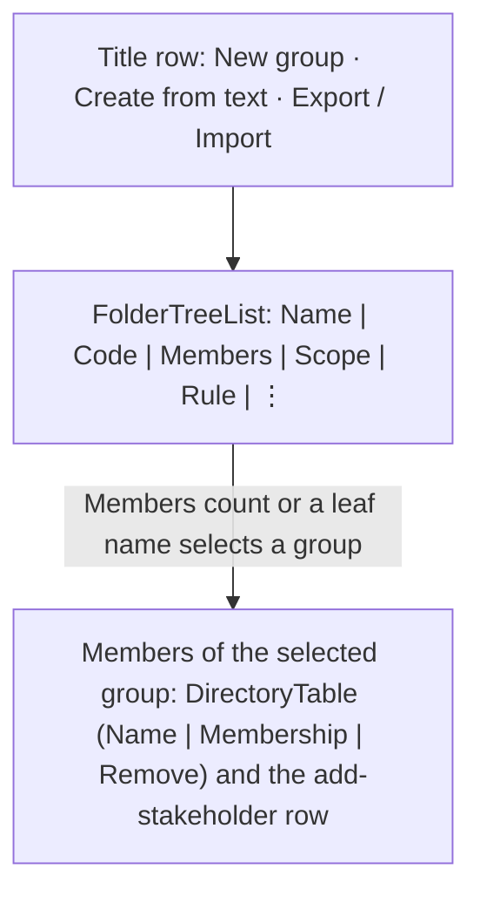

# Stakeholder Groups alignment register (phase 26)

Part of [the platform review plan](platform-review-2026-11-19-plan.md). Review of the Stakeholder Groups panel (`StakeholderGroupsPanel`, shared by Org Resources and the project page) against its siblings and the style guide's "Pattern: aligned rows and foldable blocks in a settings panel" and "Pattern: folder tree list". **Status:** signed off by the user, 2026-11-21 (**Decided by: User**): shared grid with the members below it, and a row actions menu.

## Findings (live page, 1400px wide)

| # | Element | Defect | Shared component it should be |
|---|---------|--------|-------------------------------|
| 1 | Group name | Each name is its own bordered button, sized to its text, so the code, count and badges that follow start at a different x on every row. | `FolderTreeList` Name column (one grid, rows are subgrids) |
| 2 | Code, member count, scope and rule | Loose inline spans after the name; no column heading says what the bare number is. | `FolderTreeList` columns Code, Members, Scope, Rule |
| 3 | Row actions | Five icon buttons per row (add under, edit, move up, move down, delete) at ragged positions. | `ActionMenu` in the grid's actions column, as the Structure page |
| 4 | Selected group | Bold text only, no row state. | Selected row outline (`folder-tree-selected`) on every row, parents included |
| 5 | Members | A bulleted list with a bare "Remove" button after each name and a "via a child group" suffix. | `DirectoryTable` with Name and Membership columns and an actions column |
| 6 | Tree | Hand-written `TreeView` rows with inline styles. | `FolderTreeList` (`TreeView` stays for the project tree and `TreeSelect`) |

The title row (New group, Create from Organisation / group text, Export and Import menu) already matches Personas and Stakeholders and is unchanged.

## Siblings checked for the same cause

| Panel | Result |
|-------|--------|
| Personas (`PersonaListView`) | Aligned: `DirectoryTable` with a filter panel. |
| Stakeholders (`StakeholderListView`) | The cause differs (a table, not a hand-built tree). Its code wrapped over three lines in the squeezed column; a code is now never broken (`white-space: nowrap`, in the shared record list's Code column, which also serves Personas and Needs). The table scrolls sideways inside its own region when its columns do not fit, which is the `DirectoryTable` behaviour. |
| Other Org Resources sections | Each is a list view or a record panel; none builds its own tree. |

## Expected result

