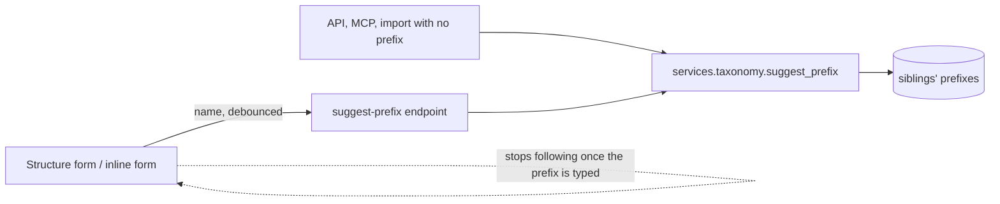

# Components and categories register (phase 22)

Part of [the platform review plan](platform-review-2026-11-19-plan.md). Every place a component or category is created, edited, ordered, deleted or chosen, with its control and what it becomes. **Status:** signed off by the user, 2026-11-21 (**Decided by: User**), with the answers below.

## Findings

| # | Finding | Consequence |
|---|---------|-------------|
| 1 | `ComponentCreate`, `ComponentUpdate`, `CategoryCreate` and `CategoryUpdate` take a required `prefix` with no validation; the column is `String(20)`, so a longer prefix is a database error (500), a blank prefix is stored. | The one prefix rule (trim, not blank, at most 20) moves to the schema; a blank or too long prefix is a 422. |
| 2 | Upper-casing is done three times (the Structure inputs, the create form inputs, the MCP tools), never on the server. | The suggestion is already upper-case; the typed value is upper-cased by the shared field, not by each caller. The server stays case-preserving (an API caller keeps its spelling). |
| 3 | A project import (`project_export.py`) and a template copy (`templates.py`) write the rows directly and carry the stored prefix. | No change: both carry an existing prefix and never need a suggestion. |
| 4 | `FolderTreeList` sorts every level by name, but components and categories have a manual order (`sort_order`, Move up and Move down). | One generic prop, `order="given"`, keeps the order of the nodes passed in. No component-specific code. |
| 5 | `TreeSelect` already has a `single` mode (one tick, closes on choice), so no new selector is needed. | The requirement forms use `PlacementPicker` in a single-choice, category-only mode (a component is a heading, the category is the choice). |
| 6 | The Requirements list filters by two flat selects (all categories listed whatever component is chosen) and passes `components={false}` to `TagFilterField`; the Reviews due page has one flat component select. | See "Chosen places". |

## Created, edited, ordered, deleted

| # | Where | Control today | Becomes |
|---|-------|---------------|---------|
| 1 | Project administration, Structure (`ProjectAdminPage.tsx`, about 190 lines) | A stack of inline name and prefix inputs per component and per category, a pencil that appears when a row is dirty, Up and Down buttons, a trash button, an always-drawn add form per component and one for a new component | `StructureTree` (new shared component over `FolderTreeList`), a `SidePanel` form (`StructureNodeForm`) for create and edit, Add component at the top, Add category on a component row. The inline block and its eleven state variables are removed from the page. |
| 2 | `RequirementCreateModal`, empty project | Inline name and prefix inputs for a first component and first category | The same `StructureNodeForm` fields with the same suggestion (a project manager creates the first ones inline, as today). |
| 3 | MCP `create_component`, `create_category`, `update_*` | `prefix` required | `prefix` optional on create (omitted: suggested by the server); update unchanged. Skill reference regenerated. |
| 4 | Project import | Carries the stored prefix | Unchanged (finding 3). |

## Chosen

| # | Where | Control today | Becomes |
|---|-------|---------------|---------|
| 5 | `RequirementCreateModal` | Two native-style selects (component, then category), the category list reset when the component changes | One `PlacementPicker` in single mode: components as headings, one category chosen, searchable. The "previous component's category is never valid" rule disappears because the pair is one choice. |
| 6 | `ChangeRequestCreateModal` (proposed requirement) | The same two selects | The same single-choice picker. |
| 7 | `RequirementDetailPage` | No select (the primary place is shown and changed through `RequirementPlaces`, which already uses `PlacementPicker`) | None. The plan listed selects here; there are none. |
| 8 | `RecordTags` (places), `ComponentField`, `RequirementAliasField`, `RequirementPlaces` | `PlacementPicker` | Unchanged. |
| 9 | `ComponentFilterField` on record lists | `TreeSelect` through `placementTree` | Unchanged. |
| 10 | Requirements list filter panel | Two flat `FilterSelect`s (`component`, `category` URL parameters) and `components={false}` | The shared `ComponentFilterField` (several places, `in_component` and `in_category`); old `component` and `category` links are moved onto them. |
| 11 | Reviews due page filter | One flat `FilterSelect` of components | Left as is: a one-level choice with no category parameter on its endpoint is what `FilterSelect` is for. The reason is recorded in `docs/decisions.md`. |
| 12 | Delivery tracks (`ComponentTracksList`, `ComponentTrackEditor`, `ComponentPhasesPanel`), architecture `AddElementsDialog` | They name a component but do not choose one from the tree (a row per component, or the shared tree filter) | Unchanged. |
| 13 | Export and import prefix columns | `component_prefix`, `category_prefix` in the project bundle and the requirements record table | Unchanged. |

## Prefix suggestion (rule)

`services.taxonomy.suggest_prefix(db, project, name, component=None)`:

1. Fold the name to ASCII (decompose accents, drop everything that is not a letter, digit or space).
2. Several words: the initial of each word. One word: its first letters. At most 6 characters (**Decided by: Agent**: short enough to read in a code, below the 20 character column).
3. A used prefix (siblings: the project's components, or the component's categories) gets the smallest digit suffix that is free (`SW`, `SW2`, `SW3`), cut so the whole prefix stays within the limit.
4. A name with no letter or digit returns an empty string, which leaves the field empty and required.

Endpoint: `GET /projects/{id}/components/suggest-prefix?name=` and `GET /projects/{id}/categories/suggest-prefix?name=&component_id=`. A create with no prefix uses the same function.

## Answers

1. A category **can** be moved to another component (**Decided by: User**, against the recommendation not to build it): Move to another component on its row, last among the target's categories, its requirements, aliases, placed records and proposed changes follow it; existing codes keep the old component prefix; refused when the target already has the prefix.
2. The Requirements list filter becomes the shared tree filter (**Decided by: User**, as recommended).
